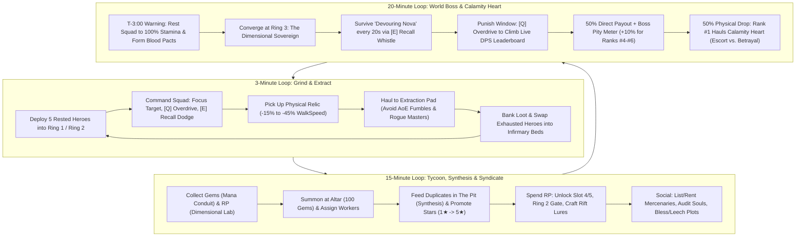
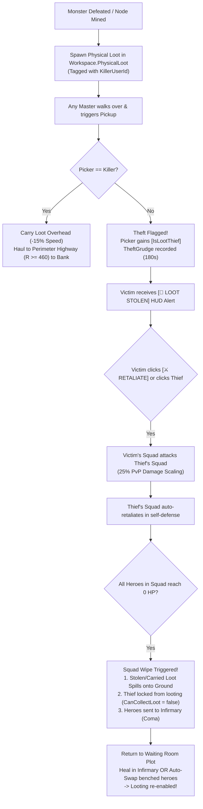

# DOCUMENT 1: COMPLETE GAME DESIGN DOCUMENT (GDD) — MVP (v0.1)
**Project Codename:** *Project: Waiting Room*  
**Target Platform:** Roblox (PC, Mobile, Tablet, Console)  
**Server Capacity:** 6 Players per Server  
**Engine Architecture:** Server-Authoritative Data Tables (5 Hz Heartbeat) + Client-Side R15 Visual Interpolation (60 FPS `RenderStepped`)

---

## 1. EXECUTIVE OVERVIEW & PLAYER FANTASY

### 1.1 High-Concept Pitch
**Project: Waiting Room** is a 6-player tactical squad-command Action-RPG, extraction sandbox, and social-deception Tycoon inspired by the dark survival manhwa *Pick Me Up, Infinite Gacha*. Players do not play as generic hack-and-slash warriors; instead, each player embodies a **Master**—a dimensional overseer who summons, trains, promotes, and commands a roster of sentient Gacha Heroes from a private fortress known as **The Waiting Room**.

### 1.2 The "Pick Me Up" Fantasy & Zero-Waste Roster Economy
In traditional gacha/simulator games, 95% of summons are discarded as worthless stat-sticks, and combat is reduced to passive AFK auto-clicking. **Project: Waiting Room** solves both problems through two foundational pillars:

1. **The Dual-Role Living Roster (Combat + Labor):**
   - Every hero pulled from the Summoning Altar rolls with **Combat Stats** (`HP`, `ATK`, `Range`), **Labor Output** (Tycoon productivity), and a **Passive Trait**.
   - **Up to 5 Deployed Heroes** accompany the Master into the central public combat rings, expending **Stamina** as they fight and risking a debilitating **60-second Coma** if left inside lethal AoE telegraphs.
   - **Benched Heroes** do not sit idle in an inventory menu—they physically inhabit the player's **Waiting Room** plot as visible workers powering the **Mana Conduit** (Gem generation), **The Infirmary & Barracks** (Stamina & Coma recovery), and **The Dimensional Lab** (Research Points & Rift Lures).
   - **Zero Dead Pulls:** Every duplicate 1★–3★ hero is immediately valuable as a specialized Tycoon worker, **Synthesis ("The Pit")** XP fodder, or a required sacrifice for **Star Promotion** (the exclusive pathway to 4★ and 5★ heroes in the MVP).

2. **Tactical Master Agency Over AFK Whaling:**
   - The Master carries no weapon. Instead, the Master uses tactical battlefield commands—**`[Click / Tap]` Focus Target**, **`[Q]` Overdrive Whistle**, and **`[E]` Emergency Recall Whistle**—while physically hauling heavy, high-value **Relics** back to their plot.
   - Because the World Boss's signature skill check (**Devouring Nova**) inflicts an instant 50% Stamina loss or a **60-second Coma** on heroes left inside the blast zone, an AFK pay-to-win player will have their squad wiped and sent to the Infirmary, dropping their DPS to zero. An active, mid-tier Master who times **`[E]` Emergency Recall Whistle** to dodge the blast and triggers **`[Q]` Overdrive Whistle** during punish windows will consistently out-damage and out-loot an AFK whale.

### 1.3 Hybrid Retention Matrix & Why Social Deception Drives 60+ Minute Sessions

| Reference Title | Adopted Core Mechanic | *Project: Waiting Room* Evolution |
| :--- | :--- | :--- |
| ***Pick Me Up, Infinite Gacha*** | Desperate squad survival, Synthesis pit, Star Promotion, living lobby workers | Heroes suffer Stamina drain and `Coma` if mismanaged; 4★/5★ heroes require hard promotion sacrifices. |
| ***Pet Simulator 99*** | 5-unit ring grinding, tactile loot explosions, exponential progression | Replaces passive pet hovering with Stamina-managed combat squads and active whistle commands. |
| ***Blox Fruits*** | Telegraphed boss skills, live DPS leaderboards, open-world bounty hunting | **Greed vs. Coma** boss checks and **Rogue Master** open-world PvP squad hunting in Rings 1 & 2. |
| ***Grow a Garden*** | Cozy-yet-competitive perimeter plots, passive production, neighbor visits | Visitors perform identical animations to either **Bless** (+25% output) or **Plant Leech Rune** (-20% stolen). |
| ***Steal an Egg*** | Physical object hauling, movement penalties, fumble & steal tension | High-tier **Relics** & the **Calamity Heart** weld overhead, slow WalkSpeed by up to -45%, and fumble on AoE hits. |

**Why the 6-Player Intimate Server Cap Maximizes Session Length:**
In a 6-player server, anonymity disappears. Every player knows who holds Rank #1 DPS, who just formed a **Blood Pact**, who rented out a suspiciously strong 3★ hero on the **Mercenary Board**, and who is lurking outside Ring 2 waiting to ambush a slowed Relic carrier. The constant interplay of cooperation, paranoia, betrayal, and immediate revenge loops keeps players locked into **"just one more World Boss cycle"** (20+ minute increments).

---

## 2. DETAILED CORE LOOPS



### 2.1 The 3-Minute Micro Loop (Grind, Command & Physical Extraction)
1. **Deploy & Enter (0:00 – 0:15):**
   - The Master selects up to 5 rested heroes (`Stamina == 100`) from their roster and steps off their private plot into **Ring 1 (Outer Ruins)** or **Ring 2 (Corrupted Grove)**.
2. **Tactical Grind & Stamina Expenditure (0:15 – 2:00):**
   - The Master uses **`[Click / Tap]` Focus Target** to direct all 5 deployed heroes onto Mana Crystal nodes, mob packs, or Ring 2 Elites.
   - To accelerate clears, the Master triggers **`[Q]` Overdrive Whistle** (`20s CD`), trading `5 Stamina` per hero for `+40% Attack Speed` for `5s`.
   - When a Ring 2 Elite telegraphs a red ground AoE, the Master triggers **`[E]` Emergency Recall Whistle** (`6s CD`), warping all 5 heroes to the Master's safe position and dropping their aggro for `2s`.
   - Common Gold drops fly directly into the Master's unbanked wallet.
3. **Physical Relic Haul (2:00 – 2:45):**
   - Defeating mobs/Elites spawns physical Relics on the ground (**Mana Geodes**, **Cursed Urns**, **Abyssal Cores**).
   - The Master touches the Relic to weld it overhead, incurring a **-15% to -45% WalkSpeed penalty** (and disabling jumping for Mythic tiers).
   - The Master escorts their own body back toward their plot while their squad defends them. If hit by an Elite/Boss AoE mid-haul, the Master is **stunned for 1s and fumbles the Relic** (which becomes stealable by any player after a **3s owner-lock**).
   - If the Master is in a **Blood Pact**, staying within `15 studs` of their Pact partner activates **Tandem Relic Carry** (halving the WalkSpeed penalty), forcing a split-second decision at the perimeter: step onto the **Shared Pact Pedestal** (75%/75% split + +10 Honor) or press **`[B] Shatter Pact`** and sprint onto their **Private Extraction Pad** (130% payout + Rogue Master brand).
4. **Extract & Rotate Roster (2:45 – 3:00):**
   - Stepping onto the Extraction Pad converts the Relic into banked Gems, Gold, and Research Points.
   - Depleted heroes (`Stamina < 25%`) are swapped into **Infirmary Recuperation Beds**, and fresh Benched Heroes are rotated into the active squad.

### 2.2 The 15-Minute Meso Loop (Tycoon Research, Synthesis & Mercenary Economy)
1. **Facility Harvesting & Upkeep (Every 3–5 Minutes):**
   - Collect accumulated Gems from the physical chest at the **Mana Conduit** and **Research Points (RP)** from **The Dimensional Lab**.
   - Inspect facilities for suspicious visitor activity; trigger **Purge Facility** within `15s` if a visitor planted a **Leech Rune**, or toggle **Mimic Chest Illusions** to bait thieves.
2. **Summoning & Roster Compression (Every 5–10 Minutes):**
   - Spend Gems (`100 Gems` per roll) at the **Summoning Altar** to pull 1★ (70%), 2★ (25%), and 3★ (5%) heroes.
   - Slot high-Labor rolls into the Mana Conduit, Infirmary, or Dimensional Lab.
   - Feed low-tier duplicates into **The Pit (Synthesis)** to level core heroes up to their Star Level Cap (`MaxLevel = Stars * 10`), then sacrifice max-level & same-star fodder plus Gold to execute **Star Promotions** (1★ $\rightarrow$ 5★).
3. **Tech Tree & Rift Lures (Every 10–15 Minutes):**
   - Spend RP in the **Dimensional Lab** to unlock the **4th and 5th Squad Deployment Slots**, permanently open the **Ring 2 Barrier Gate**, or craft repeatable **Rift Lures** to summon mid-tier Floor Bosses at Ring 3 between World Boss cycles.
4. **Mercenary Board & Espionage (Every 10–15 Minutes):**
   - List 1 powerhouse hero on the **Mercenary Noticeboard** for a 10-minute Gold rental, secretly assigning a **Loyal Contract**, **Parasite Siphon**, or **Saboteur** directive.
   - Rent a neighbor's Mercenary to push Ring 2 or a Rift Boss—and decide whether to pay `50 Gold` to **Audit Soul** if the hero exhibits the 45-second Parasite glance tell.

### 2.3 The 20-Minute Macro Loop (World Boss Prep, "Greed vs. Coma" & Calamity Heart)
1. **T-Minus 3:00 (Server Warning & Preparation Phase):**
   - A server-wide klaxon and banner announce that **The Dimensional Sovereign (World Boss)** will manifest at Ring 3 in `3:00`.
   - Masters retreat to their plots, place their top 5 combat heroes into the Infirmary to hit `100% Stamina`, negotiate **Blood Pacts** (+20% ATK, -25% Stamina drain, +25% Shared Boss Damage), and rent Mercenaries.
2. **T-Minus 0:00 to +5:00 (The Encounter — "Greed vs. Coma"):**
   - All active Masters converge on **Ring 3 (Center Boss Altar)**. Boss HP scales dynamically to the server's combined squad DPS.
   - Every `20 seconds`, the Sovereign channels **Devouring Nova** (`3s` red telegraph). Masters must actively reposition to the outer rim and press **`[E]` Emergency Recall Whistle** to yank their heroes out of the blast zone. Heroes left inside lose **50% Stamina instantly** or enter a **60-second Coma** (warped back to their plot's Infirmary, dropping their active DPS to zero).
   - Immediately after each Nova detonation, skilled Masters command **`[Click / Tap]` Focus Target** and pop **`[Q]` Overdrive Whistle** to surge up the live Damage Leaderboard.
3. **Post-Kill Climax (Direct Payout + The Calamity Heart Extraction):**
   - All Masters with $\ge 3\%$ damage contribution immediately receive the **50% Direct Payout** (Gems, Gold, RP, RNG roll for the Exclusive 3★ Boss Hero, plus **+10% Boss Pity Meter** for Ranks #4–#6).
   - The **50% Physical Drop (The Calamity Heart)** spawns on the Center Altar with a **15-second exclusive pickup lock for Rank #1 DPS**.
   - Rank #1 welds the Calamity Heart overhead (**-45% WalkSpeed**, jumping disabled) and must survive a 480-stud gauntlet back to their Extraction Pad while Pact partners consider betrayal, Saboteur Mercenaries trigger **2.5s Ankle Snares**, and rival Masters kite Ring 2 Elites into the carrier's path to force an AoE **Fumble**.

---

## 3. MAP & SPATIAL DESIGN SPECIFICATIONS

### 3.1 Global Footprint & Coordinate System
- **Total Map Size:** `1,200 x 1,200 studs` (`X: -600 to +600`, `Z: -600 to +600`).
- **World Origin `(0, 0, 0)`:** Exact center of **Ring 3 (Center Boss Altar)**.
- **Elevation Profile (Bowl-to-Pinnacle Sightlines):**
  - Perimeter Plots (`R = 480 to 600 studs`): Elevated at `Y = +12 studs` so Masters standing in their Waiting Room have an unbroken panoramic view down into Ring 1 and Ring 2, and across to the raised Center Boss Altar (`Y = +16 studs`) at `(0, 16, 0)`.

```
                        [N: (0, -600)]
                      +----------------+
                      |  PLOT 1 (0°)   |
                      +-------+--------+
           PLOT 6 (300°)      |       PLOT 2 (60°)
                 \     (Pact) | (Pact)     /
                   \   +------+------+   /
                     \ |   RING 1    | /
        (Pact) --------+ Outer Ruins +-------- (Pact)
                       |  +-------+  |
                       |  |RING 2 |  |
                       |  | +---+ |  |
                       |  | |R3 | |  |
                       |  | +---+ |  |
                       |  +-------+  |
                     / |             | \
                   /   +------+------+   \
                 /     (Pact) | (Pact)     \
           PLOT 5 (240°)      |       PLOT 3 (120°)
                      +-------+--------+
                      |  PLOT 4 (180°) |
                      +----------------+
                        [S: (0, +600)]
```

### 3.2 Concentric Zone Breakdown & Radii Table

| Zone Name | Radial Distance from `(0,0,0)` | Zone Width / Footprint | Access Requirement | Combat & PvP Rules | Primary Drops |
| :--- | :--- | :--- | :--- | :--- | :--- |
| **Ring 3: Center Boss Altar** | `0 – 120 studs` (Dia: `240`) | `120 studs` radius circular obsidian altar + 4 bridges (`24 studs` wide) | Ring 2 Gate Unlocked | World Boss (20m) & Rift Lure Floor Bosses. PvE AoE Fumbles active; Direct PvP disabled on Altar platform. | **Calamity Heart** (World Boss), **Abyssal Core** (Rift Boss) |
| **Ring 2: Corrupted Grove** | `120 – 280 studs` | `160 studs` annulus | **Dimensional Lab Research:** *Ring 2 Barrier Gate* | High-density Elites with red AoE telegraphs. **Open PvP against Rogue Masters.** | **Cursed Urns**, **Abyssal Cores**, High Gold |
| **Ring 2 Arcane Barrier Gate** | Exactly `R = 280 studs` | `20 studs` high translucent forcefield ring | Per-player collision group (`UnlockedRing2`) | Blocks movement for locked players & their squads; unlocked players pass seamlessly. | N/A |
| **Ring 1: Outer Ruins** | `280 – 460 studs` | `180 studs` annulus | Open from Tutorial (`0 RP`) | Safe low-level mobs & Mana Crystal nodes. **Open PvP against Rogue Masters.** | **Mana Geodes**, Starter Gold |
| **Perimeter Neutral Highway** | `460 – 480 studs` | `20 studs` paved ring road | Open to all players | **Safe Zone** (No mobs, Rogue PvP disabled). Houses the 6 **Shared Pact Pedestals**. | Bounty Bags (from Purged Leech Runes) |
| **Private "Waiting Room" Plots (x6)** | `480 – 600 studs` | `140 studs` (chord width) $\times$ `120 studs` (radial depth) per plot | Owner + Visitors (No Hostile Squads) | Safe Zone. Visitors can inspect, rent Mercenaries, or Bless/Leech facilities. | Passive **Gems** (Mana Conduit) & **RP** (Lab) |

### 3.3 Private Plot Orientation & Internal Layout (`140 x 120 studs`)
The 6 Private Plots are positioned radially every `60°` (`0°, 60°, 120°, 180°, 240°, 300°`) with their front gates at `R = 480 studs` and rear walls at `R = 600 studs`. Every plot is rotated so its local `-Z` forward vector points directly at `(0, 0, 0)`.

- **Front Threshold (`R = 482 – 500 studs`):**
  - **Private Extraction Pad (`Local X: -35, R: 490`, `16 x 16 studs`):** Glowing cyan runic platform. Stepping here while carrying a Relic immediately extracts 100% of its value (or 130% if the Master just pressed `[B] Shatter Pact`).
  - **Mercenary Noticeboard & Plot Security Terminal (`Local X: +35, R: 490`):** Interactive board where visitors can rent the plot owner's listed Mercenary, and where the owner can toggle **Mimic Chest Illusions** or trigger **Purge Facility**.
- **Central Courtyard (`R = 505 – 560 studs`):**
  - **Summoning Altar & The Pit (`Local X: 0, R: 530`):** Centerpiece obelisk for 100-Gem Gacha pulls and the fiery Synthesis/Promotion cauldron.
  - **Facility 1 — Mana Conduit (`Local X: -45, R: 535`):** 3 worker pedestals + physical **Gem Chest** (supports Mimic Illusion states).
  - **Facility 2 — The Infirmary & Barracks (`Local X: +45, R: 535`):** Recuperation Beds where exhausted or `Coma`-afflicted heroes physically lie down while Healer workers channel recovery beams.
- **Rear Sanctuary (`R = 565 – 595 studs`):**
  - **Facility 3 — The Dimensional Lab (`Local X: 0, R: 580`):** Arcane research terminal where Scholar workers generate **Research Points (RP)** and where the Master crafts **Rift Lures**.

### 3.4 Shared Pact Pedestal Placement & The Betrayal Fork
Six **Shared Pact Pedestals** (`14 x 14 studs` crimson-and-gold altars) are positioned on the Perimeter Neutral Highway at `R = 472 studs` at the exact angular midpoints between adjacent plots (`30°, 90°, 150°, 210°, 270°, 330°`).
- **Spatial Psychology (The Fork in the Road):** The angular distance from a plot's front gate (`R = 480`) to the nearest **Shared Pact Pedestal** (`R = 472`, `±30°` offset) is `~125 studs`. As two Blood Pact partners exit Ring 1 hauling a Relic in **Tandem Carry** (`≤ 15 studs` apart), they must physically choose at `R = 460 studs` whether to veer toward the Shared Pact Pedestal between their plots OR whether the carrier hits **`[B] Shatter Pact`** and bolts straight forward onto their **Private Extraction Pad** just `30 studs` ahead.

---

## 4. HERO & COMBAT MECHANICS (MATHEMATICAL SPECIFICATIONS)

### 4.1 Gacha Banner & Base Archetypes
- **Summon Cost:** `100 Gems` per single pull (`900 Gems` for 10x pull).
- **Drop Rates (MVP Banner):**
  - **1★ Common:** `70.0%` (Max Level 10)
  - **2★ Rare:** `25.0%` (Max Level 20)
  - **3★ Epic:** `5.0%` (Max Level 30)
  - **4★ Legendary & 5★ Mythic:** `0.0%` on Banner — **Exclusively obtained via Star Promotion**.

#### Base Stat Ranges by Role Archetype (At 1★, Level 1)
Every summoned hero rolls a `QualityScalar` $q \in [0.90, 1.15]$ applied to their archetype base stats:

| Archetype | Base HP ($HP_0$) | Base ATK ($ATK_0$) | Attack Interval ($t_{\text{atk}}$) | Attack Range | Base Labor ($L_0$) | Preferred Facility (+25% Synergy) |
| :--- | :--- | :--- | :--- | :--- | :--- | :--- |
| **Vanguard** (Tank) | `450` | `22` | `1.20s` | `6 studs` | `10 / min` | Mana Conduit |
| **Striker** (Melee DPS) | `280` | `38` | `0.85s` | `6 studs` | `12 / min` | Mana Conduit |
| **Marksman** (Ranged DPS) | `210` | `34` | `0.95s` | `28 studs` | `12 / min` | Dimensional Lab |
| **Miner** (Gem Specialist) | `300` | `20` | `1.10s` | `6 studs` | `20 / min` | **Mana Conduit** |
| **Healer** (Infirmary Spec.) | `260` | `18` | `1.25s` | `24 studs` | `18 / min` | **The Infirmary & Barracks** |
| **Scholar** (Lab Specialist) | `220` | `24` | `1.15s` | `26 studs` | `18 / min` | **The Dimensional Lab** |

### 4.2 Level Cap, Star Promotion Multipliers & Effective Stat Formulas
- **Level Cap Formula:**
  $$\text{MaxLevel}(S) = S \times 10$$
  where $S \in \{1, 2, 3, 4, 5\}$ is the hero's current Star tier (`1★ = Lv.10`, `2★ = Lv.20`, `3★ = Lv.30`, `4★ = Lv.40`, `5★ = Lv.50`).

- **Star Promotion Multipliers:**
  Promoting a hero from $S \to S+1$ resets their Level to `1`, increases `MaxLevel` by `+10`, multiplies Base Combat stats by **`1.65x`**, and multiplies Base Labor output by **`1.35x`**. Across Star tier $S$:
  $$M_{\text{Combat}}(S) = 1.65^{(S - 1)}, \quad M_{\text{Labor}}(S) = 1.35^{(S - 1)}$$

- **Effective Combat & Labor Formulas (at Star $S$ and Level $L$):**
  Each level above 1 grants **+8% Combat Stats** and **+5% Labor Output** relative to the hero's Star-promoted base:
  $$\text{EffectiveATK}(S, L) = \text{round}\Big(ATK_0 \times q \times 1.65^{(S - 1)} \times \big(1 + 0.08(L - 1)\big) \times (1 + B_{\text{TraitATK}}) \times (1 + B_{\text{Pact}})\Big)$$
  $$\text{EffectiveHP}(S, L) = \text{round}\Big(HP_0 \times q \times 1.65^{(S - 1)} \times \big(1 + 0.08(L - 1)\big) \times (1 + B_{\text{TraitHP}})\Big)$$
  $$\text{EffectiveLabor}(S, L) = L_0 \times q \times 1.35^{(S - 1)} \times \big(1 + 0.05(L - 1)\big) \times (1 + B_{\text{Synergy}}) \times (1 + B_{\text{TraitLabor}})$$
  *Where:*
  - $B_{\text{Pact}} = 0.20$ (`+20%` Squad ATK when in an active Blood Pact, `0.0` otherwise).
  - $B_{\text{Synergy}} = 0.25$ (`+25%` Labor when assigned to their Preferred Facility, `0.0` otherwise).

- **Hero Single-Target DPS Formula:**
  $$\text{HeroDPS} = \frac{\text{EffectiveATK}(S, L)}{t_{\text{atk}}} \times M_{\text{Overdrive}} \times M_{\text{Exhaustion}}$$
  *Where:*
  - $M_{\text{Overdrive}} = 1.40$ during **`[Q]` Overdrive Whistle** (`1.00` otherwise).
  - $M_{\text{Exhaustion}} = 0.20$ if `Stamina == 0` (`1.00` if `Stamina > 0`; `0.00` if in `Coma`).

### 4.3 Waiting Room Facility Output Formulas
Each of the 3 Waiting Room facilities upgrades from **Facility Level 1 to Level 10** ($F \in [1, 10]$) and holds up to **3 Worker Slots** (1 slot at Lv.1, 2 slots at Lv.4, 3 slots at Lv.7). Let $\sum \text{EffectiveLabor}$ be the sum of `EffectiveLabor` of all workers currently assigned to that facility:

1. **Mana Conduit (Gems / Minute):**
   $$\text{GemsPerMin} = \Big(5 \times F + 0.45 \times \sum \text{EffectiveLabor}\Big) \times \big(1 + 0.12(F - 1)\big) \times M_{\text{BlessOrLeech}}$$
   *(Where $M_{\text{BlessOrLeech}} = 1.25$ if Blessed, $0.80$ if Leeched by an enemy rune).*

2. **The Dimensional Lab (Research Points / Minute):**
   $$\text{RPPerMin} = \Big(3 \times F + 0.35 \times \sum \text{EffectiveLabor}\Big) \times \big(1 + 0.10(F - 1)\big) \times M_{\text{BlessOrLeech}}$$

3. **The Infirmary & Barracks (Stamina Regen & Coma Reduction):**
   - **Stamina Recovery Rate (for resting heroes):**
     $$\text{StaminaRegenPerSec} = 2.5 + (0.4 \times F) + \left(0.06 \times \sum \text{EffectiveLabor}\right)$$
     *(At Lv.1 with no workers, a 0-Stamina hero takes `40s` to hit 100 Stamina; with 3 Healer workers, recovery drops to `~10–14s`).*
   - **Coma Duration Reduction:**
     $$\text{EffectiveComaDuration} = \max\left(20\text{s}, \frac{60\text{s}}{1 + 0.05(F - 1) + 0.008 \sum \text{EffectiveLabor}}\right)$$
     *(Note: A 5-minute `Audit Soul` Coma is a hard penalty and cannot be reduced below `180s` by Infirmary workers).*

### 4.4 Stamina Drain, Whistle Commands & Coma Triggers

| Parameter / Mechanic | Exact Value / Formula | Gameplay Behavior |
| :--- | :--- | :--- |
| **Max Stamina** | `100.0` | Displayed as a yellow bar beneath each deployed hero's HP bar. |
| **Combat Stamina Drain** | Ring 1: `0.80 / sec`<br>Ring 2: `1.20 / sec`<br>Ring 3: `1.50 / sec` | Drains only while the hero is actively in combat (`State == Attacking`). Multiplied by **`0.75x` (-25%)** during an active **Blood Pact**. |
| **`[Click / Tap]` Focus Target** | `0s CD`, `0 Stamina` | Commands all 5 deployed heroes to immediately switch aggro to the clicked mob, Elite, Boss, or Rogue Master hero. |
| **`[Q]` Overdrive Whistle** | `20.0s CD`, `-5.0 Stamina` / hero | Grants all deployed heroes with `Stamina >= 5` **+40% Attack Speed** and **+20% Move Speed** for `5.0s`. |
| **`[E]` Emergency Recall Whistle** | `6.0s CD`, `0 Stamina` | Instantly teleports/pulls all 5 deployed heroes to a `4-stud` ring around the Master and **disables hero aggro for `2.0s`** so they do not run back into AoEs. |
| **Exhausted State** | Triggered at `Stamina == 0` | Hero deals `20%` damage and moves at `50%` speed. Vulnerable to instant `Coma` if hit by any Elite/Boss AoE. |
| **60-Second Coma State** | 1. Hero `HP` reaches `0` in combat.<br>2. Hit by **Devouring Nova** with `< 50` Stamina (or failing Nova check). | Hero is **immediately recalled** to the Master's **Infirmary & Barracks**, removed from the deployed squad, and locked in `Coma` for `60s` base duration (`0 DPS`). |

### 4.5 Synthesis ("The Pit") XP & Leveling Curve
Feeding an unwanted duplicate hero (`FodderStars`, `FodderLevel`) into a target hero grants XP according to the exact Project Bible formula:
$$\text{XP\_Gained} = \left(100 \times 3^{(\text{FodderStars} - 1)}\right) + (25 \times \text{FodderLevel})$$

#### Synthesis Fodder XP Payout Table
| Fodder Star Tier | Base Term: $100 \times 3^{(S-1)}$ | Level Term (Lv. 1) | Total XP (at Lv. 1) | Total XP (at Max Level $10S$) |
| :--- | :--- | :--- | :--- | :--- |
| **1★ Fodder** | `100` | `+25` | **`125 XP`** | **`350 XP`** (at Lv.10) |
| **2★ Fodder** | `300` | `+25` | **`325 XP`** | **`800 XP`** (at Lv.20) |
| **3★ Fodder** | `900` | `+25` | **`925 XP`** | **`1,650 XP`** (at Lv.30) |
| **4★ Fodder** | `2,700` | `+25` | **`2,725 XP`** | **`3,700 XP`** (at Lv.40) |

#### Target Hero XP Required Per Level ($L \to L+1$)
$$\text{XP\_Req}(L) = \text{round}\left(50 \times L^{1.45}\right)$$
- **Lv.1 $\rightarrow$ Lv.10 (1★ Cap):** `4,450 Cumulative XP` (~36 Lv.1 1★ fodders)
- **Lv.1 $\rightarrow$ Lv.20 (2★ Cap):** `21,800 Cumulative XP`
- **Lv.1 $\rightarrow$ Lv.30 (3★ Cap):** `56,900 Cumulative XP`
- **Lv.1 $\rightarrow$ Lv.40 (4★ Cap):** `114,200 Cumulative XP`
- **Lv.1 $\rightarrow$ Lv.50 (5★ Cap):** `197,500 Cumulative XP`

### 4.6 Star Promotion Cost & Multiplier Table (1★ to 5★)
To promote a target hero of Star tier $S$ to $S+1$:
1. The target hero must be at **Max Level** ($L = 10 \times S$).
2. The player must sacrifice **$S$ fodder heroes of the exact same Star tier $S$** (fodder heroes can be at any level, Lv.1+).
3. The player must pay the **Gold Promotion Fee**.
4. Upon promotion, the hero's Star becomes $S+1$, Level resets to `1`, `MaxLevel` increases by `+10`, Base Combat stats multiply by **`1.65x`**, and Base Labor multiplies by **`1.35x`**.

| Promotion Tier | Target Hero Req. | Fodder Sacrifice Required | Gold Cost | Post-Promotion Cap | Cumulative Combat Mult ($1.65^{S-1}$) | Cumulative Labor Mult ($1.35^{S-1}$) |
| :--- | :--- | :--- | :--- | :--- | :--- | :--- |
| **1★ (Base)** | Summoned | None | `0 Gold` | `Lv. 10` | `1.00x` | `1.00x` |
| **1★ $\rightarrow$ 2★** | `1★ at Lv. 10` | **`1x` 1★ Hero** | `1,500 Gold` | `Lv. 20` | **`1.65x`** | **`1.35x`** |
| **2★ $\rightarrow$ 3★** | `2★ at Lv. 20` | **`2x` 2★ Heroes** | `7,500 Gold` | `Lv. 30` | **`2.72x`** (`2.7225x`) | **`1.82x`** (`1.8225x`) |
| **3★ $\rightarrow$ 4★** | `3★ at Lv. 30` | **`3x` 3★ Heroes** | `35,000 Gold` | `Lv. 40` | **`4.49x`** (`4.4921x`) | **`2.46x`** (`2.4604x`) |
| **4★ $\rightarrow$ 5★** | `4★ at Lv. 40` | **`4x` 4★ Heroes** | `150,000 Gold` | `Lv. 50` | **`7.41x`** (`7.4120x`) | **`3.32x`** (`3.3215x`) |

### 4.7 Physical Relic Specifications (*Steal an Egg* Extraction Table)

| Relic Name | Rarity & Source | WalkSpeed Penalty | Jump Allowed? | Despawn Timer | Initial Owner-Lock | Fumble Behavior (Hit by Elite/Boss AoE) | Base Extraction Payout (100%) |
| :--- | :--- | :--- | :--- | :--- | :--- | :--- | :--- |
| **Mana Geode** | **Common** (Ring 1 Mobs / Crystal Nodes) | **`-15%`** (`16.0` $\rightarrow$ `13.6`) | Yes | `90s` | `3.0s` | `1.0s` Stun + Drop (`3.0s` Owner-Lock) | `40 Gems`, `250 Gold`, `10 RP` |
| **Cursed Urn** | **Rare** (Ring 2 Elites) | **`-25%`** (`16.0` $\rightarrow$ `12.0`) | Yes | `120s` | `3.0s` | `1.0s` Stun + Drop (`3.0s` Owner-Lock)<br>*Triggers Saboteur Ankle Snare!* | `150 Gems`, `1,200 Gold`, `45 RP` |
| **Abyssal Core** | **Mythic** (Ring 2 Rare Elites & Rift Lure Bosses) | **`-35%`** (`16.0` $\rightarrow$ `10.4`) | **No (Disabled)** | `150s` | `5.0s` | `1.0s` Stun + Drop (`3.0s` Owner-Lock)<br>*Triggers Saboteur Ankle Snare!* | `450 Gems`, `4,000 Gold`, `150 RP` |
| **The Calamity Heart** | **World Boss Exclusive** (Ring 3 Dimensional Sovereign) | **`-45%`** (`16.0` $\rightarrow$ `8.8`) | **No (Disabled)** | `180s` | **`15.0s` (Rank #1 DPS Only)** | `1.0s` Stun + Drop (`3.0s` Owner-Lock)<br>*Triggers Saboteur Ankle Snare!* | `1,500 Gems`, `15,000 Gold`, `500 RP`, `+25% Boss Hero Roll` |

---

## 5. WORLD BOSS ENCOUNTER DESIGN ("THE DIMENSIONAL SOVEREIGN")

### 5.1 Spawn Schedule & Dynamic HP Scaling
- **Spawn Cadence:** Every **20 minutes** (`1,200s`) at **Ring 3 (Center Boss Altar, `(0, 16, 0)`)**.
- **Pre-Spawn Warning:** At `T - 3:00` (`17:00` elapsed), the skybox shifts to violet-crimson and a server-wide banner displays: *"THE DIMENSIONAL SOVEREIGN AWAKENS IN 03:00 — PREPARE YOUR SQUADS IN THE INFIRMARY."*
- **Encounter Duration:** Hard **5-minute (`300s`) Despawn Timer**. If not defeated within `300s`, the Sovereign tears open a dimensional rift and vanishes with no loot payout.
- **Dynamic Server HP Scaling Formula:**
  At `T = 0:00`, the server snapshots the top 5 highest-DPS heroes of each active player $p \in \{1..N_{\text{players}}\}$ who has unlocked Ring 2 (minimum 1 player baseline):
  $$\text{BossMaxHP} = \max\left(75,000,\ \text{round}\left(\sum_{p=1}^{N} \text{Top5SquadDPS}_p \times 165 \times N^{-0.15}\right)\right)$$
  *Design Intent:* A server where players actively dodge **Devouring Nova** and use **`[Q]` Overdrive** will defeat the boss in `~150–190 seconds`. A server where whales go AFK and suffer **60-second Comas** will either fail the 300s timer or watch active F2P players overtake them on the live DPS leaderboard.

### 5.2 Phase Breakdown (`100%–50%`, `50%–25%`, `<25% Enrage`)

| Phase | HP Threshold | Boss Mechanics & Telegraphs | Tactical Master Response |
| :--- | :--- | :--- | :--- |
| **Phase 1: Rift Awakening** | `100% – 50% HP` | • **Sovereign Cleave (Every 4.0s):** Frontal `120°` cone (`22 studs` radius) targeting highest-HP Vanguard.<br>• **Void Shatter (Every 10.0s):** Three `12-stud` wide linear red telegraphs (`1.5s` cast) radiating from `(0,0,0)` toward random Masters.<br>• **Devouring Nova (Every 20.0s):** Signature anti-AFK skill check (see Section 5.3). | Keep Master avatar at mid-range (`R = 50–90 studs`), sidestep *Void Shatter* lines, and prepare **`[E]` Recall Whistle** every 20 seconds. |
| **Phase 2: Dimensional Instability** | `50% – 25% HP` | • **Rift Tether Crystals (At 50% & 35% HP):** Spawns 2 crystal pylons at opposite edges of Ring 3 (`R = 100 studs`). Grants Boss **40% Damage Reduction** until both crystals are destroyed.<br>• **Gravity Well + Devouring Nova (Every 20.0s):** `1.0s` before casting *Devouring Nova*, the Boss pulls all deployed heroes inward to `R = 15 studs`. | Immediately **`[Click / Tap]` Focus Target** the 2 Rift Tether Crystals to strip the boss shield. Hold **`[E]` Recall Whistle** until *after* the Gravity Well pull completes during the Nova telegraph. |
| **Phase 3: Sovereign's Collapse (Enrage)** | `< 25% HP` | • **Frenzied Tempo:** Boss Attack Speed `+35%`.<br>• **Abyssal Fissures:** Rotating hazard beams sweep across Ring 3 (`18°/sec`), stunning hit Masters for `1.0s`.<br>• **Corrupted Rim Nova (Every 20.0s):** *Devouring Nova* also spawns secondary `10-stud` void puddles in the outer rim (`R = 85–120 studs`), leaving safe pockets between puddles. | Master must physically stand inside a clean gap in the outer rim (`R = 90–115 studs`) without getting clipped by rotating *Abyssal Fissures* before pressing **`[E]` Recall Whistle**. |

### 5.3 Fix A — The "Greed vs. Coma" Skill Check (*Devouring Nova*)

```
                 RING 3: CENTER BOSS ALTAR (Radius = 120 studs)
                 
                        ..-""""""-..   <-- Outer Edge (R = 120 studs)
                     .-"  SAFE RIM  "-.
                    /   ..-""""""-..   \  <-- Blast Boundary (R = 85 studs)
                   |  ."            ".  |
                   | /   DEVOURING    \ |
                   | |     NOVA       | |
                   | |   (0 - 85st)   | |
                   | \   [3.0s Cast]  / |
                    \  ".          ."  /
                     "-.. "-....-" ..-"   <-- Master stands here (R = 95 studs)
                        ""-......-""          & presses [E] at t = 1.2s - 2.8s!
```

1. **Exact Timing & Spatial Parameters:**
   - **Cooldown / Cadence:** Strictly every **`20.0 seconds`** (`20s, 40s, 60s, 80s...` into the fight).
   - **Telegraph Duration:** **`3.0 seconds`** (`t = 0.0s` to `t = 3.0s`). Expanding crimson ground decal + rising sub-bass audio cue.
   - **Blast Radius:** **`0 to 85 studs`** from `(0, 16, 0)`. The outer ring from **`R = 85 to 120 studs` (`35 studs` wide)** is the **Safe Rim**.
2. **Detonation Penalty (`t = 3.0s`) — Why AFK Whales Lose:**
   - At `t = 3.0s`, the server checks the 2D distance of every deployed hero on Ring 3 from `(0, 0)`.
   - Any hero inside **`Distance <= 85 studs`** is struck by *Devouring Nova*:
     - **If Hero `CurrentStamina > 50` and `Phase == 1`:** The hero loses **50% of Max Stamina (`-50 Stamina`) instantly** and takes `40% MaxHP` damage.
     - **If Hero `CurrentStamina <= 50` OR `Phase >= 2` OR hit by two consecutive Novas:** The hero is knocked into an immediate **60-second Coma**, despawned from the arena, and warped into a Recuperation Bed in the player's **Infirmary & Barracks**. Their active DPS drops to **`0`**.
3. **The `[E]` Emergency Recall Whistle Counterplay Window:**
   - Because **`[E]` Emergency Recall Whistle** has a `6.0s` cooldown and disables hero aggro for **`2.0s`**, the timing window is razor-sharp:
     - **Too Early (`t = 0.0s – 0.9s`):** If the Master presses `[E]` at `t = 0.5s`, the `2.0s` aggro-disable expires at `t = 2.5s`, and melee heroes will charge back inside `R <= 85 studs` right before detonation at `t = 3.0s`!
     - **Optimal Skill Window (`t = 1.1s – 2.8s`):** The Master stands in the Safe Rim (`R = 90–115 studs`) and presses **`[E]`** between `1.1s` and `2.8s` into the telegraph. All 5 heroes instantly warp to the Master in the Safe Rim and remain passive until detonation completes at `t = 3.0s`.
4. **The Post-Nova Punish Window (`t = 3.0s – 8.0s`):**
   - For **`5.0 seconds`** after detonating *Devouring Nova*, the Sovereign's chest core cracks open, increasing all damage taken by **`+25%`**.
   - At `t = 3.1s`, skilled Masters immediately click the Boss (**`[Click / Tap]` Focus Target**) to override the remaining pacify timer and press **`[Q]` Overdrive Whistle** (`+40% Attack Speed` for `5.0s`), achieving a **1.75x effective DPS burst window** while careless/AFK players are watching their comatose squads recover back at base.

### 5.4 World Boss Loot Split (50% Direct + 50% Physical) & Boss Pity Meter
- **Qualification Requirement:** A player must deal at least **3.0% of the Boss's Total HP** (including the **+25% Shared Damage Score** bonus from an active Blood Pact partner) to qualify for rewards.

#### Part A: 50% Direct Payout Table (Instant Deposit on Boss Death)
| Damage Rank | Direct Gems | Direct Gold | Direct RP | Exclusive 3★ Boss Hero (*"Dimensional Archon"*) RNG | Boss Pity Meter Gain |
| :--- | :--- | :--- | :--- | :--- | :--- |
| **Rank #1 DPS** | `1,000 Gems` | `10,000 Gold` | `350 RP` | **`15.0%` Drop Chance** | `+0%` *(Receives 15s Calamity Heart Lock)* |
| **Rank #2 DPS** | `750 Gems` | `7,500 Gold` | `260 RP` | **`10.0%` Drop Chance** | `+5% Pity` |
| **Rank #3 DPS** | `550 Gems` | `5,500 Gold` | `190 RP` | **`7.0%` Drop Chance** | `+5% Pity` |
| **Rank #4 DPS** | `400 Gems` | `4,000 Gold` | `140 RP` | **`4.0%` Drop Chance** | **`+10% Pity`** |
| **Rank #5 DPS** | `300 Gems` | `3,000 Gold` | `100 RP` | **`2.5%` Drop Chance** | **`+10% Pity`** |
| **Rank #6 DPS** | `250 Gems` | `2,500 Gold` | `80 RP` | **`1.5%` Drop Chance** | **`+10% Pity`** |

- **The Boss Pity Meter Rules:**
  - Stored persistently in the player's profile (`Profile.Data.BossPity`, range `0% – 100%`).
  - Ranks #4–#6 (casual/developing players who meet the 3% participation threshold) are guaranteed **`+10% Pity`** per World Boss kill.
  - If a player rolls the **Exclusive 3★ Boss Hero** naturally via RNG, or when `BossPity` reaches **`100%`** (at most 10 Boss clears for Ranks #4–#6), the Exclusive 3★ Boss Hero is automatically awarded and `BossPity` resets to `0%`.

#### Part B: 50% Physical Drop — The Calamity Heart
- Spawns physically at `(0, 16, 0)` immediately upon Boss death.
- **15-Second Rank #1 Exclusive Lock:** For the first `15.0s`, only the **Rank #1 DPS Master** can pick up the Calamity Heart. After `15.0s` (if Rank #1 hasn't picked it up), any player can grab it.
- **Extraction Gauntlet (`480 studs` from `(0,0,0)` to Perimeter Plot):**
  - Picking up the Calamity Heart applies a **`-45%` WalkSpeed slow** (`16.0` $\rightarrow$ `8.8 studs/sec`) and **disables jumping**.
  - Unassisted travel time across `480 studs` at `8.8 studs/sec` is **`54.5 seconds`** (or **`39.2 seconds`** at `12.24 studs/sec` if maintaining **Tandem Relic Carry** within `15 studs` of a Blood Pact partner).
  - Rival Masters cannot directly damage a non-Rogue carrier's squad, **BUT** they can:
    1. Trigger a rented **Saboteur Mercenary's 2.5s Ankle Snare** when the carrier grabs the Heart.
    2. Bait Ring 2 Elites into casting red AoE attacks along the Ring 2 bridge/exit choke points so the AoE clips the slowed carrier, causing a **1.0s Stun + Fumble** (after which the Heart has only a **3.0s owner-lock** before anyone can steal it!).
    3. Betray their Pact partner at the perimeter via **`[B] Shatter Pact`**.

---

## 6. SOCIAL ENGINEERING RULESET ("THE MASTER'S SYNDICATE")

### 6.1 Contested Loot Drops, Theft Aggro & Targeted Retaliation PvP

Emergent extraction gameplay and open-world tension are governed by physical loot ownership and targeted squad retaliation:



#### Core Rules & Math
1. **Universal Physical Loot Drops (No Direct Payouts):**
   - Monsters and resource nodes do not deposit rewards directly into player wallets.
   - Rewards spawn as physical 3D mesh assets in `Workspace.PhysicalLoot` (`prop_bounty_bag` for Gold, `prop_rift_tether_crystal` for Gems, and official Relic meshes for Relics).
   - Drops are tagged with `KillerUserId`, `KillerName`, and `SpawnTime`. Any player in the arena can pick them up.
2. **Physical Overhead Hauling & Holding Animation:**
   - Picking up loot welds it directly overhead via `WeldConstraint`, incurs a `-15%` WalkSpeed cargo penalty, and triggers an upper-arm holding pose via `HoldingAnimationController.client.luau`.
3. **Theft Detection & Retaliation:**
   - If Master B collects loot where `PickerUserId ~= KillerUserId`, Master B is flagged with `IsLootThief = true` and a 3-minute retaliation grudge (`TheftGrudges[VictimUserId][ThiefUserId]`) is created.
   - Master A receives an instant HUD alert with a `[⚔️ RETALIATE]` button.
   - Clicking `[⚔️ RETALIATE]` or clicking Master B commands Master A's deployed squad to engage Master B's squad at `25%` PvP damage scaling.
   - Master B's squad automatically retaliates in self-defense. Defeated heroes enter `COMA` in the Infirmary.
4. **Squad Wipe, Spilled Loot & Waiting Room Recovery Gate:**
   - If all deployed heroes belonging to a Master reach 0 HP (`COMA`), all carried loot spills onto the ground at their feet as open loot (`KillerUserId = 0`).
   - The defeated Master's looting is locked (`CanCollectLoot = false`).
   - To restore looting, the Master must return to their Waiting Room Plot to heal fallen heroes in the Infirmary or rotate in fresh benched heroes via Auto-Swap.
5. **Perimeter Banking:**
   - Stepping onto the Perimeter Highway (`R >= 460 studs`) or into a Waiting Room Plot safely banks unbanked carried loot into permanent vault currency, removes cargo welds, and restores normal movement speed.

---
### 6.3 Waiting Room Espionage & Mimic Bluffing
Visitors can walk onto any neighbor's private plot and hold `[E]` (`2.0s` channel) on any of the 3 facilities (**Mana Conduit**, **Infirmary**, **Dimensional Lab**) to perform one of two actions:

1. **Bless Facility (Cooperative):**
   - Grants the facility **`+25%` output for `3 minutes (180s)`**.
   - Instantly rewards the Visitor **`+25 Gems`** and **`+5 Honor`**.
2. **Plant Leech Rune (Espionage):**
   - Secretly steals **`20%` of the facility's output for `3 minutes (180s)`**, routing it directly to the Visitor.
   - **Deception:** Both **Bless Facility** and **Plant Leech Rune** play the **exact same 2.0-second kneeling prayer animation** and leave an identical faint runic ring on the facility floor for the first `15.0 seconds`.

#### Counterplay: Purge Facility (`15.0s` Window) & Mimic Chest Illusions
- **The 15-Second Purge Dilemma:**
  - When a Visitor finishes kneeling at a facility, the Plot Owner receives a HUD alert: *"[PlayerName] channeled a rune on your Mana Conduit! (15s to Purge)"*.
  - If the Owner activates **Purge Facility** (`0 Cost`, `30s CD`) within **`15.0s`**:
    - **If it was a Leech Rune:** The Leech Rune shatters, the Visitor is **stunned for `3.0s`** (wherever they are on the map), loses **`-10 Honor`**, and drops a physical **Bounty Bag** (`50 Gems` + `500 Gold` from the thief's wallet, or `25 Gems` base if the thief is broke) at the Plot Owner's feet.
    - **If it was a Blessing:** The Owner **accidentally destroys their own `+25%` Blessing buff**! The Visitor keeps their `25 Gems`, and a server-wide toast laughs at the paranoid Owner.
- **Mimic Chest Illusions (Plot Security Terminal Toggle):**
  - Owners can toggle their Mana Conduit Gem Chest between 3 visual states (`30s` cooldown):
    1. **True State:** Visual fill matches actual uncollected Gems.
    2. **Fool's Gold (Empty Looks Overflowing):** Makes an empty chest (`< 20 Gems`) overflow with fake sparkling Gems and emit a fake "High Yield" aura. If a Visitor plants a **Leech Rune** while *Fool's Gold* is active, the Mimic Chest snaps shut on the Visitor—automatically triggering a free **Purge Stun (`3.0s`)** and forcing them to drop a **Bounty Bag**!
    3. **Veil of Poverty (Full Looks Empty):** Makes a full chest look dusty and empty to deter Leech Runes while the Owner is away fighting the World Boss.

---

