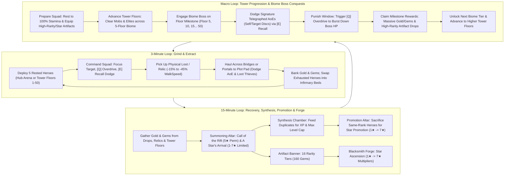

# DOCUMENT 1: COMPLETE GAME DESIGN DOCUMENT (GDD)
**Project Title:** *Infinite Tower: Become a Master!*  
**Target Platform:** Roblox (PC, Mobile, Tablet, Console)  
**Server Capacity:** 6 Players per Server (6 Dedicated Floating Fortress Plots)  
**Engine Architecture:** Server-Authoritative Data Tables (5 Hz Heartbeat) + Client-Side R15 Visual Interpolation (60 FPS `RenderStepped`) | Hybrid Replication: Central Hub 14-Byte Binary Buffers + Infinite Tower Room-Local v2 Binary Buffers (24-byte entity records, 46-byte header)

---

## 1. EXECUTIVE OVERVIEW & PLAYER FANTASY

### 1.1 High-Concept Pitch
**Infinite Tower: Become a Master!** is a tactical squad-command Action-RPG, extraction sandbox, and fortress progression game inspired by the dark survival manhwa *Pick Me Up, Infinite Gacha*. Players do not play as generic hack-and-slash warriors; instead, each player embodies a **Master**—a dimensional overseer who summons, trains, equips, promotes, and commands a roster of sentient Gacha Heroes from a private floating sanctuary known as the **Master's Fortress Plot**.

### 1.2 The "Pick Me Up" Fantasy & Zero-Waste Roster Economy
In traditional gacha/simulator games, 95% of summons are discarded as worthless stat-sticks, and combat is reduced to passive AFK auto-clicking. **Infinite Tower** solves both problems through two foundational pillars:

1. **The Dual-Role Living Roster (Combat + Labor):**
   - Every hero pulled from the Summoning Altar rolls with **Combat Stats** (`HP`, `ATK`, `Range`), **Labor Output** (Base productivity), and a **Passive Trait**.
   - **Up to 5 Deployed Heroes** (all 5 slots unlocked from the start) accompany the Master into the Central Hub or are independently deployed to specific floors (1–50) of the **Infinite Tower**. Heroes expend **Stamina** as they fight and risk a debilitating **60-second Coma** if left inside lethal AoE telegraphs.
   - **Benched Heroes** physically inhabit the player's **Fortress Plot** on recuperation beds in **The Infirmary & Barracks** (Stamina & Coma recovery), or can be forged powerful equipment at the **Blacksmith Forge**.
   - **Zero Dead Pulls:** Duplicate heroes across all star ranks are fed into the **Synthesis Chamber** (`SynthesisController.luau`) for EXP leveling to cap (`MaxLevel = Stars * 10`), or sacrificed at the **Promotion Altar** (`PromotionController.luau`) for **Star Promotion** ($1★ \to 7★$).
   - **Dual Hero Banners & Artifact Ascension:** At the **Summoning Altar**, players spend Gems (`100 Gems` single / `900 Gems` 10x) on two distinct banners: **Call of the Rift** (Permanent Banner featuring 5 stars: $1★ \to 5★$) and **A Star's Arrival** (Limited Time Banner featuring 1 character per star across all 7 stars: $1★ \to 7★$). In addition, Masters spend Gems at the **Artifact Summoning Banner** (`160 Gems` single / `1,600 Gems` 10x) to pull equippable weapons, shields, and rings across **16 Rarity Tiers** (`Common` $\to$ `Origin`) which define inherent base stats. At the **Blacksmith Forge** (`ForgeController.luau`), duplicate gear and Gold are used for **Star Ascension** ($1★ \to 7★$), multiplying base stats with massive progressive multipliers up to **`8.00x`**.

2. **Tactical Master Agency Over AFK Whaling:**
   - The Master carries no personal weapon. Instead, the Master directs squads through battlefield commands—**`[Click / Tap]` Focus Target**, **`[Q]` Overdrive Whistle**, and **`[E]` Emergency Recall Whistle**—while physically hauling heavy, high-value **Relics** and cargo back to their plot.
   - Masters use **`[LeftShift]` Sprint** ($3.0\times$ speed multiplier) to cross high-elevation bridges and dodge lethal hazards.
   - Because boss signature skill checks (the **Biome Boss** signature attacks like *Moss Quake* and *Sweeping Roots*, and elite ground telegraphs) inflict instant 50% Stamina loss or a **60-second Coma** on heroes left inside the blast zone, an AFK player will have their squad wiped and sent to the Infirmary, dropping their DPS to zero. An active Master who times **`[E]` Emergency Recall Whistle** to dodge the blast and triggers **`[Q]` Overdrive Whistle** during punish windows will consistently out-damage and out-loot an AFK whale.

### 1.3 Hybrid Retention Matrix & Core Drivers

| Reference Title | Adopted Core Mechanic | *Infinite Tower* Evolution |
| :--- | :--- | :--- |
| ***Pick Me Up, Infinite Gacha*** | Desperate squad survival, Synthesis chamber, Star Promotion, living lobby workers | Heroes suffer Stamina drain and `Coma` if mismanaged; 4★/5★ heroes require hard promotion sacrifices; War Banner plot deployment. |
| ***Pet Simulator 99*** | Multi-unit squad grinding, tactile loot explosions, exponential progression | Replaces passive pet hovering with Stamina-managed combat squads, active whistle commands, and isolated 50-floor dynamic tower rooms. |
| ***Blox Fruits*** | Telegraphed boss skills, live DPS leaderboards, open-world bounty hunting | **Greed vs. Coma** boss checks, 10 **Biome Bosses** (Floors 5, 10, ..., 50), and **Contested Loot & Targeted Retaliation PvP** in arena rings. |
| ***Grow a Garden*** | Cozy-yet-competitive perimeter plots, passive production, fortress management | Dedicated private plots with Infirmary recuperation beds, War Banner squad deployment, and Forge progression. |
| ***Steal an Egg*** | Physical object hauling, movement penalties, fumble & steal tension | High-tier **Relics** & cargo weld overhead, slow WalkSpeed by up to -45%, and fumble on AoE hits. |

**The Intimate Server Dynamic:**
In a 5–6 player server, anonymity disappears. Every player knows who conquered the latest Biome Boss, who just scooped contested loot, and who holds an active 3-minute retaliation grudge. The interplay of high-stakes extraction, boss timing, and targeted revenge loops keeps players engaged in continuous Biome Boss clears and Infinite Tower floor pushes.

---

## 2. DETAILED CORE LOOPS



### 2.1 The 3-Minute Micro Loop (Grind, Command & Physical Extraction)
1. **Deploy & Traverse (0:00 – 0:15):**
   - The Master selects up to 5 rested heroes from their roster via the **War Banner** or **Squad Deploy UI** (`SquadController.luau`).
   - The Master can sprint (`[LeftShift]`, $3.0\times$ speed) across high-elevation stone bridges onto the **Central Hub**, or use the **Tower Controller** (`TowerController.client.luau`) to travel (`Visit floor`) or station their squad (`Assign squad`) on any of the 50 **Infinite Tower Floors**.
2. **Tactical Grind & Stamina Expenditure (0:15 – 2:00):**
   - The Master uses **`[Click / Tap]` Focus Target** to direct all 5 deployed heroes onto target mobs, crystal nodes, or floor bosses.
   - To accelerate clears, the Master triggers **`[Q]` Overdrive Whistle** (`20s CD`), trading `5 Stamina` per hero for `+40% Attack Speed` for `5s`.
   - When an Elite or Boss telegraphs a red ground AoE (`ARC`, `SELF_DISC`, or `TARGET_DISC`), the Master triggers **`[E]` Emergency Recall Whistle** (`6s CD`), warping all 5 heroes to the Master's safe position and dropping their aggro for `2s`.
3. **Physical Loot Haul (2:00 – 2:45):**
   - Defeating mobs/Elites spawns physical drops in `Workspace.PhysicalLoot` (**Bounty Bags**, **Mana Geodes**, **Cursed Urns**, and **Abyssal Cores**).
   - The Master touches the drop to weld it overhead, incurring a **-15% to -45% WalkSpeed penalty** (and disabling jumping for high-tier relics).
   - If hit by an Elite/Boss AoE mid-haul, the Master is **stunned for 1s and fumbles the item** (which becomes stealable after a **3s owner-lock**).
4. **Extract & Bank (2:45 – 3:00):**
   - Stepping onto the Perimeter Highway (`R >= 460 studs`) or a Private Extraction Pad safely deposits cargo into permanent Gold and Gems.
   - Depleted heroes (`Stamina < 25%`) are swapped into **Infirmary Recuperation Beds**, and fresh rested heroes are rotated into the active squad via the `[AutoSwap]` toolbar action.

### 2.2 The 15-Minute Meso Loop (Fortress, Synthesis, Promotion & Forge Progression)
1. **Facility Upkeep (Every 3–5 Minutes):**
   - Inspect Infirmary beds and swap resting heroes into active squad rotation.
2. **Summoning & Gacha Pulls (Every 5–10 Minutes):**
   - Spend Gems at the **Summoning Altar** on either **Call of the Rift** (1★–5★ Permanent Banner), **A Star's Arrival** (1★–7★ Limited Time Rate-Up Banner, featuring 1 character per star), or the **Artifact Banner** (`160 Gems` single / `1,600 Gems` 10x for weapons, shields, and rings across 16 Rarity Tiers).
   - **Synthesis Chamber (`SynthesisController.luau`):** Place a recipient hero and up to 5 fodder heroes to level up to the hero's current cap ($\text{MaxLevel} = \text{Stars} \times 10$).
   - **Promotion Altar (`PromotionController.luau`):** When a hero reaches max level, sacrifice same-rank heroes and Promotion Stones to permanently ascend star rating ($1★ \to 7★$).
3. **Artifact Star Ascension at the Blacksmith Forge (`ForgeController.luau`):**
   - **Star Ascension (Multipliers):** Ascend artifacts from $1★ \to 7★$ at the Forge by sacrificing duplicate artifacts and Gold, scaling inherent base stats by progressive multipliers up to **`8.00x`**.

### 2.3 The Macro Loop (Tower Progression & Biome Boss Conquests)
1. **Biome Traversal & Preparation:**
   - Masters organize their 5-hero squad, equip high-rarity and high-star artifacts, and ensure full stamina in the Infirmary before entering a new Biome.
   - Each biome spans 5 progressively harder floors with rising HP, ATK, and reward scalers ($\text{HP} \times 1.08^{\text{Floor}-1}$, $\text{Damage} \times 1.045^{\text{Floor}-1}$, $\text{Reward} \times 1.055^{\text{Floor}-1}$).
2. **The Biome Boss Encounter (Floors 5, 10, 15, ..., 50):**
   - The 5th floor of every biome is a dedicated **Biome Boss Arena** featuring a massive boss dais fixture (e.g. `BossDaisFixture` on Floor 5, $60 \times 2 \times 60\text{ studs}$).
   - The Biome Boss wields devastating signature attacks with distinct shapes and timings:
     - **Basic Attacks:** Wide frontal arcs (`ARC`, e.g. `guardian_crush`, 13 studs).
     - **Signature 1:** Expanding circular ground shocks centered on the boss (`SELF_DISC`, e.g. `moss_quake`, 22 studs radius).
     - **Signature 2:** Ranged ground craters placed under distant heroes (`TARGET_DISC`, e.g. `sweeping_roots`, 55 studs cast range, 13 studs radius).
   - **Tactical Counterplay ("Dodge vs. Coma"):** Masters must watch the expanding telegraph decals and sound cues, repositioning and executing **`[E]` Emergency Recall Whistle** to yank heroes out of danger. Heroes struck by signature skills suffer severe stamina loss or a debilitating **60-second Coma**.
   - **Punish Windows:** Following major signature attacks, the boss enters an extended recovery window (1.2s–1.5s), providing active Masters the ideal moment to pop **`[Q]` Overdrive Whistle** for massive burst DPS.
3. **Biome Clearance & Milestone Rewards:**
   - Defeating the Biome Boss awards immense Gold, Gems, and rare direct drops of high-rarity **Artifacts** (from Legendary up to Origin).
   - Bosses unlock clearance to enter the next biome in the Infinite Tower.

### 2.4 The AFK & Outskirts Facility Loop (Passive Boost Facilities & Auto/Offline Gold Generation)
While active squad command in the Central Hub and Infinite Tower drives peak progression, the **Outskirts & Facility Loop** ensures that a Master's benched roster continuously generates value both online and offline—reinforcing the **Zero-Waste Roster Economy**.

1. **Inner Fortress Stations vs. The Rear Outskirts:**
   - **Core Main Buildings (Inner Courtyard):** Essential progression stations that every Master accesses by default in their main fortress courtyard—including the **Summoning Altar**, **War Banner**, **Synthesis Chamber**, **Promotion Altar**, **Blacksmith Forge**, and **The Infirmary & Barracks** (which operates strictly as a Main Building for Stamina & Coma recovery).
   - **Support Facilities (Inner Fortress Wings):** Upgradeable utility and economic structures (`Level 1` $\to$ `Level 5`) located inside the fortress courtyard wings where benched heroes are stationed via `FacilityController.luau` to grant global percentage buffs:
     - **The Market (Inner Commercial Wing):** Grants a percentage multiplier ($+5\%$ base at Lv. 1 up to $+40\%+$ with high-tier Miners) **strictly to Loot Earnings from the Towers**—amplifying Gold dropped by Infinite Tower mobs/Biome Bosses (Floors $1\text{–}50$) and the banking value of physical loot extracted from the Central Crimson Tower rings. (Does not multiply Outskirts Guard Post passive Gold).
     - **The Training Grounds (Inner Martial Wing):** Grants a percentage multiplier ($+4\%$ base at Lv. 1 up to $+32\%+$ with high-tier Strikers/Scholars) to the Master's **Overall Squad Combat Power**, multiplying total `FinalATK` and `FinalHP` (both intrinsic hero stats and equipped Artifact stats) against all monsters.
   - **The Outskirts (Southern Frontier Wilderness):** The only area located *outside* the fortress walls, reached through the rear fortress gatehouse. Houses the **Outskirts Guard Post** and wilderness patrol run.
2. **The Outskirts Guard Post (Unified AFK Gold & Offline Rewards):**
   - At the southern rear border of the island, outside the fortress battlements, lies the **Outskirts Guard Post**, a frontier bastion and wilderness trail at the back of the fortress.
   - Masters assign benched heroes (`Vanguard` and `Marksman` preferred) to the Outskirts Guard Post as **Adventurers**. Assigned Adventurers physically venture out and patrol the southern outskirts trail, fending off ambient monsters in a lightweight client-rendered visual loop without draining their combat Stamina.
   - **Auto-Received Online Gold:** There is no manual treasury chest required while online. Every $60\text{ seconds}$ (ticked automatically in $10\text{-second}$ increments), passive Gold generated by stationed Adventurers is **automatically added directly to the Master's Gold balance**, scaled by the heroes' `EffectiveLabor` and the Master's **Highest Cleared Biome Boss** (Floors $5, 10, \dots, 50$).
   - **Offline Reward Function (`OfflineRewardService.luau`):** When a Master logs out (`PlayerRemoving`), the server records `LastLogoutTimestamp` alongside their current `PassiveGoldPerMin` rate. Upon reconnecting (`PlayerAdded`), the server calculates elapsed offline minutes up to the Guard Post's **Max Offline Accumulation Cap** ($4\text{ Hours}$ at Lv. 1 $\to$ $12\text{ Hours}$ at Lv. 5) and presents a **"Welcome Back, Master!" Offline Summary Modal**, crediting the accumulated Gold straight to the player's balance.

---

## 3. MAP & SPATIAL DESIGN SPECIFICATIONS

### 3.1 Dual-Mode Spatial Architecture

The world exists in two coordinated spatial contexts:
1. **The Central Hub & Floating Fortress Ring (World Coordinates):** Landmark Central Crimson Tower, perimeter bridges, and player fortress plots.
2. **The 50 Dynamic Isolated Tower Floors (Off-Map Isolated Grid):** Server-managed dynamic encounter rooms for vertical climbing and Biome Boss arenas.

```
                      CENTRAL HUB ARENA & FLOATING FORTRESS RING
                                    [N: (0, -750)]
                                  +----------------+
                                  |  PLOT 1 (0°)   |
                                  +-------+--------+
                                          | (Bridge)
                   PLOT 6 (300°)          |           PLOT 2 (60°)
                        \                 |                 /
                  (Bridge)\        +------+------+        /(Bridge)
                            \      |   CENTRAL   |       /
                             ------+   CRIMSON   +-------
                            /      |  TOWER HUB  |       \
                  (Bridge)/        +------+------+        \(Bridge)
                        /                 |                 \
                   PLOT 5 (240°)          |           PLOT 3 (120°)
                                          | (Bridge)
                                  +-------+--------+
                                  |  PLOT 4 (180°) |
                                  +----------------+
                                    [S: (0, +750)]

               =======================================================
               OFF-MAP INFINITE TOWER ROOMS (Isolated Dynamic Grid)
               Origin(id) = (12000 + ((id-1)%10)*1800, 1000, 12000 + floor((id-1)/10)*1800)
               Enclosed 248 x 84 x 248 studs chambers with Safe Arrival platforms (CombatSafe=true)
               Floors 5, 10, 15, ..., 50 feature dedicated Biome Boss Dais Arenas (BossDaisFixture)
```

### 3.2 Global Coordinate Systems & Zones Table

| Zone Name | Radial Distance / Coordinate Space | Dimensions | Access Rule | Combat & PvP Rules | Primary Drops |
| :--- | :--- | :--- | :--- | :--- | :--- |
| **Central Crimson Tower** | `0 – 120 studs` (Hub) | Central 18-level landmark structure | Open to all | Landmark tower hub, open entrance portal to Infinite Tower floors. | Mana Geodes, Gold |
| **Ring 2: Corrupted Grove** | `120 – 280 studs` (Hub) | `160 studs` annulus | Open to all | High-density Elites with red AoE telegraphs. Contested loot PvP active. | **Cursed Urns**, **Abyssal Cores**, High Gold |
| **Ring 1: Outer Ruins** | `280 – 460 studs` (Hub) | `180 studs` annulus | Open from start | Low-level mobs & Mana Crystal nodes. Contested loot PvP active. | **Mana Geodes**, Starter Gold |
| **Perimeter Highway** | `460 – 480 studs` (Hub) | `20 studs` paved ring road | Open to all | **Safe Zone** (No mobs). Safe banking threshold ($R \ge 460$). | Banked cargo conversion |
| **6 Floating Fortress Plots** | `R = 650 studs` ($Y = 12$) | Expanded $260 \times 320\text{ studs}$ citadel island with grand courtyard & rear outskirts ($1.2\times$ radius expansion) | Plot Owner + Visitors | Safe Zone. Personal fortress sanctuary for recovery, banner summoning, forge ascension, and AFK outskirts guard post. | Roster Recovery, Gacha Banners, Forge, Outskirts Passive Gold & Multipliers |
| **Safety Catch Plane** | Lower kill plane at $Y = -95$ | `2400 x 8 x 2400 studs` | Fallen players | Non-lethal catch plane; teleports fallen players safely to their PlotSpawn. | None |
| **50 Tower Floor Rooms** | Off-map grid: $X \ge 12,000, Y = 1,000, Z \ge 12,000$ | `248 x 84 x 248 studs` each | Traversal via `TowerController` | Isolated floor-local PvE encounters; shared floor membership; safe arrival zone. | Mob drops, Gold, Gems, **Biome Boss Rare Artifact Drops** |

### 3.3 Dynamic Tower Room Architecture & Biomes

Tower floors are dynamically managed by `TowerFloorService.luau` and generated via `TowerRoomBuilder.luau`:
- **Room Origin Formula:**
  $$\text{Origin}(id) = \Big(12000 + ((id - 1) \bmod 10) \times 1800,\; 1000,\; 12000 + \lfloor(id - 1) / 10\rfloor \times 1800\Big)$$
- **Enclosure:** Enclosed $248 \times 84 \times 248\text{ studs}$ slate walls and opaque ceiling, preventing cross-floor visual overlap or raycast leakage.
- **Safe Arrival Zone:** $70 \times 0.2 \times 42\text{ studs}$ elevated landing pad at `origin + (0, 0.1, 90)` designated with `CombatSafe = true`, `CanBankCargo = false`.
- **Travel Pedestals:** 4 ProximityPrompt interaction points on the arrival pad:
  - `PREVIOUS`: Move to floor $id - 1$ (disabled on Floor 1).
  - `NEXT`: Move to floor $id + 1$ (disabled on Floor 50).
  - `SELECTOR`: Opens the full 50-floor modal selector.
  - `HUB`: Returns player directly to their Fortress Plot.
- **Room Lifecycle:** Rooms transition through `ABSENT -> BUILDING -> READY -> RETIRING -> ABSENT` with a 60-second retirement grace period when unoccupied.

#### Biome Catalog (50 Floors across 10 Biomes):
1. **Verdant Ruins (Floors 1–5):** Overgrown Threshold, Broken Aqueduct, Rootway Crossing, Vinebound Bastion, **Mossbound Court (Biome Boss: Mossbound Guardian)**.
2. **Fungal Hollow (Floors 6–10):** Sporelit Entry, Mycelium Galleries, Blooming Chasm, Rotcap Keep, **Matriarch's Hollow (Biome Boss: Spore Matriarch)**.
3. **Drowned Steps (Floors 11–15):** Drowned Steps, Coral Cloister, Tidal Channels, Pearlguard Vault, **Leviathan's Basin (Biome Boss: Abyssal Leviathan)**.
4. **Cinder Gate (Floors 16–20):** Cinder Gate, Buried Caravan, Glasswind Ravine, Sunscar Fortress, **Colossus Dais (Biome Boss: Cinder Colossus)**.
5. **Rimefall Approach (Floors 21–25):** Rimefall Approach, Frozen Barracks, Shattered Iceway, Whiteguard Keep, **Frostbound Throne (Biome Boss: Frost Sovereign)**.
6. **Stormgrass Rise (Floors 26–30):** Stormgrass Rise, Thunderhead Outpost, Skybridge Cliffs, Tempest Redoubt, **Roc's Eyrie (Biome Boss: Tempest Roc)**.
7. **Slagworks Entry (Floors 31–35):** Slagworks Entry, Molten Assembly, Furnace Causeway, Ironflame Bulwark, **Titan's Crucible (Biome Boss: Slagwork Titan)**.
8. **Blighted Verge (Floors 36–40):** Blighted Verge, Twisted Orchard, Briar Labyrinth, Heartrot Stronghold, **Sovereign's Grove (Biome Boss: Heartrot Sovereign)**.
9. **Starlit Vestibule (Floors 41–45):** Starlit Vestibule, Orbiting Stacks, Fractured Index, Runeguard Athenaeum, **Rift Warden's Observatory (Biome Boss: Rift Warden)**.
10. **Abyssal Descent (Floors 46–50):** Abyssal Descent, Crimson Procession, Voidspan Crossing, Dreadguard Citadel, **Overlord's Throne (Biome Boss: Abyssal Overlord)**.

### 3.4 Private Fortress Plot & Outskirts Architectural Layout

To accommodate active fortress management, squad training, commerce, and the passive Outskirts AFK loop, each of the 6 Floating Fortress Islands is expanded by **$1.2\times$** radial distance out to **$R = 650\text{ studs}$** (top surface $Y = 12$) with an enlarged citadel island footprint of **$260\text{ studs (Width)} \times 320\text{ studs (Length)}$**.

The island is divided into two distinct, interconnected sectors:
1. **The Grand Citadel & Inner Courtyard (Front / North - $260 \times 180\text{ studs}$):** Heavily fortified with $28\text{-stud}$ high crenellated stone walls, corner watch bastions, and a private entrance gatehouse facing the perimeter drawbridge. Encloses all **Core Main Buildings** (Summoning Altar, War Banner, The Pit, Blacksmith Forge, Infirmary) as well as the internal support facilities (**The Market** and **The Training Grounds**).
2. **The Southern Outskirts (Rear / South - $260 \times 140\text{ studs}$):** The sole exterior zone outside the fortress walls, accessed through the vaulted rear fortress gatehouse. Spans open, rugged frontier terrain, pine trees, and dirt wilderness trails housing **The Outskirts Guard Post**.

```
                        NORTH (Facing Central Hub & Perimeter Highway)
                                        | (Bridge)
                                  [North Gatehouse]
                       +---------------------------------------+
                       |   Plaza & Cyan Private Extraction Pad  |
                       |                                       |
                       | [Infirmary & Beds]   [Summoning Altar]|
                       |                      (Hero & Artifact)|
                       |          [War Banner Pedestal]        |
                       |                                       |
                       | [The Pit / Cauldron] [Blacksmith Forge|
                       | (Synthesis & Promo)   & Anvil Hearth] |
                       |                                       |
                       | [Training Grounds]       [The Market] |
                       | (Sparring & Dummies)  (Bazaar Stalls) |
                       +-------------------+-------------------+
                                           | (Rear Fortress Gate)
                       ====================+====================
                       |         THE REAR OUTSKIRTS GROUNDS     |
                       |                                       |
                       |          [Wilderness Border Trail]    |
                       |                                       |
                       |          [Outskirts Guard Post]       |
                       |       (Timber Bastion & Patrol Run)   |
                       |                                       |
                       +---------------------------------------+
                                SOUTH (Southern Frontier)
```

#### Detailed Sector Breakdown:

1. **Sector A: Arrival Ramp, Gatehouse & Extraction Plaza (North Front):**
   - **Perimeter Drawbridge & Gate:** Connects the fortress to the Perimeter Highway ($R = 480 \to 520\text{ studs}$). Features an owner-locked collision barrier preventing unauthorized plot infiltration.
   - **Plaza & Extraction Pad:** Glowing cyan illuminated deposit zone ($24 \times 1 \times 24\text{ studs}$) for banking carried relics, geodes, and urns into permanent Gold and Gems.
   - **Beacon Pillar & Plot Spawn:** Center anchor with the Master's avatar beacon projected skyward.

2. **Sector B: Grand Inner Fortress Courtyard (Core Buildings & Interior Facilities):**
   - **Summoning Altar (East Courtyard):** Towering obsidian obelisk featuring dual runic summoning circles for the **Hero Banner** (`100 Gems` single / `900 Gems` 10x) and **Artifact Banner** (`160 Gems` single / `1,600 Gems` 10x).
   - **War Banner Pedestal (Center Courtyard):** Gothic stone pedestal with heraldic banner and `[F]` proximity prompt opening the **Squad Deploy UI** (`SquadController.luau`).
   - **The Pit Sanctuary (West Courtyard):**
     - **Synthesis Chamber:** Fiery cauldron station with `[F]` prompt opening the **Synthesis UI** (`SynthesisController.luau`) for feeding EXP fodder.
     - **Promotion Altar:** Consecrated marble star dais with `[F]` prompt opening the **Promotion UI** (`PromotionController.luau`) for star ascensions ($1★ \to 5★$).
   - **The Blacksmith Forge (South-East Courtyard):** Interactive 3D station featuring an anvil, hearth coals, workbench, and prompt opening the **Forge UI** (`ForgeController.luau`) for Artifact Star Ascension ($1★ \to 7★$).
   - **The Infirmary & Barracks (North-West Courtyard):** Dedicated Gothic stone hall containing 5 permanent recuperation beds where wounded and `Coma`-afflicted heroes rest. Resting Healer heroes project an aura accelerating stamina regeneration.
   - **The Market (South-East Inner Wing):** Covered bazaar stalls, coin scales, and ledger counters located inside the fortress commercial quarter. Stationed workers (`Miner` preferred) boost Infinite Tower mob/boss loot drops and Hub extraction banking values ($+5\%$ to $+40\%+$).
   - **The Training Grounds (South-West Inner Wing):** Cobblestone sparring arena with weapon racks, archery targets, and training dummies located inside the fortress military quarter. Stationed trainers (`Striker` & `Scholar` preferred) boost the Master's overall squad combat power ($+4\%$ to $+32\%+$ Final ATK/HP).

3. **Sector C: The Southern Outskirts (Exterior Wilderness Zone):**
   - **Rear Fortress Archway:** A $24\text{-stud}$ wide vaulted stone passage connecting the inner fortress courtyard directly to the open wilderness behind the citadel.
   - **The Outskirts Guard Post (South Perimeter):** Heavy timber bastion, log palisade barricade, and campfire situated along the wilderness trail. Stationed Adventurers (`Vanguard` & `Marksman` preferred) venture out along the dirt patrol trail to battle ambient wildlife in a lightweight visual loop, auto-generating online Gold every 60 seconds and logging offline accumulation. Only the Outskirts and its Guard Post lie outside the fortress walls.

---

## 4. HERO, COMBAT & UI MECHANICS

### 4.1 Gacha Banners & Hero Roster Architecture

Hero summoning at the **Summoning Altar** (`FacilityController.luau`) is partitioned into two distinct banners:

#### 1. Permanent Banner: "Call of the Rift" (5 Stars: 1★ to 5★)
The permanent standard banner features exactly **one character for each star rating from 1★ to 5★** (5 total heroes):
- **Summon Cost:** `100 Gems` per single pull (`900 Gems` for 10x pull).
- **Pity System:** Guaranteed 5★ hero within **50 summons** (`MaxPity = 50`). Natural 5★ pull resets pity counter.
- **Drop Rates:**
  - `1★ Common (60.0%)`: **Han**
  - `2★ Rare (25.0%)`: **Aaron**
  - `3★ Epic (10.0%)`: **Catio**
  - `4★ Legendary (4.0%)`: **Valeria**
  - `5★ Mythic (1.0%)`: **Ignis**

#### 2. Limited Time Banner: "A Star's Arrival" (7 Stars: 1★ to 7★)
The inaugural limited-time rate-up banner features exactly **one character for each star rating from 1★ to 7★** (7 total heroes):
- **Summon Cost:** `100 Gems` per single pull (`900 Gems` for 10x pull).
- **Pity System:** Guaranteed 7★ featured hero (**Astrea**) within **50 summons** (`MaxPity = 50`). Natural 7★ pull resets pity counter.
- **Drop Rates:**
  - `1★ Common (50.0%)`: **Jenna**
  - `2★ Rare (25.0%)`: **Velkist**
  - `3★ Epic (13.5%)`: **Eolka**
  - `4★ Legendary (6.5%)`: **Morrigan**
  - `5★ Mythic (3.5%)`: **Sovereign Archon**
  - `6★ Transcendent (1.2%)`: **Solaris**
  - `7★ Primordial (0.3%)`: **Astrea (Featured 7★ Starlight Primordial)**

---

#### Launch Roster Base & Native Stats
Every summoned hero rolls a `QualityScalar` $q \in [0.90, 1.15]$ applied to their archetype base stats. Native stats scale with Base Star $S$ according to $Stat_0 \times 1.65^{(S - 1)}$ for combat and $L_0 \times 1.35^{(S - 1)}$ for labor:

| Banner | Hero | Star | Archetype | Base HP / ATK | Native HP / ATK | Base / Native Labor | Passive Trait |
| :--- | :--- | :---: | :--- | :--- | :--- | :--- | :--- |
| **Call of the Rift** | **Han** | **1★** | Striker | `300` / `40` | `300` / `40` | `14` / `14.0` | **Unyielding Adaptation** (+10% ATK, -10% Stamina Drain) |
| **Call of the Rift** | **Aaron** | **2★** | Vanguard | `450` / `28` | `743` / `46` | `16` / `21.6` | **Phalanx Guard** (+25% Max HP, -15% AoE Taken) |
| **Call of the Rift** | **Catio** | **3★** | Miner | `280` / `24` | `762` / `65` | `20` / `36.5` | **Quartermaster's Ledger** (+25% Labor Output) |
| **Call of the Rift** | **Valeria** | **4★** | Healer | `260` / `18` | `1,168` / `81` | `18` / `44.3` | **Sanctuary Aegis** (+30% Healing, +20% Coma Recovery) |
| **Call of the Rift** | **Ignis** | **5★** | Vanguard | `450` / `26` | `3,335` / `193` | `16` / `53.1` | **Rift Warlord** (+35% ATK, +20% DMG Reduction) |
| **A Star's Arrival** | **Jenna** | **1★** | Marksman | `210` / `34` | `210` / `34` | `13` / `13.0` | **Windstep Precision** (+15% ASPD, +5% Move Spd) |
| **A Star's Arrival** | **Velkist** | **2★** | Striker | `300` / `44` | `495` / `73` | `14` / `18.9` | **Bloodthirst Frenzy** (+20% ATK, +1s Overdrive) |
| **A Star's Arrival** | **Eolka** | **3★** | Scholar | `230` / `52` | `626` / `142` | `22` / `40.1` | **Crimson Pyromancy** (+25% ATK, +30% Labor Output) |
| **A Star's Arrival** | **Morrigan**| **4★** | Vanguard | `450` / `24` | `2,021` / `108` | `16` / `39.4` | **Abyssal Bulwark** (+30% Max HP, +15% Reflect DMG) |
| **A Star's Arrival** | **Archon** | **5★** | Striker | `350` / `65` | `2,594` / `482` | `25` / `83.0` | **Dimensional Dominion** (+30% Boss DMG, +25% All Labor) |
| **A Star's Arrival** | **Solaris** | **6★** | Scholar | `240` / `55` | `2,935` / `673` | `22` / `98.6` | **Supernova Flare** (+40% ATK, +25% AoE Radius) |
| **A Star's Arrival** | **Astrea** | **7★** | Marksman | `230` / `48` | `4,641` / `969` | `23` / `139.2` | **Cosmic Zenith** (+50% ATK, +30% ASPD, +35% Boss DMG) |

#### Archetype Foundation Table

| Archetype | Base HP ($HP_0$) | Base ATK ($ATK_0$) | Attack Interval ($t_{\text{atk}}$) | Attack Range | Base Labor ($L_0$) | Preferred Facility (+25% Synergy) | Permitted Weapons |
| :--- | :--- | :--- | :--- | :--- | :--- | :--- | :--- |
| **Vanguard** (Tank) | `450` | `22` | `1.20s` | `6 studs` | `10 / min` | **Outskirts Guard Post** | `SWORD`, `AXE`, `SHIELD` |
| **Striker** (Melee DPS) | `280` | `38` | `0.85s` | `6 studs` | `12 / min` | **The Training Grounds** | `SWORD`, `DAGGERS`, `SHIELD` |
| **Marksman** (Ranged DPS) | `210` | `34` | `0.80s` | `28 studs` | `13 / min` | **Outskirts Guard Post** | `BOW` |
| **Miner** (Gem Specialist) | `300` | `20` | `1.05s` | `6 studs` | `20 / min` | **The Market** | `AXE`, `SHIELD` |
| **Healer** (Infirmary Spec.) | `260` | `18` | `1.25s` | `24 studs` | `18 / min` | **The Infirmary & Barracks** | `STAFF`, `TOME` |
| **Scholar** (Spell Specialist)| `220` | `24` | `1.00s` | `26 studs` | `22 / min` | **The Training Grounds** | `TOME`, `STAFF` |

*(Note: Rings (`RING`) are universal accessories and can be equipped by any archetype).*

### 4.2 Effective Combat & Labor Formulas
- **Level Cap Formula:**
  $$\text{MaxLevel}(S) = S \times 10 \quad (1★ = \text{Lv.10},\; 2★ = \text{Lv.20},\; 3★ = \text{Lv.30},\; 4★ = \text{Lv.40},\; 5★ = \text{Lv.50},\; 6★ = \text{Lv.60},\; 7★ = \text{Lv.70})$$
- **Star Promotion Multipliers:** Promoting a hero from $S \to S+1$ resets Level to `1`, increases cap by `+10`, multiplies Base Combat stats by **`1.65x`**, and multiplies Base Labor output by **`1.35x`**.
- **Effective Combat Stats (with Artifact Integration):**
  $$\text{EffectiveATK} = \text{round}\Big(ATK_0 \times q \times 1.65^{(S - 1)} \times \big(1 + 0.08(L - 1)\big) \times (1 + B_{\text{TraitATK}} + B_{\text{ImprintATK}})\Big) + TotalATKBonus_{\text{Artifact}}$$
  $$\text{EffectiveHP} = \text{round}\Big(HP_0 \times q \times 1.65^{(S - 1)} \times \big(1 + 0.08(L - 1)\big) \times (1 + B_{\text{TraitHP}} + B_{\text{ImprintHP}})\Big)$$
  $$\text{EffectiveInterval} = \max\left(0.12\text{s}, \frac{HeroBaseInterval}{1 + TotalSpeedBonus_{\text{Artifact}}}\right)$$
  $$\text{TotalATKBonus}_{\text{Artifact}} = \text{round}\Big(ATK_{\text{Base, Rarity}} \times \text{Multiplier}_{\text{Star}}\Big)$$
  $$\text{TotalSpeedBonus}_{\text{Artifact}} = ASPD_{\text{Base, Rarity}} \times \text{Multiplier}_{\text{Star}}$$
  *(Where Rarity dictates inherent base stats and Stars ($1★ \to 7★$) dictate the progressive multiplier).*
- **Effective Labor Formula:**
  $$\text{EffectiveLabor} = L_0 \times q \times 1.35^{(S - 1)} \times \big(1 + 0.05(L - 1)\big) \times (1 + B_{\text{Synergy}}) \times (1 + B_{\text{TraitLabor}} + B_{\text{ImprintLabor}})$$
  *(Where $B_{\text{Synergy}} = 0.25$ when assigned to preferred facility).*

### 4.3 Fortress Outskirts & Facility Economy Formulas

Progression is bifurcated between **Core Main Buildings** (free, static fortress stations) and **Upgradeable Outskirts Facilities** (`Level 1` $\to$ `Level 5`) that scale passive Gold generation and global percentage multipliers:

#### 1. Core Main Building: The Infirmary & Barracks
The Infirmary operates as a standard, permanent fortress fixture with 5 default recuperation beds:
- **Base Stamina Recovery:** $3.0\text{ Stamina/sec}$ per occupied bed.
- **Healer Synergy Aura:** $+50\%$ acceleration ($4.5\text{ Stamina/sec}$) if at least one `Healer` hero is resting in the Infirmary.
- **Coma Duration:** Standard $60\text{ seconds}$ recovery, reduced to $40\text{ seconds}$ when a resting `Healer` is present.

#### 2. Upgradeable Support Facilities (Levels 1 to 5)

##### Facility A: The Outskirts Guard Post (Exterior AFK & Offline Gold Generation)
Located outside the fortress walls along the southern wilderness border. Stationed Adventurers (`Vanguard` & `Marksman` preferred, receiving $+25\%$ labor synergy) patrol the trail, generating automatic online Gold and accumulating offline rewards:

| Level | Gold Upgrade Cost | Max Adventurers | Base Gold / Min ($\text{BaseRate}$) | Max Offline Cap | Offline Efficiency | Visual Identity |
| :---: | :---: | :---: | :---: | :---: | :---: | :--- |
| **Lv. 1** | Free (Unlocked) | 1 Worker | `30 Gold/min` | 4 Hours (240 min) | 75% | Rugged wooden lean-to, simple campfire, dirt path. |
| **Lv. 2** | 1,500 Gold | 2 Workers | `75 Gold/min` | 6 Hours (360 min) | 80% | Timber guard shack, log palisade fence, weapon rack. |
| **Lv. 3** | 6,000 Gold | 3 Workers | `160 Gold/min` | 8 Hours (480 min) | 85% | Stone-reinforced bastion, brazier, perimeter ditch. |
| **Lv. 4** | 20,000 Gold | 4 Workers | `300 Gold/min` | 10 Hours (600 min) | 90% | Fortified outpost tower, crenellated wall, watch bell. |
| **Lv. 5** | 60,000 Gold | 5 Workers | `550 Gold/min` | 12 Hours (720 min) | 100% | Castle frontier barbican, heavy iron gate, signal beacon. |

- **Online Passive Gold Formula:**
  $$\text{PassiveGoldPerMin} = \Big(\text{BaseRate}_{\text{Level}} + 0.85 \times \sum \text{EffectiveLabor}\Big) \times \Big(1 + 0.15 \times \text{BiomeBossTier}\Big)$$
  *(Where $\text{BiomeBossTier} \in [0, 10]$ is the highest Biome Boss defeated: Floor 5 = 1, Floor 10 = 2, ..., Floor 50 = 10).*  
  *Auto-credited directly to the Master's Gold balance every 60s in 10s sub-increments; no manual claim chest required.*
- **Offline Gold Accumulation Formula (`OfflineRewardService.luau`):**
  $$\text{OfflineGold} = \min\big(\text{ElapsedMinutes},\; \text{MaxOfflineCapMinutes}\big) \times \text{PassiveGoldPerMin} \times \text{OfflineEfficiency}_{\text{Level}}$$
  *Presented via "Welcome Back, Master!" modal upon login, depositing accumulated Gold straight to profile currency.*

##### Facility B: The Market (Interior Fortress Commercial Wing - Tower Loot & Extraction Multiplier)
Located inside the fortress commercial quarter. Stationed Merchants (`Miner` preferred, $+25\%$ labor synergy) amplify loot yields strictly from Infinite Tower clears and Hub cargo extractions:

| Level | Gold Upgrade Cost | Max Workers | Base Loot Multiplier ($\text{BaseBonus}$) | Visual Identity |
| :---: | :---: | :---: | :---: | :--- |
| **Lv. 1** | 1,000 Gold | 1 Worker | `+5.0%` | Single wooden stall, canvas canopy, coin scale. |
| **Lv. 2** | 3,500 Gold | 1 Worker | `+10.0%` | Expanded twin stalls, cargo crates, merchant wagon. |
| **Lv. 3** | 12,000 Gold | 2 Workers | `+18.0%` | Covered bazaar pavillion, hanging brass scales, safe box. |
| **Lv. 4** | 35,000 Gold | 2 Workers | `+28.0%` | Stone exchange depot, trade ledgers, guarded strongbox. |
| **Lv. 5** | 90,000 Gold | 3 Workers | `+40.0%` | Grand celestial merchant exchange, guild crest, vault cellar. |

- **Market Loot Multiplier Formula:**
  $$\text{MarketMultiplier} = 1 + \text{BaseBonus}_{\text{Level}} + \big(0.005 \times \sum \text{EffectiveLabor}_{\text{Market}}\big)$$
  *(Multiplies Gold dropped by mobs and Biome Bosses on Infinite Tower Floors 1–50 and physical cargo banked at the Extraction Pad. Does NOT amplify Outskirts Guard Post passive Gold).*

##### Facility C: The Training Grounds (Interior Fortress Martial Wing - Squad Combat Power Multiplier)
Located inside the fortress military quarter. Stationed Trainers (`Striker` & `Scholar` preferred, $+25\%$ labor synergy) conduct martial drills, applying an overall multiplier to squad combat stats:

| Level | Gold Upgrade Cost | Max Workers | Base Combat Multiplier ($\text{BaseBonus}$) | Visual Identity |
| :---: | :---: | :---: | :---: | :--- |
| **Lv. 1** | 1,200 Gold | 1 Worker | `+4.0%` | Dirt sparring circle, straw dummy, wooden sword rack. |
| **Lv. 2** | 4,000 Gold | 1 Worker | `+8.0%` | Fenced training yard, sandbags, archery targets. |
| **Lv. 3** | 14,000 Gold | 2 Workers | `+14.0%` | Cobblestone arena, iron weapon racks, training pell. |
| **Lv. 4** | 40,000 Gold | 2 Workers | `+22.0%` | Tiered training ring, enchanted strike dummies, war pavilion. |
| **Lv. 5** | 100,000 Gold | 3 Workers | `+32.0%` | Consecrated martial amphitheater, glowing runic combat ring. |

- **Training Combat Multiplier Formula:**
  $$\text{TrainingMultiplier} = 1 + \text{BaseBonus}_{\text{Level}} + \big(0.004 \times \sum \text{EffectiveLabor}_{\text{Training}}\big)$$
  *(Multiplies total squad $\text{FinalATK}$ and $\text{FinalHP}$ across all heroes and equipped Artifacts).*

### 4.4 Master Controls & Tactical Commands

| Action | Keybind / Input | Description |
| :--- | :--- | :--- |
| **Shift Sprint** | `[LeftShift / RightShift]` | $3.0\times$ speed multiplier for rapid traversal across bridges, rings, and rooms. |
| **Focus Target** | `[Click / Tap]` | Raycast onto any mob, boss, or thief to focus all 5 heroes' aggro. |
| **Overdrive Whistle** | `[Q]` / Bottom Bar | $20\text{s}$ CD. Consumes $5$ Stamina/hero for $+40\%$ Attack Speed for $5\text{s}$. |
| **Emergency Recall** | `[E]` / Bottom Bar | $6\text{s}$ CD. Instantly warps squad to Master + $2\text{s}$ pacify (dodges lethal AoE). Yields priority to ProximityPrompts. |
| **Drop Carried Item**| `[R]` / HUD Button | Drops carried cargo or relic on the ground; restores normal WalkSpeed. |
| **Retaliate Attack** | `[⚔️ RETALIATE]` | Single-click HUD prompt when your drop is stolen to unleash squad PvP retaliation. |

### 4.5 Tactical UI & HUD Architecture

The player interface is built from modular, gothic-styled components:
1. **Bottom Navigation Toolbar (`BottomToolbar`):**
   - **Left:** `[PATCH NOTES]` button displaying current server update toasts.
   - **Center Group:** `[THE PIT]` (opens Synthesis/Promotion modals) | `[FORGE]` (opens Blacksmith Star Ascension modal) | `[SQUAD]` (opens 5-Hero Squad Deploy modal) | `[OVERDRIVE]` (Whistle 1 / Q) | `[RECALL]` (Whistle 2 / E) | Vertical Divider | `[AutoSwap]` (4-way arrow icon: auto-swaps exhausted heroes with bench) | `[RosterGrid]` (3x3 grid icon: toggles Squad Deploy modal).
   - **Right Group:** Settings Gear (toggles telemetry overlay) | `[SAVE]` button (manual profile save trigger).
2. **Tower Navigation UI (`TowerController.client.luau`):**
   - **TravelBar (Top of Screen):** Persistent navigation bar displaying `[Previous]`, `[Next]`, `[Floor selector]`, and `[Hub]` buttons.
   - **Floor Selector Modal (`FloorSelector`):** Responsive 50-floor grid showing milestone **Biome Boss floors** (`◆`), biome names, current visitors count, assigned player squads, and action buttons (`Visit floor`, `Assign squad`, `Recall squad`).
3. **Real-Time Combat Feedback (`CombatFeedback.luau`):**
   - **Damage Popups:** Server-hit floating damage labels pooled up to 32 active instances. Styled with `GothamBold` font, quadratic easing upward, and color-coded:
     - Gold (`#FFCF59`): Overdrive crits / empowered hits.
     - Pale Green (`#F3FFE2`): Normal outbound hero damage.
     - Coral Red (`#FF7474`): Incoming damage received by heroes.
   - **Hit Sparks:** Material Neon sphere sparks with dynamic scaling and fade.
   - **Telegraph Geometry:** Authoritative server-timed warning decals and cylinders (`ARC`, `SELF_DISC`, `TARGET_DISC`).

---

## 5. BIOME BOSS ENCOUNTER DESIGN (MILESTONE FLOORS)

### 5.1 Architecture & Biome Milestone Cadence
In **Infinite Tower**, major boss encounters take place at the apex of each biome: every 5th floor of the Infinite Tower (Floors 5, 10, 15, 20, 25, 30, 35, 40, 45, 50). Each Biome Boss commands a massive dedicated arena dais ($60 \times 2 \times 60\text{ studs}$ `BossDaisFixture`) and possesses dynamic health, high damage multipliers, and signature multi-phase telegraphed attacks.

#### The 10 Biome Bosses:

| Floor | Biome Name | Biome Boss Name | Rig Family | Base HP | Base ATK | Signature Attack Types |
| :---: | :--- | :--- | :--- | :---: | :---: | :--- |
| **5** | **Verdant Ruins** | **Mossbound Guardian** | `STONE_COLOSSUS` | `16,326` | `66` | Frontal Cleave (`ARC`), Quake (`SELF_DISC`), Root Bloom (`TARGET_DISC`) |
| **10** | **Fungal Hollow** | **Spore Matriarch** | `FUNGAL_MATRIARCH` | `24,000` | `82` | Spore Burst (`SELF_DISC`), Corrosive Cloud (`TARGET_DISC`) |
| **15** | **Drowned Steps** | **Abyssal Leviathan** | `LEVIATHAN` | `35,500` | `102` | Tidal Sweep (`ARC`), Maelstrom (`SELF_DISC`), Geyser Strike (`TARGET_DISC`) |
| **20** | **Cinder Gate** | **Cinder Colossus** | `FIRE_COLOSSUS` | `52,000` | `128` | Magma Cleave (`ARC`), Eruption (`SELF_DISC`), Fire Rain (`TARGET_DISC`) |
| **25** | **Rimefall Approach** | **Frost Sovereign** | `FROST_GIANT` | `76,000` | `160` | Glacial Smash (`ARC`), Blizzard Shock (`SELF_DISC`), Ice Spikes (`TARGET_DISC`) |
| **30** | **Stormgrass Rise** | **Tempest Roc** | `GIANT_AVIAN` | `112,000` | `200` | Gale Slash (`ARC`), Thunderclap (`SELF_DISC`), Lightning Strike (`TARGET_DISC`) |
| **35** | **Slagworks Entry** | **Slagwork Titan** | `MAGMA_CONSTRUCT` | `165,000` | `250` | Anvil Hammer (`ARC`), Slag Quake (`SELF_DISC`), Molten Core (`TARGET_DISC`) |
| **40** | **Blighted Verge** | **Heartrot Sovereign** | `CORRUPTED_TREANT` | `242,000` | `312` | Briar Whip (`ARC`), Heartrot Bloom (`SELF_DISC`), Rot Tendrils (`TARGET_DISC`) |
| **45** | **Starlit Vestibule** | **Rift Warden** | `COSMIC_ENTITY` | `355,000` | `390` | Astral Sweep (`ARC`), Dimensional Rupture (`SELF_DISC`), Void Well (`TARGET_DISC`) |
| **50** | **Abyssal Descent** | **Abyssal Overlord** | `DEMONIC_OVERLORD` | `520,000` | `488` | Hellfire Cleave (`ARC`), Abyssal Nova (`SELF_DISC`), Doom Pillars (`TARGET_DISC`) |

### 5.2 Tactical Mechanics & Combat Flow ("Greed vs. Coma")
1. **Telegraph Shapes & Timings:**
   - **`ARC` (Basic Cleave):** Fast frontal swipe ($1.1\text{s}$ windup, $1.0\text{s}$ recovery, 13-stud reach). Vanguard tanks should position facing away from squishier DPS heroes.
   - **`SELF_DISC` (Boss Quake):** Expanding crimson circle centered on the boss ($1.8\text{s}$ windup, $1.2\text{s}$ recovery, 22-stud radius). Masters must sprint out and trigger **`[E]` Emergency Recall** before impact.
   - **`TARGET_DISC` (Targeted AoE):** Red circle targeted at distant heroes ($2.2\text{s}$ windup, $1.5\text{s}$ recovery, 13-stud radius). Requires instant Master recognition and recall repositioning.
2. **Coma Skill Check:**
   - Heroes caught inside `SELF_DISC` or `TARGET_DISC` blast zones suffer instant 50% Stamina loss or fall into a **60-second Coma** (expelled back to the Fortress Infirmary).
3. **Punish Window:**
   - Immediately following a Signature detonation, the Biome Boss enters an exposed recovery window granting $+25\%$ damage taken for 4.0s. Active Masters trigger **`[Q]` Overdrive Whistle** to unleash $+40\%$ squad attack speed and maximize DPS output.

### 5.3 Biome Boss Loot & Progression Ledger
- **Encounter Respawns:** Biome Bosses operate on an authoritative server respawn cadence ($300\text{s}$ cooldown upon defeat).
- **Rewards Table:**
  - **Tiered Gold & Gems:** Scaled exponentially to biome difficulty.
  - **High-Rarity Artifact Drops:** Rare direct drops of high-tier Artifacts (from Legendary up to Origin rarity, e.g. `art_paladin_claymore`, `art_crystal_greatbow`, `art_blade_of_the_rift`).
  - **Biome Key / Floor Advancement:** Defeating the Biome Boss permanently unlocks the subsequent biome on the **Floor Selector**.

---

## 6. CONTESTED LOOT & RETALIATION PVP

### 6.1 Contested Loot & Targeted Retaliation PvP
1. **Universal Physical Drops:** Monsters and crystal nodes drop 3D physical cargo in `Workspace.PhysicalLoot` tagged with `KillerUserId`.
2. **Physical Overhead Hauling:** Picking up loot welds it overhead, slows movement by `-15%` to `-45%`, and triggers the upper-arm holding pose (`HoldingAnimationController.client.luau`).
3. **Theft Detection & Retaliation:** Picking up another player's loot flags the player as a `[Loot Thief]` and registers a 3-minute retaliation grudge. The victim receives a real-time HUD alert with a `[⚔️ RETALIATE]` button.
4. **Squad-vs-Squad Clash:** Clicking `[⚔️ RETALIATE]` commands your squad to attack the thief's squad at $25\%$ PvP damage scaling. The targeted squad auto-retaliates. Defeated heroes enter `COMA`.
5. **Squad Wipe & Spilled Loot:** On squad defeat, all carried loot spills onto the ground, and field looting is locked until the Master returns to their Fortress Plot to heal in the Infirmary.
6. **Perimeter Banking:** Reaching the perimeter highway ($R \ge 460$) or private plot pad safely banks loot into permanent Gold and Gems.

---

## 7. EQUIPPABLE ARTIFACT & BLACKSMITH SYSTEM

### 7.1 System Overview & Dual-Banner Gacha Architecture
Artifact progression replaces traditional crafting with an **Artifact Summoning Banner** at the Summoning Altar and inverts the classic star/rarity hierarchy:
1. **Inherent Rarity Potential (Common to Origin - 16 Tiers):** An artifact's Rarity Tier dictates its permanent **Base Attack Power ($ATK_{\text{Base}}$: `+20` to `+7,000`)** and **Base Attack Speed ($ASPD_{\text{Base}}$: `+5.0%` to `+85.0%`)**. The rarity represents the intrinsic baseline power of the drop or pull.
2. **Progressive Star Multipliers (1★ to 7★):** Star ratings act as **multipliers** applied to the inherent base stats. All newly pulled or acquired artifacts start at **1★ (`1.00x`)**. At the **Blacksmith Forge** (`ForgeController.luau`), players perform **Star Ascension** ($1★ \to 7★$) using duplicate artifacts and Gold, scaling effective stats up to **`8.00x`**.
3. **Artifact Banner Pulling (Gacha System):** Players spend Gems (`160 Gems` single / `1,600 Gems` 10x) at the Summoning Altar's **Artifact Banner** to pull equippable weapons, shields, and rings across archetypes.

### 7.2 The 16 Rarity Tiers (Inherent Base Stats)
The 16 Rarity Tiers determine the baseline stats of any artifact pulled from the banner or dropped by milestone content:

| Tier | Rarity Name | Base ATK ($ATK_{\text{Base}}$) | Base ASPD Bonus ($ASPD_{\text{Base}}$) | Hex Color | Visual & VFX Identity |
| :---: | :--- | :---: | :---: | :---: | :--- |
| **1** | **Common** | **`+20`** | **`+5.0%`** (`+0.050`) | `#B0B0B0` | Weathered iron / rustic wood; standard matte finish. |
| **2** | **Uncommon** | **`+45`** | **`+7.5%`** (`+0.075`) | `#4BB543` | Cleaned edge, subtle emerald sheen. |
| **3** | **Rare** | **`+80`** | **`+10.0%`** (`+0.100`) | `#2980B9` | Polished azure finish; fine leather wrappings. |
| **4** | **Superior** | **`+130`** | **`+13.0%`** (`+0.130`) | `#8E44AD` | Deep amethyst inlay with fine balance grooves. |
| **5** | **Exalted** | **`+200`** | **`+16.5%`** (`+0.165`) | `#D35400` | Tempered bronze plating; warm amber sheen. |
| **6** | **Legendary** | **`+300`** | **`+20.0%`** (`+0.200`) | `#F1C40F` | Gilding with glowing runes; subtle gold particle trails. |
| **7** | **Mythical** | **`+440`** | **`+24.0%`** (`+0.240`) | `#E74C3C` | Crimson mana channels; pulsing inner embers. |
| **8** | **Transcendent** | **`+640`** | **`+28.5%`** (`+0.285`) | `#1ABC9C` | Pure sea-glass teal resonance; condensation mist. |
| **9** | **Ascendant** | **`+900`** | **`+33.5%`** (`+0.335`) | `#E056FD` | Neon violet crystal edge; dimensional crackle. |
| **10** | **Ethereal** | **`+1,250`** | **`+39.0%`** (`+0.390`) | `#686DE0` | Semi-translucent spectral steel; atmospheric hum. |
| **11** | **Immortal** | **`+1,700`** | **`+45.0%`** (`+0.450`) | `#FF7979` | Sanguine abyssal forged alloy; trailing smoke. |
| **12** | **Divine** | **`+2,300`** | **`+51.5%`** (`+0.515`) | `#F9CA24` | Blinding solar gold radiant aura; consecrated luster. |
| **13** | **Celestial** | **`+3,050`** | **`+58.5%`** (`+0.585`) | `#00D2D3` | Cosmic azure starry core; orbiting orbital motes. |
| **14** | **Primordial** | **`+4,000`** | **`+66.0%`** (`+0.660`) | `#FF3838` | Raw volcanic magma veins; Neon material ignition. |
| **15** | **Supreme** | **`+5,250`** | **`+74.0%`** (`+0.740`) | `#BADC58` | Iridescent viridian prism; high-frequency bloom. |
| **16** | **Origin** | **`+7,000`** | **`+85.0%`** (`+0.850`) | `#FF9FF3` | Full prismatic animated chroma aura; dimensional distortion. |

### 7.3 The 7 Star Tiers (Progressive Multipliers & Ascension)
Stars multiply an artifact's inherent base stats. Ascension requires duplicate artifacts and Gold at the Blacksmith Forge:

| Star Tier | Stat Multiplier | Ascension Requirement | Gold Cost | Gem Cost | Progression Context |
| :---: | :---: | :---: | :---: | :---: | :--- |
| **1★** | **`1.00x`** | Baseline | — | — | Default tier for all pulled/dropped gear. |
| **2★** | **`1.35x`** | 1 Duplicate Artifact | 500 Gold | — | Early-game power boost. |
| **3★** | **`1.85x`** | 2 Duplicate Artifacts | 2,000 Gold | — | Mid-Ring 1 progression benchmark. |
| **4★** | **`2.60x`** | 3 Duplicate Artifacts | 8,000 Gold | — | Ring 2 Corrupted Grove readiness. |
| **5★** | **`3.75x`** | 4 Duplicate Artifacts | 25,000 Gold | 50 Gems | Biome Boss conquest tier (Floors 1–20). |
| **6★** | **`5.50x`** | 5 Duplicate Artifacts | 75,000 Gold | 150 Gems | High-tower progression (Floors 25–40). |
| **7★** | **`8.00x`** | 6 Duplicate Artifacts | 250,000 Gold | 500 Gems | Maximum star ascendancy (Floors 45–50). |

### 7.4 Artifact Summoning Banner (Gacha Mechanics)
- **Altar Integration:** The Summoning Altar features two banner tabs: **[HERO BANNER]** and **[ARTIFACT BANNER]**.
- **Summon Cost:** `160 Gems` per single pull, `1,600 Gems` for a 10x pull (matching live `ArtifactCatalog.Banner`).
- **Banner Rarity Probability Table:**
  - **Common (Tier 1):** `54.9%`
  - **Uncommon (Tier 2):** `25.0%`
  - **Rare (Tier 3):** `12.0%`
  - **Superior (Tier 4):** `5.5%`
  - **Exalted (Tier 5):** `2.0%`
  - **Legendary (Tier 6):** `0.5%`
  - **Mythical (Tier 7):** `0.1%`
  - *(Other Rarities will be available in future updates)*
- **Pity Safeguards:**
  - **10-Pull Guarantee:** Every 10-pull guarantees at least one **Rare (Tier 3)** or higher artifact.
  - **50-Pull Hard Pity:** If no **Legendary (Tier 6)** or higher artifact has been pulled in 49 pulls, the 50th pull guarantees a **Legendary (Tier 6)** or higher artifact.
  - **Biome Boss Milestone Drops:** Rare direct drops of Mythical to Origin artifacts from milestone floor clears.
  - **Blacksmith Rarity Refinement:** Forge masters can spend high quantities of Gold and Gems to refine an existing artifact's rarity tier upward.

### 7.5 Archetype Restrictions & 3D Socketing Standards
1. **Equippable Weapon & Item Catalog:**
   - **Swords (`SWORD`):** Permitted on `Vanguard`, `Striker`. High single-target slashing DPS.
   - **Daggers (`DAGGERS`):** Permitted on `Striker`. High-speed dual-wield flurry attacks.
   - **Bows (`BOW`):** Permitted on `Marksman`. Ranged single-target piercing attacks.
   - **Axes (`AXE`):** Permitted on `Vanguard`, `Miner`. Heavy cleaving strikes.
   - **Staves (`STAFF`):** Permitted on `Healer`, `Scholar`. Ranged mystic projectiles and aura empowerment.
   - **Tomes (`TOME`):** Permitted on `Healer`, `Scholar`. Channeled magical bursts and restorative resonance.
   - **Shields (`SHIELD`):** Permitted on `Vanguard`, `Striker`, `Miner`. Off-hand defensive posture and damage mitigation.
   - **Rings (`RING`):** Universal accessory equipable by any archetype for secondary stat amplification.
2. **Prefab Directory:** Centralized in `ReplicatedStorage.Assets.Weapons` (`weapon_bow`, `weapon_sword`, `weapon_daggers`, `weapon_axe`, `weapon_staff`, `weapon_tome`).
3. **Physical Constraints:** All weapon parts have `CanCollide = false`, `CanTouch = false`, `CanQuery = false`, `Massless = true`, `Anchored = false`, welded to an invisible PrimaryPart `Handle`.
4. **Dynamic Socketing:** Attached to `RightHand` via `ArtPackVisuals.AttachAt`. Bows feature dual dynamic `Beam` sinew strings connecting from stave tips to `RightHand.DrawAttachment`.

---

## 8. NETWORK PROTOCOL & REPLICATION ARCHITECTURE

### 8.1 Room-Local Replication v2 Protocol
To isolate simulation state and prevent entity overflow or vertical AoE bleed across the 50 Tower Floors:
- **Packet Structure:** 46-byte header + 24 bytes per entity record. Batches capped at 32 records (814 bytes total).
- **Context Identity:** `(ServerSessionId, FloorId, RoomGeneration, ViewEpoch)`.
  - Floor 0 represents the Central Hub and Fortress Plots.
  - Floors 1–50 represent dynamic isolated tower chambers (with Biome Boss arenas on Floors 5, 10, 15... 50).
- **Entity Record Layout:**
  - `EntityId` (u32), `EntityGeneration` (u32).
  - Local quantized `X, Y, Z` (3x i16, factor 10.0).
  - `Yaw` (u8), `PresentationState` (u8), `HP Permille` (u16, 0..1000), `Stamina` (u8, 0..100).
  - `Flags` (u8: bit 0 hero, bit 1 overdrive, bit 2 pacified, bit 3 boss core exposed).
  - `Current ActionSequence` (u32).

### 8.2 Reliable Travel & Squad Assignment Lifecycle
- **Transition Lane:** One serialized transition lane per player. State transitions (`VISIT`, `HUB`, `ASSIGN`, `RECALL`) are verified against character generation and monotonic location/squad revisions.
- **Idempotency & Replay Cache:** The server retains the last 64 terminal request results for 60 seconds per connection.
- **Budgeting:** Token bucket burst 4, refill 2 tokens/second per owner. 8-second preparation deadline before timeout rollback.
