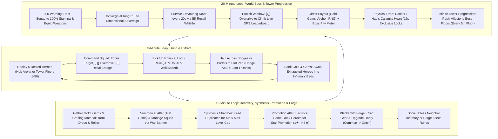

# DOCUMENT 1: COMPLETE GAME DESIGN DOCUMENT (GDD)
**Project Codename:** *Project: Waiting Room* (*Infinite Towers: Become a Master!*)  
**Target Platform:** Roblox (PC, Mobile, Tablet, Console)  
**Server Capacity:** 5–6 Players per Server  
**Engine Architecture:** Server-Authoritative Data Tables (5 Hz Heartbeat) + Client-Side R15 Visual Interpolation (60 FPS `RenderStepped`) | Hybrid Replication: Central Hub 14-Byte Binary Buffers + Infinite Tower Room-Local v2 Binary Buffers (24-byte entity records, 46-byte header)

---

## 1. EXECUTIVE OVERVIEW & PLAYER FANTASY

### 1.1 High-Concept Pitch
**Project: Waiting Room** is a tactical squad-command Action-RPG, extraction sandbox, and Tycoon inspired by the dark survival manhwa *Pick Me Up, Infinite Gacha*. Players do not play as generic hack-and-slash warriors; instead, each player embodies a **Master**—a dimensional overseer who summons, trains, equips, promotes, and commands a roster of sentient Gacha Heroes from a private floating fortress known as **The Waiting Room**.

### 1.2 The "Pick Me Up" Fantasy & Zero-Waste Roster Economy
In traditional gacha/simulator games, 95% of summons are discarded as worthless stat-sticks, and combat is reduced to passive AFK auto-clicking. **Project: Waiting Room** solves both problems through two foundational pillars:

1. **The Dual-Role Living Roster (Combat + Labor):**
   - Every hero pulled from the Summoning Altar rolls with **Combat Stats** (`HP`, `ATK`, `Range`), **Labor Output** (Tycoon productivity), and a **Passive Trait**.
   - **Up to 5 Deployed Heroes** (all 5 slots unlocked from the start) accompany the Master into the Central Hub Arena or are independently deployed to specific floors (1–50) of the **Infinite Tower**. Heroes expend **Stamina** as they fight and risk a debilitating **60-second Coma** if left inside lethal AoE telegraphs.
   - **Benched Heroes** physically inhabit the player's **Waiting Room** plot on recuperation beds in **The Infirmary & Barracks** (Stamina & Coma recovery), or can be forged powerful equipment at the **Blacksmith Forge**.
   - **Zero Dead Pulls:** Duplicate 1★–3★ heroes are fed into the **Synthesis Chamber** (`SynthesisController.luau`) for EXP leveling to cap (`MaxLevel = Stars * 10`), or sacrificed at the **Promotion Altar** (`PromotionController.luau`) for **Star Promotion** ($1★ \to 5★$).
   - **Deterministic Forge Upgrades:** Gathered materials (`IronGear`, `RiftOrb`, `AegisGem`, `StarDust`, `VoidPowder`) are crafted and upgraded at the **Blacksmith Forge** (`ForgeController.luau`) across **16 Rarity Tiers** (`Common` $\to$ `Origin`) and 10 Enhancement Levels (+0 to +10).

2. **Tactical Master Agency Over AFK Whaling:**
   - The Master carries no personal weapon. Instead, the Master directs squads through battlefield commands—**`[Click / Tap]` Focus Target**, **`[Q]` Overdrive Whistle**, and **`[E]` Emergency Recall Whistle**—while physically hauling heavy, high-value **Relics** and cargo back to their plot.
   - Masters use **`[LeftShift]` Sprint** ($3.0\times$ speed multiplier) to cross high-elevation bridges and dodge lethal hazards.
   - Because boss signature skill checks (the World Boss's **Devouring Nova** and Tower Milestone Boss AoEs) inflict instant 50% Stamina loss or a **60-second Coma** on heroes left inside the blast zone, an AFK player will have their squad wiped and sent to the Infirmary, dropping their DPS to zero. An active Master who times **`[E]` Emergency Recall Whistle** to dodge the blast and triggers **`[Q]` Overdrive Whistle** during punish windows will consistently out-damage and out-loot an AFK whale.

### 1.3 Hybrid Retention Matrix & Core Drivers

| Reference Title | Adopted Core Mechanic | *Project: Waiting Room* Evolution |
| :--- | :--- | :--- |
| ***Pick Me Up, Infinite Gacha*** | Desperate squad survival, Synthesis chamber, Star Promotion, living lobby workers | Heroes suffer Stamina drain and `Coma` if mismanaged; 4★/5★ heroes require hard promotion sacrifices; War Banner plot deployment. |
| ***Pet Simulator 99*** | Multi-unit squad grinding, tactile loot explosions, exponential progression | Replaces passive pet hovering with Stamina-managed combat squads, active whistle commands, and isolated 50-floor dynamic tower rooms. |
| ***Blox Fruits*** | Telegraphed boss skills, live DPS leaderboards, open-world bounty hunting | **Greed vs. Coma** boss checks, 50-floor milestone bosses, and **Contested Loot & Targeted Retaliation PvP** in arena rings. |
| ***Grow a Garden*** | Cozy-yet-competitive perimeter plots, passive production, neighbor visits | Visitors perform identical animations to either **Bless** (+25% output) or **Plant Leech Rune** (-20% stolen). |
| ***Steal an Egg*** | Physical object hauling, movement penalties, fumble & steal tension | High-tier **Relics** & cargo weld overhead, slow WalkSpeed by up to -45%, and fumble on AoE hits. |

**The Intimate Server Dynamic:**
In a 5–6 player server, anonymity disappears. Every player knows who holds Rank #1 DPS on the World Boss, who just scooped contested loot, and who holds an active 3-minute retaliation grudge. The interplay of high-stakes extraction, boss timing, and targeted revenge loops keeps players engaged in continuous 20-minute World Boss cycles and Infinite Tower floor pushes.

---

## 2. DETAILED CORE LOOPS



### 2.1 The 3-Minute Micro Loop (Grind, Command & Physical Extraction)
1. **Deploy & Traverse (0:00 – 0:15):**
   - The Master selects up to 5 rested heroes from their roster via the **War Banner** or **Squad Deploy UI** (`SquadController.luau`).
   - The Master can sprint (`[LeftShift]`, $3.0\times$ speed) across high-elevation stone bridges onto the **Central Hub Arena**, or use the **Tower Controller** (`TowerController.client.luau`) to travel (`Visit floor`) or station their squad (`Assign squad`) on any of the 50 **Infinite Tower Floors**.
2. **Tactical Grind & Stamina Expenditure (0:15 – 2:00):**
   - The Master uses **`[Click / Tap]` Focus Target** to direct all 5 deployed heroes onto target mobs, crystal nodes, or floor bosses.
   - To accelerate clears, the Master triggers **`[Q]` Overdrive Whistle** (`20s CD`), trading `5 Stamina` per hero for `+40% Attack Speed` for `5s`.
   - When an Elite or Boss telegraphs a red ground AoE (`ARC`, `SELF_DISC`, or `TARGET_DISC`), the Master triggers **`[E]` Emergency Recall Whistle** (`6s CD`), warping all 5 heroes to the Master's safe position and dropping their aggro for `2s`.
3. **Physical Loot Haul (2:00 – 2:45):**
   - Defeating mobs/Elites spawns physical drops in `Workspace.PhysicalLoot` (**Bounty Bags**, **Mana Geodes**, **Cursed Urns**, **Abyssal Cores**, and raw **Crafting Materials**).
   - The Master touches the drop to weld it overhead, incurring a **-15% to -45% WalkSpeed penalty** (and disabling jumping for high-tier relics).
   - If hit by an Elite/Boss AoE mid-haul, the Master is **stunned for 1s and fumbles the item** (which becomes stealable after a **3s owner-lock**).
4. **Extract & Bank (2:45 – 3:00):**
   - Stepping onto the Perimeter Highway (`R >= 460 studs`) or a Private Extraction Pad safely deposits cargo into permanent Gold and Gems.
   - Depleted heroes (`Stamina < 25%`) are swapped into **Infirmary Recuperation Beds**, and fresh rested heroes are rotated into the active squad via the `[AutoSwap]` toolbar action.

### 2.2 The 15-Minute Meso Loop (Tycoon, Synthesis, Promotion & Forge Progression)
1. **Facility Upkeep (Every 3–5 Minutes):**
   - Inspect Infirmary beds, swap resting heroes, and manage visitor blessings or leech runes.
2. **Summoning & Roster Compression (Every 5–10 Minutes):**
   - Spend Gems (`100 Gems` per roll) at the **Summoning Altar** to pull 1★ (70%), 2★ (25%), and 3★ (5%) heroes.
   - **Synthesis Chamber (`SynthesisController.luau`):** Place a recipient hero and up to 5 fodder heroes to level up to the hero's current cap ($\text{MaxLevel} = \text{Stars} \times 10$).
   - **Promotion Altar (`PromotionController.luau`):** When a hero reaches max level, sacrifice same-rank heroes and Promotion Stones to permanently ascend star rating ($1★ \to 5★$).
3. **Crafting & Upgrading at the Blacksmith Forge (`ForgeController.luau`):**
   - **Craft Artifacts:** Gather raw materials (`IronGear`, `RiftOrb`, `AegisGem`, `StarDust`, `VoidPowder`) dropped by mobs and craft class-restricted weapons, shields, and rings.
   - **Upgrade Artifacts:** Spend Gold and Gems to advance weapons across **16 Rarity Tiers** (`Common` $\to$ `Origin`), multiplying base stats up to **`18.00x`**, plus enhance items up to level +10 using fodder gear.

### 2.3 The 20-Minute Macro Loop (World Boss Prep, "Greed vs. Coma" & Infinite Tower)
1. **T-Minus 3:00 (Server Warning & Preparation Phase):**
   - A server-wide banner announces that **The Dimensional Sovereign (World Boss)** will manifest at Ring 3 in `3:00`.
   - Masters retreat to their plots, rest combat heroes in the Infirmary to hit `100% Stamina`, and equip their highest-rarity forged artifacts.
2. **T-Minus 0:00 to +5:00 (The Encounter — "Greed vs. Coma"):**
   - All active Masters converge on **Ring 3 (Center Boss Altar)**. Boss HP scales dynamically to the server's combined squad DPS.
   - Every `20 seconds`, the Sovereign channels **Devouring Nova** (`3s` red telegraph, $R = 0 \text{ to } 85\text{ studs}$). Masters must position in the safe outer rim ($R = 85 \text{ to } 120\text{ studs}$) and press **`[E]` Emergency Recall Whistle** between `t = 1.1s` and `t = 2.8s`.
   - Heroes caught inside lose **50% Stamina instantly** or enter a **60-second Coma** (warped back to their plot's Infirmary).
   - Immediately after each Nova detonation, the core is exposed for `5.0s` (`+25% Damage Taken`), allowing Masters to trigger **`[Q]` Overdrive Whistle** to burst up the live Damage Leaderboard.
3. **Post-Kill Climax & Calamity Heart Extraction:**
   - Masters with $\ge 3\%$ damage contribution receive the **Direct Payout** (Gems, Gold, RNG roll for the Exclusive 3★ Sovereign Archon, plus **+10% Boss Pity** for Ranks #4–#6).
   - The **Calamity Heart** spawns on the Center Altar with a **15-second exclusive pickup lock for Rank #1 DPS**.
   - Rank #1 welds the Calamity Heart overhead (**-45% WalkSpeed**, jumping disabled) and hauls it across bridges back to their plot extraction pad.
4. **Infinite Tower Milestone Progression:**
   - Between World Boss windows, Masters tackle the 50-floor **Infinite Tower**, pushing through 10 distinct biomes with major **Milestone Bosses** every 5th floor (Floors 5, 10, 15, ..., 50) for massive Gold, XP, and rare crafting materials.

---

## 3. MAP & SPATIAL DESIGN SPECIFICATIONS

### 3.1 Dual-Mode Spatial Architecture

The world exists in two coordinated spatial contexts:
1. **The Central Hub & Floating Fortress Ring (World Coordinates):** Open-world extraction arena, player plots, and World Boss altar.
2. **The 50 Dynamic Isolated Tower Floors (Off-Map Isolated Grid):** Server-managed dynamic encounter rooms for vertical climbing.

```
                      CENTRAL HUB ARENA & FLOATING FORTRESS RING
                                    [N: (0, -600)]
                                  +----------------+
                                  |  PLOT 1 (0°)   |
                                  +-------+--------+
                                          | (Bridge)
                     PLOT 5 (288°)        |        PLOT 2 (72°)
                         \                |                /
                   (Bridge)\       +------+------+       /(Bridge)
                             \     |  CRIMSON    |     /
                              -----+  TOWER &    +-----
                             /     | BOSS ALTAR  |     \
                   (Bridge)/       +------+------+       \(Bridge)
                         /                |                \
                    PLOT 4 (216°)         |        PLOT 3 (144°)
                                          | (Bridge)
                                  +-------+--------+
                                  |  Perimeter Rim |
                                  +----------------+
                                    [S: (0, +600)]

               =======================================================
               OFF-MAP INFINITE TOWER ROOMS (Isolated Dynamic Grid)
               Origin(id) = (12000 + ((id-1)%10)*1800, 1000, 12000 + floor((id-1)/10)*1800)
               Enclosed 248 x 84 x 248 studs chambers with Safe Arrival platforms (CombatSafe=true)
```

### 3.2 Global Coordinate Systems & Zones Table

| Zone Name | Radial Distance / Coordinate Space | Dimensions | Access Rule | Combat & PvP Rules | Primary Drops |
| :--- | :--- | :--- | :--- | :--- | :--- |
| **Central Crimson Tower** | `0 – 120 studs` (Hub) | Central 18-level landmark structure | Open to all | Landmark tower, open entrance portal to Infinite Tower floors. | Mana Geodes, Gold |
| **Ring 3: Center Boss Altar** | `0 – 120 studs` (Dia: `240`) | Circular obsidian altar at `(0,0,0)` | Open to all | World Boss (20m cadence) & Rift Warden. PvE AoE Fumbles active; direct PvP disabled on Altar platform. | **Calamity Heart** (World Boss), **Abyssal Core** |
| **Ring 2: Corrupted Grove** | `120 – 280 studs` (Hub) | `160 studs` annulus | Open to all | High-density Elites with red AoE telegraphs. Contested loot PvP active. | **Cursed Urns**, **Abyssal Cores**, High Gold |
| **Ring 1: Outer Ruins** | `280 – 460 studs` (Hub) | `180 studs` annulus | Open from start | Low-level mobs & Mana Crystal nodes. Contested loot PvP active. | **Mana Geodes**, Starter Gold |
| **Perimeter Highway** | `460 – 480 studs` (Hub) | `20 studs` paved ring road | Open to all | **Safe Zone** (No mobs). Safe banking threshold ($R \ge 460$). | Banked cargo conversion |
| **5 Floating Plot Islands** | `R = 540 studs` ($Y = 12$) | Fortress island mesh with courtyard & walls | Plot Owner + Visitors | Safe Zone. Visitors can inspect or Bless/Leech Infirmary. | Healing, Blacksmithing, Synthesis, Promotion |
| **Safety Catch Plane** | Lower kill plane at $Y = -95$ | `2400 x 8 x 2400 studs` | Fallen players | Non-lethal catch plane; teleports fallen players safely to their PlotSpawn. | None |
| **50 Tower Floor Rooms** | Off-map grid: $X \ge 12,000, Y = 1,000, Z \ge 12,000$ | `248 x 84 x 248 studs` each | Traversal via `TowerController` | Isolated floor-local PvE encounters; shared floor membership; safe arrival zone. | Mob drops, Floor Boss loot, Crafting Materials |

### 3.3 Dynamic Tower Room Architecture & Biomes

Tower floors are dynamically managed by `TowerFloorService.luau` and generated via `TowerRoomBuilder.luau`:
- **Room Origin Formula:**
  $$\text{Origin}(id) = \Big(12000 + ((id - 1) \bmod 10) \times 1800,\; 1000,\; 12000 + \lfloor(id - 1) / 10\rfloor \times 1800\Big)$$
- **Enclosure:** Enclosed $248 \times 84 \times 248\text{ studs}$ slate walls and opaque ceiling, preventing cross-floor visual overlap or raycast leakage.
- **Safe Arrival Zone:** $70 \times 0.2 \times 42\text{ studs}$ elevated landing pad at `origin + (0, 0.1, 90)` designated with `CombatSafe = true`, `CanBankCargo = false`.
- **Travel Pedestals:** 4 ProximityPrompt interaction points on the arrival pad:
  - `PREVIOUS`: Move to floor $id - 1$ (disabled on Floor 1).
  - `NEXT`: Move to floor $id + 1$ (disabled on Floor 50).
  - `SELECTOR`: Opens the full 50-floor modal selector.
  - `HUB`: Returns player directly to their Hub Waiting Room plot.
- **Room Lifecycle:** Rooms transition through `ABSENT -> BUILDING -> READY -> RETIRING -> ABSENT` with a 60-second retirement grace period when unoccupied.

#### Biome Catalog (50 Floors across 10 Biomes):
1. **Verdant Ruins (Floors 1–5):** Overgrown Threshold, Broken Aqueduct, Rootway Crossing, Vinebound Bastion, **Mossbound Court (Boss: Mossbound Guardian)**.
2. **Fungal Hollow (Floors 6–10):** Sporelit Entry, Mycelium Galleries, Blooming Chasm, Rotcap Keep, **Matriarch's Hollow (Boss: Spore Matriarch)**.
3. **Drowned Steps (Floors 11–15):** Drowned Steps, Coral Cloister, Tidal Channels, Pearlguard Vault, **Leviathan's Basin (Boss: Abyssal Leviathan)**.
4. **Cinder Gate (Floors 16–20):** Cinder Gate, Buried Caravan, Glasswind Ravine, Sunscar Fortress, **Colossus Dais (Boss: Cinder Colossus)**.
5. **Rimefall Approach (Floors 21–25):** Rimefall Approach, Frozen Barracks, Shattered Iceway, Whiteguard Keep, **Frostbound Throne (Boss: Frost Sovereign)**.
6. **Stormgrass Rise (Floors 26–30):** Stormgrass Rise, Thunderhead Outpost, Skybridge Cliffs, Tempest Redoubt, **Roc's Eyrie (Boss: Tempest Roc)**.
7. **Slagworks Entry (Floors 31–35):** Slagworks Entry, Molten Assembly, Furnace Causeway, Ironflame Bulwark, **Titan's Crucible (Boss: Slagwork Titan)**.
8. **Blighted Verge (Floors 36–40):** Blighted Verge, Twisted Orchard, Briar Labyrinth, Heartrot Stronghold, **Sovereign's Grove (Boss: Heartrot Sovereign)**.
9. **Starlit Vestibule (Floors 41–45):** Starlit Vestibule, Orbiting Stacks, Fractured Index, Runeguard Athenaeum, **Rift Warden's Observatory (Boss: Rift Warden)**.
10. **Abyssal Descent (Floors 46–50):** Abyssal Descent, Crimson Procession, Voidspan Crossing, Dreadguard Citadel, **Overlord's Throne (Boss: Abyssal Overlord)**.

### 3.4 Private Plot Internal Layout
Each of the 5 Floating Fortress Islands is oriented radially toward the central tower:
- **Plaza & Extraction Pad:** Glowing cyan platform for depositing carried cargo into permanent vault currency.
- **Summoning Altar:** Dimensional obelisk for 100-Gem Gacha pulls.
- **War Banner:** Physical banner featuring a floating 3D billboard (`SquadBannerBillboard`) and proximity prompt that opens the **Squad Deploy UI** (`SquadController.luau`).
- **Synthesis Chamber:** Fiery cauldron station with `[F]` prompt opening the **Synthesis UI** (`SynthesisController.luau`) for feeding EXP fodder.
- **Promotion Altar:** Consecrated star ascension dais with `[F]` prompt opening the **Promotion UI** (`PromotionController.luau`).
- **The Blacksmith Forge:** Interactive 3D station featuring an anvil, hearth coals, workbench, and prompt opening the **Forge UI** (`ForgeController.luau`).
- **The Infirmary & Barracks:** Recuperation beds where exhausted or `Coma`-afflicted heroes lie down while assigned Healers accelerate stamina recovery.

---

## 4. HERO, COMBAT & UI MECHANICS

### 4.1 Gacha Banner & Base Archetypes
- **Summon Cost:** `100 Gems` per single pull (`900 Gems` for 10x pull).
- **Drop Rates:** `1★ Common (70.0%)`, `2★ Rare (25.0%)`, `3★ Epic (5.0%)`. `4★` and `5★` are obtained exclusively via **Star Promotion**.

#### Launch Roster Base Stats (At 1★, Level 1)
Every summoned hero rolls a `QualityScalar` $q \in [0.90, 1.15]$ applied to their archetype base stats:

| Archetype | Base HP ($HP_0$) | Base ATK ($ATK_0$) | Attack Interval ($t_{\text{atk}}$) | Attack Range | Base Labor ($L_0$) | Preferred Facility (+25% Synergy) | Permitted Weapons |
| :--- | :--- | :--- | :--- | :--- | :--- | :--- | :--- |
| **Vanguard** (Tank) | `450` | `22` | `1.20s` | `6 studs` | `10 / min` | None | `SWORD`, `AXE`, `SHIELD` |
| **Striker** (Melee DPS) | `280` | `38` | `0.85s` | `6 studs` | `12 / min` | None | `SWORD`, `DAGGERS`, `SHIELD` |
| **Marksman** (Ranged DPS) | `210` | `34` | `0.80s` | `28 studs` | `13 / min` | None | `BOW` |
| **Miner** (Gem Specialist) | `300` | `20` | `1.05s` | `6 studs` | `20 / min` | None | `AXE`, `SHIELD` |
| **Healer** (Infirmary Spec.) | `260` | `18` | `1.25s` | `24 studs` | `18 / min` | **The Infirmary & Barracks** | `STAFF`, `TOME` |
| **Scholar** (Spell Specialist)| `220` | `24` | `1.00s` | `26 studs` | `22 / min` | None | `TOME`, `STAFF` |

*(Note: Rings (`RING`) are universal accessories and can be equipped by any archetype).*

### 4.2 Effective Combat & Labor Formulas
- **Level Cap Formula:**
  $$\text{MaxLevel}(S) = S \times 10 \quad (1★ = \text{Lv.10},\; 2★ = \text{Lv.20},\; 3★ = \text{Lv.30},\; 4★ = \text{Lv.40},\; 5★ = \text{Lv.50})$$
- **Star Promotion Multipliers:** Promoting a hero from $S \to S+1$ resets Level to `1`, increases cap by `+10`, multiplies Base Combat stats by **`1.65x`**, and multiplies Base Labor output by **`1.35x`**.
- **Effective Combat Stats (with Artifact Integration):**
  $$\text{EffectiveATK} = \text{round}\Big(ATK_0 \times q \times 1.65^{(S - 1)} \times \big(1 + 0.08(L - 1)\big) \times (1 + B_{\text{TraitATK}} + B_{\text{ImprintATK}})\Big) + TotalATKBonus_{\text{Artifact}}$$
  $$\text{EffectiveHP} = \text{round}\Big(HP_0 \times q \times 1.65^{(S - 1)} \times \big(1 + 0.08(L - 1)\big) \times (1 + B_{\text{TraitHP}} + B_{\text{ImprintHP}})\Big)$$
  $$\text{EffectiveInterval} = \max\left(0.12\text{s}, \frac{HeroBaseInterval}{1 + TotalSpeedBonus_{\text{Artifact}}}\right)$$
- **Effective Labor Formula:**
  $$\text{EffectiveLabor} = L_0 \times q \times 1.35^{(S - 1)} \times \big(1 + 0.05(L - 1)\big) \times (1 + B_{\text{Synergy}}) \times (1 + B_{\text{TraitLabor}} + B_{\text{ImprintLabor}})$$
  *(Where $B_{\text{Synergy}} = 0.25$ when assigned to preferred facility).*

### 4.3 Waiting Room Facility Output Formulas
The Infirmary upgrades from **Level 1 to Level 5** using Gold:
- **Upgrade Table:**
  - Level 1: Free (Default), 1 Max Worker, 2 Beds.
  - Level 2: 600 Gold, 1 Max Worker, 3 Beds.
  - Level 3: 2,000 Gold, 2 Max Workers, 4 Beds.
  - Level 4: 6,000 Gold, 2 Max Workers, 5 Beds.
  - Level 5: 18,000 Gold, 3 Max Workers, 5 Beds.
- **Stamina Recovery Rate:**
  $$\text{StaminaRegenPerSec} = 2.5 + (0.4 \times F) + (0.06 \times \sum \text{EffectiveLabor})$$
- **Coma Duration Reduction:**
  $$\text{EffectiveComaDuration} = \max\left(20\text{s}, \frac{60\text{s}}{1 + 0.05(F - 1) + 0.008 \sum \text{EffectiveLabor}}\right)$$

### 4.4 Master Controls & Tactical Commands

| Action | Keybind / Input | Description |
| :--- | :--- | :--- |
| **Shift Sprint** | `[LeftShift / RightShift]` | $3.0\times$ speed multiplier for rapid traversal across bridges, rings, and rooms. |
| **Focus Target** | `[Click / Tap]` | Raycast onto any mob, boss, or thief to focus all 5 heroes' aggro. |
| **Overdrive Whistle** | `[Q]` / Bottom Bar | $20\text{s}$ CD. Consumes $5$ Stamina/hero for $+40\%$ Attack Speed for $5\text{s}$. |
| **Emergency Recall** | `[E]` / Bottom Bar | $6\text{s}$ CD. Instantly warps squad to Master + $2\text{s}$ pacify (dodges lethal AoE). Yields priority to ProximityPrompts. |
| **Drop Carried Item**| `[R]` / HUD Button | Drops carried cargo or relic on the ground; restores normal WalkSpeed. |
| **Retaliate Attack** | `[⚔️ RETALIATE]` | Single-click HUD prompt when your drop is stolen to unleash squad PvP retaliation. |

### 4.5 Tactical UI & HUD Architecture

The player interface is built from modular, gothic-styled components:
1. **Bottom Navigation Toolbar (`BottomToolbar`):**
   - **Left:** `[PATCH NOTES]` button displaying current server update toasts.
   - **Center Group:** `[THE PIT]` (opens Synthesis/Promotion modals) | `[FORGE]` (opens Blacksmith Craft/Upgrade modal) | `[SQUAD]` (opens 5-Hero Squad Deploy modal) | `[OVERDRIVE]` (Whistle 1 / Q) | `[RECALL]` (Whistle 2 / E) | Vertical Divider | `[AutoSwap]` (4-way arrow icon: auto-swaps exhausted heroes with bench) | `[RosterGrid]` (3x3 grid icon: toggles Squad Deploy modal).
   - **Right Group:** Settings Gear (toggles World Boss & Pity board) | `[SAVE]` button (manual profile save trigger).
2. **Tower Navigation UI (`TowerController.client.luau`):**
   - **TravelBar (Top of Screen):** Persistent navigation bar displaying `[Previous]`, `[Next]`, `[Floor selector]`, and `[Hub]` buttons.
   - **Floor Selector Modal (`FloorSelector`):** Responsive 50-floor grid showing milestone boss floors (`◆`), biome names, current visitors count, assigned player squads, and action buttons (`Visit floor`, `Assign squad`, `Recall squad`).
3. **Real-Time Combat Feedback (`CombatFeedback.luau`):**
   - **Damage Popups:** Server-hit floating damage labels pooled up to 32 active instances. Styled with `GothamBold` font, quadratic easing upward, and color-coded:
     - Gold (`#FFCF59`): Overdrive crits / empowered hits.
     - Pale Green (`#F3FFE2`): Normal outbound hero damage.
     - Coral Red (`#FF7474`): Incoming damage received by heroes.
   - **Hit Sparks:** Material Neon sphere sparks with dynamic scaling and fade.
   - **Telegraph Geometry:** Authoritative server-timed warning decals and cylinders (`ARC`, `SELF_DISC`, `TARGET_DISC`).

---

## 5. WORLD BOSS ENCOUNTER DESIGN ("THE DIMENSIONAL SOVEREIGN")

### 5.1 Spawn Schedule & Mechanics
- **Spawn Cadence:** Every **20 minutes** at **Ring 3 Center Boss Altar**.
- **Pre-Spawn Warning:** At `T - 3:00`, the skybox shifts to crimson and a server banner sounds the alert.
- **Encounter Duration:** 5-minute despawn timer.
- **The "Greed vs. Coma" Skill Check (*Devouring Nova*):**
  - Channels every **`20.0 seconds`** with a **`3.0-second`** expanding crimson telegraph ($R = 0\text{ to }85\text{ studs}$).
  - Masters must stand in the **Safe Rim** ($R = 85\text{ to }120\text{ studs}$) and press **`[E]` Recall Whistle** between `t = 1.1s` and `t = 2.8s`.
  - Heroes caught inside lose **50% Stamina** or enter an instant **60-second Coma** back at base.
  - For **`5.0 seconds`** after detonation, the Sovereign's core is exposed, granting a **`+25% Damage Taken`** punish window where skilled Masters trigger **`[Q]` Overdrive Whistle**.

### 5.2 World Boss Direct Payout Table
Qualification: Deal $\ge 3.0\%$ of Boss Total HP.

| DPS Rank | Gems Awarded | Gold Awarded | Sovereign Archon (3★) Drop Chance | Boss Pity Gained |
| :---: | :---: | :---: | :---: | :---: |
| **#1** | **1,000 Gems** | **10,000 Gold** | **15.0%** | **0%** (Gets 15s Calamity Heart Lock) |
| **#2** | **750 Gems** | **7,500 Gold** | **10.0%** | **+5%** |
| **#3** | **550 Gems** | **5,500 Gold** | **7.0%** | **+5%** |
| **#4** | **400 Gems** | **4,000 Gold** | **4.0%** | **+10%** |
| **#5** | **300 Gems** | **3,000 Gold** | **2.5%** | **+10%** |
| **#6** | **250 Gems** | **2,500 Gold** | **1.5%** | **+10%** |

---

## 6. CONTESTED LOOT, RETALIATION PVP & ESPIONAGE

### 6.1 Contested Loot & Targeted Retaliation PvP
1. **Universal Physical Drops:** Monsters and crystal nodes drop 3D physical cargo in `Workspace.PhysicalLoot` tagged with `KillerUserId`.
2. **Physical Overhead Hauling:** Picking up loot welds it overhead, slows movement by `-15%` to `-45%`, and triggers the upper-arm holding pose (`HoldingAnimationController.client.luau`).
3. **Theft Detection & Retaliation:** Picking up another player's loot flags the player as a `[Loot Thief]` and registers a 3-minute retaliation grudge. The victim receives a real-time HUD alert with a `[⚔️ RETALIATE]` button.
4. **Squad-vs-Squad Clash:** Clicking `[⚔️ RETALIATE]` commands your squad to attack the thief's squad at $25\%$ PvP damage scaling. The targeted squad auto-retaliates. Defeated heroes enter `COMA`.
5. **Squad Wipe & Spilled Loot:** On squad defeat, all carried loot spills onto the ground, and field looting is locked until the Master returns to their Waiting Room plot to heal in the Infirmary.
6. **Perimeter Banking:** Reaching the perimeter highway ($R \ge 460$) or private plot pad safely banks loot into permanent Gold and Gems.

### 6.2 Waiting Room Espionage & Mimic Bluffing
Visitors can walk onto any neighbor's plot and channel `[E]` (`2.0s`) on the **Infirmary**:
- **Bless Facility (+25%):** Grants `+25%` output for 3 minutes; awards visitor `+25 Gems` and `+5 Honor`.
- **Plant Leech Rune (-20%):** Secretly siphons `20%` of facility output for 3 minutes to the visitor.
- **Counterplay (Purge Facility):** Owner has a `15.0s` window to activate Purge via plot interaction. Purging a Leech Rune stuns the visitor for `3.0s` and forces them to drop a Bounty Bag. Purging a Blessing destroys the owner's own buff.

---

## 7. EQUIPPABLE ARTIFACT & BLACKSMITH SYSTEM

### 7.1 System Overview & Zero-RNG Philosophy
Gear progression decouples **Permanent Base Potential** from **Progressive Rarity Multipliers**:
1. **Permanent Star Potential (1★ to 7★):** Fixed, unchangeable Star tier dictating base stats: **Base Attack Power (`+15` to `+950`)** and **Base Attack Speed (`+5%` to `+60%`)**.
2. **Deterministic 16-Tier Blacksmith Upgrading:** Every artifact can be forged through **16 Rarity Tiers** (`Common` up to `Origin`) at the Waiting Room Blacksmith Forge using Gold and Gems, multiplying base stats up to **`18.00x`**.
3. **Enhancement Levels (+0 to +10):** Artifacts can be enhanced up to level 10 using fodder gear (requiring 1 to 5 fodder items), granting $+12\%$ ATK per enhancement level.
4. **Crafting System:** Players gather 5 core crafting materials dropped by mobs and geodes to forge weapons:
   - `IronGear`: Salvaged mechanical construct cog.
   - `RiftOrb`: Concentrated cosmic rift sphere.
   - `AegisGem`: Warded crystalline diamond.
   - `StarDust`: Shimmering celestial cadence particles.
   - `VoidPowder`: Finely ground abyssal residue.

### 7.2 The 7 Star Tiers (Base Stat Seeds)

| Star Tier | Base Attack Power ($ATK_{\text{Base}}$) | Base Attack Speed Bonus ($ASPD_{\text{Base}}$) | Progression Context |
| :---: | :---: | :---: | :--- |
| **1★** | **`+15`** | **`+5.0%`** (`+0.05`) | Starter equipment (`art_hunters_shortbow`, `art_iron_broadsword`) |
| **2★** | **`+35`** | **`+10.0%`** (`+0.10`) | Early Ring 1 mob / crystal drop |
| **3★** | **`+75`** | **`+16.0%`** (`+0.16`) | Rare Ring 1 drop / basic craft |
| **4★** | **`+150`** | **`+24.0%`** (`+0.24`) | Ring 2 Corrupted Grove Elite drop |
| **5★** | **`+300`** | **`+34.0%`** (`+0.34`) | Rare Ring 2 Abyssal Executioner drop |
| **6★** | **`+550`** | **`+46.0%`** (`+0.46`) | Rift Warden / Tower Milestone Boss reward |
| **7★** | **`+950`** | **`+60.0%`** (`+0.60`) | Sovereign World Boss pinnacle reward |

### 7.3 The 16 Rarity Tiers, Multipliers & Upgrade Costs

| Tier | Rarity Name | Multiplier | Hex Color | Upgrade Cost (to Next Tier) | Visual & VFX Identity |
| :---: | :--- | :---: | :---: | :--- | :--- |
| **1** | **Common** | **`1.00x`** | `#B0B0B0` | 250 Gold | Weathered iron / rustic wood; standard matte finish. |
| **2** | **Uncommon** | **`1.15x`** | `#4BB543` | 600 Gold | Cleaned edge, subtle emerald sheen. |
| **3** | **Rare** | **`1.35x`** | `#2980B9` | 1,500 Gold | Polished azure finish; fine leather wrappings. |
| **4** | **Superior** | **`1.60x`** | `#8E44AD` | 3,500 Gold | Deep amethyst inlay with fine balance grooves. |
| **5** | **Exalted** | **`1.90x`** | `#D35400` | 8,000 Gold, 15 Gems | Tempered bronze plating; warm amber sheen. |
| **6** | **Legendary** | **`2.30x`** | `#F1C40F` | 18,000 Gold, 35 Gems | Gilding with glowing runes; subtle gold particle trails. |
| **7** | **Mythical** | **`2.80x`** | `#E74C3C` | 40,000 Gold, 75 Gems | Crimson mana channels; pulsing inner embers. |
| **8** | **Transcendent** | **`3.40x`** | `#1ABC9C` | 90,000 Gold, 150 Gems | Pure sea-glass teal resonance; condensation mist. |
| **9** | **Ascendant** | **`4.10x`** | `#E056FD` | 200,000 Gold, 300 Gems | Neon violet crystal edge; dimensional crackle. |
| **10** | **Ethereal** | **`5.00x`** | `#686DE0` | 450,000 Gold, 600 Gems | Semi-translucent spectral steel; atmospheric hum. |
| **11** | **Immortal** | **`6.10x`** | `#FF7979` | 1,000,000 Gold, 1,200 Gems | Sanguine abyssal forged alloy; trailing smoke. |
| **12** | **Divine** | **`7.50x`** | `#F9CA24` | 2,200,000 Gold, 2,500 Gems | Blinding solar gold radiant aura; consecrated luster. |
| **13** | **Celestial** | **`9.20x`** | `#00D2D3` | 5,000,000 Gold, 5,000 Gems | Cosmic azure starry core; orbiting orbital motes. |
| **14** | **Primordial** | **`11.30x`** | `#FF3838` | 12,000,000 Gold, 10,000 Gems | Raw volcanic magma veins; Neon material ignition. |
| **15** | **Supreme** | **`14.00x`** | `#BADC58` | 30,000,000 Gold, 25,000 Gems | Iridescent viridian prism; high-frequency bloom. |
| **16** | **Origin** | **`18.00x`** | `#FF9FF3` | Max Tier (Pinnacle) | Full prismatic animated chroma aura; dimensional distortion. |

### 7.4 3D Visual Equipping Standards
1. **Prefab Directory:** Centralized in `ReplicatedStorage.Assets.Weapons` (`weapon_bow`, `weapon_sword`, `weapon_daggers`, `weapon_axe`, `weapon_staff`, `weapon_tome`).
2. **Physical Constraints:** All weapon parts have `CanCollide = false`, `CanTouch = false`, `CanQuery = false`, `Massless = true`, `Anchored = false`, welded to an invisible PrimaryPart `Handle`.
3. **Dynamic Socketing:** Attached to `RightHand` via `ArtPackVisuals.AttachAt`. Bows feature dual dynamic `Beam` sinew strings connecting from stave tips to `RightHand.DrawAttachment`.

---

## 8. NETWORK PROTOCOL & REPLICATION ARCHITECTURE

### 8.1 Room-Local Replication v2 Protocol
To isolate simulation state and prevent entity overflow or vertical AoE bleed across the 50 Tower Floors:
- **Packet Structure:** 46-byte header + 24 bytes per entity record. Batches capped at 32 records (814 bytes total).
- **Context Identity:** `(ServerSessionId, FloorId, RoomGeneration, ViewEpoch)`.
  - Floor 0 represents the Central Hub Arena and Plots.
  - Floors 1–50 represent dynamic isolated tower chambers.
- **Entity Record Layout:**
  - `EntityId` (u32), `EntityGeneration` (u32).
  - Local quantized `X, Y, Z` (3x i16, factor 10.0).
  - `Yaw` (u8), `PresentationState` (u8), `HP Permille` (u16, 0..1000), `Stamina` (u8, 0..100).
  - `Flags` (u8: bit 0 hero, bit 1 overdrive, bit 2 pacified, bit 3 boss core exposed).
  - `Current ActionSequence` (u32).

### 8.2 Reliable Travel & Squad Assignment Lifecycle
- **Transition Lane:** One serialized transition lane per player. State transitions (`VISIT`, `HUB`, `ASSIGN`, `RECALL`) are verified against character generation and monotonic location/squad revisions.
- **Idempotency & Replay Cache:** The server retains the last 64 terminal request results for 60 seconds per connection.
- **Budgeting:** Token bucket burst 4, refill 2 tokens/second per owner. 8-second preparation deadline before timeout rollback.
