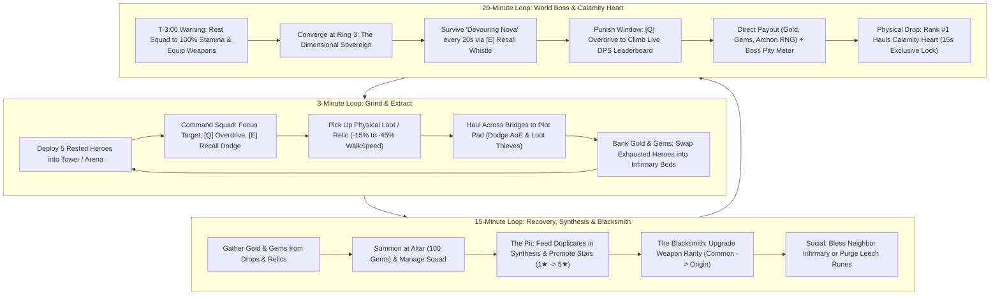

# DOCUMENT 1: COMPLETE GAME DESIGN DOCUMENT (GDD)
**Project Codename:** *Project: Waiting Room* (*Infinite Towers: Become a Master!*)  
**Target Platform:** Roblox (PC, Mobile, Tablet, Console)  
**Server Capacity:** 6 Players per Server  
**Engine Architecture:** Server-Authoritative Data Tables (5 Hz Heartbeat) + Client-Side R15 Visual Interpolation (60 FPS `RenderStepped`) | 14-Byte Binary Buffer Replication

---

## 1. EXECUTIVE OVERVIEW & PLAYER FANTASY

### 1.1 High-Concept Pitch
**Project: Waiting Room** is a tactical squad-command Action-RPG, extraction sandbox, and Tycoon inspired by the dark survival manhwa *Pick Me Up, Infinite Gacha*. Players do not play as generic hack-and-slash warriors; instead, each player embodies a **Master**—a dimensional overseer who summons, trains, equips, promotes, and commands a roster of sentient Gacha Heroes from a private floating fortress known as **The Waiting Room**.

### 1.2 The "Pick Me Up" Fantasy & Zero-Waste Roster Economy
In traditional gacha/simulator games, 95% of summons are discarded as worthless stat-sticks, and combat is reduced to passive AFK auto-clicking. **Project: Waiting Room** solves both problems through two foundational pillars:

1. **The Dual-Role Living Roster (Combat + Labor):**
   - Every hero pulled from the Summoning Altar rolls with **Combat Stats** (`HP`, `ATK`, `Range`), **Labor Output** (Tycoon productivity), and a **Passive Trait**.
   - **Up to 5 Deployed Heroes** accompany the Master into the Central Crimson Tower and surrounding rings, expending **Stamina** as they fight and risking a debilitating **60-second Coma** if left inside lethal AoE telegraphs.
   - **Benched Heroes** do not sit idle in an inventory menu—they physically inhabit the player's **Waiting Room** plot on recuperation beds in **The Infirmary & Barracks** (Stamina & Coma recovery), or can be upgraded with gear at the **Blacksmith Forge**.
   - **Zero Dead Pulls:** Every duplicate 1★–3★ hero is immediately valuable as **Synthesis ("The Pit")** XP fodder, or a required sacrifice for **Star Promotion** (the exclusive pathway to 4★ and 5★ heroes).

2. **Tactical Master Agency Over AFK Whaling:**
   - The Master carries no personal weapon. Instead, the Master directs squads through battlefield commands—**`[Click / Tap]` Focus Target**, **`[Q]` Overdrive Whistle**, and **`[E]` Emergency Recall Whistle**—while physically hauling heavy, high-value **Relics** and cargo back to their plot.
   - Masters use **`[LeftShift]` Sprint** ($3.0\times$ speed multiplier) to cross high-elevation bridges and dodge lethal hazards.
   - Because the World Boss's signature skill check (**Devouring Nova**) inflicts an instant 50% Stamina loss or a **60-second Coma** on heroes left inside the blast zone, an AFK pay-to-win player will have their squad wiped and sent to the Infirmary, dropping their DPS to zero. An active Master who times **`[E]` Emergency Recall Whistle** to dodge the blast and triggers **`[Q]` Overdrive Whistle** during punish windows will consistently out-damage and out-loot an AFK whale.

### 1.3 Hybrid Retention Matrix & Core Drivers

| Reference Title | Adopted Core Mechanic | *Project: Waiting Room* Evolution |
| :--- | :--- | :--- |
| ***Pick Me Up, Infinite Gacha*** | Desperate squad survival, Synthesis pit, Star Promotion, living lobby workers | Heroes suffer Stamina drain and `Coma` if mismanaged; 4★/5★ heroes require hard promotion sacrifices. |
| ***Pet Simulator 99*** | 5-unit ring grinding, tactile loot explosions, exponential progression | Replaces passive pet hovering with Stamina-managed combat squads and active whistle commands. |
| ***Blox Fruits*** | Telegraphed boss skills, live DPS leaderboards, open-world bounty hunting | **Greed vs. Coma** boss checks and **Contested Loot & Targeted Retaliation PvP** in arena rings. |
| ***Grow a Garden*** | Cozy-yet-competitive perimeter plots, passive production, neighbor visits | Visitors perform identical animations to either **Bless** (+25% output) or **Plant Leech Rune** (-20% stolen). |
| ***Steal an Egg*** | Physical object hauling, movement penalties, fumble & steal tension | High-tier **Relics** & cargo weld overhead, slow WalkSpeed by up to -45%, and fumble on AoE hits. |

**The Intimate Server Dynamic:**
In a 6-player server, anonymity disappears. Every player knows who holds Rank #1 DPS on the World Boss, who just scooped contested loot, and who holds an active 3-minute retaliation grudge. The interplay of high-stakes extraction, boss timing, and targeted revenge loops keeps players engaged in continuous 20-minute World Boss cycles.

---

## 2. DETAILED CORE LOOPS



### 2.1 The 3-Minute Micro Loop (Grind, Command & Physical Extraction)
1. **Deploy & Traverse (0:00 – 0:15):**
   - The Master selects up to 5 rested heroes from their roster and sprints (`[LeftShift]`) across the high-elevation stone bridges onto the **Central Crimson Tower** or arena rings.
2. **Tactical Grind & Stamina Expenditure (0:15 – 2:00):**
   - The Master uses **`[Click / Tap]` Focus Target** to direct all 5 deployed heroes onto Mana Crystal clusters, mob packs, or Ring 2 Elites.
   - To accelerate clears, the Master triggers **`[Q]` Overdrive Whistle** (`20s CD`), trading `5 Stamina` per hero for `+40% Attack Speed` for `5s`.
   - When an Elite telegraphs a red ground AoE, the Master triggers **`[E]` Emergency Recall Whistle** (`6s CD`), warping all 5 heroes to the Master's safe position and dropping their aggro for `2s`.
3. **Physical Loot Haul (2:00 – 2:45):**
   - Defeating mobs/Elites spawns physical drops in `Workspace.PhysicalLoot` (**Bounty Bags**, **Mana Geodes**, **Cursed Urns**, **Abyssal Cores**).
   - The Master touches the drop to weld it overhead, incurring a **-15% to -45% WalkSpeed penalty** (and disabling jumping for high-tier relics).
   - If hit by an Elite/Boss AoE mid-haul, the Master is **stunned for 1s and fumbles the item** (which becomes stealable after a **3s owner-lock**).
4. **Extract & Bank (2:45 – 3:00):**
   - Stepping onto the Perimeter Highway (`R >= 460 studs`) or a Private Extraction Pad safely deposits cargo into permanent Gold and Gems.
   - Depleted heroes (`Stamina < 25%`) are swapped into **Infirmary Recuperation Beds**, and fresh rested heroes are rotated into the active squad.

### 2.2 The 15-Minute Meso Loop (Tycoon, Synthesis & Blacksmith Progression)
1. **Facility Upkeep (Every 3–5 Minutes):**
   - Inspect Infirmary beds, swap resting heroes, and manage visitor interactions.
2. **Summoning & Roster Compression (Every 5–10 Minutes):**
   - Spend Gems (`100 Gems` per roll) at the **Summoning Altar** to pull 1★ (70%), 2★ (25%), and 3★ (5%) heroes.
   - Slot heroes into the Infirmary for accelerated recovery.
   - Feed duplicates into **The Pit (Synthesis)** via the dedicated UI modal (`SynthesisController.luau`) to level heroes to their cap (`MaxLevel = Stars * 10`), then execute **Star Promotions** ($1★ \to 5★$) using Promotion Stones.
3. **Artifact Equipping & The Blacksmith Forge (Every 5–10 Minutes):**
   - Equip archetypally matched weapons (Bows for Marksman, Swords/Daggers for Striker, Swords/Axes for Vanguard, Axes for Miner, Staves/Tomes for Scholar).
   - Visit the **Blacksmith Forge** on the plot to upgrade weapon rarity (`Common` $\to$ `Origin`) using Gold and Gems, multiplying base stats up to **`18.00x`** and dramatically accelerating squad DPS.

### 2.3 The 20-Minute Macro Loop (World Boss Prep, "Greed vs. Coma" & Calamity Heart)
1. **T-Minus 3:00 (Server Warning & Preparation Phase):**
   - A server-wide banner announces that **The Dimensional Sovereign (World Boss)** will manifest at Ring 3 in `3:00`.
   - Masters retreat to their plots, rest combat heroes in the Infirmary to hit `100% Stamina`, and refine gear at the Blacksmith Forge.
2. **T-Minus 0:00 to +5:00 (The Encounter — "Greed vs. Coma"):**
   - All active Masters converge on **Ring 3 (Center Boss Altar)**. Boss HP scales dynamically to the server's combined squad DPS.
   - Every `20 seconds`, the Sovereign channels **Devouring Nova** (`3s` red telegraph). Masters must actively reposition to the outer rim and press **`[E]` Emergency Recall Whistle** to yank their heroes out of the blast zone. Heroes left inside lose **50% Stamina instantly** or enter a **60-second Coma** (warped back to their plot's Infirmary).
   - Immediately after each Nova detonation, skilled Masters command **`[Click / Tap]` Focus Target** and pop **`[Q]` Overdrive Whistle** to surge up the live Damage Leaderboard during the `+25% Damage Taken` Core Exposed window.
3. **Post-Kill Climax (Direct Payout + The Calamity Heart Extraction):**
   - All Masters with $\ge 3\%$ damage contribution immediately receive the **Direct Payout** (Gems, Gold, RNG roll for the Exclusive 3★ Boss Hero, plus **+10% Boss Pity Meter** for Ranks #4–#6).
   - The **Physical Drop (The Calamity Heart)** spawns on the Center Altar with a **15-second exclusive pickup lock for Rank #1 DPS**.
   - Rank #1 welds the Calamity Heart overhead (**-45% WalkSpeed**, jumping disabled) and must haul it back to their plot extraction pad while defending against ambush hazards and rival thieves.

---

## 3. MAP & SPATIAL DESIGN SPECIFICATIONS

### 3.1 Global Footprint & Coordinate System
- **Total Map Size:** `1,200 x 1,200 studs` (`X: -600 to +600`, `Z: -600 to +600`).
- **World Origin `(0, 0, 0)`:** Center of the **Central Crimson Tower** and **Ring 3 Boss Altar**.
- **Elevation Profile & Floating Ring Architecture:**
  - **5 Floating Fortress Plot Islands:** Arranged symmetrically in a ring at $R = 540\text{ studs}$ ($72^\circ$ spacing, $Y = 12$) facing the central structure.
  - **High-Elevation Bridges (`IslandTowerBridges`):** Connect each floating plot island directly to the central arena and tower.
  - **Central Crimson Tower:** 18 fully walkable platforms, quarter-turn ascent ramps with server-side collision, and grounded waypoint navigation for lightweight hero entities.
  - **Safety Catch Plane:** Lower kill/respawn plane ($Y = -95$) catching fallen players and returning them safely to their plot spawn.

```
                              [N: (0, -600)]
                            +----------------+
                            |  PLOT 1 (0°)   |
                            +-------+--------+
                                    | (Bridge)
               PLOT 5 (288°)        |        PLOT 2 (72°)
                   \                |                /
             (Bridge)\       +------+------+       /(Bridge)
                       \     |   TOWER &   |     /
                        -----+ RING ARENA  +-----
                       /     |  (18 Floors)|     \
             (Bridge)/       +------+------+       \(Bridge)
                   /                |                \
              PLOT 4 (216°)         |        PLOT 3 (144°)
                                    | (Bridge)
                            +-------+--------+
                            |  Perimeter Rim |
                            +----------------+
                              [S: (0, +600)]
```

### 3.2 Concentric Zone Breakdown & Radii Table

| Zone Name | Radial Distance from `(0,0,0)` | Zone Footprint | Access Rule | Combat & PvP Rules | Primary Drops |
| :--- | :--- | :--- | :--- | :--- | :--- |
| **Central Crimson Tower** | `0 – 120 studs` | 18 Walkable Floors with ascent ramps & center fountain | Open to all | Active mob grinding & vertical waypoint traversal. | Mana Geodes, Gold |
| **Ring 3: Center Boss Altar** | `0 – 120 studs` (Dia: `240`) | Circular obsidian altar at origin | Open to all | World Boss (20m) & Rift Warden. PvE AoE Fumbles active; direct PvP disabled on Altar platform. | **Calamity Heart** (World Boss), **Abyssal Core** (Rift Boss) |
| **Ring 2: Corrupted Grove** | `120 – 280 studs` | `160 studs` annulus | Open to all | High-density Elites with red AoE telegraphs. Contested loot PvP active. | **Cursed Urns**, **Abyssal Cores**, High Gold |
| **Ring 1: Outer Ruins** | `280 – 460 studs` | `180 studs` annulus | Open from start | Low-level mobs & Mana Crystal nodes. Contested loot PvP active. | **Mana Geodes**, Starter Gold |
| **Perimeter Highway** | `460 – 480 studs` | `20 studs` paved ring road | Open to all | **Safe Zone** (No mobs). Safe banking threshold ($R \ge 460$). | Banked cargo conversion |
| **5 Floating Plot Islands** | `R = 540 studs` ($Y = 12$) | Fortress island mesh with courtyard & walls | Plot Owner + Visitors | Safe Zone. Visitors can inspect or Bless/Leech Infirmary. | Healing, Blacksmithing, Synthesis |

### 3.3 Private Plot Internal Layout
Each of the 5 Floating Fortress Islands is oriented toward the Central Crimson Tower:
- **Plaza & Extraction Pad:** Glowing cyan platform for depositing carried cargo into permanent vault currency.
- **Summoning Altar & The Pit:** Obelisk for 100-Gem Gacha pulls and the fiery Synthesis Cauldron (`SynthesisController.luau`) for feeding XP and promoting hero stars.
- **The Infirmary & Barracks:** Recuperation Beds where exhausted or `Coma`-afflicted heroes physically lie down while Healer workers channel recovery beams.
- **The Blacksmith Forge:** Interactive 3D station featuring an anvil, hearth coals, workbench, and `[E]` ProximityPrompt for weapon ascension.

---

## 4. HERO & COMBAT MECHANICS (MATHEMATICAL SPECIFICATIONS)

### 4.1 Gacha Banner & Base Archetypes
- **Summon Cost:** `100 Gems` per single pull (`900 Gems` for 10x pull).
- **Drop Rates:** `1★ Common (70.0%)`, `2★ Rare (25.0%)`, `3★ Epic (5.0%)`. `4★` and `5★` are obtained exclusively via **Star Promotion**.

#### Launch Roster Base Stats (At 1★, Level 1)
Every summoned hero rolls a `QualityScalar` $q \in [0.90, 1.15]$ applied to their archetype base stats:

| Archetype | Base HP ($HP_0$) | Base ATK ($ATK_0$) | Attack Interval ($t_{\text{atk}}$) | Attack Range | Base Labor ($L_0$) | Preferred Facility (+25% Synergy) |
| :--- | :--- | :--- | :--- | :--- | :--- | :--- |
| **Vanguard** (Tank) | `450` | `22` | `1.20s` | `6 studs` | `10 / min` | None |
| **Striker** (Melee DPS) | `280` | `38` | `0.85s` | `6 studs` | `12 / min` | None |
| **Marksman** (Ranged DPS) | `210` | `34` | `0.80s` | `28 studs` | `13 / min` | None |
| **Miner** (Gem Specialist) | `300` | `20` | `1.05s` | `6 studs` | `20 / min` | None |
| **Healer** (Infirmary Spec.) | `260` | `18` | `1.25s` | `24 studs` | `18 / min` | **The Infirmary & Barracks** |
| **Scholar** (Spell Specialist)| `220` | `24` | `1.00s` | `26 studs` | `22 / min` | None |

### 4.2 Effective Combat & Labor Formulas
- **Level Cap Formula:** $\text{MaxLevel}(S) = S \times 10$ (`1★ = Lv.10`, `2★ = Lv.20`, `3★ = Lv.30`, `4★ = Lv.40`, `5★ = Lv.50`).
- **Star Promotion Multipliers:** Promoting a hero from $S \to S+1$ resets Level to `1`, increases cap by `+10`, multiplies Base Combat stats by **`1.65x`**, and multiplies Base Labor output by **`1.35x`**.
- **Effective Combat Stats (with Artifact Integration):**
  $$\text{EffectiveATK} = \text{round}\Big(ATK_0 \times q \times 1.65^{(S - 1)} \times \big(1 + 0.08(L - 1)\big) \times (1 + B_{\text{TraitATK}} + B_{\text{ImprintATK}})\Big) + TotalATKBonus_{\text{Artifact}}$$
  $$\text{EffectiveHP} = \text{round}\Big(HP_0 \times q \times 1.65^{(S - 1)} \times \big(1 + 0.08(L - 1)\big) \times (1 + B_{\text{TraitHP}} + B_{\text{ImprintHP}})\Big)$$
  $$\text{EffectiveInterval} = \max\left(0.12\text{s}, \frac{HeroBaseInterval}{1 + TotalSpeedBonus_{\text{Artifact}}}\right)$$
- **Effective Labor Formula:**
  $$\text{EffectiveLabor} = L_0 \times q \times 1.35^{(S - 1)} \times \big(1 + 0.05(L - 1)\big) \times (1 + B_{\text{Synergy}}) \times (1 + B_{\text{TraitLabor}} + B_{\text{ImprintLabor}})$$
  *(Where $B_{\text{Synergy}} = 0.25$ when assigned to preferred facility).*

### 4.3 Waiting Room Facility Output Formulas
Each facility upgrades from **Level 1 to Level 5** using Gold:

**The Infirmary & Barracks (Stamina Regen & Coma Reduction):**
   - **Stamina Recovery Rate:** $\text{StaminaRegenPerSec} = 2.5 + (0.4 \times F) + (0.06 \times \sum \text{EffectiveLabor})$
   - **Coma Duration Reduction:** $\text{EffectiveComaDuration} = \max\left(20\text{s}, \frac{60\text{s}}{1 + 0.05(F - 1) + 0.008 \sum \text{EffectiveLabor}}\right)$

### 4.4 Master Controls & Tactical Commands

| Action | Keybind / Input | Description |
| :--- | :--- | :--- |
| **Shift Sprint** | `[LeftShift / RightShift]` | $3.0\times$ speed multiplier for rapid movement across bridges and rings. |
| **Focus Target** | `[Click / Tap]` | Raycast onto any mob, boss, or thief to focus all 5 heroes' aggro. |
| **Overdrive Whistle** | `[Q]` | $20\text{s}$ CD. Consumes $5$ Stamina/hero for $+40\%$ Attack Speed for $5\text{s}$. |
| **Emergency Recall** | `[E]` | $6\text{s}$ CD. Instantly warps squad to Master + $2\text{s}$ pacify (dodges Devouring Nova). Yields priority to nearby ProximityPrompts. |
| **Drop Carried Item**| `[R]` / Drop button | Drops carried cargo or relic on the ground; restores normal movement. |
| **Retaliate Attack** | `[⚔️ RETALIATE]` | Single-click HUD response when your drop is stolen to unleash squad PvP. |

---

## 5. WORLD BOSS ENCOUNTER DESIGN ("THE DIMENSIONAL SOVEREIGN")

### 5.1 Spawn Schedule & Mechanics
- **Spawn Cadence:** Every **20 minutes** at **Ring 3 Center Boss Altar**.
- **Pre-Spawn Warning:** At `T - 3:00`, the skybox shifts to crimson and a server banner sounds the alert.
- **Encounter Duration:** 5-minute despawn timer.
- **The "Greed vs. Coma" Skill Check (*Devouring Nova*):**
  - Channels every **`20.0 seconds`** with a **`3.0-second`** expanding crimson telegraph ($R = 0\text{ to }85\text{ studs}$).
  - Masters must stand in the **Safe Rim** ($R = 85\text{ to }120\text{ studs}$) and press **`[E]` Recall Whistle** between `t = 1.1s` and `t = 2.8s`.
  - Heroes caught inside lose **50% Stamina** or enter an instant **60-second Coma** back at base.
  - For **`5.0 seconds`** after detonation, the Sovereign's core is exposed, granting a **`+25% Damage Taken`** punish window where skilled Masters trigger **`[Q]` Overdrive Whistle**.

### 5.2 World Boss Direct Payout Table
Qualification: Deal $\ge 3.0\%$ of Boss Total HP.

| DPS Rank | Gems Awarded | Gold Awarded | Sovereign Archon (3★) Drop Chance | Boss Pity Gained |
| :---: | :---: | :---: | :---: | :---: |
| **#1** | **1,000 Gems** | **10,000 Gold** | **15.0%** | **0%** (Gets 15s Calamity Heart Lock) |
| **#2** | **750 Gems** | **7,500 Gold** | **10.0%** | **+5%** |
| **#3** | **550 Gems** | **5,500 Gold** | **7.0%** | **+5%** |
| **#4** | **400 Gems** | **4,000 Gold** | **4.0%** | **+10%** |
| **#5** | **300 Gems** | **3,000 Gold** | **2.5%** | **+10%** |
| **#6** | **250 Gems** | **2,500 Gold** | **1.5%** | **+10%** |

---

## 6. CONTESTED LOOT, RETALIATION PVP & ESPIONAGE

### 6.1 Contested Loot & Targeted Retaliation PvP
1. **Universal Physical Drops:** Monsters and crystal nodes drop 3D physical cargo in `Workspace.PhysicalLoot` tagged with `KillerUserId`.
2. **Physical Overhead Hauling:** Picking up loot welds it overhead, slows movement by `-15%`, and triggers the upper-arm holding pose (`HoldingAnimationController.client.luau`).
3. **Theft Detection & Retaliation:** Picking up another player's loot flags the player as a `[Loot Thief]` and registers a 3-minute retaliation grudge. The victim receives a real-time HUD alert with a `[⚔️ RETALIATE]` button.
4. **Squad-vs-Squad Clash:** Clicking `[⚔️ RETALIATE]` commands your squad to attack the thief's squad at $25\%$ PvP damage scaling. The targeted squad auto-retaliates. Defeated heroes enter `COMA`.
5. **Squad Wipe & Spilled Loot:** On squad defeat, all carried loot spills onto the ground, and field looting is locked until the Master returns to their Waiting Room plot to heal in the Infirmary.
6. **Perimeter Banking:** Reaching the perimeter or plot pad safely banks loot into permanent Gold and Gems.

### 6.2 Waiting Room Espionage & Mimic Bluffing
Visitors can walk onto any neighbor's plot and channel `[E]` (`2.0s`) on the **Infirmary**:
- **Bless Facility (+25%):** Grants `+25%` output for 3 minutes; awards visitor `+25 Gems` and `+5 Honor`.
- **Plant Leech Rune (-20%):** Secretly siphons `20%` of facility output for 3 minutes to the visitor.
- **Counterplay (Purge Facility):** Owner has a `15.0s` window to activate Purge. Purging a Leech Rune stuns the visitor for `3.0s` and forces them to drop a Bounty Bag. Purging a Blessing destroys the owner's own buff.

---

## 7. EQUIPPABLE ARTIFACT & BLACKSMITH SYSTEM

### 7.1 System Overview & Zero-RNG Philosophy
Gear progression decouples **Permanent Base Potential** from **Progressive Rarity Multipliers**:
1. **Permanent Star Potential (1★ to 7★):** Fixed, unchangeable Star tier dictating base stats: **Base Attack Power (`+15` to `+950`)** and **Base Attack Speed (`+5%` to `+60%`)**.
2. **Deterministic 16-Tier Blacksmith Upgrading:** Every artifact can be forged through **16 Rarity Tiers** (`Common` up to `Origin`) at the Waiting Room Blacksmith Forge using Gold and Gems, multiplying base stats up to **`18.00x`**.
3. **Archetype Restrictions:** Weapons are bound strictly to hero archetypes based on `HeroCatalog.luau`:
   - `BOW` $\to$ Marksman (`hero_jenna`)
   - `SWORD` $\to$ Striker, Vanguard (`hero_han`, `hero_velkist`, `hero_aaron`, `hero_archon`)
   - `DAGGERS` $\to$ Striker (`hero_velkist`)
   - `AXE` $\to$ Vanguard, Miner (`hero_aaron`, `hero_catio`)
   - `TOME` / `STAFF` $\to$ Scholar, Healer (`hero_eolka`)

### 7.2 The 7 Star Tiers (Base Stat Seeds)
| Star Tier | Base Attack Power ($ATK_{\text{Base}}$) | Base Attack Speed Bonus ($ASPD_{\text{Base}}$) | Progression Context |
| :---: | :---: | :---: | :--- |
| **1★** | **`+15`** | **`+5.0%`** (`+0.05`) | Starter equipment (`art_hunters_shortbow`, `art_iron_broadsword`) |
| **2★** | **`+35`** | **`+10.0%`** (`+0.10`) | Early Ring 1 mob / crystal drop |
| **3★** | **`+75`** | **`+16.0%`** (`+0.16`) | Rare Ring 1 drop / basic craft |
| **4★** | **`+150`** | **`+24.0%`** (`+0.24`) | Ring 2 Corrupted Grove Elite drop |
| **5★** | **`+300`** | **`+34.0%`** (`+0.34`) | Rare Ring 2 Abyssal Executioner drop |
| **6★** | **`+550`** | **`+46.0%`** (`+0.46`) | Rift Warden Floor Boss reward |
| **7★** | **`+950`** | **`+60.0%`** (`+0.60`) | Sovereign World Boss pinnacle reward |

### 7.3 The 16 Rarity Tiers & Multipliers
| Tier | Rarity Name | Multiplier | Hex Color | Visual & VFX Identity |
| :---: | :--- | :---: | :---: | :--- |
| **1** | **Common** | **`1.00x`** | `#B0B0B0` | Weathered iron / rustic wood; standard matte finish. |
| **2** | **Uncommon** | **`1.15x`** | `#4BB543` | Cleaned edge, subtle emerald sheen. |
| **3** | **Rare** | **`1.35x`** | `#2980B9` | Polished azure finish; fine leather wrappings. |
| **4** | **Superior** | **`1.60x`** | `#8E44AD` | Deep amethyst inlay with fine balance grooves. |
| **5** | **Exalted** | **`1.90x`** | `#D35400` | Tempered bronze plating; warm amber sheen. |
| **6** | **Legendary** | **`2.30x`** | `#F1C40F` | Gilding with glowing runes; subtle gold particle trails. |
| **7** | **Mythical** | **`2.80x`** | `#E74C3C` | Crimson mana channels; pulsing inner embers. |
| **8** | **Transcendent** | **`3.40x`** | `#1ABC9C` | Pure sea-glass teal resonance; condensation mist. |
| **9** | **Ascendant** | **`4.10x`** | `#E056FD` | Neon violet crystal edge; dimensional crackle. |
| **10** | **Ethereal** | **`5.00x`** | `#686DE0` | Semi-translucent spectral steel; atmospheric hum. |
| **11** | **Immortal** | **`6.10x`** | `#FF7979` | Sanguine abyssal forged alloy; trailing smoke. |
| **12** | **Divine** | **`7.50x`** | `#F9CA24` | Blinding solar gold radiant aura; consecrated luster. |
| **13** | **Celestial** | **`9.20x`** | `#00D2D3` | Cosmic azure starry core; orbiting orbital motes. |
| **14** | **Primordial** | **`11.30x`** | `#FF3838` | Raw volcanic magma veins; Neon material ignition. |
| **15** | **Supreme** | **`14.00x`** | `#BADC58` | Iridescent viridian prism; high-frequency bloom. |
| **16** | **Origin** | **`18.00x`** | `#FF9FF3` | Full prismatic animated chroma aura; dimensional distortion. |

### 7.4 3D Visual Equipping & Hunter's Shortbow Standards
1. **Prefab Directory:** Centralized in `ReplicatedStorage.Assets.Weapons` (`weapon_bow`, `weapon_sword`, `weapon_daggers`, `weapon_axe`, `weapon_staff`, `weapon_tome`).
2. **Physical Constraints:** All parts have `CanCollide = false`, `CanTouch = false`, `CanQuery = false`, `Massless = true`, `Anchored = false`, welded to an invisible PrimaryPart `Handle`.
3. **Hunter's Shortbow:** Chiseled recurve stave, leather grip, dual dynamic `Beam` sinew strings connecting from tip nocks to `RightHand.DrawAttachment`, and aligned hunter arrow. Procedural socketing in `ArtPackVisuals.luau` ensures clean 60 FPS animation.
