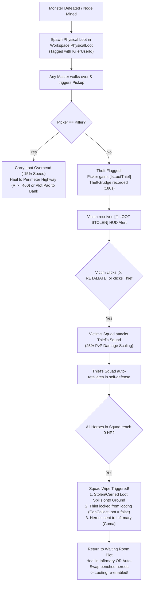

# Project: Waiting Room (*Infinite Towers: Become a Master!*)
## Prototype Implementation & Architecture Documentation

**Target Platform:** Roblox (PC, Mobile, Console)  
**Architecture Standard:** Zero Server-Side Humanoids | 5 Hz (`0.20s`) Authoritative Simulation | 60 FPS Client `RenderStepped` Interpolation | 14-Byte Binary Buffer Replication  
**Studio Place ID:** `136256010643848`  
**Version:** Current Implementation (Base Overhaul, Blacksmith Artifacts & Gothic UI)  
**Date:** October 2026  

---

## 1. Executive Summary

This document details the fully functioning, playable Roblox Studio build of *Infinite Towers: Become a Master!*, transitioning the mathematical design into production Luau architecture.

The current implementation establishes:
1. **The 3D Concentric Arena & Floating Islands ($1,200 \times 1,200\text{ studs}$):**
   - **Central Crimson Tower:** Features 18 fully walkable platforms, quarter-turn ascent ramps with server-side collision, and grounded waypoint navigation for lightweight hero entities.
   - **5 Floating Fortress Plot Islands:** Arranged symmetrically in a ring ($R = 540\text{ studs}$, $72^\circ$ spacing, $Y = 12$) facing the Central Crimson Tower, interconnected via high-elevation bridges (`IslandTowerBridges`).
   - **Kill/Safety Catch Plane:** Lower kill/respawn plane ($Y = -95$) catching fallen players and returning them safely to their plot spawn.
2. **Zero Server-Side Humanoid Combat Engine ($5\text{ Hz}$):**
   - Authoritative Luau table state machines simulating Heroes, Ring 1 Mobs, Ring 2 Elites, and the World Boss.
   - Automatic leash constraints, formation following, dynamic target acquisition, grounded pathfinding traversal (`HeroNavigation.luau`), and targeted retaliation.
3. **Bandwidth-Optimized Binary Buffer Replication:**
   - Entities replicate position ($X, Z$ plus quantized floor height $Y$), yaw, state enums, HP permille, Stamina, and flags in a compact $14\text{-byte}$ struct broadcast at $5\text{ Hz}$ over `ReplicationTick` (`5-byte` packet header, maximum 64 entities per packet = 901 bytes).
4. **Active Master Tactical Agency & Movement:**
   - **Shift Sprint:** `[LeftShift / RightShift]` provides an immediate $3.0\times$ movement speed multiplier for traversing floating bridges and concentric rings.
   - **Focus Target:** `[Click / Tap]` Viewport raycasting onto Mobs, Bosses, or Enemy Thieves commands squad aggro.
   - **Overdrive Whistle:** `[Q]` ($20\text{s}$ CD, $-5$ Stamina, $+40\%$ ASPD for $5\text{s}$).
   - **Emergency Recall Whistle:** `[E]` ($6\text{s}$ CD, instant warp to Master, $2\text{s}$ aggro pacification; yields priority to nearby ProximityPrompts).
   - **Drop Item:** `[R]` / HUD button drops carried cargo or relics.
5. **Living Waiting Room Tycoon ($1\text{ Hz}$):**
   - Benched heroes physically inhabit the plot as 3D workers on pedestals and recuperation beds, powering the **Mana Conduit** (Gems) and **Infirmary & Barracks** (Stamina & Coma recovery).
   - **Blacksmith Forge:** An interactive 3D forge station on each island plot featuring an anvil, burning neon coals, workbench, and `[E]` ProximityPrompt for upgrading weapons.
   - *Note on Pruned Features:* Research Points (RP) and the Dimensional Lab tech tree were removed to eliminate artificial progression barriers. All 5 squad deployment slots and arena areas are accessible.
6. **The World Boss ("The Dimensional Sovereign"):**
   - Features dynamic HP scaling, phase transitions, expanding $85\text{-stud}$ red **Devouring Nova** telegraphs every $20\text{s}$, $5\text{s}$ $+25\%$ Core Exposed punish windows, and independent squad DPS loot payout with Boss Pity.
7. **Contested Loot & Targeted Retaliation PvP:**
   - **Universal Physical 3D Drops:** Monsters and crystal nodes drop authentic 3D mesh assets in `Workspace.PhysicalLoot` tagged with `KillerUserId` (`prop_bounty_bag` for Gold, `prop_rift_tether_crystal` for Gems, and `RelicModels` for Relics).
   - **Physical Overhead Hauling:** Picking up loot welds it overhead via `WeldConstraint`, incurs a WalkSpeed cargo penalty, and triggers the upper-arm holding pose animation (`HoldingAnimationController.client.luau`).
   - **Theft Detection & Retaliation:** Picking up another player's loot flags the player with `IsLootThief = true` and registers a 3-minute retaliation grudge (`TheftGrudges[VictimUserId][ThiefUserId]`). The victim receives a real-time HUD alert with a `[⚔️ RETALIATE]` button.
   - **Squad-vs-Squad PvP:** Clicking `[⚔️ RETALIATE]` or raycasting onto the thief dispatches `FocusTargetRemote(0, thiefUserId)`, enabling the aggrieved Master's squad to attack the thief's squad at $25\%$ PvP damage scaling. The targeted squad auto-retaliates in mutual defense. Defeated heroes fall into Coma.
   - **Squad Wipe, Spilled Loot & Waiting Room Recovery:** When a Master's deployed squad is defeated, all carried loot spills onto the ground. The defeated Master's looting is locked (`CanCollectLoot = false`) until returning to their plot to heal in the Infirmary or swap fresh benched heroes.
   - **Perimeter Banking:** Reaching the Perimeter Highway ($R \ge 460\text{st}$) or a private plot extraction pad safely banks carried loot into permanent vault currency (Gold and Gems).
8. **Equippable Artifact & Blacksmith System:**
   - **6 Weapon Classes:** Bows, Swords, Daggers, Axes, Tomes, and Staves bound strictly to hero archetypes (Marksman, Striker, Vanguard, Miner, Scholar, Healer).
   - **Permanent 7 Star Tiers (1★ to 7★):** Fixed base stat seeds (`+15` to `+950` Base ATK; `+5%` to `+60%` Base ASPD).
   - **Deterministic 16-Tier Rarity Upgrades:** Forged from `Common` up to `Origin` at the Blacksmith Forge using Gold and Gems, multiplying base stats up to $18.00\times$.
   - **Visual Socketing:** Procedural client-side attachment to hero hands (e.g. Hunter's Shortbow with forward canted grip, dynamic dual sinew `Beam` strings, and nocked arrow).
9. **Dedicated Synthesis UI & The Pit Overhaul:**
   - Features a dedicated modal (`SynthesisController.luau`) with 1 recipient slot, 5 donor material slots, live level preview bar, and deterministic EXP calculation.
   - 100% deterministic imprints, material-based star promotion, and hero conversion.
10. **Gothic Obsidian & White Filigree UI:**
    - Top menu bar removed; currency pills (`GoldPill`, `GemsPill`) anchored at bottom-left with ornate 4-corner gothic filigree box styling (`GothicBoxStyle.luau`).
    - Bottom Toolbar (`BottomToolbar`) provides central action buttons (Whistles, Collect Gems, Facility shortcuts) and responsive scaling.

---

## 2. Roblox DataModel Directory Hierarchy

```text
game
├── Workspace
│   ├── BaseOverhaulGeometry
│   │   ├── CentralCrimsonTower       -- 18-floor walkable tower with ascent ramps & center fountain
│   │   └── IslandTowerBridges        -- High-elevation stone bridges connecting islands to tower
│   ├── ArenaRings
│   │   ├── Ring1_OuterRuins          -- Outer annulus surrounding the central structure
│   │   ├── Ring2_CorruptedGrove      -- Mid-tier annulus with Elite mobs
│   │   └── Ring3_CenterBossAltar     -- Center altar for World Boss & Rift Warden encounters
│   ├── PerimeterHighway              -- R >= 460 studs safe banking boundary
│   ├── WaitingRoomPlots              -- 5 Floating Plot Islands (Plot_1 .. Plot_5 at 72° spacing)
│   │   ├── Plot_1 .. Plot_5
│   │   │   ├── FloatingFortressIsland -- Island terrain mesh, perimeter walls, and central plaza
│   │   │   ├── PlotSpawn             -- Player SpawnLocation
│   │   │   ├── PrivateExtractionPad  -- Glowing platform for banking cargo
│   │   │   ├── SummoningAltar        -- Gacha Obelisk + The Pit Cauldron
│   │   │   ├── Facility_ManaConduit  -- 3 Worker Pedestals + Gem Chest
│   │   │   ├── Facility_Infirmary    -- 3 Worker Pedestals + 5 Recuperation Beds
│   │   │   ├── Facility_Blacksmith   -- 3D Anvil, glowing coals, furnace, workbench, and prompt
│   │   │   └── ActivePlotWorkers     -- Dynamic 3D physical worker models & sleeping bed avatars
│   │   └── Plot_6                    -- Reserved / hidden legacy slot
│   ├── PhysicalLoot                  -- Universal collectible physical drops (Gold bags, Gem crystals)
│   ├── PhysicalRelics                -- Server-managed BaseParts (WeldConstraint overhead)
│   └── ClientVisualEntities          -- Client-interpolated 3D R15/Mob models & BillboardGuis
│
├── ReplicatedStorage
│   ├── Remotes
│   │   ├── CombatRemotes             -- ReplicationTick, FocusTarget, WhistleCommand, BossTelegraph, CombatVFX, EntityMetadataSync, WorldBossTrigger, LootStolenAlert, SquadWipeState, CarriedLootSync
│   │   ├── RelicPactRemotes          -- RelicStateChanged, BountyDropped
│   │   ├── TycoonGachaRemotes        -- RequestSummon, SynthesizeHeroes, PromoteHeroStar, AssignHeroRole, FacilityInteract
│   │   └── SyndicateRemotes          -- PlotEspionage, ProfileDeltaSync, SystemToast
│   ├── Shared
│   │   ├── Config
│   │   │   ├── ArtifactCatalog.luau  -- Weapons, 7 Star Tiers, 16 Rarity Tiers, Blacksmith upgrade costs
│   │   │   ├── FacilityConfig.luau   -- Levels 1-5 upgrade costs (Gold only), caps
│   │   │   ├── HeroCatalog.luau      -- Roster seed stats, archetypes, traits, banner weights
│   │   │   ├── PitBalanceConfig.luau -- Pit costs, EXP formulas, imprint definitions, promotion materials
│   │   │   ├── RelicConfig.luau      -- Speed penalties, despawn times, drop rates, Gold/Gem payouts
│   │   │   └── WorldBossConfig.luau  -- Mob specs, Sovereign phases, direct loot rankings
│   │   └── Util
│   │       ├── GothicBoxStyle.luau   -- Obsidian & white filigree UI container styling
│   │       ├── PitMath.luau          -- Synthesis preview, imprint matching, conversion calculations
│   │       └── StatFormulas.luau     -- Mathematical formulas (Level XP, Promotion, Labor, Combat DPS)
│   └── Assets                        -- Rigs, Mob Rigs, Relics, Weapons, Props, and ArtPackVisuals
│
├── ServerScriptService
│   ├── BaseOverhaul
│   │   ├── BridgeBuilder.luau        -- High-elevation stone bridge construction
│   │   ├── FountainBuilder.luau      -- Central plaza gothic fountain model
│   │   ├── IslandBuilder.luau        -- Floating island rock geometry and foundation
│   │   ├── LightingAndEffects.luau   -- Atmospheric lighting, fog, and skybox setup
│   │   ├── PlaceIslandsInRing.server.luau -- Master runner for island ring & safety catch plane
│   │   ├── TowerBuilder.luau         -- Procedural 18-floor Crimson Tower generator
│   │   └── WallsBuilder.luau         -- Castle battlements and fortress wall builder
│   ├── Combat
│   │   └── CombatSimulation.server.luau -- 5 Hz zero-humanoid engine, 14-byte replication, Contested Loot, Retaliation PvP
│   ├── Core
│   │   ├── DataManager.server.luau   -- Profiles, session management, Gacha, Blacksmith upgrades, artifact persistence
│   │   ├── HeroNavigation.luau       -- Grounded waypoint navigation, slope and clearance verification
│   │   ├── PitService.luau           -- Authoritative synthesis, promotion, and imprint transactions
│   │   ├── PlotBuildingPlacement.server.luau -- Facility placement runner
│   │   ├── PlotBuildings.luau        -- Facility layout logic
│   │   ├── PlotFacilityArchitecture.luau -- Facility geometry generator
│   │   ├── PlotManager.server.luau   -- 5-island plot allocation, respawn binding, worker 3D models
│   │   ├── TowerTraversal.luau       -- Collision-checked tower ramp traversal and waypoint routing
│   │   └── TowerTraversalSetup.server.luau -- Traversal initialization
│   ├── ExtractionAndSocial
│   │   ├── RelicService.server.luau  -- Relic spawning, welds, slow penalties, fumbles, extraction pads
│   │   └── SyndicateService.server.luau -- Waiting room espionage (Bless vs Leech, 15s Purge, Mimic chest)
│   └── Tycoon
│       ├── BlacksmithService.server.luau -- 3D Blacksmith Forge stations, prompts, and upgrade integration
│       └── WaitingRoomService.server.luau -- 1 Hz facility production (Mana Conduit & Infirmary)
│
└── StarterPlayer.StarterPlayerScripts
    ├── Input
    │   └── MasterController.client.luau -- Click raycast, [Shift] Sprint, [Q], [E] hotkeys, ProximityPrompts
    ├── Rendering
    │   ├── EntityRenderer.client.luau -- 5 Hz 14-byte buffer unpacker, 60 FPS lerp, unit status billboards, weapon socketing
    │   └── HoldingAnimationController.client.luau -- Upper-arm holding pose animation for carrying physical loot
    └── UI
        ├── FacilityController.luau   -- Focused facility HUDs (Summoning, Infirmary, Squad Management)
        ├── GothicBoxStyle.luau       -- Client-side container styling helper
        ├── HeroCard.luau             -- Reusable hero card UI component
        ├── HUDController.client.luau -- 60 FPS HUD, Gothic bottom toolbar, bottom-left currencies, modals
        ├── PitController.luau        -- Pit interface wrapper
        ├── PitDesignTokens.luau      -- Design tokens and color palette for The Pit
        └── SynthesisController.luau  -- Dedicated Synthesis UI modal (recipient slot, 5 material slots, preview)
```

---

## 3. Contested Physical Loot & Targeted PvP Flow



---

## 4. Verification & Status Summary

| System | Implementation Status | Verification Method |
| :--- | :--- | :--- |
| **Zero Server-Side Humanoid Engine** | Complete & Verified | 5 Hz server loop runs with 0 Humanoids; 60 FPS client interpolation |
| **14-Byte Binary Buffer Replication** | Complete & Verified | Packed snapshots broadcast $X, Z, Y$, yaw, and unit state flags in 14-byte structs with 5-byte header |
| **Base Overhaul & Floating Islands** | Complete & Verified | 5 floating islands at $72^\circ$ spacing ($R = 540$) around Central Crimson Tower with bridge connections |
| **Tower Traversal & Waypoint Routing** | Complete & Verified | 18 platforms with ascent ramps; server collision verified; grounded waypoint routing in `HeroNavigation` |
| **Shift Sprint Movement** | Complete & Verified | `[LeftShift / RightShift]` applies $3.0\times$ speed multiplier with responsive handling |
| **Equippable Artifact & Blacksmith System**| Complete & Verified | 6 weapon types, 7 Star Tiers, 16 Rarity Tiers; interactive Blacksmith Forge station on plot |
| **Dedicated Synthesis UI Modal** | Complete & Verified | Recipient slot, 5 donor material slots, live level preview bar, 100% deterministic imprints |
| **Gothic Obsidian & White Filigree UI** | Complete & Verified | Top bar removed; bottom-left currency cluster and bottom toolbar with ornate filigree styling |
| **Physical Contested Loot** | Complete & Verified | Physical meshes spawn in `Workspace.PhysicalLoot`, weld overhead, and bank at $R \ge 460$ or plot pad |
| **Loot Theft & Retaliation PvP** | Complete & Verified | Theft sets `IsLootThief`, records `TheftGrudge`, HUD Retaliate dispatches PvP aggro, and squads clash |
| **Squad Wipe & Spilled Loot** | Complete & Verified | Wipe drops held cargo, sets `CanCollectLoot = false`, and locks looting until Infirmary recovery |
| **Pit Proximity Access** | Complete & Verified | Prompt ignores decorative mesh occlusion on all plots; `[E]` opens the Pit modal and takes priority over Recall |
| **Manual Item Drop** | Complete & Verified | `[R]` drops cargo; HUD Drop button drops relics; both support pickup again; 1.5s delay prevents instant re-grab |
| **Pruned Systems Cleanliness** | Clean | Blood Pacts, Mercenaries, and Research Points completely removed; zero runtime errors |
