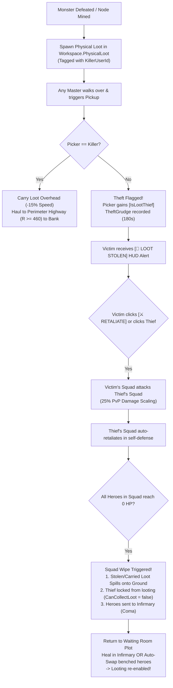

# Project: Waiting Room (*Infinite Towers: Become a Master!*)
## Prototype v0.1 Implementation & Architecture Documentation

**Target Platform:** Roblox (PC, Mobile, Console)  
**Architecture Standard:** Zero Server-Side Humanoids | 5 Hz (`0.20s`) Authoritative Simulation | 60 FPS Client `RenderStepped` Interpolation | Binary Buffer Replication  
**Studio Place ID:** `136256010643848`  
**Version:** v0.1 (Prototype Release - Retaliation PvP & Streamlined Architecture)  
**Date:** October 2026  

---

## 1. Executive Summary

Prototype v0.1 transitions the design and mathematical specifications into a fully functioning, playable Roblox Studio build with high architectural rigor.

The prototype establishes:
1. **The 3D Concentric Arena ($1,200 \times 1,200\text{ studs}$):** Bowl-to-Pinnacle sightlines, 6 Private Waiting Room Plots, Ring 2 Arcane Barrier Gate with collision groups, and the raised Ring 3 Obsidian Altar.
2. **Zero Server-Side Humanoid Combat Engine ($5\text{ Hz}$):** Authoritative Luau table state machine simulating Heroes, Ring 1 Mobs, Ring 2 Elites, and World Boss with automatic leash constraints, formation following, dynamic target acquisition, and targeted retaliation.
3. **Bandwidth-Optimized Binary Buffer Replication:** Entities replicate position, yaw, state enums, HP permille, Stamina, and flags in a compact $12\text{-byte}$ struct broadcast at $5\text{ Hz}$ over `ReplicationTick`.
4. **Active Master Tactical Agency:**
   - `[Click / Tap]` Viewport raycasting to Focus Squad Aggro on Mobs, Bosses, or Enemy Thieves.
   - `[Q] Overdrive Whistle` ($20\text{s}$ CD, $-5$ Stamina, $+40\%$ ASPD for $5\text{s}$).
   - `[E] Emergency Recall Whistle` ($6\text{s}$ CD, instant warp to Master, $2\text{s}$ aggro pacification to dodge AoEs).
5. **Living Waiting Room Tycoon ($1\text{ Hz}$):** Benched heroes physically inhabit the plot as 3D workers on pedestals and recuperation beds, powering the Mana Conduit (Gems), Infirmary (Stamina & Coma recovery), and Dimensional Lab (RP & Tech tree).
6. **The World Boss ("The Dimensional Sovereign"):** Features dynamic HP scaling, phase transitions, expanding $85\text{-stud}$ red **Devouring Nova** telegraphs every $20\text{s}$, $5\text{s}$ $+25\%$ Core Exposed punish windows, and independent squad DPS loot payout with Boss Pity.
7. **Contested Loot & Targeted Retaliation PvP (Simplified v0.2):**
   - **Universal Physical 3D Drops:** Monsters and crystal nodes drop authentic 3D mesh assets in `Workspace.PhysicalLoot` using official pack models (`prop_bounty_bag` for Gold, `prop_rift_tether_crystal` for Gems, and `RelicModels` for Relics).
   - **Physical Overhead Hauling & Holding Animation:** Picking up loot welds it directly overhead via `WeldConstraint`, incurs a $-15\%$ WalkSpeed cargo penalty, and triggers the upper-arm holding pose animation (`HoldingAnimationController.client.luau`) on `RunService.Stepped`.
   - **Theft Detection & Retaliation:** Picking up another player's loot flags the player with `IsLootThief = true` and registers a 3-minute retaliation grudge (`TheftGrudges[VictimUserId][ThiefUserId]`). The victim receives a real-time HUD alert with a `[⚔️ RETALIATE]` button.
   - **Reliable Squad-vs-Squad Engagement:** Clicking the `[⚔️ RETALIATE]` button or clicking the thief in the viewport dispatches `FocusTargetRemote(0, thiefUserId)`, enabling the aggrieved Master's squad to hunt and attack the thief's squad at $25\%$ PvP damage scaling. The targeted squad auto-retaliates in mutual defense. Defeated heroes fall into Coma, and the squad dynamically switches to the thief's remaining active heroes.
   - **Squad Wipe, Spilled Loot & Waiting Room Recovery:** When a Master's deployed squad is defeated (all heroes in Coma), all carried loot immediately spills onto the ground as open loot. The defeated Master's looting is locked (`CanCollectLoot = false`) until they return to their Waiting Room plot to heal heroes in the Infirmary or rotate in fresh benched heroes.
   - **Perimeter Banking:** Reaching the Perimeter Highway ($R \ge 460\text{st}$) safely deposits the held loot into permanent vault currency, removes the weld and mesh, restores normal walk speed, and lowers the Master's arms.
8. **Waiting Room Espionage:** Plot visitation with cooperative Blessings ($+25\%$ output, $+25$ Gems) vs. secret Leech Runes ($-20\%$ siphon) with a 15-second Purge counterplay window and Fool's Gold Mimic Chest traps.
9. **Streamlined Systems:** The legacy Blood Pact system (tandem carry, shatter pact, pact pedestals) and Mercenary system (noticeboards, secret directives, audit soul) have been completely removed for a cleaner, high-action contested-loot PvP experience.

---

## 2. Roblox DataModel Directory Hierarchy

```text
game
├── Workspace
│   ├── ArenaRings
│   │   ├── WorldBedrock              -- 1350x1350 Slate base foundation
│   │   ├── Ring1_OuterRuins          -- R = 280..460 studs (Y = 2, Cobblestone)
│   │   ├── Ring2_CorruptedGrove      -- R = 120..280 studs (Y = 4, Basalt)
│   │   │   └── ArcaneBarrierGate     -- 24 forcefield segments on "Ring2Barrier" group
│   │   └── Ring3_CenterBossAltar     -- R = 0..120 studs (Y = 16, Obsidian Granite)
│   │       ├── DevouringNovaBoundary -- R = 85 studs Safe Rim visual boundary
│   │       ├── SovereignCenterPedestal -- Origin (0, 16, 0)
│   │       ├── RiftLureObelisk       -- ProximityPrompt Altar for Floor Boss summons
│   │       └── Ring3_Bridge_1..4     -- 24-stud wide bridges connecting Ring 2 to Ring 3
│   ├── PerimeterHighway              -- R = 460..480 studs (Y = 12, Pavement) - Safe Zone
│   ├── WaitingRoomPlots              -- 6 Plots at 0°, 60°, 120°, 180°, 240°, 300° (R=480..600, Y=12)
│   │   ├── Plot_1 .. Plot_6
│   │   │   ├── PlotSpawn             -- Player SpawnLocation
│   │   │   ├── PrivateExtractionPad  -- 16x16 studs glowing cyan platform (Local X=-35, R=490)
│   │   │   ├── SummoningAltar        -- Gacha Obelisk + The Pit Cauldron (Local X=0, R=530)
│   │   │   ├── Facility_ManaConduit  -- 3 Worker Pedestals + Gem Chest (Local X=-45, R=535)
│   │   │   ├── Facility_Infirmary    -- 3 Worker Pedestals + 5 Recuperation Beds (Local X=+45, R=535)
│   │   │   ├── Facility_DimLab       -- 3 Worker Pedestals + Research Terminal (Local X=0, R=580)
│   │   │   └── ActivePlotWorkers     -- Dynamic 3D physical worker models & sleeping bed avatars
│   ├── PhysicalLoot                  -- Universal collectible physical drops (Gold, Gems, RP)
│   ├── PhysicalRelics                -- Server-managed BaseParts (WeldConstraint overhead)
│   └── ClientVisualEntities          -- Client-interpolated 3D R15/Mob models & BillboardGuis
│
├── ReplicatedStorage
│   ├── Remotes
│   │   ├── CombatRemotes             -- ReplicationTick, FocusTarget, WhistleCommand, BossTelegraph, CombatVFX, EntityMetadataSync, WorldBossTrigger, LootStolenAlert, SquadWipeState, CarriedLootSync
│   │   ├── RelicPactRemotes          -- RelicStateChanged, BountyDropped
│   │   ├── TycoonGachaRemotes        -- RequestSummon, SynthesizeHeroes, PromoteHeroStar, AssignHeroRole, FacilityInteract
│   │   └── SyndicateRemotes          -- PlotEspionage, ProfileDeltaSync, SystemToast
│   ├── Shared
│   │   ├── Config
│   │   │   ├── HeroCatalog.luau      -- Roster seed stats, archetypes, traits, banner weights
│   │   │   ├── RelicConfig.luau      -- Speed penalties, despawn times, drop rates, payouts
│   │   │   ├── FacilityConfig.luau   -- Levels 1-5 upgrade costs, caps, tech tree definitions
│   │   │   └── WorldBossConfig.luau  -- Mob table, Sovereign phases, direct loot rankings
│   │   └── Util
│   │       └── StatFormulas.luau     -- Mathematical formulas (Level XP, Promotion, Labor, Facility DPS)
│   └── Assets                        -- Templates for Rigs, Models, ArtPackVisuals, and VFX
│
├── ServerScriptService
│   ├── Core
│   │   ├── DataManager.server.luau   -- Profiles, starter heroes, Gacha, Synthesis, Promotion, synchronization
│   │   └── PlotManager.server.luau   -- Plot allocation, respawn binding, collision groups, worker 3D models
│   ├── Combat
│   │   └── CombatSimulation.server.luau -- 5 Hz zero-humanoid engine, mob spawner, boss AI, Nova telegraphs, Contested Loot, Retaliation PvP
│   ├── ExtractionAndSocial
│   │   ├── RelicService.server.luau  -- Relic spawning, welds, slow penalties, fumbles, extraction pads
│   │   └── SyndicateService.server.luau -- Waiting room espionage (Bless vs Leech, 15s Purge, Mimic chest)
│   └── Tycoon
│       └── WaitingRoomService.server.luau -- 1 Hz facility production, stamina regen, coma reduction
│
└── StarterPlayer.StarterPlayerScripts
    ├── Rendering
    │   ├── EntityRenderer.client.luau -- 5 Hz buffer unpacker, 60 FPS lerp, unit status billboards, AoE telegraphs
    │   └── HoldingAnimationController.client.luau -- Upper-arm holding pose animation for carrying physical loot & relics
    ├── Input
    │   └── MasterController.client.luau -- Click-to-focus raycast, [Q], [E] hotkeys, ProximityPrompts
    └── UI
        └── HUDController.client.luau  -- 60 FPS HUD, squad status cards, Retaliate banner, World Boss bar, modals
```

---

## 3. Contested Physical Loot & Targeted PvP Flow



---

## 4. Verification & Status Summary

| System | Implementation Status | Verification Method |
| :--- | :--- | :--- |
| **Zero Server-Side Humanoid Engine** | Complete | 5 Hz server loop runs with 0 Humanoids; 60 FPS client interpolation |
| **Physical Contested Loot** | Complete | Physical meshes spawn in `Workspace.PhysicalLoot`, weld overhead, and bank at $R \ge 460$ |
| **Loot Theft & Retaliation** | Complete & Verified | Theft sets `IsLootThief`, records `TheftGrudge`, HUD Retaliate dispatches PvP aggro, and squads clash |
| **Squad Wipe & Spilled Loot** | Complete | Wipe drops held cargo, sets `CanCollectLoot = false`, and locks looting until Infirmary recovery |
| **Blood Pact Removal** | Clean | Remotes, 3D pedestals, and UI cards completely deleted; no orphan dependencies |
| **Mercenary Removal** | Clean | Remotes, 3D boards, directives, and Audit Soul UI completely deleted; zero syntax errors |
| **Anime R15 Hero Rig Pipeline** | Complete & Verified | 7 custom anime models in `ReplicatedStorage.Assets.Heroes` with 15 Motor6Ds, client procedural animation, and 152° loot hauling |
| **Script Compilation** | 100% Pass | All 17 scripts compile with 0 errors in Roblox Studio |
