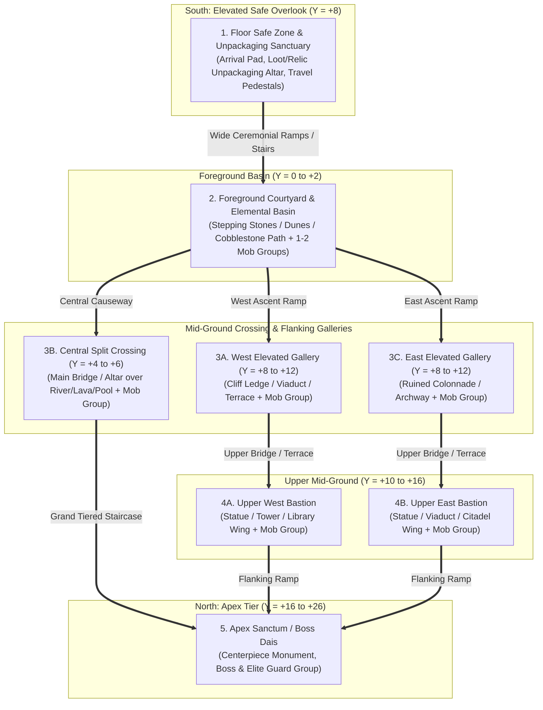

# Infinite Tower Rework — Implementation Plan

This document details the architectural, environmental, combat-spawning, and extraction rework for all **50 floors across 10 biomes** in *Infinite Towers: Become a Master!*, guided by [infinite_towers_biomes.md](file:///c:/Projects/infinite-tower/reference/infinite_towers_biomes.md) and the 9 visual reference concepts in `c:/Projects/infinite-tower/reference/`.

---

## 1. Executive Summary of Changes

1. **Canonical 10-Biome Progression Alignment**: Synchronize [MobCatalog.luau](file:///c:/Projects/infinite-tower/src/ReplicatedStorage/Shared/Config/MobCatalog.luau) and [TowerFloorConfig.luau](file:///c:/Projects/infinite-tower/src/ReplicatedStorage/Shared/Config/TowerFloorConfig.luau) with the exact 1–10 biome order in [infinite_towers_biomes.md](file:///c:/Projects/infinite-tower/reference/infinite_towers_biomes.md).
2. **Expanded Room Scale & Progressive 5-Floor Growth**: Expand room dimensions from the current flat `248 × 84 × 248` box to **`380 × 130 × 420` studs** on Floor 1 of a biome (`INTRODUCTION`), scaling up at each floor (`IndexInBiome = 1..5`) to **`560 × 190 × 640` studs** on Floor 5 (`BOSS_ARENA`).
3. **Unflattened Multi-Tiered Topography**: Replace the single flat floor slab in [TowerRoomBuilder.luau](file:///c:/Projects/infinite-tower/src/ServerScriptService/Core/TowerRoomBuilder.luau) with 5 distinct elevation tiers (`Y = -6` to `+28` studs) connected by wide, pathfinding-friendly staircases and ramps (`≤ 1.5` stud step rise / `15°` slope) so players, lightweight simulated heroes, and enemies can traverse vertically without getting stuck.
4. **Reference-Guided Biome Asset & Environment Kit**: Create a dedicated modular environment & asset builder (`src/ServerScriptService/Core/TowerBiomeAssets.luau`) that constructs the signature landmarks, lighting, water/lava/astral channels, statues, bridges, flora, and sky/ceiling centerpieces from each biome's reference artwork, evolving across the 5 floor variants.
5. **Multi-Area Mob Group Spawning (Spatial Camps)**: Replace the single central cluster of 3–6 individual enemies in [FirstBiomeCombat.luau](file:///c:/Projects/infinite-tower/src/ReplicatedStorage/Shared/Config/FirstBiomeCombat.luau) with **3 to 7 distinct spatial mob groups (camps)** per floor (`10–29` enemies per floor) distributed across the foreground basin, flanking elevated galleries, central crossing, upper bastions, and apex sanctum.
6. **Floor-Level Safe Zone Loot Unpackaging & Extraction**: Upgrade every floor's `ARRIVAL` safe zone into a full **Floor Safe Sanctuary** (`CanBankCargo = true`, `CanRecoverWipe = true`) featuring an interactive **Unpackaging & Extraction Pad** so players bring physical loot and relics back to the floor's safe zone to unpackage/bank immediately instead of returning to their Hub plot entrance.

---

## 2. Canonical Biome Order & Reference Mapping

Currently, [MobCatalog.luau](file:///c:/Projects/infinite-tower/src/ReplicatedStorage/Shared/Config/MobCatalog.luau#L125-L183) places *Sunken Sanctuary* at Biome #3 and swaps *Thunder Highlands* / *Infernal Foundry*. We will align the biome index order (`1..10`) with [infinite_towers_biomes.md](file:///c:/Projects/infinite-tower/reference/infinite_towers_biomes.md#L9-L20):

| Biome # | Floors | Biome ID & Name | Reference Image | Signature Visual & Architectural Kit |
| :--- | :--- | :--- | :--- | :--- |
| **1** | 1–5 | `verdant_ruins`<br>**Verdant Ruins** | [Verdant Ruins.png](file:///c:/Projects/infinite-tower/reference/Verdant%20Ruins.png) | Emerald reflective water basin with mossy stepping stones; vine-draped stone viaduct arches; colossal carved stone head & seated lion guardian statues; banyan trees & glowing cyan flora; tiered waterfalls; golden-lit apex temple spire. |
| **2** | 6–10 | `fungal_hollow`<br>**Fungal Hollow** | [Fungal Hollow.png](file:///c:/Projects/infinite-tower/reference/Fungal%20Hollow.png) | Colossal bioluminescent violet-blue mushroom canopies with glowing gill plates & hanging tendrils; wet cobblestone stepped terraces with warm stone lanterns; arched subterranean stone bridges over waterfalls; glowing cyan mycelium floor veins. |
| **3** | 11–15 | `ashen_dunes`<br>**Ashen Dunes** | [Ashen Dunes.jpeg](file:///c:/Projects/infinite-tower/reference/Ashen%20Dunes.jpeg) | Sloped black volcanic sand dunes & ash valleys; jagged tilted obsidian rock strata with glowing magma cracks; half-buried stone viaducts & broken columns; charred deadwood trees; volcanic caldera apex backdrop under crimson-amber lighting. |
| **4** | 16–20 | `frozen_citadel`<br>**Frozen Citadel** | [infinite_towers_biomes.md](file:///c:/Projects/infinite-tower/reference/infinite_towers_biomes.md#L40-L45) *(Text Spec)* | Tiered dark-stone & glacial-ice fortress courtyards; soaring translucent cyan crystal spires; snow-drifted ramparts & gothic ice arches; frozen waterfall cliffs & ice-bridge crossings; glowing blue runic crystal clusters & blizzard mist. |
| **5** | 21–25 | `infernal_foundry`<br>**Infernal Foundry** | [Infernal Foundry_ Molten Depths.jpeg](file:///c:/Projects/infinite-tower/reference/Infernal%20Foundry_%20Molten%20Depths.jpeg) | Colossal ceiling-mounted cogwheels & heavy iron chain rigging; multi-arch iron/stone viaduct bridges over molten lava rivers; dark gothic furnace towers with vertical glowing lava slits; basalt stone causeways with ember fissures; central lava-pouring crucible. |
| **6** | 26–30 | `thunder_highlands`<br>**Thunder Highlands** | [Thunder Highlands.jpeg](file:///c:/Projects/infinite-tower/reference/Thunder%20Highlands.jpeg) | Craggy highland cliff terraces above a sea of clouds & cliff waterfalls; circular stone henge/portal ring on the west ridge struck by lightning; stone watchtowers & arched viaducts on the east ridge; glowing blue alpine flowers; central storm-spire under a swirling violet tempest vortex. |
| **7** | 31–35 | `corrupted_grove`<br>**Corrupted Grove** | [Corrupted Grove.png](file:///c:/Projects/infinite-tower/reference/Corrupted%20Grove.png) | Gnarled black trees with glowing crimson-pink bark fissures; giant curving spiked black bramble/thorn arches; bioluminescent pink-purple mushroom clusters; shallow reflective marsh water; stepped stone altar flanked by monoliths holding a spiked dark crescent ring & magenta core. |
| **8** | 36–40 | `sunken_sanctuary`<br>**Sunken Sanctuary** | [Sunken Sanctuary.png](file:///c:/Projects/infinite-tower/reference/Sunken%20Sanctuary.png) | Submerged Greco-Atlantean limestone temple under turquoise caustics & sunbeams; colossal flanking statues (robed goddess with staff & Poseidon king with trident); multi-tier aqueduct arches with waterfalls; coral & kelp beds; tiered stairs to a golden lotus portal & cyan-sigil spire. |
| **9** | 41–45 | `astral_archives`<br>**Astral Archives** | [Astral Archives_ Portal of Starlight.png](file:///c:/Projects/infinite-tower/reference/Astral%20Archives_%20Portal%20of%20Starlight.png) | Floating white-marble & gold platforms over cosmic nebulae; curved multi-story bookshelves with warm-lit tomes & blue/gold banners; balustrade with open star-chart grimoires & brass armillary spheres; reflective constellation pool & starlight waterfalls; navy-gold gothic arch crowned by a giant golden celestial orrery framing a galaxy portal. |
| **10** | 46–50 | `abyssal_throne`<br>**Abyssal Throne** | [Abyssal throne.jpeg](file:///c:/Projects/infinite-tower/reference/Abyssal%20throne.jpeg) | Monumental obsidian causeway & wide staircase with gold/silver geometric inlays over a cyan-teal bioluminescent chasm; purple-flaming braziers; colossal silver-etched runic obelisks bound by heavy iron chains; gothic side viaducts; spectral violet-cyan waterfalls; jagged obsidian throne spire under a giant black eclipse orb & descending violet beam. |

---

## 3. Room Unflattening, Expansion & 5-Floor Progressive Scaling

### 3.1 Multi-Tiered Spatial Topography
Instead of a single flat `Y = 0` ground plane, each room is constructed from **5 navigable elevation zones** connected by wide ramps (`Slope ≤ 16°`) and low stepped stairs (`Step Rise ≤ 1.5` studs) so both player characters and server-raycasted heroes ([HeroNavigation.luau](file:///c:/Projects/infinite-tower/src/ServerScriptService/Core/HeroNavigation.luau)) traverse smoothly:



### 3.2 Progressive 5-Floor Scale & Variant Progression per Biome
Each biome spans 5 floors (`IndexInBiome = 1..5`). Each floor builds a progressively larger, more vertical, and more architecturally complete variant of the biome's reference image:

| Floor in Biome | Variant Kind | Footprint (`Width × Depth × Height`) | Elevation Tiers Active | Architectural Progression (Variant of Reference) | Mob Groups (Camps) | Total Enemies |
| :---: | :--- | :---: | :---: | :--- | :---: | :---: |
| **Floor 1**<br>*(e.g. 1, 6, 11...)* | `INTRODUCTION`<br>*(Outskirts / Threshold)* | `380 × 420 × 130` | 3 Tiers<br>(`Y: 0 to +12`) | **Foreground & Threshold Motif**: Safe overlook descending into the biome's foreground basin/courtyard, framed by entry arches, initial flora/crystals/dunes, and a modest north shrine. | **3 Groups**<br>*(Foreground Left, Foreground Right, North Shrine)* | **10–12 Mobs**<br>*(Regular packs + 1 Elite on F1)* |
| **Floor 2**<br>*(e.g. 2, 7, 12...)* | `EXPANDED_ENCOUNTER`<br>*(Flanking Galleries)* | `420 × 470 × 140` | 3 Tiers<br>(`Y: 0 to +14`) | **Flanking Galleries & Viaducts**: Expands laterally to add the elevated West & East side galleries/colonnades/cliff ridges from the reference image, connected by side ramps. | **4 Groups**<br>*(Foreground Basin, West Gallery, East Gallery, North Plaza)* | **14–16 Mobs**<br>*(4 multi-mob packs)* |
| **Floor 3**<br>*(e.g. 3, 8, 13...)* | `TERRAIN_VARIATION`<br>*(Chasm & Bridges)* | `460 × 520 × 155` | 4 Tiers<br>(`Y: -4 to +18`) | **Recessed Elemental Chasm & Split Bridges**: Carves a deep environmental channel (turquoise water, lava river, chasm mist, astral pool) through the mid-ground with arched bridges, waterfalls, and mid-ground monuments. | **5 Groups**<br>*(Foreground, West Ridge, Central Bridge, East Ridge, Upper Sanctum)* | **18–20 Mobs**<br>*(4 Regular packs + 1 Elite pack)* |
| **Floor 4**<br>*(e.g. 4, 9, 14...)* | `ELITE_STRONGHOLD`<br>*(Inner Bastion)* | `510 × 580 × 170` | 4 Tiers<br>(`Y: -4 to +22`) | **Monumental Flanking Guardians & Twin Bastions**: Adds the colossal flanking landmarks from the reference (e.g., twin deity statues, chained obelisks, multi-story book stacks, storm henge + watchtowers) guarding the upper bastion terraces. | **6 Groups**<br>*(2 Foreground, West Gallery, East Gallery, 2 Upper Elite Bastions)* | **22–25 Mobs**<br>*(4 Regular packs + 2 Elite stronghold packs)* |
| **Floor 5**<br>*(e.g. 5, 10, 15...)* | `BOSS_ARENA`<br>*(Apex Masterpiece)* | `560 × 640 × 190` | 5 Tiers<br>(`Y: -6 to +28`) | **Full Reference Masterpiece & Apex Citadel**: Complete realization of the reference image at grand scale, adding the monumental Apex Citadel/Throne/Portal dais, overhead ceiling/sky centerpiece (orrery, eclipse vortex, giant foundry cogs), and cascading waterfalls/lavafalls. | **7 Groups**<br>*(2 Foreground, West & East Galleries, 2 Upper Bastions, Central Boss Citadel)* | **25–29 Mobs**<br>*(6 area packs + Biome Boss & Royal Guards)* |

> [!NOTE]
> **Protocol & Bounds Compatibility**:
> - [TowerProtocol.luau](file:///c:/Projects/infinite-tower/src/ReplicatedStorage/Shared/Util/TowerProtocol.luau) encodes local room coordinates as `i16 / 10` (`±3,276.7` studs). Even at the maximum `560 × 640 × 190` room size (`X ∈ [-280, 280]`, `Z ∈ [-320, 320]`, `Y ∈ [-10, 190]`), local coordinates use less than 10% of the packet coordinate range.
> - We will update `Builder.Origin(id)` spacing in [TowerRoomBuilder.luau](file:///c:/Projects/infinite-tower/src/ServerScriptService/Core/TowerRoomBuilder.luau#L133-L136) from `1800` studs to `2400` studs so larger rooms remain completely camera- and physics-isolated.

---

## 4. Multi-Area Mob Group Spawning & AI Leashing

### 4.1 Group-Based Encounter Generation (`FirstBiomeCombat.luau` & `TowerFloorConfig.luau`)
Currently, [FirstBiomeCombat.luau](file:///c:/Projects/infinite-tower/src/ReplicatedStorage/Shared/Config/FirstBiomeCombat.luau#L145-L197) places only 3–6 individual mobs near the center of the room. We will replace this with a **Camp/Group Placement Generator** scaled by `IndexInBiome`:

- **Camp Templates**:
  - **Regular Pack (3–4 mobs)**: 2–3 melee frontliners (`RegularEnemyIds[1]`) arranged in a forward arc + 1–2 ranged/caster or secondary mobs (`RegularEnemyIds[2]`) positioned slightly behind on the terrace.
  - **Elite Stronghold Pack (3–4 mobs)**: 1 `EliteEnemyId` commander flanked by 2–3 regular guards positioned on an elevated bastion or bridge choke point.
  - **Boss Apex Pack (Floor 5 of Biome)**: 1 `BossEnemyId` at the center of the Apex Dais (`Z ≈ -210, Y ≈ +24`), flanked by 2 `EliteEnemyId` lieutenants and 2–4 regular vanguard mobs at the base of the apex stairs.
- **3D Placement Coordinates (`X, Y, Z, CampId, LeashRadius`)**:
  - Every placement entry in `FirstBiomeCombat.Floors[floorId]` will include `{ EnemyId, X, Y, Z, CampId, LeashRadius }`.
  - In [TowerEncounterRuntime.luau](file:///c:/Projects/infinite-tower/src/ServerScriptService/Combat/TowerEncounterRuntime.luau#L207), `m.HomePosition` will raycast downward from `room.Origin + Vector3.new(placement.X, (placement.Y or 0) + 6, placement.Z)` so mobs spawn planted on their exact terrace, bridge, or dais elevation.
  - Each mob uses its camp's `LeashRadius` (`60` studs for area packs, `95` studs for Boss encounters) relative to `m.HomePosition`, allowing players to clear room areas methodically without pulling the entire floor at once.

---

## 5. Floor Safe Zone Loot Unpackaging & Relic Extraction

### 5.1 Upgrading the Floor Safe Zone (`TowerRoomBuilder.luau` & `TowerFloorService.luau`)
Players should be able to bring physical loot (Gold/Gem drops) and physical Relics directly to the **Floor Safe Zone** to unpackage/extract them on that floor, rather than teleporting back to the Hub plot entrance.

1. **Zone Capabilities (`TowerRoomBuilder.luau`)**:
   - Update the floor's `ARRIVAL` safe zone to set:
     ```luau
     CombatSafe = true,
     CanBankCargo = true,
     CanRecoverWipe = true,
     ```
   - Expand the **Floor Safe Sanctuary** platform at the south overlook of each floor (`88 × 56` studs, elevated at `Y = +8` with wide stairs leading down into the foreground basin), featuring:
     - **Loot & Relic Unpackaging Altar / Pad (`FloorExtractionPad`)**: A glowing themed runic pad + chest/anvil/pedestal centerpiece labeled `"📦 SAFE ZONE UNPACKAGING PAD — Bring Loot & Relics Here to Unpackage"`.
     - **Sanctuary Threshold Pillars & Barrier Trim**: Clear visual boundary marking the combat-safe zone.
     - **Travel Pedestals (`PREVIOUS`, `NEXT`, `SELECTOR`, `HUB`)**: Arrayed cleanly along the back colonnade of the safe zone.

2. **Physical Loot Unpackaging on Any Floor (`CombatSimulation.server.luau`)**:
   - In [TowerFloorService.luau](file:///c:/Projects/infinite-tower/src/ServerScriptService/Core/TowerFloorService.luau#L305), `s.BankArmed` is already armed whenever `not Service.GetSafety(s, root.Position).CanBankCargo` (i.e., as soon as the player steps out of the safe zone into the floor's combat areas).
   - Also explicitly set `Tower.GetState(player).BankArmed = true` inside `collectPhysicalLoot` ([CombatSimulation.server.luau](file:///c:/Projects/infinite-tower/src/ServerScriptService/Combat/CombatSimulation.server.luau#L842)) and `RelicService.TryPickupRelic` ([RelicService.server.luau](file:///c:/Projects/infinite-tower/src/ServerScriptService/ExtractionAndSocial/RelicService.server.luau)) so picking up any loot/relic in the field immediately arms unpackaging on return to the floor's Safe Zone.
   - When the player walks into the floor's Safe Zone carrying loot (`safety.CanBankCargo == true and location.BankArmed`), [CombatSimulation.server.luau](file:///c:/Projects/infinite-tower/src/ServerScriptService/Combat/CombatSimulation.server.luau#L1969-L1997) immediately unpacks and banks the held Gold/Gems, fires a toast (`"📦 Unpackaged Field Loot at Floor %d Safe Zone: +%d %s!"`), and restores normal movement speed.

3. **Relic Unpackaging / Extraction on Floor Safe Zone Pads (`RelicService.server.luau`)**:
   - Refactor `RelicService.ExtractOnPrivatePad` (and add `RelicService.ExtractInFloorSafeZone`) in [RelicService.server.luau](file:///c:/Projects/infinite-tower/src/ServerScriptService/ExtractionAndSocial/RelicService.server.luau#L353-L437):
     - Remove the `location.FloorId ~= 0` restriction.
     - Allow a carrier on any floor (`FloorId >= 1`) with `location.BankArmed == true` to extract/unpackage their carried Relic by stepping onto the floor's `FloorExtractionPad` (or entering the floor's `CanBankCargo` Safe Zone unpackaging pad), granting the full 100% Relic payout and broadcasting `"EXTRACT_SAFE_ZONE"`!
     - Retain Hub `PrivateExtractionPad` support for `FloorId == 0` so existing Hub tests continue to pass.

---

## 6. File-by-File Implementation Breakdown

### Phase 1: Config & Biome Progression Alignment
- **[MobCatalog.luau](file:///c:/Projects/infinite-tower/src/ReplicatedStorage/Shared/Config/MobCatalog.luau)**:
  - Reorder `Catalog.Biomes` registrations (`1..10`) to match [infinite_towers_biomes.md](file:///c:/Projects/infinite-tower/reference/infinite_towers_biomes.md):
    1. `verdant_ruins`, 2. `fungal_hollow`, 3. `ashen_dunes`, 4. `frozen_citadel`, 5. `infernal_foundry`, 6. `thunder_highlands`, 7. `corrupted_grove`, 8. `sunken_sanctuary`, 9. `astral_archives`, 10. `abyssal_throne`.
- **[TowerFloorConfig.luau](file:///c:/Projects/infinite-tower/src/ReplicatedStorage/Shared/Config/TowerFloorConfig.luau)**:
  - Reorder `floorNames` to match the 10-biome sequence above.
  - Increase `Encounters` counts per floor to reflect the expanded multi-group room populations (`RegularEnemyIds[1]` count `6 + indexInBiome * 2`, `RegularEnemyIds[2]` count `4 + indexInBiome * 2`, `EliteEnemyId` count `1` on F1/F2, `2` on F3, `3` on F4, `2` on F5 + `1` Boss).

### Phase 2: Biome Asset Library & Multi-Tiered Room Builder
- **[NEW] [TowerBiomeAssets.luau](file:///c:/Projects/infinite-tower/src/ServerScriptService/Core/TowerBiomeAssets.luau)**:
  - Modular procedural 3D asset & landmark constructors for all 10 biomes guided by the reference images:
    - **Landmarks & Statues**: Carved Guardian Head & Lion Statue (`verdant_ruins`), Greco-Atlantean Goddess & Trident King Statues (`sunken_sanctuary`), Chained Runic Obelisks & Eclipse Citadel (`abyssal_throne`), Curved Multi-Story Bookshelves & Golden Celestial Orrery (`astral_archives`), Spiked Crescent Corruption Altar (`corrupted_grove`), Lightning Henge Portal & Storm Watchtowers (`thunder_highlands`), Overhead Cogwheels & Lava Crucible (`infernal_foundry`), Crystalline Fortress Spires (`frozen_citadel`), Tilted Magma-Cracked Obsidian Strata & Caldera (`ashen_dunes`), Giant Gill-Lit Mushroom Canopies & Stone Lanterns (`fungal_hollow`).
    - **Environmental Features**: Multi-arched stone/iron/marble viaduct bridges, cascading waterfalls / lavafalls / starlight falls / spectral falls, reflective water / swamp / lava / astral pools with stepping stones, and Safe Zone Unpackaging Altars.
- **[TowerRoomBuilder.luau](file:///c:/Projects/infinite-tower/src/ServerScriptService/Core/TowerRoomBuilder.luau)**:
  - Expand room dimensions progressively across `idx = 1..5` (`380×420` up to `560×640`).
  - Build the 5-tier unflattened terrain layout (Elevated Safe Overlook, Foreground Basin, Flanking West/East Galleries, Central Split Crossing over recessed elemental channel, Upper Bastions, and North Apex Dais) connected by wide ramps and low-stepped stairs.
  - Construct the **Floor Safe Zone Unpackaging Sanctuary** (`FloorExtractionPad`, visual barrier arches, signage) and set `CanBankCargo = true`, `CanRecoverWipe = true` on the floor's `ARRIVAL` safe zone.
  - Update `Bounds` per floor to enclose the larger multi-tiered room (`Min = Vector3.new(-halfW, -16, -halfD)`, `Max = Vector3.new(halfW, height + 24, halfD)`).

### Phase 3: Multi-Area Mob Group Spawning & Vertical Navigation
- **[FirstBiomeCombat.luau](file:///c:/Projects/infinite-tower/src/ReplicatedStorage/Shared/Config/FirstBiomeCombat.luau)**:
  - Replace the single 4–6 mob coordinate list with the **Multi-Area Camp Spawner** generating 3 to 7 distinct mob groups across the room's elevation tiers (`CAMP_FOREGROUND_WEST`, `CAMP_FOREGROUND_EAST`, `CAMP_WEST_GALLERY`, `CAMP_EAST_GALLERY`, `CAMP_CENTRAL_CROSSING`, `CAMP_UPPER_BASTIONS`, `CAMP_APEX_SANCTUM`).
  - Store `{ EnemyId, X, Y, Z, CampId, LeashRadius }` per placement.
- **[TowerEncounterRuntime.luau](file:///c:/Projects/infinite-tower/src/ServerScriptService/Combat/TowerEncounterRuntime.luau)**:
  - Use `placement.Y` when computing `m.HomePosition` via `api.Navigation.Ground` so elevated gallery and apex dais mobs spawn at their proper terrace height.
  - Support per-placement `m.LeashRadius = placement.LeashRadius or Config.LeashRange`.
- **[HeroNavigation.luau](file:///c:/Projects/infinite-tower/src/ServerScriptService/Core/HeroNavigation.luau)** & **[AttackTimeline.luau](file:///c:/Projects/infinite-tower/src/ReplicatedStorage/Shared/Util/AttackTimeline.luau)**:
  - Increase `clearRoute` vertical delta limit from `16` to `36` studs and `Navigation.Ground` step/ramp tolerance so heroes and mobs smoothly climb and descend staircases and sloped dunes/ramps.
  - Increase `CanAttack` and `AttackTimeline.Contains` vertical tolerance from `6–8` studs to `11` studs so combat on ramps and stepped terraces registers cleanly.

### Phase 4: Floor Safe Zone Unpackaging & Extraction
- **[CombatSimulation.server.luau](file:///c:/Projects/infinite-tower/src/ServerScriptService/Combat/CombatSimulation.server.luau)**:
  - Arm `Tower.GetState(player).BankArmed = true` immediately on `collectPhysicalLoot`.
  - Allow the Safe Zone Banking & Recovery Loop to unpackage/bank held Gold/Gems inside any floor's `ARRIVAL` safe zone (`CanBankCargo == true`), displaying floor-specific unpackaging feedback.
  - Increase `stepHeroSimulation` vertical leash tolerance (`math.abs(simHero.Position.Y - masterPos.Y) > 40`) to support multi-elevation rooms.
- **[RelicService.server.luau](file:///c:/Projects/infinite-tower/src/ServerScriptService/ExtractionAndSocial/RelicService.server.luau)**:
  - Arm `Tower.GetState(player).BankArmed = true` when picking up a Relic.
  - Update `ExtractOnPrivatePad` / Heartbeat check so carriers can extract/unpackage Relics on the `FloorExtractionPad` inside any floor's Safe Zone (`FloorId >= 1`) as well as on Hub plots (`FloorId == 0`).

### Phase 5: Verification & Automated Tests
- Update and run [tests/run.ps1](file:///c:/Projects/infinite-tower/tests/run.ps1) ([tower.spec.luau](file:///c:/Projects/infinite-tower/tests/tower.spec.luau), [tower-transport.spec.luau](file:///c:/Projects/infinite-tower/tests/tower-transport.spec.luau), [tower-combat.spec.luau](file:///c:/Projects/infinite-tower/tests/tower-combat.spec.luau)) and Studio verification scripts to verify:
  1. Canonical 10-biome order and 50-floor progressive scaling.
  2. Multi-tiered room geometry generation, valid raycast support at all camp coordinates, and enlarged `Bounds`.
  3. Multi-area mob group spawning (`10–29` mobs per floor across 3–7 camps) with no spawns inside the Floor Safe Zone.
  4. In-floor Safe Zone loot unpackaging and Relic extraction on Floors `1..50`.
