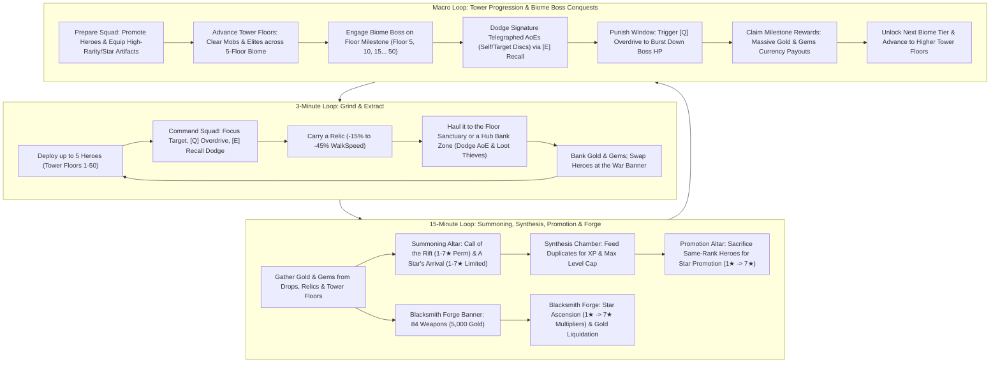

# DOCUMENT 1: COMPLETE GAME DESIGN DOCUMENT (GDD)
**Project Title:** *Infinite Tower: Become a Master!*  
**Target Platform:** Roblox (PC, Mobile, Tablet, Console)  
**Server Capacity:** 8 Players per Server (8 Dedicated Floating Fortress Plots around the Cloister Commons)  
**Engine Architecture:** Server-Authoritative Data Tables (10 Hz Heartbeat, 5 Hz tower snapshots) + Client-Side R15 Visual Interpolation (60 FPS `RenderStepped`) | Hybrid Replication: Central Hub 14-Byte Binary Buffers + Infinite Tower Room-Local v2 Binary Buffers (24-byte entity records, 46-byte header)

---

**Terms used throughout:** the **Skill Gauge** (0–100) charges with attacks and fires a hero's Ultimate; the code calls it `Stamina` / `CurrentStamina` and it travels as the `Stamina` byte of the tower protocol. A hero at 0 HP is **Downed** (sim state `COMA`) until the squad changes floor, goes home or wipes. A **Relic** is the only physical loot.

## 1. EXECUTIVE OVERVIEW & PLAYER FANTASY

### 1.1 High-Concept Pitch
**Infinite Tower: Become a Master!** is a tactical squad-command Action-RPG, extraction sandbox, and fortress progression game inspired by the dark survival manhwa *Pick Me Up, Infinite Gacha*. Players do not play as generic hack-and-slash warriors; instead, each player embodies a **Master**—a dimensional overseer who summons, trains, equips, promotes, and commands a roster of sentient Gacha Heroes from a private floating sanctuary known as the **Master's Fortress Plot**.

### 1.2 The "Pick Me Up" Fantasy & Zero-Waste Roster Economy
In traditional gacha/simulator games, 95% of summons are discarded as worthless stat-sticks, and combat is reduced to passive AFK auto-clicking. **Infinite Tower** solves both problems through two foundational pillars:

1. **The Dual-Role Living Roster (Combat + Labor):**
   - Every hero pulled from the Summoning Altar rolls with **Combat Stats** (movement speed, attack speed, attack damage, health) and **Labor Output** (separate facility productivity). Heroes have no passive traits: rarity, stars, level and their kit (§4.4) set them apart.
   - **Up to 5 Deployed Heroes** (one slot at the start; the Fortress Tree's Command branch opens slots 2–5, see §4.3) follow the Master onto floors 1–50 of the **Infinite Tower** or are assigned to a floor on their own. Heroes charge an in-combat **Skill Gauge** (0 to 100) through a 3-tier attack cadence (Basic -> Basic -> Special -> Skill Attack at 100), and risk being **Downed** (until the squad changes floor, goes home or wipes) if left inside lethal AoE telegraphs.
   - **Benched Heroes** rest on the player's **Fortress Plot** or work in its support facilities (§4.3).
   - **Zero Dead Pulls:** Duplicate heroes across all star ranks are fed into the **Synthesis Chamber** (`SynthesisController.luau`) for EXP leveling to the star cap (Lv. 10 at every star), or converted into Soul Essence that crafts the Promotion Stones the **Promotion Altar** (`PromotionController.luau`) needs for **Star Promotion** ($1★ \to 7★$, §4.2a). Both heroes and artifacts feature a baseline inventory space limit of **50 items**, raised by the Fortress Tree's Storage branch (§4.3). Heroes working in a support facility are out of the backpack and don't count toward the hero cap.
   - **Dual Hero Banners & Artifact Gacha:** At the **Summoning Altar**, players spend Gems on two distinct hero banners (Call of the Rift `100` / `900` Gems, A Star's Arrival `200` / `1,800` Gems for 1x / 10x): **Call of the Rift** (Permanent Banner featuring 7 stars: $1★ \to 7★$) and **A Star's Arrival** (Limited Time Banner featuring 1 character per star across all 7 stars: $1★ \to 7★$). In addition, Masters visit the **Blacksmith Forge** (`ForgeController.luau`) to summon equippable archetype weapons using **Gold** (`5,000 Gold` single / `45,000 Gold` 10x) across an **84-Weapon Roster** (2 weapons per archetype per rarity tier across 7 launch tiers, featuring Standard $1.00\times$ and Enhanced $1.20\times$ variants). All summoned weapons drop at **1★** baseline with inherent rarity tiers. At the Forge, donor weapons of the same rarity and star rank (regardless of weapon type), plus Gold, are used for **Star Ascension** ($1★ \to 7★$), scaling base stats up to **`16.00x`**, while unneeded artifacts can be **sold for Gold** to manage inventory limits.

2. **Tactical Master Agency Over AFK Whaling:**
   - The Master carries no personal weapon. Instead, the Master directs squads through battlefield commands—**`[Click / Tap]` Focus Target**, **`[Q]` Overdrive Whistle**, and **`[E]` Emergency Recall Whistle**—while physically hauling heavy, high-value **Relics** back to a Sanctuary or their plot.
   - Masters use **`[LeftShift]` Sprint** ($3.0\times$ speed multiplier) to cross high-elevation bridges and dodge lethal hazards.
   - Because boss signature skill checks (the **Biome Boss** signature attacks like *Moss Quake* and *Sweeping Roots*, and elite ground telegraphs) hit every hero left inside the blast zone for heavy damage, often enough to leave them **Downed**, an AFK player will have their squad wiped and sent home, dropping their DPS to zero. An active Master who times **`[E]` Emergency Recall Whistle** to dodge the blast and triggers **`[Q]` Overdrive Whistle** during punish windows will consistently out-damage and out-loot an AFK whale.

### 1.3 Hybrid Retention Matrix & Core Drivers

| Reference Title | Adopted Core Mechanic | *Infinite Tower* Evolution |
| :--- | :--- | :--- |
| ***Pick Me Up, Infinite Gacha*** | Desperate squad survival, Synthesis chamber, Star Promotion, living lobby workers | Heroes are Downed if mismanaged; high-star promotions need hard sacrifices; War Banner plot deployment. |
| ***Pet Simulator 99*** | Multi-unit squad grinding, tactile loot explosions, exponential progression | Replaces passive pet hovering with Skill-Gauge-driven combat squads, active whistle commands, and isolated 50-floor dynamic tower rooms. |
| ***Blox Fruits*** | Telegraphed boss skills, live DPS leaderboards, open-world bounty hunting | **Greed vs. Coma** boss checks, 10 **Biome Bosses** (Floors 5, 10, ..., 50), and **Contested Loot & Bounty Duels** on tower floors. |
| ***Grow a Garden*** | Cozy-yet-competitive perimeter plots, passive production, fortress management | Dedicated private plots with a Fortress Tree of unlockable facilities, War Banner squad deployment, and Forge progression. |
| ***Steal an Egg*** | Physical object hauling, movement penalties, fumble & steal tension | **Relics** weld overhead, slow WalkSpeed by up to -45%, and fumble on AoE hits. |

**The Intimate Server Dynamic:**
In a 10-player server, anonymity disappears. Every player knows who conquered the latest Biome Boss, who just scooped contested loot, and who carries an open 3-minute thief bounty. The interplay of high-stakes extraction, boss timing, and bounty-hunt loops keeps players engaged in continuous Biome Boss clears and Infinite Tower floor pushes.

---

## 2. DETAILED CORE LOOPS



### 2.1 The 3-Minute Micro Loop (Grind, Command & Physical Extraction)
1. **Deploy & Traverse (0:00 – 0:15):**
   - The Master selects up to 5 rested heroes from their roster via the **War Banner** or **Squad Deploy UI** (`SquadController.luau`).
   - The Master sprints (`[LeftShift]`, $3.0\times$ speed) from their plot across the Cloister Commons and the Pilgrim's Causeway to the tower gate, then uses the **Tower Controller** (`TowerController.client.luau`) to travel (`Visit floor`) or station their squad (`Assign squad`) on any unlocked floor of the 50 **Infinite Tower Floors**. The hub itself has no mobs.
2. **Tactical Grind & Skill Gauge Building (0:15 – 2:00):**
   - The Master uses **`[Click / Tap]` Focus Target** to direct every deployed hero onto a target mob or floor boss.
   - Heroes execute a 3-tier cadence: **Basic Attack** (+5 Skill Gauge) $\to$ **Special Attack** (+10 Skill Gauge every 3rd hit) $\to$ **Skill Attack** (unleashed when the gauge reaches 100, resetting it to 0).
   - To accelerate clears and rapidly charge Skill Attacks, the Master triggers **`[Q]` Overdrive Whistle** (`20s CD`), granting **+40% Attack Speed** for `5s` at no cost.
   - When an Elite or Boss telegraphs a red ground AoE or ranged projectile (`ARC`, `SELF_DISC`, `TARGET_DISC`, or swept-corridor `PROJECTILE`), the Master triggers **`[E]` Emergency Recall Whistle** (`6s CD`), warping all 5 heroes to the Master's safe position and dropping their aggro for `2s`.
3. **Relic Haul (2:00 – 2:45):**
   - Defeating mobs, Elites and bosses spawns physical Relic drops in `Workspace.PhysicalRelics`: **Mana Geodes** and **Cursed Urns** from anything, **Abyssal Cores** only from Elites, and **Calamity Hearts** only from Alphas and Biome Bosses (see §5.5 Relic Drops).
   - The Master holds the drop's **Carry** prompt (E, 0.35 s) to weld it overhead, incurring a **-15% to -45% WalkSpeed penalty** (and disabling jumping for high-tier relics). Relics are never picked up by walking over them.
   - If hit by an Elite/Boss AoE mid-haul, the Master is **stunned for 1s and fumbles the item** (which becomes stealable after a **5s owner-lock**).
4. **Extract & Bank (2:45 – 3:00):**
   - **Hub Banking:** Stepping onto the Cloister Commons, a plot bridge, the Pilgrim's Causeway, your plot, or a Private Extraction Pad safely banks a carried relic into permanent Gold and Gems.
   - **Floor Sanctuary Banking:** Carrying a relic into any floor's elevated **Sanctuary** banks it automatically anywhere inside (there is no pad or altar), with the full relic payout and the Market multiplier, without a trip back to the Hub. Kill Gold and Gems never need banking: they are paid on the kill.
   - Downed heroes stay down until the squad changes floor (they stand back up at 30% HP), returns home or wipes. A wipe sends the Master and squad home at full HP (see §2.5 and §6.1).

### 2.2 The 15-Minute Meso Loop (Fortress, Synthesis, Promotion & Forge Progression)
1. **Roster Upkeep (Every 3–5 Minutes):**
   - Swap heroes between the squad, the bench and the support facilities at the War Banner and the facility panels. The squad is **locked** while the Master or the squad is in the tower (including a stationed squad and floor transitions) or in the raid arena: deploying, benching or reassigning a squad hero, Deploy Best and the exhausted-hero auto swap are all refused by the server until both are home. Bench and facility moves for heroes outside the squad still work. A refused squad change shows as a modal (`SquadLockModal`, keyed by the `SQUAD_LOCKED_TOWER` / `SQUAD_LOCKED_RAID` code `AssignHeroRole` returns); in the tower it offers **Return to Hub**.
2. **Summoning & Gacha Pulls (Every 5–10 Minutes):**
   - Spend Gems at the **Summoning Altar** on either **Call of the Rift** (Common–Mythical Permanent Banner) or **A Star's Arrival** (Common–Mythical Limited Time Rate-Up Banner, featuring 1 character per rarity tier, each summoned at 1★). In addition, visit the **Blacksmith Forge** (`ForgeController.luau`) to summon weapons using **Gold** (`5,000 Gold` single / `45,000 Gold` 10x) from an **84-Weapon Roster** (2 weapons per archetype per rarity tier across 7 tiers) with 120-pull Exalted+ hard pity, or liquidate unneeded gear for Gold.
   - **Synthesis Chamber (`SynthesisController.luau`):** Place a recipient hero and fodder heroes to level it up to the current star's cap (Lv. 10).
   - **Promotion Altar (`PromotionController.luau`):** When a hero reaches max level, spend Gold and Promotion Stones to permanently ascend its star rating ($1★ \to 7★$, §4.2a). The hero's inherent rarity never changes.
3. **Artifact Star Ascension & Liquidation at the Blacksmith Forge (`ForgeController.luau`):**
   - **Star Ascension (Multipliers):** Ascend artifacts from $1★ \to 7★$ at the Forge by sacrificing donor weapons of the same rarity tier and star rank (any weapon type) and Gold, scaling inherent base stats by progressive multipliers up to **`16.00x`**.
   - **Artifact Liquidation (Selling):** Sell unequipped, unlocked weapons for Gold directly from the Assign tab to maintain the 50-item inventory limit.
   - **Locking & odds disclosure:** Any weapon can be locked from its Assign card; locked weapons can't be sold or picked by the sell quick-selects ("Common", "≤ Uncommon"), and every sale asks for confirmation (in red when it includes Exalted or better). The Summon tab's banner is a carousel of all 12 Mythical weapons: the centre one is shown large and slowly spinning, the rest as fading shadow silhouettes, advancing every few seconds. The odds live in the "View all weapons & odds" window, which shows the live, God's-Blessing-adjusted chance of each tier and lists every weapon's exact per-pull chance (tier chance ÷ 6 archetypes × 60% Standard or 40% Enhanced). The banner has no rate-up and no end date.

### 2.3 The Macro Loop (Tower Progression & Biome Boss Conquests)
1. **Biome Traversal & Preparation:**
   - Masters organize their 5-hero squad, equip high-rarity and high-star artifacts, and rest exhausted heroes on the bench before entering a new Biome.
   - Each of the 10 biomes spans 5 progressively harder floors (50 floors total) with 4 unique biome enemy species (2 Regulars, 1 Elite, and 1 Biome Boss; 40 total enemy species across the Tower). On floors 1–4 of a biome the Elite is the summoned floor champion; on the 5th floor two Elite-led packs hold the Bastions. Enemy health and attack damage follow the stat-reference curve in Section 4.2. Reward scaling remains $\text{Reward} \times 1.055^{\text{Floor}-1}$; stat inflation does not change rewards.
2. **The Biome Boss Encounter (Floors 5, 10, 15, ..., 50):**
   - The 5th floor of every biome is a dedicated **Biome Boss Arena** (`BOSS_ARENA` layout variant) featuring an 8-column ritual ring, boss braziers, and a massive boss dais fixture (`BossDaisFixture`, $60 \times 2 \times 60\text{ studs}$).
   - Every Biome Boss transitions dynamically from **Phase 1** to **Phase 2 (Enraged)** below 55% HP and wields devastating signature attacks with distinct authoritative shapes and timings:
     - **Basic Attacks:** Wide frontal arcs (`ARC`, e.g. `guardian_crush`, 13 studs).
     - **Signature 1:** Expanding circular ground shocks centered on the boss (`SELF_DISC`, e.g. `moss_quake`, 22 studs radius).
     - **Signature 2:** Ranged ground craters placed under distant heroes (`TARGET_DISC`, e.g. `sweeping_roots`, 55 studs cast range, 13 studs radius).
     - **Ranged / Caster Regulars:** Biome ranged and caster regulars (`mob_lantern_spore`, `mob_crag_channeler`, `mob_thorn_weaver`, `mob_drowned_acolyte`, `mob_astral_scribe`, `mob_void_invoker`) fire authoritative swept-corridor projectiles (`PROJECTILE`) with a floor corridor warning and flying orb visual.
   - **Tactical Counterplay ("Dodge vs. Coma"):** Masters must watch the expanding progress-fill telegraph discs, corridor warnings, and sound cues, repositioning and executing **`[E]` Emergency Recall Whistle** to yank heroes out of danger. Heroes struck by signature skills take heavy damage and are often left **Downed** (until the squad changes floor, goes home or wipes).
   - **Punish Windows:** Following major signature attacks, the boss enters an extended recovery window (1.2s–1.5s), providing active Masters the ideal moment to pop **`[Q]` Overdrive Whistle** for massive burst DPS.
3. **Biome Clearance & Milestone Rewards:**
   - Defeating the Biome Boss awards immense Gold, Gems, and first-clear milestone bonuses.
   - Floors unlock in order: defeating a floor's boss opens the next floor on the **Floor Selector** (`TowerController.client.luau`). Only a Master standing on the floor can clear it; an assigned squad farms Gold, gems and XP but cannot climb.

### 2.4 The AFK & Outskirts Facility Loop (Passive Boost Facilities & Auto/Offline Gold Generation)
While active squad command in the Central Hub and Infinite Tower drives peak progression, the **Outskirts & Facility Loop** ensures that a Master's benched roster continuously generates value both online and offline—reinforcing the **Zero-Waste Roster Economy**.

1. **Inner Fortress Stations vs. The Rear Outskirts:**
   - **Core Main Buildings (Inner Courtyard):** Essential progression stations that every Master accesses by default in their main fortress courtyard—including the **Summoning Altar**, **War Banner**, **Synthesis Chamber**, **Promotion Altar** and **Blacksmith Forge**.
   - **Support Facilities (Inner Fortress Wings):** Upgradeable utility and economic structures (`Level 1` $\to$ `Level 5`) located inside the fortress courtyard wings where benched heroes are stationed via `FacilityController.luau` to grant global percentage buffs. Each is unlocked and levelled through the **Fortress Development Tree** (Section 4.3):
     - **God's Blessing (Plaza Fountain):** An angel statue on the courtyard fountain. Stationed Acolytes (`Healer` preferred) raise **summon luck** on every Summoning Altar banner ($+4\%$ at Lv. 1 up to a $+50\%$ cap).
     - **The Market (Inner Commercial Wing):** Grants a percentage multiplier ($+5\%$ base at Lv. 1 up to $+40\%+$ with high-tier Berserkers) **strictly to Loot Earnings from the Towers**: Gold from Infinite Tower kills (Floors $1\text{–}50$) and the Gold of banked relics. (It does not multiply Outskirts Guard Post passive Gold.)
     - **The Training Grounds (Inner Martial Wing):** Grants a percentage multiplier ($+4\%$ base at Lv. 1 up to $+32\%+$ with high-tier Strikers/Scholars) to the Master's **Overall Squad Combat Power**, multiplying total `FinalATK` and `FinalHP` (both intrinsic hero stats and equipped Artifact stats) against all monsters.
   - **The Outskirts (Southern Frontier Wilderness):** The only area located *outside* the fortress walls, reached through the rear fortress gatehouse. Houses the **Outskirts Guard Post** and its wave-defense trail.
2. **The Outskirts Guard Post (Unified AFK Gold & Offline Rewards):**
   - At the southern rear border of the island, outside the fortress battlements, lies the **Outskirts Guard Post**, a frontier bastion and wilderness trail at the back of the fortress.
   - Masters assign benched heroes (`Vanguard` and `Marksman` preferred) to the Outskirts Guard Post as **Adventurers**. Assigned Adventurers hold a defense arc against cosmetic mob waves in a lightweight client-rendered loop (§4.3, *Facility Workers in the World*); it costs them nothing.
   - **Auto-Received Online Gold:** There is no manual treasury chest required while online. Every $60\text{ seconds}$ (ticked automatically in $10\text{-second}$ increments), passive Gold generated by stationed Adventurers is **automatically added directly to the Master's Gold balance**, scaled by the heroes' `EffectiveLabor` and the Master's **Highest Cleared Biome Boss** (Floors $5, 10, \dots, 50$).
   - **Offline Reward Function (`OfflineRewardService.luau`):** When a Master logs out (`PlayerRemoving`), the server records `LastLogoutTimestamp` alongside their current `PassiveGoldPerMin` rate. Upon reconnecting (`PlayerAdded`), the server calculates elapsed offline minutes up to the Guard Post's **Max Offline Accumulation Cap** ($4\text{ Hours}$ at Lv. 1 $\to$ $12\text{ Hours}$ at Lv. 5) and presents a **"Welcome Back, Master!" Offline Summary Modal**, crediting the accumulated Gold straight to the player's balance.

### 2.5 The Tower Run Loop (Phase 6)
A **run** starts when a Master first stands on a tower floor and ends when they return to the hub or their plot, their squad wipes, or they disconnect. Spec: `docs/rework-plan/PHASE_6_TOWER_RUN_LOOP.md`.

1. **Floors keep moving.** A floor holds 16 / 22 / 25 / 35 / 35 live mobs (floors 1–5 of a biome) in 4–7 camps. Every camp mixes all of the biome's Regular types, about half the camps add one support Regular (Phase D), and the floor's 1 / 2 / 3 / 4 / 4 Elites lead randomly chosen camps (see the camp roster rule in §5). A camp respawns as one wave 10 s after its last member dies (a lone survivor cannot hold it back past 45 s). Each extra Master on the floor adds 40% more members to every camp, up to 48 live mobs. When a Master's kill progress crosses 50% (floors 1–4 only), a personal **surge pack** (1 Elite and 3 Regulars) steps out near their squad.
2. **A longer climb.** A floor boss is summoned after `round(20 + 1.2 × floor)` kill points (a Regular is 1, a camp Elite 3). The boss of floors 1–4 is the biome's **Alpha**, a larger, gilded elite with its own name, stats and a self-quake attack; the 5th floor is the **Biome Boss**. Enemy strength is anchored to the squad a player is expected to have (2 heroes at floor 1, 3 by floor 5, 4 by floor 10, 5 from floor 15, hero rarity included; the curve is frozen at its values from before heroes were summoned at 1★), with a per-biome sawtooth (×0.85, 0.95, 1.05, 1.15, 1.30 by floor in the biome). Floor 1 is sized to the default starter pair, and new profiles start with 900 Gems (one 10-pull).
3. **Penalties, never losing what you own.** A knocked-out hero stays down until the squad **changes floor** (it stands back up at 30% HP), returns home, or wipes. Floor changes no longer heal anyone; the tower sanctuary heals standing heroes (10% HP per second). After a floor's summoned boss has been damaged, the floor's travel stays sealed until it dies or the squad wipes. A **wipe** costs the carried relic, the streak and 25% of the Gold and Gems earned since the last bank. Heroes, weapons and banked currency are never lost.
4. **Banking and the climb streak.** Entering a sanctuary or pad banks everything. Each floor cleared in a row adds +10% (up to +100%) to the value of relics banked during the run; banking does not reset the streak, only the end of the run does. Relics are the contested loot: each enemy role has its own drop table (§5.5 Relic Drops), and relic Gems (base 100 / 300 / 1,000 / 5,000) and Gold both scale with the floor.
5. **Rift Attunement.** In the tower and in bounty duels, one hero's power is capped at about 1.5× an on-curve hero two floors above the Master's highest floor reached, so a lucky or premium pull is felt without skipping a biome. Duels use the lower of the two Masters' caps. Facility labor is never capped, and the pull itself (hero, star, rarity) never changes.
6. **Assigned squads farm.** An assigned squad earns kill Gold, Gems and XP anywhere, but relics, kill progress, boss summons and floor unlocks need its Master standing on the floor.
7. **Simulation rate.** The tower simulation runs at 10 Hz (attack intervals round up to 0.1 s); snapshots to clients stay at 5 Hz until a Studio profile clears the bandwidth budget.

---

## 3. MAP & SPATIAL DESIGN SPECIFICATIONS

### 3.1 Dual-Mode Spatial Architecture

The world exists in two coordinated spatial contexts:
1. **The Central Hub & Cloister Commons (World Coordinates):** Landmark Central Crimson Tower, the Cloister Commons (a solid rounded-rectangle garden hub) in front of the tower gate, and the 8 player fortress plots around its outer edge. All hub geometry comes from `HubLayout.luau`.
2. **The 50 Dynamic Isolated Tower Floors (Off-Map Isolated Grid):** Server-managed dynamic encounter rooms for vertical climbing and Biome Boss arenas.

```
                    CENTRAL HUB: CLOISTER COMMONS & 8 FORTRESS PLOTS
                                     N (-Z)
                              PLOT 4      PLOT 5
                                ║           ║
                       ╭────────╨───────────╨────────╮
                       │   orchards, pool, portal    │
               PLOT 3 ═╡  ╲          │          ╱    ╞═ PLOT 6
                       │    ╲    ┌───┴───┐    ╱      │
               PLOT 2 ═╡══════════│ DAIS  │══════════╞═ PLOT 7     paths: each landing -> dais
                       │    ╱    └───┬───┘    ╲      │
               PLOT 1 ═╡  ╱  gazebo  │  pavilion ╲   ╞═ PLOT 8
                       │ overlook    │   biome stones│
                       ╰─────────────┬───────────────╯   hub 480 x 640, centre (0, 12, -796)
                                     │ Pilgrim's Causeway (90 long, 40 wide)
                              [ GATE (0,-332) ]
                         ( CENTRAL CRIMSON TOWER  0,0 )  walkway ring R = 375
                                      S (+Z)

               =======================================================
               OFF-MAP INFINITE TOWER ROOMS (Isolated Dynamic Grid)
               Origin(id) = (12000 + ((id-1)%10)*2400, 1000, 12000 + floor((id-1)/10)*2400)
               380 x 420 (floor 1 of a biome) to 560 x 640 studs (floor 5) chambers with Sanctuaries (CombatSafe=true)
               Floors 5, 10, 15, ..., 50 feature dedicated Biome Boss Dais Arenas (BossDaisFixture)
```

### 3.2 Global Coordinate Systems & Zones Table

| Zone Name | Radial Distance / Coordinate Space | Dimensions | Access Rule | Combat & PvP Rules | Primary Drops |
| :--- | :--- | :--- | :--- | :--- | :--- |
| **Central Crimson Tower** | Centred at `(0, 0)`, ~650-stud footprint, walkway ring at `R = 375` ($Y = 16$) | Central multi-level landmark on its round CrackedGroundSlab | Open to all | No mobs in the hub. The gate portal (north, `z = -332`) opens the floor selector for the Infinite Tower. | None |
| **Hub Banking Zones** | `HubLayout.BankZonePolygons()`: the Commons (its rounded outline), the 8 plot bridges and the Pilgrim's Causeway, plus a box around each PlotSpawn. The open air around them is never a bank zone | Authored polygons (`TowerFloorService`) | Open to all | **Safe Zone** (No mobs). Entering one banks a carried relic. | Relic banking |
| **The Cloister Commons** | Rounded rectangle centred at `(0, 12, -796)`: X ±240, Z −1116 to −476, corners R 60 | One solid 480 × 640 garden, with cobbled paths from the central Wayfinder Dais to every plot landing (Section 3.5) | Open to all | Safe Zone. The social hub every player crosses between their plot and the tower. | None |
| **Pilgrim's Causeway** | `z = -386` to `-476` on the gate axis | `40 studs` wide, slopes from $Y = 16$ to $Y = 12$ (`CausewayBuilder.luau`) | Open to all | Safe Zone. Joins the tower walkway to the cloister's South Gate (44 wide). An obsidian deck with a crimson rune channel whose glow rolls toward the tower, spiked parapets, three pairs of fire-crowned pylons joined by arcs of crimson energy, two crested arches with hanging cages, two hooded Warden statues at the tower end, and spikes, chains, embers and red mist hanging into the void below. | None |
| **8 Floating Fortress Plots** | Around the Commons' outer edge (`HubLayout.PlotSlots`): 3 per long side (island roots at x ±448, 208 apart), 2 on the north edge. Neighbours at least 24 studs apart, nearest point to the tower about 570 ($Y = 12$) | About $184 \times 234\text{ studs}$ citadel island (courtyard plus rear outskirts; `PlotHalfWidth`, `PlotFrontDepth`, `PlotBackDepth`); each faces into the hub and joins its edge by a 40-stud bridge | Plot Owner + Visitors | Safe Zone. Personal fortress sanctuary for recovery, banner summoning, forge ascension, and AFK outskirts guard post. Assigned nearest-to-the-gate first: 1, 8, 2, 7, 3, 6, 4, 5. | Roster Recovery, Gacha Banners, Forge, Outskirts Passive Gold & Multipliers |
| **Safety Catch Plane** | Lower kill plane at $Y = -95$, centred on `(0, -950)` | `2400 x 8 x 3400 studs`, tiled (parts cap at 2048) | Fallen players | Non-lethal catch plane; teleports fallen players safely to their PlotSpawn. | None |
| **50 Tower Floor Rooms** | Off-map grid: $X \ge 12,000, Y = 1,000, Z \ge 12,000$ (spaced $2,400\text{ studs}$) | Progressive $380 \times 130 \times 420\text{ studs}$ (F1) to $560 \times 190 \times 640\text{ studs}$ (F5) across 5 elevation tiers | Traversal via `TowerController` | Isolated floor-local PvE encounters; shared floor membership; elevated Sanctuary that banks carried relics. Bounty duels only (§6.1). | Kill Gold & Gems, **Relics** (no artifacts, §5.4) |

### 3.3 Dynamic Tower Room Architecture & Biomes

Tower floors are dynamically managed by `TowerFloorService.luau` and generated via `TowerRoomBuilder.luau` in conjunction with `TowerLayout.luau` and `TowerBiomeAssets.luau`:
- **Room Origin Spacing Formula:**
  $$\text{Origin}(id) = \Big(12000 + ((id - 1) \bmod 10) \times 2400,\; 1000,\; 12000 + \lfloor(id - 1) / 10\rfloor \times 2400\Big)$$
  Spaced at $2,400\text{ studs}$ along both axes so enlarged, multi-tiered rooms remain completely isolated from adjacent cameras, raycasts, and simulation heartbeats.
- **Progressive 5-Floor Scale & Variant Progression:**
  Each biome spans 5 floors (`IndexInBiome = 1..5`). Rather than a static flat box, each room scales progressively across 5 layout variants guided by reference concepts:

| Floor in Biome | Variant Kind | Footprint ($W \times D \times H$) | Elevation Tiers | Architectural Theme | Mob Groups (Camps) | Total Mobs |
| :---: | :--- | :---: | :---: | :--- | :---: | :---: |
| **Floor 1** | `INTRODUCTION` | $380 \times 420 \times 130\text{ studs}$ | 3 Tiers ($Y: 0\text{ to }+12$) | Foreground courtyard, threshold entry arches, flora/crystals/dunes, north shrine. | 4 Camps + Apex | 16 live Mobs (the biome Alpha is summoned at the Apex) |
| **Floor 2** | `EXPANDED_ENCOUNTER` | $420 \times 470 \times 140\text{ studs}$ | 3 Tiers ($Y: 0\text{ to }+14$) | Flanking elevated colonnades and side galleries connected by side ramps. | 5 Camps + Apex | 22 live Mobs |
| **Floor 3** | `TERRAIN_VARIATION` | $460 \times 520 \times 155\text{ studs}$ | 4 Tiers ($Y: -4\text{ to }+18$) | Recessed elemental chasm (water/lava/mist) with arched bridge crossings and waterfalls. | 5 Camps + Apex | 25 live Mobs |
| **Floor 4** | `ELITE_STRONGHOLD` | $510 \times 580 \times 170\text{ studs}$ | 4 Tiers ($Y: -4\text{ to }+22$) | Monumental flanking guardians, watchtowers, and twin upper elite bastions. | 7 Camps + Apex | 35 live Mobs |
| **Floor 5** | `BOSS_ARENA` | $560 \times 640 \times 190\text{ studs}$ | 5 Tiers ($Y: -6\text{ to }+28$) | Full biome masterpiece: Apex Boss Dais, overhead centerpiece, and cascades. | 7 Camps + Apex | 35 live Mobs (4 Elite-led camps, placed at random) + summoned Boss |

- **Multi-Tiered Spatial Topography (`TowerLayout.luau`):**
  Each room features 5 navigable elevation zones:
  1. **Elevated Safe Overlook ($Y = +8$):** South landing sanctuary housing arrival and extraction fixtures.
  2. **Foreground Basin ($Y = 0\text{ to }+2$):** Open entry courtyard and elemental basin connected by ceremonial ramps.
  3. **Flanking Galleries & Central Crossing ($Y = +4\text{ to }+12$):** Elevated West/East terraces and split bridges over recessed elemental channels.
  4. **Upper Bastions ($Y = +10\text{ to }+16$):** Fortified wings and guardian platforms.
  5. **Apex Sanctum / Boss Dais ($Y = +16\text{ to }+28$):** Grand tiered staircase ascending to the biome apex or Boss arena.
  *Slopes are restricted to $\le 15^\circ$ and stair rises to $\le 1.0\text{ stud}$ per tread. Links have stable connector IDs, a usable corridor, and full-width flat landings with eight studs of extra approach width. The inclined deck ends outside the upper terrace's entire shoulder footprint; its flat landing bridges back into the terrace. Short links extend at their lower end to preserve the slope limit. Curbs stop two studs before the deck ends, and crossing terrace trim is cleared from landing footprints. Basin return ramps start at the actual chasm floor (`Bottom - 4`) and have matching landings. Geometry and clearance share the `TowerLayout` connector contract; see [Tower Navigation Architecture](TOWER_NAVIGATION.md).*
- **Floor Safe Sanctuary & Relic Banking (`CanBankCargo = true`):**
  The elevated south arrival sanctuary ($128 \times 56\text{ studs}$ at $Y = +8$) is designated with `CombatSafe = true`, `CanBankCargo = true`, and `CanRecoverWipe = true`:
  - **Automatic banking (no pad or altar):** entering the sanctuary while carrying a relic (`BankArmed = true`) immediately banks it into permanent profile currency with 100% relic value and the active Market multiplier (`EXTRACT_SAFE_ZONE`).
  - **Travel portals:** 4 ProximityPrompt portals (`PREVIOUS`, `NEXT`, `SELECTOR`, `HUB`) along the rear of the sanctuary (Phase H).
- **Procedural Landmark Kits (`TowerBiomeAssets.luau`):**
  Native-part procedural landmark kits for all 10 biomes (statues, bridges, falls, crystals, flora, overhead cogs, celestial orreries, chained obelisks) with local lights and zero external asset dependencies.
  - **Grounded clutter rule:** no prop floats. Every prop stands on a registered support (a terrace, island crown, cliff tier, foothill shelf or the rock shelf behind the Apex) or on the chasm floor (the top of the Ground slab, `layout.Bottom - 4`). Companion pieces, arch piers and tree roots that would overhang a support are dropped, run down to real ground, or pulled in. Every compound prop (a tree, spire, mushroom, arch, statue, clutter cluster, terrace outcrop or brazier, ramp curb) is a Model tagged `PropKind`, and raised supports (chasm islands, perimeter cliffs, horizon foothills) own the props standing on them. Camp and lane clearance (`TowerPropClearance`) removes a prop or support whole when any of its parts is in the way, so no canopy, cap or spire tip is ever left floating. A rock shelf level with the Apex fills the space behind it for the backdrop to stand on. After a floor is built, a settle pass lowers any prop still hovering onto the support under it (props with nothing below are removed; rings, chains, gears and sky pieces hang by design), then camp and lane clearance run again. `tests/studio-tower-prop-audit.luau` builds all 50 floors in Studio and reports orphaned and floating props and props on walkways, which must all be 0.
  - **Clear walkway rule:** `TowerLayout.Lanes` lists the walkways: every ramp and stair with a 3-stud shoulder, the authored full-width landing footprints at both ends, the 40-wide Basin causeway and the 36-wide Sanctuary exit (arrival to front edge). No scenery stands on them. Any prop with a part on a walkway is removed whole, solid or not; the ramps, terraces, curbs, causeway inlay, the arches that span the ramps and faint light shafts are exempt. Chasm islands step outward (or along the room) from their authored spot until they clear every walkway, and their waterfalls face away from the central ramps.
  - **Shared movement & destination policies (`HeroNavigation.luau`, `TowerNavigationGraph.luau`, `SquadMovement.luau`):** heroes and enemies use feet-position navigation with cached connector topology, height-aware ramp membership, supported body sweeps, and bounded asynchronous path requests (`MAX_IN_FLIGHT = 6`). Moving goals preserve connector progress. Follow and pursuit share signed-progress recovery: route refresh after $1\text{ s}$ without progress, unreachable after $3\text{ s}$; attacks pause the timer. Active floor runs sample a bounded server trail of supported player movement (`MAX_TRAIL_POINTS = 48`) with forward lookahead, connector-graph fallback across jumped gaps, and width-aware formation slots that compress on ramps and expand on platforms. Assigned squads compute a stable engagement/regroup anchor once per squad tick using connector route cost (`SquadMovement.RouteCost`), ignore stranded-hero drag, retry alternative supported attack positions within range before applying a $5\text{ s}$ generation-scoped target exclusion, and operate independently of the owner's sprint state or physical location. Ordinary follow lag never triggers a distance/stuck teleport; explicit Recall (`E`) remains. See [Tower Navigation Architecture](TOWER_NAVIGATION.md).
  - **Sanctuary and portals (Phase H):** each floor's Sanctuary (128 × 56 studs; there is no altar or pad: relics bank automatically anywhere inside it) is traced by a glowing square on the exact `ARRIVAL` zone with a gap and two pylons at the front exit, a crystal beacon with a faint light column at each corner (visible from the Apex), and a "SANCTUARY" label over the exit. The four travel stations are **portals** (Scale 1.2, 24 studs apart; the boss portals are Scale 1.3) (Previous, Next, Choose Floor, Return to Hub) built by `TowerPortalKit` from one Blender model (`assets-source/tower/portal/TowerPortal.blend`/`.fbx`; four meshes: stone frame, gold trim, runes, vortex; about 9.8k triangles). Each biome tints the stone and gold; the vortex colour tells the actions apart (Next in the biome light, Previous dimmer, Choose Floor gold, Hub white), and Previous on floor 1 and Next on floor 50 stand dark and disabled. They keep their `TowerAction` prompts (F). Until the meshes' MeshIds are filled in (`Shared/Config/TowerPortalAssets.luau`), the kit builds the same design from parts. **When a floor's boss falls, two portals rise at the back of the Apex** (`TowerLayout.PortalSpots`, kept clear like walkways): **Ascend** to the next floor (Return to Hub on floor 50) and **Rerun**, which sends the Master and squad back to this floor's Sanctuary with a fresh kill counter (and clears their leftover surge pack) so the boss can be summoned again. Both are hold-E prompts that need the Master to have cleared this floor, and everyone on the floor gets a toast when they open.
  - **Chasm groves:** up to 28 tall, rooted props per floor rise from the chasm floor around the raised terraces and beside the ramps, staying clear of every ramp and the Basin return ramps. Each biome uses its own set: canopy trees and ivy-wrapped ruin columns (Verdant), giant mushrooms (Fungal), sandstone hoodoos and dead trees (Ashen; no trees in lava), frosted pines and ice spires (Frozen), furnace stacks and basalt hoodoos (Infernal), pines and rock hoodoos (Thunder), blighted trees and mushrooms (Corrupted), coral towers and marble columns (Sunken), crystal spires and marble columns (Astral), and obsidian spires and hoodoos (Abyssal). Small clutter frames the two ends of each ramp, on the terrace itself.
- **Multi-Area Spatial Mob Camps & AI Leashing (`FirstBiomeCombat.luau`, `TowerEncounterRuntime.luau`):** Camps respawn as a wave 10 s after their last member falls and scale up with every extra Master on the floor (Section 2.5).
  - **Camp roster rule (`CampRoster.luau`):** each live camp (spawning area) fields **all** of the biome's Regular types: members are dealt types from a shuffled bag, so every camp holds each type, in a random mix. Members stand at random spots within the camp's radius (up to 20 studs, at least 8 apart), not on fixed offsets. The floor keeps a fixed number of Elites (1 / 2 / 3 / 4 / 4 on floors 1–5 of a biome, never in the Apex Sanctum, and from floor 3 at least one above the Basin), but which camps they lead is random. The moment a camp's last member dies its next wave is planned: a fresh mix of Regular types, new spots, and its Elite, if it has one, moves to another cleared camp without an Elite (it stays put when none is cleared). A camp that is fighting never changes, and a lone survivor's partial respawn keeps the camp's plan. Rolls are seeded per floor, room generation, camp and wave. Kill points are unchanged: Regulars stay 1, Elites stay 3, and the Elite count per floor never changes.
  - **Patrol rule (`PatrolPath.luau`, Phase E):** besides camps, patrols walk the lanes so a floor never feels static. Every floor has the **Basin loop** (Basin west, foot of the Crossing ramp, Basin east, along the back half of the Basin away from the arrival ramp); from the third floor of a biome one more route is picked at random: a **Gallery** route (Gallery centre, along its link to the Apex on floor 3 or to its Bastion on floors 4–5) or, on floors 4–5, the **Bastion ring** (West Bastion, across the Apex edge, East Bastion). Routes never use the Sanctuary link. A patrol is three mixed Regulars (dealt like camp members) in a fixed formation; from biome 4 it brings the floor's support half the time. Its anchor walks the route back and forth at 5 studs/s while every member keeps formation; when any member engages, the whole patrol stops and fights, leashed 45 studs from where it engaged, then walks back into formation and carries on. Members show the `PATROL` state while walking. A wiped patrol returns as a group 20 s later at its route start, but waits while a Master or hero stands within 40 studs of that start. Patrols count toward the 48 live-mob budget and are the first thing skipped when it is full; their kills count like any Regular's.
  - **Affixed Elites (`AffixRules.luau`, Phase F):** affixes are a **chance summon**. Each time a camp Elite spawns it may emerge **affixed**: 10% in biome 1, rising 1.5% a biome to 23.5% in biome 10. An affixed Elite carries one affix (two from biome 7, never Shielded with Warded), shows them in its name plate ("Frenzied, Hasted Glacier Knight") over a crimson-gold ring, and is announced to everyone on the floor. It **drops relics 4× as often** (its tier roll stays the Elite table, so Abyssal Cores stay Elite-only) and pays 1.5× Gold; kill points are unchanged. Floor Alphas and Biome Bosses never roll affixes.
  - **Timed tower events (`TowerEventService`, `TowerEventConfig.luau`, Phase G):** every server runs one cycle: 15 minutes calm, a 60-second warning (toast to everyone), then a 5-minute event, picked by weight and never the same twice in a row. Biome events feature one biome the server has unlocked (up to the biome holding the floor after the best clear among its players). Difficulty events never touch floors 1–5. State is published as `ReplicatedStorage` attributes (`TowerEventPhase`, `TowerEventId`, `TowerEventStartsAt`, `TowerEventEndsAt`, `TowerEventBiome`), so late joiners need no remote. **Modifiers are stamped on each mob when it spawns, and camps reset at both ends of an event:** when an event starts and again when it ends, every camp and patrol on the floors it touches despawns its current mobs (including surge and split packs) and respawns fresh from the floor layout on the next sync, with respawn timers cleared and the camp roster re-rolled. The Apex boss is left alone. So a whole floor picks up an event's modifiers the moment it starts and drops them the moment it ends (`TowerEventRules.AffectedFloors`, `TowerEncounterRuntime:ResetCamps`). In Studio, `workspace.TowerEventForce = "<EventId>"` starts that event's warning at once.

    | Event | Scope | Monsters | Rewards |
    | --- | --- | --- | --- |
    | Calamity Hour | Whole tower, floor 6+ | +60% HP, +35% ATK, every Elite emerges affixed | Relic drop chance x2; 30% of Geodes become Urns, 15% of an Elite's Urns become Cores |
    | Elite Tide | Featured biome, floor 6+ | Every live camp is Elite-led | Abyssal Core share x1.5 |
    | Relic Rain | Featured biome | — | Every 30 s a telegraphed meteor (3 s purple disc) lands an unowned relic on a ramp of each featured floor in play; contested loot |
    | Swarm | Whole tower, floor 6+ | Camps respawn in 4 s | Kill progress x1.5 |
    | Golden Tide | Whole tower | — | Gold x2 (Market still applies) |
    | Alpha Hunt | Featured biome | — | Calamity Heart share x3 on Alphas and Biome Bosses |

    Relic modifiers never move Hearts off Alphas and Bosses or Cores off Elites. **HUD:** an event badge sits bottom right above Squad Power (icon, name, timer, gilded bar; calm shows an hourglass and "Next event", the warning pulses gold, an active event takes its accent colour), with a hover/tap tooltip (description, scope and effect lines), and a centre pop-up when an event starts that never blocks input and waits while a full-screen panel is open. Icons live in `GrimoireIcons` (`Event*`); see `docs/ui/tower-event-hud-mockup.html`.

    | Affix | Effect |
    | --- | --- |
    | Shielded | Starts with a shield of 30% MaxHP that returns after 6 s without being hit |
    | Hasted | +35% move speed, attack cooldowns 25% shorter |
    | Vampiric | Heals 35% of the damage it deals |
    | Frenzied | Below 50% HP: +40% ATK and cooldowns 20% shorter |
    | Splitting | On death, two Regulars of its biome step out; they never respawn and give no kill progress |
    | Warded | Allies within 18 studs take 25% less damage |
    | Commanding | Allies within 20 studs deal +20% damage |
  Enemies spawn in 4 to 7 live spatial camps per floor (16–35 mobs: two Basin flank camps, the Central Crossing from floor 2, both Galleries, and both Bastions from floor 4; the Basin centre below the arrival ramp stays clear), plus the Apex Sanctum where the floor's Alpha or Biome Boss is summoned with ground-raycasted elevations and localized leash radiuses ($60\text{ studs}$ for regular/elite packs, $95\text{ studs}$ for Boss encounters), allowing tactical, room-by-room progression without premature floor aggro pulls.
- **Room Lifecycle:** Rooms transition through `ABSENT -> BUILDING -> READY -> RETIRING -> ABSENT` with a 60-second retirement grace period when unoccupied.

#### Biome Catalog (50 Floors across 10 Biomes):
1. **Verdant Ruins (Floors 1–5):** Overgrown Threshold, Broken Aqueduct, Rootway Crossing, Vinebound Bastion, **Mossbound Court (Biome Boss: Mossbound Guardian)**.
2. **Fungal Hollow (Floors 6–10):** Sporelit Entry, Mycelium Galleries, Blooming Chasm, Rotcap Keep, **Matriarch's Hollow (Biome Boss: Spore Matriarch)**.
3. **Ashen Dunes (Floors 11–15):** Cinder Gate, Buried Caravan, Glasswind Ravine, Sunscar Fortress, **Colossus Dais (Biome Boss: Sandstone Colossus)**.
4. **Frozen Citadel (Floors 16–20):** Rimefall Approach, Frozen Barracks, Shattered Iceway, Whiteguard Keep, **Frostbound Throne (Biome Boss: Frostbound King)**.
5. **Infernal Foundry (Floors 21–25):** Slagworks Entry, Molten Assembly, Furnace Causeway, Ironflame Bulwark, **Titan's Crucible (Biome Boss: Ember Titan)**.
6. **Thunder Highlands (Floors 26–30):** Stormgrass Rise, Thunderhead Outpost, Skybridge Cliffs, Tempest Redoubt, **Roc's Eyrie (Biome Boss: Storm Roc)**.
7. **Corrupted Grove (Floors 31–35):** Blighted Verge, Twisted Orchard, Briar Labyrinth, Heartrot Stronghold, **Sovereign's Grove (Biome Boss: Blight Sovereign)**.
8. **Sunken Sanctuary (Floors 36–40):** Drowned Steps, Coral Cloister, Tidal Channels, Pearlguard Vault, **Leviathan's Basin (Biome Boss: Tidal Leviathan)**.
9. **Astral Archives (Floors 41–45):** Starlit Vestibule, Orbiting Stacks, Fractured Index, Runeguard Athenaeum, **Rift Warden's Observatory (Biome Boss: Rift Warden)**.
10. **Abyssal Throne (Floors 46–50):** Abyssal Descent, Crimson Procession, Voidspan Crossing, Dreadguard Citadel, **Overlord's Throne (Biome Boss: Crimson Overlord)**.


### 3.4 Private Fortress Plot & Outskirts Architectural Layout

To accommodate active fortress management, squad training, commerce, and the passive Outskirts AFK loop, each of the 10 Floating Fortress Islands sits on the outer edge of the Cloister Commons (Section 3.2, top surface $Y = 12$), faces into the hub, and has a citadel island footprint of **$260\text{ studs (Width)} \times 320\text{ studs (Length)}$**.

The island is divided into two distinct, interconnected sectors:
1. **The Grand Citadel & Inner Courtyard (Front / North - $260 \times 180\text{ studs}$):** Heavily fortified with $28\text{-stud}$ high crenellated stone walls, corner watch bastions, and a private entrance gatehouse facing the perimeter drawbridge. Encloses all **Core Main Buildings** (Summoning Altar, War Banner, The Pit, Blacksmith Forge) as well as the internal support facilities (**The Market** and **The Training Grounds**).
2. **The Southern Outskirts (Rear / South - $260 \times 140\text{ studs}$):** The sole exterior zone outside the fortress walls, accessed through the vaulted rear fortress gatehouse. Spans open, rugged frontier terrain, pine trees, and dirt wilderness trails housing **The Outskirts Guard Post**.

```
                        FRONT (Facing the Cloister Commons)
                                        | (Bridge)
                                  [North Gatehouse]
                       +---------------------------------------+
                       |   Plaza & Cyan Private Extraction Pad  |
                       |              (Plot Spawn)              |
                       | [Summoning Altar]   [Blacksmith Forge] |
                       | (Hero Banners)      (Artifact Banner)  |
                       |                                       |
                       |     [Plaza Fountain + Angel Statue]   |
                       |           (God's Blessing)            |
                       | [War Banner +                         |
                       |  Architect's Table]  [The Pit]        |
                       | (Command Post)  (Synthesis & Promo)   |
                       |                                       |
                       | [Training Grounds]       [The Market] |
                       | (Sparring & Dummies)  (Bazaar Stalls) |
                       +-------------------+-------------------+
                                           | (Rear Fortress Gate)
                       ====================+====================
                       |         THE REAR OUTSKIRTS GROUNDS     |
                       |                                       |
                       |          [Wilderness Border Trail]    |
                       |                                       |
                       |          [Outskirts Guard Post]       |
                       |       (Timber Bastion & Patrol Run)   |
                       |                                       |
                       +---------------------------------------+
                                SOUTH (Southern Frontier)
```

#### Detailed Sector Breakdown:

1. **Sector A: Arrival Ramp, Gatehouse & Extraction Plaza (North Front):**
   - **Drawbridge & Gate:** A 40-stud bridge connects the fortress gate to its landing on the Cloister Commons' outer edge. Features an owner-locked collision barrier preventing unauthorized plot infiltration.
   - **Plaza & Extraction Pad:** Glowing cyan illuminated deposit zone ($24 \times 1 \times 24\text{ studs}$) for banking carried relics, geodes, and urns into permanent Gold and Gems.
   - **Beacon Pillar & Plot Spawn:** Center anchor with the Master's avatar beacon projected skyward.

2. **Sector B: Grand Inner Fortress Courtyard (Core Buildings & Interior Facilities):**
   - **Courtyard Grid:** Buildings stand in a 3 x 2 grid either side of a clear walkway from the plot spawn, past the fountain, to the rear gate. Every entrance faces the fountain. North row (by the spawn): Summoning Altar and Blacksmith Forge. Middle row: the Command Post (War Banner and Architect's Table) and The Pit. South row: Training Grounds and Market, which only appear once built in the Fortress Tree.
   - **Summoning Altar (North-West Courtyard):** Towering obsidian obelisk featuring dual runic summoning circles for the **Hero Banners** (Call of the Rift `100 Gems` single / `900 Gems` 10x; A Star's Arrival `200 Gems` / `1,800 Gems`) The **Artifact Banner** is not here: it is the Gold banner at the Blacksmith Forge (`5,000 Gold` single / `45,000 Gold` 10x, §7).
   - **Plaza Fountain, God's Blessing & War Banner (Center Courtyard):** Central triple-tiered Gothic stone fountain in the courtyard center with water basins and blue glow, crowned, once unlocked, by a **marble angel statue** with raised hands holding a lantern of light. The fountain is the **God's Blessing** facility (Section 4.3, Facility D): an `[F]` prompt opens its panel, and the angel brightens with each level. 
   - **Command Post (West Courtyard):** The heraldic War Banner standard on a carved stone pedestal, with an `[F]` prompt opening the **Squad Deploy UI** (`SquadController.luau`), and beside it the **Architect's Table**, whose prompt opens the **Fortress Tree**.
   - **The Pit Sanctuary (East Courtyard):**
     - **Synthesis Chamber:** Fiery cauldron station with `[F]` prompt opening the **Synthesis UI** (`SynthesisController.luau`) for feeding EXP fodder.
     - **Promotion Altar:** Consecrated marble star dais with `[F]` prompt opening the **Promotion UI** (`PromotionController.luau`) for star ascensions ($1★ \to 7★$).
   - **The Blacksmith Forge (North-East Courtyard):** Interactive 3D station featuring an anvil, hearth coals, workbench, and prompt opening the **Forge UI** (`ForgeController.luau`) for Artifact Star Ascension ($1★ \to 7★$).
   - **The Market (South-East Inner Wing):** Covered bazaar stalls, coin scales, and ledger counters located inside the fortress commercial quarter. Stationed workers (`Berserker` preferred) boost Infinite Tower kill Gold and banked relic Gold ($+5\%$ to $+40\%+$).
   - **The Training Grounds (South-West Inner Wing):** Cobblestone sparring arena with weapon racks, archery targets, and training dummies located inside the fortress military quarter. Stationed trainers (`Striker` & `Scholar` preferred) boost the Master's overall squad combat power ($+4\%$ to $+32\%+$ Final ATK/HP).

3. **Sector C: The Southern Outskirts (Exterior Wilderness Zone):**
   - **Rear Fortress Archway:** A $24\text{-stud}$ wide vaulted stone passage connecting the inner fortress courtyard directly to the open wilderness behind the citadel.
   - **The Outskirts Guard Post (South Perimeter):** Heavy timber bastion, log palisade barricade, and campfire situated along the winding wilderness trail amidst lush rolling meadow grass, asymmetrical ancient pines, broadleaf oaks, wild berry shrubs, and mossy granite boulders. Stationed Adventurers (`Vanguard` & `Marksman` preferred) venture out along the curved patrol trail to battle ambient wildlife in a lightweight visual loop, auto-generating online Gold every 60 seconds and logging offline accumulation. Other Masters can visit a plot but cannot affect its facilities. Only the Outskirts and its Guard Post lie outside the fortress walls.

### 3.5 The Cloister Commons (Central Hub)

A solid rounded rectangle (480 × 640, corners R 60, top surface $Y = 12$), built by `CloisterBuilder.luau`, in front of the tower gate. There is no outer band or void: the plots bridge straight onto its edge, and the whole hub is one garden. Every player crosses it between their plot and the tower, so it is the hub's social space. It is a Safe Zone: no mobs and no PvP. The scene model is still named `MastersCommons`.

- **Outer edge:** a slate rim wall with crenels, lamp pylons and a 20-stud invisible barrier (taller than a jump from the wall top). It has 9 openings: one gate landing per plot (banners in the plot's colour, a nameplate showing the owner, a cyan rune) and the **South Gate**, a pair of 30-stud pylons with an arch reading *The Infinite Tower*, where the Pilgrim's Causeway arrives. Plots 1–3 land on the west edge, 4–5 on the north edge and 6–8 on the east edge.
- **Paths:** a 16-wide cobbled path runs from every plot landing straight to the dais, lit by lamp posts, and one runs north from the dais through the pool. From the South Gate the Pilgrim's Way (braziers, crimson banners, a crimson runner leading on to the dais) runs north to the dais.
- **Centre:** the **Wayfinder Dais**: a compass-rose plaza with 8 cyan arrows pointing to the plots, the Statue of the First Master with sword raised toward the tower, the floating Wayfinder Crystal, and five squad plinths. To the north is the **Reflecting Pool** with stepping stones, a footbridge, lily pads, willows and a fountain jet. East of the pool (its right side seen from the dais), at hub-local `(100, −160)`, stands the **Raid Portal** (§5.6), turned diagonally to face the hub centre.
- **South lawns:** the **Gazebo** (west) and the **Leaderboard Pavilion** (east) either side of the Pilgrim's Way (Top Playtime faces the dais, Top Power faces the South Gate, `SharedLeaderboards.luau`). In the south corners, the **Overlook Terrace** (west), with telescopes aimed at the tower, and the **Biome Stones** (east, 10 menhirs, one per tower biome).
- **West and east lawns:** a **Lantern Orchard** on each side, between the middle and north landings.
- **Garden:** oaks, pines, flower beds and benches are scattered over the remaining lawn, kept clear of the paths, landings and features.

All slopes are $\le 15°$ and steps $\le 1$ stud, except the overlook, which is reached by ramps. Plots fill nearest-to-the-gate first (`HubLayout.AssignmentOrder`). The farthest plots (4 and 5) are about 700 studs' walk from the gate.

### 3.6 Hub Lighting: Sanctuary and Dread

The hub's lighting tells the story: the fortresses are a refuge, the tower is a threat. Presets live in `HubLighting.luau`. The server applies **Sanctuary** as everyone's baseline, and `HubLightingController.client.luau` blends each player's own view by where their character stands. The sun stays fixed (ClockTime 14.8), so blending never swings shadows.

| Preset | Where | Look |
| :--- | :--- | :--- |
| **Sanctuary** | Plots, bridges and the Cloister Commons | Golden afternoon: warm sun, soft blue bounce light, clear air, saturated colour, gentle bloom and sun rays, exposure +0.3 |
| **Dread** | The tower walkway and the tower itself | Crimson murk: dusky red ambient, moderate red haze, slightly drained colour, red glows that bloom, exposure +0.05. Dark in mood but bright enough that the Master, their heroes and the causeway stay readable |
| **Storm** | Off-map tower floors | The original moody storm grade, unchanged |

Dread fades in by distance from the tower centre: none beyond 470 studs (the Commons' south edge at 476 and every plot), full within 395 (the walkway). Crossing the Pilgrim's Causeway is the transition, so the light drains as players approach the tower and returns as they walk home. The presets adjust `ExposureCompensation`, not `Brightness`, so the Settings brightness slider keeps working. The plot bridges use pale warm stone and cream marble rails; crimson is reserved for the tower side.

Performance: sun shadows are **off by default** (Settings → Graphics turns them on; the Cinematic preset does too), scenery lights never cast shadows, and `PrioritizeLightingQuality` is off so lower graphics levels can scale lighting down. Hub torches, braziers and small emitters switch off by distance (`HubEffectCulling`). There are no volumetric terrain clouds. Glow is kept restrained: one bloom only (the preset's `TowerStormBloom`, intensity 0.25–0.35, threshold 1.2–1.25; Settings → Bloom toggles it), static scenery lights run at 60% of their built brightness (`StaticGeometry`, original kept in `BaseBrightness`), and the Blacksmith Forge chimney has no smoke plume. The running game should look like the place in Edit mode: the preset's `TowerStormColorCorrection` is the only colour grade (the Settings menu adds none, and Colour FX never switches on the HUD's modal-focus effect), the default brightness slider (20%) is the place's own 1.65, and the camera-following wind mist stays faint. Lighting uses Roblox's unified lighting (`LightingStyle` Realistic); with `PrioritizeLightingQuality` off, its cost follows each player's graphics level. The place file must have it unticked as well, because its saved value can override the script.

---

## 4. HERO, COMBAT & UI MECHANICS

### 4.1 Gacha Banners & Hero Roster Architecture

Hero summoning at the **Summoning Altar** (`FacilityController.luau`) is partitioned into two distinct banners. Each banner rolls an **inherent rarity tier**, then picks a hero from that tier: most tiers hold one hero, and a tier with a pool (`HeroesPoolByStar`) splits its rate evenly between its heroes. Every hero is summoned at **1★**, whatever its tier, and its rarity sets how strong that 1★ hero is (see *Inherent Hero Rarity* below). Stars are earned only by promotion at The Pit. All hero odds can be raised by the **God's Blessing** facility (Section 4.3, Facility D).

**Summon screen.** Each banner card shows its featured hero (A Star's Arrival: Astrea; Call of the Rift: its Mythical, Han), a line with the top tier's odds and the pity, and a **View Heroes & Odds** button. The button opens a window laid out like the Forge's *All weapons & odds* (`HeroOddsModal.luau`): a rate pill per tier, the banner's pity, 10-pull and price rules, the 50/50 state on A Star's Arrival, the God's Blessing luck, then every tier (rarest first) with each hero it can award, that hero's chance per pull, its 1★ stats, and Featured / Owned markers. All odds come from `HeroBannerOdds`, which mirrors the server roll and applies the player's luck. A tier whose hero has a different rarity says so on the card.

#### 1. Permanent Banner: "Call of the Rift" (Rarity Tiers 1–7)
The permanent standard banner features **at least one character for each rarity from Common to Mythical**, and grows as permanent heroes are added:
- **Summon Cost:** `100 Gems` per single pull (`900 Gems` for 10x pull).
- **Pity System:** Guaranteed **Exalted or higher** hero within **120 summons** (`MaxPity = 120`, `PityMinTier = 5`). The pity pull is split by the banner's Exalted/Legendary/Mythical rates (with God's Blessing luck): about 65% Exalted (Ignis or Diran), 29% Legendary (Edis or Vane), 6% Mythical (Han). Any natural Exalted+ pull resets the counter. This banner has no featured hero and no 50/50 rule.
- **10-Pull Guarantee:** Every 10x pull includes at least one **Rare** or higher hero.
- **Drop Rates:**
  - `Common (75.14%)`: **Gide** or **Shurn**
  - `Uncommon (18.0%)`: **Aaron**
  - `Rare (4.7%)`: **Catio**
  - `Superior (1.65%)`: **Aeli**
  - `Exalted (0.33%)`: **Ignis** or **Diran**
  - `Legendary (0.15%)`: **Edis Callen** or **Vane** (0.075% each)
  - `Mythical (0.03%)`: **Han** (the same Gems per copy as Astrea, by the same rule)

**Han's rework.** Han used to be this banner's Common and the starter hero. He is now its Mythical, and **Gide** is the Common and the starter: a new Master begins with Gide in squad slot 1 (locked) and Catio on the bench. Hans summoned before the rework keep their saved Common rarity and stats, and only take the new look. Old-save migrations pin Han to Common for the same reason (`ProfileMigrations.LEGACY_RARITY`). His base stats and kit are unchanged; only the rarity multiplier differs.

#### 2. Limited Time Banner: "A Star's Arrival" (Rarity Tiers 1–7)
The inaugural limited-time rate-up banner features exactly **one character for each rarity from Common to Mythical** (7 total heroes):
- **Summon Cost:** `200 Gems` per single pull (`1,800 Gems` for 10x pull).
- **Pity System:** Guaranteed **Exalted or higher** hero within **100 summons** (`MaxPity = 100`, `PityMinTier = 5`). The pity pull is split by the banner's Exalted/Legendary/Mythical rates (with God's Blessing luck): about 77% Exalted (Archon or Valeria), 19% Legendary (Solaris or Rhyman, evenly) and 4% Astrea. Any natural Exalted+ pull resets the counter.
- **50/50 rule:** whenever an Exalted+ hero that is *not* Astrea is pulled on this banner (natural or pity), the next pity is guaranteed to be **Astrea** (`HeroLimitedFeaturedGuarantee`). Pulling Astrea clears the guarantee. The summon screen shows "Guaranteed Astrea in N summons" while it is active. Worst case for Astrea: 200 summons.
- **10-Pull Guarantee:** Every 10x pull includes at least one **Rare** or higher hero.
- **Drop Rates:**
  - `Common (61.14%)`: **Jenna**
  - `Uncommon (24.0%)`: **Velkist**
  - `Rare (9.5%)`: **Eolka**
  - `Superior (3.8%)`: **Morrigan**
  - `Exalted (1.2%)`: **Sovereign Archon** or **Valeria**
  - `Legendary (0.30%)`: **Solaris** or **Rhyman** (0.15% each)
  - `Mythical (0.06%)`: **Astrea (Featured Starlight Mythical)**

*(The relic economy rebalance raised Gem income about 1.3–1.5×, so both banners were tightened to keep hours of play per hero at or above the old pace: Call of the Rift from 70/20/7/2.5/0.5% with pity 80, and A Star's Arrival from 60/24/10/4.2/1.4/0.33/0.07% with pity 90 and a 100-Gem price. See `docs/relic-loot-rebalance-plan.md`. Earlier history: `docs/rework-plan/PHASE_4_ONBOARDING_AND_PROGRESSION.md` §7.)*

#### 3. Premium Banner: "The Gilded Mirror" (Rarity Tiers 7–11, Robux)
Five **mirror heroes** (`HeroCatalog.MirrorBanner`, plan: `docs/gilded-mirror-plan.md`). Every pull is one of the five; there is no filler.
- **Drop Rates:** `Mythical (50%)`: **Isabelle** · `Transcendent (28%)`: **Nyx** · `Ascendant (14%)`: **Caspian** · `Ethereal (6%)`: **Seraphine** · `Immortal (2%)`: **Rook (Featured)**.
- **Robux only** (`ShopConfig.Mirror`, granted by `ShopService` through `DataManager.RollMirrorSummons`): **55 R$** for one pull, **499 R$** for ten. There is no Gem price, no God's Blessing luck and no pity counter; Gem summons on this banner are refused. The Store shows the five heroes with their mirror share and the full odds before purchase.
- **10-Pull Guarantee:** every ten-pull includes **Caspian or better** (`TenPullMinTier = 9`).
- **Spark:** every pull adds to `profile.MirrorSpark.Pulls`; each **80 pulls** bank one free pick of any of the five (`Selections`), spent in the Store through `ProgressionRemotes.ClaimMirrorSpark` (`Util/MirrorBanner`). Older saves gain the counter lazily in `SyncProfile`.
- **Paid random items:** players whose `PolicyService` restricts them never see the banner; a purchase that still arrives becomes **150 Gems per pull** (the Gem store's rate).
- **Live once ProductIds are set:** both offers have `ProductId = 0` (COMING SOON). In Studio, the chat command `/mirrorpull [1|10]` runs the pulls without a purchase.
- **Mirror heroes have no stats of their own.** Their base power is a share of the Master's **best normal hero** (highest power without a weapon or Training Grounds; mirror heroes never copy each other): **110 / 120 / 130 / 140 / 150%** for rarity 7–11, **+2% per star** above 1★ (`StatBalance.MirrorBase`, `MirrorPerStar`). A 7★ Isabelle (122%) beats a 1★ Nyx (120%). The share is split into HP and ATK by the mirror hero's **own** archetype shape (its seed HP, ATK and interval), so $10 	imes DPS + HP$ before the weapon equals the target. Their own weapon and Training Grounds then apply as usual, and Rift Attunement still caps them (§2.5). Labor copies the source's labor at 100%, with the mirror hero's own facility synergy (`StatFormulas.GetMirrorBase`, `RefreshMirrorSources`).
- **UI:** hero lists show "Mirror 152%" where other heroes show a level (`StatFormulas.LevelText`), the Backpack says which hero it copies (`MirrorDescription`), the Hero Index has a Gilded Mirror banner (its Summon button opens the Store), and the Promotion tab shows a Mirror row, the hero being copied and a reminder that promoting that hero lifts every mirror hero ×1.5. Rarity 8–11 have their own colours (teal, orchid, indigo, rose).
- **In the world** (`Rendering/MirrorHeroFx`): a mirror hero draws a gold thread to the hero it copies when it appears and every 14 s, and throws off a small gold glint every 6–10 s (the glint stops under Reduce Motion).
- **Every roster keeps one normal hero.** The Pit refuses to consume a Master's last normal hero as a donor, alone or together with others (§4.2a).

---

#### Inherent Hero Rarity
Like weapons (Section 7.1), every hero template has a fixed **inherent rarity**. For heroes it sets a stat multiplier; every hero is summoned at 1★.
- **Rarity** uses the weapon tier names. Launch heroes span tiers 1 (Common) to 7 (Mythical); the Gilded Mirror heroes use 7–11 (Transcendent, Ascendant, Ethereal, Immortal), and tiers 12–16 are reserved. Rarity can never be upgraded, rerolled or refined. For a mirror hero, rarity only sets its mirror share; the multipliers below don't apply to it.
- **Rarity multipliers:** heroes used to be summoned at a star equal to their tier, which gave tier $t$ an extra $3^{(t-1)}$ combat and $1.35^{(t-1)}$ labor. That bonus now lives in the rarity multiplier, scaled by a compensation factor $c_t$:
  $$R_{\text{combat}}(t) = c_t \times (3 \times 1.35)^{(t-1)} \qquad R_{\text{labor}}(t) = c_t \times (1.35 \times 1.12)^{(t-1)}$$
  where $c_t = 1$ for Common, Uncommon and Rare (they keep 100% of their old summoned power, so the early floors stay easy) and $c_t = 0.5$ from Superior up (`StatBalance.RarityStarCompensation`). A fresh Superior (×33.2) still beats a fresh Rare (×16.4).
- **Stars:** every hero is summoned at 1★ (`StatBalance.HeroSummonStar`) and promotes at The Pit up to 7★ (`PitBalanceConfig.MaxStars`), at ×1.5 combat per star. Rarity never changes when a hero is promoted.
- **The Pit** values a donor at its *effective star*, Stars + Rarity − 1 (capped at 7), for synthesis XP, Soul Essence and the rare-donor confirmation, so a 1★ Mythical still feeds like the 7★ it used to arrive as.
- **Existing saves (schema v4)** drop the stars a hero got for free at summon ($t - 1$) and keep any promotions bought on top. Levels above the new cap ($Stars \times 10$) are clamped. **Schema v5** converts the absolute level to the per-star level $L - (S-1) \times 10$, clamped to 1–10.

#### Launch Roster Base & Native Stats
Every summoned hero rolls a `QualityScalar` $q \in [0.90, 1.15]$ applied to their archetype base stats. Native stats are the stats at the summoned **1★, Lv. 1**: $Stat_0 \times R_{\text{combat}}(t)$ for combat and $L_0 \times R_{\text{labor}}(t)$ for labor (without facility synergy):

| Banner | Hero | Rarity / Summoned Star | Archetype | Base HP / ATK | Native HP / ATK | Base / Native Labor |
| :--- | :--- | :--- | :--- | :--- | :--- | :--- |
| **Call of the Rift** | **Gide** | **Common (1) / 1★** | Berserker | `340` / `36` | `340` / `36` | `18` / `18.0` |
| **Call of the Rift** | **Shurn** | **Common (1) / 1★** | Scholar | `220` / `46` | `220` / `46` | `18` / `18.0` |
| **Call of the Rift** | **Aaron** | **Uncommon (2) / 1★** | Vanguard | `450` / `28` | `1,823` / `113` | `16` / `24.2` |
| **Call of the Rift** | **Catio** | **Rare (3) / 1★** | Berserker | `280` / `24` | `4,593` / `394` | `20` / `45.7` |
| **Call of the Rift** | **Ignis** | **Exalted (5) / 1★** | Vanguard | `450` / `26` | `60,534` / `3,498` | `16` / `41.8` |
| **Call of the Rift** | **Diran** | **Exalted (5) / 1★** | Healer | `300` / `22` | `40,356` / `2,959` | `20` / `52.2` |
| **Call of the Rift** | **Edis Callen** | **Legendary (6) / 1★** | Striker | `320` / `62` | `174,339` / `33,778` | `16` / `63.2` |
| **Call of the Rift** | **Vane** | **Legendary (6) / 1★** | Scholar | `220` / `60` | `119,856` / `32,688` | `20` / `79.0` |
| **Call of the Rift** | **Aeli** | **Superior (4) / 1★** | Marksman | `220` / `42` | `988` / `189` | `17` / `41.9` |
| **Call of the Rift** | **Han** | **Mythical (7) / 1★** | Striker | `300` / `40` | `661,944` / `88,259` | `14` / `83.6` |
| **A Star's Arrival** | **Jenna** | **Common (1) / 1★** | Marksman | `210` / `34` | `210` / `34` | `13` / `13.0` |
| **A Star's Arrival** | **Velkist** | **Uncommon (2) / 1★** | Striker | `300` / `44` | `1,215` / `178` | `14` / `21.2` |
| **A Star's Arrival** | **Eolka** | **Rare (3) / 1★** | Scholar | `230` / `52` | `3,773` / `853` | `22` / `50.3` |
| **A Star's Arrival** | **Morrigan** | **Superior (4) / 1★** | Vanguard | `450` / `24` | `14,947` / `797` | `16` / `27.6` |
| **A Star's Arrival** | **Valeria** | **Exalted (5) / 1★** | Healer | `260` / `18` | `34,975` / `2,421` | `18` / `47.0` |
| **A Star's Arrival** | **Archon** | **Exalted (5) / 1★** | Striker | `350` / `65` | `47,082` / `8,744` | `25` / `65.3` |
| **A Star's Arrival** | **Solaris** | **Legendary (6) / 1★** | Scholar | `240` / `55` | `130,754` / `29,965` | `22` / `86.9` |
| **A Star's Arrival** | **Rhyman** | **Legendary (6) / 1★** | Berserker | `360` / `58` | `196,132` / `31,599` | `20` / `79.0` |
| **A Star's Arrival** | **Astrea** | **Mythical (7) / 1★** | Marksman | `230` / `48` | `507,491` / `105,911` | `23` / `137.4` |

*Passive traits were removed: their stat bonuses had been off since the stat rework, so the labels only promised effects that never happened. Schema v7 drops the saved `PassiveTrait` name (§8.3).*

#### Archetype Foundation Table

Archetypes define a hero's **combat role, base stats, attack cadence, range, labor, and permitted weapons**. Attack moves are **not** shared per archetype: every hero carries a bespoke 3-tier kit (see Section 4.4, *Hero Combat Skill Ledger*).

| Archetype | Combat Role | Base HP ($HP_0$) | Base ATK ($ATK_0$) | Attack Interval ($t_{\text{atk}}$) | Attack Range | Base Labor ($L_0$) | Permitted Weapons |
| :--- | :--- | :--- | :--- | :--- | :--- | :--- | :--- |
| **Vanguard** | Frontline Tank & Damage Absorber | `450` | `22` | `1.20s` | `6 studs` | `10 / min` | `SWORD_SHIELD` |
| **Striker** | Agile Melee Critical DPS | `280` | `38` | `0.85s` | `6 studs` | `12 / min` | `DAGGERS` |
| **Marksman** | Long-Range Physical DPS & Armor Shredder | `210` | `34` | `0.80s` | `28 studs` | `13 / min` | `BOW` |
| **Berserker** | Two-Handed Greataxe Bruiser & Ground Disruptor | `300` | `20` | `1.05s` | `6 studs` | `20 / min` | `AXE` |
| **Healer** | Squad Sustain & God's Blessing Acolyte | `260` | `18` | `1.25s` | `24 studs` | `18 / min` | `TOME` |
| **Scholar** | Elemental Catalyst & Burst Magic | `220` | `24` | `1.00s` | `26 studs` | `22 / min` | `STAFF` |

*(Note: Each archetype equips exactly one weapon type, and each hero holds one artifact. Sword & Shield is a single combined weapon; rings are removed. See Section 7.5.)*

*(Berserker was called Miner until the two-handed greataxe rework. A saved hero keeps its template, so `DataManager.MigrateArtifactTypes` re-derives `Archetype` from `HeroCatalog` on load, before the equip check, and refreshes saved artifact names.)*

### 4.2 Effective Combat & Labor Formulas
- **Per-star levels:** every star rank has its own Lv. 1–10 track ($\text{MaxLevel} = 10$). Promoting resets the hero to Lv. 1 of the next star (reserved EXP is then released). Stats and EXP use the **effective level**
  $$E = (S - 1) \times 10 + L \quad (\text{so } 3★\ \text{Lv.}5 \text{ has } E = 25;\ 7★\ \text{Lv.}10 \text{ has } E = 70)$$
  so the stat curve is unchanged from the old $S \times 10$ cap and promotion never lowers stats. In the formulas below, $L$ means $E$.
- **EXP per level:** $\text{XP}(L \to L+1) = \text{round}(50 \times E^{1.45})$, so each star's ten levels cost more than the last star's (1★ Lv.1 needs 50, 2★ Lv.1 needs 1,618, 7★ Lv.1 needs 19,395). Donor EXP value, the over-level efficiency gap and Conversion's level bonus also use $E$.
- **Star Promotion Multipliers:** Promoting a hero from $S \to S+1$ resets its level to 1, multiplies Base Combat stats by **`1.5x`** (`PitBalanceConfig.Promotion.CombatMultiplier`, `StatBalance.HeroPromotionMultiplier`), and multiplies Base Labor output by **`1.35x`**. Promotion never changes the hero's inherent rarity $t$.
- **Effective Combat Stats (with Artifact Integration):**
  $$\text{EffectiveATK} = \text{round}\Big(ATK_0 \times q \times R_{\text{combat}}(t) \times 1.5^{(S - 1)} \times 1.08^{(L - 1)}\Big) + TotalATKBonus_{\text{Artifact}}$$
  $$\text{EffectiveHP} = \text{round}\Big(HP_0 \times q \times R_{\text{combat}}(t) \times 1.5^{(S - 1)} \times 1.08^{(L - 1)}\Big)$$
  *(Where $t$ is the hero's inherent rarity tier and $R$ is defined under *Inherent Hero Rarity*. A Common hero, $t = 1$, has $R = 1$.)*
  $$\text{EffectiveInterval} = \max\left(0.12\text{s}, \frac{HeroBaseInterval}{1 + TotalSpeedBonus_{\text{Artifact}}}\right)$$
  $$\text{TotalATKBonus}_{\text{Artifact}} = \text{round}\Big(ATK_{\text{Base, Rarity}} \times \text{Multiplier}_{\text{Star}}\Big)$$
  $$\text{TotalSpeedBonus}_{\text{Artifact}} = ASPD_{\text{Base, Rarity}} \times \text{Multiplier}_{\text{Star}}$$
  *(Where Rarity dictates inherent base stats and Stars ($1★ \to 7★$) dictate the progressive multiplier).*
- **Effective Labor Formula:**
  $$\text{EffectiveLabor} = L_0 \times q \times R_{\text{labor}}(t) \times 1.35^{(S - 1)} \times \big(1 + 0.05(L - 1)\big) \times (1 + B_{\text{Synergy}})$$
  *(Where $B_{\text{Synergy}} = 0.25$ when assigned to preferred facility).*

### 4.2a The Pit: Synthesis, Promotion & Soul Essence
The Pit (`PitService`, `PitBalanceConfig`, `PitMath`) holds the Synthesis Chamber and the Promotion Altar.
- **Synthesis:** feed up to 100 donor heroes into a recipient. A donor is worth $100 	imes 3^{(E_{\star}-1)} + 25 	imes L$ EXP, where $E_{\star}$ is its effective star (Stars + Rarity − 1, capped at 7). Over-levelled donors lose efficiency (2.5% per level past a 5-level grace, never below 55%). Donors at 5★ effective or higher ask for confirmation. Synthesis costs **1 Gold per EXP applied** (rounded up, at least 50 Gold; EXP lost over the cap is not charged), set by `PitBalanceConfig.Synthesis.GoldPerXP` / `MinimumGold` and computed by `PitMath.GetSynthesisGoldCost`. The Synthesize button and the footer show the cost, and the server refuses the synthesis without enough Gold.
- **Promotion** (Gold and Promotion Stones; the hero must be at Lv. 10 of its star):

  | Step | Gold | Promotion Stones |
  | --- | --- | --- |
  | 1★ → 2★ | 1,500 | 1 |
  | 2★ → 3★ | 7,500 | 3 |
  | 3★ → 4★ | 35,000 | 8 |
  | 4★ → 5★ | 150,000 | 18 |
  | 5★ → 6★ | 450,000 | 40 |
  | 6★ → 7★ | 1,250,000 | 85 |

- **Mirror heroes** (§4.1) promote at the same Gold and Stone costs **without a level requirement** (they don't level: no synthesis EXP, no combat EXP), and each star adds +2% to their mirror share. Promoting the best normal hero is usually the better buy, since every mirror hero copies its ×1.5.
- **The last normal hero** can't be a donor, alone or with others: mirror heroes copy it (`PitService.LastNormalHeroReason`).
- **Promotion Stones** drop from tower kills (`TowerFloorConfig.RollPromotionStones`, more on a first clear) and come with banked relics (0 / 1 / 2 / 5 for a Geode / Urn / Core / Heart, §5.5). New profiles start with 2.
- **Server only, no UI yet:** `PitService` also accepts **Conversion** (dissolve heroes into Soul Essence: 4 / 12 / 36 / 108 / 324 / 972 / 2,916 by effective star, +1 per 5 effective levels) and **Craft** (a Promotion Stone for 100 Gold + 20 Gems + 8 Soul Essence). The Synthesis and Promotion screens are the only Pit actions players can reach.
- **Imprints were removed.** Their stat bonuses had been switched off since the stat rework, and no screen ever sent them. Schema v7 strips hero imprints and refunds any held Imprint Catalysts at their crafting cost (§8.3).

### 4.3 Fortress Outskirts & Facility Economy Formulas

Progression is bifurcated between **Core Main Buildings** (free, static fortress stations) and **Upgradeable Support Facilities** (`Level 1` $\to$ `Level 5`) that scale passive Gold generation and global percentage multipliers.

**Fortress Development Tree:** Support facilities are unlocked and upgraded only by buying nodes in the Fortress Tree, opened from the Facilities toolbar button or the **Architect's Table** beside the War Banner. The tree has one branch per facility: Outskirts (Guard Post), Commerce (Market), Martial (Training Grounds) and Divine (God's Blessing), plus Command (squad slots) and Storage (backpack capacity), described below. Each branch has 5 level nodes bought in order, where a facility's level is the number of level nodes owned, plus 2 perk nodes at levels 3 and 5. Level 3, 4 and 5 nodes need Floor 5, 15 and 25 cleared, and the whole Divine branch needs Floor 5. Nodes cost Gold, are permanent and cannot be refunded. The Guard Post's level 1 node is owned from the start.

**Squad slots:** every Master starts with **one** squad slot. The tree's **Command** branch opens the other four in order: slot 2 (500 Gold), slot 3 (2,000), slot 4 (6,000, Floor 5) and slot 5 (15,000, Floor 10). These nodes need only the first summon (the Squad unlock), not the Fortress Tree unlock, so a new Master can open slot 2 right away. Heroes in a slot that is not open are sent to the bench.

**Backpack capacity (Storage branch):** heroes and artifacts are each capped at **50**. The tree's **Storage** branch (`st_1`–`st_6`, south-west of the root) raises the caps by **+25** per node, alternating heroes and artifacts: Barracks Annex (+25 heroes, 1,500 Gold), Armory Racks (+25 artifacts, 4,000), Officers' Wing (+25 heroes, 12,000, Floor 5), Vaulted Arsenal (+25 artifacts, 30,000, Floor 15), Grand Quarters (+25 heroes, 75,000, Floor 25) and Reliquary Vault (+25 artifacts, 100,000, Floor 25), for a maximum of **125 heroes and 125 artifacts**. The caps are computed from owned nodes (`InventoryCapacity`), so no save field stores them. The server refuses hero summons and Forge pulls that would pass a cap.

**Facility workers leave the backpack:** a hero assigned to the Guard Post, Market, Training Grounds or God's Blessing is held by that facility. It doesn't appear in the Backpack, the squad roster or other facilities' hero lists, and it **doesn't count toward the hero cap**, so staffing facilities frees backpack space. It comes back only when unassigned from its facility panel. Unassigning always succeeds, even if that puts the backpack over its cap; further summons are then refused until there is room again.

**Facilities appear only when unlocked:** A locked support facility is not in the world. Its site is plain ground with no model, sign or prompt, and it is missing from the Facilities panel. Buying its level 1 node builds it on the plot with a short construction reveal, and each later level swaps in that level's model. The server builds the models from the owner's saved levels, so visitors see the same plot. Core Main Buildings are always present. The "Gold Upgrade Cost" columns below are the costs of the matching level nodes. The full node list and perks are in `docs/rework-plan/PHASE_4_ONBOARDING_AND_PROGRESSION.md` §5.

#### 1. Hero Recovery (no Infirmary)
The Infirmary & Barracks was removed in Phase 4: since Phase 2, a squad wipe sends the squad home at full HP, so a recovery building had nothing left to do. Benched heroes and heroes working at any support facility refill their Skill Gauge by 1 point per second (`WaitingRoomService`), and any leftover coma timer simply runs out on the bench. Old saves send Infirmary heroes back to the bench.

#### 2. Upgradeable Support Facilities (Levels 1 to 5)

##### Facility A: The Outskirts Guard Post (Exterior AFK & Offline Gold Generation)
Located outside the fortress walls along the southern wilderness border. Stationed Adventurers (`Vanguard` & `Marksman` preferred, receiving $+25\%$ labor synergy) patrol the trail, generating automatic online Gold and accumulating offline rewards:

| Level | Gold Upgrade Cost | Max Adventurers | Base Gold / Min ($\text{BaseRate}$) | Max Offline Cap | Offline Efficiency | Visual Identity |
| :---: | :---: | :---: | :---: | :---: | :---: | :--- |
| **Lv. 1** | Free (Unlocked) | 1 Worker | `30 Gold/min` | 4 Hours (240 min) | 75% | Rugged wooden lean-to, simple campfire, dirt path. |
| **Lv. 2** | 1,500 Gold | 2 Workers | `75 Gold/min` | 6 Hours (360 min) | 80% | Timber guard shack, log palisade fence, weapon rack. |
| **Lv. 3** | 6,000 Gold | 3 Workers | `160 Gold/min` | 8 Hours (480 min) | 85% | Stone-reinforced bastion, brazier, perimeter ditch. |
| **Lv. 4** | 20,000 Gold | 4 Workers | `300 Gold/min` | 10 Hours (600 min) | 90% | Fortified outpost tower, crenellated wall, watch bell. |
| **Lv. 5** | 60,000 Gold | 5 Workers | `550 Gold/min` | 12 Hours (720 min) | 100% | Castle frontier barbican, heavy iron gate, signal beacon. |

- **Online Passive Gold Formula:**
  $$\text{PassiveGoldPerMin} = \Big(\text{BaseRate}_{\text{Level}} + 0.85 \times \sum \text{EffectiveLabor}\Big) \times \Big(1 + 0.15 \times \text{BiomeBossTier}\Big)$$
  *(Where $\text{BiomeBossTier} \in [0, 10]$ is the highest Biome Boss defeated: Floor 5 = 1, Floor 10 = 2, ..., Floor 50 = 10).*  
  *Auto-credited directly to the Master's Gold balance every 60s in 10s sub-increments; no manual claim chest required.*
- **Offline Gold Accumulation Formula (`OfflineRewardService.luau`):**
  $$\text{OfflineGold} = \min\big(\text{ElapsedMinutes},\; \text{MaxOfflineCapMinutes}\big) \times \text{PassiveGoldPerMin} \times \text{OfflineEfficiency}_{\text{Level}}$$
  *Presented via "Welcome Back, Master!" modal upon login, depositing accumulated Gold straight to profile currency.*

##### Facility B: The Market (Interior Fortress Commercial Wing - Tower Loot & Extraction Multiplier)
Located inside the fortress commercial quarter. Stationed Merchants (`Berserker` preferred, $+25\%$ labor synergy) amplify loot yields strictly from Infinite Tower kills and banked relics:

| Level | Gold Upgrade Cost | Max Workers | Base Loot Multiplier ($\text{BaseBonus}$) | Visual Identity |
| :---: | :---: | :---: | :---: | :--- |
| **Lv. 1** | 1,000 Gold | 1 Worker | `+5.0%` | Single wooden stall, canvas canopy, coin scale. |
| **Lv. 2** | 3,500 Gold | 1 Worker | `+10.0%` | Expanded twin stalls, cargo crates, merchant wagon. |
| **Lv. 3** | 12,000 Gold | 2 Workers | `+18.0%` | Covered bazaar pavillion, hanging brass scales, safe box. |
| **Lv. 4** | 35,000 Gold | 2 Workers | `+28.0%` | Stone exchange depot, trade ledgers, guarded strongbox. |
| **Lv. 5** | 90,000 Gold | 3 Workers | `+40.0%` | Grand celestial merchant exchange, guild crest, vault cellar. |

- **Market Loot Multiplier Formula:**
  $$\text{MarketMultiplier} = 1 + \text{BaseBonus}_{\text{Level}} + \big(0.005 \times \sum \text{EffectiveLabor}_{\text{Market}}\big)$$
  *(Multiplies kill Gold on Infinite Tower Floors 1–50 and the Gold of banked relics. Does NOT amplify Outskirts Guard Post passive Gold.)*

##### Facility C: The Training Grounds (Interior Fortress Martial Wing - Squad Combat Power Multiplier)
Located inside the fortress military quarter. Stationed Trainers (`Striker` & `Scholar` preferred, $+25\%$ labor synergy) conduct martial drills, applying an overall multiplier to squad combat stats:

| Level | Gold Upgrade Cost | Max Workers | Base Combat Multiplier ($\text{BaseBonus}$) | Visual Identity |
| :---: | :---: | :---: | :---: | :--- |
| **Lv. 1** | 1,200 Gold | 1 Worker | `+4.0%` | Dirt sparring circle, straw dummy, wooden sword rack. |
| **Lv. 2** | 4,000 Gold | 1 Worker | `+8.0%` | Fenced training yard, sandbags, archery targets. |
| **Lv. 3** | 14,000 Gold | 2 Workers | `+14.0%` | Cobblestone arena, iron weapon racks, training pell. |
| **Lv. 4** | 40,000 Gold | 2 Workers | `+22.0%` | Tiered training ring, enchanted strike dummies, war pavilion. |
| **Lv. 5** | 100,000 Gold | 3 Workers | `+32.0%` | Consecrated martial amphitheater, glowing runic combat ring. |

- **Training Combat Multiplier Formula:**
  $$\text{TrainingMultiplier} = 1 + \text{BaseBonus}_{\text{Level}} + \big(0.004 \times \sum \text{EffectiveLabor}_{\text{Training}}\big)$$
  *(Multiplies total squad $\text{FinalATK}$ and $\text{FinalHP}$ across all heroes and equipped Artifacts).*

##### Facility Workers in the World
Stationed heroes appear on the plot as costumed hero rigs carrying their equipped weapons, with no overhead labels. The client draws all of it from lightweight descriptors the server puts on `Plot_N` (`ActivePlotWorkers`), so it costs no server physics.
- **Market and Training Grounds (`FacilityWorkerRules`, `FacilityWorkerController`):** each facility has 4 worker slots (3 at Lv. 5, plus the tree perks *Extra Stall* / *Drill Sergeant*). Every slot has its own station, props and looping clip, so two workers never mirror each other:
  - **Market:** Slot 1 Bazaar Hawker, Slot 2 Crate Hauler, Slot 3 Relic Appraiser, Slot 4 Ledger & Coin Counter.
  - **Training Grounds:** Slot 1 Dummy Combo Striker (the dummy wobbles on each hit), Slot 2 Bullseye Precision Drill, Slot 3 Kata Forms & Weapon Check, Slot 4 Drill Sergeant.
  - A hero assigned while the Master is on the plot spawns at the edge of the courtyard plaza and jogs in along a clear path, then plays an arrival ring and sparkle. Resting workers sit out at a stool or bench until they recover.
- **Guard Post wave defense (`OutskirtsRules`, `AdventurerPatrolController`):** stationed Adventurers hold a defense arc south of the Guard Post (ranged heroes near the palisade, melee heroes on the forward trail). They fight endless mob waves that march from three treeline lanes toward the palisade. Mobs come from the biome of the Master's frontier floor (highest floor reached), so they advance with each Biome Boss kill. Each wave's makeup follows the frontier floor's place in its biome: Regulars first, then a support Regular, an Elite, and an Alpha commander on the biome's 5th floor. With at least one hero stationed, a wave holds `clamp(workers + ceil(GuardPostLevel / 2), 2, 6)` mobs. The waves are cosmetic: Guard Post Gold still comes from the formula above.
- **Facility panel:** the Market (`LIVE BAZAAR`), Training Grounds (`LIVE DRILLS`) and Guard Post panels show a live looping diorama of the stationed workers, with a flourish when a hero is assigned.

##### Facility D: God's Blessing (Plaza Fountain - Summon Luck)
When unlocked, a marble angel statue holding a lantern of light rises onto the Plaza Fountain's top tier. Until the Divine branch's level 1 node is bought, the fountain is a plain fountain with no angel and no prompt. Stationed Acolytes (`Healer` preferred, $+25\%$ labor synergy) pray at the fountain to raise the Master's summon luck at the Summoning Altar:

| Level | Gold Upgrade Cost | Max Workers | Base Luck ($\text{BaseLuck}$) | Visual Identity |
| :---: | :---: | :---: | :---: | :--- |
| **Lv. 1** | 2,500 Gold | 1 Worker | `+4%` | Cleaned marble angel, soft lantern glow, rim candles. |
| **Lv. 2** | 8,000 Gold | 1 Worker | `+8%` | Gilded wing edges, pale-gold glowing water. |
| **Lv. 3** | 25,000 Gold | 2 Workers | `+14%` | Choir chime and rising light motes. |
| **Lv. 4** | 70,000 Gold | 2 Workers | `+22%` | Floating golden halo, petals drifting on the basin. |
| **Lv. 5** | 180,000 Gold | 3 Workers | `+32%` | Spread wings and a sky beam rising from the lantern. |

- **Summon Luck Formula:**
  $$\text{Luck} = \min\Big(0.50,\; \text{BaseLuck}_{\text{Level}} + 0.004 \times \sum \text{EffectiveLabor}_{\text{Acolytes}} + \text{Perk}_{\text{Saint's Favor}}\Big)$$
  $$p'_i = p_i \times (1 + \text{Luck}) \;\; (i \ge 2), \qquad p'_1 = 1 - \sum_{i \ge 2} p'_i$$
  *(Applies to both hero banners and the Blacksmith Forge Gold artifact banner. Every tier above the lowest is multiplied by $(1 + \text{Luck})$, and Common absorbs the difference. Luck never changes pity counters, pity thresholds, the 120-pull Exalted+ hard pity, or 10-pull guarantees. The Saint's Favor perk adds +3%, and the total is capped at +50%.)*

### 4.4 Hero 3-Tier Attack Cadence & Dynamic Skill Gauge System

In Infinite Tower, combat is server-authoritative with client prediction/interpolation. **Every hero possesses a unique, bespoke 3-tier skill kit** (`Basic`, `Special`, `Skill / Ultimate`); kits are not shared across an archetype. Each hero executes its kit on a 3-tier attack cadence governed by the **Dynamic Skill Gauge** (formerly Stamina):

#### 1. In-Combat Skill Gauge Rules & Cadence Mechanics
- **Gauge State & Maximum:** The gauge (the yellow billboard bar above the hero's head) fills up to a maximum of **100**. It is saved on the hero (`CurrentStamina`) and carries into the next fight, and it refills by 1 point per second while the hero is benched or working in a facility.
- **Accrual Rules:**
  - **Tier 1: Basic Attack:** Standard auto-attack governed by base interval $t_{\text{atk}}$. Generates **+5 Skill Gauge**.
  - **Tier 2: Special Attack:** Automatically procs on every **3rd attack** (Cadence: `Basic (5) -> Basic (5) -> Special (10)`). Generates **+10 Skill Gauge**. Deals amplified damage with archetype-specific secondary mechanics (frontal cleaves, pierces, multi-slashes, chain lightning, or allied mini-heals).
  - **Tier 3: Skill Attack (Ultimate):** When the gauge reaches **100**, the hero's next attack triggers their signature ultimate. Consumes all 100 gauge points (resetting back to **0**).
- **Accrual Math & Combat Rhythm:**
  - Each 3-attack cycle yields: $5 + 5 + 10 = 20\text{ Skill Gauge}$.
  - A hero requires exactly $5\text{ cycles} \times 3\text{ attacks} = 15\text{ attacks}$ ($10\text{ Basic} + 5\text{ Special}$) to reach 100 gauge points without external buffs.
  - At an average interval of $1.0\text{s}$, a hero triggers an ultimate roughly every $15\text{ seconds}$.
- **Attack Timeline (decision → release → impact):** The 10 Hz simulation *decides* an attack (tier, target, aim point) and moves the Skill Gauge on that decision, so the cadence above never drifts. The blow lands later, resolved every server Heartbeat:
  - **Release** is the attack clip's `Release` marker scaled to the cast time (e.g. a bow lets go at 72% of the draw). Cast time is the attack interval clamped to `0.35–1.2s`; an Ultimate holds the hero for at least its `CastSeconds` (`1.0–1.2s`; `1.4s` for Vane's Event Horizon and Astrea's Constellation Judgment), and its next attack waits for that cast to finish.
  - **Impact** is release plus travel: `0` for melee, `distance / ProjectileSpeed` for projectiles (Marksman `95` / `120 studs/s`, Healer and Scholar `70–80 studs/s`, capped at `1s`), or a fixed delay for area skills (Marksman flare `0.35s`, Scholar meteor `0.3s`; Astrea's Constellation Judgment `0.9s`, the time its constellation takes to draw).
  - An attack is cancelled if, by its release, the hero is in `COMA`, has left the room or was recalled. Once released it always arrives. Basic and Special attacks **fizzle** (no damage, no secondary effect) if their target died or left before impact. An Ultimate's area effects still land around the aim point.
  - Multi-tick Ultimates split their damage evenly across ticks: Rain of Arrows lands in `4` ticks `0.15s` apart, with the defense shred applied on the first tick. Shared timing lives in `HeroActionTiming` (clip markers in `HeroClips`, delivery fields in `ArchetypeCombatSkills`).
- **Overdrive Whistle Synergy (`[Q]`):** Overdrive Whistle grants $+40\%$ Attack Speed for $5\text{s}$ at no cost, compressing the time to charge and release signature Ultimates during crucial DPS/punish windows.

#### 2. Hero Combat Skill Ledger

Each hero's kit is resolved by `HeroId` in `ArchetypeCombatSkills.HeroProfiles` (falling back to the archetype base profile for unknown heroes). A hero's kit inherits its archetype's damage multipliers and secondary mechanics (next table) unless it overrides them.

| # | Hero | Rarity | Archetype | Basic (+5 SP) | Special (+10 SP, 3rd Hit) | Skill / Ultimate (100 SP) |
| :---: | :--- | :--- | :--- | :--- | :--- | :--- |
| 1 | **Han** (`hero_han`) | Mythical | Striker | Gloam Cut | Nightfall Fangs | Abyssal Wake |
| 2 | **Aaron** (`hero_aaron`) | Uncommon | Vanguard | Bastion Strike | Aegis Shield Bash | Fortress Bulwark |
| 3 | **Catio** (`hero_catio`) | Rare | Berserker | Riftsteel Cleave | Resonance Tremor | Crystalline Excavation |
| 4 | **Valeria** (`hero_valeria`) | Exalted | Healer | Emerald Bolt | Verdant Mend | Sanctuary Miracle |
| 5 | **Ignis** (`hero_ignis`) | Exalted | Vanguard | Molten Cleave | Magma Breaker | Infernal Juggernaut |
| 6 | **Jenna** (`hero_jenna`) | Common | Marksman | Wind-Step Shot | Piercing Gale Volley | Sylphid Arrow Storm |
| 7 | **Velkist** (`hero_velkist`) | Uncommon | Striker | Twin Fang Cut | Shadow Rend | Phantom Lotus Execution |
| 8 | **Eolka** (`hero_eolka`) | Rare | Scholar | Ruby Firebolt | Wildfire Chain | Crimson Hellfire Pillar |
| 9 | **Morrigan** (`hero_morrigan`) | Superior | Vanguard | Abyssal Reap | Dread Shockwave | Obsidian Bastion |
| 10 | **Sovereign Archon** (`hero_archon`) | Exalted | Striker | Void Lance Strike | Rift Sever | Dimensional Cataclysm |
| 11 | **Solaris** (`hero_solaris`) | Legendary | Scholar | Solar Ray | Corona Arc | Supernova Starfall |
| 12 | **Astrea** (`hero_astrea`) | Mythical | Marksman | Astral Arrow | Nebula Piercer | Constellation Judgment |
| 13 | **Edis Callen** (`hero_edis`) | Legendary | Striker | Ravenclaw Cut | Umbral Crosscut | Midnight Requiem |
| 14 | **Gide** (`hero_gide`) | Common | Berserker | Ironvein Chop | Bedrock Sundering | Tunnelbreaker Fault |
| 15 | **Shurn** (`hero_shurn`) | Common | Scholar | Cinder Spark | Arcing Hearthbolt | Dawnstone Convergence |
| 16 | **Diran** (`hero_diran`) | Exalted | Healer | Runeward Bolt | Compass Mend | Vitality Covenant |
| 17 | **Vane** (`hero_vane`) | Legendary | Scholar | Null Bolt | Singularity Lance | Event Horizon |
| 18 | **Aeli** (`hero_aeli`) | Superior | Marksman | Leafwind Arrow | Thornbriar Volley | Canopy's Wrath |
| 19 | **Rhyman** (`hero_rhyman`) | Legendary | Berserker | Warbrand Cleave | Reaver's Whirl | Headsman's Verdict |
| 20 | **Isabelle** (`hero_isabelle`) | Mythical (mirror) | Marksman | Glint Shot | Ricochet | Twin Reflection |
| 21 | **Nyx** (`hero_nyx`) | Transcendent (mirror) | Striker | Gilt Cut | Mirror Step | Shatterdance |
| 22 | **Caspian** (`hero_caspian`) | Ascendant (mirror) | Vanguard | Gilt Edge | Polished Bash | Looking-Glass Bulwark |
| 23 | **Seraphine** (`hero_seraphine`) | Ethereal (mirror) | Scholar | Shard Bolt | Refraction | Hall of Mirrors |
| 24 | **Rook** (`hero_rook`) | Immortal (mirror) | Berserker | Gilt Cleave | Last Stand | Gilded Frenzy |

**Rhyman's kit** has two mechanics of its own (`HeroSkillEffects`). *Reaver's Whirl* is a spin (`WHIRLWIND`): the target takes the `1.50x` Special hit as `3` cuts `0.12s` apart, and every other mob within `9 studs` of Rhyman, in any direction, takes `0.90x` ATK split across the same three cuts. *Headsman's Verdict* is an execute (`Effect = "EXECUTE"`, cast `1.3s`): he leaps and lands one blow on his target alone, with no splash. Any mob it hits dies outright, whatever its remaining HP or shields: normal mobs, Elites, floor Alphas and raid adds. **Raid bosses and Biome Bosses are immune** and take `6.00x` ATK instead (`HeroSkillEffects.Executes`). In a duel the enemy hero also takes the `6.00x` hit, never an execute. On the client the whirl is the `WHIRL` style (crescents sweeping a full circle, one third per tick) and the execute is `EXECUTE` (a blade of light from above, a tall vertical cut and a crack in the floor past the target, with the target marked during the leap).

**Vane's kit** has two mechanics of its own (`docs/vane-hero-plan.md`, `docs/vane-spell-animations-plan.md`). *Singularity Lance* is an instant beam (`BEAM_LINE`): the target takes the Special hit, and every other mob within a `36-stud` line from Vane through the target, `4` studs wide, takes `0.80x` ATK. *Event Horizon* holds a black hole at the target for **4s** (`16-stud` radius, cast `1.4s`): the `3.50x` is split over **8 pulses** `0.5s` apart (other mobs take the Scholar `0.6` splash share each pulse), and each pulse drags every mob in the radius `1.5` studs inward along walkable ground, stopping `3` studs from the centre. Biome Bosses, raid bosses and floor Alphas are not pulled, and duels never displace heroes.

**The Gilded Mirror kits** (`docs/gilded-mirror-plan.md` §5) keep their archetype's numbers; a mirror hero's strength comes from its mirror share. New mechanics in `HeroSkillEffects`:
- *Ricochet* (Isabelle) and *Refraction* (Seraphine) are `RICOCHET` Specials: the hit carries on to the nearest other mobs within `14 studs`, `1` at `0.75x` ATK and `3` at `0.60x` ATK. Refraction's prism hits for `1.50x`.
- *Twin Reflection* (`TWIN_SHOT`, `2.50x`): no splash; the second half hits the highest-HP other mob within `30 studs` for the same damage, or the target again when it stands alone. `CombatSimulation` picks that mob when the attack starts and sends it to clients as a cosmetic `TWIN_MARK` on `CombatVFX` (position, attacker NetId, target NetId), so the arrow is drawn splitting toward it; the hit reuses the pick while that mob is alive, unchanged and within range + 6 studs, else picks again.
- Isabelle's visuals are her own (`SkillVfx` styles `RICOCHET` and `TWIN`, crimson palette from her art): Ricochet glints off the target and a second arrow bounces to the enemy the hit carried on to; Twin Reflection (a 1.5 s cast) charges at the nock while a gilt mirror pane forms ahead of the arrow; the arrow splits through it in a big gold flash and spray of sparks into two halves with crimson wakes that land together in bright hits with ground shockwaves. Her clips cant the bow (Glint Shot), turn it flat in a low pivot (Ricochet) and raise a held draw into a hop release (Twin Reflection).
- *Shatterdance* is the Striker burst as **5 clone cuts** (`3.25x`, `12 studs`, a cut every `0.18s`, `1.4s` cast); *Gilt Cut* lands as 2 cuts. Nyx's visuals are her own (`SkillVfx` styles `GILT_CUT`, `MIRROR_STEP`, `SHATTERDANCE`): an X of teal and gilt crescents; Mirror Step blinks her behind the target (the renderer draws her there for the attack; the server never moves her), leaving a glass clone where she stood, she stabs through the target with a lance-bright thrust, then blinks back as the clone shatters; and for Shatterdance five glass mirror clones of Nyx (`MirrorClones`: copies of her rendered rig, tinted glass under a gilt outline) standing before mirror panes around the target; each in turn winds up, lunges in and slashes, then shatters with its pane, ending in a shockwave over the skill radius, while Nyx holds her daggers crossed and slashes them out at the end. Nyx's passive **Gilded Edge** makes her Basic attacks charge **15%** more gauge while another of her Master's mirror heroes stands within `8 studs`.
- *Looking-Glass Bulwark* (`MIRROR_WALL`) is the Vanguard taunt and barrier, and for its `6s` Caspian reflects **20%** of the ranged damage he takes (`PROJECTILE` and `TARGET_DISC` attacks) back at the shooter. Each reflected hit also sends a cosmetic `REFLECT` message on `CombatVFX` (shooter position, Caspian's NetId, amount) so clients draw a mirror glint on him and a bolt back into the shooter (`SkillVfx.PlayReflect`). Caspian's visuals are his own (styles `DIAGONAL_SLASH`, `POLISHED_BASH` and `LOOKING_GLASS`, violet from his runed sword and shield): Gilt Edge is a diagonal cut that slices through the target, matching his swing from high on his right down to his left; Polished Bash flashes his shield like a mirror and fans a shockwave over the stagger cone; Looking-Glass Bulwark raises an arc of mirror panes before him, rolls a taunt shockwave over `25 studs` with a tether and mark on every enemy drawn in range, then shatters the wall into a glass barrier that follows him for its `6s`.
- *Hall of Mirrors* is the Scholar burst over **8 pulses** `0.5s` apart in a `16-stud` ring of four mirror crystals that beam into the target on every pulse (its own `HALL_OF_MIRRORS` style; Refraction has `REFRACTION`).
- *Last Stand* (`LAST_STAND`) is the Berserker stagger on a hit that grows from `1.50x` at full HP to `2.50x` at `10%` HP or less. *Gilded Frenzy* (`FRENZY`) is a leaping slam (`1.20x`, others within `18 studs` take half) then a whirlwind of `4` spins `0.3s` apart (`0.35x` each, others within `12 studs` take half): `2.60x` in total, then **+25% attack speed for 4s** from the last spin. Cast `2.4s`. His basic attacks alternate a forehand and a backhand clip (cosmetic).
- A mirror hero knocked out shatters into glass and gilt shards (`MirrorHeroFx`).

**Han's kit** keeps the Striker numbers but lands them differently. *Nightfall Fangs* is a leaping stab with both daggers reversed: its `1.60x` hit lands as **2 blows** `0.1s` apart, each with its own bonus-crit roll. *Abyssal Wake* is a dash through the target that leaves a circle of lingering slashes: its `3.20x` burst is split over **5 waves** `0.12s` apart, each hitting every enemy within `12 studs` of the aim point. His effects are smoky black and cold blue (`PLUNGE` and `WAKE` in `SkillVfxCatalog`).

#### 3. Archetype Base Mechanics (Kit Defaults)

These are the default multipliers and secondary mechanics each hero kit inherits from its archetype. The move names here are the archetype base profile names, used only as a fallback.

| Archetype | Attack Tier | Move Name | Damage / Effect | Secondary Mechanics & Range | Accrual |
| :--- | :--- | :--- | :--- | :--- | :---: |
| **Vanguard**<br>*(Tank)* | **Basic** | Shield / Blade Strike | `1.0x ATK` Physical | Single-target melee (`6 studs`). | `+5` |
| | **Special** (Hit 3) | Shield Bash | `1.4x ATK` Physical | Cleaves in front cone (`10 studs`). Applies 0.5s stagger / slow. | `+10` |
| | **Skill** (100 SP) | Fortress Aegis / Iron Roar | `0.0x ATK` Utility / Barrier | Resounding roar taunts all enemies within `25 studs` for `4s`. Grants Vanguard a damage barrier absorbing `40% Max HP` for `6s`. | `Resets to 0` |
| **Striker**<br>*(Melee DPS)* | **Basic** | Twin Blade Slash | `1.0x ATK` Physical | Single-target rapid melee (`6 studs`). | `+5` |
| | **Special** (Hit 3) | Flurry Cross | `1.6x ATK` Physical (2 hits) | Rapid dual cross-slash with `+25% bonus Crit Chance`. | `+10` |
| | **Skill** (100 SP) | Blade Tempest | `3.2x ATK` Physical | Omni-directional dashing flurry dealing massive burst in a `12-stud` radius. | `Resets to 0` |
| **Marksman**<br>*(Ranged DPS)* | **Basic** | Precision Shot | `1.0x ATK` Piercing | Single-target arrow projectile (`28 studs`). | `+5` |
| | **Special** (Hit 3) | Piercing Volley | `1.5x ATK` Piercing | Penetrating bolt passing through primary target in a straight line up to `32 studs`. | `+10` |
| | **Skill** (100 SP) | Rain of Arrows | `2.8x ATK` Physical (4 ticks) | Localized arrow storm (`16-stud` radius) dealing 4 rapid ticks and shredding enemy defense by `20%` for `5s`. | `Resets to 0` |
| **Berserker**<br>*(Disruptor)* | **Basic** | Greataxe Cleave | `1.0x ATK` Blunt | Single-target heavy melee (`6 studs`). | `+5` |
| | **Special** (Hit 3) | Seismic Slam | `1.5x ATK` Blunt | Ground pound shattering the earth in an `8-stud` radius, staggering targets. | `+10` |
| | **Skill** (100 SP) | Crystalline Cataclysm | `2.6x ATK` Blunt AoE | Summons sharp crystalline spikes under all enemies within `18 studs`; struck targets yield bonus temporary gem shards. | `Resets to 0` |
| **Healer**<br>*(Recovery)* | **Basic** | Holy Bolt | `1.0x ATK` Holy | Single-target holy projectile against hostile target (`24 studs`). | `+5` |
| | **Special** (Hit 3) | Radiant Pulse | `1.2x ATK` Holy + `8% Max HP` Heal | Strikes enemy and pulses a mini-heal restoring `8% Max HP` to lowest-HP ally within `30 studs`. | `+10` |
| | **Skill** (100 SP) | Sanctuary Miracle | `35% Max HP` Squad Heal + Cleanse | Chants divine circle (`25-stud` radius). Instantly restores `35% Max HP` to all active squad heroes, cleanses debuffs, and grants `3% HP/sec` regenerative aura for `4s`. | `Resets to 0` |
| **Scholar**<br>*(Mage)* | **Basic** | Arcane Spark | `1.0x ATK` Magic | Single-target mystical projectile (`26 studs`). | `+5` |
| | **Special** (Hit 3) | Chain Lightning | `1.4x ATK` Lightning | Arcs from primary target to up to 2 adjacent mobs within `14 studs`. | `+10` |
| | **Skill** (100 SP) | Supernova Cataclysm | `3.5x ATK` Fire AoE | Dimensional portal drops a burning meteor on target area (`20-stud` radius), leaving lingering ground flames for `3s`. | `Resets to 0` |

#### 4. Visual & Audio Combat Feedback
- **Billboard Gauge:** Yellow bar above hero health smoothly fills from $0 \to 100\%$.
- **Skill Ready Indicator:** When gauge reaches $100\%$, the bar triggers a dynamic golden pulsation animation (`#FFD700`), signaling the impending ultimate.
- **Floating Combat Text (FCT):**
  - **Basic Hit:** Pale Green (`#F3FFE2`)
  - **Special Hit:** Vibrant Orange (`#FF9900`), Bold font
  - **Skill / Ultimate Hit:** Glowing Gold (`#FFD700`), 1.25x scale, Extra Bold font (`HIT_SKILL`, sent for the Ultimate's primary target on every tick)
  - **Restorative Heal:** Lime Green (`#44FF88`), prefixed with `+`
  - **Protective Barrier:** Cyan (`#00E5FF`), prefixed with `🛡️ +`
- **Signature Ultimate Animations:** Every hero plays its own `AttackSkill` clip (`HeroClips.Overrides`), as do Velkist and Catio for their Specials. These apply only while the hero holds its archetype weapon. Each clip's `Release` marker sets when the server lands the hit (§4.4.1), so a new clip can change ultimate timing slightly.
- **Attack Projectiles & Skill VFX:** Cosmetic and client-side, driven by the `HERO_CUE` (§8.1) and the attack clip's `Release` marker, and landing at the server's impact time so each projectile meets its damage number. Looks are data in `SkillVfxCatalog` (per hero, falling back to the weapon type). Bow heroes (Jenna, Aeli, and Astrea's Basic):
  - **Basic:** a single arrow on a light arc, homing on the target's rendered body, with an impact burst.
  - **Special:** a 3-arrow volley. The centre arrow hits, bursts and pierces on past the target, with rings along its path; the side arrows fan out.
  - **Skill:** a flare arrow climbs from the bow, a sigil opens over the aim point (the skill's 16-stud radius), and one wave of arrows falls per damage tick. The owner's camera shakes on the first wave.
  - **Astrea** has her own Special and Skill (`PIERCER` and `CONSTELLATION` styles, `STARBOLT` projectile):
    - **Nebula Piercer (Special):** she holds a full draw from the clip's `Charge` marker while starlight is drawn into the arrow (motes streaming to the nock, a swelling core in a trembling violet shell, a star glyph in front of the bow, a ring closing under her feet, and a glint just before release). She looses one star-bolt: a needle of white light with a four-point glint, shedding sparks. It punches through the target and carries on 14 studs, leaving a violet-and-gold ribbon along its whole path that spreads and fades over about 0.75 s. Other enemies the server reports along the line flash as it passes.
    - **Constellation Judgment (Skill):** she pirouettes a full 360° (crescents of starlight sweep round her), then fires an arrow into the sky. When it bursts, the Archer constellation (`VfxMath.ARCHER`, 16 stars and 18 lines, a stylised Sagittarius) draws itself star by star and line by line 20 studs above the aim point, scaled to the skill's 16-stud radius and marked by a rim of light on the ground. Once it is whole, its stars fall as star-bolts, 4 per damage tick, each landing under where it hung, and the last wave closes with a shockwave. Her cast is `1.4s` and the first tick lands `0.9s` after the release (other Marksmen: `1.1s` and `0.35s`); damage, radius, ticks and the defense shred are unchanged.
  - **Other archetypes** (palette and size per hero):
    - **Melee basics:** a crescent slash across the target.
    - **Vanguard:** a shockwave cone for the Special. The ultimate draws a barrier shell that lasts the 6 s barrier, plus a 25-stud taunt shockwave.
    - **Striker:** crossing slashes for the Special. The ultimate is a ring of crescents with a 12-stud shockwave; Archon's also opens a collapsing rift.
    - **Berserker:** a ground tremor for the Special. The ultimate raises a crystal spike cluster, plus a spike under each enemy hit.
    - **Scholar:** orb basics; the Special chains lightning to each enemy the server chained. The ultimate drops a column of fire or light that leaves 3 s of burning ground.
    - **Healer:** bolt basics; the Special sends motes of light to the healed ally. The ultimate draws a 25-stud sigil with a light column on each squad hero.
  - **Budget:** pooled parts, at most 160 live effects per client, and nothing drawn when an effect is more than 180 studs from the camera.

### 4.5 Master Controls & Tactical Commands

| Action | Keybind / Input | Description |
| :--- | :--- | :--- |
| **Shift Sprint** | `[LeftShift / RightShift]` | $3.0\times$ speed multiplier for rapid traversal across bridges, rings, and rooms. |
| **Focus Target** | `[Click / Tap]` | Raycast onto any mob or boss to focus every deployed hero on it. Clicking a Master never starts a fight. |
| **Overdrive Whistle** | `[Q]` / `ButtonL1` / Right Rail | $20\text{s}$ CD. Grants $+40\%$ Attack Speed for $5\text{s}$ across all active heroes at no cost, allowing squads to rapidly charge their Skill Gauges. |
| **Emergency Recall** | `[E]` / `ButtonR1` / Right Rail | $6\text{s}$ CD. Instantly warps squad to Master + $2\text{s}$ pacify (dodges lethal AoE). Every world ProximityPrompt (portals, relics, facilities, bounty) uses `[F]`, so Recall still fires beside them; it only yields to a visible prompt bound to `E`. |
| **Drop Carried Item**| `[R]` / HUD Button | Drops the carried relic on the ground; restores normal WalkSpeed. |
| **Claim Bounty (Duel)** | `F` near a `[Loot Thief]` | Any Master but the thief, within 12 studs, during the 3-minute bounty. Starts a bounty duel for the stolen drop (§6.1). |

*`Q`, `E` and `R` are bound in `MasterController.client.luau`, and the gamepad bumpers in `Phase5HudController`. The whistles share `Hud/Whistles` with the Right Rail, which only fires them on Tower floors (and the raid arena), never while typing, in a modal or in a duel. Recall yields to a visible ProximityPrompt on the same key.*

**Hero Auto-Targeting & Squad Movement (`HeroTargeting.luau`, `SquadMovement.luau`).** The server simulation steps at $10\text{ Hz}$ (`StatBalance.TickSeconds = 0.10`) and broadcasts room-local snapshots at $5\text{ Hz}$ (every second tick). Each tick, every hero that is not pacified or downed keeps its target while it is alive, in the same room, and outside safe zones; otherwise it picks the next eligible mob. A free-following squad picks up mobs within $28\text{ studs}$ of the Master, or within the hero's own attack range, drops a fight once the mob is $30\text{ studs}$ from the Master (unless the mob is still inside that hero's attack range) or the hero is $35\text{ studs}$ from the Master, and follows the Master's supported trail with width-aware formation slots and forward trail rejoin after combat. An assigned squad computes a squad-wide engagement objective once per tick (prioritizing `FocusedTargetNetId`, retaining the current valid objective, adopting active squadmate targets in slot order, and otherwise selecting the lowest connector route-cost mob via `SquadMovement.RouteCost`). When combat pursuit reports `UNREACHABLE`, a hero first attempts an alternative supported attack position within its `AttackRange` before excluding that target for $5\text{ s}$ within its `(FloorId, RoomGeneration, EntityGeneration)`. A hero with no target forgets its cached NetId, so a camp mob that respawns under the same NetId is acquired fresh on the next tick. After an Emergency Recall the $2\text{ s}$ pacify clears every target, and heroes pick up the nearest mob on the first tick after it ends.

### 4.6 Tactical UI & HUD Architecture

**Join loading screen (`ReplicatedFirst/LoadingScreen`):** every join replaces Roblox's default loader with a Creekian Studios screen: a dark violet backdrop with a turning gold rune ring, the studio logo (a "CS" monogram placeholder until `LOGO_IMAGE` is set in `LoadingScreenView.luau`), the studio name, a loading bar and a status line. It sits above every other screen (DisplayOrder 1000) so the HUD never shows half-built. The bar covers `game:IsLoaded()` (to 20%) and then the critical assets in `Shared/Util/PreloadManifest`: hero and weapon templates (portraits clone these; they carry the faces, hair meshes and weapon meshes), `UIAssets` art and sounds, nav and settings icons, and the HUD already built. While the screen is up, `PreviewWarmup` also renders every hero and weapon template in a hidden ViewportFrame behind it, so the meshes and textures are already on the GPU and hero cards and artifact cards never appear without hair, a face or weapon textures. When the screen closes the warm-up viewports shrink to 2 px and are removed 2 s after the critical assets have arrived; keeping them for the session made the game laggier. Mesh and sound IDs found in config tables are preloaded as `SpecialMesh` and `Sound` instances, since `PreloadAsync` treats a bare ID string as an image. Hero hair is a FileMesh that only loads once its rig is in a rendered viewport, so `HeroCard` renders each portrait rig in a hidden nursery viewport first (one spare rig per hero, refilled as cards take it; a card with no spare stages its own for 0.3 s) and a hero never appears bald. A Skip button appears after 8 s and the screen closes by 20 s however slow the assets are. Raid boss and portal meshes and weapon VFX preload in the background after the fade. When it fades it sets the LocalPlayer attribute `ClientLoaded`; the Offline Reward modal and the Onboarding Guide wait for it.

The player interface is built from modular, gothic-styled components:
1. **Side-Rail Toolbar & Squad Status Card (Phase 5, `docs/rework-plan/PHASE_5_REACT_UI_AND_MENUS.md` §2):** The single bottom toolbar is split into two vertical rails.
   - **Left Rail (menus):** `[SQUAD]` | `[STORE]` | `[UPGRADES]` (Fortress Tree) | `[INDEX]` (Hero Index) | `[BACKPACK]`. `[SQUAD]` opens the Squad window directly and shows "!" while a slot is open and a hero is free to fill it. The Squad drawer leads there too: its expanded card has a **MANAGE ›** button, every portrait opens the window on one click or tap, and the portrait tooltip says so. Buttons appear as their systems unlock and carry badges (a buildable tree node, an empty open squad slot, an affordable promotion, a new hero).
   - **Right Rail (combat):** `[OVERDRIVE]` (Whistle 1 / `Q`) | `[RECALL]` (Whistle 2 / `E`) | `[TOWER]`, with radial cooldown sweeps. The rail's top is anchored below the Next Goal card so they never overlap.
   - **Squad Status Card (bottom-left):** one live row per open squad slot, showing portrait, archetype (icon and label), rarity and star, level, an HP bar (stamina off-floor), the skill gauge and a state chip (Fighting / Idle / Recalled / Down / Dueling). Locked slots collapse into a single `🔒` line that opens the Fortress Tree. It sits in a pull-up drawer: collapsed by default to a slim portrait strip (HP line, state dot, hover tooltip) that turns into the full card (only one shows at a time), toggled with the chevron, `C` or gamepad `Y`, and auto-expanded while a hero is Down or a squad alert shows (§2.2a).
   - **Raid arena (§5.6, `Hud/RaidHud.luau`):** inside the raid, a live **damage leaderboard** replaces the Right Rail (rank, name, damage, share bar; your row highlighted, or pinned under a divider when outside the top 8), and a **Leave Raid** button sits bottom centre, just above the Squad Status card (it tracks the drawer's slide; a second tap confirms). Q/E whistles keep working from the keyboard. The top-centre boss bar shows the boss name over its HP bar, with `ENRAGED · m:ss` under it. A results card shows rank, damage, share, Gems and Gold when the fight ends. In the hub, a **Raid Open** chip with a countdown stacks above the event badge while the portal is open.
   - **Squad Power badge (bottom-right):** **Squad Power** is one number for the whole active squad: $$\text{HeroPower} = \text{round}\big(10 \times \text{DPS} + \text{Health}\big) \qquad \text{SquadPower} = \sum_{\text{deployed heroes}} \text{HeroPower}$$ DPS and Health come from `StatFormulas.GetCombatSnapshot`, which already includes stars, level, rarity, the equipped weapon and the Training Grounds multiplier. Downed heroes still count; only deployed squad slots count. The weights (10 × DPS + Health) are first-pass tuning. It is computed on the server, sent as `profile.SquadPower`, and shown with change floaters.
   - **Player list columns:** every player shows **Floor** (highest Tower floor cleared) and **Power** (their Squad Power, abbreviated) through server-written `leaderstats`.
   - **Hero Index (modal):** three columns. Left, the hero banners. Middle, the heroes in the selected banner (unowned shown as silhouettes). Right, details for the selected hero: rarity, star, archetype, weapon, stats with the rarity multiplier, labor and preferred facility, Basic/Special/Skill kit, drop rate with and without God's Blessing luck, owned copies and a rotatable model.
2. **Tower Navigation UI (`TowerController.client.luau`):**
   - **In-World Navigation Pedestals & Prompts:** Travel interactions are accessed in-world via ProximityPrompts (`Previous Floor`, `Next Floor`, `Floor Selector`, and `Return to Hub` pedestals on the safe arrival pad, plus the Central Crimson Tower `Choose floor` prompt in the Hub) and the bottom toolbar `[TOWER]` button.
   - **Top-Right `Return to Hub` Action Button:** Whenever the Master is visiting any Tower floor (`FloorId >= 1`), a dedicated top-right **`Return to Hub`** button (`TowerGui.ReturnHubButton`) is displayed for one-click extraction back to the Fortress Plot.
   - **Biome-Grouped Floor Selector Modal (`FloorSelector`):** Scrollable 50-floor selector organized under 10 **Biome Header Banners** (`BIOME 1 — VERDANT RUINS (FLOORS 1–5)` through `BIOME 10 — ABYSSAL THRONE (FLOORS 46–50)`). Each floor button displays live status badges (`◆` Boss Floor, `★` You + Squad present, `●` You present, `▲` Squad stationed) and opens a detail pane showing floor name, biome, role (`Boss Floor` / `Combat Floor`), live `Visited: N | Squads: M` presence counts, and action buttons (`Visit floor`, `Assign squad`, `Recall squad`).
   - **Modal Click-Through Prevention (`MasterController.client.luau`):** Viewport targeting checks `GuiService:GetGuiObjectsAtPosition` so clicking inside open UI modals or HUD buttons never leaks world-space `FocusTarget` raycasts onto mobs behind the UI.
3. **Real-Time Combat Feedback & Boss HUD (`CombatFeedback.luau`, `EnemyAnimationController.luau`, `HUDController.client.luau`):**
   - **Floor Banner (top centre):** on any tower floor with no boss up, the banner reads `FLOOR N - NAME · REC. POWER x · YOURS y` (the floor's `TowerFloorConfig.RecommendedPower` in gold, your Tower Power (Squad Power with each hero held to its Rift Attunement cap, §2.5) in green when it meets it and red when it doesn't, as in the Floor Selector) over a kill-progress bar: `MOBS DEFEATED: k / n (p%)` until the boss is summoned.
   - **Tower Floor Boss Top HUD Banner:** Engaging any of the 10 Biome Bosses on Floors `5, 10, ..., 50` activates the top-center Boss HUD Banner (`_G.ClientCombatState.FloorBoss`), displaying `"FLOOR N BIOME BOSS — NAME [PHASE 1 / PHASE 2: ENRAGED]"` and a live HP bar that automatically clears on boss death or floor departure.
   - **Damage Popups:** Server-hit floating damage labels pooled up to 32 active instances. Styled with `GothamBold` font, quadratic easing upward, and color-coded:
     - Gold (`#FFCF59`): Overdrive crits / empowered hits.
     - Pale Green (`#F3FFE2`): Normal outbound hero damage.
     - Coral Red (`#FF7474`): Incoming damage received by heroes.
   - **Hit Sparks:** Material Neon sphere sparks with dynamic scaling and fade.
   - **Telegraph Geometry (`MAX_EFFECTS = 12` Cap):** Authoritative server-timed warning shapes with expanding inner progress-fill discs (`SELF_DISC`, `TARGET_DISC`), frontal cleave wedges (`ARC`), and swept-corridor warning strips + flying Neon orbs (`PROJECTILE`).

### 4.6.1 UI conventions (toasts, windows, alerts)
- **Toasts** (`Kit/Notify`, top centre, three at most) are small cards: an icon, a short headline in the kind's colour and at most one short line under it. Messages are written `"Headline|detail"`, for example `"Floor 3 cleared|+120 Gold · +4 Gems"`; the same message again coalesces into `×N`. No emoji, no sentences: a headline is two or three words and the detail one clause.
- **Window motion** is the same for every window, however it was built: open pops from 94% to 100% in 0.2 s, close shrinks to 96% in 0.12 s (`UIFeel.WindowIn` / `WindowOut`). Close buttons, scrims and Backspace / gamepad B all leave through `WindowManager.Close`, so a window closes the same way however it is dismissed. Both are instant under Reduce Motion.
- **Tabs live in the window header.** The Pit's `Synthesis | Promotion` tabs (`PitTabs`) sit beside the "THE PIT" title in both windows, like the Forge's `Artifacts | Summon`. Nothing floats above a window.
- **Squad alerts** (heroes down, squad wiped) sit bottom centre, 420 px wide at most, and lift above the Squad drawer and the bottom-right badges whenever they would touch either.
- **Pit confirmations** hold while their result holds. A preview token is tied to what the player confirmed (who is consumed, the cost, the EXP and level gained), not to the whole profile, so Guard Post Gold or combat EXP arriving between preview and confirm does not void it. If the token has aged out, the client re-previews and, when the result is unchanged, finishes without a second click.
- **Armed material heroes** can be synthesized or converted: their weapon returns to the backpack. The preview lists it as a warning and the confirm dialog repeats it. Heroes in the squad, at a facility, locked or in Coma are still protected.
- **Action prompts** are the game's own card, not Roblox's default prompt (`ActionPrompt.client.luau`): every `ProximityPrompt` is set to `Style = Custom` on the client and drawn as a Hud-surface card with a gold key cap (keyboard key, gamepad button or "TAP"), the object and action text, a gold hold bar for prompts with a `HoldDuration`, and a press target for clickable prompts.
- **Facility camera:** opening a facility from its prompt on the Master's own plot eases the camera in on the station (the Pit's altar, the forge, the Summoning Altar, a facility counter) while the window is up, and back when the last window closes (`FacilityCamera.client.luau`). Windows opened from HUD buttons leave the camera alone.
- **Blocking refusals are modals.** A full weapon backpack on a Forge summon opens a modal with **Sell weapons**, and a squad change refused in the tower or a raid opens one with **Return to Hub** (`SquadLockModal`).
- **Hero picker** (`HeroSelectionDrawer`, Synthesis and Equip Artifact): a toolbar to search by name or role, sort (Recommended, Level, Rarity, Power, Name), filter by role and show only available heroes (`HeroPickerFilter`). The selected hero leads, unavailable heroes sit at the end, and the grid is left-aligned.

### 4.7 Onboarding: the linear guide
New players are walked through every feature once, in a fixed order, and held to the current step until it is done (`GuideConfig`, `GuideLessons`, `OnboardingService`; client cues in `OnboardingGuide.client.luau`). The current step is the **Next Goal** card on the HUD.

**Core chain** (`GuideConfig.Chain`). Steps play strictly in order. A step whose action is not possible yet (no Gold for a roll, no spare hero) is passed over rather than shown as a dead end, and comes back when it is possible. Core steps cannot be put off.

| Step | Goal | Done when | Opens | Reward |
| :---: | :--- | :--- | :--- | :--- |
| 1 | Summon a hero | `HeroSummoned` | | 200 Gems |
| 2 | Set your squad | `SquadDeployed` | Tower (with a hero fit to fight) | |
| 3 | Enter the Tower | `FloorVisited` (floor 1) | | |
| 4 | Clear Floor 1 | `FloorCleared` (floor 1) | Forge | 5,000 Gold, topped up so one Forge roll (5,000) is always affordable |
| 5 | Return to the Hub | `TowerReturned` | | |
| 6 | Forge a weapon | `ArtifactSummoned` | Facilities, Fortress Tree, The Pit | |
| 7 | Equip the weapon | `ArtifactEquipped` | | 200 Gems |
| 8 | Post a guard | `FacilityAssigned` (Guard Post) | | 750 Gold |
| 9 | Upgrade your fortress | `TreeNodeUnlocked` | | 1,000 Gold |
| 10 | Level up a hero | `PitUsed` (Synthesis) | | 250 Gems |

- **Guaranteed first roll:** a player's first Forge roll yields a weapon type that a squad hero can hold (a hero with no weapon first), so step 7 always has something to equip. Tier and variant roll as normal; later rolls are uniform across the six types.
- **Starter ten-pull:** while the starter Gems still cover a ten-pull, step 1 points at the ten-pull button (it carries the guaranteed Rare).
- **Spare heroes:** steps 8 and 10 need a hero on the bench. With none, the guide shows *Summon a spare hero* first (when a pull is affordable).
- **Access is never taken back.** Reaching Floor 3 opens every system regardless of lessons, and players who had cleared Floor 1 before the linear chain shipped keep everything they had (they are credited steps 1, 2, 6 and 7 where they have plainly done them).

**Conditional lessons** appear when their moment comes and can be put off for 15 minutes with **Later**:

| Lesson | Appears when | Reward |
| :--- | :--- | :--- |
| Bank your relic | carrying a relic (takes priority over everything) | |
| Ready your squad | no hero in the squad is fit to fight (also after a wipe) | |
| Promote a hero | a squad hero is at its level cap (Lv.10) and the promotion is affordable | 100 Gems |
| Join the raid | the Raid Portal is open and the player can enter | |
| Upgrade a weapon | donors and Gold for a star promotion are in hand | 100 Gems |
| Staff the Market / Training Grounds / God's Blessing | the facility is built and empty, with a hero spare | |

**Cues (client, decorative only; the server decides what counts):**
- **Press something: a spotlight.** The screen dims to black except for the one control to press, ringed in gold, with two or three words beside it (`Lesson.Action`). For a core step the dim area also swallows input, which holds the player to the task.
- **Walk somewhere: a trail.** Gold chevrons flow along the ground from the player to the place, a disc marks the destination, the building is outlined within 50 studs, and an arrow sits on the screen edge when the place is out of view. The caption shows the goal and the distance.
- **The lock always lets go** when it cannot help: a higher layer covers the control (a confirm dialog, the summon reveal), pressing the control twice changed nothing, or the player chooses **Skip tutorial** (on the spotlight; unearned step rewards are forfeited).
- **Copy rule:** a goal title is two to four words, its hint one short sentence, the action label two or three words.

*(The seven-step quest chain in `OnboardingConfig` remains only for the `OnboardingV2 = false` rollback switch. Rewards paid under it are not paid again.)*

### 4.8 Free Rewards: Daily, Weekly, Playtime, Codes & Friend Boost

Opened from the **Rewards** button on the Left Rail, which shows a badge with the number of rewards ready to claim. Tunables live in `RewardsConfig`; the rules are pure (`RewardRules`) and the server (`RewardsService`) checks every claim against its own clock. **All resets are UTC:** days roll over at 00:00 UTC and weeks on Monday 00:00 UTC.

| Reward | Rule | Payout |
| --- | --- | --- |
| **Daily login** | One claim per day. Claiming on consecutive days walks a 7-day calendar and then loops; a missed day restarts it at Day 1. | 2,000 Gold · 50 Gems · 5,000 Gold · 2 Promotion Stones · 100 Gems · 10,000 Gold · 300 Gems + 3 Promotion Stones |
| **Weekly chest** | One claim per week. | 30,000 Gold, 500 Gems, 5 Promotion Stones |
| **Playtime** | 7 tiers by time played today, each claimed once; time and claims reset daily. The counter stops at the last tier (60 minutes). Time is counted on the server from the moment the save loads, in any zone, and carries across rejoins the same day. | 5 min 1,000 Gold · 10 min 25 Gems · 15 min 2,500 Gold · 20 min 40 Gems · 30 min 2 Promotion Stones · 45 min 5,000 Gold · 60 min 100 Gems |
| **Codes** | Typed into the Rewards window. Each code pays once per profile and may have an expiry time. Case, spaces and dashes are ignored. | Per code |

- **Playtime limits:** at most 7 tiers, the last at most 60 minutes (asserted in `RewardsConfig`).
- **Codes are server-only:** the list is `ServerScriptService/Core/RewardCodes`, never in `ReplicatedStorage`, so clients cannot read it. Attempts are limited to one every 2 seconds, and an unknown code gets the same answer as a malformed one. Retire a code by setting `Expires` in the past rather than deleting it.
- **Friend Boost:** each Roblox friend in the same server gives **+10% Gold, up to +30%** (3 friends). It multiplies the same Gold the Market does (tower kills, floor bosses and banked relics) and stacks with the Market, affixes, events and climb streaks. Gems, Promotion Stones and drop chances are unaffected. Friendships are checked on the server when a player joins (`Player:IsFriendsWithAsync`); the count is on the `FriendBoost` player attribute and in the Rewards window, and a toast announces changes. In Studio, the Workspace attribute `DebugFriendBoost` (a friend count) stands in for real friends.
- **Remotes:** `Remotes.RewardsRemotes.RewardsRequest` (`GET`, `CLAIM_DAILY`, `CLAIM_WEEKLY`, `CLAIM_PLAYTIME` + tier, `REDEEM_CODE` + text; 4 requests per second) returns `{ Ok, Message, State }`; `RewardsSync` pushes the same State on join, at the daily reset and when the boost changes.
- **Save data:** `profile.Rewards = { Daily = { Streak, LastClaimDay }, Weekly = { LastClaimWeek }, Playtime = { Day, Seconds, Claimed }, Codes }` (schema v8, §8.3).

---

## 5. BIOME BOSS ENCOUNTER DESIGN (MILESTONE FLOORS)

### 5.1 Architecture & Biome Milestone Cadence
In **Infinite Tower**, major boss encounters take place at the apex of each biome: every 5th floor of the Infinite Tower (Floors 5, 10, 15, 20, 25, 30, 35, 40, 45, 50). Each Biome Boss commands a massive dedicated arena dais ($60 \times 2 \times 60\text{ studs}$ `BossDaisFixture`) and possesses dynamic health, high damage multipliers, and signature multi-phase telegraphed attacks.

#### The 10 Biome Bosses:

| Floor | Biome Name | Biome Boss Name | Rig Family | Maximum Health | Basic Attack Damage | Signature Attack Types |
| :---: | :--- | :--- | :--- | :---: | :---: | :--- |
| **5** | **Verdant Ruins** | **Mossbound Guardian** | `STONE_COLOSSUS` | `98,719` | `379` | Frontal Cleave (`ARC`), Quake (`SELF_DISC`), Root Bloom (`TARGET_DISC`) |
| **10** | **Fungal Hollow** | **Spore Matriarch** | `FUNGAL_COLOSSUS` | `1,172,275` | `1,535` | Spore Burst (`SELF_DISC`), Corrosive Cloud (`TARGET_DISC`) |
| **15** | **Ashen Dunes** | **Sandstone Colossus** | `STONE_COLOSSUS` | `6,929,813` | `4,868` | Magma Cleave (`ARC`), Sand Quake (`SELF_DISC`), Obsidian Spikes (`TARGET_DISC`) |
| **20** | **Frozen Citadel** | **Frostbound King** | `ROYAL_BIPED` | `49,627,906` | `19,714` | Glacial Cleave (`ARC`), Blizzard Shock (`SELF_DISC`), Ice Spikes (`TARGET_DISC`) |
| **25** | **Infernal Foundry** | **Ember Titan** | `FORGE_COLOSSUS` | `256,773,969` | `42,562` | Anvil Hammer (`ARC`), Slag Quake (`SELF_DISC`), Molten Core (`TARGET_DISC`) |
| **30** | **Thunder Highlands** | **Storm Roc** | `GIANT_AVIAN` | `1,705,791,750` | `172,375` | Gale Slash (`ARC`), Thunderclap (`SELF_DISC`), Lightning Strike (`TARGET_DISC`) |
| **35** | **Corrupted Grove** | **Blight Sovereign** | `GROVE_COLOSSUS` | `9,109,778,438` | `372,144` | Briar Whip (`ARC`), Heartrot Bloom (`SELF_DISC`), Rot Tendrils (`TARGET_DISC`) |
| **40** | **Sunken Sanctuary** | **Tidal Leviathan** | `SERPENT` | `20,861,059,578` | `546,802` | Tidal Sweep (`ARC`), Maelstrom (`SELF_DISC`), Geyser Strike (`TARGET_DISC`) |
| **45** | **Astral Archives** | **Rift Warden** | `ARCANE_COLOSSUS` | `83,159,446,094` | `546,802` | Astral Sweep (`ARC`), Dimensional Rupture (`SELF_DISC`), Void Well (`TARGET_DISC`) |
| **50** | **Abyssal Throne** | **Crimson Overlord** | `ROYAL_COLOSSUS` | `303,887,290,571` | `546,802` | Hellfire Cleave (`ARC`), Abyssal Nova (`SELF_DISC`), Doom Pillars (`TARGET_DISC`) |

### 5.2 Full 50-Enemy Biome Roster & Procedural Rig Architecture
Each of the 10 biomes features 4 local-authored procedural enemies (2 Regulars, 1 Elite, 1 Biome Boss = **40 enemies total** in `MobCatalog.luau` and `FirstBiomeCombat.luau`), built with biome-specific material/glow palettes in `TowerEnemyRigs.luau` and animated with planted-foot leg counter-rotation (`plantedPose`) in `TowerEnemyClips.luau`.

**Enemy animation playback** (`EnemyAnimator.luau`, docs/mob-reanimation-plan.md): one client clip player drives every enemy rig in the tower, the hub patrol and the Facility preview, writing `Motor6D.Transform`. Idle and walk blend by measured speed with hysteresis (walk starts above 0.6 studs/s and stops 0.25 s after dropping below 0.3), and each mob's idle phase and rate (×0.9–1.1) are seeded from its NetId so a camp never breathes in unison. Attacks play on top, keyed to the server timings: anticipation to the clip's `Release` marker, the strike in the last 15% of the windup (at most 0.25 s) reaching `Impact` exactly at the windup's end, the impact pose held through a projectile's flight, then recovery. Legs keep walking under an attack while the mob moves. Hit flinches are additive, so they play mid-chase and mid-windup; death overrides everything. Joints ease towards their targets (rate 14/s) except through a strike. Clip translations scale with the drawn hip height against a reference per clip group (biped 3.5, multi-leg 1.3, quadruped 2.4, avian 2.8, serpent 4.2 studs; clamped 0.4–4×), and a walk cycle covers `4 × hip × sin(swing)` studs (±24° bipeds and avians, ±22° quadrupeds), so feet stay planted at every size, Alphas included. Appendage joints named `Extra*` (tails, jaws, capes, censers...; registry in `tools/blender/mob_extras.py`) and Alpha `Trophy_*` joints carry a spring role in the model index (`Cloth`, `Hanging`, `Rigid`, `Spin`). While no playing clip keys them they lag behind their pivot's acceleration on a damped spring, or turn steadily; springs rest beyond 140 studs. Biped families use four motion sets (`EnemyClips/Bipeds.luau`): LightBiped (small, caster, fungal), WarriorBiped (weapon, armoured, royal), HeavyBiped and Rooted (rooted, treant), each with its own stance, idle, walk, death and fidgets (one every 6–14 s, seeded, after 3 s of calm). A move's style follows its shape (ARC slash/backhand/whip, TARGET_DISC overhead/pound/root burst, SELF_DISC stomp/uproot, PROJECTILE bolt/throw, support kits channel) with per-enemy overrides (Rime Sentry thrust, Forge Construct piston, Executioner chop, Taskmaster chain lash, Bellows Imp pumping), and clips resolve by `Slot:Shape`. Colossus bosses (and the raid bosses' stand-in rigs) use the Colossus set (`EnemyClips/Colossi.luau`): Sweep, Pound, Quake and Hurl by shape, a slumped-to-roaring awakening, and a kneel-then-crash death; the Spore Matriarch's crown rises for its signatures and the Rift Warden's tome shields swing in on each windup. Creatures use four sets (`EnemyClips/Creatures.luau`): Quadruped (diagonal trot; lunge-bite, pounce, howl-stomp; rams butt), Avian (folded wings, hop-walk; rake, dive, wing buffet, wing flick, the herald's cry), Serpent (S-wave coils; coil bite, rear strike, coil slam) and Multileg (tripod walk; snap, leap, drum; scorpions pinch and tail-stab). The Storm Roc and the Tidal Leviathan each have their own awakening, and tails, jaws, beaks, frills, stings and elytra move in every clip. Through an attack's windup the head turns towards the aim (up to 35°; quadrupeds and serpents turn their body too), walking mobs lean into turns (up to 7°), and beyond 140 studs fidgets, aim and lean are skipped like springs.


| Biome (Floors) | Regular 1 | Regular 2 | Biome Elite | Biome Boss (5th Floor) |
| :--- | :--- | :--- | :--- | :--- |
| **1. Verdant Ruins (1–5)** | Moss Crawler (`CRAWLER`) | Ruin Guardian (`ARMORED_BIPED`) | Vinebound Elite (`ROOTED_BIPED`) | **Mossbound Guardian** (`STONE_COLOSSUS`) |
| **2. Fungal Hollow (6–10)** | Spore Skitter (`CRAWLER`) | Lantern Spore (`FUNGAL_BIPED`) | Mycelial Brute (`HEAVY_BIPED`) | **Spore Matriarch** (`FUNGAL_COLOSSUS`) |
| **3. Ashen Dunes (11–15)** | Dune Scarab (`INSECT`) | Ash Raider (`WEAPON_BIPED`) | Glass Scorpion (`SCORPION`) | **Sandstone Colossus** (`STONE_COLOSSUS`) |
| **4. Frozen Citadel (16–20)** | Frost Hound (`QUADRUPED`) | Rime Sentry (`WEAPON_BIPED`) | Glacier Knight (`ARMORED_BIPED`) | **Frostbound King** (`ROYAL_BIPED`) |
| **5. Infernal Foundry (21–25)** | Cinder Imp (`SMALL_BIPED`) | Forge Construct (`ARMORED_BIPED`) | Molten Taskmaster (`HEAVY_BIPED`) | **Ember Titan** (`FORGE_COLOSSUS`) |
| **6. Thunder Highlands (26–30)** | Storm Talon (`AVIAN`) | Crag Channeler (`CASTER_BIPED`) | Thunder Ram (`QUADRUPED`) | **Storm Roc** (`GIANT_AVIAN`) |
| **7. Corrupted Grove (31–35)** | Blight Wolf (`QUADRUPED`) | Thorn Weaver (`ROOTED_BIPED`) | Rotwood Keeper (`TREANT`) | **Blight Sovereign** (`GROVE_COLOSSUS`) |
| **8. Sunken Sanctuary (36–40)** | Tide Claw (`CRUSTACEAN`) | Drowned Acolyte (`CASTER_BIPED`) | Coral Warden (`ARMORED_BIPED`) | **Tidal Leviathan** (`SERPENT`) |
| **9. Astral Archives (41–45)** | Rune Mite (`CRAWLER`) | Astral Scribe (`CASTER_BIPED`) | Archive Executor (`ARMORED_BIPED`) | **Rift Warden** (`ARCANE_COLOSSUS`) |
| **10. Abyssal Throne (46–50)** | Abyss Reaver (`WEAPON_BIPED`) | Void Invoker (`CASTER_BIPED`) | Throne Executioner (`HEAVY_BIPED`) | **Crimson Overlord** (`ROYAL_COLOSSUS`) |

**Floor Alphas (10 more, Phase 6).** Each biome also has one **Alpha**, the boss of its floors 1–4: *Vinebound Alpha*, *Mycelial Brute Alpha*, *Glass Scorpion Alpha*, *Glacier Knight Alpha*, *Molten Taskmaster Alpha*, *Thunder Ram Alpha*, *Rotwood Keeper Alpha*, *Coral Warden Alpha*, *Archive Executor Alpha* and *Throne Executioner Alpha*. An Alpha reuses its biome Elite's rig family (1.4× larger, gilded), has its own stat tier between Elite and Boss (about 15× the squad DPS the curve is built on, against 8× and 25×), and adds a self-centred quake (`SELF_DISC`, 16 studs) to the Elite's cleave and targeted disc. It is summoned at the Apex when a Master's kill threshold is met; camp Elites never are. The roster is therefore 60 enemy templates (30 Regulars including the 10 supports, 20 Elite-role including the 10 Alphas, 10 Biome Bosses).

**Support Regulars (10 more, Phase D).** Each biome has one support Regular that casts for its camp instead of fighting: *Bloom Tender* (Verdant Ruins), *Sporecap Chanter* (Fungal Hollow), *Ember Oracle* (Ashen Dunes), *Rime Chaplain* (Frozen Citadel), *Bellows Imp* (Infernal Foundry), *Squall Herald* (Thunder Highlands), *Rot Mender* (Corrupted Grove), *Tide Cantor* (Sunken Sanctuary), *Glyph Warden* (Astral Archives) and *Void Hierophant* (Abyssal Throne). Each uses one kit (`SupportRules.luau`):

| Kit | Biomes | Effect | Numbers |
| --- | --- | --- | --- |
| `MEND` | Verdant, Corrupted, Sunken, Abyssal | Heals the ally with the lowest HP% (only allies below 95%) | 2.0 s windup, 12% of the ally's MaxHP, 7 s cooldown, range 30 |
| `WARD` | Ashen, Frozen, Astral | Shields the unshielded ally nearest the squad | 1.4 s windup, shield of 15% MaxHP for 6 s, 9 s cooldown, range 26 |
| `ROUSE` | Fungal, Infernal, Thunder | Allies within 18 studs get +25% ATK and +20% move speed | 1.2 s windup, 5 s, 10 s cooldown; cast once an ally in range is fighting |

Supports have 70% of a Regular's HP and 50% of its ATK, move at 10 and aggro at 46 studs. They keep 21 studs behind their nearest ally, on the side away from the squad, and only fire a weak bolt once no ally is left within 40 studs. **Any hero hit during a cast's windup interrupts it** and the cooldown stays spent, so Strikers and Marksmen counter them. About half the camps field one support (never more than half, re-rolled with each wave; `CampRoster.AssignSupports`), starting on floor 3; surge packs swap a Regular for a support from biome 3. Supports count toward the 48 live-mob budget, count as Regulars for kill points and relics, and wear a floating halo and a "Support" name tag. Shielded and roused mobs show a blue or amber bubble.


### 5.3 Tactical Mechanics & Combat Flow ("Greed vs. Coma")
1. **Telegraph Shapes & Timings (`AttackTimeline.luau`):**
   - **`ARC` (Basic Cleave):** Fast frontal swipe ($0.65\text{s–}1.1\text{s}$ windup, $7\text{–}13\text{-stud}$ reach). Vanguard tanks should position facing away from squishier DPS heroes.
   - **`SELF_DISC` (Boss Quake / Burst):** Expanding crimson circle with inner progress-fill disc centered on the boss ($1.8\text{s}$ windup, $1.2\text{s}$ recovery, 22-stud radius). Masters must sprint out and trigger **`[E]` Emergency Recall** before impact.
   - **`TARGET_DISC` (Targeted AoE):** Ground circle with expanding fill disc locked onto a hero's position ($1.4\text{s–}2.2\text{s}$ windup, $9\text{–}13\text{-stud}$ radius). Requires instant Master recognition and recall repositioning.
   - **`PROJECTILE` (Ranged Swept Corridor):** Aimed linear corridor ($0.75\text{s}$ windup + $0.35\text{s}$ travel time, $26\text{-stud}$ range, $2.2\text{-stud}$ corridor width). Evaluates authoritative swept-segment distance along the projectile line at `WindupSeconds + TravelSeconds`.
2. **Coma Skill Check:**
   - Every hero inside a shape when it lands takes the move's damage (the attacker's ATK × the move's multiplier, with support, affix and aura modifiers). A hero brought to 0 HP is **Downed** (sim state `COMA`) until the squad changes floor, goes home or wipes. The Skill Gauge is not touched.
3. **Punish Window:**
   - After a Signature lands, a tower boss stays in its recovery (1.2–1.5 s), unable to act. Active Masters trigger **`[Q]` Overdrive Whistle** here to maximise DPS. Tower bosses take no bonus damage in this window; the $+25\%$ damage-taken Punish Window (4 s) belongs to Raid Bosses only (§5.6).

### 5.4 Biome Boss Loot & Progression Ledger
- **Summoning, not respawning:** a floor's boss (the biome **Alpha** on floors 1–4, the **Biome Boss** on floor 5) is summoned for a Master whose own kill progress reaches the floor threshold. It never respawns on a timer. Repeat kills need a fresh threshold.
- **Kill Gems** (every kill, paid straight to the killer, `TowerFloorConfig.KillGemsByRole`): Regular 1, Elite 5, Alpha 10, Biome Boss 50, each × `1 + 0.02 × (floor − 1)` (`KillGemFloorScaling`, rounded). Floor 50 pays 2 / 10 / 20 / 99. Relic Gems scale faster (`RelicGemFloorScaling` 0.03, ×2.47 at floor 50), so relics gain value relative to kills as you climb. Kill Gold keeps `1.055^(floor − 1)`.
- **First clear of a floor** (the big payout): Gold ×3, `10 + 2 × floor` bonus Gems on top of the kill Gems, and a guaranteed Relic tagged to the killer.
- **Repeat kills:** Gold at the normal rate, a chance of a relic based on floor and enemy role (§5.5), and only the kill Gems (no first-clear bonus).
- **Boss relics:** Alphas and Biome Bosses are the only source of the **Calamity Heart** (Alpha 2% → 5% of their relics, Biome Boss 4% → 10%); the rest are Cursed Urns and Mana Geodes. A first Biome Boss clear always drops at least a Cursed Urn.
- **First clear of a Biome Boss** (floors 5, 10, …, 50), on top of the above: `300 × biome number` Gems. Bosses, Alphas and other mobs never drop artifacts: every artifact comes from the Blacksmith Forge Gold banner (§7).
- **Floor advancement:** defeating a floor's boss opens the next floor on the Floor Selector and raises the Master's Rift Attunement cap (Section 2.5).

### 5.5 Relic Drops
Relics are the contested tower loot. Drop odds depend on the enemy role and interpolate between Floors 1, 11 and 50. A qualifying first clear guarantees the killer a relic. See the [tower relic loot table](balance/RELIC_LOOT_TABLE.md) for odds, base payouts by biome and tier, and examples.

- **Floor scaling:** each floor above Floor 1 adds 1% of base Gems and 5% of base Gold. The Market multiplies Gold, and the climb streak multiplies both. The relic's billboard shows its base value at that floor.
- **Billboard themes** (`Config/BillboardThemes`): world billboards have **no plate or badge**, so they never cover the fight. The colour is the quality. A relic shows three short lines: its name in the rarity colour (Mana Geode azure, Cursed Urn amber, Abyssal Core void purple, Calamity Heart blood red; gradient titles from the Urn up), its value at this floor (`120 Gems · 400 Gold`), and a status line that stays empty unless the relic is sealed (`Sealed 4s`), locked, carried (the carrier's name) or within 20 s of despawning (`Vanishes in 12s`). A biome skin keeps its tier's colours. Higher tiers get larger text and longer view range, and Cores and Hearts draw on top of walls. Mob nameplates are the name over a slim HP bar, both in the tier colour: Normal red on slate, Elite void purple, Alpha gilded gold, Biome Boss blood red (larger as the tier rises; a support mob's name ends in `✚`). Hero nameplates are the name and level in the inherent rarity colour (Common slate, Uncommon jade, Rare azure, Superior violet, Exalted amber, Legendary gold, Mythical blood red; gradient titles from Exalted up) over an HP bar in the same colour and a thin gold skill gauge, with the hero's star rank under the bars (earned stars in gold, the rest of the 7 dim). Duel colours replace both during a retaliation duel. **Top-centre strip** (`FloorBossTopBanner`, no panel): on a floor it reads `FLOOR 3 · NAME` over a thin kill-progress line and `3 / 14`, and adds `REC. POWER` in red only when the squad is under the recommendation; against a boss it becomes the boss name in the boss tier colours over a wide ink-outlined HP bar with the percentage inside and a pale damage trail, with `ENRAGED` and the raid timer under it.
- **Seal and owner lock:** a fresh relic drop is **sealed for everyone, its killer included**, for `5s` (Calamity Heart `15s`): its Carry prompt stays off and the billboard counts the seal down, then anyone may take it. A fumbled relic is locked to the player who fumbled it for `5s`.
- **Calamity Heart bonus:** extracting any biome's Heart has a 10% chance to grant a free **Sovereign Archon** (Exalted, summoned at 1★ like every hero).
- **Biome skins:** `TowerFloorConfig.RollRelic` rolls a tier, then returns the floor's biome skin of it (`RelicConfig.Biomes[i].DropTable`, ids like `VERDANT_GEODE` … `THRONE_HEART`, 40 in `RelicConfig.Items`). Each biome has its own appearance and payouts. Speed penalty, jump lock, seal, despawn, billboard plate and model shape follow the base tier. Names run Geode / Urn / Core / Heart in every biome, e.g. Verdant Ruins: *Overgrown Moss Geode*, *Cursed Verdant Urn*, *Rootbound Earth Core*, *Heart of the Mossbound*; Abyssal Throne: *Abyssal Trench Geode*, *Sovereign's Cursed Urn*, *Void Titan Core*, *Heart of the Crimson Overlord*.
- **Income target:** about 2,900 / 6,800 / 12,700 Gems an hour of repeat farming on Alpha floors 1 / 26 / 49, with Biome Boss floors paying a little more (`tests/tower-run-loop.spec.luau`).
- **Visuals:** the server replicates an invisible relic root; each client builds the relic's model (`RelicModelBuilder`: a cracked crystal geode, a rune-banded urn, a caged void core, a crystal-spiked heart) with an outline glow, point light, rising motes, a vertical loot beam, a pulsing ground ring, idle bob and spin, and a spawn burst (`RelicVisualController`). Rarer tiers get a brighter light, taller beam and more motes; the beam, ring and bob hide while the relic is carried.

### 5.6 Raid Bosses
Implemented by `RaidConfig`, `RaidRules`, `RaidService`, `RaidArenaBuilder`, `RaidPortalKit` and `Hud/RaidHud`. Full plan: `docs/raid-boss-plan.md`.

- **Schedule:** a raid starts at every :00 and :30 UTC, on every server. 60 s before, the **Raid Portal** in the Commons opens and the whole server is told. The fight lasts **5 minutes**, then a 12 s results screen, then everyone still in the arena returns to the portal. Entry closes 30 s before the end.
- **Bosses** rotate in a fixed order: **Vorthak, the Hollow King**, **Ozrith, the Thousand-Eyed**, **Xal'Zhara, the Rift Broodmother**, **Aurelith, the Shardbound Colossus**. Each has a basic attack, two signatures and an enrage move that unlocks in Phase 2 (at 50% HP or 3:00 elapsed). Signatures open a 4 s **Punish Window** (+25% damage taken). The Broodmother summons six spiderlings when she enrages; Aurelith takes +50% damage while enraged.
- **Entry:** the Tower must be unlocked, the Master needs a standing hero, and can't be carrying a relic, flagged as a thief, duelling or travelling. Any tower assignment is dropped and the whole squad travels with the Master.
- **Arena:** off-map at `(-14000, 1000, -14000)`, floor id 60. A circular 320-stud floor with the boss dais to the north and a `CombatSafe` staging pad to the south, behind a gate that opens when the boss wakes. The arena takes the boss's colours.
- **Boss HP** is built from the people who show up: each participant adds `squad DPS × 300 s × 0.75` (minimum DPS 25). Late joiners add their share while keeping the HP fraction, so a dying boss never heals. Boss ATK is half a Biome Boss's hit at the participants' median best floor.
- **Rewards** are paid once per raid, by damage share: `Gems = min(2000, round(2000 × kill × (0.10 + 0.90 × share^0.6)))`, where `share` is your damage over the top damager's and `kill = 0.5 + 0.5 × fraction of HP removed` (1 on a kill). Only a kill pays the full **2,000 Gems** to the top damager; every qualifier (top 10, or at least 0.5% of max HP) gets at least 10%. Gold is `Gems × 25 × (1 + 0.05 × (best floor − 1))`. There are no relic or other Gem extras, so 2,000 Gems is a hard cap. `profile.Raid.LastRewardedRaid` makes the payout idempotent.
- **No contested loot:** raid mobs pay no kill rewards, drop no relics and give no floor progress. A squad wipe sends the Master home with their damage still counted, with no wipe loss.

---

## 6. CONTESTED LOOT & BOUNTY PVP

### 6.1 Contested Loot & Bounty Duels
Implemented by `LootDuel` (`Shared/Util`, rules and arena layout), `DuelArena` (`Combat`, arena geometry), the duel section of `CombatSimulation` and `DuelController.client.luau`. Original spec: `docs/rework-plan/PHASE_3_TOWER_PVP_RETALIATION.md` (the owner-only retaliation it describes was replaced by the bounty hunt below).

1. **Relics are the only physical drops:** Kills pay their Gold and Gems directly; the old physical Gold/Gem cargo (`Workspace.PhysicalLoot`, Bounty Bag) is removed. The contested drops are the killer-tagged **Relics** (`Workspace.PhysicalRelics`), which must be carried to a sanctuary to bank. `RelicService` keeps the killer on each relic (`KillerUserId`) and reports every relic pickup to `CombatSimulation.ReportRelicPickup`, which opens the bounty on a theft. Contests are keyed by relic id.
2. **Physical Overhead Hauling:** Picking up loot welds it overhead, slows movement by `-15%` to `-45%`, and triggers the upper-arm holding pose (`HoldingAnimationController.client.luau`).
3. **Theft Detection:** Picking up a drop tagged to someone else opens a **contest** for that drop and flags the picker as a `[Loot Thief]` (character attribute `IsLootThief` plus a nameplate everyone sees) for 3 minutes. The flag is an open **bounty**: the thief carries a `Claim Bounty [F]` ProximityPrompt (`BountyPrompt`, 12-stud range, hidden on the thief's own client) and every other Master on the floor gets a bounty toast. The owner also gets a banner with a countdown and an `HUNT THEM: [F]` hint (`TowerRemotes.LootContested`). There is no Gold reward: the prize is the drop itself. The contest closes when the window runs out, the drop is banked or despawns, or the owner picks it back up. If the drop is stolen again, only the newest thief carries the bounty.
4. **Bounty Duel:** Any Master except the thief (the robbed owner included) walks up to the thief and presses **F**. The duel starts at once; the server re-checks range, so the hunter must really be next to the thief. A thief with several bounties is challenged for the newest steal. Both Masters must be on the same floor with at least one hero standing. Clicking another Master never starts a fight. There is no open-field PvP: squads only fight each other inside a duel.
   - **Arena:** A floating hex-grid island is built just under the room's ceiling bound, above the hunter, so it stays inside room-local replication and clear of floor geometry. Each squad lines up in formation on its own half: melee (Vanguard, Berserker, Striker) in a front row of three, ranged and support (Marksman, Scholar, Healer) in a back row of two. Each client gets a fixed high-angle camera from behind its own squad, with its heroes labelled green and the opponent orange (`DuelState` remote).
   - **Flow:** 2.5 s line-up, then up to 40 s of automatic combat with each hero's own kit at 50% hero-vs-hero damage. Mobs ignore duelling squads. Masters are held in place, cannot bank or recall, and the drop cannot be picked up by anyone.
   - **Victory:** Knock out every opposing hero. On timeout, the side with more total HP fraction left wins (a tie goes to the thief, who defends). A Master who leaves, travels or changes floor forfeits.
5. **Zero-Consequence Resolution:** Duel knockouts never cause a squad wipe, teleport or progression loss. Afterwards every hero returns to its Master at its pre-duel HP and Skill Gauge.
   - **Winner:** Becomes the drop's owner. The drop is set at the winner's feet and picked up for them if their hands are free. The thief's flag clears.
   - **Loser lockout (hunter or thief alike):** The loser is locked out of that drop for the rest of its lifetime, whichever role they had. A losing hunter cannot claim it, and a losing thief cannot steal it again. A robbed owner who did not fight is not locked out. The lockout travels with the drop when it is dropped or spilled.
6. **Squad Wipe & Spilled Loot:** On a PvE squad defeat, a carried relic is fumbled onto the ground, and field looting is locked until the Master returns to their Fortress Plot (there is no Infirmary; see §4.3). The run ends with a wipe: the streak is lost and 25% of the Gold and Gems earned since the last bank is lost.
7. **Hub Banking:** Reaching a hub banking zone (the Cloister Commons, a plot bridge or the Pilgrim's Causeway), a Floor Safe Sanctuary or the private plot pad safely banks loot into permanent Gold and Gems.

---

## 7. EQUIPPABLE ARTIFACT & BLACKSMITH SYSTEM

### 7.1 Inherent Rarity, Progressive Stars & Inventory Limits

An **artifact is a weapon**, with one equipped artifact UUID per hero. Its rarity is an immutable property assigned on acquisition. **Star Promotion is the only upgrade to an owned weapon.** There are no enhancement levels or enhancement-fodder multipliers in the stat model.

1. **Inherent Rarity:** Sets base weapon power and a fixed attack-speed bonus across 7 launch tiers (`Common` to `Mythical`, scalable up to 16 tiers). Rarity cannot be upgraded, rerolled, or refined on the same UUID.
2. **Progressive Stars (1★ to 7★):** Multiply power by **1.00 / 1.60 / 2.50 / 4.00 / 6.50 / 10.00 / 16.00x**. Each promotion retains the recipient's rarity, template, and owner.
3. **1★ Universal Baseline:** All summoned weapons drop at **1★** regardless of their inherent rarity tier. Star promotion from $1★ \to 7★$ is conducted exclusively at the Blacksmith Forge by sacrificing donor weapons of the same rarity tier and star rank (regardless of weapon type). Promotion needs 1, 2, 3, 4, 5 and 6 donors per step (21 to reach 7★).
4. **Hard 50-Item Capacity Limits:**
   - Heroes and Artifacts share a baseline inventory limit of **50 items each** (`StatBalance.MaxHeroInventory = 50`, `StatBalance.MaxArtifactInventory = 50`).
   - If a Master's current inventory plus the incoming summon count exceeds 50, the transaction is rejected by the server with an inventory full notice.
5. **Artifact Liquidation (Selling for Gold):**
   - Masters can sell unequipped, unlocked artifacts directly from the Blacksmith Forge Assign tab for Gold.
   - Payout follows: $\text{SellPrice}(\text{Rarity}, \text{Star}) = \text{BasePrice}(\text{Rarity}) \times (1 + 0.5 \times (\text{Star} - 1))$.
   - Equipped artifacts and locked/favorite artifacts cannot be sold.

$$\text{WeaponPower} = \text{InherentRarityPower} \times \text{StatMultiplier} \times \text{WeaponStarMultiplier}$$
$$\text{WeaponDamageMultiplier} = 1 + \frac{\text{WeaponPower}}{40}$$

At **Mythical 7★ (Standard Variant)**, power is $7,000 \times 1.00 \times 16 = 112,000$ (a **2,801x trained-damage multiplier**), with a base $+30.0\%$ attack speed bonus. The **Enhanced Variant** scales to $8,400 \times 16 = 134,400$ power (**3,361x multiplier**) with $+35.0\%$ attack speed.

### 7.2 The 84-Weapon Catalog Structure (2 per Archetype per Rarity Tier)

The artifact catalog features an exhaustive **84-Weapon Roster** (6 Hero Archetypes $\times$ 7 Rarity Tiers $\times$ 2 Variants), guaranteeing every hero class has viable weapon progression at every tier:
- **Standard Variant:** $1.00\times$ base power, standard attack speed bonus ($60\%$ chance within tier).
- **Enhanced Variant:** $1.20\times$ base power, $+2.0\%$ to $+5.0\%$ bonus attack speed ($40\%$ chance within tier).

| Tier | Rarity | Standard Base Power (1★) | Standard ATK Speed | Enhanced Base Power (1★) | Enhanced ATK Speed | 1★ Base Sell Price |
| :---: | :--- | :---: | :---: | :---: | :---: | :---: |
| **1** | **Common** | 20 | $+5.0\%$ | 24 | $+6.0\%$ | 100 Gold |
| **2** | **Uncommon** | 60 | $+7.5\%$ | 72 | $+9.0\%$ | 250 Gold |
| **3** | **Rare** | 180 | $+10.0\%$ | 216 | $+12.0\%$ | 600 Gold |
| **4** | **Superior** | 540 | $+13.0\%$ | 648 | $+15.0\%$ | 1,500 Gold |
| **5** | **Exalted** | 1,400 | $+16.5\%$ | 1,680 | $+18.5\%$ | 5,000 Gold |
| **6** | **Legendary** | 3,500 | $+20.0\%$ | 4,200 | $+22.5\%$ | 12,000 Gold |
| **7** | **Mythical** | 7,000 | $+30.0\%$ | 8,400 | $+35.0\%$ | 40,000 Gold |

Sell prices are kept low on purpose: at the +50% luck cap, selling everything a pull gives returns under 15% of its cost (a spec enforces this), so summoning and selling can never make Gold.

*(Full weapon names, wielders, and concept art descriptions across all 84 items are indexed in `ArtifactCatalog.luau` and the Artifact Index compendium `HeroIndex.luau`)*.

Higher rarities (Tiers 8–16) retain stat formulas in [the complete weapon matrix](balance/STAT_SCALING_TABLES.md#weapon-power-by-inherent-rarity-and-promoted-stars) for future expansions; launch gameplay focuses on Tiers 1–7.

### 7.3 Weapon Star Promotion (1★ to 7★)

Promotion consumes other weapons of the **same rarity tier and star rank** (any weapon type, e.g., swords, daggers, bows, axes, staves, tomes), plus the listed Gold/Gems (`WeaponPromotion.IsDonorFor`). The recipient's inherent rarity never changes. Reject locked, equipped, duplicate, or recipient-as-donor UUIDs. Consumed donors return no previous investment. No random success roll applies.

| Result stars | Power multiplier | Donors for this step | Gold | Gems |
| --- | --- | --- | --- | --- |
| 1 | 1.00x | — | — | — |
| 2 | 1.60x | 1 | 500 | 0 |
| 3 | 2.50x | 2 | 2,000 | 0 |
| 4 | 4.00x | 3 | 8,000 | 0 |
| 5 | 6.50x | 4 | 25,000 | 50 |
| 6 | 10.00x | 5 | 75,000 | 150 |
| 7 | 16.00x | 6 | 250,000 | 500 |

The full 1★ to 7★ path consumes 21 donor weapons plus the retained original. There is no additional enhancement-fodder sink. The multipliers now supply the full weapon progression that the removed enhancement track previously shared. Prices and acquisition pacing remain proposed tuning.

### 7.4 Blacksmith Forge Artifact Summon Banner (Gold Gacha)
- **Summon Currency & Cost:**
  - **Single Pull (1X):** `5,000 Gold`
  - **Ten Pulls (10X):** `45,000 Gold` (10% bulk discount).
- **Banner Rarity Probability Table:**
  - **Common (Tier 1):** `54.9%` (absorbs luck reduction)
  - **Uncommon (Tier 2):** `25.0%`
  - **Rare (Tier 3):** `12.0%`
  - **Superior (Tier 4):** `5.5%`
  - **Exalted (Tier 5):** `2.0%`
  - **Legendary (Tier 6):** `0.5%`
  - **Mythical (Tier 7):** `0.1%`
  - *(God's Blessing summon luck dynamically increases Tiers 2–7 via `SummonLuck.ApplyLuck`)*.
- **Pity Safeguards:**
  - **10-Pull Guarantee:** Every 10-pull guarantees at least one **Rare (Tier 3) or higher** artifact.
  - **120-Pull Hard Pity (Exalted+):** If no Exalted (Tier 5), Legendary (Tier 6), or Mythical (Tier 7) artifact is pulled in 119 summons, the 120th pull guarantees an **Exalted or higher** weapon (the same `MaxPity = 120` as Call of the Rift; A Star's Arrival uses 100).
  - **Pity Reset:** Any pull of an Exalted, Legendary, or Mythical artifact resets the counter to 0.
- **Two-Stage Roll Hierarchy:**
  1. Roll Rarity Tier (1–7) based on rates and luck.
  2. Roll Archetype uniformly (1 of 6: Vanguard, Striker, Marksman, Berserker, Scholar, Healer).
  3. Roll Variant (60% Standard, 40% High-Stat Enhanced).
  4. Instantiate weapon at 1★.
- **Legacy Purge:** Crafting materials (`IronGear`, etc.) and milestone boss equipment drops are completely removed; all weapon acquisition occurs through the Forge banner and star ascension.
- **Artifact Index Compendium:** All 84 weapons are cataloged in `HeroIndex.luau` under the Index's **ARTIFACTS** tab, with live collection tracking (`Collected X / 84 artifacts`), category filtering, 3D previews, and each weapon's acquisition line (price, exact per-pull chance, 1★ sell price).
- **Inventory caps in the Backpack:** the Backpack tabs read `Artifacts X/cap` and `Heroes X/cap` (50 plus the Storage branch, facility workers not counted), turning amber 5 below the cap and red at it, with a note on where to make room.

### 7.5 Archetype Restrictions & 3D Socketing Standards
1. **One Weapon Type per Archetype:** Each hero holds a single equipped artifact, and each archetype can equip exactly one weapon type. There are no off-hand or accessory slots.

   | Archetype | Weapon type | Play pattern |
   | --- | --- | --- |
   | `Vanguard` | **Sword & Shield (`SWORD_SHIELD`)** | Main-hand slashing with an off-hand shield for defensive posture and damage mitigation. |
   | `Striker` | **Daggers (`DAGGERS`)** | High-speed dual-wield flurry attacks. |
   | `Marksman` | **Bow (`BOW`)** | Ranged single-target piercing attacks. |
   | `Berserker` | **Greataxe (`AXE`)** | Two-handed, long-hafted greataxes: overhand chops, level sweeps and ground slams. |
   | `Scholar` (Mage) | **Staff (`STAFF`)** | Ranged mystic projectiles and aura empowerment. |
   | `Healer` | **Tome (`TOME`)** | Channeled magical bursts and restorative resonance. |

   Swords and shields are a single combined weapon; legacy `SWORD` and `SHIELD` artifacts migrate to `SWORD_SHIELD`. Rings (`RING`) are removed: owned rings are deleted on load, and any hero left holding a weapon its archetype can no longer use is unequipped and given a compatible unequipped artifact if one is owned.
2. **Prefab Directory:** Centralized in `ReplicatedStorage.Assets.Weapons` (`weapon_bow`, `weapon_sword_shield`, `weapon_daggers`, `weapon_axe`, `weapon_staff`, `weapon_tome`; `weapon_sword` remains as the bare blade the sword & shield prefab is built from).
3. **Physical Constraints:** All weapon parts have `CanCollide = false`, `CanTouch = false`, `CanQuery = false`, `Massless = true`, `Anchored = false`, welded to the prefab's PrimaryPart `Handle`.
4. **Dynamic Socketing:** Each prefab carries oriented socket attachments: `Grip` on every weapon, plus `ShieldMount` on the shield and `Nock`/`TipUpper`/`TipLower` on the bow. The client joins each one to the matching hero-rig attachment with a single `Weld` (`HeroSockets`).

   | Weapon type | Main hand | Second socket |
   | --- | --- | --- |
   | `BOW` | Left hand grip | — (string `Nock` and limb tips for the draw) |
   | `SWORD_SHIELD` | Right hand grip | Shield strapped to the outer left forearm |
   | `DAGGERS` | Right hand grip | Off-hand dagger in the left hand grip |
   | `AXE` | Right hand grip, high on the haft below the head | Left hand on `OffhandGrip`, 1.7 studs towards the butt. Not welded: `HeroAnimator.SolveOffhand` solves the left arm onto it every frame (`HeroSockets.OFFHAND`) |
   | `STAFF` | Right hand grip | — |
   | `TOME` | Left hand grip | — |

   Hero bodies never carry weapons or shields of their own; the equipped artifact is the only weapon shown.

---

## 8. NETWORK PROTOCOL & REPLICATION ARCHITECTURE

### 8.1 Room-Local Replication v2 Protocol
To isolate simulation state and prevent entity overflow or vertical AoE bleed across the 50 Tower Floors:
- **Packet Structure:** 46-byte header + 24 bytes per entity record. Batches capped at 32 records (814 bytes total).
- **Context Identity:** `(ServerSessionId, FloorId, RoomGeneration, ViewEpoch)`.
  - Floor 0 represents the Central Hub and Fortress Plots.
  - Floor 60 is the off-map raid arena (§5.6). Only a server-issued raid pass opens it, and tower-only systems (floor selector, runs, kill progress, relics, nav graphs) skip it.
  - Floors 1–50 represent dynamic isolated tower chambers (with Biome Boss arenas on Floors 5, 10, 15... 50).
- **Entity Record Layout:**
  - `EntityId` (u32), `EntityGeneration` (u32).
  - Local quantized `X, Y, Z` (3x i16, factor 10.0).
  - `Yaw` (u8), `PresentationState` (u8), `HP Permille` (u16, 0..1000), `Stamina` (u8, 0..100).
  - `Flags` (u8: bit 0 hero, bit 1 overdrive, bit 2 pacified, bit 3 boss core exposed).
  - `Current ActionSequence` (u32).
- **Hero Attack Cue (`HERO_CUE`):** A cosmetic, room-scoped 44-byte buffer sent on the unreliable `CombatVFX` remote when a hero decides an attack (`TowerProtocol.EncodeHeroCue` / `DecodeHeroCue`). Damage never depends on it: a lost cue only loses the animation and effect.
  - `Tag` (u8 = 7), `Tier` (u8, 1 Basic / 2 Special / 3 Skill), `Flags` (u8: bit 0 overdrive), padding (u8).
  - Attacker `EntityId` and `EntityGeneration` (u32 each), target `EntityId` (u32, 0 = none).
  - `CastMs`, `ReleaseMs`, `TravelMs` (u16 each, from `HeroActionTiming`), padding (u16).
  - `StartServerTime` (f64, `GetServerTimeNow()` at the decision), world aim point (3x f32).
  - The client drops malformed cues and cues for a stale generation. A late cue starts the clip `GetServerTimeNow() - StartServerTime` seconds in, and a cue older than its cast time is ignored.

### 8.2 Reliable Travel & Squad Assignment Lifecycle
- **Transition Lane:** One serialized transition lane per player. State transitions (`VISIT`, `HUB`, `ASSIGN`, `RECALL`) are verified against character generation and monotonic location/squad revisions.
- **Idempotency & Replay Cache:** The server retains the last 64 terminal request results for 60 seconds per connection.
- **Budgeting:** Token bucket burst 4, refill 2 tokens/second per owner. 8-second preparation deadline before timeout rollback.

### 8.3 Profile Persistence & Session Locking
- **Store:** One DataStore key per player, `PlayerProfiles_v4` / `User_{UserId}`, linked to the UserId for right-to-be-forgotten. The record is `{ Data, Lock = { JobId, Time }, SavedAt }`. Every write goes through `UpdateAsync` (`ProfilePersistence`, with the pure lock rules in `ProfileCodec`).
- **Join:** The server claims the lock, then runs the saved profile (or a fresh default for a new player) through `PitService.EnsureDefaults`, `EnsureFacilities`, `ProfileMigrations.Run`, `OnboardingService.EnsureState`, `FortressTreeService.ApplyLevels` and `RewardsService.EnsureState`. `SyncProfile` lazy migrations still run on every sync. A lock held by another live server is retried 6 times, 5 seconds apart, before the player is kicked with "rejoin". A lock not refreshed for 10 minutes belongs to a crashed server and is taken over.
- **Saves:** Autosave every 120–135 seconds per player (which refreshes the lock), on `PlayerRemoving` (saves and releases), and in `BindToClose` (up to 25 seconds). `DataManager.SaveProfile(player)` is the checkpoint save for purchases. A save is cancelled if this server no longer owns the lock, so a stale server can never overwrite newer progress. Failures retry with exponential backoff.
- **Schema:** `ProfileMigrations.CurrentSchema` is 8. v8 adds `profile.Rewards` (§4.8) with nothing claimed. v3–v5 cover onboarding, 1★ summons and per-star levels (§4.1), v6 adds the onboarding guide, and v7 deletes the retired social systems (`profile.Social`: pacts, mercenaries, mimic chests, plot rune espionage) and their facility fields (`UncollectedOutput`, `BlessedUntil`, `LeechedUntil`, `LeechVisitorUserId`, `LastRuneTimestamp`, `LastRuneWasLeech`). It also removes Pit imprints (`InheritedImprints`, `ImprintCapacity`, `SynthesisHistory.ImprintsPerformed`), refunds each held Imprint Catalyst as 150 Gold, 15 Gems and 4 Soul Essence, and drops each hero's display-only `PassiveTrait` name.
- **What is saved:** A sanitised deep copy. Derived fields (`SquadPower`, `SquadPowerByHero`) are stripped, functions and Instances are dropped, and NaN/inf numbers become 0.
- **Studio:** Without "Enable Studio Access to API Services" the server warns and runs unsaved sessions instead of kicking. Studio play sessions use `studio-` JobIds and may take over a lock left by an earlier Studio session (Stop often kills the server before the release lands); they never take over a live server's lock, and live servers never take over a fresh Studio lock.
- **Shutdown:** `BindToClose` waits (up to 25 s) for every in-flight release, including the ones `PlayerRemoving` started.
