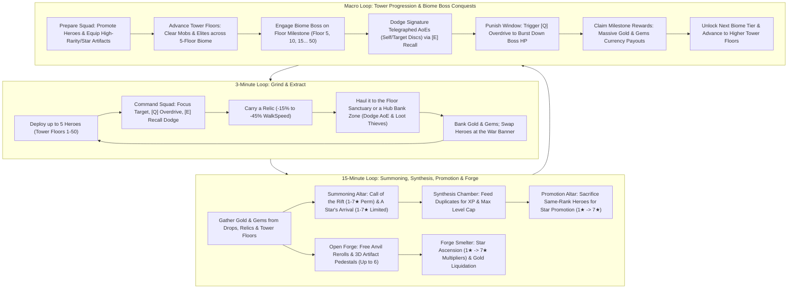

# DOCUMENT 1: COMPLETE GAME DESIGN DOCUMENT (GDD)
**Project Title:** *Infinite Tower: Become a Master!*  
**Target Platform:** Roblox (PC, Mobile, Tablet, Console)  
**Server Capacity:** 8 Players per Server (8 Dedicated Floating Fortress Plots around the Cloister Commons)  
**Engine Architecture:** Server-Authoritative Data Tables (10 Hz Heartbeat, 5 Hz tower snapshots) + Client-Side R15 Visual Interpolation (60 FPS `RenderStepped`) | Hybrid Replication: Central Hub 14-Byte Binary Buffers + Infinite Tower Room-Local v2 Binary Buffers (24-byte entity records, 46-byte header)

---

**Terms used throughout:** the **Skill Gauge** (0–100) charges with attacks and fires a hero's Ultimate; the code calls it `Stamina` / `CurrentStamina` and it travels as the `Stamina` byte of the tower protocol. A hero at 0 HP is **Downed** (sim state `COMA`) until the squad changes floor, goes home or wipes. A **Relic** is the only physical loot.

## 1. EXECUTIVE OVERVIEW & PLAYER FANTASY

### 1.1 High-Concept Pitch
**Infinite Tower: Become a Master!** is a tactical squad-command Action-RPG, extraction sandbox, and fortress progression game inspired by the dark survival manhwa *Pick Me Up, Infinite Gacha*. Players do not play as generic hack-and-slash warriors; instead, each player embodies a **Master**—a dimensional overseer who summons, trains, equips, promotes, and commands a roster of sentient Gacha Heroes from a private floating sanctuary known as the **Master's Fortress Plot**.

### 1.2 The "Pick Me Up" Fantasy & Zero-Waste Roster Economy
In traditional gacha/simulator games, 95% of summons are discarded as worthless stat-sticks, and combat is reduced to passive AFK auto-clicking. **Infinite Tower** solves both problems through two foundational pillars:

1. **The Dual-Role Living Roster (Combat + Labor):**
   - Every hero pulled from the Summoning Altar rolls with **Combat Stats** (movement speed, attack speed, attack damage, health) and **Labor Output** (separate facility productivity). Heroes have no passive traits: rarity, stars, level and their kit (§4.4) set them apart.
   - **Up to 5 Deployed Heroes** (one slot at the start; the Fortress Tree's Command branch opens slots 2–5, see §4.3) follow the Master onto floors 1–50 of the **Infinite Tower** or are assigned to a floor on their own. Heroes charge an in-combat **Skill Gauge** (0 to 100) through a 3-tier attack cadence (Basic -> Basic -> Special -> Skill Attack at 100), and risk being **Downed** (until the squad changes floor, goes home or wipes) if left inside lethal AoE telegraphs.
   - **Benched Heroes** rest on the player's **Fortress Plot** or work in its support facilities (§4.3).
   - **Zero Dead Pulls:** Duplicate heroes across all star ranks are fed into the **Synthesis Chamber** (`SynthesisController.luau`) for EXP leveling to the star cap (Lv. 10 at every star); capped heroes then rank up at the **Promotion Altar** (`PromotionController.luau`) with Gold and the Promotion Stones that tower kills and relics drop (**Star Promotion**, $1★ \to 7★$, §4.2a). Both heroes and artifacts feature a baseline inventory space limit of **50 items**, raised by the Fortress Tree's Storage branch (§4.3). Heroes working in a support facility are out of the backpack and don't count toward the hero cap.
   - **Dual Hero Banners & Open Forge 3D Rolling:** At the **Summoning Altar**, players spend Gems on two distinct hero banners (Call of the Rift `100` / `900` Gems, A Star's Arrival `200` / `1,800` Gems for 1x / 10x): **Call of the Rift** (Permanent Banner featuring 7 stars: $1★ \to 7★$) and **A Star's Arrival** (Limited Time Banner featuring 1 character per star across all 7 stars: $1★ \to 7★$). For weapons, Masters visit the open-air **Open Forge** (`Building_Blacksmith`): strike or press `[F]` on the **Master Anvil** to reroll unlocked artifact pedestals **for free**, inspect the spinning 3D artifacts with overhead rarity + name labels, and walk up to a pedestal to purchase that **1★** weapon for **Relic-floor scaled Gold** (`625 Gold` Common up to `2.28M Gold` Mythical Enhanced across the **84-Weapon Roster**). At the **Forge Smelter** (`ForgeWorkbenchController.luau`), donor weapons of the same rarity and star rank (regardless of weapon type), plus Gold, are used for **Star Ascension** ($1★ \to 7★$), scaling base stats up to **`16.00x`**, while unneeded artifacts can be **sold for Gold**.

2. **Tactical Master Agency Over AFK Whaling:**
   - The Master carries no personal weapon. Instead, the Master directs squads through battlefield commands—**`[Click / Tap]` Focus Target**, **`[Q]` Overdrive Whistle**, and **`[E]` Emergency Recall Whistle**—while physically hauling heavy, high-value **Relics** back to a Sanctuary or their plot.
   - Masters use **`[LeftShift]` Sprint** ($3.0\times$ speed multiplier) to cross high-elevation bridges and dodge lethal hazards.
   - Because boss signature skill checks (the **Biome Boss** signature attacks like *Moss Quake* and *Sweeping Roots*, and elite ground telegraphs) hit every hero left inside the blast zone for heavy damage, often enough to leave them **Downed**, an AFK player will have their squad wiped and sent home, dropping their DPS to zero. An active Master who times **`[E]` Emergency Recall Whistle** to dodge the blast and triggers **`[Q]` Overdrive Whistle** during punish windows will consistently out-damage and out-loot an AFK whale.

### 1.3 Hybrid Retention Matrix & Core Drivers

| Reference Title | Adopted Core Mechanic | *Infinite Tower* Evolution |
| :--- | :--- | :--- |
| ***Pick Me Up, Infinite Gacha*** | Desperate squad survival, Synthesis chamber, Star Promotion, living lobby workers | Heroes are Downed if mismanaged; high-star promotions need hard sacrifices; War Banner plot deployment. |
| ***Pet Simulator 99*** | Multi-unit squad grinding, tactile loot explosions, exponential progression | Replaces passive pet hovering with Skill-Gauge-driven combat squads, active whistle commands, and isolated 50-floor dynamic tower rooms. |
| ***Blox Fruits*** | Telegraphed boss skills, live DPS leaderboards, open-world bounty hunting | **Greed vs. Coma** boss checks, 10 **Biome Bosses** (Floors 5, 10, ..., 50), and **Contested Loot & Bounty Duels** on tower floors. |
| ***Grow a Garden*** | Cozy-yet-competitive perimeter plots, passive production, fortress management | Dedicated private plots with a Fortress Tree of unlockable facilities, War Banner squad deployment, and Forge progression. |
| ***Steal an Egg*** | Physical object hauling, movement penalties, fumble & steal tension | **Relics** weld overhead, slow WalkSpeed by up to -45%, and fumble on AoE hits. |

**The Intimate Server Dynamic:**
In a 10-player server, anonymity disappears. Every player knows who conquered the latest Biome Boss, who just scooped contested loot, and who carries an open 3-minute thief bounty. The interplay of high-stakes extraction, boss timing, and bounty-hunt loops keeps players engaged in continuous Biome Boss clears and Infinite Tower floor pushes.

---

## 2. DETAILED CORE LOOPS



### 2.1 The 3-Minute Micro Loop (Grind, Command & Physical Extraction)
1. **Deploy & Traverse (0:00 – 0:15):**
   - The Master selects up to 5 rested heroes from their roster via the **War Banner** or **Squad Deploy UI** (`SquadController.luau`).
   - The Master sprints (`[LeftShift]`, $3.0\times$ speed) from their plot across the Cloister Commons and the Pilgrim's Causeway to the tower gate, then uses the **Tower Controller** (`TowerController.client.luau`) to travel (`Visit floor`) or station their squad (`Assign squad`) on any unlocked floor of the 50 **Infinite Tower Floors**. The hub itself has no mobs.
2. **Tactical Grind & Skill Gauge Building (0:15 – 2:00):**
   - The Master uses **`[Click / Tap]` Focus Target** to direct every deployed hero onto a target mob or floor boss.
   - Heroes execute a 3-tier cadence: **Basic Attack** (+5 Skill Gauge) $\to$ **Special Attack** (+10 Skill Gauge every 3rd hit) $\to$ **Skill Attack** (unleashed when the gauge reaches 100, resetting it to 0).
   - To accelerate clears and rapidly charge Skill Attacks, the Master triggers **`[Q]` Overdrive Whistle** (`20s CD`), granting **+40% Attack Speed** for `5s` at no cost.
   - When an Elite or Boss telegraphs a red ground AoE or ranged projectile (`ARC`, `SELF_DISC`, `TARGET_DISC`, or swept-corridor `PROJECTILE`), the Master triggers **`[E]` Emergency Recall Whistle** (`6s CD`), warping all 5 heroes to the Master's safe position and dropping their aggro for `2s`.
3. **Relic Haul (2:00 – 2:45):**
   - Defeating mobs, Elites and bosses spawns physical Relic drops in `Workspace.PhysicalRelics`: **Mana Geodes** and **Cursed Urns** from anything, **Abyssal Cores** only from Elites, and **Calamity Hearts** only from Alphas and Biome Bosses (see §5.5 Relic Drops).
   - The Master holds the drop's **Carry** prompt (E, 0.35 s) to weld it overhead, incurring a **-15% to -45% WalkSpeed penalty** (and disabling jumping for high-tier relics). Relics are never picked up by walking over them.
   - If hit by an Elite/Boss AoE mid-haul, the Master is **stunned for 1s and fumbles the item** (which becomes stealable after a **5s owner-lock**).
4. **Extract & Bank (2:45 – 3:00):**
   - **Hub Banking:** Stepping onto the Cloister Commons, a plot bridge, the Pilgrim's Causeway, your plot, or a Private Extraction Pad safely banks a carried relic into permanent Gold and Gems.
   - **Floor Sanctuary Banking:** Carrying a relic into any floor's elevated **Sanctuary** banks it automatically anywhere inside (there is no pad or altar), with the full relic payout and the Market multiplier, without a trip back to the Hub. Kill Gold and Gems never need banking: they are paid on the kill.
   - Downed heroes stay down until the squad changes floor (they stand back up at 30% HP), returns home or wipes. A wipe sends the Master and squad home at full HP (see §2.5 and §6.1).

### 2.2 The 15-Minute Meso Loop (Fortress, Synthesis, Promotion & Forge Progression)
1. **Roster Upkeep (Every 3–5 Minutes):**
   - Swap heroes between the squad, the bench and the support facilities at the War Banner and the facility panels. The squad is **locked** while the Master or the squad is in the tower (including a stationed squad and floor transitions) or in the raid arena: deploying, benching or reassigning a squad hero, Deploy Best and the exhausted-hero auto swap are all refused by the server until both are home. Bench and facility moves for heroes outside the squad still work. A refused squad change shows as a modal (`SquadLockModal`, keyed by the `SQUAD_LOCKED_TOWER` / `SQUAD_LOCKED_RAID` code `AssignHeroRole` returns); in the tower it offers **Return to Hub**.
2. **Summoning & Open Forge Rolling (Every 5–10 Minutes):**
   - Spend Gems at the **Summoning Altar** on either **Call of the Rift** (Common–Mythical Permanent Banner) or **A Star's Arrival** (Common–Mythical Limited Time Rate-Up Banner, featuring 1 character per rarity tier, each summoned at 1★). In addition, visit the **Open Forge** (`ForgeRollService.luau` / `ForgePedestalController.client.luau`) to reroll unlocked pedestals (1–6) **for free** at the Master Anvil (via click or `[F]`, or automatically with the **Forge Auto-Roll** GamePass) and walk to any pedestal to buy its rolled 3D weapon for **Relic-floor scaled Gold** across the **84-Weapon Roster**.
   - **Synthesis Chamber (`SynthesisController.luau`):** Place a recipient hero and fodder heroes to level it up to the current star's cap (Lv. 10).
   - **Promotion Altar (`PromotionController.luau`):** When a hero reaches max level, spend Gold and Promotion Stones to permanently ascend its star rating ($1★ \to 7★$, §4.2a). The hero's inherent rarity never changes.
3. **Artifact Star Ascension & Liquidation at the Forge Smelter (`ForgeWorkbenchController.luau`):**
   - **Star Ascension (Multipliers):** Ascend artifacts from $1★ \to 7★$ at the Forge Smelter by sacrificing donor weapons of the same rarity tier and star rank (any weapon type) and Gold, scaling inherent base stats by progressive multipliers up to **`16.00x`**.
   - **Artifact Liquidation (Selling):** Sell unequipped, unlocked weapons for Gold directly from the Smelter Workbench to maintain inventory space.
   - **Locking & odds disclosure:** Any weapon can be locked from its detail card; locked weapons can't be sold or picked by the sell quick-selects, and high-tier sales ask for confirmation. Inside the Smelter's **Odds & Prices** modal, Masters inspect live **Roll Luck**-boosted per-pedestal odds (uncapped via the `ForgeLuck` Fortress Tree branch) alongside Standard and Enhanced Relic-floor Gold prices for all 84 weapons.

### 2.3 The Macro Loop (Tower Progression & Biome Boss Conquests)
1. **Biome Traversal & Preparation:**
   - Masters organize their 5-hero squad, equip high-rarity and high-star artifacts, and rest exhausted heroes on the bench before entering a new Biome.
   - Each of the 10 biomes spans 5 progressively harder floors (50 floors total) with 4 unique biome enemy species (2 Regulars, 1 Elite, and 1 Biome Boss; 40 total enemy species across the Tower). On floors 1–4 of a biome the Elite is the summoned floor champion; on the 5th floor two Elite-led packs hold the Bastions. Enemy health and attack damage follow the stat-reference curve in Section 4.2. Reward scaling remains $\text{Reward} \times 1.055^{\text{Floor}-1}$; stat inflation does not change rewards.
2. **The Biome Boss Encounter (Floors 5, 10, 15, ..., 50):**
   - The 5th floor of every biome is a dedicated **Biome Boss Arena** (`BOSS_ARENA` layout variant) featuring an 8-column ritual ring, boss braziers, and a massive boss dais fixture (`BossDaisFixture`, $60 \times 2 \times 60\text{ studs}$).
   - Every Biome Boss transitions dynamically from **Phase 1** to **Phase 2 (Enraged)** below 55% HP and wields devastating signature attacks with distinct authoritative shapes and timings:
     - **Basic Attacks:** Wide frontal arcs (`ARC`, e.g. `guardian_crush`, 13 studs).
     - **Signature 1:** Expanding circular ground shocks centered on the boss (`SELF_DISC`, e.g. `moss_quake`, 22 studs radius).
     - **Signature 2:** Ranged ground craters placed under distant heroes (`TARGET_DISC`, e.g. `sweeping_roots`, 55 studs cast range, 13 studs radius).
     - **Ranged / Caster Regulars:** Biome ranged and caster regulars (`mob_lantern_spore`, `mob_crag_channeler`, `mob_thorn_weaver`, `mob_drowned_acolyte`, `mob_astral_scribe`, `mob_void_invoker`) fire authoritative swept-corridor projectiles (`PROJECTILE`) with a floor corridor warning and flying orb visual.
   - **Tactical Counterplay ("Dodge vs. Coma"):** Masters must watch the expanding progress-fill telegraph discs, corridor warnings, and sound cues, repositioning and executing **`[E]` Emergency Recall Whistle** to yank heroes out of danger. Heroes struck by signature skills take heavy damage and are often left **Downed** (until the squad changes floor, goes home or wipes).
   - **Punish Windows:** Following major signature attacks, the boss enters an extended recovery window (1.2s–1.5s), providing active Masters the ideal moment to pop **`[Q]` Overdrive Whistle** for massive burst DPS.
3. **Biome Clearance & Milestone Rewards:**
   - Defeating the Biome Boss awards immense Gold, Gems, and first-clear milestone bonuses.
   - Floors unlock in order: defeating a floor's boss opens the next floor on the **Floor Selector** (`TowerController.client.luau`). Only a Master standing on the floor can clear it; an assigned squad farms Gold, gems and XP but cannot climb.

### 2.4 The AFK & Outskirts Facility Loop (Passive Boost Facilities & Auto/Offline Gold Generation)
While active squad command in the Central Hub and Infinite Tower drives peak progression, the **Outskirts & Facility Loop** ensures that a Master's benched roster continuously generates value both online and offline—reinforcing the **Zero-Waste Roster Economy**.

1. **Inner Fortress Stations vs. The Rear Outskirts:**
   - **Core Main Buildings (Inner Courtyard):** Essential progression stations that every Master accesses by default in their main fortress courtyard—including the **Summoning Altar**, **War Banner**, **Synthesis Chamber**, **Promotion Altar** and **Blacksmith Forge**.
   - **Support Facilities (Inner Fortress Wings):** Upgradeable utility and economic structures (`Level 1` $\to$ `Level 5`) located inside the fortress courtyard wings where benched heroes are stationed via `FacilityController.luau` to grant global percentage buffs. Each is unlocked and levelled through the **Fortress Development Tree** (Section 4.3):
     - **God's Blessing (Plaza Fountain):** An angel statue on the courtyard fountain. Stationed Acolytes (`Healer` preferred) raise **summon luck** on every Summoning Altar banner ($+4\%$ at Lv. 1 up to a $+50\%$ cap).
     - **The Market (Inner Commercial Wing):** Grants a percentage multiplier ($+5\%$ base at Lv. 1 up to $+40\%+$ with high-tier Berserkers) **strictly to Loot Earnings from the Towers**: Gold from Infinite Tower kills (Floors $1\text{–}50$) and the Gold of banked relics. (It does not multiply Outskirts Guard Post passive Gold.)
     - **The Training Grounds (Inner Martial Wing):** Grants a percentage multiplier ($+4\%$ base at Lv. 1 up to $+32\%+$ with high-tier Strikers/Scholars) to the Master's **Overall Squad Combat Power**, multiplying total `FinalATK` and `FinalHP` (both intrinsic hero stats and equipped Artifact stats) against all monsters.
   - **The Outskirts (Southern Frontier Wilderness):** The only area located *outside* the fortress walls, reached through the rear fortress gatehouse. Houses the **Outskirts Guard Post** and its wave-defense trail.
2. **The Outskirts Guard Post (Unified AFK Gold & Offline Rewards):**
   - At the southern rear border of the island, outside the fortress battlements, lies the **Outskirts Guard Post**, a frontier bastion and wilderness trail at the back of the fortress.
   - Masters assign benched heroes (`Vanguard` and `Marksman` preferred) to the Outskirts Guard Post as **Adventurers**. Assigned Adventurers hold a defense arc against cosmetic mob waves in a lightweight client-rendered loop (§4.3, *Facility Workers in the World*); it costs them nothing.
   - **Auto-Received Online Gold:** There is no manual treasury chest required while online. Every $60\text{ seconds}$ (ticked automatically in $10\text{-second}$ increments), passive Gold generated by stationed Adventurers is **automatically added directly to the Master's Gold balance**, scaled by the heroes' `EffectiveLabor` and the Master's **Highest Cleared Biome Boss** (Floors $5, 10, \dots, 50$).
   - **Offline Reward Function (`OfflineRewardService.luau`):** When a Master logs out (`PlayerRemoving`), the server records `LastLogoutTimestamp` alongside their current `PassiveGoldPerMin` rate. Upon reconnecting (`PlayerAdded`), the server calculates elapsed offline minutes up to the Guard Post's **Max Offline Accumulation Cap** ($4\text{ Hours}$ at Lv. 1 $\to$ $12\text{ Hours}$ at Lv. 5) and presents a **"Welcome Back, Master!" Offline Summary Modal**, crediting the accumulated Gold straight to the player's balance.

### 2.5 The Tower Run Loop (Phase 6)
A **run** starts when a Master first stands on a tower floor and ends when they return to the hub or their plot, their squad wipes, or they disconnect. Spec: `docs/rework-plan/PHASE_6_TOWER_RUN_LOOP.md`.

1. **Floors keep moving.** A floor holds 16 / 22 / 25 / 35 / 35 live mobs (floors 1–5 of a biome) in 4–7 camps. Every camp mixes all of the biome's Regular types, about half the camps add one support Regular (Phase D), and the floor's 1 / 2 / 3 / 4 / 4 Elites lead randomly chosen camps (see the camp roster rule in §5). A camp respawns as one wave 10 s after its last member dies (a lone survivor cannot hold it back past 45 s). Each extra Master on the floor adds 40% more members to every camp, up to 48 live mobs. When a Master's kill progress crosses 50% (floors 1–4 only), a personal **surge pack** (1 Elite and 3 Regulars) steps out near their squad.
2. **A longer climb.** A floor boss is summoned after `round(20 + 1.2 × floor)` kill points (a Regular is 1, a camp Elite 3). The boss of floors 1–4 is the biome's **Alpha**, a larger, gilded elite with its own name, stats and a self-quake attack; the 5th floor is the **Biome Boss**. Enemy strength is anchored to the squad a player is expected to have, with a per-biome sawtooth (×0.85, 0.95, 1.05, 1.15, 1.30 by floor in the biome). Floors 1–9 keep their early-game relief curve (2 heroes at floor 1, 3 by floor 5), raised ×1.5 HP and ×1.25 ATK once a new Master's first ten-pull guaranteed a Superior, so the first biome is sized to a Superior-led pair rather than a Rare-led one. From floor 10 the anchors are built on today's hero rules (1★ summon, ×1.5 per promotion, Lv. 1–10 per star) in `StatBalance.ExpectedSquads`: floor 10 expects 4 heroes led by a **promoted (2★) Rare**, floor 30 a squad of about 3★ Exalteds, floor 45 6★ Legendaries/Mythicals, and **floor 50 a full squad of 7★ Lv. 10 Legendary and Mythical heroes** (two Mythicals, three Legendaries) with Legendary 5★ weapons. Enemy HP comes from that squad's summed DPS and enemy ATK from the geometric mean of its HP, so the curve gates on both damage and survival: an unpromoted Rare/Uncommon squad stalls at floor 9, a 5★ Legendary/Mythical squad in the last biome, and a 6★ squad cannot take the floor-50 boss even with Mythical 7★ weapons. Every tower floor then multiplies the curve by `StatBalance.TowerDifficulty`: enemy HP ×1.35 on all 50 floors and enemy ATK ×1.2, with the ATK bump tapering from floor 40 to ×1.0 at floor 50 so the final boss stays gated on the full 7★ squad surviving four hits. Raids read the unscaled curve for boss ATK. Floor 1 is sized to the default starter pair, and new profiles start with 900 Gems (one 10-pull).
3. **Penalties, never losing what you own.** A knocked-out hero stays down until the squad **changes floor** (it stands back up at 30% HP), returns home, or wipes. Floor changes no longer heal anyone; the tower sanctuary heals standing heroes (10% HP per second). After a floor's summoned boss has been damaged, the floor's travel stays sealed until it dies or the squad wipes. A **wipe** costs the carried relic, the streak and 25% of the Gold and Gems earned since the last bank. Heroes, weapons and banked currency are never lost.
4. **Banking and the climb streak.** Entering a sanctuary or pad banks everything. Each floor cleared in a row adds +10% (up to +100%) to the value of relics banked during the run; banking does not reset the streak, only the end of the run does. Relics are the contested loot: each enemy role has its own drop table (§5.5 Relic Drops), and relic Gems (base 100 / 300 / 1,000 / 5,000) and Gold both scale with the floor.
5. **Rift Attunement.** In the tower and in bounty duels, one hero's power is capped at about 1.25× an on-curve hero two floors above the Master's highest floor reached, so a lucky or premium pull is felt without skipping a biome. Damage ($10 \times DPS$) and HP are capped **separately**: each gets the hero's own archetype share of the cap (its seed HP, ATK and interval), and whatever one side doesn't use goes to the other, so the capped hero still lands exactly on the cap. A huge weapon therefore trims only damage and never drains the hero's HP (`StatFormulas.SplitAttunement`, `GetAttunedMultipliers`). Duels use the lower of the two Masters' caps. Facility labor is never capped, and the pull itself (hero, star, rarity) never changes.
6. **Assigned squads farm.** An assigned squad earns kill Gold, Gems and XP anywhere, but relics, kill progress, boss summons and floor unlocks need its Master standing on the floor.
7. **Simulation rate.** The tower simulation runs at 10 Hz (attack intervals round up to 0.1 s); snapshots to clients stay at 5 Hz until a Studio profile clears the bandwidth budget.

---

## 3. MAP & SPATIAL DESIGN SPECIFICATIONS

### 3.1 Dual-Mode Spatial Architecture

The world exists in two coordinated spatial contexts:
1. **The Central Hub & Cloister Commons (World Coordinates):** Landmark Central Crimson Tower (`TowerBuilder`: a 650-stud-wide dark-slate gothic drum of 16 window tiers in four gentle setbacks, each tier with crimson tracery windows and a balcony, under a lantern crown, eight pinnacle turrets and a great spire about 2,150 studs above its base; the Blender remodel's meshes replace the part-built look once imported, see `GothicTowerShell`), the Cloister Commons (a solid rounded-rectangle garden hub) in front of the tower gate, and the 8 player fortress plots around its outer edge. All hub geometry comes from `HubLayout.luau`.
2. **The 50 Dynamic Isolated Tower Floors (Off-Map Isolated Grid):** Server-managed dynamic encounter rooms for vertical climbing and Biome Boss arenas.

```
                    CENTRAL HUB: CLOISTER COMMONS & 8 FORTRESS PLOTS
                                     N (-Z)
                              PLOT 4      PLOT 5
                                ║           ║
                       ╭────────╨───────────╨────────╮
                       │   orchards, pool, portal    │
               PLOT 3 ═╡  ╲          │          ╱    ╞═ PLOT 6
                       │    ╲    ┌───┴───┐    ╱      │
               PLOT 2 ═╡══════════│ DAIS  │══════════╞═ PLOT 7     paths: each landing -> dais
                       │    ╱    └───┬───┘    ╲      │
               PLOT 1 ═╡  ╱  gazebo  │  pavilion ╲   ╞═ PLOT 8
                       │ overlook    │   biome stones│
                       ╰─────────────┬───────────────╯   hub 480 x 640, centre (0, 12, -796)
                                     │ Pilgrim's Causeway (90 long, 40 wide)
                              [ GATE (0,-332) ]
                         ( CENTRAL CRIMSON TOWER  0,0 )  walkway ring R = 375
                                      S (+Z)

               =======================================================
               OFF-MAP INFINITE TOWER ROOMS (Isolated Dynamic Grid)
               Origin(id) = (12000 + ((id-1)%10)*2400, 1000, 12000 + floor((id-1)/10)*2400)
               380 x 420 (floor 1 of a biome) to 560 x 640 studs (floor 5) chambers with Sanctuaries (CombatSafe=true)
               Floors 5, 10, 15, ..., 50 feature dedicated Biome Boss Dais Arenas (BossDaisFixture)
```

### 3.2 Global Coordinate Systems & Zones Table

| Zone Name | Radial Distance / Coordinate Space | Dimensions | Access Rule | Combat & PvP Rules | Primary Drops |
| :--- | :--- | :--- | :--- | :--- | :--- |
| **Central Crimson Tower** | Centred at `(0, 0)`, ~650-stud footprint, walkway ring at `R = 375` ($Y = 16$) | Central multi-level landmark on its round CrackedGroundSlab | Open to all | No mobs in the hub. The gate portal (north, `z = -332`) opens the floor selector for the Infinite Tower. | None |
| **Hub Banking Zones** | `HubLayout.BankZonePolygons()`: the Commons (its rounded outline), the 8 plot bridges and the Pilgrim's Causeway, plus a box around each PlotSpawn. The open air around them is never a bank zone | Authored polygons (`TowerFloorService`) | Open to all | **Safe Zone** (No mobs). Entering one banks a carried relic. | Relic banking |
| **The Cloister Commons** | Rounded rectangle centred at `(0, 12, -796)`: X ±240, Z −1116 to −476, corners R 60 | One solid 480 × 640 garden, with cobbled paths from the central Wayfinder Dais to every plot landing (Section 3.5) | Open to all | Safe Zone. The social hub every player crosses between their plot and the tower. | None |
| **Pilgrim's Causeway** | `z = -386` to `-476` on the gate axis | `40 studs` wide, slopes from $Y = 16$ to $Y = 12$ (`CausewayBuilder.luau`) | Open to all | Safe Zone. Joins the tower walkway to the cloister's South Gate (44 wide). An obsidian deck with a crimson rune channel whose glow rolls toward the tower, spiked parapets, three pairs of fire-crowned pylons joined by arcs of crimson energy, two crested arches with hanging cages, two hooded Warden statues at the tower end, and spikes, chains, embers and red mist hanging into the void below. | None |
| **8 Floating Fortress Plots** | Around the Commons' outer edge (`HubLayout.PlotSlots`): 3 per long side (island roots at x ±448, 208 apart), 2 on the north edge. Neighbours at least 24 studs apart, nearest point to the tower about 570 ($Y = 12$) | About $184 \times 234\text{ studs}$ citadel island (courtyard plus rear outskirts; `PlotHalfWidth`, `PlotFrontDepth`, `PlotBackDepth`); each faces into the hub and joins its edge by a 40-stud bridge | Plot Owner + Visitors | Safe Zone. Personal fortress sanctuary for recovery, banner summoning, forge ascension, and AFK outskirts guard post. Assigned nearest-to-the-gate first: 1, 8, 2, 7, 3, 6, 4, 5. | Roster Recovery, Gacha Banners, Forge, Outskirts Passive Gold & Multipliers |
| **Safety Catch Plane** | Lower kill plane at $Y = -95$, centred on `(0, -950)` | `2400 x 8 x 3400 studs`, tiled (parts cap at 2048) | Fallen players | Non-lethal catch plane; teleports fallen players safely to their PlotSpawn. | None |
| **50 Tower Floor Rooms** | Off-map grid: $X \ge 12,000, Y = 1,000, Z \ge 12,000$ (spaced $2,400\text{ studs}$) | Progressive $380 \times 130 \times 420\text{ studs}$ (F1) to $560 \times 190 \times 640\text{ studs}$ (F5) across 5 elevation tiers | Traversal via `TowerController` | Isolated floor-local PvE encounters; shared floor membership; elevated Sanctuary that banks carried relics. Bounty duels only (§6.1). | Kill Gold & Gems, **Relics** (no artifacts, §5.4) |

### 3.3 Dynamic Tower Room Architecture & Biomes

Tower floors are dynamically managed by `TowerFloorService.luau` and generated via `TowerRoomBuilder.luau` in conjunction with `TowerLayout.luau` and `TowerBiomeAssets.luau`:
- **Room Origin Spacing Formula:**
  $$\text{Origin}(id) = \Big(12000 + ((id - 1) \bmod 10) \times 2400,\; 1000,\; 12000 + \lfloor(id - 1) / 10\rfloor \times 2400\Big)$$
  Spaced at $2,400\text{ studs}$ along both axes so enlarged, multi-tiered rooms remain completely isolated from adjacent cameras, raycasts, and simulation heartbeats.
- **Progressive 5-Floor Scale & Variant Progression:**
  Each biome spans 5 floors (`IndexInBiome = 1..5`). Rather than a static flat box, each room scales progressively across 5 layout variants guided by reference concepts:

| Floor in Biome | Variant Kind | Footprint ($W \times D \times H$) | Elevation Tiers | Architectural Theme | Mob Groups (Camps) | Total Mobs |
| :---: | :--- | :---: | :---: | :--- | :---: | :---: |
| **Floor 1** | `INTRODUCTION` | $380 \times 420 \times 130\text{ studs}$ | 3 Tiers ($Y: 0\text{ to }+12$) | Foreground courtyard, threshold entry arches, flora/crystals/dunes, north shrine. | 4 Camps + Apex | 16 live Mobs (the biome Alpha is summoned at the Apex) |
| **Floor 2** | `EXPANDED_ENCOUNTER` | $420 \times 470 \times 140\text{ studs}$ | 3 Tiers ($Y: 0\text{ to }+14$) | Flanking elevated colonnades and side galleries connected by side ramps. | 5 Camps + Apex | 22 live Mobs |
| **Floor 3** | `TERRAIN_VARIATION` | $460 \times 520 \times 155\text{ studs}$ | 4 Tiers ($Y: -4\text{ to }+18$) | Recessed elemental chasm (water/lava/mist) with arched bridge crossings and waterfalls. | 5 Camps + Apex | 25 live Mobs |
| **Floor 4** | `ELITE_STRONGHOLD` | $510 \times 580 \times 170\text{ studs}$ | 4 Tiers ($Y: -4\text{ to }+22$) | Monumental flanking guardians, watchtowers, and twin upper elite bastions. | 7 Camps + Apex | 35 live Mobs |
| **Floor 5** | `BOSS_ARENA` | $560 \times 640 \times 190\text{ studs}$ | 5 Tiers ($Y: -6\text{ to }+28$) | Full biome masterpiece: Apex Boss Dais, overhead centerpiece, and cascades. | 7 Camps + Apex | 35 live Mobs (4 Elite-led camps, placed at random) + summoned Boss |

- **Per-floor layouts (`TowerLayout.Get(index, floorId)`):** the table above gives each floor-in-biome its canonical shape; every floor then reshapes its own copy, seeded by its floor id (hand-authored floors, below, take a fixed shape instead), so no two floors are alike and none is a mirror image: galleries, bastions, the Crossing and the Apex shift, resize and change height (each side on its own), and the long climbs to the Apex often wind through a small bend terrace instead of running straight. The Sanctuary and the Basin never move. Every variation is validated (no overlapping terraces, no connector over a terrace or across another, no cramped camp) and falls back to the canonical layout if no seed passes; camps, patrols, portals, lanes and navigation all read the floor's own layout ([Tower Navigation §2a](TOWER_NAVIGATION.md)).
- **Hand-authored floors (`TowerLayout` `AUTHORED`):** a floor can replace its seeded variation with a fixed, hand-designed shape: its own terrace spots and sizes, its own path list (which terraces join which), in-world terrace names, set pieces in `TowerBiomeAssets` (keyed by `layout.Authored`), and its own lighting grade (`HubLighting.FloorGrades`, layered over the biome's). Terrace ids keep their roles (Basin = entry level, Galleries = wings, Crossing = central spine, Apex = summit), so camps, patrols, portals and navigation need no changes; authored floors pass the same `Validate` checks. The Verdant Ruins plan for all five floors is `docs/prompts/verdant-ruins-floor-layouts-prompt.md`; all five floors (1–5) are built:
  - **Floor 1, Overgrown Threshold:** the front door of the Solmere, the vanished sun-keepers whose temples the forest took (motif: the carved sun disc; the Heartroot's emerald-gold sap is what still glows). From the Sanctuary (*Fallen Gate*) the arrival ramp drops into the *Pilgrim Hollow* (the Basin), and a narrow raised *Processional Avenue* (the Crossing, 52 × 96 at Y +3, lined with sun-disc stelae) runs straight north up grand steps to the *Dawn Gate* (the Apex, Y +12): a cracked sun-gate whose surviving half frames the boss portals, its sun disc hanging askew, the other half fallen on the terrace. Two glades flank the avenue at different heights: the *Shrine Glade* (west, Y +4, a row of small sun shrines) climbs to the Dawn Gate on its own; the *Banyan Well* (east, Y +6, a Solmere well under a banyan) has no path up and rejoins the avenue instead. Six giant Heartroot figs (trunks 15 studs thick, about 60 tall) stand off the walkways, a pair over the arrival, one either side of the avenue and a pair framing the Dawn Gate, and their boughs arch over the paths with leaf canopies wrapped round every bough end and the trunk's top (the banyan's foliage only, never a whole tree stood on a branch), so the climb runs under a green canopy; boughs and hanging aerial roots stay above 38 studs, clear of every lane and camp, and the floor's ecosystem grows around them. Following the walkable-earth design philosophy, all six grassy terraces, landings, and ramps walk directly on sculpted `Terrain` (`Ground` trails, 3D `Grass`, `LeafyGrass`, and staggered `Limestone` stepping stones with non-colliding hidden proxy parts), while only the `Crossing -> Apex` `GrandStairTread`s stay solid `Limestone` masonry. Camps are unchanged (Hollow west and east, both glades, the Alpha at the summit; 16 mobs, 1 Elite). Lighting is dawn: low warm gold, cool shade and morning haze.
  - **Floor 2, Broken Aqueduct:** an asymmetric diagonal ruins layout (`verdant:2`) where the limestone viaduct (`Aqueduct South` -> `Aqueduct North`) has snapped mid-span above the reed pond — forcing a climb east around `Mill Ruin` (the waterwheel pool) and back across `Aqueduct North`, or up `Cistern Plaza`'s west stairs (`Kind = "STAIRS"`), to the off-centre north-west `Wellhead Shrine` summit. Camps hold 22 live mobs and 2 Elites across five live camps (`Mill Pond` west/east, `Aqueduct South`, `Cistern Plaza`, `Mill Ruin`) plus the `Wellhead Shrine` Alpha (`APEX_SANCTUM`). All grassy terraces (`Sanctuary`, `Mill Pond`, `Cistern Plaza`, `Mill Ruin`, `Wellhead Shrine`), grassy landing pads, and dirt-and-grass ramps render and collide directly via sculpted voxel `Terrain` (`Ground` trails + 3D `Grass` blades + staggered `Limestone` stepping stones, with hidden grassy `Part` colliders disabled so actors never float over terrain contours) and real voxel `Water` pools (no flat blue water plates), while `Aqueduct South`, `Aqueduct North`, and the west stairs stay solid Solmere limestone. Landmarks include twin snapped `BrokenAqueductSpan`s with waterfalls, the eastern `Waterwheel` in its mill-race pool, `SolmereBalustrade`s, `ReedPondCluster`s with stepping stones, four `HeartrootGiant`s, and the stepped golden `Temple` + `SunDiscShrine` in a carved mountain alcove under bright morning haze (`HubLighting.FloorGrades[2]`), with optional Blender meshes in `TowerBiomeKit.ExtraTemplates` (`assets-source/tower/verdant_f2_kit/VerdantF2Kit.fbx`).
  - **Floor 3, Rootway Crossing:** an east–west river gorge (`verdant:3`, `Bottom = -4`, chasm catch at `Y = -8`) splitting the grassy south river bank (*Fern Bank*, `Y 0`) from the sunlit north cliff summit (*Root-Throne*, `Y +18`) where a colossal Heartroot Mother-Trunk wraps the carved Solmere sun-disc throne. Three suspended Heartroot bridges at distinct heights cross the flowing voxel `Water` gorge (`liquidLevel = -4.8`): the central root-tangle island (*The Knot*, `Y +5`, climbing by root-framed limestone `STAIRS` to the throne), the west root arch (*Root Perch*, `Y +10`, overlooking a 38-stud west canyon waterfall and sculpted `RootBridgeArch`), and the east felled colossus stump crown (*Hollow Stump*, `Y +6`, concentric heartwood rings framed by `HollowStumpRim`). Two direct-`Terrain` return ramps (`ChasmWest` / `ChasmEast`) climb from the gorge riverbed shore back up to *Fern Bank*. Camps hold 25 live mobs across five camps (`Fern Bank` west/east, `The Knot`, `Root Perch`, `Hollow Stump` with 3 Elites above entry) plus the `Root-Throne` Alpha (`APEX_SANCTUM`), under noon light shafts (`HubLighting.FloorGrades[3]`) and optional Blender meshes (`assets-source/tower/verdant_f3_kit/VerdantF3Kit.fbx`).
  - **Floor 4, Vinebound Bastion:** a walled compound (`verdant:4`, `Bottom = -4`, `510 × 580`) where a still green voxel `Water` marsh moat (`liquidLevel = -4.8`) and flanking marsh channels separate the grassy direct-`Terrain` *Outer Ward* (`0, 0, 160`, `440 × 114`) from six solid weathered limestone fortress terraces (`Gatehouse` at `Y +5`, `Barracks` and `Sun Shrine` wing decks at `Y +8` joined by wall-walk bridges that unlock the `WALL_WALK` patrol route, upright `West Tower` `Y +14` and leaning `East Tower` `Y +16`, and processional stairs up through `GatehouseArch` to the `Inner Keep` summit at `Y +22`). Two direct-`Terrain` return ramps (`ChasmWest` / `ChasmEast`, `Z = 59..102`) climb from the moat back up to *Outer Ward*. Camps hold 35 live mobs across 7 camps (4 Elites) plus the `Inner Keep` Alpha (`APEX_SANCTUM`). Landmarks include the strangler-fig `GatehouseArch`, flanking `CurtainWallRuins`, twin `VineboundGuardian`s, upright and leaning `VineboundTower`s slung with high `AirborneVineCable`s toward the `VineboundKeep` backdrop, `BarracksSpearRack` & `SunShrineAltar` with roofless ruin gables, `MoatReedRaft`s, `ToppledWallRubble`, and four `HeartrootGiant`s under humid overcast afternoon haze (`HubLighting.FloorGrades[4]`), with optional Blender meshes in `TowerBiomeKit.ExtraTemplates` (`assets-source/tower/verdant_f4_kit/VerdantF4Kit.fbx`).
  - **Floor 5, Mossbound Court:** the Verdant Ruins Boss arena (`verdant:5`, `Bottom = -6`, `560 × 640`), built around a deep sunken voxel `Water` cenote sinkhole (`liquidLevel = -2.8`). Players descend from `Fallen Gate` across direct-`Terrain` *Cenote Rim* (`0, 0, 176`, `480 × 108`) and climb either the flanking two-tier stone colonnade spiral (`West Terrace` `Y +6` -> `Northwest Tier` `Y +14`, or `East Terrace` `Y +8` -> `Northeast Tier` `Y +16`) or directly across the suspended *Sunbridge* causeway (`0, 5, 40`) and root-wrapped ceremonial `STAIRS` up to the `140 × 110` *Mossbound Dais* (`Y +28`), topped with carved Solmere sun-disc floor medallions. Two direct-`Terrain` return ramps (`ChasmWest` / `ChasmEast`, `Z = 78..121`) climb out of the cenote shore. Camps hold 35 live mobs across 7 camps (4 Elites) plus the Biome Boss (`APEX_SANCTUM`, `95`-stud leash) framed by the open semicircular `CenoteColonnadeDome`, soaring `HeartrootMotherHeart` with glowing sap heart & golden-hour dusk light shafts (`HubLighting.FloorGrades[5]`), four two-tier `SolmereColonnadeWing`s, four `CenoteCascadeSpillway` waterfalls pouring into the cenote, and open `GlowLilyCluster`s, with optional Blender meshes in `TowerBiomeKit.ExtraTemplates` (`assets-source/tower/verdant_f5_kit/VerdantF5Kit.fbx`).
  - **Floor 6, Sporelit Entry (`fungal:6`):** the edge of the Veinweb, the single fungal organism that runs through all of Fungal Hollow (its cyan-violet veins are its nerves, the giant mushrooms its fruit, the Spore Matriarch its heart), in the outer quarry of the Velmari, a vanished order of lamp-masons who farmed light underground (indigo slate, violet cobble, teal crystal inlays; motif: the gill-wheel, a disc of radiating gill lines round a hanging bulb). A still teal glowpool fills the middle of the floor, and the *Elder Cap*, one colossal mushroom about 110 studs tall (violet dome, cyan gills, sixteen hanging spore-bulb tendrils), rises from a rock island in it and hides the Apex: from the Sanctuary (*Lampwright's Landing*) the player sees the cyan shaft of the cavern's oculus glowing over the cap. Two routes wrap round the pool and none crosses it (no Basin -> Crossing or Basin -> Apex path): west from the *Glowpool Shore* (the Basin) to the *Chanters' Terrace* (Y +8, raised over the pool, the Sporecap Chanters' candle altar, the Elite camp) and up the long Mycelium Ramp; or east to the *Skitter Warren* (Y +4, egg-sacs against the cliff), up the *Mason's Stair* (`Stairs`) onto the *Veinspan* (the Crossing: a 3-stud slate bridge deck on arched piers over the east pool, Y +9) and down its slate steps to the *Skylight Dais* (the Apex, Y +12) under a round oculus in an otherwise closed vault that casts shadows, so daylight only falls through the oculus, past a fringe of dangling roots, with a crown of giant caps on the cliff above. The terrain is the walking surface (`Terrain.Direct`, below); the floor's ground is violet cobble trails over an indigo spore-moss carpet, carpeted with glowcap turf and spore-moss (the biome's grass), with veins on the cliffs, teal crystal spires in the pool and by the Lantern Spores' camp, glowing pad-caps on the water and falls from the north-west and north-east cliffs. Camps are the index-1 roster (Shore west and east, both wings, the Mycelial Brute Alpha on the dais; 16 mobs, 1 Elite); the Veinspan has none. Lighting is underground twilight (`HubLighting.FloorGrades[6]`): indigo ambient, cyan from above, violet from below, a violet haze and stronger bloom. Kit meshes come from `fungal_f6_kit` (`TowerBiomeKit.ExtraTemplates`; each has a part-built fallback until imported).
  - **Floor 7, Mycelium Galleries (`fungal:7`):** the Velmari's lamp-galleries, cut in tiers into the cavern wall and now strung with the Veinweb's nets. The main route is a switchback up the wall: from the *Drip Hall* (the Basin, Y 0, roots dangling from the vault, drip puddles below) east to the *Lower Lamp Gallery* (Y +4, its lamp niches still burning, a Chanters' candle altar, Elite camp), back west across the *Netted Isle* (the Crossing, Y +8: a rock island rising out of the span pool, its top a rounded squircle (`Terrain.Shapes`) whose corners fall away into the water, with nets strung on mycelium stalks standing in the pool round it, shelf-fungus clumps on its shore and a small oculus overhead whose rim drips glowing threads), up the broad gallery steps (`Stairs`) to the *Upper Lamp Gallery* (Y +12, its lamps mostly dead, Elite camp) and east again to the *Lantern Vault* (the Apex, Y +16: dead lamp-posts round the dais and one living, colossal lamp). A shortcut ramp climbs from the Drip Hall straight onto the isle, and the long east climb from the lower gallery skips the upper one. Camps are the index-2 roster (Hall west and east 4 each, the isle 4, both galleries 5 with Elites, the Alpha in the vault; 22 mobs, 2 Elites). Lighting is deeper and more violet than Floor 6 (`HubLighting.FloorGrades[7]`), the veins thicker on the cliffs (`CliffVeins = 40`). New kit pieces (`fungal_f7_kit`): `MyceliumNet` and `LampNiche`.
  - **Floor 8, Blooming Chasm (`fungal:8`):** the cavern floor fell away and the Veinweb bloomed in the chasm; this is where the **Lampkeepers** (the last Velmari who refused the Veinweb, fleeing up toward the surface) made their refuge, and their trail runs on through Floors 9 and 10. The Sanctuary is *Lampkeepers' Rest*, their last lit camp (two cap-roofed shelters, a lit crystal brazier, a supply cache). From the *Rim of Blooms* (the Basin, Y 0, their abandoned forward camp at its west end) their **rope walkways** (`Terrain.Bridges`: plank decks with rope rails on posts, hung over the open chasm) reach the *Violet Cap* (Y +8: the walkable top of a colossal mushroom, a round deck (`Terrain.RoundDecks`) with a curled lip, glowing gills and a stem down into its pool; Elite camp) and the *Crystal Islet* (Y +4, terrain, teal spires; Elite camp). Both reach the *Old Aqueduct* (the Crossing, Y +12: a surviving Velmari span running east-west on arched piers, the broken spans' last piers standing in the chasm under the walkways, the Lampkeepers' barricaded watch-post at its north-west corner; Elite camp), whose stairs climb to the *Bloomcrown Ledge* (the Apex, Y +20); the islet also climbs the Spine, a rock ridge, straight to the ledge. Their chalk sign (a gill-wheel with one long ray pointing up) marks the walkway heads and the ledge, and a crushed camp lies on the chasm floor below the islet for those who fall. The chasm floor carries teal pools and a sea of mid-size caps, under the widest oculus yet; lighting is the brightest Fungal grade (`HubLighting.FloorGrades[8]`), the Rest's brazier the one warm pool of light. Camps are the index-3 roster (25 mobs, 3 Elites); the Violet Cap's patrol walks its walkway to the aqueduct. New kit pieces (`fungal_f8_kit`): `CapShelter`, `CampSupplies`, `CrystalBrazier`, `Barricade`, `ChalkSign`.
  - **Floor 9, Rotcap Keep (`fungal:9`):** the Velmari citadel devoured from the inside by rotcaps, and the scene of the **Lampkeepers' last stand**. The layout is an **"H" with a high keystone** over the central rot pit: from *The Broken Gate* (the Sanctuary, Y +8, torn shelters, shattered barricades, tattered banners) and the *Fallen Quarry* (the Basin, Y 0, Brute club-drag scars, toppled blocks, second breached barricade line), routes split up the flanking wings — west through the *Brewing Cellars* (`WestGallery`, Y +8, bubbling rot vats, the Lampkeepers' overrun camp turned into a sickly green Chanter candle shrine) to the *West Rot-Spire* (`WestBastion`, Y +16, split watchtower; Elite camp), and east through the *Ossuary of Caps* (`EastGallery`, Y +12, giant ribs and skulls sprouted with rotcaps, dead lamps among the bones) to the *East Rot-Spire* (`EastBastion`, Y +20, leaning tower bound in mycelium, the Lampkeepers' last `ChalkSign` pointing north; Elite camp). High stone-and-plank spans (`Terrain.Bridges`, arched piers in the chasm) cross from both rot-spires to *The Keystone* (`Crossing`, Y +20: masonry deck on arched piers above the rot pit, breached barricade at its north-west corner; `BASTION_RING` patrol walks across it), whose stairs climb to the roofless *Keep of the Rotcap* (`Apex`, Y +24: flanking keep towers and ruined curtain walls crowned by a colossal rotcap rising atop a keep shelf above the portal lanes). **No warm Flamekeepers' light anywhere on the floor**; lighting shifts to sickly yellow-green mixed into the violet (`HubLighting.FloorGrades[9]`), with yellow-green oculus spotlight, alternating yellow-green and violet `VaultLantern`s and set-piece `PointLight`s (24 lights total), and a 50/50 yellow-green and violet ecosystem mushroom mix (`TowerBiomeAssets`). Camps are the index-4 roster (35 live mobs, 4 Elites). New kit pieces (`fungal_f9_kit`): `BrokenBarricade`, `RotVat`, `OssuaryBones`, `RotcapTower`, `VelmariBanner`, `RotcapCluster`, `RotMyceliumWeb`.
  - **Floor 10, Matriarch's Hollow (`fungal:10`):** the heart of the Veinweb and the end of the Lampkeepers' trail. The Matriarch's Dais (`Apex`, 0, 28, −60, 140 × 110, a round terrain mesa, `Shapes`) stands in the middle of the cavern in a dark moat under the great oculus (`Skylight`, radius 70), with four silk-wrapped `ShroudSpire`s in the water at its corners, so the boss arena is in plain sight from the arrival but out of reach. The floor is the walk round to the one way in: from *The Last Lamp* (the Sanctuary: `LastLampShrine`, the floor's only warm light, a `CapShelter`) and the *Silk Shore* (the Basin, Y 0: `SilkWebCurtain`s, brood clutches and crystals, chalk signs), rim paths climb to the lower ring, the *West Egg Gallery* (Y +8: `EggRack`s either side of a `WebbedArchway`, a cold Chanter altar) and the *Spinneret Ledge* (Y +12: `SilkWindlass`es, loom cables down into the moat); wall stairs (`Stairs`) climb to the upper ring, the *West* and *East Cocoon Arcades* (`WestBastion`/`EastBastion`, Y +16/+20: a `SilkSpire`, a curtain and an `EggRack` each); hung silk spans (`Terrain.Bridges`) cross from both arcades to the *Brood Pillar* (`Crossing`, 0, 12, −262: a deck over the brood pool on a fungus-and-silk column, `BroodEggClutch`es and `SilkSpool`s) at the back of the nest; and the *Silk Stair* runs south from there across the moat to the dais' north rim (two `CocoonLamp`s at its head), its only link. The boss portals stand on the dais' south rim (`Portals = {Side = "SOUTH"}`), either side of the Veinweb heart (an `ElderCap` growing out of the dais floor, its roots in a mound of mossy slate with silk veins running out across the dais, framed by two spires), with the stolen lamps (`StolenLampCocoon`) round the rim outside the telegraph discs. No apex shelf rises behind the dais (`Terrain.NoApexShelf`). Camps are the index-5 roster (35 mobs, 4 Elites, the Spore Matriarch on the dais). Lighting (`HubLighting.FloorGrades[10]`) is the clearest Fungal grade, pale silk-white air with cyan from the oculus and a magenta bounce, the opposite of Floor 9's murk. Kit meshes come from `fungal_f10_kit` and `fungal_f10_nest_kit` (which adds the `SILK` colour role).
  - **Floor 11, Cinder Gate (`ashen:1`):** the Varrash frontier threshold (`PathStyle = "VARRASH"`, `DirectTerrain = true`, `Liquid = { Dry = true }`), designed around direct-`Terrain` volcanic ash/sand plains (`Ash Flats`, `0, 0, 82`), wind-carved sandstone ridges (including the central *Sleeping Dune* crest sweeping north behind the dead-end *Dune Crest* lookout at `(0, 10, -20)` topped with `DuneWaystationRuins`), western *Toll House* (`-116, 4, -20`), eastern *Watch Kiln* (`118, 7, -44`), and northern *Cinder Gate* summit (`0, 12, -150`). Camps hold 16 live mobs (1 Elite on *Toll House*; no camp on *Dune Crest*) under searing desert noon haze (`HubLighting.FloorGrades[11]`). Set pieces mirror `AshenF11Kit.fbx` (`assets-source/tower/ashen_f11_kit/AshenF11Kit.fbx`, with native fallbacks): `SanctuaryVarrashSteps`, `VarrashWaystone` caravan markers, tilted `BuriedWagon`, `BrokenMidArch`, `TiltedSandstoneMonolith`s, banded `TollHouseRuins` + nomad tents, cylindrical `WatchKilnTower`, monumental `CinderGateArch` set into columnar basalt cliffs, glowing ember crystal patches, and sun-bleached dead snags. Authored floors configure `DirectTerrain`, `Decks`, `Suspended`, `Masonry`, `Liquid`, `TerrainFeatures`, and custom `Patrols` directly inside `TowerLayout.AUTHORED`.
  - **Floor 12, Buried Caravan (`ashen:2`):** an east-west-east single switchback caravan road (`PathStyle = "VARRASH"`, `DirectTerrain = true`, `Decks = { Crossing = true }`, `Masonry = "VARRASH_DECK"`, `Liquid = { Dry = true }`) climbing from the *Wagon Circle* entry (`0, 0, 110`) framed by `DesertCaravanWagon`s and a nomad campfire ring, up through the colossal arching `SandStriderRibs` straddling `EastGallery -> Crossing` (`Strider's Ribs`, `130, 5, 10`, with `SandStriderSkull` beside it), across the solid weathered-sandstone *Caravanserai Roof* deck (`-10, 9, -30`) topped with flush bronze `CaravanseraiSkylight` grates, past collapsed `SpiceVaultRuins` spilling saffron and crimson powder (`-130, 12, -80`), up to the off-centre tented `MasterTombPavilion` (`40, 14, -170`) under diffuse amber afternoon sandstorm dust (`HubLighting.FloorGrades[12]`) and swirling glasswind dust devils (`assets-source/tower/ashen_f12_kit/AshenF12Kit.fbx`). Camps hold 22 live mobs (2 Elites on *Spice Vault* and *Strider's Ribs*).
  - **Floor 13, Glasswind Ravine (`ashen:3`):** a north–south obsidian canyon chasm (`PathStyle = "VARRASH"`, `DirectTerrain = true`, `Bottom = -4`, `Decks = { Crossing = true }`, `Suspended = { Platforms = { Crossing = true }, Links = { WestGallery_Crossing = true, EastGallery_Crossing = true, Crossing_Apex = true } }`, `Masonry = "VARRASH_GLASS"`, `Liquid = { Dry = true }`, `TerrainFeatures = { RAVINE, DUNE }`) dividing high *West Ledge* (`-140, 10, -34`) from lower *East Ledge* (`140, 6, -56`); the east ledge reaches *Lightning Scar* (`0, 18, -185`) only by crossing the suspended obsidian-and-amber *Glass Arch* (`0, 5, -78`) and climbing black-glass stairs with amber inlay (`Crossing_Apex`), with authored `WEST_LEDGE` and `ARCH_CROSSING` patrols replacing generic gallery routes and two ravine return ramps back to *Ravine Mouth* (`0, 0, 124`). Landmarks mirror `AshenF13Kit.fbx` (`assets-source/tower/ashen_f13_kit/AshenF13Kit.fbx`, with native fallbacks): colossal diagonal `GlassArchSpan`, crystalline `FulguriteCluster` organ pipes and glittering chasm shards, distant NE `RavineHorizonSpire`, NW `RavineSandfall` cascade, overhanging west cliff glass eaves, right-bank Ash Raider camp tents, `GlassCactusCluster` blooms, and twin `VarrashLightningRod`s framing *Lightning Scar* under ravine dusk lighting (`HubLighting.FloorGrades[13]`). Camps hold 25 live mobs (3 Elites on *West Ledge*, *East Ledge*, and *Glass Arch*).
  - **Floor 14, Sunscar Fortress (`ashen:4`):** an Elite stronghold (`510 × 580 × 170`, `PathStyle = "VARRASH"`, `DirectTerrain = true`, `Bottom = -4`, `Masonry = "VARRASH_FORTRESS"`, `Decks` & `Suspended` across `Crossing`, `WestGallery`, `EastGallery`, `WestBastion`, `EastBastion`, and `Apex`, `Liquid = { LevelOffset = 3.2, FloorDip = 1.6 }`, `TerrainFeatures = { LAVA_CHANNEL }`) split down the center (`X = 0`) by the `CrackedLava` **Sunscar** magma fissure and `SunscarLavaSeam` glow veins. Players climb from the direct-`Terrain` *Ashmarket* courtyard (`0, 0, 150`, dressed with `AshmarketStall`s, dry ash fountain, and amber glass shards) solely through the `PortcullisGate` barbican chokepoint at *Kiln Gate* (`0, 5, 52`), cross between *Glassblowers' Row* (`-160, 8, 0`) and *Cistern Barracks* (`160, 8, -10`) over the suspended *Scar Bridge* (`WestGallery_EastGallery`, supported by basalt piers outside the lava trench, adding the authored `SCAR_BRIDGE` patrol alongside generic gallery/bastion routes), and ascend past *West Kiln* (`KilnTower`, `-160, 14, -150`) and *Signal Tower* (`SignalLensTower`, `160, 16, -160`) to the glass-floored *Sunscar Throne* (`0, 22, -205`, `SunscarThroneGlassFloor` over `EmberVeinTapCore`, `SunscarThroneKeep`), lit by readable night ambient + kiln/lava bloom (`HubLighting.FloorGrades[14]`, `assets-source/tower/ashen_f14_kit/AshenF14Kit.fbx`). Camps hold 35 live mobs (4 Elites).
  - **Floor 15, Colossus Dais (`ashen:5`):** the Ashen Dunes Biome Boss arena (`560 × 640 × 190`, `PathStyle = "VARRASH"`, `DirectTerrain = true`, `Bottom = -6`, `Masonry = "VARRASH_DAIS"`, `Decks` & `Suspended` on `Crossing` & `Apex` plus suspended `WestGallery_Crossing`, `Crossing_WestBastion`, `Crossing_Apex`, `WestBastion_Apex`, and `EastBastion_Apex`, `Liquid = { LevelOffset = 3.2, FloorDip = 1.6 }`, `TerrainFeatures = { CENOTE_LAGOON }` rendered as a cracked-lava caldera lake with `CalderaLavaSeams`). Players ascend from *Caldera Floor* (`0, 0, 176`, with Ash Raider outpost tents and two chasm return ramps) across the body of a fallen Elder Colossus — over the curled stone *Fallen Hand* (`-180, 6, 30`, `ElderHandFingers`), along the arm-guarded forearm bridge onto the heart-caged *Elder's Chest* (`-30, 10, -40`), up the upper arm to *Shoulder* (`-150, 16, -150`, `ElderShoulderPauldron` ringed by basalt columns) — or scale *Broken Shield* (`180, 8, 20`, `ElderShieldRim`) and *Fallen Crown* (`170, 14, -140`, `ElderCrownRing` & face-down `ElderColossusHead`), or climb the exposed trade-road `STAIRS` (`Crossing_Apex`) straight up to the `140 × 110` *Colossus Dais* (`0, 28, -232`, `APEX_SANCTUM` Biome Boss Sandstone Colossus, `95`-stud leash) framed by basalt columns and the erupting `CinderholdVent` caldera behind the dais under crimson volcanic eruption lighting (`HubLighting.FloorGrades[15]`, `assets-source/tower/ashen_f15_kit/AshenF15Kit.fbx`). Authored patrols (`FOREARM`, `SHIELD_CLIMB`, `CROWN_RING`) replace generic gallery routes alongside `BASIN_LOOP`, with 35 live camp mobs (4 Elites) plus the Boss.
  - **Floor 21, Slagworks Entry (`infernal:1`):** the outer works of the Sootwrights, the smith-artificers who hollowed the mountain over the root of the Ember Vein; their sigil is the hammer-ring (a hammer inside a ring of gear teeth). The first floor built to the **escalation ladder** (`docs/prompts/infernal-foundry-floor-layouts-prompt.md` Part 2, the standing rule for Floors 21–50: every floor bigger, richer and more varied than the one below it and than every earlier floor at its position). It overrides its room size (`Size = { Width = 480, Depth = 525, Height = 160 }`, 1.58× Floor 1's footprint) and has 9 terraces, 9 links and 8 walk heights, against 8 / 8 / 6 at best on Floors 1, 6, 11 and 16; the walk from the Sanctuary to the Apex stays within 1.5× the canonical floor's. **Shape: a hub with spokes.** From the *Slagworks Gate* (Sanctuary) the *Ore Yard* (Basin, terrain, Y 0) crosses the *Weighbridge* (an `ExtraPlatforms` deck, Y 2) onto the *Great Turntable* (Crossing, a diamond-plate deck, Y 4), which every route passes. Spurs run from it to the *Sorting Shed* (WestGallery, Y 8, Elite camp), the *Slag Tip* (EastGallery, Y 12), the *Ore Crusher* (a deck on an iron gantry, Y 16, reached by two girder bridges) and the *Coal Bunker* (a deck, Y 6); the iron *Furnace Steps* (16 treads with brass nosing) climb to the *Furnace Gate* (Apex, Y 20), and a rim track joins the Sorting Shed to the Ore Crusher. `PathStyle = "SOOTWRIGHT"` (sleepers and steel rails down every earthen ramp), `Masonry = "FOUNDRY_IRON"` (riveted decks on soot-brick plinths, girder spurs on trestles, iron handrails), `Surface = "SOOTWRIGHT"` (sooty basalt yards, slate-grey tracks and ash patches; never `Brick` or `WoodPlanks`, which Roblox collides as 4-stud blocks), and a new `SLAG_TIP` terrain feature heaps clinker with glowing seams beside the east spur and in the back corners. Set pieces (`TowerSetPieces/InfernalFoundry.luau`, footprints checked against every lane and camp by the specs): a tank engine and ore tub parked on the turntable with a cab hut on its rim, the weighbridge office, the jaw crusher with twin flywheels, coal hoppers over the bunker's siding, a slag ladle tipping over the Slag Tip, the open Sorting Shed with roof chutes, a water tower, a roasting kiln, sidings with tubs and buffer stops, a derailed tub, the hammer-ring Furnace Gate in a soot-brick works with window glows and ducts, six smoking flue stacks (up to 120 studs), the bellows duct on trestles and a lava fall in the far corner, plus work clutter on every terrace and at both ends of every link and coal, ore and clinker ground cover. The kit (`tools/blender/generate_infernal_f21_kit.py`, 12 templates in `ExtraTemplates`, each with a part-built fallback) and a smoky red dawn grade (`HubLighting.FloorGrades[21]`).
  - **Floor 22, Molten Assembly (`infernal:2`):** the Sootwrights' assembly hall under a closed brick vault (`Skylight` oculus over the Inspection Gallery), 550 × 615 × 180, 11 terraces, 12 links and 10 walk heights (above Floor 21 and Floors 2, 7, 12 and 17). **Shape: a gantry "Π" with a stem.** A gantry crane spans the hall on two lattice piers and its girder is the route: *West Gantry Pier* (Y 8) → *West Hoist* (Y 9) → *Crane Trolley* (Crossing, Y 10) → *East Hoist* (Y 11) → *East Gantry Pier* (Y 12), tilted by a failed jack. Its four spans are `GirderSpans` (deep lattice box girders with no trestles; TowerRoomBuilder). From the trolley a stem climbs over the *Inspection Gallery* (Y 18) and up an iron stair to the *Assembly Hall* (Apex, Y 24, its only way in); each pier carries a dead-end loft (*Pattern Loft*, *Control Cab*), and a loading ramp from the *Assembly Yard* (Basin) to the trolley keeps the walk to the hall within 1.5× the canonical floor's. Lava runnels (`LAVA_CHANNEL`) run down both side aisles. Set pieces (`TowerSetPieces/InfernalFoundry.luau`): hoist portals with half-built Forge Constructs hanging on chain hoists beside the girder walk, constructs in assembly scaffolds on the yard floor, the trolley's winch drums and hook under its deck, an overhead travelling crane on wall-pier runways with its hook lowered over a bay, the master jig in the Assembly Hall (a construct 81 studs tall in a 96-stud scaffold) between two brick furnaces venting steam, great gears, an idle gantry beyond, steaming quench tanks, roller conveyors, wooden patterns in the Pattern Loft, the glazed Control Cab, parts racks, the failed jack under the east pier, brick vault ribs and sodium lamp strings. Kit: `tools/blender/generate_infernal_f22_kit.py` (12 templates); grade: warm sodium work-light (`HubLighting.FloorGrades[22]`).
  - **Floor 23, Furnace Causeway (`infernal:3`):** the furnace line over a lava lake (625 × 700 × 205, `Bottom = -4`, a `CENOTE_LAGOON` of cracked lava with crust ridges; return ramps climb from the lava shore). 12 terraces, 12 links and 11 walk heights (above Floor 22 and Floors 3, 8, 13 and 18). **Shape: a fishbone.** The spine is a three-span causeway on soot-brick piers (`StonePiers`: piers with basalt cutwaters, a rail line up every deck and twin pipe runs along the spans): *South Causeway* (Crossing, Y 6) → *Mid Causeway* (Y 12) → *North Causeway* (Y 20), then an iron stair to the *Furnace Mouth* (Apex, Y 28). Six ribs leave it, two per span on alternate sides: *West Smelting Bay* (Elite camp) and *Slag Bay*; *East Quench Bay* (Elite camp) and *Cooling Bay*; *Casting Bay* and *Blade Gallery*. An iron catwalk joins the Quench Bay up to the Blade Gallery. Authored patrols replace the generic ones (`SPINE`, `CATWALK`, plus the Basin loop). Set pieces (`TowerSetPieces/InfernalFoundry.luau`): six furnace towers on plinths in the lava flanking the spine, mouths toward the causeway, fed by bellows ducts; the tilting crucible pouring into a grid of mould beds under a jib crane in the Casting Bay; a slag ladle tipping off the Slag Bay into the lava; steaming quench tanks and steam vents; racks of glowing blades in the Cooling Bay; weapon displays in the Blade Gallery; the giant furnace door at the Mouth between flue stacks (115 studs) with more stacks along the back wall; coal tubs, sidings and jib cranes on the *Charging Floor*; crust floes adrift on the lake. Kit: `tools/blender/generate_infernal_f23_kit.py` (11 templates); grade: furnace glare (`HubLighting.FloorGrades[23]`).
  - **Floor 24, Ironflame Bulwark (`infernal:4`):** the Foundry's defences inside a volcanic cavern (715 × 810 × 230, `Bottom = -4`; two north–south `LAVA_CHANNEL` trenches split the fortress into three fortified strips, with `POUR_PIT` carving the boiling **Pour** magma cauldron south of the gate and six `LAVA_FALL` cascades spilling down the outer cavern walls; return ramps climb from the lava shore). 14 terraces, 14 links and 12 walk heights (above Floor 23 and Floors 4, 9, 14 and 19; camps hold 35 live mobs with 4 raised Elites). **Shape: a weave across the strips.** The *Mustering Yard* (Basin, terrain, Y 0) links **only** to the *West Gun Deck* (WestGallery, Y 8) via a suspended iron bridge. From there squads either climb the west strip (*West Gun Deck* → iron stair to *Powder Store* → iron bridge to *West Bulwark Tower* → iron bridge to *Ironflame Citadel*, with the dead-end *Signal Bastion* beyond the tower) or weave east over suspended girder bridges through both lava-channel *Sluice Towers* (`WestSluice`, `EastSluice`, on `StonePiers`) and the *Ironflame Gate* (Crossing, Y 14, with the dead-end *Ironflame Forge* sealed north of it) onto the *East Foundry Deck* → iron stair to *Hammer Hall* → iron bridge to *East Bulwark Tower* → iron bridge to *Ironflame Citadel* (Apex, terrain, Y 36). Authored `WEST_STRIP` and `WEAVE` patrols run alongside `BASIN_LOOP` and `BASTION_RING`. Set pieces (`TowerSetPieces/InfernalFloor24.luau`, footprints spec-checked against every lane and camp): iron-bound crenellated `BulwarkWall`s along both channels, twin `SluiceTower`s with `ChainWinch`es and spiked `SluiceGateChain` portcullis grates barring the lava canals, the Pour crucible chute and boiling glow seams, `SlagCannon` batteries on the Gun Deck, `PowderKegStack`s and a `JibCrane` munitions hoist in the Powder Store, the roaring `SignalBrazier` beacon and 136-stud flaming watchtower on the Signal Bastion, blazing `FlameJetPortcullis` archways at the Ironflame Gatehouse and sealed Ironflame Forge, colossal steam `DropHammer`s and hanging chains under a vaulted arch in the Hammer Hall, `SiegeBallista`s on the battlements, garrison `ArmourRack`s, ruined `Barricade`s ringing the Pour in the Mustering Yard, the 141.8-stud monumental `CitadelDoors` keep with the embossed hammer-ring sigil flanked by turret braziers and 135-stud flue stacks, and six glowing molten lava falls down the dark cavern cliffs. Kit: `tools/blender/generate_infernal_f24_kit.py` (12 templates); grade: siege-red night with cool steel-blue shadow fill (`HubLighting.FloorGrades[24]`).
  - **Floor 25, Titan's Crucible (`infernal:5`):** the Infernal Foundry Biome Boss arena (`740 × 795 × 250`, `Bottom = -6`, a massive `CENOTE_LAGOON` boiling lava lake with crust `PRESSURE_RIDGE`s and six towering wall `LAVA_FALL` cascades; return ramps climb from the lava shore). 15 terraces, 16 links and 13 walk heights (the grandest floor in the tower so far, strictly beating Floor 24 and Floors 5, 10, 15 and 20; 35 live camp mobs, 4 Elites, plus the **Ember Titan** Biome Boss summoned on the `170 × 124` dark-iron *Titan's Crucible Dais* at `Y 44`, `95`-stud leash). **Shape: an hourglass with side chambers.** Twin wide iron stairs climb from the *Casting Floor* (Basin, Y 0) to *West Mould Station* and *East Mould Station* (each with a dead-end side chamber: *Pattern Shop* and *Ingot Store*); both converge on the *Pour Gate* pinch (`Crossing`, Y 20, on `StonePiers` over the lava lake — no `Basin→Crossing` and no `Crossing→Apex`, so every route passes the pinch). North of the pinch sit the dead-end *Pour Spout* overlook (`Y 28`) and twin *West/East Duct* bridgeheads climbing to the *West/East Bellows* towers (`Y 30 / 32`), each with a high dead-end *Chain Gallery* (`Y 36 / 40`) beside the dais. Authored patrols replace generic gallery/bastion routes (`LOWER_PINCH`, `UPPER_PINCH`, `CRUCIBLE_RING` plus `BASIN_LOOP`). Set pieces (`TowerSetPieces/InfernalFloor25.luau`, 39 spec-checked footprints): the colossal **179.5-stud** `GreatCrucible` on twin geared trunnion towers behind the dais (never overhanging the arena or boss portals) with the blazing `TitanHeartGrate`, cathedral `VaultRibArch` columns and `Y 270` cavern vault ribs, twin `GreatBellows` towers feeding sweeping `DuctManifold` pipes, the `PourSpoutChute` funnel catching the dais overflow waterfall, upper `ChainGalleryRail`s with overhead runway beams carrying `HangingChainRun` hooks 46+ studs above walkways, `PatternLathe`s, `TitanMouldFist` & `TitanMouldHelm` castings, stacked `IngotPallet`s, finished weapon displays, Titan tool anvils, ladle carts, crust floes, and invisible lava-lake light anchors. Kit: `tools/blender/generate_infernal_f25_kit.py` (12 templates); grade: molten gold under-light under a dark cathedral vault (`HubLighting.FloorGrades[25]`).
  - **Floor 26, Stormgrass Rise (`thunder:1`):** the Kairnfolk's lower grazing slopes, the first Thunder Highlands floor (`docs/prompts/thunder-highlands-floor-layouts-prompt.md`; guide image `reference/Thunder Highlands 26.jpg`). The Kairnfolk were storm-shepherds, cliff-masons and copper-smiths; their sigil is the forked-bolt totem (a lightning glyph bound by three copper grounding rings). `510 × 550 × 180`, open sky, no chasm; 10 terraces, 11 links and 9 walk heights (above Floor 21 and Floors 1, 6, 11 and 16), the Apex at Y 24, and the walk from the Sanctuary to the Apex 1.49× the canonical floor's. **Shape: wind-tacking contours round a sheer central headwall.** From the *Bell-Gate Fold* (Sanctuary) the trail passes under a dolmen bell-gate onto *Shepherd's Moor* (Basin, Y 0), which climbs to three staggered contours: the *Windmill Knoll* (WestGallery, Y 4, Elite camp), the *Cairn Fold* (Crossing, Y 8, no camp) and the *Standing Stones* (EastGallery, a dry-stone deck, Y 6). North of the Fold a sheer turf-capped slate headwall (`HEADWALL` terrain feature) rises some 66 studs, twin falls spilling down it into a plunge tarn: there is no `Crossing → Apex` link, so every ascent tacks out across the wind, west through the *West Wind-Crag* (Y 16) and up a copper-nosed slate stair, or east over dry-stone causeways through the *East Wind-Crag* (a deck, Y 18) to the *Stormgrass Crown* (Apex, Y 24). Two dead-end spurs overlook the moor: the *Shepherd's Watch* (a deck, Y 10) and the *Fulgurite Outcrop* (Y 12), with a scorched strike crater (`LIGHTNING_SCAR`) upslope. `PathStyle = "KAIRN"` (slate stepping flags down the stormgrass trails), `Masonry = "KAIRN_STONE"` (battered dry-stone platforms with turf lips and copper corner bands, dry-stone causeways with culverts, coped parapets and copper-banded bollards, solid slate bridgehead aprons), `Surface = "KAIRN"` (Grass, LeafyGrass, Slate trails, Rock banks, Mud tarn beds). Set pieces (`TowerSetPieces/ThunderHighlands.luau`, footprints checked against every lane, camp and mob slot by the specs): the split granite tor on the headwall crowned by a copper forked-bolt totem crackling with static (the skyline's tallest piece, about 150 studs over the moor), the twin falls, a ruined post windmill on the knoll's shoulder with its sails to the gale, a ring of seven rune stones round the Standing Stones slung with glowing grounding chains, a sheepfold with its bothy, hurdles and sheep on the Cairn Fold, the shepherd's croft, prayer flags and watch cairn on the Watch, storm-glass on the Outcrop and in the crater, a storm urn shrine on the West Wind-Crag, the summit totem behind the Crown with cairns at its corners, ridge totems on the far peaks, dry-stone field walls with copper grounding stakes across the moor, wind-bent pines and stormgrass all leaning one way down the north-west gale, and moorland clutter on every terrace and at both ends of every link. Kit: `tools/blender/generate_thunder_f26_kit.py` (15 templates, each with a part-built fallback); grade: storm-breaking highland dawn (`HubLighting.FloorGrades[26]`).
  - **Floor 27, Thunderhead Outpost (`thunder:2`):** the Kairnfolk's hilltop ringfort and signal station, where the shepherds took refuge and relayed storm warnings down the mountain by wind-harp and beacon (guide image `reference/Thunder Highlands 27.jpg`). `600 × 605 × 205`, open sky; 12 terraces, 14 links and 11 walk heights (above Floor 26 and Floors 2, 7, 12, 17 and 22), the Lodge at Y 32, 22 live camp mobs and 2 Elites. **Shape: a concentric ringfort entered only through its twin palisades.** The *Stockade Apron* (Basin, Y 0) has no way straight in: it climbs only to the *West* and *East Palisade* bastions (Y 6 deck, Y 8), into the flanking *West Ram Yard* (Y 12, Elite camp) and *East Forge Yard* (a deck, Y 14, Elite camp). From the yards, routes cut in to the *Signal Broch* (Crossing, Y 16), push out to the two *Wind-Harp* towers on the ridge (Y 18 deck, Y 24), or sweep round the *Inner Ramparts* (Y 20, deck Y 22); three approaches (both inner ramparts and the *Broch Ascent* stair from the Broch) converge on *Thunderhead Lodge* (Apex, Y 32). The walk to the Lodge is 1.62× the canonical floor's: the outer arc is the floor's signature, so there is no centre bypass. The boss portals stand 44 studs either side of centre (`Portals.Spread`), so the broch keep can rise between them. Set pieces (`TowerSetPieces/ThunderFloor27.luau`, using the shared `ThunderHighlands.Helpers`; fixed footprints checked by the specs): the stepped broch keep behind the Lodge with its copper cage lantern and twin forked spires (about 117 studs), dry-stone rampart rings banded in verdigris along every terrain terrace's edge (fitted round the walkways, so every path is a gap), a stone gate-arch over the arrival causeway, a palisade of copper-tipped stakes along the Apron's north edge with watch-bell gallows at its gates, the Signal Broch's smoking beacon braziers and capacitor casks, cable masts slinging braided copper out to the two wind-harps, the copper-smith's forge and wire reels in the Forge Yard, the ram pen and loading chute in the Ram Yard, longhouse ruins on the outer slopes, ridge beacons and totems, wind-bent pine shelterbelts and stormgrass. Kit: `tools/blender/generate_thunder_f27_kit.py` (13 templates, each with a part-built fallback); grade: gathering thunderhead noon (`HubLighting.FloorGrades[27]`).
  - **Floor 28, Skybridge Cliffs (`thunder:3`):** the mountain breaks into freestanding granite needles over a sea of storm cloud, spanned only by the Kairnfolk's rope-and-copper suspension skybridges (guide image `reference/Thunder Highlands 28.jpg`). `655 × 700 × 235`, open sky, `Bottom = -6` with two return ramps out of the abyss; 13 terraces, 16 links and 12 walk heights (above Floor 27 and Floors 3, 8, 13, 18 and 23), the Skybridge Crown at Y 40, 25 live camp mobs and 3 Elites (one raised, on the Central Sky-Spire at Y 20). **Shape: a staggered sky-pinnacle archipelago over a cloud abyss.** From the *Cloudbreak Ledge* (Basin, Y 0) three chains climb needles at staggered X, Z and Y (no two neighbours on one axis): a western chain (*West Sea-Stack* Y 8, *West Pinion Crag* Y 16, *West Cable Pylon* Y 28), a central chord (*Central Sky-Spire* Y 20, *Thunderstep Crag* Y 36, then the cliff-cut *Thunderstep* stair to the Crown) and an eastern chain (*East Sea-Stack* Y 12, *East Pinion Crag* Y 24, *East Cable Pylon* Y 30, a deck), cross-linked mid-gorge, with two dead-end roosts (the *Gale Roost*, Y 14, and the *Fulgurite Needle*, Y 34, both decks) over the clouds. Every link past the ledge but the Thunderstep is a hung skybridge (`Masonry = "SKYBRIDGE"`: plank deck on stringers, twin dry-stone pylons banded in copper at each bridgehead, sagging copper main cables and hemp hangers, all dressing over a straight deck). The `SEA_STACK_APRON` terrain feature makes every terrace a sheer needle and leaves the abyss floor bare slate. Authored patrols: `WEST_SKYLINE`, `EAST_SKYLINE`, `CLOUD_SPAN` beside `BASIN_LOOP`; the walk to the Crown is 1.47× the canonical floor's. Set pieces (`TowerSetPieces/ThunderFloor28.luau`; fixed footprints checked by the specs): the twin crown towers behind the Crown (145 studs), their half-arches reaching for each other with lightning arcing in the gap; a sculpted cloud sea of cloud-bank meshes in two layers (always 4+ studs under the walkways), drifting mist and violet underglow from invisible anchors; seven sea-stack spires out of the clouds (two snapped, their cables trailing) and a far range of needles with a distant hanging bridge; cable capstans on both pylons, the supply windlass on the ledge, the anemometer mast on the Sky-Spire, squall-horn perches on the pinion crags, the Storm Roc's talon nest and shed feathers on the Gale Roost, a fulgurite spire on the Fulgurite Needle, a snapped skybridge stub off the East Sea-Stack barred by cairns and rope, prayer pennants and storm lanterns at the bridgeheads, thunder-glass waystones, copper grounding chains under the high spans and cables draped down the needle faces, bonsai pines and stormgrass. Kit: `tools/blender/generate_thunder_f28_kit.py` (13 templates, each with a part-built fallback); grade: cloud-sea squall afternoon (`HubLighting.FloorGrades[28]`).
  - **Floor 29, Tempest Redoubt (`thunder:4`):** the Kairnfolk's two-tier mountain acropolis, split by an east-west cliff fault and built to channel the mountain's lightning into storm-batteries (guide image `reference/Thunder Highlands 29.jpg`). `735 × 790 × 260`, open sky, `Bottom = -6` with two return ramps out of the chasm; 15 terraces, 17 links and 13 walk heights (above Floor 28 and Floors 4, 9, 14, 19 and 24), the Tempest Redoubt at Y 48, 35 live camp mobs and 4 Elites (both Stormkeep Elites stand above the fault, at Y 30 and 32). **Shape: a two-tier acropolis on a cliff fault, three ways up it.** South of the fault (`CLIFF_FAULT` terrain: a plateau 28 studs over the chasm floor behind a sheer, stepped scarp) the lower ward stands on rock over a misty chasm: the walled causeway from the *Outer Causeway* (Basin, Y 0) into the *Lower Barbican* (Crossing, Y 8), the *West* and *East Ram Yards* (Y 12, deck Y 14) and the *Horn Posts* (Y 16) on the outer cliff edges. Three ways climb the fault: the west and east switchbacks (causeways out to buttressed ledges on the cliff's lip, the *West* and *East Fault Switchbacks*, deck Y 22 and Y 24, then on up to the *West* and *East Stormkeeps*, deck Y 30 and Y 32), and in the middle the arched *Thunder-Viaduct* from the Barbican to its pier (deck Y 20) and up the grand steps under the *Storm-Bell Gate* (Y 36). On the plateau the *Capacitor Spire* (deck Y 38) is a dead end off the West Stormkeep, and both Stormkeeps and the Storm-Bell Gate (by the keep steps) converge on the *Tempest Redoubt* (Apex, Y 48). The viaduct spans are open round arches on tall dry-stone piers with copper conduits along both faces (`Viaducts`, `TowerRoomBuilder`); the other causeways are `KAIRN_STONE`. The boss portals stand 46 studs either side of centre (`Portals.Spread`) so the citadel keep rises between them. Authored patrols: `LOWER_WALL`, `FAULT_VIADUCT`, `UPPER_REDOUBT` beside `BASIN_LOOP`; the walk to the Redoubt is under 1.5× the canonical floor's. Set pieces (`TowerSetPieces/ThunderFloor29.luau`; fixed footprints checked by the specs): the citadel keep behind the Redoubt (about 163 studs), crowned by a copper storm spire with four nested rings and sky lightning forking onto its tip; the Capacitor Spire (nested copper coils round a caged violet nexus, arcs and static), braided copper cables from it and the two southern Stormkeep towers to the keep's spire; the Storm-Bell Gate astride the viaduct's steps with its giant verdigris bell 23 studs over the walk; the barbican gatehouse (twin drum towers, raised portcullis, war banners) at the causeway's mouth; round Stormkeep towers on the bastions' outer corners, lightning-spear ballistae trained over the fault, the Crag Channeler's forked-bolt dais beside the gate; crenellated curtain walls round every ward, broken wherever a path crosses; the great copper signal horns on both Horn Posts; thunder-ram stables in the East Ram Yard and a sheep fold in the West; copper-caged nexus braziers along the Outer Causeway; storm-water falls down the scarp, copper conduits climbing it beside the viaduct and retaining buttresses under both switchbacks; mist banks and violet underglow in the chasm; a half-toppled watchtower on the western cliff, far relay spires on the peaks, war banners at the bridgeheads, pines, cairns and stormgrass. Kit: `tools/blender/generate_thunder_f29_kit.py` (13 templates, each with a part-built fallback); grade: electric dusk (`HubLighting.FloorGrades[29]`).
  - **Floor 30, Roc's Eyrie (`thunder:5`, Biome Boss: Storm Roc):** the summit caldera at the roof of the Thunder Highlands, wrapped around an open swirling Cloud-Eye vortex (`795 × 795 × 290`, open sky, `Bottom = -8`, `CLOUD_EYE` + `SEA_STACK_APRON` + `LIGHTNING_SCAR` + `APEX_ALCOVE` terrain; guide image `reference/Thunder Highlands 30.jpg`). 16 terraces, 19 links and 15 walk heights (strictly beating Floor 29 and Floors 5, 10, 15, 20 and 25; 35 live camp mobs, 4 Elites, plus the **Storm Roc** Biome Boss summoned on the flat dark-slate `180 × 132` *Roc's Eyrie* dais at Y 56, `95`-stud leash, two chasm return ramps). **Shape: a Twin-Wing Caldera Amphitheatre around an open Cloud Eye.** From *Thunderhead Threshold* (Basin, Y 0), the *Eye-Rim Overlook* (Crossing, Y 12) projects a hammered-copper-coped stone causeway (`CopperCoping`) straight out onto the cantilevered circular *Storm Eye Pulpit* (deck Y 16) suspended over the cloud vortex — with **no path across the Cloud Eye to the summit** (`Crossing_Apex` and `EyePulpit_Apex` absent), so every ascent curves up either wing of the amphitheatre. The **West Wing** climbs via six Kairnfolk rope-and-copper suspension skybridges (`Skybridges` per-link override in `TowerRoomBuilder`) across *West Feather Shelf* (Y 8), *West Talon Perch* (dead-end deck Y 14), *West Pinion Crag* (Y 20), *West Gale Bastion* (Y 32), *Shattered Crown Spire* (dead-end Y 40) and *West Aerie Landing* (Y 44); the **East Wing** climbs via fortified `KAIRN_STONE` crenellated dry-stone causeways and decks across *East Feather Shelf* (deck Y 10), *East Talon Perch* (dead-end deck Y 18), *East Pinion Crag* (deck Y 22), *East Gale Bastion* (deck Y 34) and *East Aerie Landing* (deck Y 46), before twin grand slate stairs (`STAIRS`, +12/+10) ascend into *Roc's Eyrie* (deck Y 56). Boss portals stand wide at `±66` (`Portals.Spread`) so the colossal spire rises cleanly between them. Authored patrols (`WEST_WING`, `EAST_WING`, `EYE_CHORD`, `EYRIE_CROWN` plus `BASIN_LOOP`) replace generic routes. Set pieces (`TowerSetPieces/ThunderFloor30.luau`, 31 spec-checked footprints): the **204.9-stud** twin-peak *Shattered Sky-Spire* with crackling chasm lightning framed by seven curved copper-clad *Lightning Crown Arches* behind the dais (never overhanging the boss arena or portals); the 16-segment *Woven Great Nest Rim* (storm-blasted pine trunks, braided rope lashings and drum banners) wrapping *Roc's Eyrie* outside its combat floor; the circular *Storm Eye Pulpit* balustrade and drum sleeve; six sweeping catenary *Hanging Abyss Chains* with tattered Kairnfolk banners draped across the 84-bank swirling *Cloud-Eye Vortex* (with 3 invisible lilac-violet underglow anchors and mist swirls); foreground *Threshold Ruin Arch* and *Observatory Ruin*; sea-stack *Gale-Lantern Towers* and gabled highland *Observatory Hall*; twin *Wind-Harp Towers*, *Shattered Crown Fragment*, *Aerie Threshold Totems*, impaled *Colossal Storm-Roc Feathers*, *Feather-Heart Shrine*, bleached *Caldera Rib Bones*, fulgurite glass spires, three roaring cliff waterfalls plunging into the cloud sea, crenellated dry-stone curtain walls, eight outer caldera lightning rods on slate plinths, sea-stack skyline crags, supercell rain, wind-bent pines, cairns and stormgrass. Kit: `tools/blender/generate_thunder_f30_kit.py` (13 templates, each with a part-built fallback); grade: Eye of the Maelstrom dramatic silver-violet calm with warm-gold cliff rim bounce (`HubLighting.FloorGrades[30]`).
  - **Floor 31, Blighted Verge (`corrupted:1`):** the edge of the Corrupted Grove, where the **Hollin** held the line. They were grove-wardens and grafters who grafted every tree of the forest onto one trunk, the Mother Graft; it rotted from the heart (the **Heartrot**) and woke as the Blight Sovereign (Floor 35). Their sigil is the graft-knot (two branches crossed and bound by a ring), and the player follows their **Pale Bands**, the linen bands they tied round every tree they saved, up all five floors (plan: `docs/prompts/corrupted-grove-floor-layouts-prompt.md`; guide image `reference/Corrupted Grove 31.webp`). `Size = { Width = 540, Depth = 580, Height = 195 }`: 11 terraces, 13 links and 10 walk heights, against 9 / 9 / 8 at best on Floors 1, 6, 11, 16 and 21. **Shape: a meandering blight-brook.** It rises at the *Heartrot Spring* (a split elder east of the Apex, its rot-heart glowing magenta) and winds west to a sinkhole, splitting the floor into an autumn-gold south bank and a rotten north bank. The Apex (*Heartrot Spring*, Y 28) sits in the far north-east corner, in view across the water from the *Warden's Stile*. Four **fords** cross the brook, and every route to the Apex uses at least one (`Fords`; the spec checks that without them the Apex is out of reach): the *Stepping-Stone Ford* and the *Weir Ford* are earthen causeways, the *Mill-Race Ford* a hung plank walkway and the *Fallen-Log Ford* a colossal fallen trunk (`Terrain.BridgeStyles = { LOG }`). The quick way fords once (*The Last Green*, *Lantern Copse*, Weir Ford), the zigzag three times (*Pale Glade*, *Weir Mill*, *Lantern Copse*, *Rothollow*), and a back path along the rotten bank (*Warding Shrine*, *The Blight Line*) reaches the Apex from the west; the *Rootstep Stairs* climb from Rothollow. Terrain: the Fungal `Terrain` system with the new `HOLLIN` surface (pale sand trails over brown earth, slate cliffs; mud only under the water, since its ripples read as water on dry ground), the brook a channel 1.5 studs below its banks (`LiquidRise = -1.6`), seven low hillocks, and `GroveScale = 0` / `MeadowScale = 0.15` so the floor places its own trees. `PathStyle = "HOLLIN"`: fieldstone treads and pavers, per-deck looks (`Terrain.DeckLooks`), no vault lanterns. Set pieces (`TowerSetPieces/CorruptedGrove.luau`, 11 spec-checked footprints): the Heartrot Spring elder (113.6 studs), the thatched mill and its wheel on the brook, a fieldstone weir with foam, banded golden beeches in the Pale Glade and the Lantern Copse with wicker lanterns, the great oak on the Last Green, the wardens' lean-to, fire ring and sawn stumps at the Woodcutters' Ring, the Warding Shrine cairn, the felled Blight Line log hung with torn bands, the sinkhole, the woven stile arch over the arrival, groves on both banks and the wall slopes, rot-lilies and reeds along the brook, and golden grass, bracken, rot-blooms and blight pods as ground cover. Kit: `tools/blender/generate_corrupted_f31_kit.py` (15 templates); grade: a sickly gold late afternoon with a rose haze, the least murky Corrupted floor (`HubLighting.FloorGrades[31]`).
  - **Floor 32, Twisted Orchard (`corrupted:2`):** the Hollin's grafting orchard (`620 × 640 × 220`, `Bottom = 0`; guide image `reference/Corrupted Grove 32.jpg`). 13 terraces, 15 links and 12 walk heights (strictly beating Floor 31 and Floors 2, 7, 12, 17 and 22; 22 live camp mobs and 2 Elites). **Shape: up and over.** Every route climbs a continuous south-facing terraced orchard slope (`Terrain.Slope`) from the *Orchard Lawn* (Basin, Y 0) up to the unbroken E–W **Graft Ridge** (`Terrain.Ridges`: *Crookback Ridge* Y 40, *The Grafted Crown* Y 48, *Thorn Saddle* Y 44) and then **descends** behind the crest into the hidden *Pressing Hollow* (Apex, Y 36, lower than the crest and completely hidden from the Sanctuary arrival): centre up the *Grafters' Stair* (`STAIRS`, +32, under a living flowering pleached tunnel) to the Grafted Crown and down the *Press Stair* (`STAIRS`, −12); west through *West Rows* → *West Espalier* → *Crookback Ridge* (with a ridge-walk joining Crookback Ridge to the Crown); east through *East Rows* → *Skep Terrace* → *Thorn Saddle* (with the *Cider Vats* dead-end spur). *Windfall Hollow* (Y 6) is a built slatted timber fruit-drying deck (`Terrain.Decks`, `DeckLooks`). Set pieces (`TowerSetPieces/CorruptedFloor32.luau`, 20 spec-checked footprints): the **130.5-stud** *Great Cider Press* and broad woven-willow *Press-House Roof* on the hollow's back-west rim pouring glowing magenta must with dark press-house smoke rising above the ridge; the five-species *Grafted Crown* tree on the ridge crest (pink blossom, golden autumn, olive fruiting, plum-crimson, pale white blossom plus one bare dead eastern limb, every living limb banded); the flowering *Orchard Gate* and four-arch *Grafters' Stair* tunnel; *Windfall Hollow*'s heaped fruit piles and drying arbor; the *Grafters' Yard* workbenches with terracotta rootstock pots and bubbling wax cauldrons; the mossy fieldstone *West Espalier* walls; the *Skep Terrace* benches of woven straw bee-skeps with humming glowing hives; the burst cooperage *Cider Vat* spilling magenta must down the eastern slope beside the *Felled Row*'s stumps and smouldering brash; *Crookback Ridge*'s hunched pear tree over a carved Hollin bench; *Thorn Saddle*'s dark briar arches; and E–W terraced orchard rows of crutch-propped grafted trees, ladders, baskets, puddles and ground cover. Kit: `tools/blender/generate_corrupted_f32_kit.py` (15 templates); grade: overripe rose dusk (`HubLighting.FloorGrades[32]`).
  - **Floor 33, Briar Labyrinth (`corrupted:3`):** the hedge-maze the Hollin wardens planted over a dry sunken thorn pit to wall in the Thornheart (`680 × 720 × 250`, `Bottom = -6`; guide image `reference/Corrupted Grove 33.jpg`). 15 terraces, 17 links and 14 walk heights (strictly beating Floor 32 and Floors 3, 8, 13, 18 and 23; 25 live camp mobs, 3 Elites, 2 pit return ramps, and `ReplacePatrols` with `GATE_WALK`, `WEST_MAZE` and `OUTER_RING`). **Shape: a hedge-walled labyrinth around a centred Apex.** *Thornheart Court* (Apex, Y 44) stands in the exact centre of the room, visible over the low hedges (≤ 9 studs) from *Hedge Stile* (Sanctuary) and *Briar Lawn* (Basin, Y 0), with the overgrown *Briar Gate* (Crossing, Y 8) directly in front and **no path across the pit** (`Crossing_Apex` absent). The unbanded east branch (*East Walk* → *Thornwrack*, Y 22) is a dead-end trap holding a fallen warden's skeleton; the Pale-Band-marked west branch climbs via *Mender's Croft* / *West Walk* → *Nettle Turn* → *Hanging Garden* (built timber deck, Y 26) → *Garden Stair* (+18) straight into the Court, or continues around the full northern outer ring (*Briar Cloister* → *North Hedge Gate* → *Gibbet Thicket* → *East Rosary* → *Thornheart Steps* `STAIRS`, +4) into the Court from the south-east. All ten pit-spanning walkways use `Terrain.BridgeStyles = "HEDGE"` (non-colliding clipped hawthorn hedge walls with glowing violet-magenta briar vines outside `UsableWidth`). Terrain uses the deeply corrupted `Surfaces.BLIGHT` palette and `Terrain.Blight` relief (violet cobble trails, indigo blighted earth, blackened basalt cliffs/fissures, jagged pit crags and glowing cliff/pit corruption veins; used from Floor 33 onwards). Set pieces (`TowerSetPieces/CorruptedFloor33.luau`, 19 spec-checked footprints): the **153.5-stud** *Thornheart* knot and split blackened elder stump with its blazing magenta cavity on a northern pit mound behind the Court; the overgrown *Briar Gate* doors; the Mender's thatched *Wattle Croft*, bench and scarecrow; the fallen warden's briar nest at *Thornwrack*; the *Hanging Garden* planter pergola; the hacked *Nettle Turn* three-arm signpost; *Briar Cloister*'s fieldstone wellhead; the *North Hedge Gate* arch framing the Mother Graft's far-north horizon silhouette; three dead gallows trees with empty wicker cages at *Gibbet Thicket*; *East Rosary*'s ruined arches draped in shield-sized rot-roses; overgrown topiary stag and Hollin graft-knot on the thorn pit floor; true-path Pale Bands and false-path unbanded hedges; and ground cover. Kit: `tools/blender/generate_corrupted_f33_kit.py` (16 templates); grade: crisp hard-shadow violet noon (`HubLighting.FloorGrades[33]`).
  - **Floor 34, Heartrot Stronghold (`corrupted:4`):** the Hollin wardens' last refuge built up five colossal elder trunks over a deeply corrupted violet-black rot bog (`750 × 795 × 275`, `Bottom = -6`, `Surface = "BLIGHT"`, `Blight = { FissureDepth = 5.0, CragHeight = 15 }`, shallow abyssal bog pools at `LiquidRise = 1.8`). 16 terraces, 19 links and 15 walk heights (strictly beating Floor 33 and Floors 4, 9, 14, 19 and 24; 35 live camp mobs, 4 Elites with `UPPER_WEST` Y 32 and `UPPER_EAST` Y 36 above Y 30, 2 bog return ramps, and `ReplacePatrols` with `BOLE_RING`, `WEST_CLIMB`, `EAST_CLIMB` and `CROWN_WALK`). **Shape: tree-to-tree ascent up five elder trunks to a high back-west fork.** Below, *Sedge Landing* (Y 0) leads to the palisaded *Rootgate* (Y 8) and twin stockades (*West Stockade* Y 12, *East Stockade* Y 14); above, six built tree-bracket and stilt decks (*Mender's Ward* Y 6, *Bracket Ledge* Y 18, *The Lower Bole* Y 20, *Sap Cistern* Y 26, *Seed Vault* Y 30) and 14 `BridgeStyles = "BRANCH"` branch bridges climb to *West Bole Keep* (Y 32), *East Bole Keep* (Y 36), *Middle Fork* (Y 40, reached by the *Bole Stair* `STAIRS` +20), *Canopy Walk* (Y 44), *Weeping Gallows* (Y 48) and *Heartrot Crown* (Apex, `−150, 52, −290`, entered from three ways: *West Bole Keep*, *Middle Fork* and *Canopy Walk*). Set pieces (`TowerSetPieces/CorruptedFloor34.luau`, 22 spec-checked footprints): the **187-stud** split *Great Rotwood* cradling the Crown with its blazing magenta cavity and giant rot-soaked Pale Band; five modular 148–156-stud elder trunks stacked from `ElderTrunkRootFlare`, `ElderTrunkBoleA`/`B` and `ElderTrunkFork` strictly off lanes and camps; three torn-roof Hollin *Treehouse Keeps*; giant glowing *Shelf Fungus Brackets*; *Sap Cistern* cooperage spout pouring glowing sap; *Seed Vault*'s thorn-caged *Heartrot Core* jar; *Weeping Gallows*; *Mender's Ward* stilt hut; stockade palisades; *Canopy Walk* lookout; sunken warden's skiff; severed bog bridge; canopy light shafts; corrupted bog heartrot veins; and the Mother Graft looming much nearer on the north-east horizon. Kit: `tools/blender/generate_corrupted_f34_kit.py` (14 templates); grade: deep violet-black canopy gloom with sun-ray shafts (`HubLighting.FloorGrades[34]`).
  - **Floor 35, Sovereign's Grove (`corrupted:5`, Biome Boss: Blight Sovereign):** the Mother Graft's colossal root crown rising out of an abyssal corrupted sap mire (`810 × 795 × 305`, `Bottom = -8`, `Surface = "BLIGHT"`, `Blight = { FissureDepth = 6.0, CragHeight = 16 }`, broad sap-mire pools at `LiquidRise = 2.0`). 18 platforms (17 combat/traversal terraces + Sanctuary), 21 links and 16 walk heights (strictly beating Floor 34 and Floors 5, 10, 15, 20 and 25; 35 live camp mobs, 4 Elites, the **Blight Sovereign** boss camp on the `184 × 136` *Sovereign's Dais* at Y 60, 2 mire return ramps, and `ReplacePatrols` with `WEST_ROOT`, `EAST_ROOT`, `TAPROOT`, `KNEE_CHORD` and `CROWN_RING`). **Shape: up the backs of three colossal roots to the palm.** *Mire Shore* (Y 0) climbs along the *West Root* (*West Root Foot* Y 8 → *West Root Knee* Y 20 → *West Root Crest* Y 36 → *West Root Crown* Y 48), the central *Taproot* (*Taproot Foot* Y 12 → *Taproot Knuckle* Y 24 → *Taproot Spine* Y 40 → *Heart Stair* `STAIRS` +20) and the *East Root* (*East Root Foot* Y 10 → *East Root Knee* Y 22 → *East Root Crest* Y 38 → *East Root Crown* Y 50), joined at the knees with four root-burl spurs (*Weeping Pulpit*, *Rotbloom Nursery*, *Fallen Crown Ring*, *Sapfall Ledge*) and `BridgeStyles = "ROOT"` mire-spanning root walkways. Set pieces (`TowerSetPieces/CorruptedFloor35.luau`, 23 spec-checked footprints): the **252-stud** *Mother Graft* dead colossus behind the dais (tallest landmark in the tower, blazing magenta heart cavity at Y ~160 and enormous rotten Pale Band, four grafted species limbs, never overhanging the boss arena or portals); the *Last Warden* at *Taproot Foot* ringed by the only green moss and ferns on the floor; *Rotbloom Nursery*'s colossal pulsing blooms; *Fallen Crown Ring*'s broken circlet; *Sapfall Ledge*'s sculpted curving magenta sap waterfall; fused *Root Knee Junctions*; *West Root Crown*'s split *Heartrot Geode* and *East Root Crown*'s *Thorn-Caged Seed*; outer-rim Dais Pale-Band stakes; bowing perimeter elders; converging mire heartrot fissures; and *The Last Band* post at the Sanctuary. Kit: `tools/blender/generate_corrupted_f35_kit.py` (14 templates); grade: blight eclipse crimson-violet sky with cool lilac dais key (`HubLighting.FloorGrades[35]`).
  - **Floor 36, Drowned Steps (`sunken:1`):** the Nereth city's sea-front, the first Sunken Sanctuary floor (plan: `docs/prompts/sunken-sanctuary-floor-layouts-prompt.md`; guide image `reference/Sunken Sanctuary 36.webp`). The **Nereth** were tide-priests who built on the seabed inside the *Stillwater Ward*, a dome of held-back sea that the Tidal Leviathan (Floor 40) held up; their sigil is the tide-spiral, and the player follows their bronze **Tidebells** up all five floors. `570 × 600 × 210`, open sky; 12 terraces, 16 links and 11 walk heights (above Floor 31 and Floors 1, 6, 11, 16, 21 and 26), the Apex at Y 32, the walk from the Sanctuary to the Apex within 2× the canonical floor's. **Shape: a broken processional stair over a tide-flat.** From the *Pilgrims' Gate* (a bell arch over the arrival) the *Tide-Flat* (Basin, Y 0) runs along the shore; the *Pilgrim Stair* climbs from the *Stair Foot* (Crossing, Y 8) up the *First Flight* (`STAIRS`) to the *Pilgrims' Landing* (a marble deck on piers, Y 16), and stops: its middle flight lies broken in the surf with its bell drowned beside it, and there is **no** link from the Landing to the *Bell Landing* (Y 24) beyond the gap (`BrokenFlight`; the spec checks the Apex is still reachable without one). Detours run round the gap east through the *Votive Pool* (a deck, Y 10, floating lamp bowls in the surf round it) and west down to the wrecked *Hollin Barge* on its sandbar (a deck, Y 6) and up *Cantors' Rock* (Y 20, a ring of lecterns); a scenic route climbs the *Tidepool Steps* (EastGallery, Y 12) to the *Upper Pools* (Y 28). The Apex, *The Bell Stack* (Y 32), is a sheer limestone sea-stack in the back-west (`Terrain.Shapes` `Sheer`), entered up the *Bell Stair* (`STAIRS`) from the south or from Cantors' Rock in the west. Four links cross open water as `Terrain.BridgeStyles = "CAUSEWAY"` (flagged limestone on round-arched piers, low parapets with marble posts). Terrain: the Fungal `Terrain` system with the new `NERETH` surface (limestone trails over sand, sandstone patches, rock banks and headlands, limestone sea-cliffs, slate pool beds), one sheet of turquoise shallows over all the open ground just under the floor's slab (`LiquidRise = -0.6`, slate pool beds) with six sandbars, and a low north wall band (`WallBand.NorthScale = 0.3`) so the Tidewall shows over it. `PathStyle = "NERETH"`: marble and limestone treads and pavers, no vault lanterns. Set pieces (`TowerSetPieces/SunkenSanctuary.luau`, 15 spec-checked footprints): the Bell Stack's open shrine of lancet bays under a golden scallop canopy (its crest about 150 studs over the surf) with the first great Tidebell hung high over the Alpha's camp; bell arches over the First Flight and the Bell Stair with aqua rune tablets; the landing's sheared edge and piers; the fallen flight and the drowned bell in the gap; the Hollin barge (a graft-knot cider barrel, a Pale Band rag); the Tide Claws' shell midden; the tide-queen and tide-king colossi sunk to the knee in the surf; a surf colonnade and broken bell arches standing in the sea; rockpools with anemones and a spill-fall; and the **Tidewall**, the sea standing like a cliff along the north wall with fish shoals in it and the drowned city's spires beyond, plus coral, sea fans, kelp, clams and seagrass. Kit: `tools/blender/generate_sunken_f36_kit.py` (17 templates, each with a part-built fallback); grade: bright turquoise noon, the clearest Sunken floor (`HubLighting.FloorGrades[36]`).
  - **Floor 37, Coral Cloister (`sunken:2`):** the Nereth cantors' double cloister (plan: `docs/prompts/sunken-sanctuary-floor-layouts-prompt.md`; guide image `reference/Sunken Sanctuary 37.jpg`). `640 × 690 × 235`, open sky; 14 terraces, 17 links and 13 walk heights (strictly beating Floor 36 and Floors 2, 7, 12, 17, 22 and 32; 22 live camp mobs and 2 Elites), the Apex at Y 40. **Shape: a figure-eight of two arcaded cloisters round two flooded squircle garths (`Pools[i].Round = 5`).** From *Lay Gate* and *Lay Court* (Basin, Y 0), cross the south garth directly on the flagged *Garth Causeway* (`BridgeStyles = "CAUSEWAY"`, framed by twin bell arches) to *The Lavabo* (Crossing, Y 16), or walk *West Walk* (Y 8, Elite) or *East Walk* (Y 12, Elite). Across the wide north garth (`>= 42` studs of impassable open water, kept open by `Sheer` aprons on *The Lavabo*, *Chapter Isle*, *Cantors' Walk* and *Coral Walk*) rises *Chapter Isle* (Apex, Y 40), reached only by circling round *Cantors' Walk* (Y 20) or *Coral Walk* (Y 24) and climbing one of the twin coral-arched *Isle Stairs* (`STAIRS`, `BridgeStyles = "ARCADE"`, columns outside `UsableWidth` and arches >= 20 studs clear). *Bell Tower* (Y 36) joins the two walks behind the isle without linking to it; side spurs house *The Dorter* (Y 4), *The Frater* (deck, Y 10), *Choir Loft* (deck, Y 26), *Sacristy* (Y 28) and *Scriptorium* (deck, Y 30). Set pieces (`TowerSetPieces/SunkenFloor37.luau`, 22 spec-checked footprints): the **150-stud** *Campanile Bell Tower* behind the isle (188 studs above bottom, paired belfry bells and verdigris spire); the octagonal open ribbed-vault *Chapter House* bays, cantors' stalls, north Cantor statue and flush blue-and-gold tide-spiral mosaic on Chapter Isle (and Lay Court); the domed verdigris *Lavabo Fountain House* with its glowing giant scalloped shell basin and fish-head water spouts; outer *Coral Arcade Bays* and corners framing the walks; monastic vignettes in the Dorter (stone cots), Frater (set refectory tables), Choir Loft (stalls & conch racks), Scriptorium (desks & carved celestial tide-charts) and Sacristy (vestment presses & coiled bell-rope bins); two submerged *Drowned Sundials* in the south and north garths; coral-skirt reef growth around Chapter Isle; and the closer three-sided sunlit *Tidewall* with gliding mantas and drowned city domes. Kit: `tools/blender/generate_sunken_f37_kit.py` (14 templates with part-built fallbacks); grade: warm gold-green afternoon (`HubLighting.FloorGrades[37]`).
  - **Floor 38, Tidal Channels (`sunken:3`, `TERRAIN_VARIATION`):** the Nereth waterworks under a brooding grey-teal storm tide (`700 × 740 × 265`, `Bottom = -6`, `Surface = "DEEPWARD"`, `PathStyle = "DEEPWARD"`, `WallBand = { Base = 26, Noise = 9, NorthScale = 0.22 }`; guide image `reference/Sunken Sanctuary 38.jpg`, plan `docs/prompts/sunken-sanctuary-floor-layouts-prompt.md`). 16 platforms, 19 links and 15 walk heights (strictly beating every earlier third floor: 3, 8, 13, 18, 23, 28 and 33; 25 live camp mobs, 3 Elites, 2 tailwater Basin return ramps, and `ReplacePatrols` with `TAIL_GATE`, `WEST_FLIGHT`, `EAST_FLIGHT` and `HEAD_RUNG` alongside `BASIN_LOOP`). **Shape: a twin-rail ladder climbing five stepped canal locks.** *Lock-keeper's Stair* descends to *Tailwater Quay* (Y 0), then west (*West Towpath* Y 12 → *West Lockhouse* Y 20 → *Upper West Lock* Y 28) and east (*East Towpath* Y 16 → *East Lockhouse* Y 24 → *Upper East Lock* Y 32) towpath rails climb alongside five stepped `Terrain.Locks` chambers (`WaterLevel` stepping `-2 → 4 → 10 → 16 → 22`), bridged across the canal at *Tail Gate*, *Middle Gate* and *Head Gate* (`BridgeStyles = "LOCKGATE"` timber-and-bronze lock bridges with hanging mitre gates, overflow ribbons and overhead bell gallows). Flanking side channels hold the *Tide Mill*, *Sluice House*, *Eel Weir*, *Upper Pound* and *Tidebell Tower* (Y 44), while twin stairs (*HeadGate_Apex* and *UpperWest_Apex*) ascend to *The Sea-Gate* Apex (back-west, Y 48). Set pieces (`TowerSetPieces/SunkenFloor38.luau`, 23 spec-checked footprints): the **168.5-stud** open *Sea-Gate* framed by colossal trident statues looking straight into the *Storm Tidewall* and distant viaduct aqueduct, the **149.2-stud** slender gothic *Tidebell Tower*, five lock-chamber mitre gates with aqua tide-wave runes and overflow curtains, four lockhouse bell gallows, jammed Lock 2 and Upper Pound barges, *Tide Mill* with foaming undershot waterwheel, *Sluice House* with triple foaming discharge arches, curved timber *Eel Weirs*, sluice winches, tide-gauge columns, harbour bollards and tailwater wrecks. Kit: `tools/blender/generate_sunken_f38_kit.py` (13 templates in `TowerBiomeKit.ExtraTemplates`); grade: overcast grey-teal storm haze with glowing aqua rune bloom (`HubLighting.FloorGrades[38]`).
  - **Floor 39, Pearlguard Vault (`sunken:4`, `ELITE_STRONGHOLD`):** the Pearlguard's double-walled sea fortress and harbour vault protecting the great Pearl Vault (`780 × 795 × 290`, `Bottom = -6`, `Surface = "DEEPWARD"`, `PathStyle = "DEEPWARD"`, `WallBand = { Base = 24, Noise = 8, NorthScale = 0.20 }`, `NoApexShelf = true`; guide image `reference/Sunken Sanctuary 39.jpg`). 17 terraces, 20 links and 16 walk heights (strictly beating Floor 38 and Floors 4, 9, 14, 19, 24, 29 and 34; 35 live camp mobs, 4 Elites with `UPPER_WEST` Y 36 and `UPPER_EAST` Y 40 above Y 30, 2 harbour return ramps, and `ReplacePatrols` with `OUTER_WARD`, `WALL_WALK`, `WEST_CLIMB`, `EAST_CLIMB` and `VAULT_RING`). **Shape: two concentric sea-walls with a vault behind them.** From *Breakwater Steps* (Sanctuary) and the *Harbour Apron* (Basin, Y 0), **only** the portcullis *Sea Gate* (`Crossing`, Y 8) enters the fortress (outer-gate rule), flanked by the sunken harbour *Divers' Wharf* (wood deck, Y 10) and *Oyster Pearl Beds* (deck, Y 18). Beyond the outer curtain (*Pearl Market* Y 12, *Muster Yard* Y 16, *Harbour Ward* Y 20, *Cistern* Y 24) stands the unbroken Inner Sea-Wall anchored by *Coral Gate Tower* (`WestBastion`, Y 36) and *Tide Tower* (`EastBastion`, Y 40) joined across the *Drowned Gate* by the elevated `BridgeStyles = "WALLWALK"` *Wall-Walk* bridge (inner-wall rule: removing both towers disconnects the vault). From arrival the inner wall hides the lower inner ward while only the gleaming 218-stud **Pearl Vault** dome looms over its battlements; past the towers, twin inner climbs (*Warden's Hall* Y 44 → *Shell Chapel* Y 50, or *Reliquary* Y 46 → *Vault Stair* deck Y 48 → `STAIRS` +8) converge on the back-east *Pearl Vault* (`Apex`, `160, 56, −280`). Set pieces (`TowerSetPieces/SunkenFloor39.luau`, 26 spec-checked footprints): the **218-stud** `PearlVaultDome` greenhouse vault housing the luminous `ColossalClam` with pearl orb behind the Apex; `PortcullisGatehouse` over the Sea Gate; `DrownedGateWall` with sea-serpent reliefs and seven battered `SeaWallSegment` curtains; `CoralGateTower` and `TideArmillaryTower`; `DiversWharfBell`, `ShellAwningStall` market stalls, `MuffledBellStack` barricades, `OysterRack` stakes, `HarbourCrane`, two `PearlguardGalley` ships and `HarbourChainBoom` in the harbour; `CoralWardenStatue` guardians, `CoralCageReliquary`, and the towering north `TidewallFortressNorth` wall of standing sea holding the vast dark shadow of the Leviathan. Kit: `tools/blender/generate_sunken_f39_kit.py` (15 templates); grade: deep sea-blue twilight with golden-pearl vault glow (`HubLighting.FloorGrades[39]`).
  - **Floor 40, Leviathan's Basin (`sunken:5`, `BOSS_ARENA`, Biome Boss: Tidal Leviathan):** the inner basin of the drowned Great Temple beneath the closed **Sea-Dome** (`860 × 795 × 330`, `Bottom = -10`, `Surface = "DEEPWARD"`, `PathStyle = "DEEPWARD"`, `Terrain.Maelstrom` spiral-ribbed whirlpool basin, `NoApexShelf = true`, `WallBand = { Base = 22, Noise = 8, NorthScale = 0.20 }`; guide image `reference/Sunken Sanctuary 40.jpg`). 19 terraces (18 combat/traversal + Sanctuary), 23 links and 18 distinct walk heights (strictly beating Floor 39 and every earlier fifth floor: 5, 10, 15, 20, 25, 30 and 35; 35 live camp mobs, 4 Elites, the **Tidal Leviathan** Boss camp on the `196 × 144` *Leviathan's Dais* at Y 64, 2 maelstrom return ramps at `X ≈ ±318.2`, and `ReplacePatrols` with `WEST_HORN`, `EAST_HORN`, `TIDE_GATE`, `WEST_CREST`, `EAST_CREST` and `CHAIN_RING` alongside `BASIN_LOOP`). **Shape: two bioluminescent reef horns climb round a living whirlpool maelstrom to twin suspended chain-bridge stairs onto a sheer central pillar dais in its eye.** From *The Last Bell* (Sanctuary) and *Wrack Shore* (Basin, Y 0), both *West Horn* (*West Shoal* Y 8 → *West Reef* Y 20 → *West Chain Tower* Y 36 → *West Anchor* Y 52 → `STAIRS` +12) and *East Horn* (*East Shoal* Y 10 → *East Reef* Y 22 → *East Chain Tower* Y 38 → *East Anchor* Y 56 → `STAIRS` +8) wrap around the basin (with optional higher crest loops through *West/East Crest* and *High Cantor's Pulpit* / *Pearl Reliquary*, plus *Kelp Shrine* and *Bell Barge* spurs) and enter *Leviathan's Dais* via **exact two** `BridgeStyles = "CHAIN"` suspended chain-bridge stairs; *Tide Gate* (`Crossing`, Y 12) links both reefs via `"CAUSEWAY"` spans and juts out to the dead-end *Drowned Altar* (Y 26) facing the dais across the vortex. Set pieces (`TowerSetPieces/SunkenFloor40.luau`, 26 spec-checked footprints): the **272-stud** torn twin-buttress `GreatTidebellTower` stump north of the dais with its twisted bronze yoke and shattered bell remnant (never overhanging the arena or portals); overhead geodesic `SeaDomeShell` and glowing `EyeOfDaylight` oculus with client-animated orbiting Leviathan/whale/manta/shark silhouettes (`SunkenDomeSwimmer`); **client-animated `MaelstromVortex`** (flush animated water swirls, subtle water-tornado funnels, swirling debris, and quality-scaled eye spray & bubble columns driven client-side by `MaelstromVortexController.client.luau` at zero server cost); clean flat dais arena with flush blue-and-gold trident mosaic, outer-rim `DaisBrazierPedestal`s, hanging pillar banners, and four rim waterfalls; twin `BrokenTideStatue` monarchs, `ChainAnchorBollard`s (plus snapped trailing chain), `ChainTowerRound`s, `DrownedAltar`, `CantorPulpit`, `AbyssReliquaryShrine`, `BellBargeWreck`, `KelpShrine`, drowned perimeter colonnade, and violet/lavender/pale-ochre/cyan-aqua table-coral reefs (zero red or orange). Kit: `tools/blender/generate_sunken_f40_kit.py` (15 templates); grade: storm-eye under the sea (`HubLighting.FloorGrades[40]`).
  - **Astral Archives (Floors 41–45, the Halcyr):** the **Halcyr** were star-archivists who believed every star was a book and built an open-sky celestial library in vellum-white stone, lapis-indigo marble, brass, gold leaf and ebony. Their **Index Engine** (Floor 43) catalogued every star except one blank entry — the **Rift**, a tear leading down toward the Abyssal Throne (Floors 46–50) watched by the **Rift Warden** (Floor 45). When the last Grand Indexer ordered the Engine to write the unwritten entry, the Rift read the Archive back: the Index fractured, the Runeguard sealed the Athenaeum (Floor 44), and pages, lamps and stars now drift toward the rift-eye. Players follow the **Index Lamps** (star-quill lanterns in brass rings showing open routes) while the client-only **Conjunction** (`StarterPlayerScripts/Rendering/Conjunction.luau`, synced to `workspace:GetServerTimeNow()`, zero remotes, zero gameplay effect) sweeps starlight across tagged star-glyphs, brightens lamps, lifts loose pages, nudges bloom and rings a far chime (plus a low Rift undertone on 43–45), tightening from 16 s on Floor 41 to 6 s on Floor 45. All five rooms are open-sky Starfields using `PathStyle = "HALCYR"` and the `HALCYR` (41–42) / `RIFTWARD` (43–45) terrain surfaces.
  - **Floor 41, Starlit Vestibule (`astral:1`):** `600 × 620 × 225`, `Bottom = -4` (guide image `reference/Astral Archives 41.jpg`). 13 platforms, 18 links and 12 walk heights (16 live mobs, 1 Elite, 2 Nebula Floor return ramps). **Shape: a constellation of floating star-isles traced by `STARGLASS` bridges as the Quill**, rising along the brightest shaft (*Vane Root* → *Lamplighters' Isle* → *The Calamus* → *Nib Landing* → *Nib Stair* `STAIRS`) to *The Nib Star* (Apex, `175, 36, -225`), flanked by the three-barb reading-garden vane and the *Inkwell* → *Blotter* shortcut. Every terrain isle past the Concourse uses `Shapes[id].Float`. Set pieces (`AstralFloor41.luau`, 17 footprints): the **135.2-stud** *Lectern of First Light* spire with orbiting tomes, *The Index Gate* ring, *Catalogue Isle* with the water-stained Nereth tide-chart (*"received wet"*), *The Inkwell*, chained *Blotter* slab, colossal Halcyr statues and sky Quill constellation. Kit: `tools/blender/generate_astral_f41_kit.py` (18 templates); grade: pale gold first light (`HubLighting.FloorGrades[41]`).
  - **Floor 42, Orbiting Stacks (`astral:2`):** `660 × 680 × 250`, `Bottom = -4` (guide image `reference/Astral Archives 42.jpg`). 15 platforms, 20 links and 14 walk heights (22 live mobs, 2 Elites, 2 return ramps). **Shape: a working brass orrery round a central Sun-Lectern (`0, 44, -70`)**, dead-ended across open void from *Perihelion Court* and entered only from *Lexicon* or *Concordance* via `STAIRS`, stepping inward orbit-by-orbit through four `ORBIT` orrery-arm conjunction bridges (with outer counterweights) at the moons and *Atlas*/*Almanac*. Set pieces (`AstralFloor42.luau`, 19 footprints): the **156.5-stud** tall brass *Armillary Sphere* hovering ≥ 22 studs clear above the Sun-Lectern, three cosmetic overhead brass orbit rings, six tinted department planet globes, ring bookcases, moon phase discs, *The Aphelion* frosted telescope, brass sundial, half-sunk plinth gears and the first hairline violet Rift tear in the sky. Kit: `tools/blender/generate_astral_f42_kit.py` (16 templates); grade: warm brass noon (`HubLighting.FloorGrades[42]`).
  - **Floor 43, Fractured Index (`astral:3`):** `720 × 750 × 280`, `Bottom = -6` (guide image `reference/Astral Archives 43.jpg`). 17 platforms, 23 links and 16 walk heights (25 live mobs, 3 Elites, 2 return ramps, `ReplacePatrols` with `WEST_PLATES`, `RIFT_CROSSING`, `EAST_PLATES`, `UPPER_ROW`). **Shape: four tilted fault-plate ranges (`Shapes[id].Scarp`) rising toward back-west *The Lifted Index* (`-210, 52, -285`), split by three alternating-pinch `Terrain.Rifts`** crossed on floating `SHARD` decks or round their pinched ends. Set pieces (`AstralFloor43.luau`, 20 footprints): the **179.7-stud** split *Index Engine* with gear bank and shelf tower back-east, *Lifted Index Gallery*, fossilised *ScarpShelfStrata*, sculpted *PageFallRibbon* cascades, crooked Index Lamps lit only on the shards, deep rift-bed violet glow and split violet-teal aurora overhead. Kit: `tools/blender/generate_astral_f43_kit.py` (19 templates); grade: split violet-teal aurora (`HubLighting.FloorGrades[43]`).
  - **Floor 44, Runeguard Athenaeum (`astral:4`):** `800 × 795 × 305`, `Bottom = -6` (guide image `reference/Astral Archives 44.jpg`). 18 platforms, 23 links and 17 walk heights (35 live mobs, 4 Elites with `UPPER_WEST` Y 32 and `UPPER_EAST` Y 36, 2 return ramps, `ReplacePatrols` with `OUTER_WARD`, `WEST_GATE`, `MIDDLE_WARD`, `EAST_GATE`, `INNER_WARD`). **Shape: three stepped fortress wards divided by two wall-to-wall rune-ward moats (`Terrain.Rifts`) pierced only by alternating physical `WAYGATE` ring-portals** (*West Waygate* at X −130, *East Waygate* at X +140) leading up twin stairs to back-east *The Sealed Stacks* (`230, 60, -300`). Set pieces (`AstralFloor44.luau`, 22 footprints): the **222.1-stud** chained *Athenaeum Dome* rising over both ward walls, rune-ward pylons and shimmering glyph veils, twin *Runeguard Towers*, *Hall of Indices* board, *Seal Forge* anvil, *Forbidden Vault* ring door, *Reliquary* lens rack, shuttered dark lamps everywhere except the two warm-gold Waygates. Kit: `tools/blender/generate_astral_f44_kit.py` (17 templates); grade: sealed indigo dusk (`HubLighting.FloorGrades[44]`).
  - **Floor 45, Rift Warden's Observatory (`astral:5`, Biome Boss: Rift Warden):** `900 × 795 × 350`, `Bottom = -6` (guide image `reference/Astral Archives 45.jpg`). 20 platforms, 26 links and 19 walk heights (35 live mobs, 4 Elites, the **Rift Warden** boss camp on the `204 × 152` *Observing Floor* dais at Y 68, 2 return ramps, `ReplacePatrols` with `WEST_BANK`, `MID_SUTURE`, `WEST_HORN`, `EAST_HORN`, `EAST_CREST`, `ANCHOR_RING`). **Shape: an end-to-end diagonal Rift (`Terrain.Rifts`) stitched by three `SUTURE` shelf-and-chain crossings** (with the dead-end *Rift Overlook* cantilever facing the dais) leading up to twin *Azimuth Rings* and `STARGLASS` Ring Stairs onto the sheer pedestal dais (`Shapes.Apex.Sheer`). Set pieces (`AstralFloor45.luau`, 24 footprints): the **297.8-stud** *Great Telescope* and open-ribbed *Observatory Dome* standing clear behind the dais against a torn sky, slow-turning violet *Rift Eye* deep in the rift bed, twin *Azimuth Rings* holding the last two gold lamps, *Transit Towers*, *Lens Gallery*, *Fallen Orrery*, *Rift Overlook* cantilever and *The Last Lamp* at the Sanctuary. Kit: `tools/blender/generate_astral_f45_kit.py` (17 templates); grade: rift-eye under a torn sky (`HubLighting.FloorGrades[45]`).
  - **Abyssal Throne (Floors 46–50, the Vahl):** the **Vahl** were mortal wardens who followed **Vharos the Warden-King** beneath the Rift to bind the Abyss from within in black obsidian, blackened iron chains, bone-white marble walkway trim and matte wine-crimson silk under the **Chained Crown** sigil. Below every walkway the **Undertow** braids and climbs uphill toward the Throne, while pale bone-white **Wardlights** in iron cages mark every open way (all gameplay telegraphs keep walk surfaces free of crimson/orange/violet emissive glare per §5.7). The client-only **Dirge** (`StarterPlayerScripts/Rendering/Dirge.luau`, synced to `workspace:GetServerTimeNow()`, zero remotes, zero gameplay effect) tolls a slow far bell, surges the Undertow, flares Wardlights, draws chains taut, lifts ash/page drift, nudges bloom (`+0.05..0.08`) and bows distant court silhouettes, tightening from 16 s on Floor 46 to 6 s on Floor 50 (where the Crimson Eclipse and Throne's heart-crack answer with a deep red-black heartbeat). All five rooms use open-vault black skyboxes with `PathStyle = "VAHL"` and the `VAHL` (46–47) / `THRONEWARD` (48–50) terrain surfaces.
<<<<<<< HEAD
  - **Floor 46, Abyssal Descent (`abyssal:1`, `INTRODUCTION`):** `640 × 640 × 240`, `Bottom = -4` (guide image `reference/Abyssal Throne 46.jpg`). 14 terraces, 19 links (18 `"CHAINFORD"` iron-grate chain bridges plus `HeadC→Apex` stairs) and 13 walk heights (16 live mobs, 1 Elite at *Reaving Eyot*, 2 return ramps). **Shape: four staggered rows of lens-shaped obsidian eyots (`Shapes.Round = 2.4, Sheer = true`) above braided uphill `Terrain.Rifts` channels**, climbing past *The Ford of Pages*, *The Drift* raft, *Gallows Eyot*, *Wreck Shoal*, *Midbraid*, *Bonebar*, *Weir of Hooks* and *The Lip* to the back-west *Upfall* (`-150, 40, -240`). Set pieces (`AbyssalFloor46.luau`, 20 footprints): **172-stud** *Abyssal Upfall* column pouring upward into the black vault, overhead Pale Rift wound shedding Archive pages, Fallstrand Halcyr wreckage and the *"Vharos"* unwritten page pinned beside *The Fallstair*, *Reaving Rack*, *Vahl Gibbet Cage*, *Execution Block*, *Weir of Hooks*, *Chained Crown Keystone* and split crimson-core obsidian Trench Geodes. Kit: `tools/blender/generate_abyssal_f46_kit.py` (15 templates); grade: ash-fall dusk (`HubLighting.FloorGrades[46]`).
  - **Floor 47, Crimson Procession (`abyssal:2`, `EXPANDED_ENCOUNTER`):** `700 × 700 × 265`, `Bottom = -4` (guide image `reference/Abyssal Throne 47.jpg`). 16 terraces, 21 links (`"PROCESSIONAL"` obsidian spans and twin `StationW`/`StationE` processional stairs with matte wine-silk runners) and 14 walk heights (22 live mobs, 2 Elites at *Hall of Sworn* and *Hall of Bound*, 2 return ramps). **Shape: two processional columns plaited across the central *Crossing of Oaths*, climbing from the flanks onto the central *Crimson Bier* (`0, 48, -160`) ringed by a closed-loop `Terrain.Rifts` void moat (`Loop = true`)**, with *The Mourners' Gallery* ending in an impassable chasm facing the Bier and the back *Vigils* / *Ossuary* joined by the *Vigil Walk*. Set pieces (`AbyssalFloor47.luau`, 22 footprints): **186-stud** vaulted *Effigy on Bearers* arching cleanly over the *Vigil Walk*, *Crimson Bier Catafalque*, rows of *Sworn* and *Bound* processioners, kneeling vigil statues, veiled mourners, *Silk Loom* and cold *Iron Forge* shrines, chain-votive racks and *Ossuary* urn niches. Kit: `tools/blender/generate_abyssal_f47_kit.py` (15 templates); grade: crimson vigil (`HubLighting.FloorGrades[47]`).
<<<<<<< HEAD
  - **Floor 48, Voidspan Crossing (`abyssal:3`, `TERRAIN_VARIATION`):** `760 × 760 × 295`, `Bottom = -6` (guide image `reference/Abyssal Throne 48.jpg`). 18 terraces, 24 links (`"CATENARY"` suspended saltire spans + `"CHAINFORD"` wall-bolted Gibbet Ledges + `AnchorFE→Apex` stair) and 17 walk heights (25 live mobs, 3 Elites at *The Hookward*, *The Chainwright's Yard*, *The Ashgrate*, 2 return ramps, `ReplacePatrols` with `NEAR_RIM`, `WEST_CHAIN`, `EAST_CHAIN`, `FAR_CHAIN`). **Shape: a saltire catenary crossing where the quickest route drops down through four suspended iron bead decks to *The Keystone* (`0, 25, -105`) before climbing back up to back-east *The Far Gate* (`170, 56, -305`)**, flanked by high outer *Gibbet Ledges* along the chasm end walls. Set pieces (`AbyssalFloor48.luau`, 26 footprints): four **214-stud** iron-collared *Anchor Spires* with seized great capstans and hanging counterweights, great catenary saltire chains overhead (`>= 23` studs clear), *Keystone Cage*, *Hung Bead Platforms*, *Far Gatehouse* with gold-rimmed *Chained Crown*, *Half-Forged Link*, *Hook & Pulley Rack*, *Ashgrate Floor* and pooled violet *VoidPoolMesh* lighting from underneath. Kit: `tools/blender/generate_abyssal_f48_kit.py` (15 templates); grade: void-glare (`HubLighting.FloorGrades[48]`).
  - **Floor 49, Dreadguard Citadel (`abyssal:4`, `ELITE_STRONGHOLD`):** `840 × 795 × 320`, `Bottom = -6` (guide image `reference/Abyssal Throne 49.jpg`). 19 terraces, 25 links (twin `"DRAWBRIDGE"` moat stairs from *West/East Inner Ward* onto *The Dreadguard Keep*, plus `"CHAINFORD"` spurs to dead-end *Sallyport* & *Countermine*) and 18 walk heights (35 live mobs, 4 Elites at *Bastion of Hooks/Axes* and *West/East Dread Bastion* at Y 32/36, 2 return ramps, `ReplacePatrols` with `GLACIS`, `WEST_FLANK`, `EAST_FLANK`, `NORTH_WALK`, `INNER_WARD`). **Shape: a bastioned obsidian star fort round a closed-loop `Terrain.Rifts` void moat (`Loop = true`) encircling the central *Dreadguard Keep* (`0, 64, -90`)**, where outer ramps climb the covered way and bastions round the curtains before lowering over the moat via the twin drawbridges. Set pieces (`AbyssalFloor49.luau`, 28 footprints): **244-stud** battered *Dreadguard Keep Tower* with empty Overlord sword niche, *Dreadguard Keep Gatehouses*, *Star Bastion Salients*, crenellated curtains with shuttered lamps, *Ravelin Portcullis*, iron-stake palisades, *Siege Hook Crane*, execution yard, *Penitent Cages*, *Great Iron Bell*, *Mine Winding Gear* and north-horizon crimson sky glow, and in the north wall behind the North Bastion the **Throne Gate**, the way into Floor 50: twin 300-stud gate towers with wine banners, closed iron doors over the Bastion's prow with a crimson glow between the leaves, a pointed arch and gable crowned by the Chained Crown sigil. The star-fort retaining walls and the Keep mound's buttresses are solid (`AbyssalCollision.SupportKinds`). The Keep's corner sentries and south battlements stand on its round edge facing out, the salient prows past their terraces stand on masonry piers, the Keep Tower's chains run to the north sentries, the drawbridge gatehouses and frames, and the far-north fortress towers are `StormkeepRoundTower` (the `ChainTowerRound` kit isn't imported). Kit: `tools/blender/generate_abyssal_f49_kit.py` (16 templates); grade: iron night (`HubLighting.FloorGrades[49]`).
=======
<<<<<<< HEAD
  - **Floor 48, Voidspan Crossing (`abyssal:3`, `TERRAIN_VARIATION`):** `760 × 760 × 295`, `Bottom = -6` (guide image `reference/Abyssal Throne 48.jpg`). 18 terraces, 24 links (`"CATENARY"` suspended saltire spans + `"CHAINFORD"` wall-bolted Gibbet Ledges + `AnchorFE→Apex` stair) and 17 walk heights (25 live mobs, 3 Elites at *The Hookward*, *The Chainwright's Yard*, *The Ashgrate*, 2 return ramps, `ReplacePatrols` with `NEAR_RIM`, `WEST_CHAIN`, `EAST_CHAIN`, `FAR_CHAIN`). **Shape: a saltire catenary crossing where the quickest route drops down through four suspended iron bead decks to *The Keystone* (`0, 25, -105`) before climbing back up to back-east *The Far Gate* (`170, 56, -305`)**, flanked by high outer *Gibbet Ledges* along the chasm end walls. Set pieces (`AbyssalFloor48.luau`, 26 footprints): four **214-stud** iron-collared *Anchor Spires* with seized great capstans and hanging counterweights, great catenary saltire chains overhead (`>= 23` studs clear), *Keystone crown* (an iron ring where the four great chains meet, the brightest Wardlight hung under it, the deck itself left open), the four *Beads* hung from their great chains on iron yokes, *Far Gatehouse* with gold-rimmed *Chained Crown*, *Half-Forged Link*, *Hook & Pulley Rack*, *Ashgrate Floor* and pooled violet *VoidPoolMesh* lighting from underneath. Kit: `tools/blender/generate_abyssal_f48_kit.py` (15 templates); grade: void-glare (`HubLighting.FloorGrades[48]`).
=======
=======
  - **Floor 46, Abyssal Descent (`abyssal:1`, `INTRODUCTION`):** `640 × 640 × 240`, `Bottom = -4` (guide image `reference/Abyssal Throne 46.jpg`). 14 terraces, 19 links (18 `"CHAINFORD"` iron-grate chain bridges plus `HeadC→Apex` stairs) and 13 walk heights (16 live mobs, 1 Elite at *Reaving Eyot*, 2 return ramps). **Shape: four staggered rows of lens-shaped obsidian eyots (`Shapes.Round = 2.4, Sheer = true`) above braided uphill `Terrain.Rifts` channels**, climbing past *The Ford of Pages*, *The Drift* raft, *Gallows Eyot*, *Wreck Shoal*, *Midbraid*, *Bonebar*, *Weir of Hooks* and *The Lip* to the back-west *Upfall* (`-150, 40, -240`). Set pieces (`AbyssalFloor46.luau`, 20 footprints): **172-stud** *Abyssal Upfall* column pouring upward into the black vault, overhead Pale Rift wound shedding Archive pages, Fallstrand Halcyr wreckage and the *"Vharos"* unwritten page pinned beside *The Fallstair*, *Reaving Rack*, *Vahl Gibbet Cage*, *Execution Block*, *Weir of Hooks*, *Chained Crown Keystone* and split crimson-core obsidian Trench Geodes. Kit: `tools/blender/generate_abyssal_f46_kit.py` (15 templates); grade: ash-fall dusk (`HubLighting.FloorGrades[46]`). Floors 46-49 lie under the Abyssal void vault (`TowerRoomBuilder`'s `AbyssalVoidVault`: a black, shadowless ceiling over the mountain tops and black walls just outside the room), so the Dirge's violet haze (density 0.34 rising to 0.42 on Floor 50, haze 1.6 to 2.0) tints a void instead of a daylight sky; on the Dirge toll only small dressing sways (16 studs or less), big tagged pieces just flicker their light.
>>>>>>> feat/abyssal-throne-floor-46
>>>>>>> feat/abyssal-throne-floor-47
>>>>>>> feat/abyssal-throne-floor-48
- **Authored room size (`TowerLayout` `Size`, Floor 21 first):** an authored floor may override its floor-in-biome footprint with `Size = { Width, Depth, Height, Bottom? }`; every consumer reads the built layout's `Width`, `Depth`, `Height` and `Bottom`, and the 2,400-stud room grid still holds the largest planned room (920 deep). Every other floor keeps the per-index table above.
- **Authored terrain (`TowerLayout` `Terrain`, Floor 6 first):** an authored floor can shape its own ground as data. `Direct = true` makes natural terraces, landings and ramps the terrain itself: their parts stay as invisible, non-colliding proxies, and the field sits 2 studs under the walking plane (smooth voxel terrain renders its surface half a voxel above the requested height, exactly so only on 4-stud planes, so terrain terraces stand on multiples of 4), 2.8 under stair treads and 4.5 under built `Decks` (solid, visible masonry; `DeckThickness` makes a deck a thin bridge that raises no ground, so its pool runs on beneath it). Where walkways overlap the highest surface wins, and a ramp wins a tie with a deck so it meets the deck flush. Aprons fall away along noise-warped edges, every path gets a trodden `TRAIL` spine, and a `Surface` palette (`TowerTerrain.Surfaces`) says what trails, walk ground, banks, cliffs and pool beds are made of. `Bridges` hang a path as a solid plank walkway with the chasm open beneath it, `RoundDecks` make a deck a disc (a cap top), `Shapes` round a terrain terrace into a squircle (its corners fall away, its edges' middles stay flat for the paths), `Pools` (ellipses) replace the random chasm pools, `Islands` rise out of them, `LiquidRise` and `FloorDip` set the water level and pool depth, `WallBand` the width of the mountain band, `NoApexShelf` drops the ridge that otherwise rises behind the Apex (for a dais that stands free), and `GroveScale`, `GroundCover`/`GroundCoverCount` and `CliffVeins` tune the ecosystem. Outside `Terrain`, `Portals = {Side, Spread}` moves the boss portals to the Apex's south rim. Because terraces stop answering raycasts, the arrival check, loot drops and mob grounding also raycast the Terrain (ignoring water). Terrain colours are place-wide, so each colour belongs to one look: Cobblestone, Concrete, Pavement and Asphalt are Fungal-owned (violet cobble, spore-moss, indigo slate, wet teal-black pool beds) and no biome palette may use them.
- **Natural floors (`TowerTerrain.luau`, once the Tower Biome Kit is imported):** every floor stands in its own voxel landscape. The chasm is rolling ground with marsh pools, lava crusts, frozen ponds or crystal flats by biome; noisy, partly terraced mountain walls rise past the ceiling on every side, so the room's box walls disappear; every terrace becomes a plateau on a rugged rock apron; every ramp runs over an earthen land bridge; and the shelf behind the Apex rises to it so the backdrop monuments stand on ground. Terrain materials come from the biome (`TowerTerrain.Palettes`: grass and leafy grass over rock in the Ruins, snow and glacier in the Citadel, basalt and cracked lava in the Foundry...). On standard natural floors the terrain stays a full voxel (`4.5` studs) under part-built walkways and falls away at `1.4` studs per stud or steeper; floors using live `Terrain` directly as grassy ground (`verdant:1`, `verdant:2`, and grounded banks/entry meadows/return ramps on `verdant:3`, `verdant:4`, and `verdant:5`) align the smooth voxel surface at `ownSurface - RES/2` (`-2.0` studs) with packed `Ground` trails and 3D `Grass`, keep grassy `Part` colliders disabled so visual terrain matches physical footing, and reserve solid `Part`s for built masonry (`IsDeck` viaducts, fortress/amphitheatre decks, suspended bridges, and `IsStair` stairs — keeping suspended platforms/links out of terrain embankment buildup on `verdant:3`, `verdant:4`, and `verdant:5` so rivers, moats, and cenotes flow cleanly underneath). A mountain may only rise beside a walkway as a canyon wall, past a 6-stud moat and well above it; terraces lose their mosaics, masonry bands and corner pieces, ramps lose their inlays, lanterns and viaduct piers (their curbs stay as invisible railings), and the chasm's Ground slab stays as an invisible catch. A retiring room clears its terrain. Over the terrain the kit is scattered as an ecosystem (`TowerBiomeKit.Ecology`, TowerBiomeAssets section 7), seeded per floor and scaled to the floor's size: groves on open ground and on the big terraces' lawns (a centrepiece tree, smaller companions and an understory ring), a loose meadow of understory, understory and boulders along the plateau rims, trees climbing the mountain slopes, boulders, rock outcrops half sunk in the slopes and a few monoliths, spaced apart and kept out of every camp and walkway (a tree keeps only its trunk off a path; its canopy may overhang it high above heads). These props are placed on the terrain's own surface (`OnTerrain`), so the settle pass leaves them alone. Terraces take the biome's ground material (grass, snow, sand...). Only the tower floors use voxel terrain, so `TowerTerrain.MaterialColors` sets lusher grass, leafy grass, mud, ground and rock colours place-wide. Biomes grow their own: banyans over bushes and ruins in the Ruins, mushroom forests in the Hollow, dead trees and boulder fields in the Dunes, pine forests in the Citadel and Highlands, forge stacks in the Foundry, blighted trees and pods in the Grove, giant coral in the Sanctuary, crystal groves in the Archives and obsidian shard fields in the Abyss. The part-made perimeter cliffs, chasm islands, seas, basin pools and clutter beds are not built on natural floors; the ramp arches (now square to each ramp), the iconic guardians and the Apex backdrops are.
- **Multi-Tiered Spatial Topography (`TowerLayout.luau`):**
  Each room features 5 navigable elevation zones:
  1. **Elevated Safe Overlook ($Y = +8$):** South landing sanctuary housing arrival and extraction fixtures.
  2. **Foreground Basin ($Y = 0\text{ to }+2$):** Open entry courtyard and elemental basin connected by ceremonial ramps.
  3. **Flanking Galleries & Central Crossing ($Y = +4\text{ to }+12$):** Elevated West/East terraces and split bridges over recessed elemental channels.
  4. **Upper Bastions ($Y = +10\text{ to }+16$):** Fortified wings and guardian platforms.
  5. **Apex Sanctum / Boss Dais ($Y = +16\text{ to }+28$):** Grand tiered staircase ascending to the biome apex or Boss arena.
  *Slopes are restricted to $\le 15^\circ$ and stair rises to $\le 1.0\text{ stud}$ per tread. Links have stable connector IDs, a usable corridor, and full-width flat landings with eight studs of extra approach width. The inclined deck ends outside the upper terrace's entire shoulder footprint; its flat landing bridges back into the terrace. Short links extend at their lower end to preserve the slope limit. Curbs stop two studs before the deck ends, and crossing terrace trim is cleared from landing footprints. Basin return ramps start at the actual chasm floor (`Bottom - 4`) and have matching landings. Geometry and clearance share the `TowerLayout` connector contract; see [Tower Navigation Architecture](TOWER_NAVIGATION.md).*
- **Floor Safe Sanctuary & Relic Banking (`CanBankCargo = true`):**
  The elevated south arrival sanctuary ($128 \times 56\text{ studs}$ at $Y = +8$) is designated with `CombatSafe = true`, `CanBankCargo = true`, and `CanRecoverWipe = true`:
  - **Automatic banking (no pad or altar):** entering the sanctuary while carrying a relic (`BankArmed = true`) immediately banks it into permanent profile currency with 100% relic value and the active Market multiplier (`EXTRACT_SAFE_ZONE`).
  - **Travel portals:** 4 ProximityPrompt portals (`PREVIOUS`, `NEXT`, `SELECTOR`, `HUB`) along the rear of the sanctuary (Phase H).
- **Procedural Landmark Kits (`TowerBiomeAssets.luau`):**
  Procedural landmark kits for all 10 biomes (statues, bridges, falls, crystals, flora, overhead cogs, celestial orreries, chained obelisks) with local lights.
  - **Tower Biome Kit (Blender meshes):** the props are drawn with 30 sculpted templates modelled in Blender by `tools/blender/generate_tower_biome_kit.py` (`assets-source/tower/biome_kit/TowerBiomeKit.fbx`, about 43k triangles in 79 meshes; contact sheets in `previews/`). Rock-column cliffs (two variants) and a flat-topped column island dress the perimeter cliffs, corner massifs, horizon peaks, ledges, foothills, chasm islands and the Apex shelf; a ruined arch is built from a plinth, stacked masonry courses (tiled, so the tall ramp-arch piers keep their proportions) and a keystoned crown scaled to the span; carved obelisks (furnace stacks in the Foundry, obsidian shard clusters in the Abyss) and crystal clusters replace the spires; a banyan-rooted ruin tree, a blighted tree with glowing fissures, a dead tree, a tiered pine, a giant glowing mushroom, a lion guardian and two robed statues (staff and trident) replace the part-built ones; and each biome has its own clutter (bushes, rubble and urns, mushroom clusters, boulders, ice crystals, forge scrap, cairns, blight pods, coral, tome stacks, void shards). Frozen Citadel landmarks add a snow-laden pine and Thunder Highlands' grow highland pines. Every template is split into colour roles (`<Template>__<ROLE>`: stone, trim, accent, moss/snow/ash cover, glow, wood, foliage, metal, gold, crystal, cap, stem, coral, alt), so one mesh serves every biome: `TowerKitProps` tints each role from the floor theme and the biome palette in `Shared/Config/TowerBiomeKit.luau` (moss in the Ruins, snow in the Citadel, cracked lava in the Foundry, cosmic dust in the Archives). Placed meshes never collide or take queries; solid pieces (cliffs, ledges, islands, arch piers, spire shafts) keep their old part as an invisible collider and support, so navigation, settling and clearance are unchanged, and each mesh model carries `PropKind`, so clearance still removes a prop whole. The templates live in `ServerStorage.TowerBiomeKit` (not managed by Rojo): import the FBX with File > Import 3D, run `tests/studio-tower-biome-kit-import.luau` (it measures the importer's scale and axes from the shared Blender origin and files each template with its origin on the ground, front +Z), and save the place. Floors use the core kit only when every template is present (`TowerKitProps.Ready`); until then they build the part-made props. Optional per-floor sculpted sets (such as Floor 2's 5 templates from `tools/blender/generate_verdant_f2_kit.py` -> `assets-source/tower/verdant_f2_kit/VerdantF2Kit.fbx`) register in `TowerBiomeKit.ExtraTemplates` and check `TowerKitProps.Has(name)` independently so floors render crisp native fallbacks if the extra FBX has not yet been imported.
  - **Grounded clutter rule:** no prop floats. Every prop stands on a registered support (a terrace, island crown, cliff tier, foothill shelf or the rock shelf behind the Apex) or on the chasm floor (the top of the Ground slab, `layout.Bottom - 4`). Companion pieces, arch piers and tree roots that would overhang a support are dropped, run down to real ground, or pulled in. Every compound prop (a tree, spire, mushroom, arch, statue, clutter cluster, terrace outcrop or brazier, ramp curb) is a Model tagged `PropKind`, and raised supports (chasm islands, perimeter cliffs, horizon foothills) own the props standing on them. Camp and lane clearance (`TowerPropClearance`) removes a prop or support whole when any of its parts is in the way, so no canopy, cap or spire tip is ever left floating. A rock shelf level with the Apex fills the space behind it for the backdrop to stand on. After a floor is built, a settle pass lowers any prop still hovering onto the support under it (props with nothing below are removed; rings, chains, gears and sky pieces hang by design), then camp and lane clearance run again. `tests/studio-tower-prop-audit.luau` builds all 50 floors in Studio and reports orphaned and floating props and props on walkways, which must all be 0.
  - **Clear walkway rule:** `TowerLayout.Lanes` lists the walkways: every ramp and stair with a 3-stud shoulder, the authored full-width landing footprints at both ends, the 40-wide Basin causeway and the 36-wide Sanctuary exit (arrival to front edge). No scenery stands on them. Any prop with a part on a walkway is removed whole, solid or not; the ramps, terraces, curbs, causeway inlay, the arches that span the ramps and faint light shafts are exempt. Chasm islands step outward (or along the room) from their authored spot until they clear every walkway, and their waterfalls face away from the central ramps.
  - **Shared movement & destination policies (`HeroNavigation.luau`, `TowerNavigationGraph.luau`, `SquadMovement.luau`):** heroes and enemies use feet-position navigation with cached connector topology, height-aware ramp membership, supported body sweeps, and bounded asynchronous path requests (`MAX_IN_FLIGHT = 6`). Moving goals preserve connector progress. Follow and pursuit share signed-progress recovery: route refresh after $1\text{ s}$ without progress, unreachable after $3\text{ s}$; attacks pause the timer. Active floor runs sample a bounded server trail of supported player movement (`MAX_TRAIL_POINTS = 48`) with forward lookahead, connector-graph fallback across jumped gaps, and width-aware formation slots that compress on ramps and expand on platforms. Assigned squads compute a stable engagement/regroup anchor once per squad tick using connector route cost (`SquadMovement.RouteCost`), ignore stranded-hero drag, retry alternative supported attack positions within range before applying a $5\text{ s}$ generation-scoped target exclusion, and operate independently of the owner's sprint state or physical location. Ordinary follow lag never triggers a distance/stuck teleport; explicit Recall (`E`) remains. See [Tower Navigation Architecture](TOWER_NAVIGATION.md).
  - **Sanctuary and portals (Phase H):** each floor's Sanctuary (128 × 56 studs; there is no altar or pad: relics bank automatically anywhere inside it) is traced by a glowing square on the exact `ARRIVAL` zone with a gap and two pylons at the front exit, a crystal beacon with a faint light column at each corner (visible from the Apex), and a "SANCTUARY" label over the exit. The four travel stations are **portals** (Scale 1.2, 24 studs apart; the boss portals are Scale 1.3) (Previous, Next, Choose Floor, Return to Hub) built by `TowerPortalKit` from one Blender model (`assets-source/tower/portal/TowerPortal.blend`/`.fbx`; four meshes: stone frame, gold trim, runes, vortex; about 9.8k triangles). Each biome tints the stone and gold; the vortex colour tells the actions apart (Next in the biome light, Previous dimmer, Choose Floor gold, Hub white), and Previous on floor 1 and Next on floor 50 stand dark and disabled. They keep their `TowerAction` prompts (F). Until the meshes' MeshIds are filled in (`Shared/Config/TowerPortalAssets.luau`), the kit builds the same design from parts. **When a floor's boss falls, two portals rise at the back of the Apex** (`TowerLayout.PortalSpots`, kept clear like walkways): **Ascend** to the next floor (Return to Hub on floor 50) and **Rerun**, which sends the Master and squad back to this floor's Sanctuary with a fresh kill counter (and clears their leftover surge pack) so the boss can be summoned again. Both are hold-E prompts that need the Master to have cleared this floor, and everyone on the floor gets a toast when they open.
  - **Chasm groves:** up to 28 tall, rooted props per floor rise from the chasm floor around the raised terraces and beside the ramps, staying clear of every ramp and the Basin return ramps. Each biome uses its own set: canopy trees and ivy-wrapped ruin columns (Verdant), giant mushrooms (Fungal), sandstone hoodoos and dead trees (Ashen; no trees in lava), frosted pines and ice spires (Frozen), furnace stacks and basalt hoodoos (Infernal), pines and rock hoodoos (Thunder), blighted trees and mushrooms (Corrupted), coral towers and marble columns (Sunken), crystal spires and marble columns (Astral), and obsidian spires and hoodoos (Abyssal). Small clutter frames the two ends of each ramp, on the terrace itself.
- **Multi-Area Spatial Mob Camps & AI Leashing (`FirstBiomeCombat.luau`, `TowerEncounterRuntime.luau`):** Camps respawn as a wave 10 s after their last member falls and scale up with every extra Master on the floor (Section 2.5).
  - **Camp roster rule (`CampRoster.luau`):** each live camp (spawning area) fields **all** of the biome's Regular types: members are dealt types from a shuffled bag, so every camp holds each type, in a random mix. Members stand at random spots within the camp's radius (up to 20 studs, at least 8 apart), not on fixed offsets. The floor keeps a fixed number of Elites (1 / 2 / 3 / 4 / 4 on floors 1–5 of a biome, never in the Apex Sanctum, and from floor 3 at least one above the Basin), but which camps they lead is random. The moment a camp's last member dies its next wave is planned: a fresh mix of Regular types, new spots, and its Elite, if it has one, moves to another cleared camp without an Elite (it stays put when none is cleared). A camp that is fighting never changes, and a lone survivor's partial respawn keeps the camp's plan. Rolls are seeded per floor, room generation, camp and wave. Kill points are unchanged: Regulars stay 1, Elites stay 3, and the Elite count per floor never changes.
  - **Patrol rule (`PatrolPath.luau`, Phase E):** besides camps, patrols walk the lanes so a floor never feels static. Every floor has the **Basin loop** (Basin west, foot of the Crossing ramp, Basin east, along the back half of the Basin away from the arrival ramp); from the third floor of a biome one more route is picked at random: a **Gallery** route (Gallery centre, along its link to the Apex on floor 3 or to its Bastion on floors 4–5) or, on floors 4–5, the **Bastion ring** (West Bastion, across the Apex edge, East Bastion). Routes never use the Sanctuary link. A patrol is three mixed Regulars (dealt like camp members) in a fixed formation; from biome 4 it brings the floor's support half the time. Its anchor walks the route back and forth at 5 studs/s while every member keeps formation; when any member engages, the whole patrol stops and fights, leashed 45 studs from where it engaged, then walks back into formation and carries on. Members show the `PATROL` state while walking. A wiped patrol returns as a group 20 s later at its route start, but waits while a Master or hero stands within 40 studs of that start. Patrols count toward the 48 live-mob budget and are the first thing skipped when it is full; their kills count like any Regular's.
  - **Affixed Elites (`AffixRules.luau`, Phase F):** affixes are a **chance summon**. Each time a camp Elite spawns it may emerge **affixed**: 10% in biome 1, rising 1.5% a biome to 23.5% in biome 10. An affixed Elite carries one affix (two from biome 7, never Shielded with Warded), shows them in its name plate ("Frenzied, Hasted Glacier Knight") over a crimson-gold ring, and is announced to everyone on the floor. It **drops relics 4× as often** (its tier roll stays the Elite table, so Abyssal Cores stay Elite-only) and pays 1.5× Gold; kill points are unchanged. Floor Alphas and Biome Bosses never roll affixes.
  - **Timed tower events (`TowerEventService`, `TowerEventConfig.luau`, Phase G):** every server runs one cycle: 15 minutes calm, a 60-second warning (toast to everyone), then a 5-minute event, picked by weight and never the same twice in a row. Biome events feature one biome the server has unlocked (up to the biome holding the floor after the best clear among its players). Difficulty events never touch floors 1–5. State is published as `ReplicatedStorage` attributes (`TowerEventPhase`, `TowerEventId`, `TowerEventStartsAt`, `TowerEventEndsAt`, `TowerEventBiome`), so late joiners need no remote. **Modifiers are stamped on each mob when it spawns, and camps reset at both ends of an event:** when an event starts and again when it ends, every camp and patrol on the floors it touches despawns its current mobs (including surge and split packs) and respawns fresh from the floor layout on the next sync, with respawn timers cleared and the camp roster re-rolled. The Apex boss is left alone. So a whole floor picks up an event's modifiers the moment it starts and drops them the moment it ends (`TowerEventRules.AffectedFloors`, `TowerEncounterRuntime:ResetCamps`). In Studio, `workspace.TowerEventForce = "<EventId>"` starts that event's warning at once. **Gathering players (plan B4):** **Relic Rain** comes round at least once every 3 events (`RelicDroughtCycles`: after 3 others in a row it is picked next, never twice running); its relics have no owner, but whoever carries one can be challenged to a Relic Duel. **Event starts are pushed clear of raids**: an event's warning and run never overlap a raid's warning, fight and results, with 30 s between them (`TowerEventRules.ClearOfRaids`, `RaidGapSeconds`). During the warning and the event the HUD badge has a **GO** button (above the badge on phones) that travels to the event (`TowerRemotes.EventTravel`): a biome event's first floor in the featured biome, a tower-wide event's floor the Master's highest reached, through the normal travel checks; a Master who hasn't reached it, or is already on an affected floor, gets a toast instead. *A Hub board for the countdown was not built; the HUD badge already counts down to the next event.*

    | Event | Scope | Monsters | Rewards |
    | --- | --- | --- | --- |
    | Calamity Hour | Whole tower, floor 6+ | +60% HP, +35% ATK, every Elite emerges affixed | Relic drop chance x2; 30% of Geodes become Urns, 15% of an Elite's Urns become Cores |
    | Elite Tide | Featured biome, floor 6+ | Every live camp is Elite-led | Abyssal Core share x1.5 |
    | Relic Rain | Featured biome | — | Every 30 s a telegraphed meteor (3 s purple disc) lands an unowned relic on a ramp of each featured floor in play; contested loot |
    | Swarm | Whole tower, floor 6+ | Camps respawn in 4 s | Kill progress x1.5 |
    | Golden Tide | Whole tower | — | Gold x2 (Market still applies) |
    | Alpha Hunt | Featured biome | — | Calamity Heart share x3 on Alphas and Biome Bosses |

    Relic modifiers never move Hearts off Alphas and Bosses or Cores off Elites. **HUD:** an event badge sits bottom right above Squad Power (icon, name, timer, gilded bar; calm shows an hourglass and "Next event", the warning pulses gold, an active event takes its accent colour), with a hover/tap tooltip (description, scope and effect lines), and a centre pop-up when an event starts that never blocks input and waits while a full-screen panel is open. Icons live in `GrimoireIcons` (`Event*`); see `docs/ui/tower-event-hud-mockup.html`.

    | Affix | Effect |
    | --- | --- |
    | Shielded | Starts with a shield of 30% MaxHP that returns after 6 s without being hit |
    | Hasted | +35% move speed, attack cooldowns 25% shorter |
    | Vampiric | Heals 35% of the damage it deals |
    | Frenzied | Below 50% HP: +40% ATK and cooldowns 20% shorter |
    | Splitting | On death, two Regulars of its biome step out; they never respawn and give no kill progress |
    | Warded | Allies within 18 studs take 25% less damage |
    | Commanding | Allies within 20 studs deal +20% damage |
  Enemies spawn in 4 to 7 live spatial camps per floor (16–35 mobs: two Basin flank camps, the Central Crossing from floor 2, both Galleries, and both Bastions from floor 4; the Basin centre below the arrival ramp stays clear), plus the Apex Sanctum where the floor's Alpha or Biome Boss is summoned with ground-raycasted elevations and localized leash radiuses ($60\text{ studs}$ for regular/elite packs, $95\text{ studs}$ for Boss encounters), allowing tactical, room-by-room progression without premature floor aggro pulls.
- **Room Lifecycle:** Rooms transition through `ABSENT -> BUILDING -> READY -> RETIRING -> ABSENT` with a 60-second retirement grace period when unoccupied.

#### Biome Catalog (50 Floors across 10 Biomes):
1. **Verdant Ruins (Floors 1–5):** Overgrown Threshold, Broken Aqueduct, Rootway Crossing, Vinebound Bastion, **Mossbound Court (Biome Boss: Mossbound Guardian)**.
2. **Fungal Hollow (Floors 6–10):** Sporelit Entry, Mycelium Galleries, Blooming Chasm, Rotcap Keep, **Matriarch's Hollow (Biome Boss: Spore Matriarch)**.
3. **Ashen Dunes (Floors 11–15):** Cinder Gate, Buried Caravan, Glasswind Ravine, Sunscar Fortress, **Colossus Dais (Biome Boss: Sandstone Colossus)**.
4. **Frozen Citadel (Floors 16–20):** Rimefall Approach, Frozen Barracks, Shattered Iceway, Whiteguard Keep, **Frostbound Throne (Biome Boss: Frostbound King)**.
5. **Infernal Foundry (Floors 21–25):** Slagworks Entry, Molten Assembly, Furnace Causeway, Ironflame Bulwark, **Titan's Crucible (Biome Boss: Ember Titan)**.
6. **Thunder Highlands (Floors 26–30):** Stormgrass Rise, Thunderhead Outpost, Skybridge Cliffs, Tempest Redoubt, **Roc's Eyrie (Biome Boss: Storm Roc)**.
7. **Corrupted Grove (Floors 31–35):** Blighted Verge, Twisted Orchard, Briar Labyrinth, Heartrot Stronghold, **Sovereign's Grove (Biome Boss: Blight Sovereign)**.
8. **Sunken Sanctuary (Floors 36–40):** Drowned Steps, Coral Cloister, Tidal Channels, Pearlguard Vault, **Leviathan's Basin (Biome Boss: Tidal Leviathan)**.
9. **Astral Archives (Floors 41–45):** Starlit Vestibule, Orbiting Stacks, Fractured Index, Runeguard Athenaeum, **Rift Warden's Observatory (Biome Boss: Rift Warden)**.
10. **Abyssal Throne (Floors 46–50):** Abyssal Descent, Crimson Procession, Voidspan Crossing, Dreadguard Citadel, **Overlord's Throne (Biome Boss: Crimson Overlord)**.


### 3.4 Private Fortress Plot & Outskirts Architectural Layout

To accommodate active fortress management, squad training, commerce, and the passive Outskirts AFK loop, each of the 10 Floating Fortress Islands sits on the outer edge of the Cloister Commons (Section 3.2, top surface $Y = 12$), faces into the hub, and has a citadel island footprint of **$260\text{ studs (Width)} \times 320\text{ studs (Length)}$**.

The island is divided into two distinct, interconnected sectors:
1. **The Grand Citadel & Inner Courtyard (Front / North - $260 \times 180\text{ studs}$):** Heavily fortified with $28\text{-stud}$ high crenellated stone walls, corner watch bastions, and a private entrance gatehouse facing the perimeter drawbridge. Encloses all **Core Main Buildings** (Summoning Altar, War Banner, The Pit, Blacksmith Forge) as well as the internal support facilities (**The Market** and **The Training Grounds**).
2. **The Southern Outskirts (Rear / South - $260 \times 140\text{ studs}$):** The sole exterior zone outside the fortress walls, accessed through the vaulted rear fortress gatehouse. Spans open, rugged frontier terrain, pine trees, and dirt wilderness trails housing **The Outskirts Guard Post**.

```
                        FRONT (Facing the Cloister Commons)
                                        | (Bridge)
                                  [North Gatehouse]
                       +---------------------------------------+
                       |   Plaza & Cyan Private Extraction Pad  |
                       |              (Plot Spawn)              |
                       | [Summoning Altar]   [Blacksmith Forge] |
                       | (Hero Banners)      (Artifact Banner)  |
                       |                                       |
                       |     [Plaza Fountain + Angel Statue]   |
                       |           (God's Blessing)            |
                       | [War Banner +                         |
                       |  Architect's Table]  [The Pit]        |
                       | (Command Post)  (Synthesis & Promo)   |
                       |                                       |
                       | [Training Grounds]       [The Market] |
                       | (Sparring & Dummies)  (Bazaar Stalls) |
                       +-------------------+-------------------+
                                           | (Rear Fortress Gate)
                       ====================+====================
                       |         THE REAR OUTSKIRTS GROUNDS     |
                       |                                       |
                       |          [Wilderness Border Trail]    |
                       |                                       |
                       |          [Outskirts Guard Post]       |
                       |       (Timber Bastion & Patrol Run)   |
                       |                                       |
                       +---------------------------------------+
                                SOUTH (Southern Frontier)
```

#### Detailed Sector Breakdown:

1. **Sector A: Arrival Ramp, Gatehouse & Extraction Plaza (North Front):**
   - **Drawbridge & Gate:** A 40-stud bridge connects the fortress gate to its landing on the Cloister Commons' outer edge. Features an owner-locked collision barrier preventing unauthorized plot infiltration.
   - **Plaza & Extraction Pad:** Glowing cyan illuminated deposit zone ($24 \times 1 \times 24\text{ studs}$) for banking carried relics, geodes, and urns into permanent Gold and Gems.
   - **Beacon Pillar & Plot Spawn:** Center anchor with the Master's avatar beacon projected skyward.

2. **Sector B: Grand Inner Fortress Courtyard (Core Buildings & Interior Facilities):**
   - **Courtyard Grid:** Buildings stand in a 3 x 2 grid either side of a clear walkway from the plot spawn, past the fountain, to the rear gate. Every entrance faces the fountain. North row (by the spawn): Summoning Altar and Blacksmith Forge. Middle row: the Command Post (War Banner and Architect's Table) and The Pit. South row: Training Grounds and Market, which only appear once built in the Fortress Tree.
   - **Summoning Altar (North-West Courtyard):** Towering obsidian obelisk featuring dual runic summoning circles for the **Hero Banners** (Call of the Rift `100 Gems` single / `900 Gems` 10x; A Star's Arrival `200 Gems` / `1,800 Gems`). Weapon acquisition lives across the plaza at the Open Forge (§7.4).
   - **Plaza Fountain, God's Blessing & War Banner (Center Courtyard):** Central triple-tiered Gothic stone fountain in the courtyard center with water basins and blue glow, crowned, once unlocked, by a **marble angel statue** with raised hands holding a lantern of light. The fountain is the **God's Blessing** facility (Section 4.3, Facility D): an `[F]` prompt opens its panel, and the angel brightens with each level. 
   - **Command Post (West Courtyard):** The heraldic War Banner standard on a carved stone pedestal, with an `[F]` prompt opening the **Squad Deploy UI** (`SquadController.luau`), and beside it the **Architect's Table**, whose prompt opens the **Fortress Tree**.
   - **The Pit Sanctuary (East Courtyard):**
     - **Synthesis Chamber:** Fiery cauldron station with `[F]` prompt opening the **Synthesis UI** (`SynthesisController.luau`) for feeding EXP fodder.
     - **Promotion Altar:** Consecrated marble star dais with `[F]` prompt opening the **Promotion UI** (`PromotionController.luau`) for star ascensions ($1★ \to 7★$).
   - **The Open Forge (North-East Courtyard):** Open-air stone terrace featuring the **Smelter** (`[F]` prompt opening `ForgeWorkbenchController.luau` for Inventory, Equipping, Selling, and Star Ascension $1★ \to 7★$), the **Master Anvil** (click or `[F]` prompt to reroll unlocked pedestals for free), and up to **6 Artifact Pedestals** displaying rolled 3D weapons with overhead Rarity + Name labels and `[F]` buy prompts.
   - **The Market (South-East Inner Wing):** Covered bazaar stalls, coin scales, and ledger counters located inside the fortress commercial quarter. Stationed workers (`Berserker` preferred) boost Infinite Tower kill Gold and banked relic Gold ($+5\%$ to $+40\%+$).
   - **The Training Grounds (South-West Inner Wing):** Cobblestone sparring arena with weapon racks, archery targets, and training dummies located inside the fortress military quarter. Stationed trainers (`Striker` & `Scholar` preferred) boost the Master's overall squad combat power ($+4\%$ to $+32\%+$ Final ATK/HP).

3. **Sector C: The Southern Outskirts (Exterior Wilderness Zone):**
   - **Rear Fortress Archway:** A $24\text{-stud}$ wide vaulted stone passage connecting the inner fortress courtyard directly to the open wilderness behind the citadel.
   - **The Outskirts Guard Post (South Perimeter):** Heavy timber bastion, log palisade barricade, and campfire situated along the winding wilderness trail amidst lush rolling meadow grass, asymmetrical ancient pines, broadleaf oaks, wild berry shrubs, and mossy granite boulders. Stationed Adventurers (`Vanguard` & `Marksman` preferred) venture out along the curved patrol trail to battle ambient wildlife in a lightweight visual loop, auto-generating online Gold every 60 seconds and logging offline accumulation. Other Masters can visit a plot but cannot affect its facilities. Only the Outskirts and its Guard Post lie outside the fortress walls.

### 3.5 The Cloister Commons (Central Hub)

A solid rounded rectangle (480 × 640, corners R 60, top surface $Y = 12$), built by `CloisterBuilder.luau`, in front of the tower gate. There is no outer band or void: the plots bridge straight onto its edge, and the whole hub is one garden. Every player crosses it between their plot and the tower, so it is the hub's social space. It is a Safe Zone: no mobs and no PvP. The scene model is still named `MastersCommons`.

- **Outer edge:** a slate rim wall with crenels and a 20-stud invisible barrier (taller than a jump from the wall top). It has 9 openings: one gate landing per plot (banners in the plot's colour, a nameplate showing the owner, a cyan rune) and the **South Gate**, a pair of 30-stud pylons with an arch reading *The Infinite Tower*, where the Pilgrim's Causeway arrives. Plots 1–3 land on the west edge, 4–5 on the north edge and 6–8 on the east edge.
- **Paths:** a 16-wide cobbled path runs from every plot landing straight to the dais, lit by lamp posts, and one runs north from the dais through the pool. From the South Gate the Pilgrim's Way (braziers, crimson banners, a crimson runner leading on to the dais) runs north to the dais.
- **Centre:** the **Wayfinder Dais**: a compass-rose plaza with 8 cyan arrows pointing to the plots, the Statue of the First Master with sword raised toward the tower, the floating Wayfinder Crystal, and five squad plinths. To the north is the **Reflecting Pool** with stepping stones, a footbridge, lily pads, willows and a fountain jet. East of the pool (its right side seen from the dais), at hub-local `(100, −160)`, stands the **Raid Portal** (§5.6), turned diagonally to face the hub centre.
- **South lawns:** the **Gazebo** (west) and the **Leaderboard Pavilion** (east) either side of the Pilgrim's Way (Top Playtime faces the dais, Top Power faces the South Gate, `SharedLeaderboards.luau`). In the south corners, the **Overlook Terrace** (west), with telescopes aimed at the tower, and the **Biome Stones** (east, 10 menhirs, one per tower biome).
- **West and east lawns:** a cherry-blossom orchard on each side, between the middle and north landings.
- **Garden:** oaks, pines and flower beds are scattered over the remaining lawn, kept clear of the paths, landings and features.

All slopes are $\le 15°$ and steps $\le 1$ stud, except the overlook, which is reached by ramps. Plots fill nearest-to-the-gate first (`HubLayout.AssignmentOrder`). The farthest plots (4 and 5) are about 700 studs' walk from the gate.

### 3.6 Hub Lighting: Sanctuary and Dread

The hub's lighting tells the story: the fortresses are a refuge, the tower is a threat. Presets live in `HubLighting.luau`. The server applies **Sanctuary** as everyone's baseline, and `HubLightingController.client.luau` blends each player's own view by where their character stands. The sun stays fixed (ClockTime 14.8), so blending never swings shadows.

| Preset | Where | Look |
| :--- | :--- | :--- |
| **Sanctuary** | Plots, bridges and the Cloister Commons | Golden afternoon: warm sun, soft blue bounce light, clear air, saturated colour, gentle bloom and sun rays, exposure +0.3 |
| **Dread** | The tower walkway and the tower itself | Crimson murk: dusky red ambient, moderate red haze, slightly drained colour, red glows that bloom, exposure +0.05. Dark in mood but bright enough that the Master, their heroes and the causeway stay readable |
| **Storm** | Off-map tower floors | The moody storm grade, tinted per biome (below) |

On a tower floor, Storm takes its biome's grade (`HubLighting.BiomeGrades`, `HubLighting.TowerPreset`): ambient, colour shift, atmosphere colour and haze, tint, saturation and, for some biomes, exposure, contrast and bloom. Verdant Ruins is golden jungle haze, Fungal Hollow a deep bioluminescent blue, Ashen Dunes hot orange dust, Frozen Citadel cold clear blue, Infernal Foundry forge red, Thunder Highlands violet storm light, Corrupted Grove magenta murk, Sunken Sanctuary aqua, Astral Archives indigo starlight and Abyssal Throne a violet void. A hand-authored floor can layer its own grade over its biome's (`HubLighting.FloorGrades`; floor 1 is dawn). The controller reads the floor from the room grid (`HubLighting.TowerFloorAt`) and blends over about a second when a Master travels to a floor with a different grade; leaving the tower fades out from the last biome's grade.

Dread fades in by distance from the tower centre: none beyond 470 studs (the Commons' south edge at 476 and every plot), full within 395 (the walkway). Crossing the Pilgrim's Causeway is the transition, so the light drains as players approach the tower and returns as they walk home. The presets adjust `ExposureCompensation`, not `Brightness`, so the Settings brightness slider keeps working. The plot bridges use pale warm stone and cream marble rails; crimson is reserved for the tower side.

Performance: sun shadows are **off by default** (Settings → Graphics turns them on; the Cinematic preset does too), scenery lights never cast shadows, and `PrioritizeLightingQuality` is off so lower graphics levels can scale lighting down. Hub torches, braziers, small emitters and beams (fountain waterfalls, causeway arcs) switch off by distance (`HubEffectCulling`), and hub scenery emitters run at half their built rate (`StaticGeometry.ThinEmitters`, original kept in `BaseRate`). There are no volumetric terrain clouds. Glow is kept restrained: one bloom only (the preset's `TowerStormBloom`, intensity 0.25–0.35, threshold 1.2–1.25; Settings → Bloom toggles it), static scenery lights run at 60% of their built brightness (`StaticGeometry`, original kept in `BaseBrightness`), and the Blacksmith Forge chimney has no smoke plume. The running game should look like the place in Edit mode: the preset's `TowerStormColorCorrection` is the only colour grade (the Settings menu adds none, and Colour FX never switches on the HUD's modal-focus effect; with Colour FX off the Atmosphere is thinned to density 0.10 and haze 0, and `HubLightingController` is the only script that writes the Atmosphere, so switching back restores the current zone's values), the default brightness slider (20%) is the place's own 1.65, and the camera-following wind mist stays faint. Lighting uses Roblox's unified lighting (`LightingStyle` Realistic); with `PrioritizeLightingQuality` off, its cost follows each player's graphics level. The place file must have it unticked as well, because its saved value can override the script.

---

## 4. HERO, COMBAT & UI MECHANICS

### 4.1 Gacha Banners & Hero Roster Architecture

Hero summoning at the **Summoning Altar** (`FacilityController.luau`) is partitioned into two distinct banners. Each banner rolls an **inherent rarity tier**, then picks a hero from that tier: most tiers hold one hero, and a tier with a pool (`HeroesPoolByStar`) splits its rate evenly between its heroes. Every hero is summoned at **1★**, whatever its tier, and its rarity sets how strong that 1★ hero is (see *Inherent Hero Rarity* below). Stars are earned only by promotion at The Pit. All hero odds can be raised by the **God's Blessing** facility (Section 4.3, Facility D).

**Summon screen.** Each banner card shows its featured hero (A Star's Arrival: Astrea; Call of the Rift: its Mythical, Han), a line with the top tier's odds and the pity, and a **View Heroes & Odds** button. The button opens a window laid out like the Forge's *All weapons & odds* (`HeroOddsModal.luau`): a rate pill per tier, the banner's pity, 10-pull and price rules, the 50/50 state on A Star's Arrival, the God's Blessing luck, then every tier (rarest first) with each hero it can award, that hero's chance per pull, its 1★ stats, and Featured / Owned markers. All odds come from `HeroBannerOdds`, which mirrors the server roll and applies the player's luck. A tier whose hero has a different rarity says so on the card.

#### 1. Permanent Banner: "Call of the Rift" (Rarity Tiers 1–7)
The permanent standard banner features **at least one character for each rarity from Common to Mythical**, and grows as permanent heroes are added:
- **Summon Cost:** `100 Gems` per single pull (`900 Gems` for 10x pull).
- **Pity System:** Guaranteed **Exalted or higher** hero within **120 summons** (`MaxPity = 120`, `PityMinTier = 5`). The pity pull is split by the banner's Exalted/Legendary/Mythical rates (with God's Blessing luck): about 65% Exalted (Ignis or Diran), 29% Legendary (Edis or Vane), 6% Mythical (Han). Any natural Exalted+ pull resets the counter. This banner has no featured hero and no 50/50 rule.
- **10-Pull Guarantee:** Every 10x pull includes at least one **Rare** or higher hero.
- **First 10-pull (new Masters):** in onboarding arms with the showcase (`v2`, §4.7), a Master's first Call of the Rift 10x, made before any other summon, includes a **Superior** or higher hero instead (`FirstTenPullMinTier = 4`, Aeli unless a rarer hero lands). Superior is below `PityMinTier`, so pity is untouched. While that guarantee is open and the Gems cover a 10x, single pulls and A Star's Arrival pulls are refused with a "Ten-pull first" toast, so the guarantee can't be spent by accident. The odds window states it while it applies (`FirstTenPullShowcase`, a derived profile flag that is never saved).
- **Drop Rates:**
  - `Common (75.14%)`: **Gide** or **Shurn**
  - `Uncommon (18.0%)`: **Aaron**
  - `Rare (4.7%)`: **Catio**
  - `Superior (1.65%)`: **Aeli**
  - `Exalted (0.33%)`: **Ignis** or **Diran**
  - `Legendary (0.15%)`: **Edis Callen** or **Vane** (0.075% each)
  - `Mythical (0.03%)`: **Han** (the same Gems per copy as Astrea, by the same rule)

**Han's rework.** Han used to be this banner's Common and the starter hero. He is now its Mythical, and **Gide** is the Common and the starter: a new Master begins with Gide in squad slot 1 (locked) and Catio on the bench. Hans summoned before the rework keep their saved Common rarity and stats, and only take the new look. Old-save migrations pin Han to Common for the same reason (`ProfileMigrations.LEGACY_RARITY`). His base stats and kit are unchanged; only the rarity multiplier differs.

#### 2. Limited Time Banner: "A Star's Arrival" (Rarity Tiers 1–7)
The inaugural limited-time rate-up banner features exactly **one character for each rarity from Common to Mythical** (7 total heroes):
- **Summon Cost:** `200 Gems` per single pull (`1,800 Gems` for 10x pull).
- **Pity System:** Guaranteed **Exalted or higher** hero within **100 summons** (`MaxPity = 100`, `PityMinTier = 5`). The pity pull is split by the banner's Exalted/Legendary/Mythical rates (with God's Blessing luck): about 77% Exalted (Archon or Valeria), 19% Legendary (Solaris or Rhyman, evenly) and 4% Astrea. Any natural Exalted+ pull resets the counter.
- **50/50 rule:** whenever an Exalted+ hero that is *not* Astrea is pulled on this banner (natural or pity), the next pity is guaranteed to be **Astrea** (`HeroLimitedFeaturedGuarantee`). Pulling Astrea clears the guarantee. The summon screen shows "Guaranteed Astrea in N summons" while it is active. Worst case for Astrea: 200 summons.
- **10-Pull Guarantee:** Every 10x pull includes at least one **Rare** or higher hero.
- **Drop Rates:**
  - `Common (61.14%)`: **Jenna**
  - `Uncommon (24.0%)`: **Velkist**
  - `Rare (9.5%)`: **Eolka**
  - `Superior (3.8%)`: **Morrigan**
  - `Exalted (1.2%)`: **Sovereign Archon** or **Valeria**
  - `Legendary (0.30%)`: **Solaris** or **Rhyman** (0.15% each)
  - `Mythical (0.06%)`: **Astrea (Featured Starlight Mythical)**

*(The relic economy rebalance raised Gem income about 1.3–1.5×, so both banners were tightened to keep hours of play per hero at or above the old pace: Call of the Rift from 70/20/7/2.5/0.5% with pity 80, and A Star's Arrival from 60/24/10/4.2/1.4/0.33/0.07% with pity 90 and a 100-Gem price. See `docs/relic-loot-rebalance-plan.md`. Earlier history: `docs/rework-plan/PHASE_4_ONBOARDING_AND_PROGRESSION.md` §7.)*

#### 3. Premium Banner: "The Gilded Mirror" (Rarity Tiers 7–11, Robux)
Five **mirror heroes** (`HeroCatalog.MirrorBanner`, plan: `docs/gilded-mirror-plan.md`). Every pull is one of the five; there is no filler.
- **Drop Rates:** `Mythical (50%)`: **Isabelle** · `Transcendent (28%)`: **Nyx** · `Ascendant (14%)`: **Caspian** · `Ethereal (6%)`: **Seraphine** · `Immortal (2%)`: **Rook (Featured)**.
- **Robux only** (`ShopConfig.Mirror`, granted by `ShopService` through `DataManager.RollMirrorSummons`): **55 R$** for one pull, **499 R$** for ten. There is no Gem price, no God's Blessing luck and no pity counter; Gem summons on this banner are refused. The Store shows the five heroes with their mirror share and the full odds before purchase.
- **10-Pull Guarantee:** every ten-pull includes **Caspian or better** (`TenPullMinTier = 9`).
- **Spark:** every pull adds to `profile.MirrorSpark.Pulls`; each **80 pulls** bank one free pick of any of the five (`Selections`), spent in the Store through `ProgressionRemotes.ClaimMirrorSpark` (`Util/MirrorBanner`). Older saves gain the counter lazily in `SyncProfile`.
- **Paid random items:** players whose `PolicyService` restricts them never see the banner; a purchase that still arrives becomes **150 Gems per pull** (the Gem store's rate).
- **Live once ProductIds are set:** both offers have `ProductId = 0` (COMING SOON). In Studio, the chat command `/mirrorpull [1|10]` runs the pulls without a purchase.
- **Mirror heroes have no stats of their own.** Their base power is a share of the Master's **best normal hero** (highest power without a weapon or Training Grounds; mirror heroes never copy each other): **110 / 120 / 130 / 140 / 150%** for rarity 7–11, **+2% per star** above 1★ (`StatBalance.MirrorBase`, `MirrorPerStar`). A 7★ Isabelle (122%) beats a 1★ Nyx (120%). The share is split into HP and ATK by the mirror hero's **own** archetype shape (its seed HP, ATK and interval), so $10 	imes DPS + HP$ before the weapon equals the target. Their own weapon and Training Grounds then apply as usual, and Rift Attunement still caps them (§2.5). Labor copies the source's labor at 100%, with the mirror hero's own facility synergy (`StatFormulas.GetMirrorBase`, `RefreshMirrorSources`).
- **UI:** hero lists show "Mirror 152%" where other heroes show a level (`StatFormulas.LevelText`), the Backpack says which hero it copies (`MirrorDescription`), the Hero Index has a Gilded Mirror banner (its Summon button opens the Store), and the Promotion tab shows a Mirror row, the hero being copied and a reminder that promoting that hero lifts every mirror hero ×1.5. Rarity 8–11 have their own colours (teal, orchid, indigo, rose).
- **In the world** (`Rendering/MirrorHeroFx`): a mirror hero draws a gold thread to the hero it copies when it appears and every 14 s, and throws off a small gold glint every 6–10 s (the glint stops under Reduce Motion).
- **Every roster keeps one normal hero.** The Pit refuses to consume a Master's last normal hero as a donor, alone or together with others (§4.2a).

---

#### Inherent Hero Rarity
Like weapons (Section 7.1), every hero template has a fixed **inherent rarity**. For heroes it sets a stat multiplier; every hero is summoned at 1★.
- **Rarity** uses the weapon tier names. Launch heroes span tiers 1 (Common) to 7 (Mythical); the Gilded Mirror heroes use 7–11 (Transcendent, Ascendant, Ethereal, Immortal), and tiers 12–16 are reserved. Rarity can never be upgraded, rerolled or refined. For a mirror hero, rarity only sets its mirror share; the multipliers below don't apply to it.
- **Rarity multipliers:** heroes used to be summoned at a star equal to their tier, which gave tier $t$ an extra $3^{(t-1)}$ combat and $1.35^{(t-1)}$ labor. That bonus now lives in the rarity multiplier, scaled by a compensation factor $c_t$:
  $$R_{\text{combat}}(t) = c_t \times (3 \times 1.35)^{(t-1)} \qquad R_{\text{labor}}(t) = c_t \times (1.35 \times 1.12)^{(t-1)}$$
  where $c_t = 1$ for Common, Uncommon and Rare (they keep 100% of their old summoned power, so the early floors stay easy) and $c_t = 0.5$ from Superior up (`StatBalance.RarityStarCompensation`). A fresh Superior (×33.2) still beats a fresh Rare (×16.4).
- **Stars:** every hero is summoned at 1★ (`StatBalance.HeroSummonStar`) and promotes at The Pit up to 7★ (`PitBalanceConfig.MaxStars`), at ×1.5 combat per star. Rarity never changes when a hero is promoted.
- **The Pit** values a donor at its *effective star*, Stars + Rarity − 1 (capped at 7), for synthesis XP and the rare-donor confirmation, so a 1★ Mythical still feeds like the 7★ it used to arrive as.
- **Existing saves (schema v4)** drop the stars a hero got for free at summon ($t - 1$) and keep any promotions bought on top. Levels above the new cap ($Stars \times 10$) are clamped. **Schema v5** converts the absolute level to the per-star level $L - (S-1) \times 10$, clamped to 1–10.

#### Launch Roster Base & Native Stats
Every summoned hero rolls a `QualityScalar` $q \in [0.90, 1.15]$ applied to their archetype base stats. Native stats are the stats at the summoned **1★, Lv. 1**: $Stat_0 \times R_{\text{combat}}(t)$ for combat and $L_0 \times R_{\text{labor}}(t)$ for labor (without facility synergy):

| Banner | Hero | Rarity / Summoned Star | Archetype | Base HP / ATK | Native HP / ATK | Base / Native Labor |
| :--- | :--- | :--- | :--- | :--- | :--- | :--- |
| **Call of the Rift** | **Gide** | **Common (1) / 1★** | Berserker | `340` / `36` | `340` / `36` | `18` / `18.0` |
| **Call of the Rift** | **Shurn** | **Common (1) / 1★** | Scholar | `220` / `46` | `220` / `46` | `18` / `18.0` |
| **Call of the Rift** | **Aaron** | **Uncommon (2) / 1★** | Vanguard | `450` / `28` | `1,823` / `113` | `16` / `24.2` |
| **Call of the Rift** | **Catio** | **Rare (3) / 1★** | Berserker | `280` / `24` | `4,593` / `394` | `20` / `45.7` |
| **Call of the Rift** | **Ignis** | **Exalted (5) / 1★** | Vanguard | `450` / `26` | `60,534` / `3,498` | `16` / `41.8` |
| **Call of the Rift** | **Diran** | **Exalted (5) / 1★** | Healer | `300` / `22` | `40,356` / `2,959` | `20` / `52.2` |
| **Call of the Rift** | **Edis Callen** | **Legendary (6) / 1★** | Striker | `320` / `62` | `174,339` / `33,778` | `16` / `63.2` |
| **Call of the Rift** | **Vane** | **Legendary (6) / 1★** | Scholar | `220` / `60` | `119,856` / `32,688` | `20` / `79.0` |
| **Call of the Rift** | **Aeli** | **Superior (4) / 1★** | Marksman | `220` / `42` | `988` / `189` | `17` / `41.9` |
| **Call of the Rift** | **Han** | **Mythical (7) / 1★** | Striker | `300` / `40` | `661,944` / `88,259` | `14` / `83.6` |
| **A Star's Arrival** | **Jenna** | **Common (1) / 1★** | Marksman | `210` / `34` | `210` / `34` | `13` / `13.0` |
| **A Star's Arrival** | **Velkist** | **Uncommon (2) / 1★** | Striker | `300` / `44` | `1,215` / `178` | `14` / `21.2` |
| **A Star's Arrival** | **Eolka** | **Rare (3) / 1★** | Scholar | `230` / `52` | `3,773` / `853` | `22` / `50.3` |
| **A Star's Arrival** | **Morrigan** | **Superior (4) / 1★** | Vanguard | `450` / `24` | `14,947` / `797` | `16` / `27.6` |
| **A Star's Arrival** | **Valeria** | **Exalted (5) / 1★** | Healer | `260` / `18` | `34,975` / `2,421` | `18` / `47.0` |
| **A Star's Arrival** | **Archon** | **Exalted (5) / 1★** | Striker | `350` / `65` | `47,082` / `8,744` | `25` / `65.3` |
| **A Star's Arrival** | **Solaris** | **Legendary (6) / 1★** | Scholar | `240` / `55` | `130,754` / `29,965` | `22` / `86.9` |
| **A Star's Arrival** | **Rhyman** | **Legendary (6) / 1★** | Berserker | `360` / `58` | `196,132` / `31,599` | `20` / `79.0` |
| **A Star's Arrival** | **Astrea** | **Mythical (7) / 1★** | Marksman | `230` / `48` | `507,491` / `105,911` | `23` / `137.4` |

*Passive traits were removed: their stat bonuses had been off since the stat rework, so the labels only promised effects that never happened. Schema v7 drops the saved `PassiveTrait` name (§8.3).*

#### Archetype Foundation Table

Archetypes define a hero's **combat role, base stats, attack cadence, range, labor, and permitted weapons**. Attack moves are **not** shared per archetype: every hero carries a bespoke 3-tier kit (see Section 4.4, *Hero Combat Skill Ledger*).

| Archetype | Combat Role | Base HP ($HP_0$) | Base ATK ($ATK_0$) | Attack Interval ($t_{\text{atk}}$) | Attack Range | Base Labor ($L_0$) | Permitted Weapons |
| :--- | :--- | :--- | :--- | :--- | :--- | :--- | :--- |
| **Vanguard** | Frontline Tank & Damage Absorber | `450` | `22` | `1.20s` | `6 studs` | `10 / min` | `SWORD_SHIELD` |
| **Striker** | Agile Melee Critical DPS | `280` | `38` | `0.85s` | `6 studs` | `12 / min` | `DAGGERS` |
| **Marksman** | Long-Range Physical DPS & Armor Shredder | `210` | `34` | `0.80s` | `28 studs` | `13 / min` | `BOW` |
| **Berserker** | Two-Handed Greataxe Bruiser & Ground Disruptor | `300` | `20` | `1.05s` | `6 studs` | `20 / min` | `AXE` |
| **Healer** | Squad Sustain & God's Blessing Acolyte | `260` | `18` | `1.25s` | `24 studs` | `18 / min` | `TOME` |
| **Scholar** | Elemental Catalyst & Burst Magic | `220` | `24` | `1.00s` | `26 studs` | `22 / min` | `STAFF` |

*(Note: Each archetype equips exactly one weapon type, and each hero holds one artifact. Sword & Shield is a single combined weapon; rings are removed. See Section 7.5.)*

*(Berserker was called Miner until the two-handed greataxe rework. A saved hero keeps its template, so `DataManager.MigrateArtifactTypes` re-derives `Archetype` from `HeroCatalog` on load, before the equip check, and refreshes saved artifact names.)*

### 4.2 Effective Combat & Labor Formulas
- **Per-star levels:** every star rank has its own Lv. 1–10 track ($\text{MaxLevel} = 10$). Promoting resets the hero to Lv. 1 of the next star (reserved EXP is then released). Stats and EXP use the **effective level**
  $$E = (S - 1) \times 10 + L \quad (\text{so } 3★\ \text{Lv.}5 \text{ has } E = 25;\ 7★\ \text{Lv.}10 \text{ has } E = 70)$$
  so the stat curve is unchanged from the old $S \times 10$ cap and promotion never lowers stats. In the formulas below, $L$ means $E$.
- **EXP per level:** $\text{XP}(L \to L+1) = \text{round}(50 \times E^{1.45})$, so each star's ten levels cost more than the last star's (1★ Lv.1 needs 50, 2★ Lv.1 needs 1,618, 7★ Lv.1 needs 19,395). Donor EXP value and the over-level efficiency gap also use $E$.
- **Star Promotion Multipliers:** Promoting a hero from $S \to S+1$ resets its level to 1, multiplies Base Combat stats by **`1.5x`** (`PitBalanceConfig.Promotion.CombatMultiplier`, `StatBalance.HeroPromotionMultiplier`), and multiplies Base Labor output by **`1.35x`**. Promotion never changes the hero's inherent rarity $t$.
- **Effective Combat Stats (with Artifact Integration):**
  $$\text{EffectiveATK} = \text{round}\Big(ATK_0 \times q \times R_{\text{combat}}(t) \times 1.5^{(S - 1)} \times 1.08^{(L - 1)}\Big) + TotalATKBonus_{\text{Artifact}}$$
  $$\text{EffectiveHP} = \text{round}\Big(HP_0 \times q \times R_{\text{combat}}(t) \times 1.5^{(S - 1)} \times 1.08^{(L - 1)}\Big)$$
  *(Where $t$ is the hero's inherent rarity tier and $R$ is defined under *Inherent Hero Rarity*. A Common hero, $t = 1$, has $R = 1$.)*
  $$\text{EffectiveInterval} = \max\left(0.12\text{s}, \frac{HeroBaseInterval}{1 + TotalSpeedBonus_{\text{Artifact}}}\right)$$
  $$\text{TotalATKBonus}_{\text{Artifact}} = \text{round}\Big(ATK_{\text{Base, Rarity}} \times \text{Multiplier}_{\text{Star}}\Big)$$
  $$\text{TotalSpeedBonus}_{\text{Artifact}} = ASPD_{\text{Base, Rarity}} \times \text{Multiplier}_{\text{Star}}$$
  *(Where Rarity dictates inherent base stats and Stars ($1★ \to 7★$) dictate the progressive multiplier).*
- **Effective Labor Formula:**
  $$\text{EffectiveLabor} = L_0 \times q \times R_{\text{labor}}(t) \times 1.35^{(S - 1)} \times \big(1 + 0.05(L - 1)\big) \times (1 + B_{\text{Synergy}})$$
  *(Where $B_{\text{Synergy}} = 0.25$ when assigned to preferred facility).*

### 4.2a The Pit: Synthesis & Promotion
The Pit (`PitService`, `PitBalanceConfig`, `PitMath`) holds the Synthesis Chamber and the Promotion Altar.
- **Synthesis:** feed up to 100 donor heroes into a recipient. A donor is worth $100 	imes 3^{(E_{\star}-1)} + 25 	imes L$ EXP, where $E_{\star}$ is its effective star (Stars + Rarity − 1, capped at 7). Over-levelled donors lose efficiency (2.5% per level past a 5-level grace, never below 55%). Donors at 5★ effective or higher ask for confirmation. Synthesis costs **1 Gold per EXP applied** (rounded up, at least 50 Gold; EXP lost over the cap is not charged), set by `PitBalanceConfig.Synthesis.GoldPerXP` / `MinimumGold` and computed by `PitMath.GetSynthesisGoldCost`. The Synthesize button and the footer show the cost, and the server refuses the synthesis without enough Gold.
- **Promotion** (Gold and Promotion Stones; the hero must be at Lv. 10 of its star). The Gold below is the **base** price: it is multiplied by the hero's inherent rarity factor, **×1 Common and Uncommon, ×1.5 Rare, ×3 Superior, ×8 Exalted, ×25 Legendary, ×60 Mythical** (mirror heroes, rarity 7–11, use ×60), so late-game promotions keep pace with late-game Gold (`StatBalance.RarityGoldFactor`, `StatFormulas.GetPromotionGoldCost`). A full 1★ → 7★ path costs about 1.9M Gold for a Common, 47M for a Legendary and 114M for a Mythical. Promotion Stones are not scaled.

  | Step | Gold | Promotion Stones |
  | --- | --- | --- |
  | 1★ → 2★ | 1,500 | 1 |
  | 2★ → 3★ | 7,500 | 3 |
  | 3★ → 4★ | 35,000 | 8 |
  | 4★ → 5★ | 150,000 | 18 |
  | 5★ → 6★ | 450,000 | 40 |
  | 6★ → 7★ | 1,250,000 | 85 |

- **Mirror heroes** (§4.1) promote at the same Gold (at the ×60 factor) and Stone costs **without a level requirement** (they don't level: no synthesis EXP, no combat EXP), and each star adds +2% to their mirror share. Promoting the best normal hero is usually the better buy, since every mirror hero copies its ×1.5.
- **The last normal hero** can't be a donor, alone or with others: mirror heroes copy it (`PitService.LastNormalHeroReason`).
- **Promotion Stones** drop from tower kills (`TowerFloorConfig.RollPromotionStones`, more on a first clear) and come with banked relics (0 / 1 / 2 / 5 for a Geode / Urn / Core / Heart, §5.5). New profiles start with 2.
- **Soul Essence was removed**, with the Conversion (dissolve heroes into essence) and Craft (essence into Promotion Stones) actions that never had a screen. Synthesis and Promotion are the only Pit actions, so duplicates have one use: EXP. Schema v9 turns held essence into Promotion Stones (§8.3).
- **Imprints were removed.** Their stat bonuses had been switched off since the stat rework, and no screen ever sent them. Schema v7 strips hero imprints and refunds any held Imprint Catalysts at their crafting cost (§8.3).

### 4.3 Fortress Outskirts & Facility Economy Formulas

Progression is bifurcated between **Core Main Buildings** (free, static fortress stations) and **Upgradeable Support Facilities** (`Level 1` $\to$ `Level 5`) that scale passive Gold generation and global percentage multipliers.

**Fortress Development Tree:** Support facilities are unlocked and upgraded only by buying nodes in the Fortress Tree, opened from the Facilities toolbar button or the **Architect's Table** beside the War Banner. The tree has one branch per facility: Outskirts (Guard Post), Commerce (Market), Martial (Training Grounds) and Divine (God's Blessing), plus Command (squad slots) and Storage (backpack capacity), described below. Each branch has 5 level nodes bought in order, where a facility's level is the number of level nodes owned, plus 2 perk nodes at levels 3 and 5. Level 3, 4 and 5 nodes need Floor 5, 15 and 25 cleared, and the whole Divine branch needs Floor 5. Nodes cost Gold, are permanent and cannot be refunded. The Guard Post's level 1 node is owned from the start.

**Squad slots:** every Master starts with **one** squad slot. The tree's **Command** branch opens the other four in order: slot 2 (500 Gold), slot 3 (2,000), slot 4 (6,000, Floor 5) and slot 5 (15,000, Floor 10). These nodes need only the first summon (the Squad unlock), not the Fortress Tree unlock, so a new Master can open slot 2 right away. Heroes in a slot that is not open are sent to the bench.

**Backpack capacity (Storage branch):** heroes and artifacts are each capped at **50**. The tree's **Storage** branch (`st_1`–`st_6`, south-west of the root) raises the caps by **+25** per node, alternating heroes and artifacts: Barracks Annex (+25 heroes, 1,500 Gold), Armory Racks (+25 artifacts, 4,000), Officers' Wing (+25 heroes, 12,000, Floor 5), Vaulted Arsenal (+25 artifacts, 30,000, Floor 15), Grand Quarters (+25 heroes, 75,000, Floor 25) and Reliquary Vault (+25 artifacts, 100,000, Floor 25), for a maximum of **125 heroes and 125 artifacts**. The caps are computed from owned nodes (`InventoryCapacity`), so no save field stores them. The server refuses hero summons and Forge pulls that would pass a cap.

**Facility workers leave the backpack:** a hero assigned to the Guard Post, Market, Training Grounds or God's Blessing is held by that facility. It doesn't appear in the Backpack, the squad roster or other facilities' hero lists, and it **doesn't count toward the hero cap**, so staffing facilities frees backpack space. It comes back only when unassigned from its facility panel. Unassigning always succeeds, even if that puts the backpack over its cap; further summons are then refused until there is room again.

**Facilities appear only when unlocked:** A locked support facility is not in the world. Its site is plain ground with no model, sign or prompt, and it is missing from the Facilities panel. Buying its level 1 node builds it on the plot with a short construction reveal, and each later level swaps in that level's model. The server builds the models from the owner's saved levels, so visitors see the same plot. Core Main Buildings are always present. The "Gold Upgrade Cost" columns below are the costs of the matching level nodes. The full node list and perks are in `docs/rework-plan/PHASE_4_ONBOARDING_AND_PROGRESSION.md` §5.

#### 1. Hero Recovery (no Infirmary)
The Infirmary & Barracks was removed in Phase 4: since Phase 2, a squad wipe sends the squad home at full HP, so a recovery building had nothing left to do. Benched heroes and heroes working at any support facility refill their Skill Gauge by 1 point per second (`WaitingRoomService`), and any leftover coma timer simply runs out on the bench. Old saves send Infirmary heroes back to the bench.

#### 2. Upgradeable Support Facilities (Levels 1 to 5)

##### Facility A: The Outskirts Guard Post (Exterior AFK & Offline Gold Generation)
Located outside the fortress walls along the southern wilderness border. Stationed Adventurers (`Vanguard` & `Marksman` preferred, receiving $+25\%$ labor synergy) patrol the trail, generating automatic online Gold and accumulating offline rewards:

| Level | Gold Upgrade Cost | Max Adventurers | Base Gold / Min ($\text{BaseRate}$) | Max Offline Cap | Offline Efficiency | Visual Identity |
| :---: | :---: | :---: | :---: | :---: | :---: | :--- |
| **Lv. 1** | Free (Unlocked) | 1 Worker | `30 Gold/min` | 4 Hours (240 min) | 75% | Rugged wooden lean-to, simple campfire, dirt path. |
| **Lv. 2** | 1,500 Gold | 2 Workers | `75 Gold/min` | 6 Hours (360 min) | 80% | Timber guard shack, log palisade fence, weapon rack. |
| **Lv. 3** | 6,000 Gold | 3 Workers | `160 Gold/min` | 8 Hours (480 min) | 85% | Stone-reinforced bastion, brazier, perimeter ditch. |
| **Lv. 4** | 20,000 Gold | 4 Workers | `300 Gold/min` | 10 Hours (600 min) | 90% | Fortified outpost tower, crenellated wall, watch bell. |
| **Lv. 5** | 60,000 Gold | 5 Workers | `550 Gold/min` | 12 Hours (720 min) | 100% | Castle frontier barbican, heavy iron gate, signal beacon. |

- **Online Passive Gold Formula:**
  $$\text{PassiveGoldPerMin} = \Big(\text{BaseRate}_{\text{Level}} + 0.85 \times \sum \text{EffectiveLabor}\Big) \times \Big(1 + 0.15 \times \text{BiomeBossTier}\Big)$$
  *(Where $\text{BiomeBossTier} \in [0, 10]$ is the highest Biome Boss defeated: Floor 5 = 1, Floor 10 = 2, ..., Floor 50 = 10).*  
  *Auto-credited directly to the Master's Gold balance every 60s in 10s sub-increments; no manual claim chest required.*
- **Offline Gold Accumulation Formula (`OfflineRewardService.luau`):**
  $$\text{OfflineGold} = \min\big(\text{ElapsedMinutes},\; \text{MaxOfflineCapMinutes}\big) \times \text{PassiveGoldPerMin} \times \text{OfflineEfficiency}_{\text{Level}}$$
  *Presented via "Welcome Back, Master!" modal upon login, depositing accumulated Gold straight to profile currency.*

##### Facility B: The Market (Interior Fortress Commercial Wing - Tower Loot & Extraction Multiplier)
Located inside the fortress commercial quarter. Stationed Merchants (`Berserker` preferred, $+25\%$ labor synergy) amplify loot yields strictly from Infinite Tower kills and banked relics:

| Level | Gold Upgrade Cost | Max Workers | Base Loot Multiplier ($\text{BaseBonus}$) | Visual Identity |
| :---: | :---: | :---: | :---: | :--- |
| **Lv. 1** | 1,000 Gold | 1 Worker | `+5.0%` | Single wooden stall, canvas canopy, coin scale. |
| **Lv. 2** | 3,500 Gold | 1 Worker | `+10.0%` | Expanded twin stalls, cargo crates, merchant wagon. |
| **Lv. 3** | 12,000 Gold | 2 Workers | `+18.0%` | Covered bazaar pavillion, hanging brass scales, safe box. |
| **Lv. 4** | 35,000 Gold | 2 Workers | `+28.0%` | Stone exchange depot, trade ledgers, guarded strongbox. |
| **Lv. 5** | 90,000 Gold | 3 Workers | `+40.0%` | Grand celestial merchant exchange, guild crest, vault cellar. |

- **Market Loot Multiplier Formula:**
  $$\text{MarketMultiplier} = 1 + \text{BaseBonus}_{\text{Level}} + \big(0.005 \times \sum \text{EffectiveLabor}_{\text{Market}}\big)$$
  *(Multiplies kill Gold on Infinite Tower Floors 1–50 and the Gold of banked relics. Does NOT amplify Outskirts Guard Post passive Gold.)*

##### Facility C: The Training Grounds (Interior Fortress Martial Wing - Squad Combat Power Multiplier)
Located inside the fortress military quarter along a diagonal cobblestone approach aligned with the Plaza Fountain and corner bastion tip through a pointed timber-and-stone V-gable entrance archway. A symmetrical polygonal split-rail wooden courtyard sits flush on level courtyard turf with a centered cobblestone sparring floor, 5 chevron-arranged animated burlap-and-crimson strike dummies, mirrored red-and-white archery bullseye targets, paired weapon/halberd racks, stacked crates/barrels, and twin wrought-iron corner stands. Stationed Trainers (`Striker` & `Scholar` preferred, $+25\%$ labor synergy) conduct martial drills, applying an overall multiplier to squad combat stats:

| Level | Gold Upgrade Cost | Max Workers | Base Combat Multiplier ($\text{BaseBonus}$) | Visual Identity |
| :---: | :---: | :---: | :---: | :--- |
| **Lv. 1** | 1,200 Gold | 1 Worker | `+4.0%` | Dirt sparring circle, straw dummy, wooden sword rack. |
| **Lv. 2** | 4,000 Gold | 1 Worker | `+8.0%` | Fenced training yard, sandbags, archery targets. |
| **Lv. 3** | 14,000 Gold | 2 Workers | `+14.0%` | Cobblestone arena, iron weapon racks, training pell. |
| **Lv. 4** | 40,000 Gold | 2 Workers | `+22.0%` | Tiered training ring, enchanted strike dummies, war pavilion. |
| **Lv. 5** | 100,000 Gold | 3 Workers | `+32.0%` | Consecrated martial amphitheater, glowing runic combat ring. |

- **Training Combat Multiplier Formula:**
  $$\text{TrainingMultiplier} = 1 + \text{BaseBonus}_{\text{Level}} + \big(0.004 \times \sum \text{EffectiveLabor}_{\text{Training}}\big)$$
  *(Multiplies total squad $\text{FinalATK}$ and $\text{FinalHP}$ across all heroes and equipped Artifacts).*

##### Facility Workers in the World
Stationed heroes appear on the plot as costumed hero rigs carrying their equipped weapons, with no overhead labels. The client draws all of it from lightweight descriptors the server puts on `Plot_N` (`ActivePlotWorkers`), so it costs no server physics.
- **Market and Training Grounds (`FacilityWorkerRules`, `FacilityWorkerController`):** each facility has 4 worker slots (3 at Lv. 5, plus the tree perks *Extra Stall* / *Drill Sergeant*). Every slot has its own station, props and looping clip, so two workers never mirror each other:
  - **Market:** Slot 1 Bazaar Hawker, Slot 2 Crate Hauler, Slot 3 Relic Appraiser, Slot 4 Ledger & Coin Counter.
  - **Training Grounds:** Slot 1 Dummy Combo Striker (the dummy wobbles on each hit), Slot 2 Bullseye Precision Drill, Slot 3 Kata Forms & Weapon Check, Slot 4 Drill Sergeant.
  - A hero assigned while the Master is on the plot spawns at the edge of the courtyard plaza and jogs in along a clear path, then plays an arrival ring and sparkle. Resting workers sit out at a stool or bench until they recover.
- **Guard Post wave defense (`OutskirtsRules`, `AdventurerPatrolController`):** stationed Adventurers hold a defense arc south of the Guard Post (ranged heroes near the palisade, melee heroes on the forward trail). They fight endless mob waves that march from three treeline lanes toward the palisade. Mobs come from the biome of the Master's frontier floor (highest floor reached), so they advance with each Biome Boss kill. Each wave's makeup follows the frontier floor's place in its biome: Regulars first, then a support Regular, an Elite, and an Alpha commander on the biome's 5th floor. With at least one hero stationed, a wave holds `clamp(workers + ceil(GuardPostLevel / 2), 2, 6)` mobs. The waves are cosmetic: Guard Post Gold still comes from the formula above. Wave mobs use the light enemy rig (`EnemyRigFactory.Build` with `Light`): the same joints and clips as in the tower, but no shadows or lights, only the head's glow meshes, and just the core bead of a support's halo. Any Master's active squad heroes walking into a staffed Outskirts join the cosmetic skirmish (`OutskirtsSquadBridge`), animating their weapons and skills against nearby wave mobs for fun with no bonus rewards, stat changes, or Skill Gauge/HP effects.
- **Facility panel:** the Market (`LIVE BAZAAR`), Training Grounds (`LIVE DRILLS`) and Guard Post panels show a live looping diorama of the stationed workers, with a flourish when a hero is assigned.

##### Facility D: God's Blessing (Plaza Fountain - Summon Luck)
When unlocked, a marble angel statue holding a lantern of light rises onto the Plaza Fountain's top tier. Until the Divine branch's level 1 node is bought, the fountain is a plain fountain with no angel and no prompt. Stationed Acolytes (`Healer` preferred, $+25\%$ labor synergy) pray at the fountain to raise the Master's summon luck at the Summoning Altar:

| Level | Gold Upgrade Cost | Max Workers | Base Luck ($\text{BaseLuck}$) | Visual Identity |
| :---: | :---: | :---: | :---: | :--- |
| **Lv. 1** | 2,500 Gold | 1 Worker | `+4%` | Cleaned marble angel, soft lantern glow, rim candles. |
| **Lv. 2** | 8,000 Gold | 1 Worker | `+8%` | Gilded wing edges, pale-gold glowing water. |
| **Lv. 3** | 25,000 Gold | 2 Workers | `+14%` | Choir chime and rising light motes. |
| **Lv. 4** | 70,000 Gold | 2 Workers | `+22%` | Floating golden halo, petals drifting on the basin. |
| **Lv. 5** | 180,000 Gold | 3 Workers | `+32%` | Spread wings and a sky beam rising from the lantern. |

- **Summon Luck Formula:**
  $$\text{Luck} = \min\Big(0.50,\; \text{BaseLuck}_{\text{Level}} + 0.004 \times \sum \text{EffectiveLabor}_{\text{Acolytes}} + \text{Perk}_{\text{Saint's Favor}}\Big)$$
  $$p'_i = p_i \times (1 + \text{Luck}) \;\; (i \ge 2), \qquad p'_1 = 1 - \sum_{i \ge 2} p'_i$$
  *(Applies exclusively to the hero banners **Call of the Rift** and **A Star's Arrival**. Every tier above the lowest is multiplied by $(1 + \text{Luck})$, and Common absorbs the difference. Luck never changes pity counters, pity thresholds, or 10-pull guarantees. The Saint's Favor perk adds +3%, and God's Blessing summon luck is capped at +50%. Open Forge weapon rolling uses its own separate, uncapped **Roll Luck** branch in the Fortress Tree, §7.4.)*

### 4.4 Hero 3-Tier Attack Cadence & Dynamic Skill Gauge System

In Infinite Tower, combat is server-authoritative with client prediction/interpolation. **Every hero possesses a unique, bespoke 3-tier skill kit** (`Basic`, `Special`, `Skill / Ultimate`); kits are not shared across an archetype. Each hero executes its kit on a 3-tier attack cadence governed by the **Dynamic Skill Gauge** (formerly Stamina):

#### 1. In-Combat Skill Gauge Rules & Cadence Mechanics
- **Gauge State & Maximum:** The gauge (the yellow billboard bar above the hero's head) fills up to a maximum of **100**. It is saved on the hero (`CurrentStamina`) and carries into the next fight, and it refills by 1 point per second while the hero is benched or working in a facility.
- **Accrual Rules:**
  - **Tier 1: Basic Attack:** Standard auto-attack governed by base interval $t_{\text{atk}}$. Generates **+5 Skill Gauge**.
  - **Tier 2: Special Attack:** Automatically procs on every **3rd attack** (Cadence: `Basic (5) -> Basic (5) -> Special (10)`). Generates **+10 Skill Gauge**. Deals amplified damage with archetype-specific secondary mechanics (frontal cleaves, pierces, multi-slashes, chain lightning, or allied mini-heals).
  - **Tier 3: Skill Attack (Ultimate):** When the gauge reaches **100**, the hero's next attack triggers their signature ultimate. Consumes all 100 gauge points (resetting back to **0**).
- **Accrual Math & Combat Rhythm:**
  - Each 3-attack cycle yields: $5 + 5 + 10 = 20\text{ Skill Gauge}$.
  - A hero requires exactly $5\text{ cycles} \times 3\text{ attacks} = 15\text{ attacks}$ ($10\text{ Basic} + 5\text{ Special}$) to reach 100 gauge points without external buffs.
  - At an average interval of $1.0\text{s}$, a hero triggers an ultimate roughly every $15\text{ seconds}$.
- **Attack Timeline (decision → release → impact):** The 10 Hz simulation *decides* an attack (tier, target, aim point) and moves the Skill Gauge on that decision, so the cadence above never drifts. The blow lands later, resolved every server Heartbeat:
  - **Release** is the attack clip's `Release` marker scaled to the cast time (e.g. a bow lets go at 72% of the draw). Cast time is the attack interval clamped to `0.35–1.2s`; an Ultimate holds the hero for at least its `CastSeconds` (`1.0–1.2s`; `1.4s` for Vane's Event Horizon and Astrea's Constellation Judgment), and its next attack waits for that cast to finish. Every Skill also opens with a **0.8 s wind-up** (`HeroActionTiming.SKILL_WINDUP_SECONDS`, from `HeroClips.WINDUP_SECONDS`; the server adds it to the Skill's cast, release and impact with `WithSkillWindup`), so its hit lands 0.8 s later than its clip alone would put it. For that whole cast the hero does nothing else (`SkillLockUntil`, `stepHeroSimulation`): it doesn't move, retarget, follow its Master or attack, even if its target dies, so its Skill animation always plays out in place (its attack timer keeps running).
  - **Impact** is release plus travel: `0` for melee, `distance / ProjectileSpeed` for projectiles (Marksman `95` / `120 studs/s`, Healer and Scholar `70–80 studs/s`, capped at `1s`), or a fixed delay for area skills (Marksman flare `0.35s`, Scholar meteor `0.3s`; Astrea's Constellation Judgment `0.9s`, the time its constellation takes to draw).
  - An attack is cancelled if, by its release, the hero is in `COMA`, has left the room or was recalled. Once released it always arrives. Basic and Special attacks **fizzle** (no damage, no secondary effect) if their target died or left before impact. An Ultimate's area effects still land around the aim point.
  - Multi-tick Ultimates split their damage evenly across ticks: Rain of Arrows lands in `4` ticks `0.15s` apart, with the defense shred applied on the first tick. Shared timing lives in `HeroActionTiming` (clip markers in `HeroClips`, delivery fields in `ArchetypeCombatSkills`).
- **Overdrive Whistle Synergy (`[Q]`):** Overdrive Whistle grants $+40\%$ Attack Speed for $5\text{s}$ at no cost, compressing the time to charge and release signature Ultimates during crucial DPS/punish windows.

#### 2. Hero Combat Skill Ledger

Each hero's kit is resolved by `HeroId` in `ArchetypeCombatSkills.HeroProfiles` (falling back to the archetype base profile for unknown heroes). A hero's kit inherits its archetype's damage multipliers and secondary mechanics (next table) unless it overrides them.

| # | Hero | Rarity | Archetype | Basic (+5 SP) | Special (+10 SP, 3rd Hit) | Skill / Ultimate (100 SP) |
| :---: | :--- | :--- | :--- | :--- | :--- | :--- |
| 1 | **Han** (`hero_han`) | Mythical | Striker | Gloam Cut | Nightfall Fangs | Abyssal Wake |
| 2 | **Aaron** (`hero_aaron`) | Uncommon | Vanguard | Bastion Strike | Aegis Shield Bash | Fortress Bulwark |
| 3 | **Catio** (`hero_catio`) | Rare | Berserker | Riftsteel Cleave | Resonance Tremor | Crystalline Excavation |
| 4 | **Valeria** (`hero_valeria`) | Exalted | Healer | Emerald Bolt | Verdant Mend | Sanctuary Miracle |
| 5 | **Ignis** (`hero_ignis`) | Exalted | Vanguard | Molten Cleave | Magma Breaker | Infernal Juggernaut |
| 6 | **Jenna** (`hero_jenna`) | Common | Marksman | Wind-Step Shot | Piercing Gale Volley | Sylphid Arrow Storm |
| 7 | **Velkist** (`hero_velkist`) | Uncommon | Striker | Twin Fang Cut | Shadow Rend | Phantom Lotus Execution |
| 8 | **Eolka** (`hero_eolka`) | Rare | Scholar | Ruby Firebolt | Wildfire Chain | Crimson Hellfire Pillar |
| 9 | **Morrigan** (`hero_morrigan`) | Superior | Vanguard | Abyssal Reap | Dread Shockwave | Obsidian Bastion |
| 10 | **Sovereign Archon** (`hero_archon`) | Exalted | Striker | Void Lance Strike | Rift Sever | Dimensional Cataclysm |
| 11 | **Solaris** (`hero_solaris`) | Legendary | Scholar | Solar Ray | Corona Arc | Supernova Starfall |
| 12 | **Astrea** (`hero_astrea`) | Mythical | Marksman | Astral Arrow | Nebula Piercer | Constellation Judgment |
| 13 | **Edis Callen** (`hero_edis`) | Legendary | Striker | Ravenclaw Cut | Umbral Crosscut | Midnight Requiem |
| 14 | **Gide** (`hero_gide`) | Common | Berserker | Ironvein Chop | Bedrock Sundering | Tunnelbreaker Fault |
| 15 | **Shurn** (`hero_shurn`) | Common | Scholar | Cinder Spark | Arcing Hearthbolt | Dawnstone Convergence |
| 16 | **Diran** (`hero_diran`) | Exalted | Healer | Runeward Bolt | Compass Mend | Vitality Covenant |
| 17 | **Vane** (`hero_vane`) | Legendary | Scholar | Null Bolt | Singularity Lance | Event Horizon |
| 18 | **Aeli** (`hero_aeli`) | Superior | Marksman | Leafwind Arrow | Thornbriar Volley | Canopy's Wrath |
| 19 | **Rhyman** (`hero_rhyman`) | Legendary | Berserker | Warbrand Cleave | Reaver's Whirl | Headsman's Verdict |
| 20 | **Isabelle** (`hero_isabelle`) | Mythical (mirror) | Marksman | Glint Shot | Ricochet | Twin Reflection |
| 21 | **Nyx** (`hero_nyx`) | Transcendent (mirror) | Striker | Gilt Cut | Mirror Step | Shatterdance |
| 22 | **Caspian** (`hero_caspian`) | Ascendant (mirror) | Vanguard | Gilt Edge | Polished Bash | Looking-Glass Bulwark |
| 23 | **Seraphine** (`hero_seraphine`) | Ethereal (mirror) | Scholar | Shard Bolt | Refraction | Hall of Mirrors |
| 24 | **Rook** (`hero_rook`) | Immortal (mirror) | Berserker | Gilt Cleave | Last Stand | Gilded Frenzy |

**Rhyman's kit** has two mechanics of its own (`HeroSkillEffects`). *Reaver's Whirl* is a spin (`WHIRLWIND`): the target takes the `1.50x` Special hit as `3` cuts `0.12s` apart, and every other mob within `9 studs` of Rhyman, in any direction, takes `0.90x` ATK split across the same three cuts. *Headsman's Verdict* is an execute (`Effect = "EXECUTE"`, cast `1.3s`): he leaps and lands one blow on his target alone, with no splash. Any mob it hits dies outright, whatever its remaining HP or shields: normal mobs, Elites, floor Alphas and raid adds. **Raid bosses and Biome Bosses are immune** and take `6.00x` ATK instead (`HeroSkillEffects.Executes`). In a duel the enemy hero also takes the `6.00x` hit, never an execute. On the client the whirl is the `WHIRL` style (crescents sweeping a full circle, one third per tick) and the execute is `EXECUTE` (a blade of light from above, a tall vertical cut and a crack in the floor past the target, with the target marked during the leap).

**Vane's kit** has two mechanics of its own (`docs/vane-hero-plan.md`, `docs/vane-spell-animations-plan.md`). *Singularity Lance* is an instant beam (`BEAM_LINE`): the target takes the Special hit, and every other mob within a `36-stud` line from Vane through the target, `4` studs wide, takes `0.80x` ATK. *Event Horizon* holds a black hole at the target for **4s** (`16-stud` radius, cast `1.4s`): the `3.50x` is split over **8 pulses** `0.5s` apart (other mobs take the Scholar `0.6` splash share each pulse), and each pulse drags every mob in the radius `1.5` studs inward along walkable ground, stopping `3` studs from the centre. Biome Bosses, raid bosses and floor Alphas are not pulled, and duels never displace heroes.

**The Gilded Mirror kits** (`docs/gilded-mirror-plan.md` §5) keep their archetype's numbers; a mirror hero's strength comes from its mirror share. New mechanics in `HeroSkillEffects`:
- *Ricochet* (Isabelle) and *Refraction* (Seraphine) are `RICOCHET` Specials: the hit carries on to the nearest other mobs within `14 studs`, `1` at `0.75x` ATK and `3` at `0.60x` ATK. Refraction's prism hits for `1.50x`.
- *Twin Reflection* (`TWIN_SHOT`, `2.50x`): no splash; the second half hits the highest-HP other mob within `30 studs` for the same damage, or the target again when it stands alone. `CombatSimulation` picks that mob when the attack starts and sends it to clients as a cosmetic `TWIN_MARK` on `CombatVFX` (position, attacker NetId, target NetId), so the arrow is drawn splitting toward it; the hit reuses the pick while that mob is alive, unchanged and within range + 6 studs, else picks again.
- Isabelle's visuals are her own (`SkillVfx` styles `RICOCHET` and `TWIN`, crimson palette from her art): Ricochet glints off the target and a second arrow bounces to the enemy the hit carried on to; Twin Reflection (a 1.5 s cast) charges at the nock while a gilt mirror pane forms ahead of the arrow; the arrow splits through it in a big gold flash and spray of sparks into two halves with crimson wakes that land together in bright hits with ground shockwaves. Her clips cant the bow (Glint Shot), turn it flat in a low pivot (Ricochet) and raise a held draw into a hop release (Twin Reflection).
- *Shatterdance* is the Striker burst as **5 clone cuts** (`3.25x`, `12 studs`, a cut every `0.18s`, `1.4s` cast); *Gilt Cut* lands as 2 cuts. Nyx's visuals are her own (`SkillVfx` styles `GILT_CUT`, `MIRROR_STEP`, `SHATTERDANCE`): an X of teal and gilt crescents; Mirror Step blinks her behind the target (the renderer draws her there for the attack; the server never moves her), leaving a glass clone where she stood, she stabs through the target with a lance-bright thrust, then blinks back as the clone shatters; and for Shatterdance five glass mirror clones of Nyx (`MirrorClones`: copies of her rendered rig, tinted glass under a gilt outline) standing before mirror panes around the target; each in turn winds up, lunges in and slashes, then shatters with its pane, ending in a shockwave over the skill radius, while Nyx holds her daggers crossed and slashes them out at the end. Nyx's passive **Gilded Edge** makes her Basic attacks charge **15%** more gauge while another of her Master's mirror heroes stands within `8 studs`.
- *Looking-Glass Bulwark* (`MIRROR_WALL`) is the Vanguard taunt and barrier, and for its `6s` Caspian reflects **20%** of the ranged damage he takes (`PROJECTILE` and `TARGET_DISC` attacks) back at the shooter. Each reflected hit also sends a cosmetic `REFLECT` message on `CombatVFX` (shooter position, Caspian's NetId, amount) so clients draw a mirror glint on him and a bolt back into the shooter (`SkillVfx.PlayReflect`). Caspian's visuals are his own (styles `DIAGONAL_SLASH`, `POLISHED_BASH` and `LOOKING_GLASS`, violet from his runed sword and shield): Gilt Edge is a diagonal cut that slices through the target, matching his swing from high on his right down to his left; Polished Bash flashes his shield like a mirror and fans a shockwave over the stagger cone; Looking-Glass Bulwark raises an arc of mirror panes before him, rolls a taunt shockwave over `25 studs` with a tether and mark on every enemy drawn in range, then shatters the wall into a glass barrier that follows him for its `6s`.
- *Hall of Mirrors* is the Scholar burst over **8 pulses** `0.5s` apart in a `16-stud` ring of four mirror crystals that beam into the target on every pulse (its own `HALL_OF_MIRRORS` style; Refraction has `REFRACTION`).
- *Last Stand* (`LAST_STAND`) is the Berserker stagger on a hit that grows from `1.50x` at full HP to `2.50x` at `10%` HP or less. *Gilded Frenzy* (`FRENZY`) is a leaping slam (`1.20x`, others within `18 studs` take half) then a whirlwind of `4` spins `0.3s` apart (`0.35x` each, others within `12 studs` take half): `2.60x` in total, then **+25% attack speed for 4s** from the last spin. Cast `2.4s`. His basic attacks alternate a forehand and a backhand clip (cosmetic).
- A mirror hero knocked out shatters into glass and gilt shards (`MirrorHeroFx`).

**Han's kit** keeps the Striker numbers but lands them differently. *Nightfall Fangs* is a leaping stab with both daggers reversed: its `1.60x` hit lands as **2 blows** `0.1s` apart, each with its own bonus-crit roll. *Abyssal Wake* has him flash from point to point round the circle, on the ground and in the air, cutting through it each time: its `3.20x` burst is split over **8 waves** `0.09s` apart (one per flash), each hitting every enemy within `12 studs` of the aim point, and it holds him for `1.3s`. The flashes are cosmetic (the renderer draws him at each point, with trails on his body and blades and fading afterimages); the server never moves him. His effects are smoky black and cold blue (`PLUNGE` and `WAKE` in `SkillVfxCatalog`). He fights as an assassin: both daggers held reversed (`HeroSockets.HERO_GRIPS`), a low crouching idle, a leaning sprint with his arms pumping and the blades tucked back along his forearms, a hook-and-backhand *Gloam Cut* that alternates with a full spinning cut, a tucked front flip into *Nightfall Fangs* (the wind-up draws the leap), and leaping cuts for each *Abyssal Wake* flash, low cuts out wide and high ones swung down from overhead (the wind-up marks the circle).

#### 3. Archetype Base Mechanics (Kit Defaults)

These are the default multipliers and secondary mechanics each hero kit inherits from its archetype. The move names here are the archetype base profile names, used only as a fallback.

| Archetype | Attack Tier | Move Name | Damage / Effect | Secondary Mechanics & Range | Accrual |
| :--- | :--- | :--- | :--- | :--- | :---: |
| **Vanguard**<br>*(Tank)* | **Basic** | Shield / Blade Strike | `1.0x ATK` Physical | Single-target melee (`6 studs`). | `+5` |
| | **Special** (Hit 3) | Shield Bash | `1.4x ATK` Physical | Cleaves in front cone (`10 studs`). Applies 0.5s stagger / slow. | `+10` |
| | **Skill** (100 SP) | Fortress Aegis / Iron Roar | `0.0x ATK` Utility / Barrier | Resounding roar taunts all enemies within `25 studs` for `4s`. Grants Vanguard a damage barrier absorbing `40% Max HP` for `6s`. | `Resets to 0` |
| **Striker**<br>*(Melee DPS)* | **Basic** | Twin Blade Slash | `1.0x ATK` Physical | Single-target rapid melee (`6 studs`). | `+5` |
| | **Special** (Hit 3) | Flurry Cross | `1.6x ATK` Physical (2 hits) | Rapid dual cross-slash with `+25% bonus Crit Chance`. | `+10` |
| | **Skill** (100 SP) | Blade Tempest | `3.2x ATK` Physical | Omni-directional dashing flurry dealing massive burst in a `12-stud` radius. | `Resets to 0` |
| **Marksman**<br>*(Ranged DPS)* | **Basic** | Precision Shot | `1.0x ATK` Piercing | Single-target arrow projectile (`28 studs`). | `+5` |
| | **Special** (Hit 3) | Piercing Volley | `1.5x ATK` Piercing | Penetrating bolt passing through primary target in a straight line up to `32 studs`. | `+10` |
| | **Skill** (100 SP) | Rain of Arrows | `2.8x ATK` Physical (4 ticks) | Localized arrow storm (`16-stud` radius) dealing 4 rapid ticks and shredding enemy defense by `20%` for `5s`. | `Resets to 0` |
| **Berserker**<br>*(Disruptor)* | **Basic** | Greataxe Cleave | `1.0x ATK` Blunt | Single-target heavy melee (`6 studs`). | `+5` |
| | **Special** (Hit 3) | Seismic Slam | `1.5x ATK` Blunt | Ground pound shattering the earth in an `8-stud` radius, staggering targets. | `+10` |
| | **Skill** (100 SP) | Crystalline Cataclysm | `2.6x ATK` Blunt AoE | Summons sharp crystalline spikes under all enemies within `18 studs`; struck targets yield bonus temporary gem shards. | `Resets to 0` |
| **Healer**<br>*(Recovery)* | **Basic** | Holy Bolt | `1.0x ATK` Holy | Single-target holy projectile against hostile target (`24 studs`). | `+5` |
| | **Special** (Hit 3) | Radiant Pulse | `1.2x ATK` Holy + `8% Max HP` Heal | Strikes enemy and pulses a mini-heal restoring `8% Max HP` to lowest-HP ally within `30 studs`. | `+10` |
| | **Skill** (100 SP) | Sanctuary Miracle | `35% Max HP` Squad Heal + Cleanse | Chants divine circle (`25-stud` radius). Instantly restores `35% Max HP` to all active squad heroes, cleanses debuffs, and grants `3% HP/sec` regenerative aura for `4s`. | `Resets to 0` |
| **Scholar**<br>*(Mage)* | **Basic** | Arcane Spark | `1.0x ATK` Magic | Single-target mystical projectile (`26 studs`). | `+5` |
| | **Special** (Hit 3) | Chain Lightning | `1.4x ATK` Lightning | Arcs from primary target to up to 2 adjacent mobs within `14 studs`. | `+10` |
| | **Skill** (100 SP) | Supernova Cataclysm | `3.5x ATK` Fire AoE | Dimensional portal drops a burning meteor on target area (`20-stud` radius), leaving lingering ground flames for `3s`. | `Resets to 0` |

#### 4. Visual & Audio Combat Feedback
- **Billboard Gauge:** Yellow bar above hero health smoothly fills from $0 \to 100\%$.
- **Skill Ready Indicator:** When gauge reaches $100\%$, the bar triggers a dynamic golden pulsation animation (`#FFD700`), signaling the impending ultimate.
- **Floating Combat Text (FCT):**
  - **Basic Hit:** Pale Green (`#F3FFE2`)
  - **Special Hit:** Vibrant Orange (`#FF9900`), Bold font
  - **Skill / Ultimate Hit:** Glowing Gold (`#FFD700`), 1.25x scale, Extra Bold font (`HIT_SKILL`, sent for the Ultimate's primary target on every tick)
  - **Restorative Heal:** Lime Green (`#44FF88`), prefixed with `+`
  - **Protective Barrier:** Cyan (`#00E5FF`), prefixed with `🛡️ +`
- **Sound Cues (`SoundCatalog`, played by `AudioManager`):** a cue is heard on the beat it belongs to or not at all. Each pack sound starts at its measured onset (`AnimeSfxManifest` `LeadIn`), so padded silence never delays a hit, slash or skill. Every combat and UI sound is decoded and kept ready after join. A short cue that still is not ready within 0.25 s is skipped rather than played late; stingers and fanfares may wait up to 3 s. Busy cues cap their overlap (`MaxVoices`: 3 copies of a light hit or slash, 2 of a weak hit) on top of their cooldowns, so a big fight stays readable. Each artifact weapon type has its own attack sound (`SkillVfx`): `SWORD_SHIELD` a sword slash and blade draw, `DAGGERS` a quick dagger slash and short blade draw, `AXE` a heavy swing with a landing chop, `BOW` a bow release (the 3-arrow volley and arrow rain are arrows, not gunfire), `STAFF` an arcane spark and `TOME` a holy chime. Basic and Special weapon attacks play at 80% of their cue volume; Skills keep full volume. No sound effect plays until the join loading screen has faded (`ClientLoaded`, or after 30 s). Buttons click on press. Hovering gives a short, quiet tick at most every 0.12 s, only when the player has just moved the mouse or a gamepad stick or D-pad, never on touch and never because a screen opened under a still cursor. Mirror heroes chime once, when one of the player's own links to its source; their repeating threads and glints are silent. Music and ambience skip their silent intros, and loops restart past them. The SFX, Music and Ambience sliders scale their channel linearly.
- **Weapon Basic attacks and walks** (`HeroClips.ByWeapon`, used by every hero without its own clip): each Basic has a wind-up, a strike key on the `Release` marker approached at a steady rate (no ease-in stall into the hit), a held follow-through and a recovery: the bow raises side-on, draws to the chin and holds the loose (see the archer's stance below); the sword rocks back, comes over and lunges into the cut; daggers coil and unwind into a lunging one-two; the axe sinks, rises onto the toes and drops through the chop; the staff gathers and thrusts with a lunge; the tome winds and pushes the orb out. Release fractions are unchanged, so hits land on the same beat. Walks are one smooth eight-sample cycle with knee lift, foot flex and a root that dips after each landing, shaped per weapon (`Gait`): a light scout's stride (bow), a guarded march (sword and shield), a low prowl (daggers), a heavy square walk (axe), a measured walk (staff) and a gliding one (tome).
- **The archer's stance and a live bowstring** (every bow hero): marksmen idle at a low ready (body turned a third of the way, bow low and canted, an arrow nocked, the draw hand on the string). To shoot they raise the bow with the hand on the string, then push the bow out and coil side-on while drawing to an anchor under the chin, the draw elbow high behind, in line with the arrow. The draw hand is solved onto the string every frame (`HeroAnimator.SolveBowDraw`, timed by each bow clip's `Draw` Set/Full), so it holds the string in every bow clip, the heroes' own clips included. The signature marksmen shoot side-on in their own styles: **Astrea** as a dancer, upright with her chin raised and her front foot pointed, drawing to the corner of her mouth and loosing with a wide flowing hand (Nebula Piercer from a wide, low stance with a deeper draw past her jaw; Constellation Judgment lands arched back with the bow raised 60°); **Aeli** as an elven ranger on narrow feet, leaning into the shot with the bow canted 15° and drawn high to her cheekbone (Thornbriar Volley a square power draw from a braced lunge; Canopy's Wrath kneeling, bow nearly straight up); **Isabelle** as a huntress, stalking low with the bow canted 35° and her head tipped over the arrow (Ricochet near-flat from a deep crouch; Twin Reflection tall, drawing at 25°). A clip's `Draw.Anchor` sets where its draw anchors. The string bends to the hand as two beams from the limb tips, the nocked arrow rides on it and points through the arrow rest, and at the `Release` the string snaps forward and shivers out while the shot leaves (`HeroBowString`). The arrow is hidden from `Release` until `Nock` as before. Cosmetic and client-side; hit timing is unchanged.
- **Aeli's own Basic and Special:** Leafwind Arrow keeps her narrow ranger's footing, turns side-on into a canted cheek-high draw, and on the loose her draw hand opens out and keeps rising; Thornbriar Volley steps side-on into a deep lunge, holds a long draw and thrusts after the arrow. Both keep the bow clips' `Release` and `Nock`.
- **Gide's Ironvein Chop and Catio's idle:** Gide's Basic is a short, vertical miner's stroke (sink, straight overhead lift, into the floor in front, then a wrench of the torso as if prying ore), distinct from Bedrock Sundering's long diagonal; it keeps the axe Basic's `Release`. Catio idles with an inquisitor's composure to match his mantle: upright, chin raised, feet close, the greataxe at port arms, a slow breath. His arms keep the shared haft grip.
- **Signature Ultimate Animations:** Every hero plays its own `AttackSkill` clip (`HeroClips.Overrides`), as do Velkist and Catio for their Specials. These apply only while the hero holds its archetype weapon. Each clip's `Release` marker sets when the server lands the hit (§4.4.1), so a new clip can change ultimate timing slightly.
- **Attack Projectiles & Skill VFX:** Cosmetic and client-side, driven by the `HERO_CUE` (§8.1) and the attack clip's `Release` marker, and landing at the server's impact time so each projectile meets its damage number. Looks are data in `SkillVfxCatalog` (per hero, falling back to the weapon type). Bow heroes (Jenna, Aeli, and Astrea's Basic):
  - **Basic:** a single arrow on a light arc, homing on the target's rendered body, with an impact burst.
  - **Special:** a 3-arrow volley. The centre arrow hits, bursts and pierces on past the target, with rings along its path; the side arrows fan out.
  - **Skill:** a flare arrow climbs from the bow, a sigil opens over the aim point (the skill's 16-stud radius), and one wave of arrows falls per damage tick. The owner's camera shakes on the first wave.
  - **Astrea** has her own Special and Skill (`PIERCER` and `CONSTELLATION` styles, `STARBOLT` projectile):
    - **Nebula Piercer (Special):** she holds a full draw from the clip's `Charge` marker while starlight is drawn into the arrow (motes streaming to the nock, a swelling core in a trembling violet shell, a star glyph in front of the bow, a ring closing under her feet, and a glint just before release). She looses one star-bolt: a needle of white light with a four-point glint, shedding sparks. It punches through the target and carries on 14 studs, leaving a violet-and-gold ribbon along its whole path that spreads and fades over about 0.75 s. Other enemies the server reports along the line flash as it passes.
    - **Constellation Judgment (Skill):** she pirouettes a full 360° (crescents of starlight sweep round her), then fires an arrow into the sky. When it bursts, the Archer constellation (`VfxMath.ARCHER`, 16 stars and 18 lines, a stylised Sagittarius) draws itself star by star and line by line 20 studs above the aim point, scaled to the skill's 16-stud radius and marked by a rim of light on the ground. Once it is whole, its stars fall as star-bolts, 4 per damage tick, each landing under where it hung, and the last wave closes with a shockwave. Her cast is `1.4s` and the first tick lands `0.9s` after the release (other Marksmen: `1.1s` and `0.35s`); damage, radius, ticks and the defense shred are unchanged.
  - **Other archetypes** (palette and size per hero):
    - **Melee basics:** a crescent slash across the target.
    - **Vanguard:** a shockwave cone for the Special. The ultimate draws a barrier shell that lasts the 6 s barrier, plus a 25-stud taunt shockwave.
    - **Striker:** crossing slashes for the Special. The ultimate is a ring of crescents with a 12-stud shockwave; Archon's also opens a collapsing rift.
    - **Berserker:** a ground tremor for the Special. The ultimate raises a crystal spike cluster, plus a spike under each enemy hit.
    - **Scholar:** orb basics; the Special chains lightning to each enemy the server chained. The ultimate drops a column of fire or light that leaves 3 s of burning ground.
    - **Healer:** bolt basics; the Special sends motes of light to the healed ally. The ultimate draws a 25-stud sigil with a light column on each squad hero.
  - **Shared styles land in layers** (plan A8 step 5): every hit is a coloured burst, a white core flash and a glint (`pop`); Specials add sparks and a ground shockwave, Skills a second ring and a flash on the floor (`shockwave`). Melee basics leave an afterimage behind the crescent, projectiles flash where they leave the weapon, volley side arrows burst where they land, chains are a thick bolt with a white core, heals drop a shaft of light with a ring on each healed hero, and the Storm's arrows each ring the ground before a final flash over the sigil. Basics stay light (they play on every attack).
  - **Wind-ups for the shared styles:** every weapon's generic Special and Skill clip has a `Charge` marker on its anticipation key. From it (`chargeGather`) light is drawn into the weapon's head (the bow's nock), a glow swells there and glints just before release; area attacks (Storm, Tempest, Crystals, Pillar, Tremor) also mark the ground they will hit with a disc and a ring closing in, and Bulwark and Sanctuary gather at the hero's feet. The generic Special and Skill clips themselves were redone with anticipation, a linear strike on the unchanged `Release`, overshoot and a settle (kneeling volley, lunging shield bash, X-cut with a hop, wound-up axe sweep, staff thrust from overhead, tome push; Skill strikes from a crouch).
  - **Budget:** pooled parts, at most 160 live effects per client, and nothing drawn when an effect is more than 180 studs from the camera.

### 4.5 Master Controls & Tactical Commands

| Action | Keybind / Input | Description |
| :--- | :--- | :--- |
| **Shift Sprint** | `[LeftShift / RightShift]` | $3.0\times$ speed multiplier for rapid traversal across bridges, rings, and rooms. |
| **Focus Target** | `[Click / Tap]` | Raycast onto any mob or boss to focus every deployed hero on it. Clicking a Master never starts a fight. |
| **Overdrive Whistle** | `[Q]` / `ButtonL1` / Right Rail | $20\text{s}$ CD. Grants $+40\%$ Attack Speed for $5\text{s}$ across all active heroes at no cost, allowing squads to rapidly charge their Skill Gauges. |
| **Emergency Recall** | `[E]` / `ButtonR1` / Right Rail | $6\text{s}$ CD. Instantly warps squad to Master + $2\text{s}$ pacify (dodges lethal AoE). Every world ProximityPrompt (portals, relics, facilities, bounty) uses `[F]`, so Recall still fires beside them; it only yields to a visible prompt bound to `E`. |
| **Drop Carried Item**| `[R]` / HUD Button | Drops the carried relic on the ground; restores normal WalkSpeed. |
| **Claim Bounty (Duel)** | `F` near a `[Loot Thief]` | Any Master but the thief, within 12 studs, during the 3-minute bounty. Starts a bounty duel for the stolen drop (§6.1). |

*`Q`, `E` and `R` are bound in `MasterController.client.luau`, and the gamepad bumpers in `Phase5HudController`. The whistles share `Hud/Whistles` with the Right Rail, which only fires them on Tower floors (and the raid arena), never while typing, in a modal or in a duel. Recall yields to a visible ProximityPrompt on the same key.*

**Hero Auto-Targeting & Squad Movement (`HeroTargeting.luau`, `SquadMovement.luau`).** The server simulation steps at $10\text{ Hz}$ (`StatBalance.TickSeconds = 0.10`) and broadcasts room-local snapshots at $5\text{ Hz}$ (every second tick). Each tick, every hero that is not pacified or downed keeps its target while it is alive, in the same room, and outside safe zones; otherwise it picks the next eligible mob. A free-following squad picks up mobs within $28\text{ studs}$ of the Master, or within the hero's own attack range, drops a fight once the mob is $30\text{ studs}$ from the Master (unless the mob is still inside that hero's attack range) or the hero is $35\text{ studs}$ from the Master, and follows the Master's supported trail with width-aware formation slots and forward trail rejoin after combat. An assigned squad computes a squad-wide engagement objective once per tick (prioritizing `FocusedTargetNetId`, retaining the current valid objective, adopting active squadmate targets in slot order, and otherwise selecting the lowest connector route-cost mob via `SquadMovement.RouteCost`). When combat pursuit reports `UNREACHABLE`, a hero first attempts an alternative supported attack position within its `AttackRange` before excluding that target for $5\text{ s}$ within its `(FloorId, RoomGeneration, EntityGeneration)`. A hero with no target forgets its cached NetId, so a camp mob that respawns under the same NetId is acquired fresh on the next tick. After an Emergency Recall the $2\text{ s}$ pacify clears every target, and heroes pick up the nearest mob on the first tick after it ends.

**Combat Movement (`HeroCombatMovement.luau`).** A hero in range of its target no longer stands still. Between its own attacks (never during the wind-up, and never during a Skill cast) it runs one manoeuvre at a time, picked by the pure `HeroCombatMovement.Plan` and then checked by the server against the world (`HeroNavigation.PlaceOnGround`, line of sight, attack range, safe zones) before `HeroNavigation.Step` walks it:

| Manoeuvre | Who | Behaviour |
| --- | --- | --- |
| `EVADE` | Striker, Marksman, Scholar, Healer | Leaves an enemy Special or Signature telegraph (arc, disc or projectile lane) for the nearest clear spot, $1.6\text{ studs}$ past its edge. Basic attacks are never dodged: heroes take them, so the Vanguard is what keeps the squad standing against camps. Starts $0.4\text{ s}$ after the wind-up begins (so quick Specials land first), walks at $85\%$ speed and only when the walk fits in $70\%$ of the time left. Each dodge starts a per-archetype cooldown with the Striker's $14\text{ s}$ as the floor (Striker $14\text{ s}$, Marksman $18\text{ s}$, Scholar $20\text{ s}$, Healer $22\text{ s}$), so when boss Signatures or several Elites' Specials come closer together than that, a hero still on cooldown takes the next one. The hero does not attack while it walks out and waits outside until the hit resolves. Vanguards and Berserkers never evade. |
| `KITE` | Ranged ($\text{AttackRange} \ge 14$) | Backs away up to $5\text{ studs}$ at $50\%$ speed (10 studs/s, slower than a Regular's 12, so the mob catches up) from a mob within $35\%$ of its range (clamped $6$–$9\text{ studs}$), at most once every $4\text{ s}$ from the start of the last kite, never past $90\%$ of its own range from its target and, for a free-following squad, never past $30\text{ studs}$ from the Master. |
| `FLANK` | Melee | Takes its own slot on a ring at $80\%$ of attack range, $3.4\text{ studs}$ from other melee heroes on the same target. Strikers circle toward the target's back ($0.9\text{ rad}$ per manoeuvre) unless the target is facing them; Vanguards stand between the target and the squad's ranged heroes; Berserkers take the nearest free slot. Runs at $55\%$ speed. |
| `SPREAD` | Ranged | Sidesteps across the line of fire when stacked within $3.5\text{ studs}$ of an ally; the lower NetId holds its spot. |

Duel heroes do not manoeuvre. Enemy telegraph data comes from `TowerEncounterRuntime:Threats`, and live mobs and telegraphs are gathered once per room per tick.

### 4.6 Tactical UI & HUD Architecture

**Join loading screen (`ReplicatedFirst/LoadingScreen`):** every join replaces Roblox's default loader with a Creekian Studios screen: a dark violet backdrop with a turning gold rune ring, the studio logo (a "CS" monogram placeholder until `LOGO_IMAGE` is set in `LoadingScreenView.luau`), the studio name, a loading bar and a status line. It sits above every other screen (DisplayOrder 1000) so the HUD never shows half-built. The bar covers `game:IsLoaded()` (to 20%) and then the critical assets in `Shared/Util/PreloadManifest`: hero and weapon templates (portraits clone these; they carry the faces, hair meshes and weapon meshes), `UIAssets` art and sounds, nav and settings icons, and the HUD already built. While the screen is up, `PreviewWarmup` also renders every hero and weapon template in a hidden ViewportFrame behind it, so the meshes and textures are already on the GPU and hero cards and artifact cards never appear without hair, a face or weapon textures. When the screen closes the warm-up viewports shrink to 2 px and are removed 2 s after the critical assets have arrived; keeping them for the session made the game laggier. Mesh and sound IDs found in config tables are preloaded as `SpecialMesh` and `Sound` instances, since `PreloadAsync` treats a bare ID string as an image. Hero hair is a FileMesh that only loads once its rig is in a rendered viewport, so `HeroCard` renders each portrait rig in a hidden nursery viewport first (one spare rig per hero, refilled as cards take it; a card with no spare stages its own for 0.3 s) and a hero never appears bald. It then streams the whole hub in (see *Streaming*, §8.5) and stays up until that has finished too: every stream request is done and no hub part has arrived for 1 s. A Skip button appears after 8 s, and a 90 s safety cap closes the screen if the connection stalls. Raid boss and portal meshes and weapon VFX preload in the background after the fade. When it fades it sets the LocalPlayer attribute `ClientLoaded`; the Offline Reward modal and the Onboarding Guide wait for it.

The player interface is built from modular, gothic-styled components:
1. **Side-Rail Toolbar & Squad Status Card (Phase 5, `docs/rework-plan/PHASE_5_REACT_UI_AND_MENUS.md` §2):** The single bottom toolbar is split into two vertical rails.
   - **Travel row (top centre):** `[ISLAND]` | `[HUB]` | `[TOWER]` teleports, side by side inside Roblox's top bar at the very top of the screen (its own layer, `TravelRowGui`, ignores the safe-area inset). Each is a rounded rectangle in its accent colour with bold outlined text and no icon. If the top bar is too narrow for the row (a narrow phone), it drops just under the bar (under the floor boss banner while that shows) and the View Squad bar sits below it. It is hidden during a duel.
   - **Left Rail (the Master's own things):** `[SQUAD]` | `[BACKPACK]` | `[INDEX]` (Hero Index) | `[UPGRADES]` (Fortress Tree). `[SQUAD]` opens the Squad window directly and shows "!" while a slot is open and a hero is free to fill it. The Squad drawer leads there too: its expanded card has a **MANAGE ›** button, every portrait opens the window on one click or tap, and the portrait tooltip says so. Buttons appear as their systems unlock and carry badges (a buildable tree node, an empty open squad slot, an affordable promotion, a new hero).
   - **Right Rail (offers and combat):** `[STORE]` | `[PASS]` (Battle Pass, §4.9) | `[REWARDS]` | `[OVERDRIVE]` (Whistle 1 / `Q`) | `[RECALL]` (Whistle 2 / `E`), the whistles with radial cooldown sweeps. In a raid the damage leaderboard takes the rail's place. The rail's top is anchored below the Next Goal card so they never overlap.
   - **Squad Status Card (bottom-left):** one live row per open squad slot, showing portrait, archetype (icon and label), rarity and star, level, an HP bar (stamina off-floor), the skill gauge and a state chip (Fighting / Idle / Recalled / Down / Dueling). Locked slots collapse into a single `🔒` line that opens the Fortress Tree. It sits in a pull-up drawer: collapsed by default to a slim portrait strip (HP line, state dot, hover tooltip) that turns into the full card (only one shows at a time), toggled with the chevron, `C` or gamepad `Y`, and auto-expanded while a hero is Down or a squad alert shows (§2.2a).
   - **Raid arena (§5.6, `Hud/RaidHud.luau`):** inside the raid, a live **damage leaderboard** replaces the Right Rail (rank, name, damage, share bar; your row highlighted, or pinned under a divider when outside the top 8), and a **Leave Raid** button sits bottom centre, just above the Squad Status card (it tracks the drawer's slide; a second tap confirms). Q/E whistles keep working from the keyboard. The top-centre boss bar shows the boss name over its HP bar, with `ENRAGED · m:ss` under it. A results card shows rank, damage, share, Gems and Gold when the fight ends. In the hub, a **Raid Open** chip with a countdown stacks above the event badge while the portal is open.
   - **Squad Power badge (bottom-right):** **Squad Power** is one number for the whole active squad: $$\text{HeroPower} = \text{round}\big(10 \times \text{DPS} + \text{Health}\big) \qquad \text{SquadPower} = \sum_{\text{deployed heroes}} \text{HeroPower}$$ DPS and Health come from `StatFormulas.GetCombatSnapshot`, which already includes stars, level, rarity, the equipped weapon and the Training Grounds multiplier. Downed heroes still count; only deployed squad slots count. The weights (10 × DPS + Health) are first-pass tuning. It is computed on the server, sent as `profile.SquadPower`, and shown with change floaters.
   - **Player list columns:** every player shows **Floor** (highest Tower floor cleared) and **Power** (their Squad Power, abbreviated) through server-written `leaderstats`.
   - **Hero Index (modal):** three columns. Left, the hero banners. Middle, the heroes in the selected banner (unowned shown as silhouettes). Right, details for the selected hero: rarity, star, archetype, weapon, stats with the rarity multiplier, labor and preferred facility, Basic/Special/Skill kit, drop rate with and without God's Blessing luck, owned copies and a rotatable model.
2. **Tower Navigation UI (`TowerController.client.luau`):**
   - **In-World Navigation Pedestals & Prompts:** Travel interactions are accessed in-world via ProximityPrompts (`Previous Floor`, `Next Floor`, `Floor Selector`, and `Return to Hub` pedestals on the safe arrival pad, plus the Central Crimson Tower `Choose floor` prompt in the Hub) and the bottom toolbar `[TOWER]` button.
   - **Top-Right `Return to Hub` Action Button:** Whenever the Master is visiting any Tower floor (`FloorId >= 1`), a dedicated top-right **`Return to Hub`** button (`TowerGui.ReturnHubButton`) is displayed for one-click extraction back to the Fortress Plot.
   - **Biome-Grouped Floor Selector Modal (`FloorSelector`):** Scrollable 50-floor selector organized under 10 **Biome Header Banners** (`BIOME 1 — VERDANT RUINS (FLOORS 1–5)` through `BIOME 10 — ABYSSAL THRONE (FLOORS 46–50)`). Each floor button displays live status badges (`◆` Boss Floor, `★` You + Squad present, `●` You present, `▲` Squad stationed) and opens a detail pane showing floor name, biome, role (`Boss Floor` / `Combat Floor`), live `Visited: N | Squads: M` presence counts, and action buttons (`Visit floor`, `Assign squad`, `Recall squad`).
   - **Modal Click-Through Prevention (`MasterController.client.luau`):** Viewport targeting checks `GuiService:GetGuiObjectsAtPosition` so clicking inside open UI modals or HUD buttons never leaks world-space `FocusTarget` raycasts onto mobs behind the UI.
3. **Real-Time Combat Feedback & Boss HUD (`CombatFeedback.luau`, `EnemyAnimationController.luau`, `HUDController.client.luau`):**
   - **Floor Banner (top centre):** on any tower floor with no boss up, the banner reads `FLOOR N - NAME · REC. POWER x · YOURS y` (the floor's `TowerFloorConfig.RecommendedPower` in gold, your Tower Power (Squad Power with each hero held to its Rift Attunement cap, §2.5) in green when it meets it and red when it doesn't, as in the Floor Selector) over a kill-progress bar: `MOBS DEFEATED: k / n (p%)` until the boss is summoned.
   - **Tower Floor Boss Top HUD Banner:** Engaging any of the 10 Biome Bosses on Floors `5, 10, ..., 50` activates the top-center Boss HUD Banner (`_G.ClientCombatState.FloorBoss`), displaying `"FLOOR N BIOME BOSS — NAME [PHASE 1 / PHASE 2: ENRAGED]"` and a live HP bar that automatically clears on boss death or floor departure.
   - **Damage Popups:** Server-hit floating damage labels pooled up to 32 active instances. Styled with `GothamBold` font, quadratic easing upward, and color-coded:
     - Gold (`#FFCF59`): Overdrive crits / empowered hits.
     - Pale Green (`#F3FFE2`): Normal outbound hero damage.
     - Coral Red (`#FF7474`): Incoming damage received by heroes.
   - **Hit Sparks:** Material Neon sphere sparks with dynamic scaling and fade.
   - **Telegraph Geometry (`MAX_EFFECTS = 12` Cap):** Authoritative server-timed warning shapes with expanding inner progress-fill discs (`SELF_DISC`, `TARGET_DISC`), frontal cleave wedges (`ARC`), and swept-corridor warning strips + flying Neon orbs (`PROJECTILE`).

### 4.6.1 UI conventions (toasts, windows, alerts)
- **Server news** (`NewsService`, `NewsRules`, `NewsFeedController`; plan B0, B1, B3): every server-wide moment goes through one channel, as a headline banner under the toast band with the Master's headshot, shown for 5 s. The server sends at most one headline every 4 s, highest priority first, and merges the same Master's burst inside 60 s into one headline ("Ana summoned 3 legends", keeping the rarest name). The queue holds 6; the least important news is dropped first. The client builds the words from the item (`NewsRules.Format`); only display names and server-chosen names are sent, so nothing needs text filtering. **Settings → Server News** hides the banner (`ShowNews`, saved with the other settings). Headlines:
  - **Thefts of a Core or Heart** (priority 3): "Ana stole a Calamity Heart · from Bo · Bounty on Floor 12", counting down the bounty, with a **Hunt** button. Smaller relics keep the floor-only toast. A Rival lesson's training theft is never news.
  - **Duel results** between two Masters: bounty claimed, the thief escaped, or a Relic Duel won.
  - **Legendary or Mythical hero pulls** (a light column also rises over the puller's Summoning Altar for 7 s), **Exalted or rarer Forge weapons**, the **first kill of each Biome Boss** in the server, **Calamity Hearts banked**, and a Heart's **Sovereign Archon** (this replaced the old emoji broadcast toast).
- **Wanted list** (B1): every open public bounty (not training or Relic Duel contests), pushed to all clients every 2 s when it changes. A red **WANTED · n** chip (top left) opens the list: headshot, name, relic, floor and time left, with **Hunt**. Hunt asks the server to travel to the thief's floor (`NewsRemotes.NewsRequest`, 2 s cooldown), through the normal travel checks (unlocks, boss lock, carried relics). The same panel has **Top Thieves** and **Top Hunters** tabs (§6.1 Notoriety): rank, headshot, name and this week's count, with the Master's own row lit and a footer with their title and week. The boards reset each Monday (UTC). With no open bounty the chip reads **NOTORIETY** (gold) and opens the boards; it hides only while there is nothing to show. *Built as a HUD list instead of the planned board in the Cloister Commons: it works on every screen and anywhere in the game, and a world board can show the same list later.*
- **Toasts** (`Kit/Notify`, top centre, three at most) are small cards: an icon, a short headline in the kind's colour and at most one short line under it. Messages are written `"Headline|detail"`, for example `"Floor 3 cleared|+120 Gold · +4 Gems"`; the same message again coalesces into `×N`. No emoji, no sentences: a headline is two or three words and the detail one clause.
- **Window motion** is the same for every window, however it was built: open pops from 94% to 100% in 0.2 s, close shrinks to 96% in 0.12 s (`UIFeel.WindowIn` / `WindowOut`). Close buttons, scrims and Backspace / gamepad B all leave through `WindowManager.Close`, so a window closes the same way however it is dismissed. Both are instant under Reduce Motion.
- **Tabs live in the window header.** The Pit's `Synthesis | Promotion` tabs (`PitTabs`) sit beside the "THE PIT" title in both windows, like the Forge's `Artifacts | Summon`. Nothing floats above a window.
- **Squad alerts** (heroes down, squad wiped) sit bottom centre, 420 px wide at most, and lift above the Squad drawer and the bottom-right badges whenever they would touch either.
- **Pit confirmations** hold while their result holds. A preview token is tied to what the player confirmed (who is consumed, the cost, the EXP and level gained), not to the whole profile, so Guard Post Gold or combat EXP arriving between preview and confirm does not void it. If the token has aged out, the client re-previews and, when the result is unchanged, finishes without a second click.
- **Armed material heroes** can be synthesized or converted: their weapon returns to the backpack. The preview lists it as a warning and the confirm dialog repeats it. Heroes in the squad, at a facility, locked or in Coma are still protected.
- **Action prompts** are the game's own card, not Roblox's default prompt (`ActionPrompt.client.luau`): every `ProximityPrompt` is set to `Style = Custom` on the client and drawn as a Hud-surface card with a gold key cap (keyboard key, gamepad button or "TAP"), the object and action text, a gold hold bar for prompts with a `HoldDuration`, and a press target for clickable prompts.
- **Facility camera:** using a facility's prompt on the Master's own plot first eases the camera in on the station (the Pit's altar, the forge, the Summoning Altar, a facility counter, 0.5 s), then opens its window; the camera eases back when the last window closes (`FacilityCamera.client.luau`). Windows opened from HUD buttons leave the camera alone.
- **Blocking refusals are modals.** A full weapon backpack on a Forge summon opens a modal with **Sell weapons**, and a squad change refused in the tower or a raid opens one with **Return to Hub** (`SquadLockModal`).
- **Hero picker** (`HeroSelectionDrawer`, Synthesis and Equip Artifact): a toolbar to search by name or role, sort (Recommended, Level, Rarity, Power, Name), filter by role and show only available heroes (`HeroPickerFilter`). The selected hero leads, unavailable heroes sit at the end, and the grid is left-aligned.

### 4.7 Onboarding: the linear guide
New players are walked through every feature once, in a fixed order, and held to the current step until it is done (`GuideConfig`, `GuideLessons`, `OnboardingService`; client cues in `OnboardingGuide.client.luau`). The current step is the **Next Goal** card on the HUD.

**Core chain** (`GuideConfig.Chain`). Steps play strictly in order. A step whose action is not possible yet (no Gold for a roll, no spare hero) is passed over rather than shown as a dead end, and comes back when it is possible. Core steps cannot be put off.

| Step | Goal | Done when | Opens | Reward |
| :---: | :--- | :--- | :--- | :--- |
| 1 | Summon a hero | `HeroSummoned` | | 200 Gems |
| 2 | Set your squad | `SquadDeployed` | Tower (with a hero fit to fight) | |
| 3 | Enter the Tower | `FloorVisited` (floor 1) | | |
| 4 | Clear Floor 1 | `FloorCleared` (floor 1) | Forge | 5,000 Gold, topped up so one Forge roll (5,000) is always affordable |
| 5 | Return to the Hub | `TowerReturned` | | |
| 6 | Forge a weapon | `ArtifactSummoned` | Facilities, Fortress Tree, The Pit | |
| 7 | Equip the weapon | `ArtifactEquipped` | | 200 Gems |
| 8 | Post a guard | `FacilityAssigned` (Guard Post) | | 750 Gold |
| 9 | Upgrade your fortress | `TreeNodeUnlocked` | | 1,000 Gold |
| 10 | Level up a hero | `PitUsed` (Synthesis) | | 250 Gems |

**v4 chain** (arms `v1` and `v2`, `GuideConfig.Chains.v4`; the control arm plays the table above): Summon → **Try the limited banner** → Set your squad → Enter the Tower → Clear Floor 1 → **Bank your relic** → Return to the Hub, then Forge, Equip, Guard Post, Fortress Tree and Synthesis as before.
- **Try the limited banner** (`LimitedSummoned`, any A Star's Arrival pull, 200 Gems): step 1's 200 Gems pay for exactly one single pull, so the spotlight goes on A Star's Arrival's single-pull button (opening its tab first). The reward refunds the pull. Passed over without the Gems.
- **Bank your relic** is a core step in v4 (it can't be put off) and pays 200 Gems, moved from Equip (which pays nothing in v4). While the Floor 1 relic still lies on the floor, the step points at it; while it is carried, at a sanctuary. With no relic to carry (banked elsewhere, despawned) it is passed over.
- Step numbers (`Index`/`Total`), core status and rewards come from the player's chain (`GuideConfig.Position`, `GuideConfig.RewardFor`), not from the lesson. **Skip tutorial** skips the player's own chain.
- Guide `Version` 4 credits the Limited and Bank steps to every player past Floor 1, without rewards.

**Less friction in session 1 (plan A6):** until their first summon, a new Master spawns on their plot facing the Summoning Altar (`PlotManager.TeleportPlayerToPlot`). Winning the Rival lesson's duel asks once whether they'd like experience notifications (`ExperienceNotificationService`, which decides whether the prompt may show). **Settings → Help → Report a Problem** opens Roblox's player-support form (`SocialService:PromptFeedbackSubmissionAsync`), so reports reach Creator Hub with device info. No reward window opens by itself on join (the Rewards button only shows a badge), so nothing gets in the way of the first summon.

**v5 chain: the Rival Master lesson** (arm `v2r`, the default for new profiles; `GuideConfig.Chains.v5`): the v4 chain with **Steal a relic** and **Win the duel** after the first bank. Every new Master plays a theft and a bounty duel once, against a server-run rival (`RivalLesson.server.luau`):
- **When:** on the first Floor 2–4 visit after clearing Floor 1, once the player is out of any sanctuary with a standing hero and empty hands. Until then, on Floor 1, the guide shows **Climb to Floor 2** (conditional, can be put off).
- **The beat:** a Rival Master (a plain avatar named "Rival Master") walks in ahead of the player and drops a Mana Geode. Only this player may take it (`TrainingFor`). Taking it is a real theft (step **Steal**, `RelicStolen`): the `[Loot Thief]` flag, with a **private training bounty** (`Contest.Training`): no floor-wide bounty toast, no `Claim Bounty` prompt, no steal challenges, and only the Rival can claim it. Within 2 s the Rival claims it and the real bounty duel starts against its squad (one level 1 Shurn; the duel holds both squads to the player's Attunement cap). Winning completes **Win the duel** (`DuelWon`, 100 Gems), then **Bank the stolen relic** (`Haul`, conditional) and Return.
- **Never ends on a loss:** if the Rival wins, it lets the relic go: the relic stays the player's, shielded like a duel winner's, and the step completes (`DuelLesson`). If the player banks the relic before the Rival reaches them, the step completes too.
- **Abandoned attempts** (the player leaves the floor, or leaves the relic for 2 minutes) remove the relic and the Rival and try again 30 s later, at most 3 times a session. Once the player has stolen, the lesson is done for good (guide fact `Steal`; a real theft counts too).
- Guide `Version` 5 credits Steal, Duel, Haul and Climb to every player past Floor 2, without rewards.

- **Guaranteed first roll:** a player's first Forge roll yields a weapon type that a squad hero can hold (a hero with no weapon first), so step 7 always has something to equip. Tier and variant roll as normal; later rolls are uniform across the six types.
- **Starter ten-pull:** while the starter Gems still cover a ten-pull, step 1 points at the ten-pull button (it carries the guaranteed Rare).
- **Spare heroes:** steps 8 and 10 need a hero on the bench. With none, the guide shows *Summon a spare hero* first (when a pull is affordable).
- **Access is never taken back.** Reaching Floor 3 opens every system regardless of lessons, and players who had cleared Floor 1 before the linear chain shipped keep everything they had (they are credited steps 1, 2, 6 and 7 where they have plainly done them).

**Conditional lessons** appear when their moment comes and can be put off for 15 minutes with **Later**:

| Lesson | Appears when | Reward |
| :--- | :--- | :--- |
| Bank your relic | carrying a relic (takes priority over everything) | |
| Ready your squad | no hero in the squad is fit to fight before the Set your squad / Floor 1 tutorial is done (never repeats after) | |
| Promote a hero | a squad hero is at its level cap (Lv.10) and the promotion is affordable | 100 Gems |
| Join the raid | the Raid Portal is open and the player can enter | |
| Upgrade a weapon | donors and Gold for a star promotion are in hand | 100 Gems |
| Staff the Market / Training Grounds / God's Blessing | the facility is built and empty, with a hero spare | |

**Cues (client, decorative only; the server decides what counts):**
- **Press something: a spotlight.** The screen dims to black except for the one control to press, ringed in gold, with two or three words beside it (`Lesson.Action`). For a core step the dim area also swallows input, which holds the player to the task.
- **Walk somewhere: a trail.** Gold chevrons flow along the ground from the player to the place, a disc marks the destination, the building is outlined within 50 studs, and an arrow sits on the screen edge when the place is out of view. The caption shows the goal and the distance.
- **The lock always lets go** when it cannot help: a higher layer covers the control (a confirm dialog, the summon reveal), pressing the control twice changed nothing, or the player chooses **Skip tutorial** (on the spotlight; unearned step rewards are forfeited).
- **Copy rule:** a goal title is two to four words, its hint one short sentence, the action label two or three words.

*(The seven-step quest chain in `OnboardingConfig` remains only for the `OnboardingV2 = false` rollback switch. Rewards paid under it are not paid again.)*

**First-session funnel and experiment arms** (`OnboardingFunnel`, `OnboardingService`; plan: `docs/first-session-and-social-plan.md`):
- **Milestones** are fixed, not guide steps, so every arm feeds the same Creator Hub onboarding funnel (`LogOnboardingFunnelStepEvent`): Joined, FirstPull, LimitedPull, SquadSet, EnteredTower, FirstUltimate, ClearedFloor1, PickedUpRelic, BankedRelic, ReachedFloor2, FirstTheft, FirstDuel, DuelWon, BankedStolenRelic. Steps are sequential, so reaching a milestone also logs every earlier step not yet logged. Each milestone also logs `OnboardingMilestone` (value: seconds since first join; fields: milestone, arm).
- **Only new profiles count.** A profile created by the default-profile path carries `Onboarding.FirstJoinAt` (`os.time()`). Older profiles get 0 and never enter first-session metrics. `Onboarding.Funnel` holds the highest step logged.
- **Arms:** `control`, `v1`, `v2` (`GuideConfig.Arms`). A new profile's arm is read once from its `OnboardingArm` experience config (`ConfigService:GetConfigForPlayerAsync`) and saved in `Onboarding.Arm`, so a player never changes arms mid-onboarding. Without an experiment, or for older profiles, the arm is `GuideConfig.DefaultArm`. `OnboardingV2 = false` stays the emergency switch.
- **First-session moments** (arm `v2` only, Masters who haven't cleared Floor 1; `OnboardingService.ClaimMoment`, guide facts `FirstUltimate` and `WhistleHint`, `TowerRemotes.GuideMoment`, `UltimateMomentController`): the first Ultimate a new Master's hero fires on a tower floor shows a banner with the hero's and the skill's names over a briefly dimmed screen, with a short camera dolly toward the squad (never in a duel or a raid). Under Reduce Motion only the banner shows. The player's field of view is never touched. The first boss summoned shows a one-time hint, "Speed up your heroes", with the Overdrive control for the player's input (Q, L1 or the whistle button). Both are decorative: the fight is unchanged.
- **Skill cutscene** (every arm and every Master, client-only and cosmetic; `Rendering/SkillCutscene`, driven by `EntityRenderer`). By default the first Skill each of the local Master's heroes casts in a session gets one (not saved, so it plays again after a rejoin); **Settings > Graphics > Always Show Skill Cutscenes** (`SettingsConfig.AlwaysSkillCutscenes`, saved with the other settings, off by default, older saves read as off) gives every Skill one. The fight never pauses.
  - **Wind-up** (every Skill, every hero, every client; GDD §4.4 timing). When a Skill fires, its first 0.8 s is the hero's Skill wind-up (`HeroClips.Windup`, built for every hero and weapon from its own clips: the upper body takes the anticipation pose just before its Skill's strike, the legs sink into a crouch from its idle stance, and it pulses, quickening), then the Skill's own clip plays; the client gives that clip and its effects the cue shifted past the wind-up, so they keep their own timing.
  - **Wind-up VFX** (`SkillVfx.PlayWindup` and `PlayWindupRelease`, in the hero's Skill palette, sized to the hero, in an effect pool of its own so a busy fight can't crowd it out; other Masters' heroes get a lighter version). The charge runs from the Skill firing through the wind-up and the Skill's own clip until it strikes: a chest flash, a lens glint and a ground shockwave as it starts; a turning sigil and a spreading glow underfoot; an aura shell and a spinning waist ring that flash on every pulse (quickening), with smaller shockwaves on alternate pulses; waves of light streaming into the chest, where a core swells and throbs, and into the weapon's head, which glows and glints on each pulse; motes rising off the ground. On the strike the light collapses into the chest and bursts out with a wide double shockwave. A power-up sound at the start and an activation sound at the burst; on the Master's own heroes, a shake at each.
  - **Cutscene.** It opens when the Skill actually fires (its `HERO_CUE`; `SkillCutscene.OnSkill`), so a Skill that never comes (its target died first) never gets one. Black letterbox bars slide in with the hero's name and the skill's name, and the camera pans in (0.2 s) on the wind-up and follows the Skill's animation: a front three-quarter shot that drifts round, then swings over the shoulder at the release so the effect lands in frame (self-cast skills stay on the front shot). A skill that draws the hero somewhere else (Han's Abyssal Wake flashes, Nyx's Mirror Step) stops the camera following the hero once it is more than 3 studs from where it cast; the camera eases out to one steady, high wide shot over the skill's area instead. It holds briefly on the impact and hands back. The cutscene blends over whichever camera is active (default, squad bird's-eye or duel) and never changes the field of view; shakes asked for during it shake the cutscene camera (`SkillCutscene.Shake`), since the usual combat shake would be overwritten.
  - **Several Skills at once** (a full squad often fires two together). Skills that fire within 0.1 s of each other are weighed for the camera: a hero's first Skill of the session first, then the rarest hero, then the first to fire. That one gets the cutscene; the others, and any Skill that fires while a cutscene is on screen, get a **cut-in banner** (`Rendering/SkillCutIn`): a strip in the hero's Skill colours with a live close-up of the hero (`HeroCard.Portrait`), its name and the skill's name. It slides in from the right edge under the top letterbox bar, holds about 1.25 s and slides back out; up to four stack downwards (the oldest makes way). Under Reduce Motion banners appear and disappear without sliding. Combat timing is untouched: nothing waits for a cutscene.
  - **Skips.** A Skill whose cue arrives after 40% of its cast gets no cutscene. A hero whose first Skill went to a cut-in keeps its cutscene for a later Skill. Under Reduce Motion the cutscene has no camera move: only the bars and caption show (the wind-up still plays, as part of the Skill).
- **Studio:** analytics never leave Studio. The Workspace attribute `DebugOnboardingTelemetry = true` prints every guide event and milestone to Output, and `OnboardingArmForce` (a server-side attribute) picks the arm of a new profile.

### 4.8 Free Rewards: Daily, Weekly, Playtime, Codes & Friend Boost

Opened from the **Rewards** button on the Right Rail, which shows a badge with the number of rewards ready to claim. Tunables live in `RewardsConfig`; the rules are pure (`RewardRules`) and the server (`RewardsService`) checks every claim against its own clock. **All resets are UTC:** days roll over at 00:00 UTC and weeks on Monday 00:00 UTC.

| Reward | Rule | Payout |
| --- | --- | --- |
| **Daily login** | One claim per day. Claiming on consecutive days walks a 7-day calendar and then loops; a missed day restarts it at Day 1. | 2,000 Gold · 50 Gems · 5,000 Gold · 2 Promotion Stones · 100 Gems · 10,000 Gold · 300 Gems + 3 Promotion Stones |
| **Weekly chest** | One claim per week. | 30,000 Gold, 500 Gems, 5 Promotion Stones |
| **Playtime** | 7 tiers by session time played, each claimed once; claiming any unlocked tier also claims all other unlocked, unclaimed tiers. Time and claims reset when a player leaves/rejoins and daily at 00:00 UTC. The counter stops at the last tier (60 minutes). Time is counted on the server from the moment the save loads, in any zone. | 5 min 1,000 Gold · 10 min 25 Gems · 15 min 2,500 Gold · 20 min 40 Gems · 30 min 2 Promotion Stones · 45 min 5,000 Gold · 60 min 100 Gems |
| **Codes** | Typed into the Rewards window. Each code pays once per profile and may have an expiry time. Case, spaces and dashes are ignored. | Per code |

- **Playtime limits:** at most 7 tiers, the last at most 60 minutes (asserted in `RewardsConfig`).
- **Codes are server-only:** the list is `ServerScriptService/Core/RewardCodes`, never in `ReplicatedStorage`, so clients cannot read it. Attempts are limited to one every 2 seconds, and an unknown code gets the same answer as a malformed one. Retire a code by setting `Expires` in the past rather than deleting it.
- **Inviting friends** (plan B5): the Friend Boost strip in Rewards has an **INVITE** button, and while a boost is active a green **+N%** tag rides on the HUD's Gold chip; tapping it opens the invite prompt too (`FriendInvite`: Roblox's `PromptGameInvite`, shown only when `CanSendGameInviteAsync` allows). Sending an invite earns nothing by itself: the boost rewards playing together.
- **Friend Boost:** each Roblox friend in the same server gives **+10% Gold, up to +30%** (3 friends). It multiplies the same Gold the Market does (tower kills, floor bosses and banked relics) and stacks with the Market, affixes, events and climb streaks. Gems, Promotion Stones and drop chances are unaffected. Friendships are checked on the server when a player joins (`Player:IsFriendsWithAsync`); the count is on the `FriendBoost` player attribute and in the Rewards window, and a toast announces changes. In Studio, the Workspace attribute `DebugFriendBoost` (a friend count) stands in for real friends.
- **Remotes:** `Remotes.RewardsRemotes.RewardsRequest` (`GET`, `CLAIM_DAILY`, `CLAIM_WEEKLY`, `CLAIM_PLAYTIME` + tier, `REDEEM_CODE` + text; 4 requests per second) returns `{ Ok, Message, State }`; `RewardsSync` pushes the same State on join, at the daily reset and when the boost changes.
- **Save data:** `profile.Rewards = { Daily = { Streak, LastClaimDay }, Weekly = { LastClaimWeek }, Playtime = { Day, Seconds, Claimed }, Codes }` (schema v8, §8.3).
- **Potions and Battle Pass XP:** a reward may also pay potions (`Reward.Potions`, §4.9), so codes and future calendar entries can hand them out. Claiming a daily, weekly or playtime reward earns Battle Pass XP; codes do not.

### 4.9 Battle Pass & Potions

Opened from the **Pass** button on the Right Rail, which shows a badge with the number of pass rewards ready to claim. Tunables live in `BattlePassConfig` and `PotionConfig`; the rules are pure (`BattlePassRules`, `PotionRules`) and the server (`BattlePassService`, `PotionService`) decides every claim, purchase and potion.

**Battle Pass**

- **Seasons:** 28 days each, back to back on the UTC clock from Monday 16 November 2026 00:00 UTC (`BattlePassConfig.Epoch`). Season names cycle through `SeasonNames`. A new season resets XP, claims and Premium.
- **Levels:** 30 levels, 1,000 XP each. XP stops at level 30.
- **Two rows, one reward per level each:**
  - **Free:** every player. Gold, Gems, Promotion Stones and one potion every few levels (880 Gems, 16 Promotion Stones and 9 potions across the season).
  - **Premium:** unlocked for the current season by a Robux Developer Product (`ShopConfig.Pass`, `pass_premium`, 399 Robux fallback label; the live price is read from the product). 3,520 Gems, 41 Promotion Stones and 26 potions across the season. Buying it late still pays every premium level already reached. The rewards are fixed and shown before purchase, so it is not a paid random item.
- **Claims:** each reward is claimed once, from its card or with **CLAIM ALL**. When a season ends, rewards that were unlocked but not claimed are delivered automatically (premium ones only if Premium was owned), then the track resets.
- **XP sources** (`BattlePassConfig.Xp`):

  | Action | XP |
  | --- | --- |
  | Regular / Elite / Alpha kill | 5 / 20 / 60 |
  | Floor boss / Biome Boss | 60 / 150 |
  | First clear of a floor | +100 |
  | Relic banked | 25 |
  | Raid (qualified) | 200 |
  | Daily / weekly / playtime reward claimed | 150 / 500 / 30 |

- **Quests** (`BattlePassConfig.DailyQuests` / `WeeklyQuests`): simple goals on the window's **Quests** tab that pay Battle Pass XP. Every player has the same list. Daily quests reset at 00:00 UTC and weekly quests on Monday 00:00 UTC. A finished quest is claimed from its row or with **CLAIM ALL**; a finished quest left unclaimed is paid automatically when its day or week ends. Quest XP is multiplied by the Pass XP Potion at the moment it is paid. All quests together pay 4,200 XP a week from dailies and 3,600 from weeklies.

  | Daily quest | XP | Weekly quest | XP |
  | --- | --- | --- | --- |
  | Clear 3 tower floors | 150 | Clear 25 tower floors | 600 |
  | Summon a hero | 100 | Summon 10 heroes | 600 |
  | Summon an artifact at the Forge | 100 | Summon 10 artifacts at the Forge | 600 |
  | Defeat 50 enemies | 150 | Defeat 500 enemies | 600 |
  | Bank 2 relics | 100 | Bank 15 relics | 600 |
  | | | Defeat 2 Biome Bosses | 600 |

  A floor counts as cleared when its boss falls. Progress is counted on the server, from the same hooks that pay XP (`BattlePassConfig.QuestMetrics`) plus the hero and artifact summon handlers (`BattlePassService.Progress`).
- **Window:** two tabs, **Rewards** and **Quests**, each showing its count of ready claims. The window does not scroll up and down: the reward cards and the quest rows are sized to the height available (daily and weekly quests side by side), and only the reward track scrolls sideways. A screen too short for the minimum sizes falls back to scrolling. The Quests tab is two framed boards, **Daily** (violet) and **Weekly** (azure), each with a title band showing how many quests are done and the time to its reset. A quest row has an icon medallion, the goal, a slim progress bar with its count, and the XP as a gold pill; a finished quest turns gold with a CLAIM button, and a claimed one dims and shows a tick. On Rewards the premium row is gold (gilt cards over a gold wash, bright gold when a reward is ready), and a fixed **Final Reward** column on the right previews the level 30 reward of each row; tapping it scrolls the track to the end. The Pass button's badge counts ready rewards plus finished quests.
- **Purchase flow:** the window opens Roblox's checkout; `ShopService.ProcessReceipt` grants it through the same idempotent receipt handling as every Store product (§8.3), and confirms it once the profile is saved. A second Premium receipt in one season (a retry that slipped past, or a gift) is paid as 10 levels of XP rather than nothing. While `ProductId` is 0 the button shows COMING SOON; in Studio it unlocks the row directly (`DEV_UNLOCK`, refused outside Studio) for play-testing.
- **Remote:** `Remotes.BattlePassRemotes.BattlePassRequest` (`CLAIM` + track + level, `CLAIM_ALL`, `QUEST_CLAIM` + quest id, `QUEST_CLAIM_ALL`; 4 requests per second) returns `{ Ok, Message }`. The state reaches the client in the profile sync.
- **Save data:** `profile.BattlePass = { Season, Xp, Premium, Free, Paid, Quests }` (schema v11, §8.3). `Quests = { Day, Week, Progress, Claimed }` holds the UTC day and week the progress belongs to; `BattlePassRules.EnsureState` adds or repairs it on every load, so it needs no schema step of its own. `Free` and `Paid` are bitmasks of claimed levels, so the state stays small: XP changes on every kill and profile sync resends a changed key whole.

**Potions**

Potions are consumables kept in the Backpack's **Potions** tab. Drinking one starts a timed boost or adds its time to a running one, up to 4 hours. **Boost time only counts down while the player is in the game.** There is one potion per effect, so a boost never has two strengths.

| Potion | Effect | Duration |
| --- | --- | --- |
| **Gold Potion** | +50% tower Gold (kills, floor bosses, banked relics). Multiplies with the Market, the friend boost, affixes, events and climb streaks. | 30 min |
| **Gem Potion** | +50% Gems from kills and banked relics. First-clear bonuses and raid payouts are not affected. | 30 min |
| **Luck Potion** | +25% summon luck on Call of the Rift and A Star's Arrival. It adds to God's Blessing and goes on top of its +50% cap. Pity is unchanged, Open Forge Roll Luck uses its own uncapped Fortress Tree branch, and the Robux banners (Gilded Mirror, Gilded Anvil) have no luck. | 15 min |
| **Hero XP Potion** | +100% combat XP for squad heroes (the Pit's per-grant cap still applies). | 30 min |
| **Pass XP Potion** | +50% Battle Pass XP from every source. | 30 min |

- **Sources:** both Battle Pass rows, and any reward that lists `Potions` (promo codes, for example). A profile holds at most 999 of each.
- **Odds disclosure:** every odds display (`SummonLuck.ForProfile`: the summon screen, the odds modal, the Index and the Forge) includes a running Luck Potion, so the shown odds always match the roll.
- **HUD:** each running boost shows a chip with its flask and time left beside the currency bar; tapping it opens the Backpack. The server sets each boost's end time on a player attribute (`Boost<Effect>Until`, server clock), so the client counts down without messages.
- **Remote:** `Remotes.PotionRemotes.PotionRequest` (`USE` + potion id; 4 requests per second) returns `{ Ok, Message }`.
- **Save data:** `profile.Potions = { [potionId] = count }` and `profile.Boosts = { [effect] = seconds left }` (schema v11). Loading a save repairs both: unknown ids are dropped and numbers are clamped.

---

### 4.10 Store Gold Packs
The three Robux Gold packs (`ShopConfig.Gold`: Coin Purse 19 R$, Gold Strongbox 79 R$, Dragon's Hoard 199 R$) grant the **larger** of their listed amount (100K / 520K / 1.68M) and **10 / 52 / 168 minutes of the buyer's frontier income**, so a pack keeps its value as the Master climbs instead of becoming worth less than one relic. Frontier income (`Util/FrontierIncome`) is a fixed model of base tower Gold per minute on the Master's highest cleared floor: 30 Regular and 3 Elite kills plus one banked Regular relic (the floor's Geode/Urn mix), without Market, streak, friend or potion bonuses; Floor 50 is about 1.6M Gold per minute. The server works out the amount when the receipt is granted (`ShopConfig.GrantAmount`), and the Store card shows the same number. Gem packs do not scale.

## 5. BIOME BOSS ENCOUNTER DESIGN (MILESTONE FLOORS)

### 5.1 Architecture & Biome Milestone Cadence
In **Infinite Tower**, major boss encounters take place at the apex of each biome: every 5th floor of the Infinite Tower (Floors 5, 10, 15, 20, 25, 30, 35, 40, 45, 50). Each Biome Boss commands a massive dedicated arena dais ($60 \times 2 \times 60\text{ studs}$ `BossDaisFixture`) and possesses dynamic health, high damage multipliers, and signature multi-phase telegraphed attacks.

#### The 10 Biome Bosses:

| Floor | Biome Name | Biome Boss Name | Rig Family | Maximum Health | Basic Attack Damage | Signature Attack Types |
| :---: | :--- | :--- | :--- | :---: | :---: | :--- |
| **5** | **Verdant Ruins** | **Mossbound Guardian** | `STONE_COLOSSUS` | `98,719` | `379` | Frontal Cleave (`ARC`), Quake (`SELF_DISC`), Root Bloom (`TARGET_DISC`) |
| **10** | **Fungal Hollow** | **Spore Matriarch** | `FUNGAL_COLOSSUS` | `1,172,275` | `1,535` | Spore Burst (`SELF_DISC`), Corrosive Cloud (`TARGET_DISC`) |
| **15** | **Ashen Dunes** | **Sandstone Colossus** | `STONE_COLOSSUS` | `6,929,813` | `4,868` | Magma Cleave (`ARC`), Sand Quake (`SELF_DISC`), Obsidian Spikes (`TARGET_DISC`) |
| **20** | **Frozen Citadel** | **Frostbound King** | `ROYAL_BIPED` | `49,627,906` | `19,714` | Glacial Cleave (`ARC`), Blizzard Shock (`SELF_DISC`), Ice Spikes (`TARGET_DISC`) |
| **25** | **Infernal Foundry** | **Ember Titan** | `FORGE_COLOSSUS` | `256,773,969` | `42,562` | Anvil Hammer (`ARC`), Slag Quake (`SELF_DISC`), Molten Core (`TARGET_DISC`) |
| **30** | **Thunder Highlands** | **Storm Roc** | `GIANT_AVIAN` | `1,705,791,750` | `172,375` | Gale Slash (`ARC`), Thunderclap (`SELF_DISC`), Lightning Strike (`TARGET_DISC`) |
| **35** | **Corrupted Grove** | **Blight Sovereign** | `GROVE_COLOSSUS` | `9,109,778,438` | `372,144` | Briar Whip (`ARC`), Heartrot Bloom (`SELF_DISC`), Rot Tendrils (`TARGET_DISC`) |
| **40** | **Sunken Sanctuary** | **Tidal Leviathan** | `SERPENT` | `20,861,059,578` | `546,802` | Tidal Sweep (`ARC`), Maelstrom (`SELF_DISC`), Geyser Strike (`TARGET_DISC`) |
| **45** | **Astral Archives** | **Rift Warden** | `ARCANE_COLOSSUS` | `83,159,446,094` | `546,802` | Astral Sweep (`ARC`), Dimensional Rupture (`SELF_DISC`), Void Well (`TARGET_DISC`) |
| **50** | **Abyssal Throne** | **Crimson Overlord** | `ROYAL_COLOSSUS` | `303,887,290,571` | `546,802` | Hellfire Cleave (`ARC`), Abyssal Nova (`SELF_DISC`), Doom Pillars (`TARGET_DISC`) |

### 5.2 Full 50-Enemy Biome Roster & Procedural Rig Architecture
Each of the 10 biomes features 4 local-authored procedural enemies (2 Regulars, 1 Elite, 1 Biome Boss = **40 enemies total** in `MobCatalog.luau` and `FirstBiomeCombat.luau`), built with biome-specific material/glow palettes in `TowerEnemyRigs.luau` and animated with planted-foot leg counter-rotation (`plantedPose`) in `TowerEnemyClips.luau`.

**Enemy animation playback** (`EnemyAnimator.luau`, docs/mob-reanimation-plan.md): one client clip player drives every enemy rig in the tower, the hub patrol and the Facility preview, writing `Motor6D.Transform`. Idle and walk blend by measured speed with hysteresis (walk starts above 0.6 studs/s and stops 0.25 s after dropping below 0.3), and each mob's idle phase and rate (×0.9–1.1) are seeded from its NetId so a camp never breathes in unison. Attacks play on top, keyed to the server timings: anticipation to the clip's `Release` marker, the strike in the last 15% of the windup (at most 0.25 s) reaching `Impact` exactly at the windup's end, the impact pose held through a projectile's flight, then recovery. Legs keep walking under an attack while the mob moves. Hit flinches are additive, so they play mid-chase and mid-windup; death overrides everything. Joints ease towards their targets (rate 14/s) except through a strike. Clip translations scale with the drawn hip height against a reference per clip group (biped 3.5, multi-leg 1.3, quadruped 2.4, avian 2.8, serpent 4.2 studs; clamped 0.4–4×), and a walk cycle covers `4 × hip × sin(swing)` studs (±24° bipeds and avians, ±22° quadrupeds), so feet stay planted at every size, Alphas included. Appendage joints named `Extra*` (tails, jaws, capes, censers...; registry in `tools/blender/mob_extras.py`) and Alpha `Trophy_*` joints carry a spring role in the model index (`Cloth`, `Hanging`, `Rigid`, `Spin`). While no playing clip keys them they lag behind their pivot's acceleration on a damped spring, or turn steadily; springs rest beyond 140 studs. Biped families use four motion sets (`EnemyClips/Bipeds.luau`): LightBiped (small, caster, fungal), WarriorBiped (weapon, armoured, royal), HeavyBiped and Rooted (rooted, treant), each with its own stance, idle, walk, death and fidgets (one every 6–14 s, seeded, after 3 s of calm). A move's style follows its shape (ARC slash/backhand/whip, TARGET_DISC overhead/pound/root burst, SELF_DISC stomp/uproot, PROJECTILE bolt/throw, support kits channel) with per-enemy overrides (Rime Sentry thrust, Forge Construct piston, Executioner chop, Taskmaster chain lash, Bellows Imp pumping), and clips resolve by `Slot:Shape`. Colossus bosses (and the raid bosses' stand-in rigs) use the Colossus set (`EnemyClips/Colossi.luau`): Sweep, Pound, Quake and Hurl by shape, a slumped-to-roaring awakening, and a kneel-then-crash death; the Spore Matriarch's crown rises for its signatures and the Rift Warden's tome shields swing in on each windup. Creatures use four sets (`EnemyClips/Creatures.luau`): Quadruped (diagonal trot; lunge-bite, pounce, howl-stomp; rams butt), Avian (folded wings, hop-walk; rake, dive, wing buffet, wing flick, the herald's cry), Serpent (S-wave coils; coil bite, rear strike, coil slam) and Multileg (tripod walk; snap, leap, drum; scorpions pinch and tail-stab). The Storm Roc and the Tidal Leviathan each have their own awakening, and tails, jaws, beaks, frills, stings and elytra move in every clip. Through an attack's windup the head turns towards the aim (up to 35°; quadrupeds and serpents turn their body too), walking mobs lean into turns (up to 7°), and beyond 140 studs fidgets, aim and lean are skipped like springs.


| Biome (Floors) | Regular 1 | Regular 2 | Biome Elite | Biome Boss (5th Floor) |
| :--- | :--- | :--- | :--- | :--- |
| **1. Verdant Ruins (1–5)** | Moss Crawler (`CRAWLER`) | Ruin Guardian (`ARMORED_BIPED`) | Vinebound Elite (`ROOTED_BIPED`) | **Mossbound Guardian** (`STONE_COLOSSUS`) |
| **2. Fungal Hollow (6–10)** | Spore Skitter (`CRAWLER`) | Lantern Spore (`FUNGAL_BIPED`) | Mycelial Brute (`HEAVY_BIPED`) | **Spore Matriarch** (`FUNGAL_COLOSSUS`) |
| **3. Ashen Dunes (11–15)** | Dune Scarab (`INSECT`) | Ash Raider (`WEAPON_BIPED`) | Glass Scorpion (`SCORPION`) | **Sandstone Colossus** (`STONE_COLOSSUS`) |
| **4. Frozen Citadel (16–20)** | Frost Hound (`QUADRUPED`) | Rime Sentry (`WEAPON_BIPED`) | Glacier Knight (`ARMORED_BIPED`) | **Frostbound King** (`ROYAL_BIPED`) |
| **5. Infernal Foundry (21–25)** | Cinder Imp (`SMALL_BIPED`) | Forge Construct (`ARMORED_BIPED`) | Molten Taskmaster (`HEAVY_BIPED`) | **Ember Titan** (`FORGE_COLOSSUS`) |
| **6. Thunder Highlands (26–30)** | Storm Talon (`AVIAN`) | Crag Channeler (`CASTER_BIPED`) | Thunder Ram (`QUADRUPED`) | **Storm Roc** (`GIANT_AVIAN`) |
| **7. Corrupted Grove (31–35)** | Blight Wolf (`QUADRUPED`) | Thorn Weaver (`ROOTED_BIPED`) | Rotwood Keeper (`TREANT`) | **Blight Sovereign** (`GROVE_COLOSSUS`) |
| **8. Sunken Sanctuary (36–40)** | Tide Claw (`CRUSTACEAN`) | Drowned Acolyte (`CASTER_BIPED`) | Coral Warden (`ARMORED_BIPED`) | **Tidal Leviathan** (`SERPENT`) |
| **9. Astral Archives (41–45)** | Rune Mite (`CRAWLER`) | Astral Scribe (`CASTER_BIPED`) | Archive Executor (`ARMORED_BIPED`) | **Rift Warden** (`ARCANE_COLOSSUS`) |
| **10. Abyssal Throne (46–50)** | Abyss Reaver (`WEAPON_BIPED`) | Void Invoker (`CASTER_BIPED`) | Throne Executioner (`HEAVY_BIPED`) | **Crimson Overlord** (`ROYAL_COLOSSUS`) |

**Floor Alphas (10 more, Phase 6).** Each biome also has one **Alpha**, the boss of its floors 1–4: *Vinebound Alpha*, *Mycelial Brute Alpha*, *Glass Scorpion Alpha*, *Glacier Knight Alpha*, *Molten Taskmaster Alpha*, *Thunder Ram Alpha*, *Rotwood Keeper Alpha*, *Coral Warden Alpha*, *Archive Executor Alpha* and *Throne Executioner Alpha*. An Alpha reuses its biome Elite's rig family (1.4× larger, gilded), has its own stat tier between Elite and Boss (about 15× the squad DPS the curve is built on, against 8× and 25×), and adds a self-centred quake (`SELF_DISC`, 16 studs) to the Elite's cleave and targeted disc. It is summoned at the Apex when a Master's kill threshold is met; camp Elites never are. The roster is therefore 60 enemy templates (30 Regulars including the 10 supports, 20 Elite-role including the 10 Alphas, 10 Biome Bosses).

**Support Regulars (10 more, Phase D).** Each biome has one support Regular that casts for its camp instead of fighting: *Bloom Tender* (Verdant Ruins), *Sporecap Chanter* (Fungal Hollow), *Ember Oracle* (Ashen Dunes), *Rime Chaplain* (Frozen Citadel), *Bellows Imp* (Infernal Foundry), *Squall Herald* (Thunder Highlands), *Rot Mender* (Corrupted Grove), *Tide Cantor* (Sunken Sanctuary), *Glyph Warden* (Astral Archives) and *Void Hierophant* (Abyssal Throne). Each uses one kit (`SupportRules.luau`):

| Kit | Biomes | Effect | Numbers |
| --- | --- | --- | --- |
| `MEND` | Verdant, Corrupted, Sunken, Abyssal | Heals the ally with the lowest HP% (only allies below 95%) | 2.0 s windup, 12% of the ally's MaxHP, 7 s cooldown, range 30 |
| `WARD` | Ashen, Frozen, Astral | Shields the unshielded ally nearest the squad | 1.4 s windup, shield of 15% MaxHP for 6 s, 9 s cooldown, range 26 |
| `ROUSE` | Fungal, Infernal, Thunder | Allies within 18 studs get +25% ATK and +20% move speed | 1.2 s windup, 5 s, 10 s cooldown; cast once an ally in range is fighting |

Supports have 70% of a Regular's HP and 50% of its ATK, move at 10 and aggro at 46 studs. They keep 21 studs behind their nearest ally, on the side away from the squad, and only fire a weak bolt once no ally is left within 40 studs. **Any hero hit during a cast's windup interrupts it** and the cooldown stays spent, so Strikers and Marksmen counter them. About half the camps field one support (never more than half, re-rolled with each wave; `CampRoster.AssignSupports`), starting on floor 3; surge packs swap a Regular for a support from biome 3. Supports count toward the 48 live-mob budget, count as Regulars for kill points and relics, and wear a floating halo and a "Support" name tag. Shielded and roused mobs show a blue or amber bubble.


### 5.3 Tactical Mechanics & Combat Flow ("Greed vs. Coma")
1. **Telegraph Shapes & Timings (`AttackTimeline.luau`):**
   - **`ARC` (Basic Cleave):** Fast frontal swipe ($0.65\text{s–}1.1\text{s}$ windup, $7\text{–}13\text{-stud}$ reach). Vanguard tanks should position facing away from squishier DPS heroes.
   - **`SELF_DISC` (Boss Quake / Burst):** Expanding crimson circle with inner progress-fill disc centered on the boss ($1.8\text{s}$ windup, $1.2\text{s}$ recovery, 22-stud radius). Masters must sprint out and trigger **`[E]` Emergency Recall** before impact.
   - **`TARGET_DISC` (Targeted AoE):** Ground circle with expanding fill disc locked onto a hero's position ($1.4\text{s–}2.2\text{s}$ windup, $9\text{–}13\text{-stud}$ radius). Requires instant Master recognition and recall repositioning.
   - **`PROJECTILE` (Ranged Swept Corridor):** Aimed linear corridor ($0.75\text{s}$ windup + $0.35\text{s}$ travel time, $26\text{-stud}$ range, $2.2\text{-stud}$ corridor width). Evaluates authoritative swept-segment distance along the projectile line at `WindupSeconds + TravelSeconds`.
2. **Coma Skill Check:**
   - Every hero inside a shape when it lands takes the move's damage (the attacker's ATK × the move's multiplier, with support, affix and aura modifiers). A hero brought to 0 HP is **Downed** (sim state `COMA`) until the squad changes floor, goes home or wipes. The Skill Gauge is not touched.
3. **Punish Window:**
   - After a Signature lands, a tower boss stays in its recovery (1.2–1.5 s), unable to act. Active Masters trigger **`[Q]` Overdrive Whistle** here to maximise DPS. Tower bosses take no bonus damage in this window; the $+25\%$ damage-taken Punish Window (4 s) belongs to Raid Bosses only (§5.6).

### 5.4 Biome Boss Loot & Progression Ledger
- **Summoning, not respawning:** a floor's boss (the biome **Alpha** on floors 1–4, the **Biome Boss** on floor 5) is summoned for a Master whose own kill progress reaches the floor threshold. It never respawns on a timer. Repeat kills need a fresh threshold.
- **Kill Gems** (every kill, paid straight to the killer, `TowerFloorConfig.KillGemsByRole`): Regular 1, Elite 5, Alpha 10, Biome Boss 50, each × `1 + 0.02 × (floor − 1)` (`KillGemFloorScaling`, rounded). Floor 50 pays 2 / 10 / 20 / 99. Relic Gems scale faster (`RelicGemFloorScaling` 0.03, ×2.47 at floor 50), so relics gain value relative to kills as you climb. Kill Gold keeps `1.055^(floor − 1)`.
- **First clear of a floor** (the big payout): Gold ×3, `10 + 2 × floor` bonus Gems on top of the kill Gems, and a guaranteed Relic tagged to the killer.
- **Repeat kills:** Gold at the normal rate, a chance of a relic based on floor and enemy role (§5.5), and only the kill Gems (no first-clear bonus).
- **Boss relics:** Alphas and Biome Bosses are the only source of the **Calamity Heart** (Alpha 2% → 5% of their relics, Biome Boss 4% → 10%); the rest are Cursed Urns and Mana Geodes. A first Biome Boss clear always drops at least a Cursed Urn.
- **First clear of a Biome Boss** (floors 5, 10, …, 50), on top of the above: `300 × biome number` Gems. Bosses, Alphas and other mobs never drop artifacts: every non-Robux artifact is rolled and purchased on the Open Forge pedestals (§7.4).
- **Floor advancement:** defeating a floor's boss opens the next floor on the Floor Selector and raises the Master's Rift Attunement cap (Section 2.5).

### 5.5 Relic Drops
Relics are the contested tower loot. Drop odds depend on the enemy role and interpolate between Floors 1, 11 and 50. A qualifying first clear guarantees the killer a relic. See the [tower relic loot table](balance/RELIC_LOOT_TABLE.md) for odds, base payouts by biome and tier, and examples.

- **Floor scaling:** each floor above Floor 1 adds 1% of base Gems and 5% of base Gold. The Market multiplies Gold, and the climb streak multiplies both. The relic's billboard shows its base value at that floor.
- **Billboard themes** (`Config/BillboardThemes`): world billboards have **no plate or badge**, so they never cover the fight. The colour is the quality. A relic shows three short lines: its name in the rarity colour (Mana Geode azure, Cursed Urn amber, Abyssal Core void purple, Calamity Heart blood red; gradient titles from the Urn up), its value at this floor (`120 Gems · 400 Gold`), and a status line that stays empty unless the relic is sealed (`Sealed 4s`), locked, carried (the carrier's name) or within 20 s of despawning (`Vanishes in 12s`). A biome skin keeps its tier's colours. Higher tiers get larger text and longer view range, and Cores and Hearts draw on top of walls. Mob nameplates are the name over a slim HP bar, both in the tier colour: Normal red on slate, Elite void purple, Alpha gilded gold, Biome Boss blood red (larger as the tier rises; a support mob's name ends in `✚`). Hero nameplates are the name and level in the inherent rarity colour (Common slate, Uncommon jade, Rare azure, Superior violet, Exalted amber, Legendary gold, Mythical blood red; gradient titles from Exalted up) over an HP bar in the same colour and a thin gold skill gauge, with the hero's star rank under the bars (earned stars in gold, the rest of the 7 dim). Duel colours replace both during a retaliation duel. **Top-centre strip** (`FloorBossTopBanner`, no panel): on a floor it reads `FLOOR 3 · NAME` over a thin kill-progress line and `3 / 14`, and adds `REC. POWER` in red only when the squad is under the recommendation; against a boss it becomes the boss name in the boss tier colours over a wide ink-outlined HP bar with the percentage inside and a pale damage trail, with `ENRAGED` and the raid timer under it.
- **A new Master's first relic:** the first clear of Floor 1 pays a relic to every Master who qualifies for the boss's rewards, not only the one who landed the kill. That relic is **protected**: nobody but its owner can carry it, for as long as it exists (its status line reads `Protected`), so it can't be stolen and opens no bounty. Every later relic can be stolen as normal (`RelicService` `ProtectedForUserId`).
- **Seal and owner lock:** a fresh relic drop is **sealed for everyone, its killer included**, for `5s` (Calamity Heart `15s`): its Carry prompt stays off and the billboard counts the seal down, then anyone may take it. A fumbled relic is locked to the player who fumbled it for `5s`.
- **Calamity Heart bonus:** extracting any biome's Heart has a 10% chance to grant a free **Sovereign Archon** (Exalted, summoned at 1★ like every hero).
- **Biome skins:** `TowerFloorConfig.RollRelic` rolls a tier, then returns the floor's biome skin of it (`RelicConfig.Biomes[i].DropTable`, ids like `VERDANT_GEODE` … `THRONE_HEART`, 40 in `RelicConfig.Items`). Each biome has its own appearance and payouts. Speed penalty, jump lock, seal, despawn, billboard plate and model shape follow the base tier. Names run Geode / Urn / Core / Heart in every biome, e.g. Verdant Ruins: *Overgrown Moss Geode*, *Cursed Verdant Urn*, *Rootbound Earth Core*, *Heart of the Mossbound*; Abyssal Throne: *Abyssal Trench Geode*, *Sovereign's Cursed Urn*, *Void Titan Core*, *Heart of the Crimson Overlord*.
- **Income target:** about 2,900 / 6,800 / 12,700 Gems an hour of repeat farming on Alpha floors 1 / 26 / 49, with Biome Boss floors paying a little more (`tests/tower-run-loop.spec.luau`).
- **Visuals:** the server replicates an invisible relic root; each client builds the relic's model (`RelicModelBuilder`: a cracked crystal geode, a rune-banded urn, a caged void core, a crystal-spiked heart) with an outline glow, point light, rising motes, a vertical loot beam, a pulsing ground ring, idle bob and spin, and a spawn burst (`RelicVisualController`). Rarer tiers get a brighter light, taller beam and more motes; the beam, ring and bob hide while the relic is carried.

### 5.6 Raid Bosses
Implemented by `RaidConfig`, `RaidRules`, `RaidService`, `RaidArenaBuilder`, `RaidPortalKit` and `Hud/RaidHud`. Full plan: `docs/raid-boss-plan.md`.

- **Schedule:** a raid starts at every :00 and :30 UTC, on every server. 60 s before, the **Raid Portal** in the Commons opens and the whole server is told. The fight lasts **5 minutes**, then a 12 s results screen, then everyone still in the arena returns to the portal. Entry closes 30 s before the end.
- **Bosses** rotate in a fixed order: **Vorthak, the Hollow King**, **Ozrith, the Thousand-Eyed**, **Xal'Zhara, the Rift Broodmother**, **Aurelith, the Shardbound Colossus**. Each has a basic attack, two signatures and an enrage move that unlocks in Phase 2 (at 50% HP or 3:00 elapsed). Signatures open a 4 s **Punish Window** (+25% damage taken). The Broodmother summons six spiderlings when she enrages; Aurelith takes +50% damage while enraged.
- **Entry:** the Tower must be unlocked, the Master needs a standing hero, and can't be carrying a relic, flagged as a thief, duelling or travelling. Any tower assignment is dropped and the whole squad travels with the Master.
- **Arena:** off-map at `(-14000, 1000, -14000)`, floor id 60. A circular 320-stud floor with the boss dais to the north and a `CombatSafe` staging pad to the south, behind a gate that opens when the boss wakes. The arena takes the boss's colours.
- **Boss HP** is built from the people who show up: each participant adds `squad DPS × 300 s × 0.75` (minimum DPS 25). Late joiners add their share while keeping the HP fraction, so a dying boss never heals. Boss ATK is half a Biome Boss's hit at the participants' median best floor.
- **Rewards** are paid once per raid, by damage share: `Gems = min(2000, round(2000 × kill × (0.10 + 0.90 × share^0.6)))`, where `share` is your damage over the top damager's and `kill = 0.5 + 0.5 × fraction of HP removed` (1 on a kill). Only a kill pays the full **2,000 Gems** to the top damager; every qualifier (top 10, or at least 0.5% of max HP) gets at least 10%. Gold is `Gems × 25 × (1 + 0.05 × (best floor − 1))`. There are no relic or other Gem extras, so 2,000 Gems is a hard cap. `profile.Raid.LastRewardedRaid` makes the payout idempotent.
- **No contested loot:** raid mobs pay no kill rewards, drop no relics and give no floor progress. A squad wipe sends the Master home with their damage still counted, with no wipe loss.

---

## 6. CONTESTED LOOT & BOUNTY PVP

### 6.1 Contested Loot & Bounty Duels
Implemented by `LootDuel` (`Shared/Util`, rules and arena layout), `DuelArena` (`Combat`, arena geometry), the duel section of `CombatSimulation` and `DuelController.client.luau`. Original spec: `docs/rework-plan/PHASE_3_TOWER_PVP_RETALIATION.md` (the owner-only retaliation it describes was replaced by the bounty hunt below).

1. **Relics are the only physical drops:** Kills pay their Gold and Gems directly; the old physical Gold/Gem cargo (`Workspace.PhysicalLoot`, Bounty Bag) is removed. The contested drops are the killer-tagged **Relics** (`Workspace.PhysicalRelics`), which must be carried to a sanctuary to bank. `RelicService` keeps the killer on each relic (`KillerUserId`) and reports every relic pickup to `CombatSimulation.ReportRelicPickup`, which opens the bounty on a theft. Contests are keyed by relic id.
2. **Physical Overhead Hauling:** Picking up loot welds it overhead, slows movement by `-15%` to `-45%`, and triggers the upper-arm holding pose (`HoldingAnimationController.client.luau`).
3. **Theft Detection:** Picking up a drop tagged to someone else opens a **contest** for that drop and flags the picker as a `[Loot Thief]` (character attribute `IsLootThief` plus a nameplate everyone sees) for 3 minutes. The flag is an open **bounty**: the thief carries a `Claim Bounty [F]` ProximityPrompt (`BountyPrompt`, 12-stud range, hidden on the thief's own client) and every other Master on the floor gets a bounty toast. The owner also gets a banner with a countdown and an `HUNT THEM: [F]` hint (`TowerRemotes.LootContested`). There is no Gold reward: the prize is the drop itself. The contest closes when the window runs out, the drop is banked or despawns, or the owner picks it back up. If the drop is stolen again, only the newest thief carries the bounty.
4. **Bounty Duel:** Any Master except the thief (the robbed owner included) walks up to the thief and presses **F**. The duel starts at once; the server re-checks range, so the hunter must really be next to the thief. A thief with several bounties is challenged for the newest steal. Both Masters must be on the same floor with at least one hero standing. Clicking another Master never starts a fight. There is no open-field PvP: squads only fight each other inside a duel.
   - **Arena:** A floating hex-grid island is built just under the room's ceiling bound, above the hunter, so it stays inside room-local replication and clear of floor geometry. Each squad lines up in formation on its own half: melee (Vanguard, Berserker, Striker) in a front row of three, ranged and support (Marksman, Scholar, Healer) in a back row of two. Each client gets a fixed high-angle camera from behind its own squad, with its heroes labelled green and the opponent orange (`DuelState` remote).
   - **Flow:** 2.5 s line-up, then up to 40 s of automatic combat with each hero's own kit at 50% hero-vs-hero damage. Mobs ignore duelling squads. Masters are held in place, cannot bank or recall, and the drop cannot be picked up by anyone.
   - **Victory:** Knock out every opposing hero. On timeout, the side with more total HP fraction left wins (a tie goes to the thief, who defends). A Master who leaves, travels or changes floor forfeits.
3a. **Rival Masters** (the onboarding lesson, §4.7): a duel side can be a server-run rival instead of a player. A rival is a stand-in Master (negative user id, no character, profile or tower state) whose heroes are ordinary sim heroes created for its duel and removed after it (`CombatSimulation.CreateRival`, `ArmRival`, `StartRivalDuel`, `DismissRival`). It never forfeits unless dismissed, its floor stands in for a profile's in the Attunement cap, and its relic's theft opens a training contest (above). `CombatSimulation.DebugRivalDuel(player, roster?)` starts one in Studio.
4a. **Carry Challenge:** Any Master can also challenge a Master who is **carrying** a relic, without a theft first. Every carrier has a `Steal Relic [F]` prompt (`StealPrompt`, short hold, 12-stud range, hidden on their own client); pressing it starts a **Relic Duel** at once with the same arena and rules as a bounty duel: the challenger hunts (side A), the carrier defends (side B), the winner takes the relic and the loser is locked out of it for its lifetime. The carrier is never flagged a thief and no bounty opens (`LootDuel.NewCarryContest`, `Kind = "CARRY"`). A thief's stolen relic is still claimed through its bounty prompt instead. Guardrails, all checked on the server (`LootDuel.CanChallengeCarrier`, `CombatSimulation.challengeCarrier`):
   - **Empty hands:** the challenger can't be carrying a relic. A challenge risks a lockout and a cooldown, and nobody holds two relics.
   - **Same Tower floor only** (1–50), and never in or against anyone standing in a sanctuary or combat-safe zone, so nobody is pinned at the door they are banking through.
   - **Protected relics** (a new Master's first, §5.5) can't be challenged. A relic already in a duel can't be challenged again.
   - **No interrupted boss fights:** a carrier who has hurt the floor's living boss can't be challenged.
   - **No farming low floors:** a Master can't carry-challenge on a floor 10 or more below their best clear (`CARRY_OVERLEVEL_FLOORS`). This also stops a strong account taking relics from a low-floor alt account.
   - **Full HP:** both squads fight a Relic Duel at full HP (restored afterwards), so nobody can ambush a carrier a boss or a camp has just worn down. Rift Attunement still holds both squads to the lower Master's cap.
   - **Shield:** whoever holds the relic after any duel can't be carry-challenged for 45 s (`CARRY_SHIELD_SECONDS`), so one challenger after another can't pin them down.
   - **Cooldowns:** a challenger waits 120 s after a loss and 30 s after a win before challenging anyone again. The same two Masters can't carry-duel each other again for 10 minutes (`CARRY_PAIR_COOLDOWN`), which stops harassing one player and passing relics between friends or alts.
   - **The relic's clock stops:** a relic's despawn timer is pushed back by the length of every duel fought over it (bounty duels too), so duels can't run it out.
   - **Spam:** the 3 s challenge cooldown and the server's own range check apply as for bounty claims. Refusals are toasts naming the guardrail (`"Shielded|32s after their last duel"`).
   - *Considered, not built:* evening out squad sizes. A Master with more squad slots fields more heroes; benching the extra heroes for the duel has no safe state for them, and Attunement plus the floor rule cover the worst gaps.
4b. **Duels as a show** (plan B2): through the 2.5 s line-up a **VS card** shows both Masters' headshots, names and squad power as they will fight (after the Attunement clamp; `PowerA`/`PowerB` in `DuelState` START). The duel is titled **BOUNTY DUEL** or **RELIC DUEL**, and the result names the prize ("You escaped with the Calamity Heart.", "You kept your Mana Geode."; a Rival lesson: "The Rival lets you keep the Mana Geode."). Through the outro the winners' heroes **pose**: the hero sim state `VICTORY` (wire state 5) plays each weapon's looping `Victory` clip (`HeroClips`: bow raised, sword up, daggers crossed overhead, axe hoisted, staff raised, tome hand thrown up), and `finishDuel` puts them back. **Other Masters on the floor** get a **WATCH DUEL** button (`DuelState` NEARBY / NEARBY_END) that frames the arena from side A until they stop or the duel ends; players in the Hub only get the result headline (server news), since room-local replication only sends a floor's entities to Masters on it. Duel results between two Masters are server news (§4.6.1).
5. **Zero-Consequence Resolution:** Duel knockouts never cause a squad wipe, teleport or progression loss. Afterwards every hero returns to its Master at its pre-duel HP and Skill Gauge.
   - **Winner:** Becomes the drop's owner. The drop is set at the winner's feet and picked up for them if their hands are free. The thief's flag clears.
   - **Loser lockout (hunter or thief alike):** The loser is locked out of that drop for the rest of its lifetime, whichever role they had. A losing hunter cannot claim it, and a losing thief cannot steal it again. A robbed owner who did not fight is not locked out. The lockout travels with the drop when it is dropped or spilled.
6. **Squad Wipe & Spilled Loot:** On a PvE squad defeat, a carried relic is fumbled onto the ground, and field looting is locked until the Master returns to their Fortress Plot (there is no Infirmary; see §4.3). The run ends with a wipe: the streak is lost and 25% of the Gold and Gems earned since the last bank is lost.
7. **Hub Banking:** Reaching a hub banking zone (the Cloister Commons, a plot bridge or the Pilgrim's Causeway), a Floor Safe Sanctuary or the private plot pad safely banks loot into permanent Gold and Gems.
8. **Notoriety** (plan B6; `NotorietyRules`, `NotorietyService`, `profile.Notoriety`, schema v10): each Master counts **thefts** (a relic picked up from someone else), **bounties claimed** (a hunter wins a bounty duel) and **escapes** (the thief wins one). Only fair fights count, or the boards would reward griefing:
   - never a Rival lesson's training theft or duel, never a Relic Duel (carry challenge), and never a server-run rival;
   - never between Roblox friends (`IsFriendsWith`, checked when the act is recorded);
   - never on a floor 10 or more below the actor's best clear (`OVERLEVEL_FLOORS`, as the carry-challenge rule), so a veteran robbing newcomers or a main farming alt accounts on Floor 2 earns nothing;
   - at most **3 counted acts against the same Master per UTC day** (`DAILY_CAP`), across all three kinds;
   - protected first relics (§5.5) can't be stolen at all, so they never count.
   - **Titles:** the thief track (thefts plus escapes) gives **Pickpocket** at 5 and **Notorious Thief** at 25; the hunter track (bounties claimed) gives **Bounty Hunter** at 5 and **Warden** at 25. The further track wins (a tie in rungs goes to the larger count). The title is a line over the Master's head (a server `BillboardGui`, `NotorietyTag`, under the `[Loot Thief]` tag; red for thieves, gold for hunters) and the `NotorietyTitle` player attribute.
   - **Weekly boards:** **Top Thieves** (thefts and escapes) and **Top Hunters** (bounties claimed) for the ISO week (Monday to Sunday, UTC). Each is one `OrderedDataStore` per week (`NotorietyThefts_2026W47`, `NotorietyHunts_2026W47`; Studio uses the `STUDIO` scope). A Master's weekly totals are written every 60 s when they changed and when they leave, not on every act; one server loop reads the top 10 of each every 60 s and pushes them to every client (`NewsRemotes.Boards`). They show as tabs on the HUD's Wanted panel (§4.6.1). *Built in the HUD instead of the planned two Leaderboard Pavilion slots: thefts happen in the tower, where the pavilion can't be seen. A pavilion board can show the same data later.*

---

## 7. EQUIPPABLE ARTIFACT & BLACKSMITH SYSTEM

### 7.1 Inherent Rarity, Progressive Stars & Inventory Limits

An **artifact is a weapon**, with one equipped artifact UUID per hero. Its rarity is an immutable property assigned on acquisition. **Star Promotion is the only upgrade to an owned weapon.** There are no enhancement levels or enhancement-fodder multipliers in the stat model.

1. **Inherent Rarity:** Sets base weapon power and a fixed attack-speed bonus across 7 launch tiers (`Common` to `Mythical`, scalable up to 16 tiers). Rarity cannot be upgraded, rerolled, or refined on the same UUID.
2. **Progressive Stars (1★ to 7★):** Multiply power by **1.00 / 1.60 / 2.50 / 4.00 / 6.50 / 10.00 / 16.00x**. Each promotion retains the recipient's rarity, template, and owner.
3. **1★ Universal Baseline:** All summoned weapons drop at **1★** regardless of their inherent rarity tier. Star promotion from $1★ \to 7★$ is conducted exclusively at the Blacksmith Forge by sacrificing donor weapons of the same rarity tier and star rank (regardless of weapon type). Promotion needs 1, 2, 3, 4, 5 and 6 donors per step (21 to reach 7★).
4. **Hard 50-Item Capacity Limits:**
   - Heroes and Artifacts share a baseline inventory limit of **50 items each** (`StatBalance.MaxHeroInventory = 50`, `StatBalance.MaxArtifactInventory = 50`).
   - If a Master's current inventory plus the incoming summon count exceeds 50, the transaction is rejected by the server with an inventory full notice.
5. **Artifact Liquidation (Selling for Gold):**
   - Masters can sell unequipped, unlocked artifacts directly from the Blacksmith Forge Assign tab for Gold.
   - Payout follows: $\text{SellPrice}(\text{Rarity}, \text{Star}) = \text{BasePrice}(\text{Rarity}) \times (1 + 0.5 \times (\text{Star} - 1))$.
   - Equipped artifacts and locked/favorite artifacts cannot be sold.

$$\text{WeaponPower} = \text{InherentRarityPower} \times \text{StatMultiplier} \times \text{WeaponStarMultiplier}$$
$$\text{WeaponDamageMultiplier} = 1 + \frac{\text{WeaponPower}}{40}$$

At **Mythical 7★ (Standard Variant)**, power is $7,000 \times 1.00 \times 16 = 112,000$ (a **2,801x trained-damage multiplier**), with a base $+30.0\%$ attack speed bonus. The **Enhanced Variant** scales to $8,400 \times 16 = 134,400$ power (**3,361x multiplier**) with $+35.0\%$ attack speed.

### 7.2 The 84-Weapon Catalog Structure (2 per Archetype per Rarity Tier)

The artifact catalog features an exhaustive **84-Weapon Roster** (6 Hero Archetypes $\times$ 7 Rarity Tiers $\times$ 2 Variants), guaranteeing every hero class has viable weapon progression at every tier:
- **Standard Variant:** $1.00\times$ base power, standard attack speed bonus ($60\%$ chance within tier).
- **Enhanced Variant:** $1.20\times$ base power, $+2.0\%$ to $+5.0\%$ bonus attack speed ($40\%$ chance within tier).

| Tier | Rarity | Standard Base Power (1★) | Standard ATK Speed | Enhanced Base Power (1★) | Enhanced ATK Speed | 1★ Base Sell Price |
| :---: | :--- | :---: | :---: | :---: | :---: | :---: |
| **1** | **Common** | 20 | $+5.0\%$ | 24 | $+6.0\%$ | 100 Gold |
| **2** | **Uncommon** | 60 | $+7.5\%$ | 72 | $+9.0\%$ | 250 Gold |
| **3** | **Rare** | 180 | $+10.0\%$ | 216 | $+12.0\%$ | 600 Gold |
| **4** | **Superior** | 540 | $+13.0\%$ | 648 | $+15.0\%$ | 1,500 Gold |
| **5** | **Exalted** | 1,400 | $+16.5\%$ | 1,680 | $+18.5\%$ | 5,000 Gold |
| **6** | **Legendary** | 3,500 | $+20.0\%$ | 4,200 | $+22.5\%$ | 12,000 Gold |
| **7** | **Mythical** | 7,000 | $+30.0\%$ | 8,400 | $+35.0\%$ | 40,000 Gold |

Sell prices are kept low on purpose: at the +50% luck cap, selling everything a pull gives returns under 15% of its cost (a spec enforces this), so summoning and selling can never make Gold.

*(Full weapon names, wielders, and concept art descriptions across all 84 items are indexed in `ArtifactCatalog.luau` and the Artifact Index compendium `HeroIndex.luau`)*.

Higher rarities (Tiers 8–16) retain stat formulas in [the complete weapon matrix](balance/STAT_SCALING_TABLES.md#weapon-power-by-inherent-rarity-and-promoted-stars) for future expansions; launch gameplay focuses on Tiers 1–7.

### 7.3 Weapon Star Promotion (1★ to 7★)

Promotion consumes other weapons of the **same rarity tier and star rank** (any weapon type, e.g., swords, daggers, bows, axes, staves, tomes), plus the listed Gold/Gems (`WeaponPromotion.IsDonorFor`). The Gold in the table is the base price and is multiplied by the weapon's rarity factor, the same table as hero promotion (×1 Common and Uncommon, ×1.5 Rare, ×3 Superior, ×8 Exalted, ×25 Legendary, ×60 Mythical and above, `StatBalance.WeaponPromotionCost`). Donors and Gems are not scaled. The recipient's inherent rarity never changes. Reject locked, equipped, duplicate, or recipient-as-donor UUIDs. Consumed donors return no previous investment. No random success roll applies.

| Result stars | Power multiplier | Donors for this step | Gold | Gems |
| --- | --- | --- | --- | --- |
| 1 | 1.00x | — | — | — |
| 2 | 1.60x | 1 | 500 | 0 |
| 3 | 2.50x | 2 | 2,000 | 0 |
| 4 | 4.00x | 3 | 8,000 | 0 |
| 5 | 6.50x | 4 | 25,000 | 50 |
| 6 | 10.00x | 5 | 75,000 | 150 |
| 7 | 16.00x | 6 | 250,000 | 500 |

The full 1★ to 7★ path consumes 21 donor weapons plus the retained original. There is no additional enhancement-fodder sink. The multipliers now supply the full weapon progression that the removed enhancement track previously shared. Prices and acquisition pacing remain proposed tuning.

### 7.4 Open Forge 3D Rolling System & Relic-Scaled Pedestal Pricing
- **Open-Air 3D Forge (`Building_Blacksmith`):**
  - **Forge Smelter:** `[F]` `ProximityPrompt` opens the Smelter Workbench (`ForgeWorkbenchController.luau`) for Artifact Inventory, Equipping, Locking, Selling, Star Ascension ($1★ \to 7★$), live **Odds & Prices**, and a shortcut to the Forge Fortress Tree branches.
  - **Master Anvil (Free Rerolls):** Interactive via **both** clicking (`ClickDetector`, 30-stud server distance check) and `[F]` `ProximityPrompt` (`0.22s` server rate limit). Rerolling costs **0 Gold** and refreshes **all** unlocked pedestals simultaneously (no individual pedestal lock, no 10-pull or 120-pull pity counters).
  - **3D Artifact Pedestals (1 Starter, up to 6 Max):** Unlocked pedestals (`Pedestal_1..6`, spaced $\ge 7.16\text{ studs}$ apart) display a spinning 3D weapon model (`ForgePedestalController.client.luau`) with rarity VFX, a world-space top label showing **Rarity** and **Artifact Name** (plus Gold cost & Power on the owner's plot), and an `[F]` `ProximityPrompt` (`BuyArtifactPrompt`) when walking near that pedestal to purchase it. Buying clears only that pedestal slot while keeping other slots intact.
  - **Forge Auto-Roll GamePass (`ShopConfig.Passes.ForgeAutoRoll`, `199 Robux`):** Permanent account GamePass verified server-side (`ShopService` + `ForgeRollService`). When toggled ON in the proximity `ForgeRollHud` bar, the server automatically rerolls unlocked pedestals every `0.85s` while the Master is on the Hub/Island until any pedestal matches the chosen target `MinRarity` (`Rare+` through `Mythical`) and optional `WeaponType`, then pauses with a pedestal highlight & toast so the Master walks over to buy it.
- **Fortress Tree Forge Branches (`FortressTreeConfig.luau`):**
  - **`ForgePedestals` Branch (Max 6):** Five sequential `LEVEL` nodes (`fp_1..fp_5`, `2,500` to `450,000 Gold`, Floor `0..30` gates) raising active pedestals from `1` starter to `6` max.
  - **`ForgeLuck` Branch (Uncapped Roll Luck):** Separate from `GodsBlessing` hero Summon Luck. Four foundation `PERK` nodes (`rl_1..rl_4`, totaling `+50%` Roll Luck) lead into **`rl_endless` ("Eternal Stoking")**, an infinitely `REPEATABLE` node (`50,000 × 1.22^Rank` Gold, `+5%` Roll Luck per rank with **no maximum cap**).
- **Base Per-Pedestal Rarity Rates & Uncapped Odds-Ratio Luck (`RollLuck.luau`):**
  - Base rates (`ArtifactCatalog.RollRates`): **Common** `54.9%`, **Uncommon** `25.0%`, **Rare** `12.0%`, **Superior** `5.5%`, **Exalted** `2.0%`, **Legendary** `0.5%`, **Mythical** `0.1%`.
  - Uncapped Roll Luck $L \in [0, \infty)$ scales cumulative upper-tail odds $C_t(0) = \sum_{k=t}^{7} p_k$:
    $$C_t(L) = \frac{C_t(0)(1 + L)}{1 + C_t(0)L}, \qquad p'_t(L) = C_t(L) - C_{t+1}(L)$$
    Every tier probability stays strictly in $(0, 1)$ and sums to `1.0` at any finite luck rank.
- **Relic-Floor Scaled Gold Pedestal Prices (`ArtifactCatalog.GetPedestalCost`):**
  - Pedestal purchase costs use **Gold only**, anchored to 1 banked **biome Cursed Urn Relic** payout (`RelicConfig.Items[biome.DropTable[2]].Payout.Gold × TowerFloorConfig.RelicFloorMultipliers(TargetFloor)`) across milestone floors `{ 1, 8, 15, 20, 28, 40, 50 }`, with a `1.30×` multiplier for Enhanced (`1.20×` stat) variants:
    - **Common (F1):** `625` Standard / `813` Enhanced Gold
    - **Uncommon (F8):** `2,630` / `3,420` Gold
    - **Rare (F15):** `7,650` / `9,950` Gold
    - **Superior (F20):** `22,400` / `29,100` Gold
    - **Exalted (F28):** `91,700` / `119,000` Gold
    - **Legendary (F40):** `451,000` / `586,000` Gold
    - **Mythical (F50):** `1,750,000` / `2,280,000` Gold
  - 1★ sell prices (`100` to `40,000 Gold`) remain strictly `<= 16%` of pedestal purchase cost across all tiers, preventing free-reroll buy-and-sell Gold farming.
- **Two-Stage Roll Hierarchy:**
  1. Roll Rarity Tier (1–7) using `RollLuck.Roll(ArtifactCatalog.RollRates, rollLuck)`.
  2. Roll Archetype uniformly (1 of 6: Vanguard, Striker, Marksman, Berserker, Scholar, Healer; starter guarantee on a player's first unrolled weapon matches a deployed squad hero).
  3. Roll Variant (60% Standard, 40% High-Stat Enhanced).
  4. Persist rolled template ID on the pedestal; instantiate weapon at **1★** upon purchase.
- **Artifact Index Compendium:** All 84 weapons are cataloged in `HeroIndex.luau` under the Index's **ARTIFACTS** tab, with live collection tracking (`Collected X / 84 artifacts`), category filtering, 3D previews, and each weapon's Open Forge acquisition line (pedestal Gold price, Relic floor anchor, exact per-pedestal chance with Roll Luck, and 1★ sell price).
- **The Backpack is the inventory:** Roblox's own backpack (tool hotbar and the `` ` `` inventory) is disabled (`CoreGuiType.Backpack`; the game has no Tools), and `` ` `` or **I** opens and closes the Backpack instead, as does the Left Rail button. It is a slot grid with four tabs (Artifacts, Heroes, Materials, Potions): each slot shows the item's art on a rarity-coloured tile, its name and a badge (stars, level or stack count), with a cyan mark on items in use (an equipped artifact, a squad hero, a running boost). Empty slots pad the grid to whole rows. **Sort** cycles Rarity, Stars and Name. Selecting a slot shows its details beside the grid (on narrow screens, in place of it), with **DRINK** for potions.
- **Inventory caps in the Backpack:** the Backpack tabs read `Artifacts X/cap` and `Heroes X/cap` (50 plus the Storage branch, facility workers not counted), turning amber 5 below the cap and red at it, with a note on where to make room.

### 7.4a Premium Artifact Banner: "The Gilded Anvil" (Robux)
A Robux-only banner (`ArtifactCatalog.AnvilBanner` / `AnvilBanner`) featuring six **Gildforged** weapons, one per archetype: Dawnwarden's Oath (`SWORD_SHIELD`), Eclipse Sisters (`DAGGERS`), Aurora Skyhook (`BOW`), Wyrmheart Cleaver (`AXE`), Orrery of the Ninth Sky (`STAFF`) and Evergarden Codex (`TOME`). All six sit at Transcendent (tier 8, 10,000 Power at 1★ to 160,000 at 7★), support a customizable Focus archetype pick (`40%` Focus / `12%` each other, 10-pull Focus guarantee, and 60-pull Spark pick), cannot be sold for Gold, and ship as sculpted `EditableMesh` assets (`GildedAnvilMeshData` / `WeaponModelBuilder`) with **Band 6** VFX (`WeaponVfxConfig`, `WeaponVfx`, `GildedAnvilFx`: moving centrepieces, footer sigils, equip flourishes, dual gold trails and signature skill finishers), wired through `ShopConfig.Anvil`, `ShopService`, `DataManager.RollAnvilSummons`, `ShopPanel` and `SummonReveal`. Full specs and resolved design decisions: `docs/gilded-anvil-plan.md`.

### 7.5 Archetype Restrictions & 3D Socketing Standards
1. **One Weapon Type per Archetype:** Each hero holds a single equipped artifact, and each archetype can equip exactly one weapon type. There are no off-hand or accessory slots.

   | Archetype | Weapon type | Play pattern |
   | --- | --- | --- |
   | `Vanguard` | **Sword & Shield (`SWORD_SHIELD`)** | Main-hand slashing with an off-hand shield for defensive posture and damage mitigation. |
   | `Striker` | **Daggers (`DAGGERS`)** | High-speed dual-wield flurry attacks. |
   | `Marksman` | **Bow (`BOW`)** | Ranged single-target piercing attacks. |
   | `Berserker` | **Greataxe (`AXE`)** | Two-handed, long-hafted greataxes: overhand chops, level sweeps and ground slams. |
   | `Scholar` (Mage) | **Staff (`STAFF`)** | Ranged mystic projectiles and aura empowerment. |
   | `Healer` | **Tome (`TOME`)** | Channeled magical bursts and restorative resonance. |

   Swords and shields are a single combined weapon; legacy `SWORD` and `SHIELD` artifacts migrate to `SWORD_SHIELD`. Rings (`RING`) are removed: owned rings are deleted on load, and any hero left holding a weapon its archetype can no longer use is unequipped and given a compatible unequipped artifact if one is owned.
2. **Prefab Directory:** Centralized in `ReplicatedStorage.Assets.Weapons` (`weapon_bow`, `weapon_sword_shield`, `weapon_daggers`, `weapon_axe`, `weapon_staff`, `weapon_tome`; `weapon_sword` remains as the bare blade the sword & shield prefab is built from).
3. **Physical Constraints:** All weapon parts have `CanCollide = false`, `CanTouch = false`, `CanQuery = false`, `Massless = true`, `Anchored = false`, welded to the prefab's PrimaryPart `Handle`.
4. **Dynamic Socketing:** Each prefab carries oriented socket attachments: `Grip` on every weapon, plus `ShieldMount` on the shield and `Nock`/`TipUpper`/`TipLower` on the bow. The client joins each one to the matching hero-rig attachment with a single `Weld` (`HeroSockets`).

   | Weapon type | Main hand | Second socket |
   | --- | --- | --- |
   | `BOW` | Left hand grip | — (string `Nock` and limb tips for the draw) |
   | `SWORD_SHIELD` | Right hand grip | Shield strapped to the outer left forearm |
   | `DAGGERS` | Right hand grip | Off-hand dagger in the left hand grip |
   | `AXE` | Right hand grip, high on the haft below the head | Left hand on `OffhandGrip`, 1.7 studs towards the butt. Not welded: `HeroAnimator.SolveOffhand` solves the left arm onto it every frame (`HeroSockets.OFFHAND`) |
   | `STAFF` | Right hand grip | — |
   | `TOME` | Left hand grip | — |

   Hero bodies never carry weapons or shields of their own; the equipped artifact is the only weapon shown.

---

### 7.6 Weapon Reforge (Runesmith's Anvil)
A repeatable Gold sink that improves a weapon without raising its rarity or stars. The **Runesmith's Anvil** stands on the Cloister Commons west of the Reflecting Pool, mirroring the Raid Portal (`HubLayout.ReforgeStation`, built at runtime by `ReforgeService.BuildStation`, so it needs no hub rebake). Its prompt opens the Reforge window (`ReforgeController`); every action goes through `ReforgeRemotes.ReforgeRequest` and is validated on the server (`ReforgeService`, rules in `Util/ReforgeRules`, data in `Config/ReforgeConfig`).
- **One enchantment per weapon.** A roll picks one of four enchantments evenly and a grade by weight. Values are percent by grade (Common / Uncommon / Rare / Epic / Legendary / Godly):

  | Enchantment | Effect | Values |
  | --- | --- | --- |
  | Keen | damage | 2 / 4 / 6 / 9 / 13 / 20 |
  | Vigor | HP | 2 / 3 / 5 / 7 / 10 / 15 |
  | Swift | attack speed (added to the weapon's speed bonus) | 2 / 3 / 5 / 7 / 10 / 14 |
  | Focus | Skill Gauge charge | 4 / 6 / 9 / 12 / 16 / 25 |

- **Grade odds:** Common 50%, Uncommon 28%, Rare 14%, Epic 6%, Legendary 1.8%, Godly 0.2%, shown in the window before any roll. **Pity:** after 49 rolls in a row below Epic (counted per Master, across all weapons), the next roll is Epic or better.
- **Keep or discard.** A roll charges its Gold at once and shows the result next to the current enchantment; the Master keeps the new enchantment or the old one. Rolling again on the same weapon discards the waiting result; another weapon cannot be rolled until it is resolved. The waiting result is saved, so a disconnect never loses a paid roll.
- **Cost per roll:** `5,000 × rarity Gold factor × (1 + 0.5 × (stars − 1))`, the same rarity factor as promotion (§4.2a): 5,000 for a Common 1★, 1.2M for a Mythical 7★.
- **Power is capped on purpose.** The best enchantment is +20% damage or +15% HP, while one hero star is ×3.24, so an enchantment never replaces a promotion and the floor-50 gate (§2.5) still needs 7★ heroes. Enchantments apply before Rift Attunement (`StatFormulas.GetCombatSnapshot`), so the cap still holds.
- **Promotion and selling.** A promoted weapon keeps its enchantment; donors and sold weapons lose theirs. The Forge's sell confirmation must be held for a weapon with an Epic or better enchantment, and the upgrade review says "reforged enchantments lost" when a donor has one.
- **Save:** `artifact.Enchantment = { Id, Grade }` and `profile.Reforge = { Pity, Rolls, Pending }`, both optional; `ReforgeRules.EnsureState` adds the state to old saves and drops damaged values on load, so no schema migration is needed.

## 8. NETWORK PROTOCOL & REPLICATION ARCHITECTURE

### 8.1 Room-Local Replication v2 Protocol
To isolate simulation state and prevent entity overflow or vertical AoE bleed across the 50 Tower Floors:
- **Packet Structure:** 46-byte header + 24 bytes per entity record. Batches capped at 32 records (814 bytes total).
- **Context Identity:** `(ServerSessionId, FloorId, RoomGeneration, ViewEpoch)`.
  - Floor 0 represents the Central Hub and Fortress Plots.
  - Floor 60 is the off-map raid arena (§5.6). Only a server-issued raid pass opens it, and tower-only systems (floor selector, runs, kill progress, relics, nav graphs) skip it.
  - Floors 1–50 represent dynamic isolated tower chambers (with Biome Boss arenas on Floors 5, 10, 15... 50).
- **Entity Record Layout:**
  - `EntityId` (u32), `EntityGeneration` (u32).
  - Local quantized `X, Y, Z` (3x i16, factor 10.0).
  - `Yaw` (u8), `PresentationState` (u8), `HP Permille` (u16, 0..1000), `Stamina` (u8, 0..100).
  - `Flags` (u8: bit 0 hero, bit 1 overdrive, bit 2 pacified, bit 3 boss core exposed).
  - `Current ActionSequence` (u32).
- **Hero Attack Cue (`HERO_CUE`):** A cosmetic, room-scoped 44-byte buffer sent on the unreliable `CombatVFX` remote when a hero decides an attack (`TowerProtocol.EncodeHeroCue` / `DecodeHeroCue`). Damage never depends on it: a lost cue only loses the animation and effect.
  - `Tag` (u8 = 7), `Tier` (u8, 1 Basic / 2 Special / 3 Skill), `Flags` (u8: bit 0 overdrive), padding (u8).
  - Attacker `EntityId` and `EntityGeneration` (u32 each), target `EntityId` (u32, 0 = none).
  - `CastMs`, `ReleaseMs`, `TravelMs` (u16 each, from `HeroActionTiming`), padding (u16).
  - `StartServerTime` (f64, `GetServerTimeNow()` at the decision), world aim point (3x f32).
  - The client drops malformed cues and cues for a stale generation. A late cue starts the clip `GetServerTimeNow() - StartServerTime` seconds in, and a cue older than its cast time is ignored.
- **Roster bootstraps:** The reliable `TowerEntityState` BOOTSTRAP/COMPLETE pair carries the full roster (metadata) of the receiver's view. Tower roster changes (kills, camp waves, boss summons, surges, hero level-ups) are queued per floor and sent once per frame, only to the players whose view is on that floor, and always before the next snapshot (`CombatSimulation.queueFloorBootstrap`). Squad rebuilds, duels and rivals still bootstrap every player at once.
- **Resync:** A client asks for a resync (`EntityMetadataSync`, at most once a second) when a snapshot names an entity it has no metadata for, when an entity has gone a second without a snapshot, or when a snapshot's `ActionSequence` is still ahead of the actions it has received after 0.5 s (snapshots are unreliable and actions reliable, so a snapshot often lands just before its START). The server answers with a `Context` COMMIT of the unchanged view (`RequestId = "ENTITY_RESYNC"`) and a bootstrap. Clients reconcile in place on that COMMIT: they do not clear the view or touch the Master's character.

### 8.2 Reliable Travel & Squad Assignment Lifecycle
- **Transition Lane:** One serialized transition lane per player. State transitions (`VISIT`, `HUB`, `ASSIGN`, `RECALL`) are verified against character generation and monotonic location/squad revisions.
- **Idempotency & Replay Cache:** The server retains the last 64 terminal request results for 60 seconds per connection.
- **Budgeting:** Token bucket burst 4, refill 2 tokens/second per owner. 8-second preparation deadline before timeout rollback.

### 8.3 Profile Persistence & Session Locking
- **Store:** One DataStore key per player, `PlayerProfiles_v5` / `User_{UserId}`, linked to the UserId for right-to-be-forgotten. The name is versioned so all progress can be reset by bumping it (v4 to v5 on 2026-11-17 wiped every profile; the old store is left in place). The record is `{ Data, Lock = { JobId, Time }, SavedAt }`. Every write goes through `UpdateAsync` (`ProfilePersistence`, with the pure lock rules in `ProfileCodec`).
- **Join:** The server claims the lock, then runs the saved profile (or a fresh default for a new player) through `PitService.EnsureDefaults`, `EnsureFacilities`, `ProfileMigrations.Run`, `OnboardingService.EnsureState`, `FortressTreeService.ApplyLevels`, `RewardsService.EnsureState`, `PotionService.EnsureState` and `BattlePassService.EnsureState`. `SyncProfile` lazy migrations still run on every sync. A lock held by another live server is retried 6 times, 5 seconds apart, before the player is kicked with "rejoin". A lock not refreshed for 10 minutes belongs to a crashed server and is taken over.
- **Saves:** Autosave every 120–135 seconds per player (which refreshes the lock), on `PlayerRemoving` (saves and releases), and in `BindToClose` (up to 25 seconds). `DataManager.SaveProfile(player)` is the checkpoint save for purchases; it does nothing once the player's session is released. A save is cancelled unless the record still holds this server's lock, so a stale server can never overwrite newer progress, and a save that lands after the release (an autosave retrying, a purchase checkpoint) can never lock the record again and keep the player out until the lock times out. If a save finds another server holds the lock, this server stops saving the player and kicks them with "Your save was opened on another server. Please rejoin." Failures retry with exponential backoff.
- **Schema:** `ProfileMigrations.CurrentSchema` is 11. v11 adds `profile.BattlePass`, `profile.Potions` and `profile.Boosts` (§4.9): older saves start the current season at level 0 with no potions and no running boosts. v10 adds `profile.Notoriety` (§6.1) with zeros (lifetime `Thefts`, `BountiesClaimed`, `Escapes`; the per-victim daily counts; this week's totals); `NotorietyRules.Ensure` repairs a broken one. v9 removes Soul Essence and turns any held essence into Promotion Stones at the old crafting rate (8 per stone, rounded up, no Gold or Gems charged). v8 adds `profile.Rewards` (§4.8) with nothing claimed. v3–v5 cover onboarding, 1★ summons and per-star levels (§4.1), v6 adds the onboarding guide, and v7 deletes the retired social systems (`profile.Social`: pacts, mercenaries, mimic chests, plot rune espionage) and their facility fields (`UncollectedOutput`, `BlessedUntil`, `LeechedUntil`, `LeechVisitorUserId`, `LastRuneTimestamp`, `LastRuneWasLeech`). It also removes Pit imprints (`InheritedImprints`, `ImprintCapacity`, `SynthesisHistory.ImprintsPerformed`), refunds each held Imprint Catalyst as 150 Gold, 15 Gems and 4 Soul Essence, and drops each hero's display-only `PassiveTrait` name.
- **Robux receipts:** `ShopService.ProcessReceipt` records each granted `PurchaseId` in `profile.PurchaseIds` (the last 100, newest last) together with the grant, then saves the profile and answers `PurchaseGranted` only if that save succeeds. The grant and its `PurchaseId` are saved or lost together, so a failed save or a crash makes Roblox retry the receipt and it is granted exactly once. A retry of a receipt whose grant is still running is answered `NotProcessedYet`. In Studio without API access the purchase is confirmed without a save.
- **What is saved:** A sanitised deep copy. Derived fields (`SquadPower`, `SquadPowerByHero`) are stripped, functions and Instances are dropped, and NaN/inf numbers become 0.
- **Studio:** Without "Enable Studio Access to API Services" the server warns and runs unsaved sessions instead of kicking. Studio play sessions use `studio-` JobIds and may take over a lock left by an earlier Studio session (Stop often kills the server before the release lands); they never take over a live server's lock, and live servers never take over a fresh Studio lock.
- **Shutdown:** `BindToClose` waits (up to 25 s) for every in-flight release, including the ones `PlayerRemoving` started.

### 8.4 Profile Sync (Deltas)
- **What travels:** `SyndicateRemotes.ProfileDeltaSync` carries the whole profile once (the first sync after join, the first after each respawn, and on request) and a delta every time after that. A client that gets a delta with no profile to apply it to fires `SyndicateRemotes.RequestProfileResync` (no arguments, at most once per 5 s per player) and the server sends the whole profile again. This happens when the first profile arrives before `HUDController` is listening: a RemoteEvent fired before any listener is queued for the first listener only. The server keeps a copy of what each client last received, diffs the live profile against it and sends only the difference; nothing is sent when nothing changed (`Shared/Util/ProfileDelta`).
- **Delta shape:** `{ _Delta = true, Set = { key = value }, Unset = { key }, Maps = { Heroes = { Set, Unset }, Artifacts = { Set, Unset } } }`. Top-level keys are resent whole; `Heroes` and `Artifacts` are diffed entry by entry. Applying a delta twice equals applying it once.
- **Three server entry points:** `DataManager.SyncProfile` (lazy migrations, squad rebuild, plot refresh, then send), `DataManager.SyncPitDelta` (hero stat refresh, then send) and `DataManager.SyncLight` (send only). `SyncLight` is for frequent changes that only move displayed numbers: kill Gold and Gems, passive Gold and stamina. Anything that changes the squad, equipment, facilities or hero stats must use `SyncProfile`. The 1 Hz economy loop sends a light delta every 3 s and a full `SyncProfile` every 30 s or when a hero leaves a coma.
- **Client:** `HUDController` owns the cached profile (`_G.CurrentProfile`) and applies deltas to it in place. Other scripts only fill `_G.CurrentProfile` while it is still empty. Panels refresh only when a sync touched a key they depend on (`PANEL_IGNORES` lists what each panel does not depend on, so a new profile field refreshes too much rather than too little), and delta-driven refreshes are merged and run once per 0.2 s. A whole profile refreshes everything at once.

### 8.5 Hub Streaming & Baked Scenery
- **Streaming:** `StreamingTargetRadius` is 500 studs (set in the place). Nothing on a plot is `Persistent` except its small `PlotBeaconAnchor`, so clients stream other players' plots by distance (`PlotManager`). The island (walls, courtyard, outskirts) is `Default`, so its parts arrive a few at a time; the fountain, the statue and each building are `Atomic`, because client effects bind to their children as soon as the model appears. The owner keeps their own plot loaded through a replication focus on the plot's anchor. The join loading screen streams the whole hub in and stays up until it has arrived (every plot, the Commons and the tower plaza, `HubLayout.StreamPreloadPoints`), and `StreamOutBehavior` is `LowMemory` (set in the place), so walking the hub does not hitch on streaming bursts; content is only dropped when the device runs low on memory. Client code must treat another plot's buildings as possibly absent.
- **Unoccupied plots:** a plot with no owner has no buildings. Every `Building_*` model in `PlotBuildings` (the Guard Post included) and the plaza fountain are taken out of the DataModel until a Master is assigned the plot, and put back when one is (`FacilityPresence`). The fortress walls and gatehouses, the courtyard (floor, lanterns, benches) and the outskirts scenery stay.
- **Baked scenery:** `FortressWalls` (about 2,200 plain parts per plot) and `CourtyardGroundTiles` (246) are merged in Blender into one mesh per material and colour (`tools/blender/bake_scenery_meshes.py`, 12 and 10 meshes). When the imported templates exist in `ReplicatedStorage.Assets.BakedScenery`, `SceneryBake.Apply` removes the baked parts and places the meshes; a baked part that collides stays as an invisible collider, so walking and raycasts are unchanged. Parts with lights, emitters or attachments, and anything transparent, stay real parts. Each bake records a signature of the parts it replaces: if a builder changes, the signature no longer matches and the parts are kept until the bake is re-run. Importing or re-baking a template rebuilds the baked hub once on the next server start.
