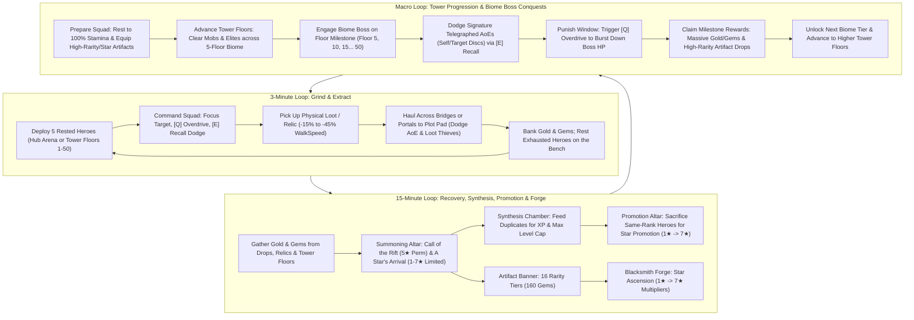

# DOCUMENT 1: COMPLETE GAME DESIGN DOCUMENT (GDD)
**Project Title:** *Infinite Tower: Become a Master!*  
**Target Platform:** Roblox (PC, Mobile, Tablet, Console)  
**Server Capacity:** 6 Players per Server (6 Dedicated Floating Fortress Plots)  
**Engine Architecture:** Server-Authoritative Data Tables (10 Hz Heartbeat, 5 Hz tower snapshots) + Client-Side R15 Visual Interpolation (60 FPS `RenderStepped`) | Hybrid Replication: Central Hub 14-Byte Binary Buffers + Infinite Tower Room-Local v2 Binary Buffers (24-byte entity records, 46-byte header)

---

## 1. EXECUTIVE OVERVIEW & PLAYER FANTASY

### 1.1 High-Concept Pitch
**Infinite Tower: Become a Master!** is a tactical squad-command Action-RPG, extraction sandbox, and fortress progression game inspired by the dark survival manhwa *Pick Me Up, Infinite Gacha*. Players do not play as generic hack-and-slash warriors; instead, each player embodies a **Master**—a dimensional overseer who summons, trains, equips, promotes, and commands a roster of sentient Gacha Heroes from a private floating sanctuary known as the **Master's Fortress Plot**.

### 1.2 The "Pick Me Up" Fantasy & Zero-Waste Roster Economy
In traditional gacha/simulator games, 95% of summons are discarded as worthless stat-sticks, and combat is reduced to passive AFK auto-clicking. **Infinite Tower** solves both problems through two foundational pillars:

1. **The Dual-Role Living Roster (Combat + Labor):**
   - Every hero pulled from the Summoning Altar rolls with **Combat Stats** (movement speed, attack speed, attack damage, health) and **Labor Output** (separate facility productivity), without trait or imprint bonuses.
   - **Up to 5 Deployed Heroes** (all 5 slots unlocked from the start) accompany the Master into the Central Hub or are independently deployed to specific floors (1–50) of the **Infinite Tower**. Heroes charge an in-combat **Skill/Stamina Gauge** (0 to 100) through a 3-tier attack cadence (Basic -> Basic -> Special -> Skill Attack at 100), and risk a debilitating **Downed state** (down until the squad changes floor, goes home or wipes) if left inside lethal AoE telegraphs.
   - **Benched Heroes** physically inhabit the player's **Fortress Plot**, resting on the bench, or can be forged powerful equipment at the **Blacksmith Forge**.
   - **Zero Dead Pulls:** Duplicate heroes across all star ranks are fed into the **Synthesis Chamber** (`SynthesisController.luau`) for EXP leveling to cap (`MaxLevel = Stars * 10`), or sacrificed at the **Promotion Altar** (`PromotionController.luau`) for **Star Promotion** ($1★ \to 7★$).
   - **Dual Hero Banners & Artifact Ascension:** At the **Summoning Altar**, players spend Gems (`100 Gems` single / `900 Gems` 10x) on two distinct banners: **Call of the Rift** (Permanent Banner featuring 5 stars: $1★ \to 5★$) and **A Star's Arrival** (Limited Time Banner featuring 1 character per star across all 7 stars: $1★ \to 7★$). In addition, Masters spend Gems at the **Artifact Summoning Banner** (`160 Gems` single / `1,600 Gems` 10x) to pull equippable archetype weapons across **16 Rarity Tiers** (`Common` $\to$ `Origin`) which define inherent base stats. At the **Blacksmith Forge** (`ForgeController.luau`), duplicate gear and Gold are used for **Star Ascension** ($1★ \to 7★$), multiplying base stats with massive progressive multipliers up to **`16.00x`**.

2. **Tactical Master Agency Over AFK Whaling:**
   - The Master carries no personal weapon. Instead, the Master directs squads through battlefield commands—**`[Click / Tap]` Focus Target**, **`[Q]` Overdrive Whistle**, and **`[E]` Emergency Recall Whistle**—while physically hauling heavy, high-value **Relics** and cargo back to their plot.
   - Masters use **`[LeftShift]` Sprint** ($3.0\times$ speed multiplier) to cross high-elevation bridges and dodge lethal hazards.
   - Because boss signature skill checks (the **Biome Boss** signature attacks like *Moss Quake* and *Sweeping Roots*, and elite ground telegraphs) inflict instant 50% Stamina loss or a **Downed state** (down until the squad changes floor, goes home or wipes) on heroes left inside the blast zone, an AFK player will have their squad wiped and sent home, dropping their DPS to zero. An active Master who times **`[E]` Emergency Recall Whistle** to dodge the blast and triggers **`[Q]` Overdrive Whistle** during punish windows will consistently out-damage and out-loot an AFK whale.

### 1.3 Hybrid Retention Matrix & Core Drivers

| Reference Title | Adopted Core Mechanic | *Infinite Tower* Evolution |
| :--- | :--- | :--- |
| ***Pick Me Up, Infinite Gacha*** | Desperate squad survival, Synthesis chamber, Star Promotion, living lobby workers | Heroes suffer Stamina drain and `Coma` if mismanaged; 4★/5★ heroes require hard promotion sacrifices; War Banner plot deployment. |
| ***Pet Simulator 99*** | Multi-unit squad grinding, tactile loot explosions, exponential progression | Replaces passive pet hovering with Stamina-managed combat squads, active whistle commands, and isolated 50-floor dynamic tower rooms. |
| ***Blox Fruits*** | Telegraphed boss skills, live DPS leaderboards, open-world bounty hunting | **Greed vs. Coma** boss checks, 10 **Biome Bosses** (Floors 5, 10, ..., 50), and **Contested Loot & Targeted Retaliation PvP** in arena rings. |
| ***Grow a Garden*** | Cozy-yet-competitive perimeter plots, passive production, fortress management | Dedicated private plots with a Fortress Tree of unlockable facilities, War Banner squad deployment, and Forge progression. |
| ***Steal an Egg*** | Physical object hauling, movement penalties, fumble & steal tension | High-tier **Relics** & cargo weld overhead, slow WalkSpeed by up to -45%, and fumble on AoE hits. |

**The Intimate Server Dynamic:**
In a 5–6 player server, anonymity disappears. Every player knows who conquered the latest Biome Boss, who just scooped contested loot, and who holds an active 3-minute retaliation grudge. The interplay of high-stakes extraction, boss timing, and targeted revenge loops keeps players engaged in continuous Biome Boss clears and Infinite Tower floor pushes.

---

## 2. DETAILED CORE LOOPS



### 2.1 The 3-Minute Micro Loop (Grind, Command & Physical Extraction)
1. **Deploy & Traverse (0:00 – 0:15):**
   - The Master selects up to 5 rested heroes from their roster via the **War Banner** or **Squad Deploy UI** (`SquadController.luau`).
   - The Master can sprint (`[LeftShift]`, $3.0\times$ speed) across high-elevation stone bridges onto the **Central Hub**, or use the **Tower Controller** (`TowerController.client.luau`) to travel (`Visit floor`) or station their squad (`Assign squad`) on any of the 50 **Infinite Tower Floors**.
2. **Tactical Grind & Skill Gauge Building (0:15 – 2:00):**
   - The Master uses **`[Click / Tap]` Focus Target** to direct all 5 deployed heroes onto target mobs, crystal nodes, or floor bosses.
   - Heroes execute a 3-tier cadence: **Basic Attack** (+5 Stamina) $\to$ **Special Attack** (+10 Stamina every 3rd hit) $\to$ **Skill Attack** (unleashed when Stamina reaches 100, resetting gauge to 0).
   - To accelerate clears and rapidly charge Skill Attacks, the Master triggers **`[Q]` Overdrive Whistle** (`20s CD`), granting **+40% Attack Speed** for `5s` with zero stamina cost.
   - When an Elite or Boss telegraphs a red ground AoE or ranged projectile (`ARC`, `SELF_DISC`, `TARGET_DISC`, or swept-corridor `PROJECTILE`), the Master triggers **`[E]` Emergency Recall Whistle** (`6s CD`), warping all 5 heroes to the Master's safe position and dropping their aggro for `2s`.
3. **Physical Loot Haul (2:00 – 2:45):**
   - Defeating mobs/Elites spawns physical Relic drops in `Workspace.PhysicalLoot` (**Mana Geodes**, **Cursed Urns**, and **Abyssal Cores**).
   - The Master touches the drop to weld it overhead, incurring a **-15% to -45% WalkSpeed penalty** (and disabling jumping for high-tier relics).
   - If hit by an Elite/Boss AoE mid-haul, the Master is **stunned for 1s and fumbles the item** (which becomes stealable after a **3s owner-lock**).
4. **Extract & Bank (2:45 – 3:00):**
   - **Hub Banking:** Stepping onto the Perimeter Highway (`R >= 460 studs`) or a Private Extraction Pad safely deposits cargo into permanent Gold and Gems.
   - **Floor Safe Sanctuary Banking:** Bringing physical loot (Gold/Gems) or Relics back into any floor's elevated **Floor Safe Sanctuary** automatically deposits them at the **Floor Extraction Pad** (`FloorExtractionPad`), granting 100% relic payout and Market multipliers immediately without requiring a trip back to the Hub.
   - Comatose heroes are benched, and fresh rested heroes are rotated into the active squad via the `[AutoSwap]` toolbar action.

### 2.2 The 15-Minute Meso Loop (Fortress, Synthesis, Promotion & Forge Progression)
1. **Facility Upkeep (Every 3–5 Minutes):**
   - Swap rested heroes from the bench into the active squad rotation.
2. **Summoning & Gacha Pulls (Every 5–10 Minutes):**
   - Spend Gems at the **Summoning Altar** on either **Call of the Rift** (Common–Exalted Permanent Banner), **A Star's Arrival** (Common–Mythical Limited Time Rate-Up Banner, featuring 1 character per rarity tier, each summoned at its matching star), or the **Artifact Banner** (`160 Gems` single / `1,600 Gems` 10x for archetype weapons across 16 Rarity Tiers).
   - **Synthesis Chamber (`SynthesisController.luau`):** Place a recipient hero and up to 5 fodder heroes to level up to the hero's current cap ($\text{MaxLevel} = \text{Stars} \times 10$).
   - **Promotion Altar (`PromotionController.luau`):** When a hero reaches max level, sacrifice same-rank heroes and Promotion Stones to permanently ascend star rating ($1★ \to 5★$). The hero's inherent rarity never changes.
3. **Artifact Star Ascension at the Blacksmith Forge (`ForgeController.luau`):**
   - **Star Ascension (Multipliers):** Ascend artifacts from $1★ \to 7★$ at the Forge by sacrificing duplicate artifacts and Gold, scaling inherent base stats by progressive multipliers up to **`16.00x`**.

### 2.3 The Macro Loop (Tower Progression & Biome Boss Conquests)
1. **Biome Traversal & Preparation:**
   - Masters organize their 5-hero squad, equip high-rarity and high-star artifacts, and rest exhausted heroes on the bench before entering a new Biome.
   - Each of the 10 biomes spans 5 progressively harder floors (50 floors total) with 4 unique biome enemy species (2 Regulars, 1 Elite, and 1 Biome Boss; 40 total enemy species across the Tower). On floors 1–4 of a biome the Elite is the summoned floor champion; on the 5th floor two Elite-led packs hold the Bastions. Enemy health and attack damage follow the stat-reference curve in Section 4.2. Reward scaling remains $\text{Reward} \times 1.055^{\text{Floor}-1}$; stat inflation does not change rewards.
2. **The Biome Boss Encounter (Floors 5, 10, 15, ..., 50):**
   - The 5th floor of every biome is a dedicated **Biome Boss Arena** (`BOSS_ARENA` layout variant) featuring an 8-column ritual ring, boss braziers, and a massive boss dais fixture (`BossDaisFixture`, $60 \times 2 \times 60\text{ studs}$).
   - Every Biome Boss transitions dynamically from **Phase 1** to **Phase 2 (Enraged)** below 55% HP and wields devastating signature attacks with distinct authoritative shapes and timings:
     - **Basic Attacks:** Wide frontal arcs (`ARC`, e.g. `guardian_crush`, 13 studs).
     - **Signature 1:** Expanding circular ground shocks centered on the boss (`SELF_DISC`, e.g. `moss_quake`, 22 studs radius).
     - **Signature 2:** Ranged ground craters placed under distant heroes (`TARGET_DISC`, e.g. `sweeping_roots`, 55 studs cast range, 13 studs radius).
     - **Ranged / Caster Regulars:** Biome ranged and caster regulars (`mob_lantern_spore`, `mob_crag_channeler`, `mob_thorn_weaver`, `mob_drowned_acolyte`, `mob_astral_scribe`, `mob_void_invoker`) fire authoritative swept-corridor projectiles (`PROJECTILE`) with a floor corridor warning and flying orb visual.
   - **Tactical Counterplay ("Dodge vs. Coma"):** Masters must watch the expanding progress-fill telegraph discs, corridor warnings, and sound cues, repositioning and executing **`[E]` Emergency Recall Whistle** to yank heroes out of danger. Heroes struck by signature skills suffer severe stamina loss or a debilitating **Downed state** (down until the squad changes floor, goes home or wipes).
   - **Punish Windows:** Following major signature attacks, the boss enters an extended recovery window (1.2s–1.5s), providing active Masters the ideal moment to pop **`[Q]` Overdrive Whistle** for massive burst DPS.
3. **Biome Clearance & Milestone Rewards:**
   - Defeating the Biome Boss awards immense Gold, Gems, and rare direct drops of high-rarity **Artifacts** (from Legendary up to Origin).
   - Floors unlock in order: defeating a floor's boss opens the next floor on the **Floor Selector** (`TowerController.client.luau`). Only a Master standing on the floor can clear it; an assigned squad farms Gold, gems and XP but cannot climb.

### 2.4 The AFK & Outskirts Facility Loop (Passive Boost Facilities & Auto/Offline Gold Generation)
While active squad command in the Central Hub and Infinite Tower drives peak progression, the **Outskirts & Facility Loop** ensures that a Master's benched roster continuously generates value both online and offline—reinforcing the **Zero-Waste Roster Economy**.

1. **Inner Fortress Stations vs. The Rear Outskirts:**
   - **Core Main Buildings (Inner Courtyard):** Essential progression stations that every Master accesses by default in their main fortress courtyard—including the **Summoning Altar**, **War Banner**, **Synthesis Chamber**, **Promotion Altar** and **Blacksmith Forge**.
   - **Support Facilities (Inner Fortress Wings):** Upgradeable utility and economic structures (`Level 1` $\to$ `Level 5`) located inside the fortress courtyard wings where benched heroes are stationed via `FacilityController.luau` to grant global percentage buffs. Each is unlocked and levelled through the **Fortress Development Tree** (Section 4.3):
     - **God's Blessing (Plaza Fountain):** An angel statue on the courtyard fountain. Stationed Acolytes (`Healer` preferred) raise **summon luck** on every Summoning Altar banner ($+4\%$ at Lv. 1 up to a $+50\%$ cap).
     - **The Market (Inner Commercial Wing):** Grants a percentage multiplier ($+5\%$ base at Lv. 1 up to $+40\%+$ with high-tier Miners) **strictly to Loot Earnings from the Towers**—amplifying Gold dropped by Infinite Tower mobs/Biome Bosses (Floors $1\text{–}50$) and the banking value of physical loot extracted from the Central Crimson Tower rings. (Does not multiply Outskirts Guard Post passive Gold).
     - **The Training Grounds (Inner Martial Wing):** Grants a percentage multiplier ($+4\%$ base at Lv. 1 up to $+32\%+$ with high-tier Strikers/Scholars) to the Master's **Overall Squad Combat Power**, multiplying total `FinalATK` and `FinalHP` (both intrinsic hero stats and equipped Artifact stats) against all monsters.
   - **The Outskirts (Southern Frontier Wilderness):** The only area located *outside* the fortress walls, reached through the rear fortress gatehouse. Houses the **Outskirts Guard Post** and wilderness patrol run.
2. **The Outskirts Guard Post (Unified AFK Gold & Offline Rewards):**
   - At the southern rear border of the island, outside the fortress battlements, lies the **Outskirts Guard Post**, a frontier bastion and wilderness trail at the back of the fortress.
   - Masters assign benched heroes (`Vanguard` and `Marksman` preferred) to the Outskirts Guard Post as **Adventurers**. Assigned Adventurers physically venture out and patrol the southern outskirts trail, fending off ambient monsters in a lightweight client-rendered visual loop without draining their combat Stamina.
   - **Auto-Received Online Gold:** There is no manual treasury chest required while online. Every $60\text{ seconds}$ (ticked automatically in $10\text{-second}$ increments), passive Gold generated by stationed Adventurers is **automatically added directly to the Master's Gold balance**, scaled by the heroes' `EffectiveLabor` and the Master's **Highest Cleared Biome Boss** (Floors $5, 10, \dots, 50$).
   - **Offline Reward Function (`OfflineRewardService.luau`):** When a Master logs out (`PlayerRemoving`), the server records `LastLogoutTimestamp` alongside their current `PassiveGoldPerMin` rate. Upon reconnecting (`PlayerAdded`), the server calculates elapsed offline minutes up to the Guard Post's **Max Offline Accumulation Cap** ($4\text{ Hours}$ at Lv. 1 $\to$ $12\text{ Hours}$ at Lv. 5) and presents a **"Welcome Back, Master!" Offline Summary Modal**, crediting the accumulated Gold straight to the player's balance.

### 2.5 The Tower Run Loop (Phase 6)
A **run** starts when a Master first stands on a tower floor and ends when they return to the hub or their plot, their squad wipes, or they disconnect. Spec: `docs/rework-plan/PHASE_6_TOWER_RUN_LOOP.md`.

1. **Floors keep moving.** A floor holds 16 / 22 / 25 / 35 / 35 live mobs (floors 1–5 of a biome) in 4–7 camps. A camp respawns as one wave 10 s after its last member dies (a lone survivor cannot hold it back past 45 s). Each extra Master on the floor adds 40% more members to every camp, up to 48 live mobs. When a Master's kill progress crosses 50% (floors 1–4 only), a personal **surge pack** (1 Elite and 3 Regulars) steps out near their squad.
2. **A longer climb.** A floor boss is summoned after `round(20 + 1.2 × floor)` kill points (a Regular is 1, a camp Elite 3). The boss of floors 1–4 is the biome's **Alpha**, a larger, gilded elite with its own name, stats and a self-quake attack; the 5th floor is the **Biome Boss**. Enemy strength is anchored to the squad a player is expected to have (2 heroes at floor 1, 3 by floor 5, 4 by floor 10, 5 from floor 15, hero rarity included), with a per-biome sawtooth (×0.85, 0.95, 1.05, 1.15, 1.30 by floor in the biome). Floor 1 is sized to the default starter pair, and new profiles start with 900 Gems (one 10-pull).
3. **Penalties, never losing what you own.** A knocked-out hero stays down until the squad **changes floor** (it stands back up at 30% HP), returns home, or wipes. Floor changes no longer heal anyone; the tower sanctuary heals standing heroes (10% HP per second). After a floor's summoned boss has been damaged, the floor's travel stays sealed until it dies or the squad wipes. A **wipe** costs the carried relic, the streak and 25% of the Gold and Gems earned since the last bank. Heroes, weapons and banked currency are never lost.
4. **Banking and the climb streak.** Entering a sanctuary or pad banks everything. Each floor cleared in a row adds +10% (up to +100%) to the value of relics banked during the run; banking does not reset the streak, only the end of the run does. Relics are the contested loot: a camp Elite always leaves at least a Mana Geode, and relic Gems are flat per tier (10 / 30 / 300) while their Gold scales with the floor.
5. **Rift Attunement.** In the tower and in retaliation duels, one hero's power is capped at about 1.5× an on-curve hero two floors above the Master's highest floor reached, so a lucky or premium pull is felt without skipping a biome. Duels use the lower of the two Masters' caps. Facility labor is never capped, and the pull itself (hero, star, rarity) never changes.
6. **Assigned squads farm.** An assigned squad earns kill Gold, Gems and XP anywhere, but relics, kill progress, boss summons and floor unlocks need its Master standing on the floor.
7. **Simulation rate.** The tower simulation runs at 10 Hz (attack intervals round up to 0.1 s); snapshots to clients stay at 5 Hz until a Studio profile clears the bandwidth budget.

---

## 3. MAP & SPATIAL DESIGN SPECIFICATIONS

### 3.1 Dual-Mode Spatial Architecture

The world exists in two coordinated spatial contexts:
1. **The Central Hub & Floating Fortress Ring (World Coordinates):** Landmark Central Crimson Tower, perimeter bridges, and player fortress plots.
2. **The 50 Dynamic Isolated Tower Floors (Off-Map Isolated Grid):** Server-managed dynamic encounter rooms for vertical climbing and Biome Boss arenas.

```
                      CENTRAL HUB ARENA & FLOATING FORTRESS RING
                                    [N: (0, -750)]
                                  +----------------+
                                  |  PLOT 1 (0°)   |
                                  +-------+--------+
                                          | (Bridge)
                   PLOT 6 (300°)          |           PLOT 2 (60°)
                        \                 |                 /
                  (Bridge)\        +------+------+        /(Bridge)
                            \      |   CENTRAL   |       /
                             ------+   CRIMSON   +-------
                            /      |  TOWER HUB  |       \
                  (Bridge)/        +------+------+        \(Bridge)
                        /                 |                 \
                   PLOT 5 (240°)          |           PLOT 3 (120°)
                                          | (Bridge)
                                  +-------+--------+
                                  |  PLOT 4 (180°) |
                                  +----------------+
                                    [S: (0, +750)]

               =======================================================
               OFF-MAP INFINITE TOWER ROOMS (Isolated Dynamic Grid)
               Origin(id) = (12000 + ((id-1)%10)*1800, 1000, 12000 + floor((id-1)/10)*1800)
               Enclosed 248 x 84 x 248 studs chambers with Safe Arrival platforms (CombatSafe=true)
               Floors 5, 10, 15, ..., 50 feature dedicated Biome Boss Dais Arenas (BossDaisFixture)
```

### 3.2 Global Coordinate Systems & Zones Table

| Zone Name | Radial Distance / Coordinate Space | Dimensions | Access Rule | Combat & PvP Rules | Primary Drops |
| :--- | :--- | :--- | :--- | :--- | :--- |
| **Central Crimson Tower** | `0 – 120 studs` (Hub) | Central 18-level landmark structure | Open to all | Landmark tower hub, open entrance portal to Infinite Tower floors. | Mana Geodes, Gold |
| **Ring 2: Corrupted Grove** | `120 – 280 studs` (Hub) | `160 studs` annulus | Open to all | High-density Elites with red AoE telegraphs. Contested loot PvP active. | **Cursed Urns**, **Abyssal Cores**, High Gold |
| **Ring 1: Outer Ruins** | `280 – 460 studs` (Hub) | `180 studs` annulus | Open from start | Low-level mobs & Mana Crystal nodes. Contested loot PvP active. | **Mana Geodes**, Starter Gold |
| **Perimeter Highway** | `460 – 480 studs` (Hub) | `20 studs` paved ring road | Open to all | **Safe Zone** (No mobs). Safe banking threshold ($R \ge 460$). | Banked cargo conversion |
| **6 Floating Fortress Plots** | `R = 650 studs` ($Y = 12$) | Expanded $260 \times 320\text{ studs}$ citadel island with grand courtyard & rear outskirts ($1.2\times$ radius expansion) | Plot Owner + Visitors | Safe Zone. Personal fortress sanctuary for recovery, banner summoning, forge ascension, and AFK outskirts guard post. | Roster Recovery, Gacha Banners, Forge, Outskirts Passive Gold & Multipliers |
| **Safety Catch Plane** | Lower kill plane at $Y = -95$ | `2400 x 8 x 2400 studs` | Fallen players | Non-lethal catch plane; teleports fallen players safely to their PlotSpawn. | None |
| **50 Tower Floor Rooms** | Off-map grid: $X \ge 12,000, Y = 1,000, Z \ge 12,000$ (spaced $2,400\text{ studs}$) | Progressive $380 \times 130 \times 420\text{ studs}$ (F1) to $560 \times 190 \times 640\text{ studs}$ (F5) across 5 elevation tiers | Traversal via `TowerController` | Isolated floor-local PvE encounters; shared floor membership; elevated safe arrival sanctuary with instant loot unpackaging/banking. | Mob drops, Gold, Gems, **Biome Boss Rare Artifact Drops** |

### 3.3 Dynamic Tower Room Architecture & Biomes

Tower floors are dynamically managed by `TowerFloorService.luau` and generated via `TowerRoomBuilder.luau` in conjunction with `TowerLayout.luau` and `TowerBiomeAssets.luau`:
- **Room Origin Spacing Formula:**
  $$\text{Origin}(id) = \Big(12000 + ((id - 1) \bmod 10) \times 2400,\; 1000,\; 12000 + \lfloor(id - 1) / 10\rfloor \times 2400\Big)$$
  Spaced at $2,400\text{ studs}$ along both axes so enlarged, multi-tiered rooms remain completely isolated from adjacent cameras, raycasts, and simulation heartbeats.
- **Progressive 5-Floor Scale & Variant Progression:**
  Each biome spans 5 floors (`IndexInBiome = 1..5`). Rather than a static flat box, each room scales progressively across 5 layout variants guided by reference concepts:

| Floor in Biome | Variant Kind | Footprint ($W \times D \times H$) | Elevation Tiers | Architectural Theme | Mob Groups (Camps) | Total Mobs |
| :---: | :--- | :---: | :---: | :--- | :---: | :---: |
| **Floor 1** | `INTRODUCTION` | $380 \times 420 \times 130\text{ studs}$ | 3 Tiers ($Y: 0\text{ to }+12$) | Foreground courtyard, threshold entry arches, flora/crystals/dunes, north shrine. | 4 Camps + Apex | 16 live Mobs (Elite champion summoned at the Apex) |
| **Floor 2** | `EXPANDED_ENCOUNTER` | $420 \times 470 \times 140\text{ studs}$ | 3 Tiers ($Y: 0\text{ to }+14$) | Flanking elevated colonnades and side galleries connected by side ramps. | 5 Camps + Apex | 22 live Mobs |
| **Floor 3** | `TERRAIN_VARIATION` | $460 \times 520 \times 155\text{ studs}$ | 4 Tiers ($Y: -4\text{ to }+18$) | Recessed elemental chasm (water/lava/mist) with arched bridge crossings and waterfalls. | 5 Camps + Apex | 25 live Mobs |
| **Floor 4** | `ELITE_STRONGHOLD` | $510 \times 580 \times 170\text{ studs}$ | 4 Tiers ($Y: -4\text{ to }+22$) | Monumental flanking guardians, watchtowers, and twin upper elite bastions. | 7 Camps + Apex | 35 live Mobs |
| **Floor 5** | `BOSS_ARENA` | $560 \times 640 \times 190\text{ studs}$ | 5 Tiers ($Y: -6\text{ to }+28$) | Full biome masterpiece: Apex Boss Dais, overhead centerpiece, and cascades. | 7 Camps + Apex | 35 live Mobs (incl. 2 Elite-led Bastion packs) + summoned Boss |

- **Multi-Tiered Spatial Topography (`TowerLayout.luau`):**
  Each room features 5 navigable elevation zones:
  1. **Elevated Safe Overlook ($Y = +8$):** South landing sanctuary housing arrival and extraction fixtures.
  2. **Foreground Basin ($Y = 0\text{ to }+2$):** Open entry courtyard and elemental basin connected by ceremonial ramps.
  3. **Flanking Galleries & Central Crossing ($Y = +4\text{ to }+12$):** Elevated West/East terraces and split bridges over recessed elemental channels.
  4. **Upper Bastions ($Y = +10\text{ to }+16$):** Fortified wings and guardian platforms.
  5. **Apex Sanctum / Boss Dais ($Y = +16\text{ to }+28$):** Grand tiered staircase ascending to the biome apex or Boss arena.
  *All slopes are restricted to $\le 15^\circ$ and stair rises to $\le 1.0\text{ stud}$ per tread, guaranteeing smooth grounded navigation for heroes (`HeroNavigation.luau`) and enemies without getting stuck.*
- **Floor Safe Sanctuary & In-Floor Loot Unpackaging (`CanBankCargo = true`):**
  The elevated south arrival sanctuary ($88 \times 56\text{ studs}$ at $Y = +8$) is designated with `CombatSafe = true`, `CanBankCargo = true`, and `CanRecoverWipe = true`:
  - **`FloorExtractionPad`:** Interactive unpackaging pad and altar. Entering the sanctuary while carrying physical Gold/Gems or Relics (`BankArmed = true`) immediately unpacks and banks them into permanent profile currency with 100% relic value and the active Market multiplier (`EXTRACT_SAFE_ZONE`).
  - **Travel Pedestals:** 4 ProximityPrompt pedestals (`PREVIOUS`, `NEXT`, `SELECTOR`, `HUB`) along the rear colonnade.
- **Procedural Landmark Kits (`TowerBiomeAssets.luau`):**
  Native-part procedural landmark kits for all 10 biomes (statues, bridges, falls, crystals, flora, overhead cogs, celestial orreries, chained obelisks) with local lights and zero external asset dependencies.
  - **Grounded clutter rule:** no prop floats. Every prop stands on a registered support (a terrace, island crown, cliff tier, foothill shelf or the rock shelf behind the Apex) or on the chasm floor (the top of the Ground slab, `layout.Bottom - 4`). Companion pieces, arch piers and tree roots that would overhang a support are dropped, run down to real ground, or pulled in. Raised supports are `PropGroup` models that own the props on them, so camp and path clearance removes a support and everything on it together.
  - **Chasm groves:** up to 28 tall, rooted props per floor rise from the chasm floor around the raised terraces and beside the ramps, staying clear of every ramp and the Basin return ramps. Each biome uses its own set: canopy trees and ivy-wrapped ruin columns (Verdant), giant mushrooms (Fungal), sandstone hoodoos and dead trees (Ashen; no trees in lava), frosted pines and ice spires (Frozen), furnace stacks and basalt hoodoos (Infernal), pines and rock hoodoos (Thunder), blighted trees and mushrooms (Corrupted), coral towers and marble columns (Sunken), crystal spires and marble columns (Astral), and obsidian spires and hoodoos (Abyssal). Small clutter frames the two ends of each ramp, on the terrace itself.
- **Multi-Area Spatial Mob Camps & AI Leashing (`FirstBiomeCombat.luau`, `TowerEncounterRuntime.luau`):** Camps respawn as a wave 10 s after their last member falls and scale up with every extra Master on the floor (Section 2.5).
  Enemies spawn in 4 to 7 live spatial camps per floor (16–35 mobs: two Basin flank camps, the Central Crossing from floor 2, both Galleries, and both Bastions from floor 4; the Basin centre below the arrival ramp stays clear), plus the Apex Sanctum where the floor champion or Biome Boss is summoned with ground-raycasted elevations and localized leash radiuses ($60\text{ studs}$ for regular/elite packs, $95\text{ studs}$ for Boss encounters), allowing tactical, room-by-room progression without premature floor aggro pulls.
- **Room Lifecycle:** Rooms transition through `ABSENT -> BUILDING -> READY -> RETIRING -> ABSENT` with a 60-second retirement grace period when unoccupied.

#### Biome Catalog (50 Floors across 10 Biomes):
1. **Verdant Ruins (Floors 1–5):** Overgrown Threshold, Broken Aqueduct, Rootway Crossing, Vinebound Bastion, **Mossbound Court (Biome Boss: Mossbound Guardian)**.
2. **Fungal Hollow (Floors 6–10):** Sporelit Entry, Mycelium Galleries, Blooming Chasm, Rotcap Keep, **Matriarch's Hollow (Biome Boss: Spore Matriarch)**.
3. **Ashen Dunes (Floors 11–15):** Cinder Gate, Buried Caravan, Glasswind Ravine, Sunscar Fortress, **Colossus Dais (Biome Boss: Sandstone Colossus)**.
4. **Frozen Citadel (Floors 16–20):** Rimefall Approach, Frozen Barracks, Shattered Iceway, Whiteguard Keep, **Frostbound Throne (Biome Boss: Frostbound King)**.
5. **Infernal Foundry (Floors 21–25):** Slagworks Entry, Molten Assembly, Furnace Causeway, Ironflame Bulwark, **Titan's Crucible (Biome Boss: Ember Titan)**.
6. **Thunder Highlands (Floors 26–30):** Stormgrass Rise, Thunderhead Outpost, Skybridge Cliffs, Tempest Redoubt, **Roc's Eyrie (Biome Boss: Storm Roc)**.
7. **Corrupted Grove (Floors 31–35):** Blighted Verge, Twisted Orchard, Briar Labyrinth, Heartrot Stronghold, **Sovereign's Grove (Biome Boss: Blight Sovereign)**.
8. **Sunken Sanctuary (Floors 36–40):** Drowned Steps, Coral Cloister, Tidal Channels, Pearlguard Vault, **Leviathan's Basin (Biome Boss: Tidal Leviathan)**.
9. **Astral Archives (Floors 41–45):** Starlit Vestibule, Orbiting Stacks, Fractured Index, Runeguard Athenaeum, **Rift Warden's Observatory (Biome Boss: Rift Warden)**.
10. **Abyssal Throne (Floors 46–50):** Abyssal Descent, Crimson Procession, Voidspan Crossing, Dreadguard Citadel, **Overlord's Throne (Biome Boss: Crimson Overlord)**.


### 3.4 Private Fortress Plot & Outskirts Architectural Layout

To accommodate active fortress management, squad training, commerce, and the passive Outskirts AFK loop, each of the 6 Floating Fortress Islands is expanded by **$1.2\times$** radial distance out to **$R = 650\text{ studs}$** (top surface $Y = 12$) with an enlarged citadel island footprint of **$260\text{ studs (Width)} \times 320\text{ studs (Length)}$**.

The island is divided into two distinct, interconnected sectors:
1. **The Grand Citadel & Inner Courtyard (Front / North - $260 \times 180\text{ studs}$):** Heavily fortified with $28\text{-stud}$ high crenellated stone walls, corner watch bastions, and a private entrance gatehouse facing the perimeter drawbridge. Encloses all **Core Main Buildings** (Summoning Altar, War Banner, The Pit, Blacksmith Forge) as well as the internal support facilities (**The Market** and **The Training Grounds**).
2. **The Southern Outskirts (Rear / South - $260 \times 140\text{ studs}$):** The sole exterior zone outside the fortress walls, accessed through the vaulted rear fortress gatehouse. Spans open, rugged frontier terrain, pine trees, and dirt wilderness trails housing **The Outskirts Guard Post**.

```
                        NORTH (Facing Central Hub & Perimeter Highway)
                                        | (Bridge)
                                  [North Gatehouse]
                       +---------------------------------------+
                       |   Plaza & Cyan Private Extraction Pad  |
                       |              (Plot Spawn)              |
                       | [Summoning Altar]   [Blacksmith Forge] |
                       | (Hero & Artifact)    & Anvil Hearth]   |
                       |                                       |
                       |     [Plaza Fountain + Angel Statue]   |
                       |           (God's Blessing)            |
                       | [War Banner +                         |
                       |  Architect's Table]  [The Pit]        |
                       | (Command Post)  (Synthesis & Promo)   |
                       |                                       |
                       | [Training Grounds]       [The Market] |
                       | (Sparring & Dummies)  (Bazaar Stalls) |
                       +-------------------+-------------------+
                                           | (Rear Fortress Gate)
                       ====================+====================
                       |         THE REAR OUTSKIRTS GROUNDS     |
                       |                                       |
                       |          [Wilderness Border Trail]    |
                       |                                       |
                       |          [Outskirts Guard Post]       |
                       |       (Timber Bastion & Patrol Run)   |
                       |                                       |
                       +---------------------------------------+
                                SOUTH (Southern Frontier)
```

#### Detailed Sector Breakdown:

1. **Sector A: Arrival Ramp, Gatehouse & Extraction Plaza (North Front):**
   - **Perimeter Drawbridge & Gate:** Connects the fortress to the Perimeter Highway ($R = 480 \to 520\text{ studs}$). Features an owner-locked collision barrier preventing unauthorized plot infiltration.
   - **Plaza & Extraction Pad:** Glowing cyan illuminated deposit zone ($24 \times 1 \times 24\text{ studs}$) for banking carried relics, geodes, and urns into permanent Gold and Gems.
   - **Beacon Pillar & Plot Spawn:** Center anchor with the Master's avatar beacon projected skyward.

2. **Sector B: Grand Inner Fortress Courtyard (Core Buildings & Interior Facilities):**
   - **Courtyard Grid:** Buildings stand in a 3 x 2 grid either side of a clear walkway from the plot spawn, past the fountain, to the rear gate. Every entrance faces the fountain. North row (by the spawn): Summoning Altar and Blacksmith Forge. Middle row: the Command Post (War Banner and Architect's Table) and The Pit. South row: Training Grounds and Market, which only appear once built in the Fortress Tree.
   - **Summoning Altar (North-West Courtyard):** Towering obsidian obelisk featuring dual runic summoning circles for the **Hero Banner** (`100 Gems` single / `900 Gems` 10x) and **Artifact Banner** (`160 Gems` single / `1,600 Gems` 10x).
   - **Plaza Fountain, God's Blessing & War Banner (Center Courtyard):** Central triple-tiered Gothic stone fountain in the courtyard center with water basins and blue glow, crowned, once unlocked, by a **marble angel statue** with raised hands holding a lantern of light. The fountain is the **God's Blessing** facility (Section 4.3, Facility D): an `[F]` prompt opens its panel, and the angel brightens with each level. 
   - **Command Post (West Courtyard):** The heraldic War Banner standard on a carved stone pedestal, with an `[F]` prompt opening the **Squad Deploy UI** (`SquadController.luau`), and beside it the **Architect's Table**, whose prompt opens the **Fortress Tree**.
   - **The Pit Sanctuary (East Courtyard):**
     - **Synthesis Chamber:** Fiery cauldron station with `[F]` prompt opening the **Synthesis UI** (`SynthesisController.luau`) for feeding EXP fodder.
     - **Promotion Altar:** Consecrated marble star dais with `[F]` prompt opening the **Promotion UI** (`PromotionController.luau`) for star ascensions ($1★ \to 5★$).
   - **The Blacksmith Forge (North-East Courtyard):** Interactive 3D station featuring an anvil, hearth coals, workbench, and prompt opening the **Forge UI** (`ForgeController.luau`) for Artifact Star Ascension ($1★ \to 7★$).
   - **The Market (South-East Inner Wing):** Covered bazaar stalls, coin scales, and ledger counters located inside the fortress commercial quarter. Stationed workers (`Miner` preferred) boost Infinite Tower mob/boss loot drops and Hub extraction banking values ($+5\%$ to $+40\%+$).
   - **The Training Grounds (South-West Inner Wing):** Cobblestone sparring arena with weapon racks, archery targets, and training dummies located inside the fortress military quarter. Stationed trainers (`Striker` & `Scholar` preferred) boost the Master's overall squad combat power ($+4\%$ to $+32\%+$ Final ATK/HP).

3. **Sector C: The Southern Outskirts (Exterior Wilderness Zone):**
   - **Rear Fortress Archway:** A $24\text{-stud}$ wide vaulted stone passage connecting the inner fortress courtyard directly to the open wilderness behind the citadel.
   - **The Outskirts Guard Post (South Perimeter):** Heavy timber bastion, log palisade barricade, and campfire situated along the winding wilderness trail amidst lush rolling meadow grass, asymmetrical ancient pines, broadleaf oaks, wild berry shrubs, and mossy granite boulders. Stationed Adventurers (`Vanguard` & `Marksman` preferred) venture out along the curved patrol trail to battle ambient wildlife in a lightweight visual loop, auto-generating online Gold every 60 seconds and logging offline accumulation. Only the Outskirts and its Guard Post lie outside the fortress walls.

---

## 4. HERO, COMBAT & UI MECHANICS

### 4.1 Gacha Banners & Hero Roster Architecture

Hero summoning at the **Summoning Altar** (`FacilityController.luau`) is partitioned into two distinct banners. Each banner rolls an **inherent rarity tier**, and each tier holds exactly one hero. Each hero is summoned at its template's star, which matches its tier (Common = 1★ up to Mythical = 7★). Rarity adds a stat multiplier on top (see *Inherent Hero Rarity* below). All hero odds can be raised by the **God's Blessing** facility (Section 4.3, Facility D).

#### 1. Permanent Banner: "Call of the Rift" (Rarity Tiers 1–5)
The permanent standard banner features exactly **one character for each rarity from Common to Exalted** (5 total heroes):
- **Summon Cost:** `100 Gems` per single pull (`900 Gems` for 10x pull).
- **Pity System:** Guaranteed Exalted hero (**Ignis**) within **80 summons** (`MaxPity = 80`). A natural Exalted pull resets the pity counter.
- **10-Pull Guarantee:** Every 10x pull includes at least one **Rare** or higher hero.
- **Drop Rates:**
  - `Common (70.0%)`: **Han**
  - `Uncommon (20.0%)`: **Aaron**
  - `Rare (7.0%)`: **Catio**
  - `Superior (2.5%)`: **Valeria**
  - `Exalted (0.5%)`: **Ignis**

#### 2. Limited Time Banner: "A Star's Arrival" (Rarity Tiers 1–7)
The inaugural limited-time rate-up banner features exactly **one character for each rarity from Common to Mythical** (7 total heroes):
- **Summon Cost:** `100 Gems` per single pull (`900 Gems` for 10x pull).
- **Pity System:** Guaranteed Mythical featured hero (**Astrea**) within **90 summons** (`MaxPity = 90`). A natural Mythical pull resets the pity counter.
- **10-Pull Guarantee:** Every 10x pull includes at least one **Rare** or higher hero.
- **Drop Rates:**
  - `Common (60.0%)`: **Jenna**
  - `Uncommon (24.0%)`: **Velkist**
  - `Rare (10.0%)`: **Eolka**
  - `Superior (4.2%)`: **Morrigan**
  - `Exalted (1.4%)`: **Sovereign Archon**
  - `Legendary (0.33%)`: **Solaris**
  - `Mythical (0.07%)`: **Astrea (Featured Starlight Mythical)**

*(These rates are lower than the pre-Phase 4 rates of 60/25/10/4/1% and 50/25/13.5/6.5/3.5/1.2/0.3%, and pity rose from 50 to 80 and 90 so it does not undo the lower odds. See `docs/rework-plan/PHASE_4_ONBOARDING_AND_PROGRESSION.md` §7.)*

---

#### Inherent Hero Rarity
Like weapons (Section 7.1), every hero template has a fixed **inherent rarity**. For heroes it only adds a stat multiplier, and summoning and stars work as before.
- **Rarity** uses the weapon tier names. Launch heroes span tiers 1 (Common) to 7 (Mythical), and tiers 8–16 are reserved for future heroes. Rarity can never be upgraded, rerolled or refined.
- **Rarity multipliers:** combat stats × $1.35^{(t-1)}$ and labor × $1.12^{(t-1)}$, where $t$ is the tier.
- **Stars are unchanged:** each hero is summoned at its template's star and promotes at The Pit up to 5★ (`PitBalanceConfig.MaxStars`); 6★ Solaris and 7★ Astrea arrive above that cap. Rarity never changes when a hero is promoted.
- **Existing saves** keep their stars and level and gain their template's rarity.

#### Launch Roster Base & Native Stats
Every summoned hero rolls a `QualityScalar` $q \in [0.90, 1.15]$ applied to their archetype base stats. Native stats are the stats at the hero's **summoned star $S$, Lv. 1**: $Stat_0 \times 1.35^{(t - 1)} \times 3^{(S - 1)}$ for combat and $L_0 \times 1.12^{(t - 1)} \times 1.35^{(S - 1)}$ for labor, using the live 3× star promotion multiplier:

| Banner | Hero | Rarity / Summoned Star | Archetype | Base HP / ATK | Native HP / ATK | Base / Native Labor | Passive Trait |
| :--- | :--- | :--- | :--- | :--- | :--- | :--- | :--- |
| **Call of the Rift** | **Han** | **Common (1) / 1★** | Striker | `300` / `40` | `300` / `40` | `14` / `14.0` | **Unyielding Adaptation** (+10% ATK, -10% Stamina Drain) |
| **Call of the Rift** | **Aaron** | **Uncommon (2) / 2★** | Vanguard | `450` / `28` | `1,823` / `113` | `16` / `24.2` | **Phalanx Guard** (+25% Max HP, -15% AoE Taken) |
| **Call of the Rift** | **Catio** | **Rare (3) / 3★** | Miner | `280` / `24` | `4,593` / `394` | `20` / `45.7` | **Quartermaster's Ledger** (+25% Labor Output) |
| **Call of the Rift** | **Valeria** | **Superior (4) / 4★** | Healer | `260` / `18` | `17,272` / `1,196` | `18` / `62.2` | **Sanctuary Aegis** (+30% Healing, +20% Coma Recovery) |
| **Call of the Rift** | **Ignis** | **Exalted (5) / 5★** | Vanguard | `450` / `26` | `121,069` / `6,995` | `16` / `83.6` | **Rift Warlord** (+35% ATK, +20% DMG Reduction) |
| **A Star's Arrival** | **Jenna** | **Common (1) / 1★** | Marksman | `210` / `34` | `210` / `34` | `13` / `13.0` | **Windstep Precision** (+15% ASPD, +5% Move Spd) |
| **A Star's Arrival** | **Velkist** | **Uncommon (2) / 2★** | Striker | `300` / `44` | `1,215` / `178` | `14` / `21.2` | **Bloodthirst Frenzy** (+20% ATK, +1s Overdrive) |
| **A Star's Arrival** | **Eolka** | **Rare (3) / 3★** | Scholar | `230` / `52` | `3,773` / `853` | `22` / `50.3` | **Crimson Pyromancy** (+25% ATK, +30% Labor Output) |
| **A Star's Arrival** | **Morrigan** | **Superior (4) / 4★** | Vanguard | `450` / `24` | `29,894` / `1,594` | `16` / `55.3` | **Abyssal Bulwark** (+30% Max HP, +15% Reflect DMG) |
| **A Star's Arrival** | **Archon** | **Exalted (5) / 5★** | Striker | `350` / `65` | `94,165` / `17,488` | `25` / `130.7` | **Dimensional Dominion** (+30% Boss DMG, +25% All Labor) |
| **A Star's Arrival** | **Solaris** | **Legendary (6) / 6★** | Scholar | `240` / `55` | `261,509` / `59,929` | `22` / `173.9` | **Supernova Flare** (+40% ATK, +25% AoE Radius) |
| **A Star's Arrival** | **Astrea** | **Mythical (7) / 7★** | Marksman | `230` / `48` | `1,014,981` / `211,822` | `23` / `274.8` | **Cosmic Zenith** (+50% ATK, +30% ASPD, +35% Boss DMG) |

#### Archetype Foundation Table

Archetypes define a hero's **combat role, base stats, attack cadence, range, labor, and permitted weapons**. Attack moves are **not** shared per archetype: every hero carries a bespoke 3-tier kit (see Section 4.4, *Hero Combat Skill Ledger*).

| Archetype | Combat Role | Base HP ($HP_0$) | Base ATK ($ATK_0$) | Attack Interval ($t_{\text{atk}}$) | Attack Range | Base Labor ($L_0$) | Permitted Weapons |
| :--- | :--- | :--- | :--- | :--- | :--- | :--- | :--- |
| **Vanguard** | Frontline Tank & Damage Absorber | `450` | `22` | `1.20s` | `6 studs` | `10 / min` | `SWORD_SHIELD` |
| **Striker** | Agile Melee Critical DPS | `280` | `38` | `0.85s` | `6 studs` | `12 / min` | `DAGGERS` |
| **Marksman** | Long-Range Physical DPS & Armor Shredder | `210` | `34` | `0.80s` | `28 studs` | `13 / min` | `BOW` |
| **Miner** | Heavy Blunt Disruptor & Gem Specialist | `300` | `20` | `1.05s` | `6 studs` | `20 / min` | `AXE` |
| **Healer** | Squad Sustain & God's Blessing Acolyte | `260` | `18` | `1.25s` | `24 studs` | `18 / min` | `TOME` |
| **Scholar** | Elemental Catalyst & Burst Magic | `220` | `24` | `1.00s` | `26 studs` | `22 / min` | `STAFF` |

*(Note: Each archetype equips exactly one weapon type, and each hero holds one artifact. Sword & Shield is a single combined weapon; rings are removed. See Section 7.5.)*

### 4.2 Effective Combat & Labor Formulas
- **Level Cap Formula:**
  $$\text{MaxLevel}(S) = S \times 10 \quad (1★ = \text{Lv.10},\; 2★ = \text{Lv.20},\; 3★ = \text{Lv.30},\; 4★ = \text{Lv.40},\; 5★ = \text{Lv.50},\; 6★ = \text{Lv.60},\; 7★ = \text{Lv.70})$$
- **Star Promotion Multipliers:** Promoting a hero from $S \to S+1$ increases the level cap by `+10`, multiplies Base Combat stats by **`3x`** (`PitBalanceConfig.Promotion.CombatMultiplier`), and multiplies Base Labor output by **`1.35x`**. Promotion never changes the hero's inherent rarity $t$.
- **Effective Combat Stats (with Artifact Integration):**
  $$\text{EffectiveATK} = \text{round}\Big(ATK_0 \times q \times 1.35^{(t - 1)} \times 3^{(S - 1)} \times 1.08^{(L - 1)} \times (1 + B_{\text{TraitATK}} + B_{\text{ImprintATK}})\Big) + TotalATKBonus_{\text{Artifact}}$$
  $$\text{EffectiveHP} = \text{round}\Big(HP_0 \times q \times 1.35^{(t - 1)} \times 3^{(S - 1)} \times 1.08^{(L - 1)} \times (1 + B_{\text{TraitHP}} + B_{\text{ImprintHP}})\Big)$$
  *(Where $t$ is the hero's inherent rarity tier. A Common hero, $t = 1$, has the same stats as before rarity was added.)*
  $$\text{EffectiveInterval} = \max\left(0.12\text{s}, \frac{HeroBaseInterval}{1 + TotalSpeedBonus_{\text{Artifact}}}\right)$$
  $$\text{TotalATKBonus}_{\text{Artifact}} = \text{round}\Big(ATK_{\text{Base, Rarity}} \times \text{Multiplier}_{\text{Star}}\Big)$$
  $$\text{TotalSpeedBonus}_{\text{Artifact}} = ASPD_{\text{Base, Rarity}} \times \text{Multiplier}_{\text{Star}}$$
  *(Where Rarity dictates inherent base stats and Stars ($1★ \to 7★$) dictate the progressive multiplier).*
- **Effective Labor Formula:**
  $$\text{EffectiveLabor} = L_0 \times q \times 1.12^{(t - 1)} \times 1.35^{(S - 1)} \times \big(1 + 0.05(L - 1)\big) \times (1 + B_{\text{Synergy}}) \times (1 + B_{\text{TraitLabor}} + B_{\text{ImprintLabor}})$$
  *(Where $B_{\text{Synergy}} = 0.25$ when assigned to preferred facility).*

### 4.3 Fortress Outskirts & Facility Economy Formulas

Progression is bifurcated between **Core Main Buildings** (free, static fortress stations) and **Upgradeable Support Facilities** (`Level 1` $\to$ `Level 5`) that scale passive Gold generation and global percentage multipliers.

**Fortress Development Tree:** Support facilities are unlocked and upgraded only by buying nodes in the Fortress Tree, opened from the Facilities toolbar button or the **Architect's Table** beside the War Banner. The tree has one branch per facility: Outskirts (Guard Post), Commerce (Market), Martial (Training Grounds) and Divine (God's Blessing). Each branch has 5 level nodes bought in order, where a facility's level is the number of level nodes owned, plus 2 perk nodes at levels 3 and 5. Level 3, 4 and 5 nodes need Floor 5, 15 and 25 cleared, and the whole Divine branch needs Floor 5. Nodes cost Gold, are permanent and cannot be refunded. The Guard Post's level 1 node is owned from the start.

**Squad slots:** every Master starts with **one** squad slot. The tree's **Command** branch opens the other four in order: slot 2 (500 Gold), slot 3 (2,000), slot 4 (6,000, Floor 5) and slot 5 (15,000, Floor 10). These nodes need only the first summon (the Squad unlock), not the Fortress Tree unlock, so a new Master can open slot 2 right away. Heroes in a slot that is not open are sent to the bench.

**Facilities appear only when unlocked:** A locked support facility is not in the world. Its site is plain ground with no model, sign or prompt, and it is missing from the Facilities panel. Buying its level 1 node builds it on the plot with a short construction reveal, and each later level swaps in that level's model. The server builds the models from the owner's saved levels, so visitors see the same plot. Core Main Buildings are always present. The "Gold Upgrade Cost" columns below are the costs of the matching level nodes. The full node list and perks are in `docs/rework-plan/PHASE_4_ONBOARDING_AND_PROGRESSION.md` §5.

#### 1. Hero Recovery (no Infirmary)
The Infirmary & Barracks was removed in Phase 4: since Phase 2, a squad wipe sends the squad home at full HP, so a recovery building had nothing left to do. Benched heroes and heroes working at any support facility recover $1\text{ Stamina/sec}$ passively, and any leftover coma timer simply runs out on the bench. Old saves send Infirmary heroes back to the bench.

#### 2. Upgradeable Support Facilities (Levels 1 to 5)

##### Facility A: The Outskirts Guard Post (Exterior AFK & Offline Gold Generation)
Located outside the fortress walls along the southern wilderness border. Stationed Adventurers (`Vanguard` & `Marksman` preferred, receiving $+25\%$ labor synergy) patrol the trail, generating automatic online Gold and accumulating offline rewards:

| Level | Gold Upgrade Cost | Max Adventurers | Base Gold / Min ($\text{BaseRate}$) | Max Offline Cap | Offline Efficiency | Visual Identity |
| :---: | :---: | :---: | :---: | :---: | :---: | :--- |
| **Lv. 1** | Free (Unlocked) | 1 Worker | `30 Gold/min` | 4 Hours (240 min) | 75% | Rugged wooden lean-to, simple campfire, dirt path. |
| **Lv. 2** | 1,500 Gold | 2 Workers | `75 Gold/min` | 6 Hours (360 min) | 80% | Timber guard shack, log palisade fence, weapon rack. |
| **Lv. 3** | 6,000 Gold | 3 Workers | `160 Gold/min` | 8 Hours (480 min) | 85% | Stone-reinforced bastion, brazier, perimeter ditch. |
| **Lv. 4** | 20,000 Gold | 4 Workers | `300 Gold/min` | 10 Hours (600 min) | 90% | Fortified outpost tower, crenellated wall, watch bell. |
| **Lv. 5** | 60,000 Gold | 5 Workers | `550 Gold/min` | 12 Hours (720 min) | 100% | Castle frontier barbican, heavy iron gate, signal beacon. |

- **Online Passive Gold Formula:**
  $$\text{PassiveGoldPerMin} = \Big(\text{BaseRate}_{\text{Level}} + 0.85 \times \sum \text{EffectiveLabor}\Big) \times \Big(1 + 0.15 \times \text{BiomeBossTier}\Big)$$
  *(Where $\text{BiomeBossTier} \in [0, 10]$ is the highest Biome Boss defeated: Floor 5 = 1, Floor 10 = 2, ..., Floor 50 = 10).*  
  *Auto-credited directly to the Master's Gold balance every 60s in 10s sub-increments; no manual claim chest required.*
- **Offline Gold Accumulation Formula (`OfflineRewardService.luau`):**
  $$\text{OfflineGold} = \min\big(\text{ElapsedMinutes},\; \text{MaxOfflineCapMinutes}\big) \times \text{PassiveGoldPerMin} \times \text{OfflineEfficiency}_{\text{Level}}$$
  *Presented via "Welcome Back, Master!" modal upon login, depositing accumulated Gold straight to profile currency.*

##### Facility B: The Market (Interior Fortress Commercial Wing - Tower Loot & Extraction Multiplier)
Located inside the fortress commercial quarter. Stationed Merchants (`Miner` preferred, $+25\%$ labor synergy) amplify loot yields strictly from Infinite Tower clears and Hub cargo extractions:

| Level | Gold Upgrade Cost | Max Workers | Base Loot Multiplier ($\text{BaseBonus}$) | Visual Identity |
| :---: | :---: | :---: | :---: | :--- |
| **Lv. 1** | 1,000 Gold | 1 Worker | `+5.0%` | Single wooden stall, canvas canopy, coin scale. |
| **Lv. 2** | 3,500 Gold | 1 Worker | `+10.0%` | Expanded twin stalls, cargo crates, merchant wagon. |
| **Lv. 3** | 12,000 Gold | 2 Workers | `+18.0%` | Covered bazaar pavillion, hanging brass scales, safe box. |
| **Lv. 4** | 35,000 Gold | 2 Workers | `+28.0%` | Stone exchange depot, trade ledgers, guarded strongbox. |
| **Lv. 5** | 90,000 Gold | 3 Workers | `+40.0%` | Grand celestial merchant exchange, guild crest, vault cellar. |

- **Market Loot Multiplier Formula:**
  $$\text{MarketMultiplier} = 1 + \text{BaseBonus}_{\text{Level}} + \big(0.005 \times \sum \text{EffectiveLabor}_{\text{Market}}\big)$$
  *(Multiplies Gold dropped by mobs and Biome Bosses on Infinite Tower Floors 1–50 and physical cargo banked at the Extraction Pad. Does NOT amplify Outskirts Guard Post passive Gold).*

##### Facility C: The Training Grounds (Interior Fortress Martial Wing - Squad Combat Power Multiplier)
Located inside the fortress military quarter. Stationed Trainers (`Striker` & `Scholar` preferred, $+25\%$ labor synergy) conduct martial drills, applying an overall multiplier to squad combat stats:

| Level | Gold Upgrade Cost | Max Workers | Base Combat Multiplier ($\text{BaseBonus}$) | Visual Identity |
| :---: | :---: | :---: | :---: | :--- |
| **Lv. 1** | 1,200 Gold | 1 Worker | `+4.0%` | Dirt sparring circle, straw dummy, wooden sword rack. |
| **Lv. 2** | 4,000 Gold | 1 Worker | `+8.0%` | Fenced training yard, sandbags, archery targets. |
| **Lv. 3** | 14,000 Gold | 2 Workers | `+14.0%` | Cobblestone arena, iron weapon racks, training pell. |
| **Lv. 4** | 40,000 Gold | 2 Workers | `+22.0%` | Tiered training ring, enchanted strike dummies, war pavilion. |
| **Lv. 5** | 100,000 Gold | 3 Workers | `+32.0%` | Consecrated martial amphitheater, glowing runic combat ring. |

- **Training Combat Multiplier Formula:**
  $$\text{TrainingMultiplier} = 1 + \text{BaseBonus}_{\text{Level}} + \big(0.004 \times \sum \text{EffectiveLabor}_{\text{Training}}\big)$$
  *(Multiplies total squad $\text{FinalATK}$ and $\text{FinalHP}$ across all heroes and equipped Artifacts).*

##### Facility D: God's Blessing (Plaza Fountain - Summon Luck)
When unlocked, a marble angel statue holding a lantern of light rises onto the Plaza Fountain's top tier. Until the Divine branch's level 1 node is bought, the fountain is a plain fountain with no angel and no prompt. Stationed Acolytes (`Healer` preferred, $+25\%$ labor synergy) pray at the fountain to raise the Master's summon luck at the Summoning Altar:

| Level | Gold Upgrade Cost | Max Workers | Base Luck ($\text{BaseLuck}$) | Visual Identity |
| :---: | :---: | :---: | :---: | :--- |
| **Lv. 1** | 2,500 Gold | 1 Worker | `+4%` | Cleaned marble angel, soft lantern glow, rim candles. |
| **Lv. 2** | 8,000 Gold | 1 Worker | `+8%` | Gilded wing edges, pale-gold glowing water. |
| **Lv. 3** | 25,000 Gold | 2 Workers | `+14%` | Choir chime and rising light motes. |
| **Lv. 4** | 70,000 Gold | 2 Workers | `+22%` | Floating golden halo, petals drifting on the basin. |
| **Lv. 5** | 180,000 Gold | 3 Workers | `+32%` | Spread wings and a sky beam rising from the lantern. |

- **Summon Luck Formula:**
  $$\text{Luck} = \min\Big(0.50,\; \text{BaseLuck}_{\text{Level}} + 0.004 \times \sum \text{EffectiveLabor}_{\text{Acolytes}} + \text{Perk}_{\text{Saint's Favor}}\Big)$$
  $$p'_i = p_i \times (1 + \text{Luck}) \;\; (i \ge 2), \qquad p'_1 = 1 - \sum_{i \ge 2} p'_i$$
  *(Applies to both hero banners and the artifact banner. Every tier above the lowest is multiplied, and the lowest tier absorbs the difference. Luck never changes pity counters, pity thresholds or 10-pull guarantees. The Saint's Favor perk adds +3%, and the total is capped at +50%.)*

### 4.4 Hero 3-Tier Attack Cadence & Dynamic Skill Gauge System

In Infinite Tower, combat is server-authoritative with client prediction/interpolation. **Every hero possesses a unique, bespoke 3-tier skill kit** (`Basic`, `Special`, `Skill / Ultimate`); kits are not shared across an archetype. Each hero executes its kit on a 3-tier attack cadence governed by the **Dynamic Skill Gauge** (formerly Stamina):

#### 1. In-Combat Skill Gauge Rules & Cadence Mechanics
- **Gauge Starting State & Maximum:** Heroes enter active combat with **0 Skill Gauge** (represented by the yellow billboard bar above the hero's head) that fills up to a maximum of **100**.
- **Accrual Rules:**
  - **Tier 1: Basic Attack:** Standard auto-attack governed by base interval $t_{\text{atk}}$. Generates **+5 Skill Gauge**.
  - **Tier 2: Special Attack:** Automatically procs on every **3rd attack** (Cadence: `Basic (5) -> Basic (5) -> Special (10)`). Generates **+10 Skill Gauge**. Deals amplified damage with archetype-specific secondary mechanics (frontal cleaves, pierces, multi-slashes, chain lightning, or allied mini-heals).
  - **Tier 3: Skill Attack (Ultimate):** When the gauge reaches **100**, the hero's next attack triggers their signature ultimate. Consumes all 100 gauge points (resetting back to **0**).
- **Accrual Math & Combat Rhythm:**
  - Each 3-attack cycle yields: $5 + 5 + 10 = 20\text{ Skill Gauge}$.
  - A hero requires exactly $5\text{ cycles} \times 3\text{ attacks} = 15\text{ attacks}$ ($10\text{ Basic} + 5\text{ Special}$) to reach 100 gauge points without external buffs.
  - At an average interval of $1.0\text{s}$, a hero triggers an ultimate roughly every $15\text{ seconds}$.
- **Attack Timeline (decision → release → impact):** The 10 Hz simulation *decides* an attack (tier, target, aim point) and moves the Skill Gauge on that decision, so the cadence above never drifts. The blow lands later, resolved every server Heartbeat:
  - **Release** is the attack clip's `Release` marker scaled to the cast time (e.g. a bow lets go at 72% of the draw). Cast time is the attack interval clamped to `0.35–1.2s`; an Ultimate holds the hero for at least its `CastSeconds` (`1.0–1.2s`), and its next attack waits for that cast to finish.
  - **Impact** is release plus travel: `0` for melee, `distance / ProjectileSpeed` for projectiles (Marksman `95` / `120 studs/s`, Healer and Scholar `70–80 studs/s`, capped at `1s`), or a fixed delay for area skills (Marksman flare `0.35s`, Scholar meteor `0.3s`).
  - An attack is cancelled if, by its release, the hero is in `COMA`, has left the room or was recalled. Once released it always arrives. Basic and Special attacks **fizzle** (no damage, no secondary effect) if their target died or left before impact. An Ultimate's area effects still land around the aim point.
  - Multi-tick Ultimates split their damage evenly across ticks: Rain of Arrows lands in `4` ticks `0.15s` apart, with the defense shred applied on the first tick. Shared timing lives in `HeroActionTiming` (clip markers in `HeroClips`, delivery fields in `ArchetypeCombatSkills`).
- **Overdrive Whistle Synergy (`[Q]`):** Overdrive Whistle grants $+40\%$ Attack Speed for $5\text{s}$ with zero Stamina drain, compressing the time to charge and release signature Ultimates during crucial DPS/punish windows.

#### 2. Hero Combat Skill Ledger

Each hero's kit is resolved by `HeroId` in `ArchetypeCombatSkills.HeroProfiles` (falling back to the archetype base profile for unknown heroes). A hero's kit inherits its archetype's damage multipliers and secondary mechanics (next table) unless it overrides them.

| # | Hero | Star | Archetype | Basic (+5 SP) | Special (+10 SP, 3rd Hit) | Skill / Ultimate (100 SP) |
| :---: | :--- | :---: | :--- | :--- | :--- | :--- |
| 1 | **Han** (`hero_han`) | 1★ | Striker | Gale Slash | Crescent Cross-Cut | Relentless Blade Flurry |
| 2 | **Aaron** (`hero_aaron`) | 2★ | Vanguard | Bastion Strike | Aegis Shield Bash | Fortress Bulwark |
| 3 | **Catio** (`hero_catio`) | 3★ | Miner | Pickaxe Cleave | Resonance Tremor | Crystalline Excavation |
| 4 | **Valeria** (`hero_valeria`) | 4★ | Healer | Emerald Bolt | Verdant Mend | Sanctuary Miracle |
| 5 | **Ignis** (`hero_ignis`) | 5★ | Vanguard | Molten Cleave | Magma Breaker | Infernal Juggernaut |
| 6 | **Jenna** (`hero_jenna`) | 1★ | Marksman | Wind-Step Shot | Piercing Gale Volley | Sylphid Arrow Storm |
| 7 | **Velkist** (`hero_velkist`) | 2★ | Striker | Twin Fang Cut | Shadow Rend | Phantom Lotus Execution |
| 8 | **Eolka** (`hero_eolka`) | 3★ | Scholar | Ruby Firebolt | Wildfire Chain | Crimson Hellfire Pillar |
| 9 | **Morrigan** (`hero_morrigan`) | 4★ | Vanguard | Abyssal Reap | Dread Shockwave | Obsidian Bastion |
| 10 | **Sovereign Archon** (`hero_archon`) | 5★ | Striker | Void Lance Strike | Rift Sever | Dimensional Cataclysm |
| 11 | **Solaris** (`hero_solaris`) | 6★ | Scholar | Solar Ray | Corona Arc | Supernova Starfall |
| 12 | **Astrea** (`hero_astrea`) | 7★ | Marksman | Astral Arrow | Nebula Piercer | Constellation Judgment |

#### 3. Archetype Base Mechanics (Kit Defaults)

These are the default multipliers and secondary mechanics each hero kit inherits from its archetype. The move names here are the archetype base profile names, used only as a fallback.

| Archetype | Attack Tier | Move Name | Damage / Effect | Secondary Mechanics & Range | Accrual |
| :--- | :--- | :--- | :--- | :--- | :---: |
| **Vanguard**<br>*(Tank)* | **Basic** | Shield / Blade Strike | `1.0x ATK` Physical | Single-target melee (`6 studs`). | `+5` |
| | **Special** (Hit 3) | Shield Bash | `1.4x ATK` Physical | Cleaves in front cone (`10 studs`). Applies 0.5s stagger / slow. | `+10` |
| | **Skill** (100 SP) | Fortress Aegis / Iron Roar | `0.0x ATK` Utility / Barrier | Resounding roar taunts all enemies within `25 studs` for `4s`. Grants Vanguard a damage barrier absorbing `40% Max HP` for `6s`. | `Resets to 0` |
| **Striker**<br>*(Melee DPS)* | **Basic** | Twin Blade Slash | `1.0x ATK` Physical | Single-target rapid melee (`6 studs`). | `+5` |
| | **Special** (Hit 3) | Flurry Cross | `1.6x ATK` Physical (2 hits) | Rapid dual cross-slash with `+25% bonus Crit Chance`. | `+10` |
| | **Skill** (100 SP) | Blade Tempest | `3.2x ATK` Physical | Omni-directional dashing flurry dealing massive burst in a `12-stud` radius. | `Resets to 0` |
| **Marksman**<br>*(Ranged DPS)* | **Basic** | Precision Shot | `1.0x ATK` Piercing | Single-target arrow projectile (`28 studs`). | `+5` |
| | **Special** (Hit 3) | Piercing Volley | `1.5x ATK` Piercing | Penetrating bolt passing through primary target in a straight line up to `32 studs`. | `+10` |
| | **Skill** (100 SP) | Rain of Arrows | `2.8x ATK` Physical (4 ticks) | Localized arrow storm (`16-stud` radius) dealing 4 rapid ticks and shredding enemy defense by `20%` for `5s`. | `Resets to 0` |
| **Miner**<br>*(Disruptor)* | **Basic** | Heavy Maul Swing | `1.0x ATK` Blunt | Single-target heavy melee (`6 studs`). | `+5` |
| | **Special** (Hit 3) | Seismic Slam | `1.5x ATK` Blunt | Ground pound shattering the earth in an `8-stud` radius, staggering targets. | `+10` |
| | **Skill** (100 SP) | Crystalline Cataclysm | `2.6x ATK` Blunt AoE | Summons sharp crystalline spikes under all enemies within `18 studs`; struck targets yield bonus temporary gem shards. | `Resets to 0` |
| **Healer**<br>*(Recovery)* | **Basic** | Holy Bolt | `1.0x ATK` Holy | Single-target holy projectile against hostile target (`24 studs`). | `+5` |
| | **Special** (Hit 3) | Radiant Pulse | `1.2x ATK` Holy + `8% Max HP` Heal | Strikes enemy and pulses a mini-heal restoring `8% Max HP` to lowest-HP ally within `30 studs`. | `+10` |
| | **Skill** (100 SP) | Sanctuary Miracle | `35% Max HP` Squad Heal + Cleanse | Chants divine circle (`25-stud` radius). Instantly restores `35% Max HP` to all active squad heroes, cleanses debuffs, and grants `3% HP/sec` regenerative aura for `4s`. | `Resets to 0` |
| **Scholar**<br>*(Mage)* | **Basic** | Arcane Spark | `1.0x ATK` Magic | Single-target mystical projectile (`26 studs`). | `+5` |
| | **Special** (Hit 3) | Chain Lightning | `1.4x ATK` Lightning | Arcs from primary target to up to 2 adjacent mobs within `14 studs`. | `+10` |
| | **Skill** (100 SP) | Supernova Cataclysm | `3.5x ATK` Fire AoE | Dimensional portal drops a burning meteor on target area (`20-stud` radius), leaving lingering ground flames for `3s`. | `Resets to 0` |

#### 4. Visual & Audio Combat Feedback
- **Billboard Gauge:** Yellow bar above hero health smoothly fills from $0 \to 100\%$.
- **Skill Ready Indicator:** When gauge reaches $100\%$, the bar triggers a dynamic golden pulsation animation (`#FFD700`), signaling the impending ultimate.
- **Floating Combat Text (FCT):**
  - **Basic Hit:** Pale Green (`#F3FFE2`)
  - **Special Hit:** Vibrant Orange (`#FF9900`), Bold font
  - **Skill / Ultimate Hit:** Glowing Gold (`#FFD700`), 1.25x scale, Extra Bold font (`HIT_SKILL`, sent for the Ultimate's primary target on every tick)
  - **Restorative Heal:** Lime Green (`#44FF88`), prefixed with `+`
  - **Protective Barrier:** Cyan (`#00E5FF`), prefixed with `🛡️ +`
- **Signature Ultimate Animations:** Every hero plays its own `AttackSkill` clip (`HeroClips.Overrides`), as do Velkist and Catio for their Specials. These apply only while the hero holds its archetype weapon. Each clip's `Release` marker sets when the server lands the hit (§4.4.1), so a new clip can change ultimate timing slightly.
- **Attack Projectiles & Skill VFX:** Cosmetic and client-side, driven by the `HERO_CUE` (§8.1) and the attack clip's `Release` marker, and landing at the server's impact time so each projectile meets its damage number. Looks are data in `SkillVfxCatalog` (per hero, falling back to the weapon type). Bow heroes (Jenna, Astrea):
  - **Basic:** a single arrow on a light arc, homing on the target's rendered body, with an impact burst.
  - **Special:** a 3-arrow volley. The centre arrow hits, bursts and pierces on past the target, with rings along its path; the side arrows fan out.
  - **Skill:** a flare arrow climbs from the bow, a sigil opens over the aim point (the skill's 16-stud radius), and one wave of arrows falls per damage tick. The owner's camera shakes on the first wave.
  - **Other archetypes** (palette and size per hero):
    - **Melee basics:** a crescent slash across the target.
    - **Vanguard:** a shockwave cone for the Special. The ultimate draws a barrier shell that lasts the 6 s barrier, plus a 25-stud taunt shockwave.
    - **Striker:** crossing slashes for the Special. The ultimate is a ring of crescents with a 12-stud shockwave; Archon's also opens a collapsing rift.
    - **Miner:** a ground tremor for the Special. The ultimate raises a crystal spike cluster, plus a spike under each enemy hit.
    - **Scholar:** orb basics; the Special chains lightning to each enemy the server chained. The ultimate drops a column of fire or light that leaves 3 s of burning ground.
    - **Healer:** bolt basics; the Special sends motes of light to the healed ally. The ultimate draws a 25-stud sigil with a light column on each squad hero.
  - **Budget:** pooled parts, at most 160 live effects per client, and nothing drawn when an effect is more than 180 studs from the camera.

### 4.5 Master Controls & Tactical Commands

| Action | Keybind / Input | Description |
| :--- | :--- | :--- |
| **Shift Sprint** | `[LeftShift / RightShift]` | $3.0\times$ speed multiplier for rapid traversal across bridges, rings, and rooms. |
| **Focus Target** | `[Click / Tap]` | Raycast onto any mob or boss to focus all 5 heroes' aggro. Clicking a Master who stole from you challenges them to a duel instead. |
| **Overdrive Whistle** | `[Q]` / `ButtonL1` / Right Rail | $20\text{s}$ CD. Grants $+40\%$ Attack Speed for $5\text{s}$ across all active heroes with zero Stamina drain, allowing squads to rapidly charge their Skill Gauges. |
| **Emergency Recall** | `[E]` / `ButtonR1` / Right Rail | $6\text{s}$ CD. Instantly warps squad to Master + $2\text{s}$ pacify (dodges lethal AoE). Yields priority to ProximityPrompts. |
| **Drop Carried Item**| `[R]` / HUD Button | Drops carried cargo or relic on the ground; restores normal WalkSpeed. |
| **Retaliate (Duel)** | `[⚔️ RETALIATE]` / click the thief | HUD prompt (with a 3-minute countdown) when your drop is stolen. Starts a retaliation duel for that drop (§6.1). |

*The Overdrive and Recall hotkeys are bound only on Tower floors, never while typing, in a modal or in a duel. Recall yields to a visible ProximityPrompt on the same key. The `Q`/`E` bindings are specified in Phase 5 (`docs/rework-plan/PHASE_5_REACT_UI_AND_MENUS.md` §2.1); until then only the HUD buttons fire the whistles.*

### 4.6 Tactical UI & HUD Architecture

The player interface is built from modular, gothic-styled components:
1. **Side-Rail Toolbar & Squad Status Card (Phase 5, `docs/rework-plan/PHASE_5_REACT_UI_AND_MENUS.md` §2):** The single bottom toolbar is split into two vertical rails.
   - **Left Rail (menus):** `[SUMMON]` | `[SQUAD]` | `[FORGE]` | `[FORTRESS]` (Fortress Tree) | `[INDEX]` (Hero Index). Buttons appear as their systems unlock and carry badges (a buildable tree node, an empty open squad slot, an affordable promotion, a new hero).
   - **Right Rail (combat):** `[OVERDRIVE]` (Whistle 1 / `Q`) | `[RECALL]` (Whistle 2 / `E`) | `[TOWER]`, with radial cooldown sweeps. The rail's top is anchored below the Next Goal card so they never overlap.
   - **Squad Status Card (bottom-left):** one live row per open squad slot, showing portrait, archetype (icon and label), rarity and star, level, an HP bar (stamina off-floor), the skill gauge and a state chip (Fighting / Idle / Recalled / Down / Dueling). Locked slots collapse into a single `🔒` line that opens the Fortress Tree.
   - **Squad Power badge (bottom-right):** **Squad Power** is one number for the whole active squad: $$\text{HeroPower} = \text{round}\big(10 \times \text{DPS} + \text{Health}\big) \qquad \text{SquadPower} = \sum_{\text{deployed heroes}} \text{HeroPower}$$ DPS and Health come from `StatFormulas.GetCombatSnapshot`, which already includes stars, level, rarity, the equipped weapon and the Training Grounds multiplier. Heroes in a coma still count; only deployed squad slots count. The weights (10 × DPS + Health) are first-pass tuning. It is computed on the server, sent as `profile.SquadPower`, and shown with change floaters.
   - **Player list columns:** every player shows **Floor** (highest Tower floor cleared) and **Power** (their Squad Power, abbreviated) through server-written `leaderstats`.
   - **Hero Index (modal):** three columns. Left, the hero banners. Middle, the heroes in the selected banner (unowned shown as silhouettes). Right, details for the selected hero: rarity, star, archetype, weapon, stats with the rarity multiplier, labor and preferred facility, passive, Basic/Special/Skill kit, drop rate with and without God's Blessing luck, owned copies and a rotatable model.
2. **Tower Navigation UI (`TowerController.client.luau`):**
   - **In-World Navigation Pedestals & Prompts:** Travel interactions are accessed in-world via ProximityPrompts (`Previous Floor`, `Next Floor`, `Floor Selector`, and `Return to Hub` pedestals on the safe arrival pad, plus the Central Crimson Tower `Choose floor` prompt in the Hub) and the bottom toolbar `[TOWER]` button.
   - **Top-Right `Return to Hub` Action Button:** Whenever the Master is visiting any Tower floor (`FloorId >= 1`), a dedicated top-right **`Return to Hub`** button (`TowerGui.ReturnHubButton`) is displayed for one-click extraction back to the Fortress Plot.
   - **Biome-Grouped Floor Selector Modal (`FloorSelector`):** Scrollable 50-floor selector organized under 10 **Biome Header Banners** (`BIOME 1 — VERDANT RUINS (FLOORS 1–5)` through `BIOME 10 — ABYSSAL THRONE (FLOORS 46–50)`). Each floor button displays live status badges (`◆` Boss Floor, `★` You + Squad present, `●` You present, `▲` Squad stationed) and opens a detail pane showing floor name, biome, role (`Boss Floor` / `Combat Floor`), live `Visited: N | Squads: M` presence counts, and action buttons (`Visit floor`, `Assign squad`, `Recall squad`).
   - **Modal Click-Through Prevention (`MasterController.client.luau`):** Viewport targeting checks `GuiService:GetGuiObjectsAtPosition` so clicking inside open UI modals or HUD buttons never leaks world-space `FocusTarget` raycasts onto mobs behind the UI.
3. **Real-Time Combat Feedback & Boss HUD (`CombatFeedback.luau`, `EnemyAnimationController.luau`, `HUDController.client.luau`):**
   - **Tower Floor Boss Top HUD Banner:** Engaging any of the 10 Biome Bosses on Floors `5, 10, ..., 50` activates the top-center Boss HUD Banner (`_G.ClientCombatState.FloorBoss`), displaying `"FLOOR N BIOME BOSS — NAME [PHASE 1 / PHASE 2: ENRAGED]"` and a live HP bar that automatically clears on boss death or floor departure.
   - **Damage Popups:** Server-hit floating damage labels pooled up to 32 active instances. Styled with `GothamBold` font, quadratic easing upward, and color-coded:
     - Gold (`#FFCF59`): Overdrive crits / empowered hits.
     - Pale Green (`#F3FFE2`): Normal outbound hero damage.
     - Coral Red (`#FF7474`): Incoming damage received by heroes.
   - **Hit Sparks:** Material Neon sphere sparks with dynamic scaling and fade.
   - **Telegraph Geometry (`MAX_EFFECTS = 12` Cap):** Authoritative server-timed warning shapes with expanding inner progress-fill discs (`SELF_DISC`, `TARGET_DISC`), frontal cleave wedges (`ARC`), and swept-corridor warning strips + flying Neon orbs (`PROJECTILE`).

---

## 5. BIOME BOSS ENCOUNTER DESIGN (MILESTONE FLOORS)

### 5.1 Architecture & Biome Milestone Cadence
In **Infinite Tower**, major boss encounters take place at the apex of each biome: every 5th floor of the Infinite Tower (Floors 5, 10, 15, 20, 25, 30, 35, 40, 45, 50). Each Biome Boss commands a massive dedicated arena dais ($60 \times 2 \times 60\text{ studs}$ `BossDaisFixture`) and possesses dynamic health, high damage multipliers, and signature multi-phase telegraphed attacks.

#### The 10 Biome Bosses:

| Floor | Biome Name | Biome Boss Name | Rig Family | Maximum Health | Basic Attack Damage | Signature Attack Types |
| :---: | :--- | :--- | :--- | :---: | :---: | :--- |
| **5** | **Verdant Ruins** | **Mossbound Guardian** | `STONE_COLOSSUS` | `98,719` | `379` | Frontal Cleave (`ARC`), Quake (`SELF_DISC`), Root Bloom (`TARGET_DISC`) |
| **10** | **Fungal Hollow** | **Spore Matriarch** | `FUNGAL_COLOSSUS` | `1,172,275` | `1,535` | Spore Burst (`SELF_DISC`), Corrosive Cloud (`TARGET_DISC`) |
| **15** | **Ashen Dunes** | **Sandstone Colossus** | `STONE_COLOSSUS` | `6,929,813` | `4,868` | Magma Cleave (`ARC`), Sand Quake (`SELF_DISC`), Obsidian Spikes (`TARGET_DISC`) |
| **20** | **Frozen Citadel** | **Frostbound King** | `ROYAL_BIPED` | `49,627,906` | `19,714` | Glacial Cleave (`ARC`), Blizzard Shock (`SELF_DISC`), Ice Spikes (`TARGET_DISC`) |
| **25** | **Infernal Foundry** | **Ember Titan** | `FORGE_COLOSSUS` | `256,773,969` | `42,562` | Anvil Hammer (`ARC`), Slag Quake (`SELF_DISC`), Molten Core (`TARGET_DISC`) |
| **30** | **Thunder Highlands** | **Storm Roc** | `GIANT_AVIAN` | `1,705,791,750` | `172,375` | Gale Slash (`ARC`), Thunderclap (`SELF_DISC`), Lightning Strike (`TARGET_DISC`) |
| **35** | **Corrupted Grove** | **Blight Sovereign** | `GROVE_COLOSSUS` | `9,109,778,438` | `372,144` | Briar Whip (`ARC`), Heartrot Bloom (`SELF_DISC`), Rot Tendrils (`TARGET_DISC`) |
| **40** | **Sunken Sanctuary** | **Tidal Leviathan** | `SERPENT` | `20,861,059,578` | `546,802` | Tidal Sweep (`ARC`), Maelstrom (`SELF_DISC`), Geyser Strike (`TARGET_DISC`) |
| **45** | **Astral Archives** | **Rift Warden** | `ARCANE_COLOSSUS` | `83,159,446,094` | `546,802` | Astral Sweep (`ARC`), Dimensional Rupture (`SELF_DISC`), Void Well (`TARGET_DISC`) |
| **50** | **Abyssal Throne** | **Crimson Overlord** | `ROYAL_COLOSSUS` | `303,887,290,571` | `546,802` | Hellfire Cleave (`ARC`), Abyssal Nova (`SELF_DISC`), Doom Pillars (`TARGET_DISC`) |

### 5.2 Full 50-Enemy Biome Roster & Procedural Rig Architecture
Each of the 10 biomes features 4 local-authored procedural enemies (2 Regulars, 1 Elite, 1 Biome Boss = **40 enemies total** in `MobCatalog.luau` and `FirstBiomeCombat.luau`), built with biome-specific material/glow palettes in `TowerEnemyRigs.luau` and animated with planted-foot leg counter-rotation (`plantedPose`) in `TowerEnemyClips.luau`:

| Biome (Floors) | Regular 1 | Regular 2 | Biome Elite | Biome Boss (5th Floor) |
| :--- | :--- | :--- | :--- | :--- |
| **1. Verdant Ruins (1–5)** | Moss Crawler (`CRAWLER`) | Ruin Guardian (`ARMORED_BIPED`) | Vinebound Elite (`ROOTED_BIPED`) | **Mossbound Guardian** (`STONE_COLOSSUS`) |
| **2. Fungal Hollow (6–10)** | Spore Skitter (`CRAWLER`) | Lantern Spore (`FUNGAL_BIPED`) | Mycelial Brute (`HEAVY_BIPED`) | **Spore Matriarch** (`FUNGAL_COLOSSUS`) |
| **3. Ashen Dunes (11–15)** | Dune Scarab (`INSECT`) | Ash Raider (`WEAPON_BIPED`) | Glass Scorpion (`SCORPION`) | **Sandstone Colossus** (`STONE_COLOSSUS`) |
| **4. Frozen Citadel (16–20)** | Frost Hound (`QUADRUPED`) | Rime Sentry (`WEAPON_BIPED`) | Glacier Knight (`ARMORED_BIPED`) | **Frostbound King** (`ROYAL_BIPED`) |
| **5. Infernal Foundry (21–25)** | Cinder Imp (`SMALL_BIPED`) | Forge Construct (`ARMORED_BIPED`) | Molten Taskmaster (`HEAVY_BIPED`) | **Ember Titan** (`FORGE_COLOSSUS`) |
| **6. Thunder Highlands (26–30)** | Storm Talon (`AVIAN`) | Crag Channeler (`CASTER_BIPED`) | Thunder Ram (`QUADRUPED`) | **Storm Roc** (`GIANT_AVIAN`) |
| **7. Corrupted Grove (31–35)** | Blight Wolf (`QUADRUPED`) | Thorn Weaver (`ROOTED_BIPED`) | Rotwood Keeper (`TREANT`) | **Blight Sovereign** (`GROVE_COLOSSUS`) |
| **8. Sunken Sanctuary (36–40)** | Tide Claw (`CRUSTACEAN`) | Drowned Acolyte (`CASTER_BIPED`) | Coral Warden (`ARMORED_BIPED`) | **Tidal Leviathan** (`SERPENT`) |
| **9. Astral Archives (41–45)** | Rune Mite (`CRAWLER`) | Astral Scribe (`CASTER_BIPED`) | Archive Executor (`ARMORED_BIPED`) | **Rift Warden** (`ARCANE_COLOSSUS`) |
| **10. Abyssal Throne (46–50)** | Abyss Reaver (`WEAPON_BIPED`) | Void Invoker (`CASTER_BIPED`) | Throne Executioner (`HEAVY_BIPED`) | **Crimson Overlord** (`ROYAL_COLOSSUS`) |

**Floor Alphas (10 more, Phase 6).** Each biome also has one **Alpha**, the boss of its floors 1–4: *Vinebound Alpha*, *Mycelial Brute Alpha*, *Glass Scorpion Alpha*, *Glacier Knight Alpha*, *Molten Taskmaster Alpha*, *Thunder Ram Alpha*, *Rotwood Keeper Alpha*, *Coral Warden Alpha*, *Archive Executor Alpha* and *Throne Executioner Alpha*. An Alpha reuses its biome Elite's rig family (1.4× larger, gilded), has its own stat tier between Elite and Boss (about 15× the squad DPS the curve is built on, against 8× and 25×), and adds a self-centred quake (`SELF_DISC`, 16 studs) to the Elite's cleave and targeted disc. It is summoned at the Apex when a Master's kill threshold is met; camp Elites never are. The roster is therefore 50 enemy templates (20 Regulars, 20 Elite-role including the 10 Alphas, 10 Biome Bosses).


### 5.3 Tactical Mechanics & Combat Flow ("Greed vs. Coma")
1. **Telegraph Shapes & Timings (`AttackTimeline.luau`):**
   - **`ARC` (Basic Cleave):** Fast frontal swipe ($0.65\text{s–}1.1\text{s}$ windup, $7\text{–}13\text{-stud}$ reach). Vanguard tanks should position facing away from squishier DPS heroes.
   - **`SELF_DISC` (Boss Quake / Burst):** Expanding crimson circle with inner progress-fill disc centered on the boss ($1.8\text{s}$ windup, $1.2\text{s}$ recovery, 22-stud radius). Masters must sprint out and trigger **`[E]` Emergency Recall** before impact.
   - **`TARGET_DISC` (Targeted AoE):** Ground circle with expanding fill disc locked onto a hero's position ($1.4\text{s–}2.2\text{s}$ windup, $9\text{–}13\text{-stud}$ radius). Requires instant Master recognition and recall repositioning.
   - **`PROJECTILE` (Ranged Swept Corridor):** Aimed linear corridor ($0.75\text{s}$ windup + $0.35\text{s}$ travel time, $26\text{-stud}$ range, $2.2\text{-stud}$ corridor width). Evaluates authoritative swept-segment distance along the projectile line at `WindupSeconds + TravelSeconds`.
2. **Coma Skill Check:**
   - Heroes caught inside `SELF_DISC` or `TARGET_DISC` blast zones suffer instant 50% Stamina loss or fall into a **Downed state** (down until the squad changes floor, goes home or wipes).
3. **Punish Window:**
   - Immediately following a Signature detonation, the Biome Boss enters an exposed recovery window granting $+25\%$ damage taken for 4.0s. Active Masters trigger **`[Q]` Overdrive Whistle** to unleash $+40\%$ squad attack speed and maximize DPS output.

### 5.4 Biome Boss Loot & Progression Ledger
- **Summoning, not respawning:** a floor's boss (the biome **Alpha** on floors 1–4, the **Biome Boss** on floor 5) is summoned for a Master whose own kill progress reaches the floor threshold. It never respawns on a timer. Repeat kills need a fresh threshold.
- **First clear of a floor** (the big payout): Gold ×3, `10 + 2 × floor` Gems, and a guaranteed Relic tagged to the killer.
- **Repeat kills:** Gold at the normal rate, a 50% chance of a Relic, and no bonus Gems, so a cleared floor is a farm, not a Gem source.
- **First clear of a Biome Boss** (floors 5, 10, …, 50), on top of the above: `300 × biome number` Gems and one artifact (1★) of a guaranteed minimum rarity: Rare for biomes 1–2, Superior for 3–4, Exalted for 5–6, Legendary for 7–8, Mythical for 9–10. The tier is capped at Mythical until higher tiers ship after launch. Alphas do not drop artifacts.
- **Floor advancement:** defeating a floor's boss opens the next floor on the Floor Selector and raises the Master's Rift Attunement cap (Section 2.5).

---

## 6. CONTESTED LOOT & RETALIATION PVP

### 6.1 Contested Loot & Retaliation Duels
Implemented by `LootDuel` (`Shared/Util`, rules and arena layout), `DuelArena` (`Combat`, arena geometry), the duel section of `CombatSimulation` and `DuelController.client.luau`. Spec: `docs/rework-plan/PHASE_3_TOWER_PVP_RETALIATION.md`.

1. **Universal Physical Drops:** Monsters and crystal nodes drop 3D physical cargo in `Workspace.PhysicalLoot` tagged with `KillerUserId`. In the tower, regular and elite kills pay their Gold and Gems directly, with no Gold drop (the tower Bounty Bag is removed). The contested drops in the tower are the killer-tagged **Relics**, which must be carried to a sanctuary to bank.
2. **Physical Overhead Hauling:** Picking up loot welds it overhead, slows movement by `-15%` to `-45%`, and triggers the upper-arm holding pose (`HoldingAnimationController.client.luau`).
3. **Theft Detection:** Picking up a drop tagged to someone else opens a **contest** for that drop and flags the picker as a `[Loot Thief]` (character attribute `IsLootThief` plus a nameplate everyone sees) for 3 minutes. The owner gets a `[⚔️ RETALIATE]` banner with a countdown (`TowerRemotes.LootContested`). The contest closes when the window runs out, the drop is banked or despawns, or the owner picks it back up. If the drop is stolen again, only the newest thief can be challenged.
4. **Retaliation Duel:** The owner presses `[⚔️ RETALIATE]` (`TowerRemotes.InitiateRetaliation(dropId)`) or clicks the thief. Both Masters must be on the same floor with at least one hero standing. There is no open-field PvP: squads only fight each other inside a duel.
   - **Arena:** A floating hex-grid island is built just under the room's ceiling bound, above the owner, so it stays inside room-local replication and clear of floor geometry. Each squad lines up in formation on its own half: melee (Vanguard, Miner, Striker) in a front row of three, ranged and support (Marksman, Scholar, Healer) in a back row of two. Each client gets a fixed high-angle camera from behind its own squad, with its heroes labelled green and the opponent orange (`DuelState` remote).
   - **Flow:** 2.5 s line-up, then up to 40 s of automatic combat with each hero's own kit at 50% hero-vs-hero damage. Mobs ignore duelling squads. Masters are held in place, cannot bank or recall, and the drop cannot be picked up by anyone.
   - **Victory:** Knock out every opposing hero. On timeout, the side with more total HP fraction left wins (a tie goes to the thief). A Master who leaves, travels or changes floor forfeits.
5. **Zero-Consequence Resolution:** Duel knockouts never cause a squad wipe, teleport or progression loss. Afterwards every hero returns to its Master at its pre-duel HP and Skill Gauge.
   - **Winner:** Becomes the drop's owner. The drop is set at the winner's feet and picked up for them if their hands are free. The thief's flag clears.
   - **Loser lockout (owner or thief alike):** The loser is locked out of that drop for the rest of its lifetime, whichever role they had. A losing owner cannot reclaim it, and a losing thief cannot steal it again. The lockout travels with the drop when it is dropped or spilled.
6. **Squad Wipe & Spilled Loot:** On a PvE squad defeat, all carried loot spills onto the ground, and field looting is locked until the Master returns to their Fortress Plot (there is no Infirmary; see §4.3). The run ends with a wipe: the streak is lost and 25% of the Gold and Gems earned since the last bank is lost.
7. **Perimeter Banking:** Reaching the perimeter highway ($R \ge 460$), a Floor Safe Sanctuary or the private plot pad safely banks loot into permanent Gold and Gems.

---

## 7. EQUIPPABLE ARTIFACT & BLACKSMITH SYSTEM

### 7.1 Inherent Rarity, Progressive Stars

An **artifact is a weapon**, with one equipped artifact UUID per hero. Its rarity is an immutable property assigned on acquisition. **Star Promotion is the only upgrade to an owned weapon.** There are no enhancement levels or enhancement-fodder multipliers in the stat model.

1. **Inherent rarity:** Sets base weapon power and a fixed attack-speed bonus. The stat reference uses **Mythical at hero level 50 / floor 50**. Rarity cannot be upgraded, rerolled, or refined on the same UUID.
2. **Progressive stars (1★ to 7★):** Multiply power by **1.00 / 1.60 / 2.50 / 4.00 / 6.50 / 10.00 / 16.00x**. Each promotion retains the recipient's rarity, template, and owner.
3. **New weapon acquisition:** A higher-rarity weapon is a new item, starting at 1★. Stars do not transfer between items. Compare resulting damage before equipping; a promoted lower-rarity weapon can outperform a fresh higher-rarity weapon.

`WeaponPower = InherentRarityPower * WeaponStarMultiplier`

`WeaponDamageMultiplier = 1 + WeaponPower/40`

At **Mythical 7★**, power is `7,000 * 16 = 112,000`, for a **2,801x trained-damage multiplier**. The fixed rarity bonus is **+30% attack speed** at every star rank. Weapons do not change health or movement speed. Hero stars, levels, and seed damage remain the other major power axis.

### 7.2 Inherent Weapon Stats by Rarity

| Tier | Inherent rarity | Base power (1★) | Attack-speed bonus | 7★ power | 7★ trained-damage multiplier |
| --- | --- | --- | --- | --- | --- |
| 1 | Common | 20 | 5.0% | 320 | 9x |
| 2 | Uncommon | 60 | 7.5% | 960 | 25x |
| 3 | Rare | 180 | 10.0% | 2,880 | 73x |
| 4 | Superior | 540 | 13.0% | 8,640 | 217x |
| 5 | Exalted | 1,400 | 16.5% | 22,400 | 561x |
| 6 | Legendary | 3,500 | 20.0% | 56,000 | 1,401x |
| 7 | Mythical | 7,000 | 30.0% | 112,000 | 2,801x |
| 8 | Transcendent | 10,000 | 35.0% | 160,000 | 4,001x |
| 9 | Ascendant | 14,000 | 40.0% | 224,000 | 5,601x |
| 10 | Ethereal | 20,000 | 45.0% | 320,000 | 8,001x |
| 11 | Immortal | 28,000 | 50.0% | 448,000 | 11,201x |
| 12 | Divine | 40,000 | 55.0% | 640,000 | 16,001x |
| 13 | Celestial | 56,000 | 60.0% | 896,000 | 22,401x |
| 14 | Primordial | 80,000 | 65.0% | 1,280,000 | 32,001x |
| 15 | Supreme | 112,000 | 70.0% | 1,792,000 | 44,801x |
| 16 | Origin | 160,000 | 75.0% | 2,560,000 | 64,001x |

These values apply to every compatible weapon type; templates select appearance/type rather than a special stat formula. Attack speed is fixed by inherent rarity, not multiplied by stars. A Common 7★ weapon has 320 power, while a Mythical 1★ has 7,000 power; a Legendary 7★ has 56,000 power and can outperform that newly acquired Mythical until it is promoted.

Higher rarities retain stat definitions in [the complete weapon matrix](balance/STAT_SCALING_TABLES.md#weapon-power-by-inherent-rarity-and-promoted-stars). They are outside the required floor-50 reference build; this stat revision does not change how any rarity is obtained. The current hero level cap stays 50.

### 7.3 Weapon Star Promotion (1★ to 7★)

Promotion consumes other copies of the **same weapon template**, of any rarity or star rank, plus the listed Gold/Gems. The recipient's inherent rarity never changes. Reject locked, equipped, duplicate, or recipient-as-donor UUIDs. Consumed donors return no previous investment. No random success roll applies.

| Result stars | Power multiplier | Donors for this step | Gold | Gems |
| --- | --- | --- | --- | --- |
| 1 | 1.00x | — | — | — |
| 2 | 1.60x | 1 | 500 | 0 |
| 3 | 2.50x | 2 | 2,000 | 0 |
| 4 | 4.00x | 3 | 8,000 | 0 |
| 5 | 6.50x | 4 | 25,000 | 50 |
| 6 | 10.00x | 5 | 75,000 | 150 |
| 7 | 16.00x | 6 | 250,000 | 500 |

The full 1★ to 7★ path consumes 21 donor weapons plus the retained original. There is no additional enhancement-fodder sink. The multipliers now supply the full weapon progression that the removed enhancement track previously shared. Prices and acquisition pacing remain proposed tuning.

### 7.4 Artifact Summoning Banner (Gacha Mechanics)
- **Altar Integration:** The Summoning Altar features two banner tabs: **[HERO BANNER]** and **[ARTIFACT BANNER]**.
- **Summon Cost:** `160 Gems` per single pull, `1,600 Gems` for a 10x pull (matching live `ArtifactCatalog.Banner`).
- **Banner Rarity Probability Table:**
  - **Common (Tier 1):** `54.9%`
  - **Uncommon (Tier 2):** `25.0%`
  - **Rare (Tier 3):** `12.0%`
  - **Superior (Tier 4):** `5.5%`
  - **Exalted (Tier 5):** `2.0%`
  - **Legendary (Tier 6):** `0.5%`
  - **Mythical (Tier 7):** `0.1%`
  - *(Other Rarities will be available in future updates)*
  - *(The God's Blessing summon luck bonus raises every tier above Common on this banner too; see Section 4.3, Facility D.)*
- **Pity Safeguards:**
  - **10-Pull Guarantee:** Every 10-pull guarantees at least one **Rare (Tier 3)** or higher artifact.
  - **50-Pull Hard Pity:** If no **Legendary (Tier 6)** or higher artifact has been pulled in 49 pulls, the 50th pull guarantees a **Legendary (Tier 6)** or higher artifact.
  - **Biome Boss Milestone Drops:** Rare direct drops of Mythical to Origin artifacts from milestone floor clears.

### 7.5 Archetype Restrictions & 3D Socketing Standards
1. **One Weapon Type per Archetype:** Each hero holds a single equipped artifact, and each archetype can equip exactly one weapon type. There are no off-hand or accessory slots.

   | Archetype | Weapon type | Play pattern |
   | --- | --- | --- |
   | `Vanguard` | **Sword & Shield (`SWORD_SHIELD`)** | Main-hand slashing with an off-hand shield for defensive posture and damage mitigation. |
   | `Striker` | **Daggers (`DAGGERS`)** | High-speed dual-wield flurry attacks. |
   | `Marksman` | **Bow (`BOW`)** | Ranged single-target piercing attacks. |
   | `Miner` | **Axe (`AXE`)** | Heavy cleaving strikes. |
   | `Scholar` (Mage) | **Staff (`STAFF`)** | Ranged mystic projectiles and aura empowerment. |
   | `Healer` | **Tome (`TOME`)** | Channeled magical bursts and restorative resonance. |

   Swords and shields are a single combined weapon; legacy `SWORD` and `SHIELD` artifacts migrate to `SWORD_SHIELD`. Rings (`RING`) are removed: owned rings are deleted on load, and any hero left holding a weapon its archetype can no longer use is unequipped and given a compatible unequipped artifact if one is owned.
2. **Prefab Directory:** Centralized in `ReplicatedStorage.Assets.Weapons` (`weapon_bow`, `weapon_sword_shield`, `weapon_daggers`, `weapon_axe`, `weapon_staff`, `weapon_tome`; `weapon_sword` remains as the bare blade the sword & shield prefab is built from).
3. **Physical Constraints:** All weapon parts have `CanCollide = false`, `CanTouch = false`, `CanQuery = false`, `Massless = true`, `Anchored = false`, welded to the prefab's PrimaryPart `Handle`.
4. **Dynamic Socketing:** Each prefab carries oriented socket attachments: `Grip` on every weapon, plus `ShieldMount` on the shield and `Nock`/`TipUpper`/`TipLower` on the bow. The client joins each one to the matching hero-rig attachment with a single `Weld` (`HeroSockets`).

   | Weapon type | Main hand | Second socket |
   | --- | --- | --- |
   | `BOW` | Left hand grip | — (string `Nock` and limb tips for the draw) |
   | `SWORD_SHIELD` | Right hand grip | Shield strapped to the outer left forearm |
   | `DAGGERS` | Right hand grip | Off-hand dagger in the left hand grip |
   | `AXE` | Right hand grip, near the butt of the haft | — (`OffhandGrip` reserved for two-handed swings) |
   | `STAFF` | Right hand grip | — |
   | `TOME` | Left hand grip | — |

   Hero bodies never carry weapons or shields of their own; the equipped artifact is the only weapon shown.

---

## 8. NETWORK PROTOCOL & REPLICATION ARCHITECTURE

### 8.1 Room-Local Replication v2 Protocol
To isolate simulation state and prevent entity overflow or vertical AoE bleed across the 50 Tower Floors:
- **Packet Structure:** 46-byte header + 24 bytes per entity record. Batches capped at 32 records (814 bytes total).
- **Context Identity:** `(ServerSessionId, FloorId, RoomGeneration, ViewEpoch)`.
  - Floor 0 represents the Central Hub and Fortress Plots.
  - Floors 1–50 represent dynamic isolated tower chambers (with Biome Boss arenas on Floors 5, 10, 15... 50).
- **Entity Record Layout:**
  - `EntityId` (u32), `EntityGeneration` (u32).
  - Local quantized `X, Y, Z` (3x i16, factor 10.0).
  - `Yaw` (u8), `PresentationState` (u8), `HP Permille` (u16, 0..1000), `Stamina` (u8, 0..100).
  - `Flags` (u8: bit 0 hero, bit 1 overdrive, bit 2 pacified, bit 3 boss core exposed).
  - `Current ActionSequence` (u32).
- **Hero Attack Cue (`HERO_CUE`):** A cosmetic, room-scoped 44-byte buffer sent on the unreliable `CombatVFX` remote when a hero decides an attack (`TowerProtocol.EncodeHeroCue` / `DecodeHeroCue`). Damage never depends on it: a lost cue only loses the animation and effect.
  - `Tag` (u8 = 7), `Tier` (u8, 1 Basic / 2 Special / 3 Skill), `Flags` (u8: bit 0 overdrive), padding (u8).
  - Attacker `EntityId` and `EntityGeneration` (u32 each), target `EntityId` (u32, 0 = none).
  - `CastMs`, `ReleaseMs`, `TravelMs` (u16 each, from `HeroActionTiming`), padding (u16).
  - `StartServerTime` (f64, `GetServerTimeNow()` at the decision), world aim point (3x f32).
  - The client drops malformed cues and cues for a stale generation. A late cue starts the clip `GetServerTimeNow() - StartServerTime` seconds in, and a cue older than its cast time is ignored.

### 8.2 Reliable Travel & Squad Assignment Lifecycle
- **Transition Lane:** One serialized transition lane per player. State transitions (`VISIT`, `HUB`, `ASSIGN`, `RECALL`) are verified against character generation and monotonic location/squad revisions.
- **Idempotency & Replay Cache:** The server retains the last 64 terminal request results for 60 seconds per connection.
- **Budgeting:** Token bucket burst 4, refill 2 tokens/second per owner. 8-second preparation deadline before timeout rollback.

### 8.3 Profile Persistence & Session Locking
- **Store:** One DataStore key per player, `PlayerProfiles_v1` / `User_{UserId}`, linked to the UserId for right-to-be-forgotten. The record is `{ Data, Lock = { JobId, Time }, SavedAt }`. Every write goes through `UpdateAsync` (`ProfilePersistence`, with the pure lock rules in `ProfileCodec`).
- **Join:** The server claims the lock, then runs the saved profile (or a fresh default for a new player) through `PitService.EnsureDefaults`, `EnsureFacilities`, `ProfileMigrations.Run`, `OnboardingService.EnsureState` and `FortressTreeService.ApplyLevels`. `SyncProfile` lazy migrations still run on every sync. A lock held by another live server is retried 6 times, 5 seconds apart, before the player is kicked with "rejoin". A lock not refreshed for 10 minutes belongs to a crashed server and is taken over.
- **Saves:** Autosave every 120–135 seconds per player (which refreshes the lock), on `PlayerRemoving` (saves and releases), and in `BindToClose` (up to 25 seconds). `DataManager.SaveProfile(player)` is the checkpoint save for purchases. A save is cancelled if this server no longer owns the lock, so a stale server can never overwrite newer progress. Failures retry with exponential backoff.
- **What is saved:** A sanitised deep copy. Derived fields (`SquadPower`, `SquadPowerByHero`) are stripped, functions and Instances are dropped, and NaN/inf numbers become 0.
- **Studio:** Without "Enable Studio Access to API Services" the server warns and runs unsaved sessions instead of kicking. Studio play sessions use `studio-` JobIds and may take over a lock left by an earlier Studio session (Stop often kills the server before the release lands); they never take over a live server's lock, and live servers never take over a fresh Studio lock.
- **Shutdown:** `BindToClose` waits (up to 25 s) for every in-flight release, including the ones `PlayerRemoving` started.
