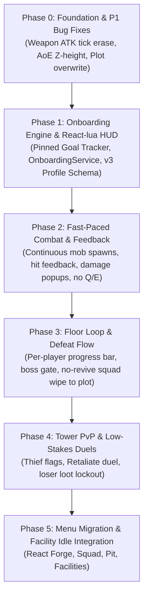

# Infinite Tower: Core Game Design & Systems Rework

**Document Version:** 1.1 (Approved Rework Specification; synced with GDD hero kits & weapon rules)  
**Date:** October 2026  
**Status:** Canonical Design Direction  

---

## 1. Executive Summary & Vision

### 1.1 The Problem
The current game experience suffers from three core friction points:
1. **Confusing Progression:** Over 10 complex, unguided systems (Summoning, Star Promotion, Synthesis Chamber, Artifact Ascension with 16 tiers, The Pit, Facility Labor, Relic Pacts, Syndicate Espionage, PvP Retaliation) are exposed simultaneously without guidance or a visible immediate goal.
2. **Sluggish, Non-Interactive Combat:** Combat is an unimpactful 5 Hz server simulation with a weaponless Master. The 60-second coma punishes players severely for things they cannot control, while boss fights become protracted DPS sponges.
3. **Cluttered, Inflexible UI/UX:** The interface is built on rigid pixel offsets without safe-area handling, lacking console/gamepad support, and crowding the screen with up to 8 disjointed HUD elements.

### 1.2 The Reworked Fantasy
**Infinite Tower** is an **AFK Journey-style 3D Auto-Battler** set in a persistent multiplayer tower and floating sanctuary.
- **The Master's Role:** Roams freely in 3D, explores floors, and guides the squad's spatial movement. Combat is **fully hands-off and automatic**—no formation micromanagement, no skill tap fatigue.
- **The Core Loop:** 
  $$\text{Summon \& Equip} \longrightarrow \text{Climb Shared Tower} \longrightarrow \text{Fill Kill Bar} \longrightarrow \text{Slay Floor Boss} \longrightarrow \text{Collect Facility Labor}$$
- **Fast-Paced Action:** Enemies spawn continuously; attacks and animations trigger rapidly with immediate audiovisual impact; bosses engage in intense 20–30 second showdowns rather than endless endurance tests.

---

## 2. Core Pillars & Mechanics

### 2.1 Combat & Squad Rules
- **Squad Composition:** Up to 5 summoned heroes deployed with the Master.
- **Fully Hands-Off (Zero-Input Combat):** Heroes execute basic attacks, special abilities, and ultimates automatically upon gauge readiness.
- **Removal of Q/E Whistles:** Legacy `[Q]` Overdrive Whistle and `[E]` Emergency Recall Whistle are completely removed from controls and HUD. The Master focuses entirely on movement, exploration, and spatial positioning.
- **Fast-Paced Combat Pacing:**
  - Standard mob TTK (time-to-kill): ~1.5 to 2.5 seconds per squad focus.
  - Elite mob TTK: ~6 to 10 seconds.
  - Boss TTK: ~20 to 30 seconds on-curve.
  - Faster animation cycles and hit-frame damage synchronization.
  - Dynamic mob streaming: Continuous mob respawns keep combat constant until the kill threshold is satisfied.
- **Spectacle & Feedback:** Dynamic damage popups (Normal, Crit, Element), hit-stop/flash effects, camera micro-shakes on major boss attacks, and instant loot bursts.

### 2.2 Hero Kits & Weapon Rules
These rules match `GAME_DESIGN.MD` §4.1, §4.4 and §7.5.
- **Per-Hero Kits:** Every hero has its own Basic, Special and Skill (ultimate). A kit takes its base numbers and mechanics from the hero's archetype, then overrides names, descriptions and, optionally, multipliers. Archetypes define only role, base stats, attack cadence, range, labor and weapon type.
- **One Weapon per Hero:** Each hero equips a single artifact (weapon). There are no off-hand or accessory slots, and **rings are removed**.
- **One Weapon Type per Archetype:**

  | Archetype | Weapon type |
  | :--- | :--- |
  | Vanguard | Sword & Shield (`SWORD_SHIELD`): one combined weapon |
  | Striker | Daggers (`DAGGERS`) |
  | Marksman | Bow (`BOW`) |
  | Miner | Axe (`AXE`) |
  | Scholar (mage) | Staff (`STAFF`) |
  | Healer | Tome (`TOME`) |

- **Legacy Saves:** Old `SWORD`/`SHIELD` artifacts become `SWORD_SHIELD`, owned rings are deleted, and heroes holding a weapon their archetype can no longer use are unequipped. If the player owns a compatible unequipped weapon, the hero equips it instead.

### 2.3 Death & Failure Mechanics
- **No Mid-Run Revives:** When a hero reaches 0 HP, they collapse dramatically and remain down for the rest of that floor run (portrait greyed out on HUD).
- **Removal of 60-Second Coma:** The debilitating 60-second coma and hospital timers are abolished.
- **Squad Wipe Flow:**
  1. If all 5 heroes are defeated, the encounter halts immediately.
  2. The Master and squad are teleported back to their private Fortress Plot.
  3. A clean **Defeat Modal** summarizes floor progress, enemy encounters, and provides instant **[Retry Floor]** or **[Upgrade Squad]** buttons.
  4. **Instant Restoration:** All heroes are restored to 100% HP upon arrival at the Plot.
  5. **Loot Stakes:** Banked Plot currencies and inventory remain 100% safe. Unbanked physical drops carried on that floor remain subject to contest rules.

---

## 3. Tower Progression & Shared World Architecture

### 3.1 Globally Shared Tower Floors
- **Multiplayer Shared Space:** Each tower floor instance is globally shared across players on the server (up to 6 players per server).
- **Per-Player Progress Bar:**
  - While players share the floor space and visual world, each Master has their own personal **Floor Kill Progress Bar** pinned at the top of their screen:
    $$\text{Target Kills} = \text{round}(12 + 0.5 \times \text{Floor})$$
  - Each mob defeated by the player's squad advances their individual progress meter.
- **Boss Summoning & Progression Gate:**
  - When a player fills their meter, their Floor Boss spawns.
  - Slaying the boss unlocks access to $\text{Floor} + 1$ on the player's profile (`HighestClearedFloor`).
  - **Shared Boss Participation:** If multiple players engage a boss, any player contributing at least **3.0% total damage** receives **full copies** of the boss rewards and floor clear credit. Boss rewards are safe, non-contestable, and never split.

### 3.2 Tower PvP & Loot Retaliation Flow
- **Non-Lethal, Low-Stakes Contests:**
  - Regular monster and elite drops in the tower spawn as physical loot tagged with `KillerUserId`.
  - If another player claims a drop tagged to someone else, they are visibly flagged with a **[Loot Thief]** indicator.
  - The victim receives a prominent, non-obtrusive **[⚔️ RETALIATE]** prompt with a countdown timer.
- **Duel Mechanics:**
  - Activating Retaliate initiates an isolated squad duel between the two Masters' heroes.
  - **Zero Consequence:** Duel knockouts do **not** trigger a squad wipe, do **not** teleport players away, and cause **no loss of progression**. Heroes instantly restore HP once the duel concludes.
  - **The Sole Penalty:** The losing squad is **temporarily locked out of picking up the contested drop**, allowing the victor to claim their prize uninterrupted.

---

## 4. Progression & Onboarding Spine

### 4.1 Pinned "Next Goal" Quest Chain
Progression is unified into a linear, always-visible Objective Tracker pinned on the HUD. Players are never overwhelmed with all systems at once.

| Step | Objective Title | Trigger Event | System Unlocked | Milestone Reward |
| :---: | :--- | :--- | :--- | :--- |
| **1** | Summon your first hero | `HeroSummoned` | Squad Management | 200 Gems |
| **2** | Deploy your squad | `SquadDeployed` | Infinite Tower | 500 Gold |
| **3** | Clear Floor 1 of the Tower | `FloorCleared` (Floor 1) | Blacksmith Forge | 1x Weapon Seed |
| **4** | Upgrade a weapon at the Forge | `ArtifactUpgraded` | Plot Facilities | 300 Gold |
| **5** | Put a hero to work at a facility | `FacilityAssigned` | The Pit (Synthesis) | 100 Gems |
| **6** | Level up a hero in the Pit | `PitUsed` | Tower Floor 5 Boss | Rare Gear Box |

### 4.2 Economy & Idle Loop
- **Facility-Driven Idle Earnings:** Idle rewards are generated strictly through **Fortress Plot Facility Labor** (`WaitingRoomService` + `OfflineRewardService`).
- **No Secondary Idle Chest:** Progression is clear—assigning benched heroes to facilities produces gold and materials while active or offline.

---

## 5. UI/UX Overhaul: React-lua & Obsidian-Gold Theme

### 5.1 Architecture & Standards
- **Framework:** Transition from 1,700-line imperative UI controllers to component-driven **React-lua** (`jsdotlua/react` + `react-roblox` v17.2.1).
- **Resolution Independence:** 
  - `ScreenInsets = Enum.ScreenInsets.CoreUISafeInsets` on all interactive screens to guarantee notch and top-bar avoidance on mobile.
  - Scale-driven layout (`UDim2.fromScale`) with `UIAspectRatioConstraint` and `UISizeConstraint`.
  - Touch targets guaranteed $\ge 44 \times 44\text{ px}$.
  - Full console / gamepad `Selectable` and D-pad navigation compatibility.

### 5.2 Clean HUD Contract (Max 4 Persistent Elements)
1. **Top-Center:** Personal **Floor Progress Bar** (swaps to Boss Health Bar during boss encounters).
2. **Top-Left:** Consolidated **Currencies** (Gold, Gems) with large readable numbers and delta animations.
3. **Top-Right (or Below Currencies):** Pinned **Next Goal Tracker** card with objective progress.
4. **Bottom-Center:** Clean **Navigation Toolbar** with labelled icons (Squad, Summon, Forge, Facilities, Tower) and notification badges.
- *Removed from HUD:* Q/E Whistle buttons, persistent World Boss stat tables, and redundant bottom-left currency clusters.

---

## 6. Implementation Phasing

This document represents the agreed-upon master blueprint for transforming Infinite Tower into an engaging, cohesive, and fast-paced game.
