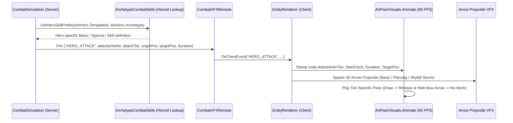

# Implementation Plan: Jenna Idle Stance, 3-Tier Bow Animations, Projectile Arrows & Per-Hero Skill Design

## Goal Description

This plan addresses four interconnected improvements:
1. **Natural Wind-Scout Idle Stance for Jenna (`hero_jenna`)**: Normalize her baked `Motor6D.C0` joints (which currently lock her arms in a mid-draw pose with straight legs) to standard R15 neutral joints and drive an athletic, contrapposto **Wind-Scout Ready Stance** via `ArtPackVisuals.Animate`.
2. **3D Projectile Arrow Visuals**: Spawn physical/visual 3D arrow projectiles on the client whenever Jenna (or any bow Marksman) attacks, with distinct visual treatments for **Basic (`Wind-Step Shot`)**, **Special (`Piercing Gale Volley`)**, and **Skill/Ultimate (`Sylphid Arrow Storm`)**, synchronized with hiding/re-nocking the bow's `HunterArrow`.
3. **Distinct Basic, Special, and Skill Attack Animations**: Replicate the active attack tier (`BASIC`, `SPECIAL`, `SKILL`) to the client so `ArtPackVisuals.Animate` plays three distinct, multi-phase procedural animations for Jenna instead of a single generic loop.
4. **Per-Hero Unique Skills in `GAME_DESIGN.MD` (and Config)**: Refactor [`GAME_DESIGN.MD`](file:///D:/Programming%20shi/infinite-tower/docs/GAME_DESIGN.MD) Sections 4.1 & 4.4 and [`ArchetypeCombatSkills.luau`](file:///D:/Programming%20shi/infinite-tower/src/ReplicatedStorage/Shared/Config/ArchetypeCombatSkills.luau) so that **each of the 12 Heroes** has their own unique Basic, Special, and Skill (Ultimate) kit, while Archetypes define base role, attack range, interval, and permitted weapon classes.

---

## Architecture & Data Flow

---

## Proposed Changes

### 1. Jenna Idle Stance & Rig Joint Normalization

#### [MODIFY] [HeroModelBuilder.luau](file:///D:/Programming%20shi/infinite-tower/src/ReplicatedStorage/Assets/HeroModelBuilder.luau)
- Add a helper `normalizeR15Joints(model: Model)` and invoke it in `EnsureHeroes()` for `hero_jenna` (and apply directly to `ReplicatedStorage.Assets.Heroes.hero_jenna` and `ServerStorage.ModelViewer.JennaPreview` in Studio).
- This resets the baked aiming `C0` rotations on `LeftShoulder`, `RightShoulder`, `RightElbow`, `Waist`, and `Neck` back to standard R15 `RigAttachment` CFrames so that procedural animations in `ArtPackVisuals.Animate` do not compound on top of pre-rotated joints.

#### [MODIFY] [ArtPackVisuals.luau](file:///D:/Programming%20shi/infinite-tower/src/ReplicatedStorage/Assets/ArtPackVisuals.luau)
- **Unified Marksman Idle Stance (Contrapposto Wind-Scout Ready Pose)**:
  - **Torso (`Waist`, `Neck`)**: `Waist` angled `-18°` Y with subtle forward lean (`-3°` X) and breathing sway; `Neck` counter-turned `+16°` Y with gentle horizontal look scan.
  - **Bow Arm (`LeftShoulder`, `LeftElbow`, `LeftWrist`)**: Held in a poised, lowered diagonal ready carry (`LeftShoulder` pitch `-32°`, yaw `-14°`, roll `+18°`; `LeftElbow` bent `-24°`) so the bow and nocked arrow frame her silhouette cleanly without covering her face.
  - **Draw Arm (`RightShoulder`, `RightElbow`, `RightWrist`)**: Relaxed archer ready hand poised near the bowstring/quiver hip (`RightShoulder` pitch `-14°`, yaw `+10°`, roll `-18°`; `RightElbow` bent `-48°`).
  - **Legs (`LeftHip`, `LeftKnee`, `LeftAnkle`, `RightHip`, `RightKnee`, `RightAnkle`)**: Athletic planted stance with left foot stepped slightly forward (`LeftHip` pitch `-10°`, `LeftKnee` `+16°`) and right leg braced back (`RightHip` pitch `+8°`, `RightKnee` `+12°`).

---

### 2. Basic, Special & Skill Attack Animations for Jenna

#### [MODIFY] [ArtPackVisuals.luau](file:///D:/Programming%20shi/infinite-tower/src/ReplicatedStorage/Assets/ArtPackVisuals.luau)
- Update `A.Animate(node, dt, time)` to read `node.AttackAnimTier` (`"BASIC"` | `"SPECIAL"` | `"SKILL"`), `node.AttackAnimStartClock`, and `node.AttackAnimDuration`:
  1. **Basic Attack (`Wind-Step Shot`)**:
     - *0%–65% (Draw)*: Torso turns `-32°` Y; left bow arm lifts and extends straight toward target (`LeftShoulder` `-78°` X); right hand pulls string and `DrawAttachment` back to cheek (`RightShoulder` `+18°` X, `-42°` Z; `RightElbow` `-95°` X). Nocked `HunterArrow` is visible and tracks the draw.
     - *65%–82% (Release & Recoil)*: String snaps forward, right hand flicks back in follow-through, bow arm kicks `+6°` upward; nocked `HunterArrow` hides as projectile launches.
     - *82%–100% (Re-Nock)*: Right hand dips toward quiver and returns to string; `HunterArrow` reappears.
  2. **Special Attack (`Piercing Gale Volley` — Every 3rd Hit)**:
     - *0%–68% (Crouched Cant Over-Draw)*: Deep knee bend (`LeftKnee` `+28°`, `RightKnee` `+26°`, `Root` lowered `-0.35` studs), torso leans `-10°` forward, left wrist cants the bow `40°` diagonally, and right arm executes a heavy over-draw.
     - *68%–86% (Gale Recoil)*: Explosive release pitches upper torso back `+10°` with a wide right-arm whip follow-through.
     - *86%–100% (Recover)*: Smooth return to ready posture.
  3. **Skill Attack / Ultimate (`Sylphid Arrow Storm` — 100 Skill Gauge)**:
     - *0%–58% (Skyward Draw)*: Jenna braces her legs wide, arches her upper torso skyward (`Waist` `+32°` X, `Neck` `+25°` X), raises her bow arm high (`LeftShoulder` `-125°` X), and draws deeply toward the sky.
     - *58%–82% (Apex Sky-Shot)*: High-angle release recoil as the flare arrow streaks upward to summon the arrow rain.
     - *82%–100% (Landing Reset)*: Smoothly lowers the bow back to ready stance.

---

### 3. Projectile Arrow Visuals

#### [MODIFY] [CombatSimulation.server.luau](file:///D:/Programming%20shi/infinite-tower/src/ServerScriptService/Combat/CombatSimulation.server.luau)
- When a hero executes an attack in `stepHeroSimulation`, broadcast a `"HERO_ATTACK"` visual event on `CombatVFXRemote` containing `(simHero.Position, simHero.NetId, attackType, targetPos, effectiveInterval, simHero.TemplateId)` so clients immediately trigger the tier-specific animation and projectile.

#### [MODIFY] [CombatFeedback.luau](file:///D:/Programming%20shi/infinite-tower/src/ReplicatedStorage/Assets/CombatFeedback.luau)
- Add `self:SpawnArrowProjectile(originPos: Vector3, targetPos: Vector3, attackTier: string, attackerModel: Model?)`:
  - **Basic (`"BASIC"`)**: Builds a sleek 3D arrow (wooden shaft, slate wedge tip, 3 fletchings, and a wind-cyan neon trail/glow) starting from the bow's world position and tweening at ~100 studs/s to `targetPos + Vector3.new(0, 2.2, 0)` with a subtle parabolic arc, spawning a wind-ring spark on hit.
  - **Special (`"SPECIAL"`)**: Spawns an enlarged, glowing emerald-cyan **Piercing Gale Bolt** with spiraling wind rings that shoots 32 studs through the target line, leaving a brief wind-tunnel beam and impact burst.
  - **Skill (`"SKILL"`)**: Launches an ascending **Sky-Flare Arrow** from the bow up to `originPos + Vector3.new(0, 28, 0)`, opens a glowing emerald-cyan wind sigil ring above `targetPos`, and rains down **14 glowing wind arrows** across the 16-stud radius over 0.55s with ground impact ripples.

#### [MODIFY] [EntityRenderer.client.luau](file:///D:/Programming%20shi/infinite-tower/src/StarterPlayerScripts/Rendering/EntityRenderer.client.luau)
- Handle `"HERO_ATTACK"` in `CombatVFXRemote.OnClientEvent`:
  - Look up the attacker `VisualNode` by `NetId`, set `node.AttackAnimTier = attackTier`, `node.AttackAnimStartClock = os.clock()`, and `node.AttackAnimDuration = math.clamp(interval, 0.35, 0.95)`.
  - If the hero is `hero_jenna` / `Marksman` (or has a bow equipped), call `CombatFeedback:SpawnArrowProjectile(...)`.

---

### 4. Per-Hero Unique Skills in `GAME_DESIGN.MD` & `ArchetypeCombatSkills.luau`

#### [MODIFY] [GAME_DESIGN.MD](file:///D:/Programming%20shi/infinite-tower/docs/GAME_DESIGN.MD)
- Update **Section 4.1 (Archetype Foundation Table)** so that the Archetype table defines only **combat role, base stats, attack interval, attack range, base labor, and permitted weapons**.
- Update **Section 4.4 (Hero 3-Tier Attack Cadence & Dynamic Skill Gauge System)** to specify that **every Hero possesses a unique, bespoke 3-Tier Skill Kit (`Basic`, `Special`, `Skill / Ultimate`)** rather than sharing skills by archetype, and provide the complete **12-Hero Combat Skill Ledger**:
  1. **Han (`hero_han`, 1★ Striker)**: *Gale Slash* $\to$ *Crescent Cross-Cut* $\to$ *Relentless Blade Flurry*
  2. **Aaron (`hero_aaron`, 2★ Vanguard)**: *Bastion Strike* $\to$ *Aegis Shield Bash* $\to$ *Fortress Bulwark*
  3. **Catio (`hero_catio`, 3★ Miner)**: *Pickaxe Cleave* $\to$ *Resonance Tremor* $\to$ *Crystalline Excavation*
  4. **Valeria (`hero_valeria`, 4★ Healer)**: *Emerald Bolt* $\to$ *Verdant Mend* $\to$ *Sanctuary Miracle*
  5. **Ignis (`hero_ignis`, 5★ Vanguard)**: *Molten Cleave* $\to$ *Magma Breaker* $\to$ *Infernal Juggernaut*
  6. **Jenna (`hero_jenna`, 1★ Marksman)**: *Wind-Step Shot* $\to$ *Piercing Gale Volley* $\to$ *Sylphid Arrow Storm*
  7. **Velkist (`hero_velkist`, 2★ Striker)**: *Twin Fang Cut* $\to$ *Shadow Rend* $\to$ *Phantom Lotus Execution*
  8. **Eolka (`hero_eolka`, 3★ Scholar)**: *Ruby Firebolt* $\to$ *Wildfire Chain* $\to$ *Crimson Hellfire Pillar*
  9. **Morrigan (`hero_morrigan`, 4★ Vanguard)**: *Abyssal Reap* $\to$ *Dread Shockwave* $\to$ *Obsidian Bastion*
  10. **Sovereign Archon (`hero_archon`, 5★ Striker)**: *Void Lance Strike* $\to$ *Rift Sever* $\to$ *Dimensional Cataclysm*
  11. **Solaris (`hero_solaris`, 6★ Scholar)**: *Solar Ray* $\to$ *Corona Arc* $\to$ *Supernova Starfall*
  12. **Astrea (`hero_astrea`, 7★ Marksman)**: *Astral Arrow* $\to$ *Nebula Piercer* $\to$ *Constellation Judgment*

#### [MODIFY] [ArchetypeCombatSkills.luau](file:///D:/Programming%20shi/infinite-tower/src/ReplicatedStorage/Shared/Config/ArchetypeCombatSkills.luau)
- Add `HeroProfiles` keyed by `HeroId` (`hero_han`, `hero_jenna`, ..., `hero_astrea`) with each hero's unique `Basic`, `Special`, and `Skill` definitions, and update `GetSkillProfile(heroIdOrArchetype, fallbackArchetype)` so `CombatSimulation` resolves hero-specific skills first while preserving archetype fallback compatibility.

---

## Verification Plan

### Automated & Studio Live Verification
1. **Sync to Studio**: Sync all modified modules (`HeroModelBuilder`, `ArtPackVisuals`, `CombatFeedback`, `ArchetypeCombatSkills`, `CombatSimulation`, `EntityRenderer`) into Roblox Studio Edit mode and normalize `ReplicatedStorage.Assets.Heroes.hero_jenna` joints.
2. **Idle Stance Inspection**: Start Play mode, inspect `Workspace.ClientVisualEntities.Entity_1_Jenna` in the courtyard, and capture screenshots verifying her balanced contrapposto Wind-Scout idle stance and bow hold.
3. **Combat Animations & Arrow Projectiles**: Engage enemies in Play mode (and trigger Basic, Special, and Skill tiers) to verify all 3 animations and projectile arrow visuals (`Wind-Step Shot`, `Piercing Gale Volley`, and `Sylphid Arrow Storm`), capturing live screenshots.
