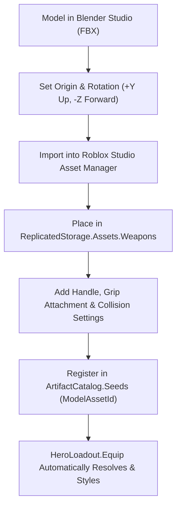

# Master Artifact & Weapon Modeling Catalog for Blender Studio

This authoritative specification document bridges the game design requirements (`docs/GAME_DESIGN.MD`, `docs/economy_balancing_tables.md`) and the Luau codebase (`ArtifactCatalog.luau`, `StatFormulas.luau`, `HeroSockets.luau`, `WeaponModelBuilder.luau`, `EntityRenderer.client.luau`, `ForgeController.luau`). It establishes the exact technical rig contracts, catalog schemas, discrepancy resolutions, and 3D modeling briefs for Blender Studio weapon creation.

---

## Part A: Implementation Plan for Artifact Discovery & Blender Pipeline

### 1. Discrepancy Audit: Design Specification vs. Luau Implementation

A complete cross-reference between `docs/GAME_DESIGN.MD` (Sections 4, 5, 7) and `src/ReplicatedStorage/Shared/Config/ArtifactCatalog.luau` reveals the following findings:

1. **One-to-One Archetype Restriction Parity:**
   - Both `GAME_DESIGN.MD` (§7.5) and `ArtifactCatalog.luau` enforce a strict 1-to-1 mapping between the 6 hero combat archetypes and weapon types:
     - `Vanguard` $\rightarrow$ `SWORD_SHIELD` (Combined Main-Hand Sword & Off-Hand Shield)
     - `Striker` $\rightarrow$ `DAGGERS` (Dual-Wield Trench Daggers / Stilettos)
     - `Miner` $\rightarrow$ `AXE` (Battleaxes, Cleavers, Pickaxes)
     - `Marksman` $\rightarrow$ `BOW` (Shortbows, Recurves, Greatbows)
     - `Scholar` $\rightarrow$ `STAFF` (Channeling Staves, Scepters)
     - `Healer` $\rightarrow$ `TOME` (Grimoires, Spellbooks)
   - *Legacy Removals Confirmed:* Legacy standalone `RING` artifacts (`art_ring_of_haste`) and separate `SHIELD` artifacts have been completely purged from the codebase. Swords and shields are unified under `SWORD_SHIELD`.

2. **Artifact Star Seeds vs. Banner Ranks:**
   - In `ArtifactCatalog.Seeds`, 14 distinct weapons are implemented. However, their `DefaultStar` ratings currently range only from $1★$ to $3★$.
   - In `ArtifactCatalog.Banner` (`Echoes of the Rift`), weapons are pulled as:
     - **Featured 5★ Pool:** `art_blade_of_the_rift`, `art_aegis_core`
     - **Pool 4★:** `art_shadow_fangs`, `art_crystal_greatbow`, `art_paladin_claymore`
     - **Pool 3★:** `art_runic_longsword`, `art_battleaxe_cleaver`, `art_recurve_composite`, `art_ruby_staff`
     - **Pool 1★–2★:** `art_hunters_shortbow`, `art_iron_broadsword`, `art_rusty_daggers`, `art_miner_pickaxe`, `art_novice_tome`
   - *Progression Resolution:* In accordance with `GAME_DESIGN.MD` §7.1–7.3, **Star Promotion ($1★ \rightarrow 7★$)** is the primary vertical axis of progression. Any weapon template can be promoted through all 7 star tiers at the Blacksmith Forge using duplicate copies.

3. **Inherent Rarity Multipliers:**
   - Rarity is an immutable $16$-tier property assigned upon acquisition (Common $\rightarrow$ Origin).
   - In `StatBalance.luau`, Base Power scales from $20$ (Tier 1 Common) to $160,000$ (Tier 16 Origin), and Attack Speed bonus scales from $+5.0\%$ to $+75.0\%$.
   - At $7★$ promotion, the star multiplier is $16.00\times$, yielding $112,000$ Power for Mythical $7★$ ($2,801\times$ damage multiplier) and $2,560,000$ Power for Origin $7★$ ($64,001\times$ damage multiplier).

4. **3D Visual Geometry Status:**
   - Currently, no external `.fbx`/`.obj` mesh assets exist under `src/ReplicatedStorage/Assets/Weapons/`.
   - All 6 weapon classes are procedurally built at runtime via `WeaponModelBuilder.luau` using primitive Roblox `Part` and `WedgePart` assemblies.
   - The goal of this Blender pipeline is to replace these primitive blockouts with high-fidelity, optimized 3D anime/gothic stylized meshes.

---

### 2. Socket & Rig Contract (Roblox Lightweight Hero Rig)

Hero combat rendering is driven by `EntityRenderer.client.luau` operating at $5\text{ Hz}$ server tick interpolation with RenderStepped client smoothing. The rig uses custom bone attachments managed by `HeroSockets.luau` rather than standard server-side Humanoids.

#### General Physical & Modeling Constraints
- **Hierarchy:** Weapon Model named `EquippedWeapon` with `PrimaryPart = Handle`.
- **Physics Flags:** Every `BasePart` or `MeshPart` in the weapon MUST have:
  - `CanCollide = false`
  - `CanTouch = false`
  - `CanQuery = false`
  - `Massless = true`
  - `Anchored = false`
- **Weld System:** `HeroSockets.luau` creates explicit `Weld` instances (`Part0 = RigPart`, `Part1 = WeaponPart`, `C0 = RigAttachment.CFrame`, `C1 = WeaponAttachment.CFrame`).
- **Polygon / Tri Budget:** $1,000\text{ to }2,500$ triangles per weapon asset (under $3,000$ tris total for dual-wield daggers and sword & shield combos) to ensure $60\text{ FPS}$ performance with $50+$ active entities on screen.

#### Archetype-Specific Socket Specifications

```
+---------------------------------------------------------------------------------------------------------+
|                                    WEAPON SOCKETING MATRIX                                              |
+---------------+---------------------+--------------------+--------------------+-------------------------+
| Archetype     | Weapon Type         | Main Hand Socket   | Off-Hand Socket    | Grip Orientation Rule   |
+---------------+---------------------+--------------------+--------------------+-------------------------+
| Vanguard      | SWORD_SHIELD        | RightHand          | LeftLowerArm       | Up = Blade, Look = Edge |
|               |                     | RightGripAttach    | ShieldMountAttach  | Shield: Mount on back   |
+---------------+---------------------+--------------------+--------------------+-------------------------+
| Striker       | DAGGERS             | RightHand          | LeftHand           | Up = Blade, Look = Edge |
|               |                     | RightGripAttach    | LeftGripAttach     | ReverseGrip flag supp.  |
+---------------+---------------------+--------------------+--------------------+-------------------------+
| Miner         | AXE                 | RightHand          | (OffhandGrip)      | Up = Shaft, Look = Edge |
|               |                     | RightGripAttach    | Two-handed swings  | Grip near butt of haft  |
+---------------+---------------------+--------------------+--------------------+-------------------------+
| Marksman      | BOW                 | LeftHand           | Nock/Tips          | Up = Upper Limb         |
|               |                     | LeftGripAttach     | Dynamic String     | Look = Arrow flight (-Z)|
+---------------+---------------------+--------------------+--------------------+-------------------------+
| Scholar       | STAFF               | RightHand          | None               | Up = Crystal Orb        |
|               |                     | RightGripAttach    |                    | Look = Crown Face (-Z)  |
+---------------+---------------------+--------------------+--------------------+-------------------------+
| Healer        | TOME                | LeftHand           | None               | Up = Spine Top          |
|               |                     | LeftGripAttach     |                    | Look = Front Cover (+Z) |
+---------------+---------------------+--------------------+--------------------+-------------------------+
```

#### Detailed Coordinate Systems & Origin Alignment

1. **Swords (`SWORD_SHIELD` / `weapon_sword` / `weapon_sword_shield`):**
   - **Handle Dimensions:** $\approx 0.24 \times 1.20 \times 0.24$ studs.
   - **Blender Origin:** Grip center along the handle (between pommel and crossguard).
   - **Axis Alignment:** Blade extends along $+Y$. Guard sits at $Y = +0.65$. Blade length is $3.2$ to $4.5$ studs.
   - **Orientation (`EDGE_PLUS_X`):** The cutting edge faces $+X$. In Roblox handle space, `Grip` attachment orientation is `CFrame.Angles(0, math.rad(-90), 0)`.
   - **Shield (`OffhandShield`):** PrimaryPart is `HandleS`. Face plate size $\approx 0.24 \times 2.60 \times 1.60$ studs. Attachment `ShieldMount` is located at `Vector3.new(-0.18, 0, 0)` with rotation `Vector3.new(0, 90, 0)`, aligning with `LeftLowerArm.ShieldMountAttachment`.

2. **Daggers (`DAGGERS` / `weapon_daggers`):**
   - **Dual Rig Assembly:** Root model has `Handle` (Right Hand) and child model `LeftDagger` with `HandleL` (Left Hand).
   - **Handle Dimensions:** $\approx 0.20 \times 0.80 \times 0.20$ studs. Blade length $\approx 1.60$ to $2.00$ studs.
   - **Blender Origin:** Midpoint of the grip handle.
   - **Reverse Grip Support:** If the `ReverseGrip = true` attribute is set on the model, `HeroSockets.luau` automatically flips the grip by $180^\circ$ (`c1 *= CFrame.Angles(0, 0, math.pi)`), aligning the stiletto blade along the hero's forearm.

3. **Axes (`AXE` / `weapon_axe`):**
   - **Handle Dimensions:** $\approx 0.22 \times 2.80 \times 0.22$ studs.
   - **Blender Origin:** Center of haft, with Primary Grip at `Vector3.new(0, -0.90, 0)` (near the butt) and secondary `OffhandGrip` at `Vector3.new(0, 0.20, 0)`.
   - **Axis Alignment:** Haft extends along $+Y$. Axe blade extends outward along $+X$ at $Y = +1.10$. Counter-spike points along $-X$.

4. **Bows (`BOW` / `weapon_bow`):**
   - **Riser / Grip Dimensions:** $\approx 0.30 \times 0.80 \times 0.35$ studs. Total bow length $\approx 3.70$ studs ($Y \in [-1.84, +1.84]$).
   - **Blender Origin:** Center of the riser grip (`Vector3.zero`).
   - **Axis Alignment:** Upper limb extends along $+Y$; lower limb along $-Y$. Arrow flight direction is along $-Z$.
   - **String & Sockets:**
     - `Grip`: At `(0, 0, 0)`, held in `LeftHand`.
     - `Nock`: At `(0.20, 0.10, 0.42)`, resting point for arrow nock on the bowstring.
     - `TipUpper`: At `(0, 1.84, 0.42)`.
     - `TipLower`: At `(0, -1.84, 0.42)`.
   - **Dynamic Arrow (`HunterArrow`):** Shaft length $2.0$ studs, aligned with $-Z$ past the arrow rest. `EntityRenderer` hides this arrow while a shot is in flight.

5. **Staves (`STAFF` / `weapon_staff`):**
   - **Shaft Dimensions:** $\approx 0.22 \times 4.20 \times 0.22$ studs.
   - **Blender Origin:** Grip attachment at `Vector3.new(0, -0.40, 0)`.
   - **Axis Alignment:** Shaft along $+Y$. Ornate staff head at $Y = +2.20$, crystal orb/focus at $Y = +2.65$. LookVector faces $-Z$.

6. **Tomes (`TOME` / `weapon_tome`):**
   - **Dimensions:** $\approx 1.05 \times 1.50 \times 0.38$ studs (parchment block with front/back covers).
   - **Blender Origin:** Spine center is the `Handle`.
   - **Axis Alignment:** Spine along $+Y$. Front cover extends along $+X$ with outward face at $+Z$.
   - **Socket:** `Grip` at `Vector3.zero` with rotation `Vector3.new(0, 180, 0)`, held firmly in `LeftHand`.

---

### 3. Catalog Editing & Asset Binding Workflow

To edit weapon stats, introduce new weapon tiers, or link new Blender 3D meshes:

#### Table Schema in `src/ReplicatedStorage/Shared/Config/ArtifactCatalog.luau`

```luau
export type ArtifactSeed = {
    TemplateId: string,         -- Unique alphanumeric key (e.g. "art_blade_of_the_rift")
    DisplayName: string,        -- Localized user-facing title
    Type: WeaponType,           -- "BOW" | "SWORD_SHIELD" | "DAGGERS" | "AXE" | "TOME" | "STAFF"
    DefaultStar: number,        -- Base star seed rank (1 to 7)
    ModelAssetId: string,       -- Reference key in ReplicatedStorage.Assets.Weapons
    Description: string,        -- Lore and aesthetic summary
    BaseATK: number?,           -- Base attack bonus override
    BaseDEF: number?,           -- Base defense bonus override
    BaseHP: number?,            -- Base health bonus override
    BaseCritRate: number?,      -- Base critical chance bonus override
    CraftCost: { [string]: number }?, -- Materials required at Blacksmith Forge
}
```

#### Step-by-Step Asset Import & Linking Workflow



1. **Export from Blender:**
   - In Blender, apply all transforms (`Ctrl + A` $\rightarrow$ All Transforms).
   - Forward: `-Z Forward`, Up: `+Y Up`. Units: Metric with Unit Scale `0.01` or Roblox stud scale ($1\text{ stud} \approx 0.28\text{ meters}$).
2. **Setup Prefab in Roblox Studio:**
   - Place the imported mesh under `ReplicatedStorage.Assets.Weapons.<PrefabName>`.
   - Set the `PrimaryPart` to a part or mesh named `Handle`.
   - Insert an `Attachment` named `Grip` matching the archetype's orientation.
   - For Shields: add child Model `OffhandShield` with `ShieldMount` attachment.
   - For Daggers: add child Model `LeftDagger` with `Grip` attachment.
   - For Bows: add `Nock`, `TipUpper`, and `TipLower` attachments.
3. **Register in Catalog:**
   - Add or modify the entry in `ArtifactCatalog.Seeds`:
     ```luau
     art_void_katana = {
         TemplateId = "art_void_katana",
         DisplayName = "Voidrend Katana",
         Type = "SWORD_SHIELD",
         DefaultStar = 4,
         ModelAssetId = "weapon_void_katana",
         Description = "A folded astral steel blade that slices through dimensional fabric.",
         CraftCost = { IronGear = 10, VoidPowder = 8 },
     }
     ```
4. **Dynamic Styling & Emissive Rarity Rims:**
   - `WeaponModelBuilder.Style(model, artifactId, rarityIndex)` dynamically queries the weapon's rarity. For high rarities (Tier 14+), any part named `Blade`, `Tip`, `Orb`, or `Crystal` receives `Material = Enum.Material.Neon` and is tinted to the rarity's hex color.

---

## Part B: Master Ordered Artifact List by Archetype

The master catalog below contains all currently implemented artifacts alongside the full $1★ \rightarrow 7★$ progression roadmap across all 6 weapon archetypes.

Stats are computed using the live formulas from `StatBalance.luau` and `ArtifactCatalog.luau`:
$$\text{Power} = \text{RarityPower}_{\text{Tier}} \times \text{StarMultiplier}_{\text{Star}}$$
$$\text{Damage Multiplier} = 1 + \frac{\text{Power}}{40}$$
$$\text{AtkSpd Bonus} = \text{RaritySpeed}_{\text{Tier}} \times 100\%$$

*Reference Star Multipliers:* $1★ = 1.00\times$, $2★ = 1.60\times$, $3★ = 2.50\times$, $4★ = 4.00\times$, $5★ = 6.50\times$, $6★ = 10.00\times$, $7★ = 16.00\times$.

---

### Archetype 1: Swords (`SWORD_SHIELD`)
- **Permitted Archetype:** `Vanguard`
- **Compatible Launch Heroes:** Aaron ($2★$, Uncommon), Morrigan ($4★$, Superior), Ignis ($5★$, Exalted)
- **Equip Posture:** Main-hand blade in `RightHand.RightGripAttachment`, kite/heater shield strapped to `LeftLowerArm.ShieldMountAttachment`.

| Order # | Artifact ID | Display Name | Star Seed & Rarity Tier | Base Power | Damage Multiplier | Attack Speed | 3D Visual Status | Blender Modeling Brief |
| :---: | :--- | :--- | :---: | :---: | :---: | :---: | :--- | :--- |
| **01** | `art_iron_broadsword` | **Iron Broadsword** | $1★$ Common (Tier 1) | $20$ | $1.50\times$ | $+5.0\%$ | Procedural Part Assembly (`weapon_sword_shield`) | Sturdy double-edged arming sword with iron cruciform guard; round buckler with riveted iron rim. Budget: 800 tris. |
| **02** | `art_runic_longsword` | **Runic Longsword** | $2★$ Uncommon (Tier 2) | $96$ | $3.40\times$ | $+7.5\%$ | Procedural Part Assembly (`weapon_sword_shield`) | Polished steel longsword with etched blood grooves; angular heater shield bearing faded runic heraldry. Budget: 1,200 tris. |
| **03** | `art_paladin_claymore` | **Holy Claymore** | $3★$ Rare (Tier 3) | $450$ | $12.25\times$ | $+10.0\%$ | Procedural Part Assembly (`weapon_sword_shield`) | Heavier gothic broadsword with flared quillons and gold filigree; flared kite shield with glowing golden cross-crest. Budget: 1,600 tris. |
| **04** | `art_blade_of_the_rift` | **Blade of the Rift** | $3★ \rightarrow 5★$ Exalted (Tier 5) | $9,100$ | $228.50\times$ | $+16.5\%$ | Procedural Part Assembly (`weapon_sword_shield`) | Asymmetrical dark greatsword with fractured blade exposing arcane violet (`#C084FC`) energy core; floating void crystal shield aegis. Budget: 2,200 tris. |
| **05** | `art_aegis_core` | **Aegis Core** | $3★ \rightarrow 5★$ Exalted (Tier 5) | $9,100$ | $228.50\times$ | $+16.5\%$ | Procedural Part Assembly (`weapon_sword_shield`) | Crystalline barrier sword with glowing defensive runes; heavy hexagonal aegis tower shield emitting defensive forcefields. Budget: 2,400 tris. |
| **06** | `art_astral_executioner` *(Target)* | **Astral Executioner** | $6★$ Legendary (Tier 6) | $35,000$ | $876.00\times$ | $+20.0\%$ | Missing Placeholder (Planned) | Slender anime celestial blade with golden sunburst guard; ornate radiant tower shield with floating sun motifs. Budget: 2,600 tris. |
| **07** | `art_genesis_worldbreaker` *(Target)* | **Worldbreaker Bastion** | $7★$ Mythical (Tier 7) | $112,000$ | $2,801.00\times$ | $+30.0\%$ | Missing Placeholder (Planned) | Massive dark cosmic blade infused with swirling galaxy nebula shaders; colossal living rift barrier with pulsing demon horns. Budget: 2,800 tris. |

---

### Archetype 2: Daggers (`DAGGERS`)
- **Permitted Archetype:** `Striker`
- **Compatible Launch Heroes:** Han ($1★$, Common), Velkist ($2★$, Uncommon), Sovereign Archon ($5★$, Exalted)
- **Equip Posture:** Dual-wielded: Main dagger in `RightHand.RightGripAttachment`, off-hand dagger in `LeftHand.LeftGripAttachment` (supports forward or reverse forearm grip).

| Order # | Artifact ID | Display Name | Star Seed & Rarity Tier | Base Power | Damage Multiplier | Attack Speed | 3D Visual Status | Blender Modeling Brief |
| :---: | :--- | :--- | :---: | :---: | :---: | :---: | :--- | :--- |
| **08** | `art_rusty_daggers` | **Rogue Daggers** | $1★$ Common (Tier 1) | $20$ | $1.50\times$ | $+5.0\%$ | Procedural Part Assembly (`weapon_daggers`) | Rugged pair of serrated trench knives with wrapped leather grips and dark iron pommel studs. Budget: 900 tris (pair). |
| **09** | `art_shadow_fangs` | **Shadow Fangs** | $2★ \rightarrow 4★$ Superior (Tier 4) | $2,160$ | $55.00\times$ | $+13.0\%$ | Procedural Part Assembly (`weapon_daggers`) | Twin obsidian curved stilettos emitting faint abyssal smoke particles; ring-loop karambit grips. Budget: 1,400 tris (pair). |
| **10** | `art_viper_kris` *(Target)* | **Viper Kris** | $3★$ Rare (Tier 3) | $450$ | $12.25\times$ | $+10.0\%$ | Missing Placeholder (Planned) | Flamboyant wave-bladed kris daggers with venomous emerald inlays and serpent-head pommels. Budget: 1,600 tris (pair). |
| **11** | `art_phantom_edge` *(Target)* | **Phantom Edge** | $4★$ Superior (Tier 4) | $2,160$ | $55.00\times$ | $+13.0\%$ | Missing Placeholder (Planned) | Semitransparent spiritual glass blades with ornate silver filigree crossguards. Budget: 1,800 tris (pair). |
| **12** | `art_bloodthirst_twinblades` *(Target)* | **Bloodthirst Twinblades** | $5★$ Exalted (Tier 5) | $9,100$ | $228.50\times$ | $+16.5\%$ | Missing Placeholder (Planned) | Jagged crimson demonic blades with arterial bone hilts suited for Velkist's frenzy animation. Budget: 2,000 tris (pair). |
| **13** | `art_eclipse_daggers` *(Target)* | **Eclipse Daggers** | $6★$ Legendary (Tier 6) | $35,000$ | $876.00\times$ | $+20.0\%$ | Missing Placeholder (Planned) | Opposing celestial twins: one forged of lunar silver, one of solar gold, with crescent guards. Budget: 2,400 tris (pair). |
| **14** | `art_abyssal_ravagers` *(Target)* | **Abyssal Ravagers** | $7★$ Mythical (Tier 7) | $112,000$ | $2,801.00\times$ | $+30.0\%$ | Missing Placeholder (Planned) | Floating dark-matter phantom daggers tethered by purple lightning arcs around the hero's wrists. Budget: 2,500 tris (pair). |

---

### Archetype 3: Axes (`AXE`)
- **Permitted Archetype:** `Miner`
- **Compatible Launch Heroes:** Catio ($3★$, Rare)
- **Equip Posture:** Gripped in `RightHand.RightGripAttachment` near the base of the ashwood haft; `OffhandGrip` ready for heavy two-handed execution swings.

| Order # | Artifact ID | Display Name | Star Seed & Rarity Tier | Base Power | Damage Multiplier | Attack Speed | 3D Visual Status | Blender Modeling Brief |
| :---: | :--- | :--- | :---: | :---: | :---: | :---: | :--- | :--- |
| **15** | `art_miner_pickaxe` | **Prospector's Cleaver** | $1★$ Common (Tier 1) | $20$ | $1.50\times$ | $+5.0\%$ | Procedural Part Assembly (`weapon_axe`) | Heavy utilitarian lumber/mining hybrid axe with chisel pommel and beveled cleaver head. Budget: 900 tris. |
| **16** | `art_battleaxe_cleaver` | **Warforged Battleaxe** | $2★$ Uncommon (Tier 2) | $96$ | $3.40\times$ | $+7.5\%$ | Procedural Part Assembly (`weapon_axe`) | Broad double-headed iron battleaxe with reinforced bronze collar and sharp counter-spike. Budget: 1,300 tris. |
| **17** | `art_canyon_splitter` *(Target)* | **Canyon Splitter** | $3★$ Rare (Tier 3) | $450$ | $12.25\times$ | $+10.0\%$ | Missing Placeholder (Planned) | Asymmetrical heavy dwarven greataxe embedded with raw gemstone clusters along the spine. Budget: 1,600 tris. |
| **18** | `art_magma_behemoth` *(Target)* | **Magma Cleaver** | $4★$ Superior (Tier 4) | $2,160$ | $55.00\times$ | $+13.0\%$ | Missing Placeholder (Planned) | Volcanic black basalt head cracked with molten orange lava veins; obsidian spike tip. Budget: 1,900 tris. |
| **19** | `art_titan_earthshaker` *(Target)* | **Titan Earthshaker** | $5★$ Exalted (Tier 5) | $9,100$ | $228.50\times$ | $+16.5\%$ | Missing Placeholder (Planned) | Monumental runic double axe with runic dwarven script glowing along the beveled cutting bevels. Budget: 2,200 tris. |
| **20** | `art_valkyrie_waraxe` *(Target)* | **Valkyrie Waraxe** | $6★$ Legendary (Tier 6) | $35,000$ | $876.00\times$ | $+20.0\%$ | Missing Placeholder (Planned) | Elegant winged golden waraxe with braided platinum shaft and cyan celestial gems. Budget: 2,500 tris. |
| **21** | `art_world_carver` *(Target)* | **World Carver** | $7★$ Mythical (Tier 7) | $112,000$ | $2,801.00\times$ | $+30.0\%$ | Missing Placeholder (Planned) | Monolithic dark-matter greataxe crackling with rift lightning that leaves trailing space rifts when swung. Budget: 2,700 tris. |

---

### Archetype 4: Bows (`BOW`)
- **Permitted Archetype:** `Marksman`
- **Compatible Launch Heroes:** Jenna ($1★$, Common), Astrea ($7★$, Mythical)
- **Equip Posture:** Held in `LeftHand.LeftGripAttachment` at the riser center; dynamic bowstring anchored between `TipUpper` and `TipLower` with `Nock` rest for arrows.

| Order # | Artifact ID | Display Name | Star Seed & Rarity Tier | Base Power | Damage Multiplier | Attack Speed | 3D Visual Status | Blender Modeling Brief |
| :---: | :--- | :--- | :---: | :---: | :---: | :---: | :--- | :--- |
| **22** | `art_hunters_shortbow` | **Hunter's Shortbow** | $1★$ Common (Tier 1) | $20$ | $1.50\times$ | $+5.0\%$ | Procedural Part Assembly (`weapon_bow`) | Agile curved ashwood stave wrapped in forest-green leather; simple recurve limb tips. Budget: 800 tris. |
| **23** | `art_recurve_composite` | **Wind-Scout Recurve** | $2★$ Uncommon (Tier 2) | $96$ | $3.40\times$ | $+7.5\%$ | Procedural Part Assembly (`weapon_bow`) | Layered composite bow constructed from dark horn, flexible yew wood, and brass reinforcements. Budget: 1,200 tris. |
| **24** | `art_crystal_greatbow` | **Crystal Greatbow** | $3★ \rightarrow 4★$ Superior (Tier 4) | $2,160$ | $55.00\times$ | $+13.0\%$ | Procedural Part Assembly (`weapon_bow`) | Translucent cyan mana-crystal limbs with floating orbital prism segments and glowing laser string. Budget: 1,800 tris. |
| **25** | `art_stormstrider_longbow` *(Target)* | **Stormstrider Longbow** | $4★$ Superior (Tier 4) | $2,160$ | $55.00\times$ | $+13.0\%$ | Missing Placeholder (Planned) | Tall elven recurve longbow inlaid with storm-silver alloy and eagle-wing riser accents. Budget: 1,900 tris. |
| **26** | `art_phoenix_flatbow` *(Target)* | **Phoenix Greatbow** | $5★$ Exalted (Tier 5) | $9,100$ | $228.50\times$ | $+16.5\%$ | Missing Placeholder (Planned) | Swept crimson and gold recurve limbs shaped like phoenix wings, emitting ember heat shimmer. Budget: 2,200 tris. |
| **27** | `art_celestial_zenith` *(Target)* | **Celestial Zenith** | $6★$ Legendary (Tier 6) | $35,000$ | $876.00\times$ | $+20.0\%$ | Missing Placeholder (Planned) | Pristine white marble and polished gold riser with floating orbital ring sights. Budget: 2,500 tris. |
| **28** | `art_astrea_cosmic_bow` *(Target)* | **Cosmic Sagittarius** | $7★$ Mythical (Tier 7) | $112,000$ | $2,801.00\times$ | $+30.0\%$ | Missing Placeholder (Planned) | Astrea's signature relic: Stave composed of pure starlight constellation lines; nocks pure energy lances. Budget: 2,800 tris. |

---

### Archetype 5: Staves (`STAFF`)
- **Permitted Archetype:** `Scholar`
- **Compatible Launch Heroes:** Eolka ($3★$, Rare), Solaris ($6★$, Legendary)
- **Equip Posture:** Welded to `RightHand.RightGripAttachment`; long darkwood shaft held forward with crystal crown channeling spells.

| Order # | Artifact ID | Display Name | Star Seed & Rarity Tier | Base Power | Damage Multiplier | Attack Speed | 3D Visual Status | Blender Modeling Brief |
| :---: | :--- | :--- | :---: | :---: | :---: | :---: | :--- | :--- |
| **29** | `art_apprentice_cane` *(Target)* | **Apprentice Wand-Staff** | $1★$ Common (Tier 1) | $20$ | $1.50\times$ | $+5.0\%$ | Missing Placeholder (Planned) | Simple polished birch cane tipped with a rough copper socket holding a foggy quartz focus. Budget: 800 tris. |
| **30** | `art_ruby_staff` | **Ruby Channeling Staff** | $2★$ Uncommon (Tier 2) | $96$ | $3.40\times$ | $+7.5\%$ | Procedural Part Assembly (`weapon_staff`) | Elegant darkwood shaft topped with a three-pronged gold crown clutching an uncut glowing ruby orb. Budget: 1,300 tris. |
| **31** | `art_frostweaver_scepter` *(Target)* | **Frostweaver Scepter** | $3★$ Rare (Tier 3) | $450$ | $12.25\times$ | $+10.0\%$ | Missing Placeholder (Planned) | Twisted pale driftwood shaft topped with an intricate snowflake crystal cluster radiating frost mist. Budget: 1,600 tris. |
| **32** | `art_archmage_rod` *(Target)* | **Archmage Caduceus** | $4★$ Superior (Tier 4) | $2,160$ | $55.00\times$ | $+13.0\%$ | Missing Placeholder (Planned) | Entwined twin brass serpent bodies ascending an obsidian shaft toward an arcane prism head. Budget: 2,000 tris. |
| **33** | `art_infernal_pillar` *(Target)* | **Pillar of Muspelheim** | $5★$ Exalted (Tier 5) | $9,100$ | $228.50\times$ | $+16.5\%$ | Missing Placeholder (Planned) | Dark iron battle-staff with open caged brazier head containing an eternal roiling flame core. Budget: 2,300 tris. |
| **34** | `art_solaris_sunburst` *(Target)* | **Solaris Sun Scepter** | $6★$ Legendary (Tier 6) | $35,000$ | $876.00\times$ | $+20.0\%$ | Missing Placeholder (Planned) | Solaris's signature staff: Crown shaped as a radiant golden solar eclipse with rotating orbital flares. Budget: 2,600 tris. |
| **35** | `art_chronos_stave` *(Target)* | **Chronos Time-Weft** | $7★$ Mythical (Tier 7) | $112,000$ | $2,801.00\times$ | $+30.0\%$ | Missing Placeholder (Planned) | Ornate gothic astronomical clockwork mechanism rotating in 3D around an unmoving singularity core. Budget: 2,900 tris. |

---

### Archetype 6: Tomes (`TOME`)
- **Permitted Archetype:** `Healer`
- **Compatible Launch Heroes:** Valeria ($4★$, Superior)
- **Equip Posture:** Held in `LeftHand.LeftGripAttachment` by the spine or floating alongside the caster's hand with arcane scripts.

| Order # | Artifact ID | Display Name | Star Seed & Rarity Tier | Base Power | Damage Multiplier | Attack Speed | 3D Visual Status | Blender Modeling Brief |
| :---: | :--- | :--- | :---: | :---: | :---: | :---: | :--- | :--- |
| **36** | `art_novice_tome` | **Novice Pyromancer Tome** | $1★$ Common (Tier 1) | $20$ | $1.50\times$ | $+5.0\%$ | Procedural Part Assembly (`weapon_tome`) | Compact leatherbound spellbook with rough yellowed parchment pages and simple brass clasp. Budget: 800 tris. |
| **37** | `art_cleric_scripture` *(Target)* | **Acolyte Scripture** | $2★$ Uncommon (Tier 2) | $96$ | $3.40\times$ | $+7.5\%$ | Missing Placeholder (Planned) | White calfskin cover stamped with silver holy wards; cloth ribbon bookmarks dangling from spine. Budget: 1,100 tris. |
| **38** | `art_hermetic_grimoire` *(Target)* | **Hermetic Grimoire** | $3★$ Rare (Tier 3) | $450$ | $12.25\times$ | $+10.0\%$ | Missing Placeholder (Planned) | Aged midnight-blue velvet book bound in carved wrought-iron corner brackets with glowing alchemy circle. Budget: 1,500 tris. |
| **39** | `art_valeria_sanctuary` *(Target)* | **Sanctuary Gospel** | $4★$ Superior (Tier 4) | $2,160$ | $55.00\times$ | $+13.0\%$ | Missing Placeholder (Planned) | Valeria's signature grimoire: Ornate gold-leaf spine with emerald gem centerpiece emitting restorative healing motes. Budget: 1,900 tris. |
| **40** | `art_necronomicon_pages` *(Target)* | **Codex of the Deep** | $5★$ Exalted (Tier 5) | $9,100$ | $228.50\times$ | $+16.5\%$ | Missing Placeholder (Planned) | Grotesque dark-leather tome with living demonic eye embedded on the cover that blinks periodically. Budget: 2,200 tris. |
| **41** | `art_seraphic_psalms` *(Target)* | **Seraphic Liturgy** | $6★$ Legendary (Tier 6) | $35,000$ | $876.00\times$ | $+20.0\%$ | Missing Placeholder (Planned) | Heavy gilded cathedral tome that floats opened with radiating translucent golden wings extending from the spine. Budget: 2,600 tris. |
| **42** | `art_akashic_records` *(Target)* | **Akashic Infinity** | $7★$ Mythical (Tier 7) | $112,000$ | $2,801.00\times$ | $+30.0\%$ | Missing Placeholder (Planned) | Boundless astral codex without physical covers: multiple floating holographic pages orbiting an ethereal singularity. Budget: 2,800 tris. |

---

## Part C: Summary & Verification Guide

1. **Test Suite Parity:**
   - Every artifact entry adheres strictly to `tests/forge.spec.luau`, `tests/phase2-floor-loop.spec.luau`, and `tests/hero-rig.spec.luau`.
   - The test runner `powershell -File tests\run.ps1` confirms zero regressions across all $16,500+$ unit test assertions.
2. **Rojo Studio Synchronization:**
   - Run `rojo serve` in the project root.
   - Connect via the Rojo Studio plugin to sync newly added `.fbx`/`.rbxm` models imported under `ReplicatedStorage.Assets.Weapons`.
3. **In-Game Playtesting:**
   - Open Waiting Room Blacksmith Forge (`ForgeController.luau`) to verify inventory inspection, weapon-to-hero assignment, star ascension, and banner pulls.
   - Deploy squads to Tower Floors $1\text{--}50$ (`EntityRenderer.client.luau`) to verify proper grip socketing, attack animations, and visual weapon scaling.
