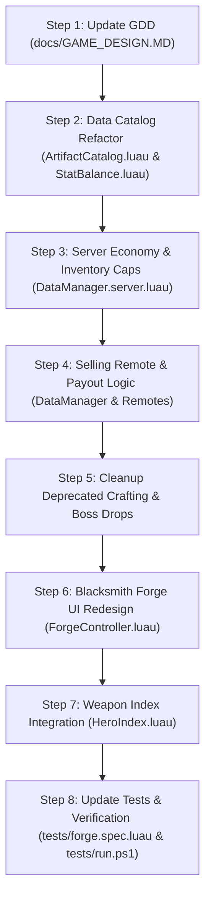

# Implementation Plan: Blacksmith Forge Roll System Redesign (Full 84-Weapon Matrix & Index Integration)

An architectural, economic, and visual redesign of the Blacksmith Forge Artifact Summoning system in *Infinite Tower*, transitioning from the legacy Gems/Crafting model into a pure Gold-driven Gacha economy with inherent rarity tiers, 1★ summon baselines, God's Blessing luck scaling, 50-item inventory limits, artifact liquidation (selling for Gold), 120-pull Exalted+ hard pity, a comprehensive **84-weapon roster** (2 artifacts per archetype per rarity tier), full **Weapon Index compendium integration** (`HeroIndex.luau`), banner catalog inspection, and complete removal of legacy crafting and boss-drop systems.

---

## 1. Executive Summary & Goals

| Core Area | Current State | Target Redesign |
| :--- | :--- | :--- |
| **Summon Currency** | Gems (160 / 1,600) | **Gold**: 5,000 Gold (1x) / 45,000 Gold (10x) (10% bulk discount) |
| **Summon Luck** | Applied to 4 star pools (`{ 0.50, 0.35, 0.12, 0.03 }`) | Fully integrated with **7 Rarity Tiers** via `SummonLuck.ApplyLuck` powered by God's Blessing |
| **Inventory Limits** | Unbounded table additions | **Hard cap of 50** for both Heroes and Artifacts (reject summons when full) |
| **Rolled Star Rank** | Dropped as 1★, 2★, 3★, 4★, or 5★ depending on seed | **All summoned artifacts drop at 1★**; star progression ($1★ \to 7★$) is exclusive to Forge duplicate promotion |
| **Artifact Roster** | 42 templates spread across 6 archetypes with crafting costs | **84 Weapons total**: Strictly **2 artifacts per archetype per rarity tier** (6 archetypes $\times$ 7 tiers $\times$ 2 variants: 1 Standard $1.00\times$ power, 1 Enhanced $1.20\times$ power) |
| **Weapon Index** | 42 hardcoded items tied to deprecated crafting recipe order | **Full 84-weapon compendium integration in `HeroIndex.luau`**: category tags (84 Total, 14 per Archetype), `CatalogOrder` sequence, live collection progress, and Forge Gacha acquisition display |
| **Banner Pity** | 50 pulls guaranteed 5★ weapon | **120 pulls guaranteed Exalted (Tier 5+) or higher** (matching Hero banner `MaxPity = 120`); 10-pull guarantees Rare (Tier 3+) |
| **Artifact Disposal** | None (only consumed as promotion donors) | **Sell for Gold** (single & multi-select liquidation) |
| **Banner Inspection** | Static banner visual with no in-engine odds sheet | **"View Artifacts" modal panel** with archetype & rarity tabs, displaying full catalog, live drop rates, and stat comparisons |
| **Legacy Code** | Crafting materials (`IronGear`, etc.), boss drops (`GrantBossArtifact`) | **Completely purged** from codebase, data models, remotes, and test suites |
| **Documentation** | GDD §7 still discusses Gems, 42 weapons, and boss drops | **GDD §4 & §7 fully updated** with new economy and rules |

---

## 2. Architecture & Data Schema Changes

### 2.1 Artifact Catalog Configuration (`ArtifactCatalog.luau`)

```
+----------------------------------------------------------------------------------------------------+
|                                    ARTIFACT CATALOG RESTRUCTURE                                     |
+----------------------------------------------------------------------------------------------------+
| Banner Config:                                                                                     |
|   Currency = "Gold"                                                                                |
|   Cost1X = 5,000                                                                                   |
|   Cost10X = 45,000 (10% bulk discount)                                                             |
|   MaxPity = 120 (Guarantees Exalted Tier 5+ or higher, matching Hero banner)                        |
|   PityRarity = 5 (Exalted)                                                                         |
|   BaseRarityRates = { 0.549, 0.250, 0.120, 0.055, 0.020, 0.005, 0.001 }                         |
|                                                                                                    |
| 84-Weapon Roster (6 Archetypes × 7 Tiers × 2 Variants):                                            |
|   • Standard Variant (1.00x Base Power / Standard ATK Speed)                                      |
|   • High-Stat Variant (1.20x Base Power / +2.0% to +5.0% bonus ATK Speed)                           |
|   • Archetypes: Vanguard, Striker, Marksman, Miner, Scholar, Healer                                |
|   • Master CatalogOrder: Ordered array of all 84 seed keys for Index & UI enumeration              |
|                                                                                                    |
| Purged Legacy Tables:                                                                              |
|   ❌ CraftingMaterials (IronGear, RiftOrb, AegisGem, StarDust, VoidPowder)                          |
|   ❌ CraftCost properties on seeds                                                                 |
|   ❌ CraftingRecipeOrder list (replaced by CatalogOrder)                                          |
|   ❌ Variable DefaultStar (all normalized to 1)                                                    |
+----------------------------------------------------------------------------------------------------+
```

#### New Seed Schema
```luau
export type ArtifactSeed = {
    TemplateId: string,
    DisplayName: string,
    Type: WeaponType,           -- "BOW" | "SWORD_SHIELD" | "DAGGERS" | "AXE" | "TOME" | "STAFF"
    RarityTier: number,         -- 1 (Common) to 7 (Mythical)
    IsHighStat: boolean,        -- true if the enhanced variant of this tier
    StatMultiplier: number,     -- 1.00 for standard, 1.20 for high-stat variant
    SpeedBonusAdditive: number, -- Flat additive attack speed bonus (e.g. +0.03 = +3%)
    ModelAssetId: string,       -- Reference key in ReplicatedStorage.Assets.Weapons
    Description: string,        -- Lore and aesthetic profile
}
```

### 2.2 Inventory Baseline Limits (50 Heroes / 50 Artifacts)
- **Constants** (`StatBalance.luau`):
  - `StatBalance.MaxHeroInventory = 50`
  - `StatBalance.MaxArtifactInventory = 50`
- **Server Enforcement (`DataManager.server.luau`)**:
  - `RequestSummonFunc` (Heroes): Pre-flight check `countCurrentHeroes(profile) + pullCount <= 50`. If exceeded, reject transaction with toast: `"Hero inventory full! Maximum capacity is 50."`
  - `DataManager.SummonArtifact`: Pre-flight check `countCurrentArtifacts(profile) + pullCount <= 50`. If exceeded, reject transaction with toast: `"Artifact inventory full! Maximum capacity is 50."`
- **Client UI Feedback**:
  - Forge HUD shows dynamic capacity pill: `Artifacts: X / 50`. Turns amber at $\ge 45$, red at $50$. Summon buttons are disabled with tooltip when full.

---

## 3. Rarity-Based Gacha, God's Blessing & 120-Pull Exalted+ Pity

### 3.1 Base Drop Chances & Pity Contract

| Rarity Tier | Name | Base Probability | 10-Pull Guarantee | 120-Pull Hard Pity |
| :---: | :--- | :---: | :---: | :---: |
| **Tier 1** | **Common** | `54.9%` (0.549) | Ineligible | Ineligible |
| **Tier 2** | **Uncommon** | `25.0%` (0.250) | Ineligible | Ineligible |
| **Tier 3** | **Rare** | `12.0%` (0.120) | Guaranteed minimum if no $\ge$ Tier 3 in pull 1–9 | Ineligible |
| **Tier 4** | **Superior** | `5.5%` (0.055) | Eligible | Ineligible |
| **Tier 5** | **Exalted** | `2.0%` (0.020) | Eligible | **100% Guaranteed on 120th pull** (resets pity) |
| **Tier 6** | **Legendary** | `0.5%` (0.005) | Eligible | Eligible (resets pity) |
| **Tier 7** | **Mythical** | `0.1%` (0.001) | Eligible | Eligible (resets pity) |

### 3.2 God's Blessing Summon Luck Integration
Summon luck from assigned Acolytes in God's Blessing is calculated via `DataManager.GetSummonLuck(player)` / `SummonLuck.ForProfile(profile)`.
- Base rates are dynamically adjusted via `SummonLuck.ApplyLuck`:
  $$\text{BoostedRate}_i = \text{BaseRate}_i \times (1 + \text{Luck}) \quad \text{for } i \in [2, 7]$$
  $$\text{CommonRate} = \max\left(0, 1 - \sum_{i=2}^{7} \text{BoostedRate}_i\right)$$
- **120-Pull Hard Pity Enforcement**:
  - If `profile.ArtifactBannerPity >= 120`, the roll is clamped to Tier 5 (Exalted), Tier 6 (Legendary), or Tier 7 (Mythical) using their relative weights ($\approx 76.9\%$ Exalted, $19.2\%$ Legendary, $3.9\%$ Mythical).
  - Any natural or pity pull of an **Exalted (Tier 5), Legendary (Tier 6), or Mythical (Tier 7)** artifact resets `profile.ArtifactBannerPity` to `0`.
- **10-Pull Guarantee**:
  - `SummonLuck.RollAtLeast(rates, 3, math.random())` guarantees at least one Rare (Tier 3) or higher within a 10-pull batch if none rolled in pulls 1–9.

### 3.3 Two-Stage Roll Selection (Rarity -> Archetype -> Variant)
Once a pull is initiated:
1. **Rarity Roll**: Roll tier $T \in [1, 7]$ (incorporating luck, 10-pull guarantee, or 120-pull pity).
2. **Archetype Roll**: Uniformly select one of the 6 archetypes ($1/6$ chance each: Vanguard, Striker, Marksman, Miner, Scholar, Healer).
3. **Variant Roll**: Between the 2 artifacts defined for $(T, \text{Archetype})$:
   - **Standard Variant ($1.00\times$)**: `60%` chance
   - **Enhanced High-Stat Variant ($1.20\times$)**: `40%` chance
4. **Instantiate**: Create artifact at **1★** with inherent `Rarity = T`, `IsHighStat`, and `StatMultiplier`.

---

## 4. Artifact Liquidation System (Selling for Gold)

To prevent players from hitting the 50-item inventory cap and to establish an active Gold recycling loop, an explicit **Sell Artifacts** mechanism is implemented.

### 4.1 Sell Payout Valuation

| Rarity Tier | 1★ Base Sell Price | 2★ (1 donor) | 3★ (3 donors) | 4★ (6 donors) | 5★ (10 donors) | 6★ (15 donors) | 7★ (21 donors) |
| :--- | :---: | :---: | :---: | :---: | :---: | :---: | :---: |
| **Common (1)** | **1,000 Gold** | 1,500 Gold | 2,500 Gold | 4,500 Gold | 8,000 Gold | 14,000 Gold | 25,000 Gold |
| **Uncommon (2)**| **2,500 Gold** | 3,750 Gold | 6,250 Gold | 11,250 Gold | 20,000 Gold | 35,000 Gold | 60,000 Gold |
| **Rare (3)** | **6,000 Gold** | 9,000 Gold | 15,000 Gold | 27,000 Gold | 48,000 Gold | 84,000 Gold | 150,000 Gold |
| **Superior (4)**| **15,000 Gold**| 22,500 Gold | 37,500 Gold | 67,500 Gold | 120,000 Gold| 210,000 Gold| 375,000 Gold |
| **Exalted (5)** | **40,000 Gold**| 60,000 Gold | 100,000 Gold| 180,000 Gold| 320,000 Gold| 560,000 Gold| 1,000,000 Gold |
| **Legendary (6)**|**100,000 Gold**| 150,000 Gold| 250,000 Gold| 450,000 Gold| 800,000 Gold| 1,400,000 Gold| 2,500,000 Gold |
| **Mythical (7)**| **300,000 Gold**| 450,000 Gold| 750,000 Gold| 1,350,000 Gold| 2,400,000 Gold| 4,200,000 Gold| 7,500,000 Gold |

$$\text{SellPrice}(\text{Rarity}, \text{Star}) = \text{BasePrice}(\text{Rarity}) \times (1 + 0.5 \times (\text{Star} - 1))$$

### 4.2 Security Guards
- **Equipped Guard**: An artifact currently equipped to a hero (`artifact.EquippedHeroUUID ~= nil`) cannot be selected or sold.
- **Lock Guard**: An artifact marked as favorite/locked (`artifact.Locked == true`) cannot be selected or sold.
- **Atomic Execution**: Multiple artifacts are sold in one atomic transaction under the session lock; missing or foreign UUIDs safely fail without mutating data.
- **Remote Endpoint**: `RequestSellArtifactsFunc.OnServerInvoke(player, { uuid1, uuid2, ... })` returning `(success, message, goldEarned)`.

---

## 5. UI / UX Redesign in Blacksmith Forge & Weapon Index

### 5.1 Blacksmith Forge HUD (`ForgeController.luau`)
1. **Currency Display**:
   - Single Pull: `5,000 Gold` (Gold coin icon, formatted value).
   - 10-Pull: `45,000 Gold` (Gold coin icon, `"SAVE 10%"` badge).
2. **Pity Label & Track**:
   - Updates text to: `"Guaranteed Exalted+ in: <b>%d</b> summons"`.
   - Track fills from $0 \to 120$ (matching Hero Limited Banner).
3. **"View Artifacts" Catalog & Odds Sheet Modal**:
   - Header with active God's Blessing luck multiplier (`+X.X% Luck Active`).
   - Archetype filter chips: `[ALL] [VANGUARD] [STRIKER] [MARKSMAN] [MINER] [SCHOLAR] [HEALER]`.
   - Rarity breakdown showing exact drop rates and side-by-side Standard vs. Enhanced cards with lore.
4. **Assign Tab Sell Mode**:
   - Dynamic inventory capacity pill: `Artifacts: X / 50`.
   - `"SELL ARTIFACTS"` selection mode enabling multi-select liquidation for Gold.

### 5.2 Weapon Index Compendium (`HeroIndex.luau`)
The client compendium (`HeroIndex.luau`) is updated to register all 84 weapons:
1. **Category Headers & Counts**:
   - `ALL`: `Tag = "MASTER CATALOG · 84 WEAPONS"`
   - `SWORD_SHIELD`: `Tag = "VANGUARD · 14 WEAPONS"`
   - `DAGGERS`: `Tag = "STRIKER · 14 WEAPONS"`
   - `AXE`: `Tag = "MINER · 14 WEAPONS"`
   - `BOW`: `Tag = "MARKSMAN · 14 WEAPONS"`
   - `STAFF`: `Tag = "SCHOLAR · 14 WEAPONS"`
   - `TOME`: `Tag = "HEALER · 14 WEAPONS"`
   - `BANNER`: `Tag = "ARTIFACT GACHA · 84 WEAPONS"`
2. **Catalog Enumeration**:
   - Switches `weaponsOfCategory` from iterating `CraftingRecipeOrder` to iterating `ArtifactCatalog.CatalogOrder` (listing all 84 keys in structured order).
3. **Card & Detail Rendering**:
   - Uses `seed.RarityTier` for rarity badge and theme colors (`ArtifactCatalog.GetRarityInfo(seed.RarityTier)`).
   - Card displays: `"Common · Standard"`, `"Exalted · Enhanced (+20%)"`, etc.
   - Replaces the legacy "FORGE CRAFTING COST" section with:
     `weaponDetail.Acquisition = section(5, "ACQUISITION", "Blacksmith Forge Gacha (5,000 Gold)", 46)`.
4. **Collection Counter**:
   - Correctly reports: `Collected X / 84 weapons` with progress bar fill.

---

## 6. The Complete 84-Weapon Roster (2 per Archetype per Rarity)

The roster defines exactly **2 artifacts per archetype for every rarity tier** ($6 \times 7 \times 2 = 84$ weapons), ensuring that every single hero class has immediate weapon options at every progression milestone.

---

### Tier 1: Common (`#B0B0B0`) — 54.9% Base Rate
*Base Stats: Standard = 20 Power, $+5.0\%$ ATK SPD | Enhanced = 24 Power, $+6.0\%$ ATK SPD*

1. **Vanguard (`SWORD_SHIELD`)**:
   - **Standard: Iron Broadsword**: Utilitarian cast-grey iron blade with rough fuller hammer marks and wooden corner-banded heater shield.
   - **Enhanced: Tempered Bastard Sword**: Double-quenched carbon steel blade with fluted crossguard and reinforced steel buckler.
2. **Striker (`DAGGERS`)**:
   - **Standard: Rogue Daggers**: Pair of simple drop-point trench daggers with leather cord wraps and blackened tips.
   - **Enhanced: Serrated Skewers**: Deeply serrated butchering daggers with curved knuckle rings and brass pommel weights.
3. **Marksman (`BOW`)**:
   - **Standard: Hunter's Shortbow**: Lightweight curved yew hunting bow with waxed hemp string and smooth ash grip.
   - **Enhanced: Reinforced Yew Longbow**: Stouter yew stave backed with cured tendon cordage, firing heavy field arrows.
4. **Miner (`AXE`)**:
   - **Standard: Prospector's Cleaver**: Wedge-profile industrial steel axe with beveled cutting bevel and pick spike butt.
   - **Enhanced: Heavy Hewing Axe**: Broad-faced logging axe with hardened wedge bit and counter-weighted iron poll.
5. **Scholar (`STAFF`)**:
   - **Standard: Apprentice Wand-Staff**: Slender birch rod with polished copper socket holding cloudy river quartz focus.
   - **Enhanced: Scholar's Spire**: Carved rowan staff banded with brass astrological markings and faceted amber focus.
6. **Healer (`TOME`)**:
   - **Standard: Novice Prayerbook**: Pocket calfskin booklet inscribed with foundational cleansing scriptures and linen clasp.
   - **Enhanced: Acolyte's Litany**: Embossed pigskin codex with stamped brass corner fittings and soothing verse marginalia.

---

### Tier 2: Uncommon (`#4BB543`) — 25.0% Base Rate
*Base Stats: Standard = 60 Power, $+7.5\%$ ATK SPD | Enhanced = 72 Power, $+9.0\%$ ATK SPD*

7. **Vanguard (`SWORD_SHIELD`)**:
   - **Standard: Runic Longsword**: Cobalt-treated steel knightly blade etched with faint emerald rune grooves and matching runic pavise.
   - **Enhanced: Knightly Estoc**: Needle-pointed triangular thrusting sword with full basket hilt and convex teardrop kite shield.
8. **Striker (`DAGGERS`)**:
   - **Standard: Viper Kris**: Flamboyant serpentine wavy-bladed daggers tipped with emerald venom gloss and snake-eye brass hilts.
   - **Enhanced: Silent Dirk Pair**: Needle-point stiletto dirks with non-reflective blued steel blades and lead-dampened guards.
9. **Marksman (`BOW`)**:
   - **Standard: Wind-Scout Recurve**: Slender composite recurve layered with pale ashwood, horn tips, and falcon feather accents.
   - **Enhanced: Gale-Force Composite**: Deeply reflexed composite bow bound in emerald silk sinew with carved ivory riser tips.
10. **Miner (`AXE`)**:
    - **Standard: Canyon Splitter**: Heavy dwarven wedge axe with raw amethyst geode chips embedded into the spine.
    - **Enhanced: Quakestone Greataxe**: Broad bearded mining axe forged of grey granite-tempered steel with hexagonal brass shaft.
11. **Scholar (`STAFF`)**:
    - **Standard: Ruby Channeling Staff**: Polished hickory staff holding an uncut igneous crystal head that amplifies casting cadence.
    - **Enhanced: Pyromancer's Torch-Rod**: Dark iron rod terminating in an open-caged brazier casting continual fiery ember wisps.
12. **Healer (`TOME`)**:
    - **Standard: Cleric Scripture**: White calfskin volume with silver-embossed holy wards and trailing azure silk bookmark ribbons.
    - **Enhanced: Mendicant's Psalter**: Gold-leafed prayerbook with illuminated margins depicting dawn light and soothing aura petals.

---

### Tier 3: Rare (`#2980B9`) — 12.0% Base Rate
*Base Stats: Standard = 180 Power, $+10.0\%$ ATK SPD | Enhanced = 216 Power, $+12.0\%$ ATK SPD*

13. **Vanguard (`SWORD_SHIELD`)**:
    - **Standard: Paladin Spatha**: Noble chivalric broadsword with winged crossguard and radiant sun-crested heater shield.
    - **Enhanced: Vanguard Warden Bastion**: Heavy tower-blade with full-length blood channel and massive scalloped fortress shield.
14. **Striker (`DAGGERS`)**:
    - **Standard: Shadow Fangs**: Twin obsidian stilettos trailing purple-black abyssal smoke, set in skeletal dragon-rib hilts.
    - **Enhanced: Phantom Stiletto**: Translucent spirit-glass blades that blur into ethereal silhouettes during rapid thrusts.
15. **Marksman (`BOW`)**:
    - **Standard: Stormstrider Longbow**: Tall elven recurve inlaid with storm-silver alloy and eagle-wing riser accents.
    - **Enhanced: Thunderhead Recurve**: Taut recurve wrapped in coiled copper lightning wires that discharge spark showers on draw.
16. **Miner (`AXE`)**:
    - **Standard: Warforged Battleaxe**: Symmetrical twin-bearded dwarven axe forged from dark gunmetal iron with bronze geometric inlays.
    - **Enhanced: Iron-Juggernaut Cleaver**: Asymmetrical slab-iron executioner axe with heavy boiler-plate rivets and counterbalance hammer.
17. **Scholar (`STAFF`)**:
    - **Standard: Frostweaver Scepter**: Pale driftwood staff crowned with an intricate snowflake crystal radiating drifting frost mist.
    - **Enhanced: Glacial Monolith**: Translucent blue glacial ice rod suspended with floating frost-rime shards orbiting the crown.
18. **Healer (`TOME`)**:
    - **Standard: Hermetic Grimoire**: Aged midnight-blue velvet book bound in wrought-iron brackets with a glowing alchemy circle.
    - **Enhanced: Restorative Codex**: Embossed silver-leaf volume that floats open, turning pages automatically upon mana contact.

---

### Tier 4: Superior (`#8E44AD`) — 5.5% Base Rate
*Base Stats: Standard = 540 Power, $+13.0\%$ ATK SPD | Enhanced = 648 Power, $+15.0\%$ ATK SPD*

19. **Vanguard (`SWORD_SHIELD`)**:
    - **Standard: Crystal Claymore**: Translucent amethyst-bladed greatsword paired with an interlocking prismatic crystal barrier.
    - **Enhanced: Resonant Bulwark**: Vibrating sonic steel broadsword with an acoustic hexagonal aegis that deflects kinetic blows.
20. **Striker (`DAGGERS`)**:
    - **Standard: Phantom Edge**: Semitransparent spirit glass daggers with ornate filigree crossguards and phase-strike luminescence.
    - **Enhanced: Nightstalker Katar**: Punching katars forged of black meteoric iron with dual glowing violet plasma edges.
21. **Marksman (`BOW`)**:
    - **Standard: Crystal Greatbow**: Towering prismatic mana-quartz bow with condensed cerulean mana string that hums melodically.
    - **Enhanced: Prismatic Arbalest**: Intricate crystal-limbed mechanical greatbow with floating mana focus sights.
22. **Miner (`AXE`)**:
    - **Standard: Magma Cleaver**: Volcanic black basalt axe head fractured with molten lava veins and an obsidian counter-spike.
    - **Enhanced: Obsidian Hell-Splitter**: Solid jagged volcanic glass double axe billowing white sulfur smoke along its searing edge.
23. **Scholar (`STAFF`)**:
    - **Standard: Archmage Caduceus**: Petrified ebony wood staff with entwined brass serpents suspending a hovering multi-faceted arcane prism.
    - **Enhanced: Chronomancer's Spindle**: Ornate brass clockwork staff with spinning interlocking astrolabe gears around a quartz core.
24. **Healer (`TOME`)**:
    - **Standard: Sanctuary Gospel**: Valeria's signature grimoire style: Gold-leaf spine with emerald centerpiece emitting restorative motes.
    - **Enhanced: Seraph's Testament**: Gilded cathedral tome whose pages radiate warm golden feathered halos when healing spells are cast.

---

### Tier 5: Exalted (`#D35400`) — 2.0% Base Rate (Hard Pity Target)
*Base Stats: Standard = 1,400 Power, $+16.5\%$ ATK SPD | Enhanced = 1,680 Power, $+18.5\%$ ATK SPD*

25. **Vanguard (`SWORD_SHIELD`)**:
    - **Standard: Holy Claymore**: Consecrated white-silver executioner sword with angelic wing quillons and radiant sunburst kite shield.
    - **Enhanced: Aegis of Valor**: Gilded royal arming sword paired with an incandescent solar shield projecting humming barrier domes.
26. **Striker (`DAGGERS`)**:
    - **Standard: Bloodthirst Twinblades**: Jagged crimson Damascus demonic falchions with arterial filigree dripping phantom blood embers.
    - **Enhanced: Crimson Carnage**: Asymmetrical curved demonic scythe-daggers forged of living bone that thrum with predatory frenzy.
27. **Marksman (`BOW`)**:
    - **Standard: Phoenix Greatbow**: Swept crimson-gold limbs sculpted like flaming phoenix wings emitting rippling heat shimmers.
    - **Enhanced: Solar Flare Recurve**: Blinding incandescent bow with floating corona rings that materializes searing sunlight javelins.
28. **Miner (`AXE`)**:
    - **Standard: Titan Earthshaker**: Monumental runic double axe with dwarven runes pulsing seismic tremors across the earth.
    - **Enhanced: Mountain Breaker**: Massive monolithic stone-and-gold greataxe that fissures the bedrock with localized shockwaves.
29. **Scholar (`STAFF`)**:
    - **Standard: Pillar of Muspelheim**: Dark iron battle-staff with open caged brazier containing an eternal roiling miniature flame star.
    - **Enhanced: Void Channeler**: Abyssal black-stone staff crowned with a miniature gravitational singularity dragging light inward.
30. **Healer (`TOME`)**:
    - **Standard: Codex of the Deep**: Aged forbidden leather tome with an iridescent demonic eye on the cover that blinks rhythmically.
    - **Enhanced: Lifebinder's Chronicle**: Living wooden-covered grimoire entwined with blooming sacred vines that shed luminescent pollen.

---

### Tier 6: Legendary (`#F1C40F`) — 0.5% Base Rate (Hard Pity Eligible)
*Base Stats: Standard = 3,500 Power, $+20.0\%$ ATK SPD | Enhanced = 4,200 Power, $+22.5\%$ ATK SPD*

31. **Vanguard (`SWORD_SHIELD`)**:
    - **Standard: Blade of the Rift**: Dimensional cosmic glass blade swirling with inner nebula stars and antique cathedral portal shield.
    - **Enhanced: Aegis Core**: Hexagonal floating segmented gold plates orbiting a hyper-dense glowing rift power core.
32. **Striker (`DAGGERS`)**:
    - **Standard: Eclipse Daggers**: Opposing celestial twins: one forged of lunar silver, one of solar gold, with crescent eclipse guards.
    - **Enhanced: Abyssal Razor**: Void-matter shadow daggers that leave pitch-black cuts suspended in three-dimensional space.
33. **Marksman (`BOW`)**:
    - **Standard: Celestial Zenith**: Pristine white marble and polished gold riser with floating orbital ring sights and starlight string.
    - **Enhanced: Supernova Greatbow**: Colossal cosmic recurve radiating stellar flares that nocks superheated fusion plasma bolts.
34. **Miner (`AXE`)**:
    - **Standard: Valkyrie Waraxe**: Elegant winged golden waraxe with braided platinum shaft and cyan celestial teardrop gems.
    - **Enhanced: World Shaper**: Mythic foundry greataxe with burning celestial brass conduits and an anti-gravity core.
35. **Scholar (`STAFF`)**:
    - **Standard: Solaris Sun Scepter**: Golden solar eclipse crown with rotating orbital rings suspending an incandescent sun core.
    - **Enhanced: Chronos Time-Weft**: Complex astronomical clockwork mechanism rotating in 3D around an unmoving time singularity.
36. **Healer (`TOME`)**:
    - **Standard: Seraphic Liturgy**: Heavy gilded cathedral tome that floats opened with radiating translucent golden wings extending from the spine.
    - **Enhanced: Divine Providence**: Radiant crystalline codex made of prism diamond leaves that project prismatic restorative beams.

---

### Tier 7: Mythical (`#E74C3C`) — 0.1% Base Rate (Hard Pity Eligible)
*Base Stats: Standard = 7,000 Power, $+30.0\%$ ATK SPD | Enhanced = 8,400 Power, $+35.0\%$ ATK SPD*

37. **Vanguard (`SWORD_SHIELD`)**:
    - **Standard: Astral Executioner**: Starlight alloy chisel-tipped blade with constellation runes and monolithic starry mirror shield.
    - **Enhanced: Worldbreaker Bastion**: Colossal cosmic bastion forged from a collapsed star; gravitational lensing warps space around its rim.
38. **Striker (`DAGGERS`)**:
    - **Standard: Abyssal Ravagers**: Floating dark-matter phantom daggers tethered by purple lightning arcs around the hero's wrists.
    - **Enhanced: Void Reapers**: Twin rift scythe-daggers that slice through the fabric of dimensions, leaving tearing cosmic rifts.
39. **Marksman (`BOW`)**:
    - **Standard: Cosmic Sagittarius**: Astrea's pinnacle relic: stave formed of pure starlight constellation lines; nocks pure energy lances.
    - **Enhanced: Infinity Bow of Genesis**: Transcendent cosmic arc whose string is a beam of creation light, firing arrows that warp space-time.
40. **Miner (`AXE`)**:
    - **Standard: World Carver**: Monolithic dark-matter greataxe crackling with rift lightning that leaves trailing space rifts when swung.
    - **Enhanced: Genesis Sunderer**: Colossal primordial axe infused with the spark of planetary creation; seismic ripples shatter reality.
41. **Scholar (`STAFF`)**:
    - **Standard: Eye of the Singularity**: Stave of black cosmic glass culminating in an event horizon core that bends ambient light.
    - **Enhanced: Omega Archon Caduceus**: Primordial staff crowned by an uncoiling infinity loop of cosmic plasma, channeling raw arcane genesis.
42. **Healer (`TOME`)**:
    - **Standard: Akashic Infinity**: Boundless astral codex without covers: floating holographic tablets orbiting an ethereal singularity.
    - **Enhanced: Book of Primordial Genesis**: Transcendent scripture of life itself, written in eternal light that resurrects fallen allies and grants immortality.

---

## 7. Deprecation & Cleanup Plan

### 7.1 Unused Code Removal
1. **Crafting Materials & Costs**:
   - Delete `CraftingMaterials` dictionary from `src/ReplicatedStorage/Shared/Config/ArtifactCatalog.luau`.
   - Remove `CraftCost` property from `ArtifactSeed` type and all seed definitions.
   - Replace `ArtifactCatalog.CraftingRecipeOrder` with `ArtifactCatalog.CatalogOrder`.
   - Remove `RequestCraftArtifactFunc` and `DataManager.CraftArtifact` in `src/ServerScriptService/Core/DataManager.server.luau`.
   - Remove `self.RequestCraft` in `src/StarterPlayerScripts/UI/ForgeController.luau`.
   - Update `HeroIndex.luau` to display `"Obtained via Blacksmith Forge Summons (Gold)"` instead of crafting cost.
2. **Guaranteed Boss Artifact Drops**:
   - Remove `DataManager.GrantBossArtifact` in `src/ServerScriptService/Core/DataManager.server.luau`.
   - Remove `TowerProgress.BossArtifactRarity` in `src/ReplicatedStorage/Shared/Util/TowerProgress.luau`.
   - Remove boss artifact drop hook in `src/ServerScriptService/Combat/CombatSimulation.server.luau` line 2750 (`if firstBiomeClear and dm.GrantBossArtifact then ... end`).
3. **Test Suite Modernization**:
   - Refactor `tests/forge.spec.luau`: Replace recipe/crafting tests with tests for Gold pricing (5k/45k), 84-weapon roster verification (2 per archetype per rarity tier), `CatalogOrder` completeness, 1★ baseline, stat multiplier variance, 120-pull Exalted+ pity, and selling calculations.
   - Update `tests/tower-run-loop.spec.luau`: Remove `BossArtifactRarity` assertions.

---

## 8. Game Design Document (GDD) Updates

The following sections of `docs/GAME_DESIGN.MD` will be revised:
- **Section 4.3 (God's Blessing Facility)**: Clarify that summon luck directly scales the 7 artifact rarity tiers on the Gold banner.
- **Section 7.1 & 7.2 (Artifact Acquisition & Rarity Tiers)**:
  - Document that artifacts are **never crafted** and **only summoned** with Gold (5,000 / 45,000).
  - Detail the **full 84-weapon catalog structure** (2 weapons per archetype per rarity tier across all 7 launch tiers), standard ($1.00\times$) and enhanced ($1.20\times$) stat variants.
  - Document compendium indexing across all 84 weapons in the Weapon Index.
  - State the **50-item inventory cap** on both heroes and artifacts.
  - Define the **Artifact Selling schedule** for Gold liquidation.
- **Section 7.3 (Weapon Star Promotion)**: Reiterate that all weapons drop at 1★ and ascend through $1★ \to 7★$ exclusively via duplicate consumption.
- **Section 7.4 (Artifact Banner)**: Replace the old Gem costs with Gold, document the **120-pull Exalted+ rarity pity** (matching the Hero Limited Banner), 10-pull Rare guarantee, and God's Blessing luck formula. Remove biome boss milestone gear drops.

---

## 9. Step-by-Step Implementation Sequence



1. **Step 1: Update the Game Design Document (`docs/GAME_DESIGN.MD`)**:
   - Update Sections 2, 4.3, 7.1, 7.2, 7.3, and 7.4.
   - Authoritatively document:
     - Gold summon costs: 5,000 Gold (1x) / 45,000 Gold (10x).
     - 120-pull hard pity guaranteeing Exalted (Tier 5) or higher (matching Hero Limited Banner).
     - Full 84-weapon matrix: 2 artifacts per archetype for each of the 7 launch rarity tiers (1 Standard $1.00\times$, 1 Enhanced $1.20\times$).
     - 50-item baseline inventory caps for both Heroes and Artifacts.
     - Artifact Selling liquidation for Gold.
     - 1★ universal drop baseline (all promotion occurs through duplicate consumption at the Forge).
     - Full Weapon Index compendium integration.
     - Removal of legacy crafting materials, recipe tables, and biome boss milestone weapon drops.
2. **Step 2: Data Model & Catalog Refactor (`ArtifactCatalog.luau` & `StatBalance.luau`)**:
   - Update `StatBalance`: `MaxHeroInventory = 50`, `MaxArtifactInventory = 50`.
   - Update `ArtifactCatalog.Banner`: `Cost1X = 5000`, `Cost10X = 45000`, `Currency = "Gold"`, `MaxPity = 120`, `PityRarity = 5` (Exalted).
   - Define the complete 84-weapon `Seeds` catalog (2 artifacts per archetype for each of the 7 rarity tiers), each configured with `IsHighStat`, `StatMultiplier = 1.00` or `1.20`, and `SpeedBonusAdditive`.
   - Expose `ArtifactCatalog.CatalogOrder`: Array of all 84 seed IDs.
   - Update `GetStatBreakdown` to multiply power by `seed.StatMultiplier`.
   - Purge `CraftingMaterials` and `CraftCost`.
3. **Step 3: Server Summoning & Inventory Cap (`DataManager.server.luau`)**:
   - Enforce 50-item inventory cap for Heroes (`RequestSummonFunc`) and Artifacts (`SummonArtifact`).
   - Refactor `DataManager.SummonArtifact`:
     - Deduct Gold (5,000 / 45,000).
     - Scale 7 rarity tiers with `SummonLuck.ApplyLuck`.
     - Implement 10-pull guarantee (Rare+) and 120-pull hard pity (Exalted+).
     - Reset pity counter to 0 on any Exalted, Legendary, or Mythical pull.
     - Roll archetype (1 of 6), then roll variant (60% Standard / 40% HighStat).
     - Spawn all artifacts with `Star = 1`.
4. **Step 4: Selling Endpoint**:
   - Add `RequestSellArtifacts` remote in `ArtifactRemotes`.
   - Implement `DataManager.SellArtifacts` with lock/equipped validations and Gold credit.
5. **Step 5: Codebase Cleanup**:
   - Delete `CraftArtifact`, `GrantBossArtifact`, and `TowerProgress.BossArtifactRarity`.
   - Clean call sites in `CombatSimulation.server.luau`, `HeroIndex.luau`, `BackpackModel.luau`.
6. **Step 6: Forge UI Overhaul (`ForgeController.luau`)**:
   - Update Summon buttons to Gold (5,000 / 45,000).
   - Update Pity counter to display Exalted+ rarity countdown (`X / 120`).
   - Build `"VIEW ARTIFACTS"` catalog & drop-rate subpanel modal with Archetype tabs and Standard vs. Enhanced comparisons.
   - Add Sell button, multi-select checkboxes, and capacity pill (`X / 50`) to Assign tab.
7. **Step 7: Weapon Index Integration (`HeroIndex.luau`)**:
   - Update `WEAPON_CATEGORIES` tags (84 Total, 14 per Archetype).
   - Wire `weaponsOfCategory` to `ArtifactCatalog.CatalogOrder`.
   - Render rarity and variant badge (`"Common · Standard"`, `"Mythical · Enhanced"`).
   - Update detail acquisition to `"Blacksmith Forge Gacha (5,000 Gold)"`.
8. **Step 8: Test Suite & Rojo Build**:
   - Update `tests/forge.spec.luau` and `tests/tower-run-loop.spec.luau`.
   - Run `powershell -File tests/run.ps1` to ensure 100% PASS and clean bytecode compilation.
   - Run `rojo build -o build.rbxl`.

---

## 10. Verification Checklist

- [x] `powershell -File tests/run.ps1` compiles and all tests pass with 0 errors.
- [x] Attempting 1x summon with $< 5,000$ Gold fails with insufficient Gold toast.
- [x] Attempting 10x summon with $< 45,000$ Gold fails with insufficient Gold toast.
- [x] Summoning with $\ge 50$ artifacts or $\ge 50$ heroes is rejected with inventory full toast.
- [x] Every summoned weapon has `Star == 1`.
- [x] Every rolled weapon belongs to the 84-item roster with correct rarity, archetype, and stat multiplier.
- [x] Every archetype has exactly 2 artifacts per rarity tier (1 Standard, 1 Enhanced).
- [x] 120th pull without an Exalted+ guarantees a Tier 5 (Exalted), Tier 6 (Legendary), or Tier 7 (Mythical) artifact and resets pity.
- [x] Natural pull of Exalted, Legendary, or Mythical resets pity to 0.
- [x] Selling an unequipped artifact removes it and credits exact Gold.
- [x] Equipped and locked artifacts cannot be selected or sold.
- [x] "View Artifacts" modal opens, allows archetype filtering, renders all 7 tiers with live percentages, and displays both variants per archetype with concept descriptions.
- [x] `HeroIndex.luau` lists all 84 weapons across the All and 6 Archetype categories with correct 14-item tags and collection counts.
- [x] `rojo build -o build.rbxl` executes with code 0.
