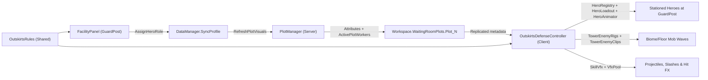
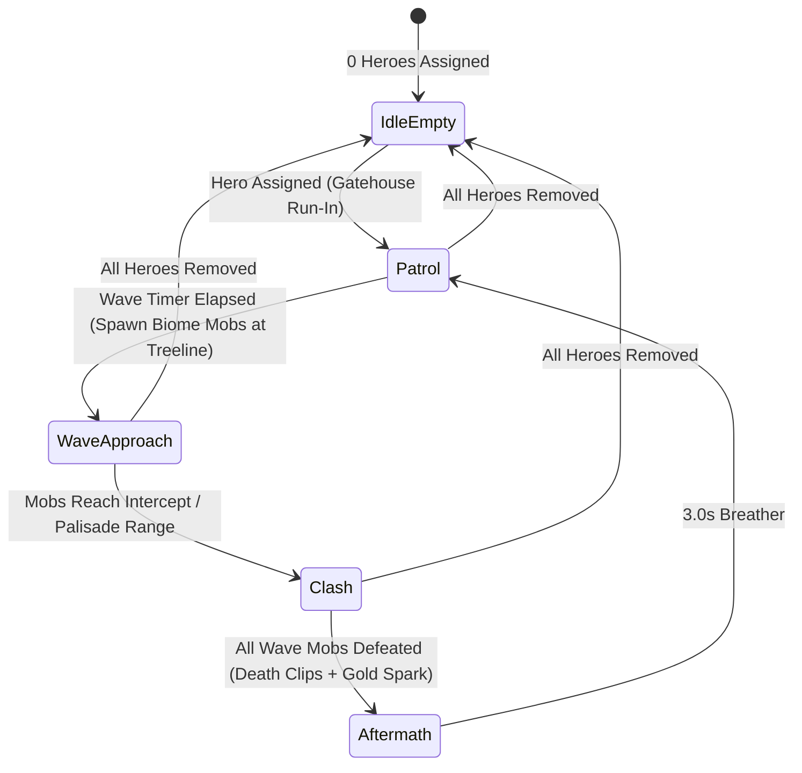

# Outskirts Guard Post: Live Hero Presence, Loop Animations & Floor/Biome Mob Waves

## Goal & Root-Cause Context

When players assign heroes to the **Outskirts Guard Post**, assigned Adventurers should:
1. Play **looping assignment/combat visuals** (both immediately in the Guard Post assignment UI and continuously in the 3D world).
2. **Physically and visually appear in the Outskirts plot** around `Building_GuardPost` as full costumed R15 hero rigs carrying their equipped weapons.
3. Defend the **Outskirts Guard Post** against **repeating waves of mobs marching from the wilderness treeline** toward the building, with mob species/rigs dynamically selected from the player's **highest Tower floor / biome**.

> [!IMPORTANT]
> **Why nothing currently appears in the Outskirts:**
> - [`AdventurerPatrolController.client.luau`](../src/StarterPlayerScripts/Rendering/AdventurerPatrolController.client.luau) reads `_G.DataManager.GetProfile(LocalPlayer)` on the client, which is always `nil` (`_G.DataManager` is server-only in [`DataManager.server.luau`](../src/ServerScriptService/Core/DataManager.server.luau)).
> - Even if given profile data, its prototype code only built placeholder block/ball primitives (`createAdventurerRig` / `spawnAmbientCritter`), missed the `-70` Z courtyard origin offset used by [`PlotBuildings.luau`](../src/ServerScriptService/Core/PlotBuildings.luau) on `260 × 320` islands, and never rendered other players' plots.
> - [`PlotManager.server.luau`](../src/ServerScriptService/Core/PlotManager.server.luau) creates `Plot_N.ActivePlotWorkers` and immediately calls `ClearAllChildren()` without populating worker or floor metadata.

---

## Architecture Overview

> [!TIP]
> **Client-Rendered Simulation, Server-Replicated Descriptors:**
> The server replicates only lightweight attributes on `Plot_N` and `Configuration` children under `Plot_N.ActivePlotWorkers` whenever assignments or floor clears change. All 3D rigs, `Motor6D` animations, projectiles, and wave state machines run **100% client-side** (distance-throttled and culled while inside Tower floors), preserving zero server physics/Humanoid overhead and never draining hero Stamina (GDD §2.4), while allowing **both the plot owner and visiting Masters** to watch any plot's Outskirts defense live.

---

## Proposed Changes

### 1. Shared Frontier & Wave Rules (`ReplicatedStorage/Shared/Util`)

#### [NEW] `src/ReplicatedStorage/Shared/Util/OutskirtsRules.luau`
Pure, deterministic helper module (no `Workspace` dependencies; unit-testable) using [`TowerFloorConfig.luau`](../src/ReplicatedStorage/Shared/Config/TowerFloorConfig.luau) and [`MobCatalog.luau`](../src/ReplicatedStorage/Shared/Config/MobCatalog.luau):

- **`ResolveFrontierFloor(highestClearedFloor: number?, maxFloorReached: number?): number`**
  - Resolves the active frontier floor in `1..50` (defaults to `math.clamp(math.max(1, maxFloorReached or ((highestClearedFloor or 0) + 1)), 1, TowerFloorConfig.FloorCount)` so defeating a Biome Boss on Floor `5, 10, …` immediately advances Outskirts attackers into the newly unlocked biome, matching `GuardPost`'s Biome Boss tier bonus).
- **`ResolveWaveRoster(floorId: number, guardPostLevel: number, workerCount: number, waveIndex: number): { WaveEnemySpec }`**
  - Looks up `floor = TowerFloorConfig.Get(floorId)` and `biome = MobCatalog.Biomes[floor.BiomeIndex]` across all 10 biomes (`verdant_ruins`, `fungal_hollow`, `ashen_dunes`, `frozen_citadel`, `infernal_foundry`, `thunder_highlands`, `corrupted_grove`, `sunken_sanctuary`, `astral_archives`, `abyssal_throne`).
  - Scales wave count to `math.clamp(workerCount + math.ceil(guardPostLevel * 0.5), 2, 6)` when `workerCount >= 1` (`0` when no heroes are stationed).
  - Scales wave composition by `floor.IndexInBiome` (`1..5`):
    | `IndexInBiome` | Floor Variant | Wave Composition |
    | :--- | :--- | :--- |
    | `1` | `INTRODUCTION` | Mix of `biome.RegularEnemyIds[1]` and `RegularEnemyIds[2]` |
    | `2` | `EXPANDED_ENCOUNTER` | Full regular pack (`RegularEnemyIds[1..2]`) |
    | `3` | `TERRAIN_VARIATION` | Regulars + 1 `biome.SupportEnemyId` (with glowing support halo) |
    | `4` | `ELITE_STRONGHOLD` | Regulars + 1 `biome.EliteEnemyId` vanguard |
    | `5` | `BOSS_ARENA` | Regulars + 1 gilded `biome.AlphaEnemyId` (or `EliteEnemyId` on odd waves) as wave commander |
- **`OutskirtsWaypoints` (Plot-Local Coordinates relative to `PlotBuildings` `Origin`):**
  - Aligns strictly with [`OutskirtsEnvironmentBuilder.luau`](../src/ServerScriptService/Core/OutskirtsEnvironmentBuilder.luau) and `FacilityConfig.FacilityLayout.Guardpost` (`Offset = Vector3.new(15, 0, 158)`):
    - **Gatehouse Entrance Path:** `(32, 0, 100) → (25, 0, 128) → (15, 0, 152)` (newly assigned heroes jog out through the rear gatehouse along the stone/dirt connector trail).
    - **Guard Post Defense Arc (`Slots 1..5`):** Positioned south of `Building_GuardPost` along the winding patrol trail (`X ∈ [-8, +38]`, `Z ≈ 164..174`), with ranged archetypes (`Marksman`, `Scholar`, `Healer`) stationed closer to the palisade/watch-post (`Z ≈ 162..165`) and melee archetypes (`Vanguard`, `Striker`, `Miner`) holding the forward trail (`Z ≈ 169..174`).
    - **Building Attack Target:** Palisade perimeter in front of `Building_GuardPost` (`(15, 0, 160)`).
    - **Wilderness Treeline Spawn Lanes (`3` lanes):** Emerging from gaps in the southern pine ridge (`(-34, 0, 208)`, `(15, 0, 212)`, `(56, 0, 206)`) and converging on `(15, 0, 160)`.

---

### 2. Server Replication of Stationed Outskirts Heroes & Frontier Tier

#### [MODIFY] [`src/ServerScriptService/Core/PlotManager.server.luau`](../src/ServerScriptService/Core/PlotManager.server.luau)
Update `PlotManager.RefreshPlotVisuals(player)` (already invoked by `DataManager.SyncProfile` on role assignment, summon, promotion, floor clear, and plot claim, and cleared on `PlayerRemoving`):
- Compute `frontierFloor = OutskirtsRules.ResolveFrontierFloor(profile.HighestClearedFloor, profile.MaxFloorReached)` and set plot attributes on `Plot_N`:
  - `OutskirtsFloorId = frontierFloor`
  - `OutskirtsBiomeId = floorCfg.BiomeId`
  - `GuardPostLevel = guardPost.Level`
- Populate `Plot_N.ActivePlotWorkers` with one lightweight `Configuration` child per hero in `profile.Facilities.GuardPost.AssignedHeroUUIDs`:
  - Attributes: `Facility = "GuardPost"`, `Slot = i`, `UUID`, `TemplateId`, `DisplayName`, `Archetype`, `Rarity`, `Stars`, `Level`, `EquippedArtifactId`, `EquippedArtifactType`, `EquippedArtifactRarity`, `ComaUntilTimestamp`.
- On `PlayerRemoving`, clear `OutskirtsFloorId`, `OutskirtsBiomeId`, `GuardPostLevel`, and `ActivePlotWorkers` children alongside `FacilityPresence.Reset`.

---

### 3. 3D Outskirts Defense & Loop Animation Renderer

#### [MODIFY] [`src/StarterPlayerScripts/Rendering/AdventurerPatrolController.client.luau`](../src/StarterPlayerScripts/Rendering/AdventurerPatrolController.client.luau)
Replace the broken placeholder script with the full client-side Outskirts loop director watching `Workspace.WaitingRoomPlots`:

- **Plot Origin Resolution:** Reads `PlotBuildings:GetAttribute("Origin")` directly so positions match `Building_GuardPost` and `WildernessPatrolTrailSeg_*` on every island orientation in the horseshoe ring.
- **Physical & Visual Hero Rigs:**
  - Clones full costumed R15 rigs via [`ArtPackVisuals.luau`](../src/ReplicatedStorage/Assets/ArtPackVisuals.luau) / [`HeroRegistry.luau`](../src/ReplicatedStorage/Assets/HeroRig/HeroRegistry.luau), equips their artifact weapon via [`HeroLoadout.luau`](../src/ReplicatedStorage/Assets/HeroRig/HeroLoadout.luau), and animates joints each frame with [`HeroAnimator.luau`](../src/ReplicatedStorage/Assets/HeroRig/HeroAnimator.luau) (`Idle`, `Move`, `Sleep` by the campfire if resting in coma, and `AttackBasic` / `AttackSpecial` / `AttackSkill`).
  - Newly assigned heroes (detected when `UUID` wasn't present on the previous sync of an already-loaded plot) spawn at the Rear Gatehouse apron with a subtle golden deploy burst and jog down the connector trail into their Guard Post slot.
  - No overhead `BillboardGui` nameplates on Outskirts heroes, keeping the wilderness vista clean.
- **Biome/Floor Mob Wave Rigs & Building Assault:**
  - Builds articulated 3D biome enemies via [`TowerEnemyRigs.luau`](../src/ReplicatedStorage/Assets/TowerEnemyRigs.luau) using `FirstBiomeCombat.Entries[enemyId].RootHeight` so crawlers, quadrupeds, avians, and armored bipeds plant cleanly on the grass/trail surface.
  - Drives limb poses through [`TowerEnemyClips.luau`](../src/ReplicatedStorage/Assets/TowerEnemyClips.luau) (`Awakening`/emerge, `Locomotion` march toward `Building_GuardPost`, `BasicAttack` swings at intercepting heroes or the Guard Post palisade stakes, `HitReaction` flinches + white/gold highlight flashes on hit, and `1.6s` `Death` collapse + transparency fade).
  - No overhead `BillboardGui` labels or health bars on Outskirts mobs; biome identity and combat state read purely through the 3D rigs, palettes, hit flashes, and death animations.
- **Combat VFX & Loop Pacing:**
  - Hooks `HeroAnimator.OnMarker` (`"Release"`, `"Nock"`, `"End"`) to fire [`SkillVfx.luau`](../src/ReplicatedStorage/Assets/CombatVfx/SkillVfx.luau) through a dedicated `VfxPool` (arrows, melee crescents, tome/staff projectiles, bow arrow hide/re-nock, without camera shake).
  - Each mob takes 3–5 hero strikes (~6–9s clash), keeping every wave brisk, readable, and endlessly looping.
- **Performance & Streaming Guardrails:**
  - Pauses simulation & hides/parks outskirts visual instances while the local player is inside a Tower floor (`_G.ClientCombatState` / camera far in Tower room) or > `450` studs from a plot; steps animations at `15 Hz` between `220–450` studs and full `RenderStepped` within `220` studs.

---

### 4. Loop Animation Visuals in the Outskirts Assignment UI

#### [MODIFY] [`src/StarterPlayerScripts/UI/Hud/FacilityPanel.luau`](../src/StarterPlayerScripts/UI/Hud/FacilityPanel.luau)
When `props.Facility == "GuardPost"`, enhance the panel so assigning a hero immediately shows a live looping visual inside the UI as well:
- **Live Outskirts Patrol Stage (`OutskirtsPreviewStage` sub-component):**
  - Compact `ViewportFrame` diorama strip in the Guard Post column showing the stationed Adventurer R15 rig(s) (`HeroAnimator` looping `"Move"` / `"AttackBasic"` poses via `HeroAnimator.ApplyStaticPose` on anchored viewport clones) facing off against an articulated preview mob from the player's current frontier (`Floor <N> · <BiomeDisplayName>` chip in the corner).
  - Clicking **ASSIGN** or **MOVE HERE** triggers an immediate celebratory deploy flash + action swing cycle (`AttackSpecial` → `Move` loop) as the new Adventurer joins the patrol formation.

---

## Verification Plan

1. **Automated Unit Tests (`tests/outskirts-waves.spec.luau`):**
   - Verify `OutskirtsRules.ResolveFrontierFloor` and `ResolveWaveRoster` across Floor `0` (new save → Floor 1 `verdant_ruins`), Floor `5` → `6` (`fungal_hollow`), Floor `15` → `16` (`frozen_citadel`), and Floor `50` (`abyssal_throne`).
   - Verify every generated `enemyId` exists in `MobCatalog.Entries`, `FirstBiomeCombat.Entries`, and `TowerEnemyClips`.
   - Verify all spawn/patrol/target waypoints lie within `OutskirtsGrounds` (`X ∈ [-120, 120]`, `Z ∈ [96, 220]`).
2. **Build Integrity:**
   - Run `rojo build -o build.rbxl` to confirm clean project compilation.
3. **Live Roblox Studio MCP Verification:**
   - Run a Studio playtest (`start_stop_play` / `execute_luau` / `get_console_output`):
     - Open the `GuardPost` `FacilityPanel`, assign 1–3 heroes, and verify the UI preview loop and `Plot_N.ActivePlotWorkers` replication.
     - Inspect the Outskirts behind the Rear Gatehouse (`Building_GuardPost` at `(15, 0, 158)`): confirm full costumed R15 hero rigs + socketed weapons appear, run in from the gatehouse, patrol, and engage incoming treeline mob waves with `SkillVfx`.
     - Advance `HighestClearedFloor` across multiple biomes during the session and verify the next spawned wave switches to the corresponding biome's enemy rigs and floor level with zero console errors.
