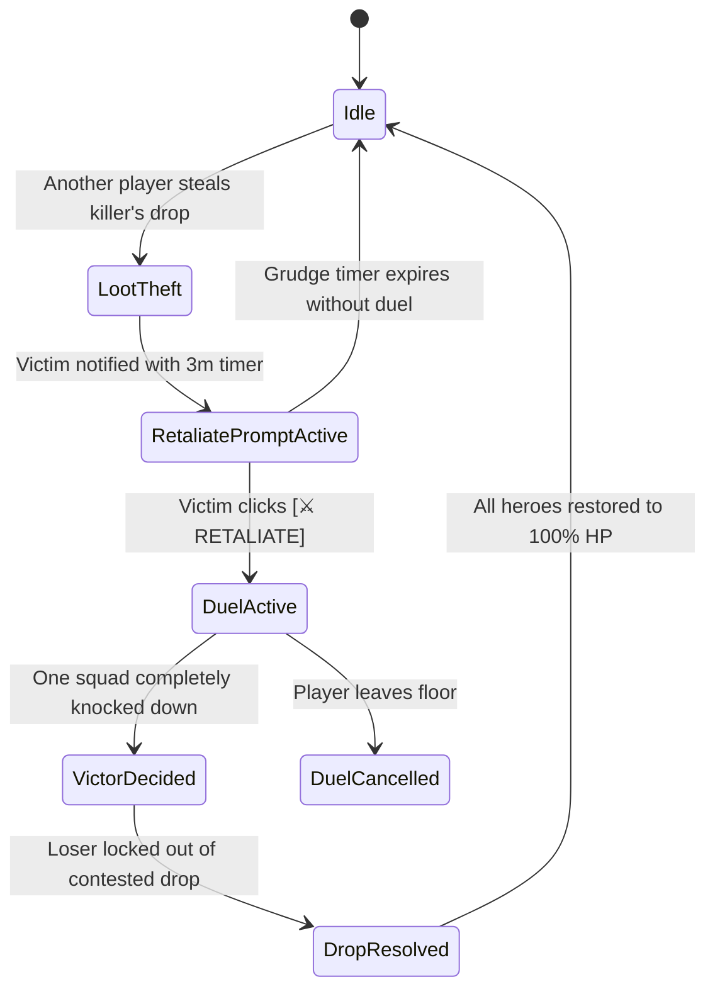

# Phase 4: Tower PvP, Contested Drops & Low-Stakes Retaliation Duels

**Document Version:** 1.0  
**Phase Status:** Ready for Execution  
**Prerequisites:** Phase 3 complete  

---

## 1. Objectives & Scope

Phase 4 integrates exciting player-versus-player tension into the shared tower without punishing failure. Players can contest mob loot drops, and victims can initiate an automated **Retaliation Duel**. Crucially, duels carry **zero permanent consequences**: nobody is wiped, nobody loses tower progress or banked currencies, and all heroes heal immediately when the duel concludes. The only stake is ownership of the contested drop.

---

## 2. Contested Loot System Architecture

### 2.1 Physical Loot Tagging (`PhysicalLoot.luau`)
- When a standard or elite monster drops physical loot (cargo/crystal crates) on a tower floor:
  - The drop instance is tagged with an attribute: `KillerUserId = killerPlayer.UserId`.
  - A subtle halo visual indicates ownership (green for owner, amber for other players).
- **Legitimate Pickup:** If the killer claims the drop, it banks into carried cargo with zero penalty.
- **Theft Event:** If any other player picks up the drop:
  1. The collector is tagged with the attribute `IsLootThief = true` (lasting 3 minutes).
  2. A red skull icon and **[Loot Thief]** badge appear over their character nameplate.
  3. The victim receives a reliable notification over `CombatRemotes/LootStolenAlert`:
     - Parameters: `(thiefUserId, thiefName, lootType, amount, dropId)`

---

## 3. Retaliation Duel Rules & Flow

### 3.1 Initiation
- The victim sees a non-intrusive yet prominent **[⚔️ RETALIATE]** banner card on their screen.
- Clicking the button fires `CombatRemotes/RequestRetaliation(thiefUserId)`.
- Server validates:
  - Both players currently occupy the same floor instance.
  - The grudge is active ($t_{\text{elapsed}} \le 180\text{s}$).
  - Neither squad is currently inside another active duel.

### 3.2 Duel Execution (`CombatSimulation.server.luau`)
- Both players' squads switch targeting exclusively to each other's heroes.
- Standard tower mobs ignore duelists for the duration of the duel.
- **Damage Scaling:** Standard PvP damage scaling applies ($25\%$ damage output) to ensure battles last an engaging 15 to 25 seconds rather than instant one-shots.
- Combat is 100% hands-off auto-battler execution.

### 3.3 Zero-Consequence Resolution
- When all 5 heroes of one squad are knocked down:
  1. **No Squad Wipe:** The defeat does **not** trigger a plot teleport, does **not** clear the floor kill progress bar, and does **not** deduct any currencies or gear.
  2. **Instant Hero Recovery:** Both squads are immediately restored to 100% HP on the spot.
  3. **Contested Drop Lockout:**
     - The loser is locked out of picking up that specific `dropId` for 60 seconds.
     - The drop is unsealed exclusively for the winner.
  4. The `[Loot Thief]` flag and grudge are cleared.

---

## 4. Client UI Components

### 4.1 Retaliate Prompt Banner (`RetaliatePrompt.luau`)
Create `src/StarterPlayerScripts/UI/Next/Components/HUD/RetaliatePrompt.luau`:
- Slides into view from the right margin when a theft alert arrives.
- Displays:
  - Thief avatar thumbnail and username.
  - Stolen item summary (e.g. `25x Gems Crate`).
  - Active countdown timer (`02:45 remaining`).
  - Crimson Gothic button: **[⚔️ RETALIATE]**.
  - Small dismiss button (declining the duel leaves the grudge to expire).

### 4.2 Duel Status Bar (`DuelStatusBar.luau`)
- Replaces the top progress bar during an active duel.
- Displays:
  - Challenger vs Defender squad rosters (5 miniature hero health pips on each side).
  - Live indicator of remaining living heroes (e.g. `Squad: 4/5` vs `Thief: 2/5`).
  - Duel countdown timer ($45\text{s}$ match limit; ties resolve to original killer).

---

## 5. Verification & Testing

1. **Theft Flagging:**
   - Client A kills elite mob; loot crate drops with `KillerUserId = ClientA.UserId`.
   - Client B picks up crate; verify Client B gains `[Loot Thief]` badge over avatar.
2. **Retaliate Prompt:**
   - Verify Client A receives Retaliate Prompt with Client B's name and timer.
3. **Duel Engagement:**
   - Client A presses Retaliate; verify squads auto-target each other.
   - Verify ambient tower mobs do not attack dueling heroes.
4. **Resolution & Lockout:**
   - Squad B is defeated; verify Squad B heroes immediately restore to full HP without plot teleportation.
   - Verify Client B cannot pick up the contested drop.
   - Verify Client A can claim the drop successfully.
