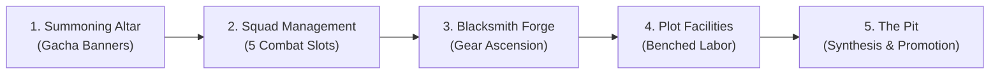

# Phase 5: Incremental React Menu Migration & Facility Labor Idle Loop

**Document Version:** 1.0  
**Phase Status:** Ready for Execution  
**Prerequisites:** Phase 1 through 4 complete  

---

## 1. Objectives & Scope

Phase 5 modernizes the entire menu system by migrating legacy imperative, 1,000+ line UI files into clean, declarative **React-lua components**. It also finalizes the **Facility-Only Idle Loop**, providing clear rewards for assigning benched heroes to fortress facilities, and adds full gamepad/console navigation.

---

## 2. Menu Migration Schedule

We migrate the existing screens in order of first-session player contact to ensure a smooth transition:

### 2.1 Screen 1: Summoning Altar (`SummonModal.luau`)
- Replaces imperative dialog in `HUDController.client.luau`.
- Features:
  - Hero Banner: Single (100 Gems) / 10x (900 Gems).
  - Artifact Banner: Single (160 Gems) / 10x (1,600 Gems).
  - Clean card reveal animations with star rating and rarity glows.
  - Direct hook into `OnboardingService` on first summon.

### 2.2 Screen 2: Squad Management (`SquadModal.luau`)
- Replaces 747-line `SquadController.luau`.
- Features:
  - 5 active combat slots with clean drag-and-drop or one-tap assign.
  - Roster grid showing hero stars, level, class icon, and equipped weapon.
  - Clear **"Total Squad Power"** summary calculated and displayed at the top.

### 2.3 Screen 3: Blacksmith Forge (`ForgeModal.luau`)
- Replaces 1,995-line `ForgeController.luau` and hardcoded 880x520 pixel window.
- Features:
  - Scalable flex layout adapting to phone, tablet, and PC.
  - Two-pane view: Inventory weapons on left, Ascension preview on right.
  - Star ascension ($1★ \to 7★$) and rarity progression ($1 \to 16$).
  - Clear cost preview and stat delta indicator ($+120\text{ ATK}$, $+0.10\text{ Speed}$).

### 2.4 Screen 4: Plot Facilities (`FacilityModal.luau`)
- Replaces 1,180-line `FacilityController.luau`.
- Features:
  - Overview of Fortress Plot buildings: Gold Mine, Mana Well, Training Grounds, Infirmary.
  - Benched hero assignment slots.
  - Live production rate indicator: e.g. `+450 Gold / Hour`.
  - Single **[Claim Facility Rewards]** button.

### 2.5 Screen 5: The Pit - Synthesis & Promotion (`PitModal.luau`)
- Unifies `SynthesisController.luau` (561 lines) and `PromotionController.luau` (1,214 lines).
- Features:
  - **Synthesis Tab:** Select base hero, auto-select duplicate fodder, preview XP gain and level up.
  - **Promotion Tab:** Star ascension with deterministic sacrifice requirements.

---

## 3. Facility-Only Idle Progression Loop

### 3.1 Rules & Mechanics
- **Zero Confusion:** Idle progression is strictly powered by **Plot Facility Labor** (`WaitingRoomService` + `OfflineRewardService`). There is no separate floor-based idle chest.
- **Production Formula:**
  $$\text{HourlyGold} = \text{BaseRate} + 0.85 \times \sum \text{EffectiveLabor}(\text{assigned heroes})$$
- Heroes assigned to facility work continuously generate passive Gold and Materials both while the player is active or offline (capped at 24 hours).

### 3.2 Offline Reward Claim Dialog (`OfflineRewardModal.luau`)
- Replaces `OfflineRewardModal.client.luau` with a React-lua modal.
- Shows upon joining the game if offline time $> 10\text{ minutes}$:
  - Time away (e.g. `4 hours, 12 minutes`).
  - List of assigned workers and their contributions.
  - Total accumulated Gold and Materials.
  - One-tap **[CLAIM ALL]** button with coin burst animation.

---

## 4. Cross-Platform & Gamepad Support

1. **Mobile Safe Areas:**
   - All modal backdrops and panels derive padding from `CoreUISafeInsets`.
   - All interactive touch hitboxes are enforced $\ge 44 \times 44\text{ px}$.
2. **Gamepad Navigation:**
   - Every button and list element has `Selectable = true`.
   - On modal open, `GuiService.SelectedObject` automatically targets the primary action or first list entry.
   - D-pad left/right/up/down cleanly traverses grid items using standard Roblox UI layout navigation.
   - Controller `ButtonB` reliably closes any open modal.

---

## 5. Verification & Deprecation

1. **Legacy Controller Retirement:**
   - Delete deprecated legacy files:
     - `src/StarterPlayerScripts/UI/ForgeController.luau`
     - `src/StarterPlayerScripts/UI/SquadController.luau`
     - `src/StarterPlayerScripts/UI/FacilityController.luau`
     - `src/StarterPlayerScripts/UI/SynthesisController.luau`
     - `src/StarterPlayerScripts/UI/PromotionController.luau`
2. **Integration Verification:**
   - Open each new React modal on PC, Mobile Simulator, and Gamepad.
   - Verify every action (summon, equip, upgrade, assign, synthesize) dispatches to the server and updates state reactively.
3. **End-to-End Build Test:**
   - Run `rojo build -o build.rbxl` and verify clean build with 0 legacy references.
