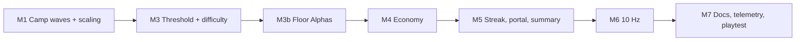

# Phase 6: Tower Run Loop, Encounter Throughput & Economy Rebalance

**Document Version:** 2.3 (implemented, see §7; 2.2 downed heroes stay down until floor transition, return or wipe; 2.1 replaced the depth layers with penalties; 2.0 added hardcore layers; 1.9 added Rift Attunement; 1.8 sized floor 1 to the starter squad; 1.7 added easy start and exponential walls; 1.6 stopped assigned squads advancing floors; 1.5 confirmed the streak rule; 1.4 added gem targets, artifact cap and the M3 progression-curve fix; 1.3 decided M3b; 1.2 dropped M2)  
**Phase Status:** Implemented on `feat/tower-run-loop` except the UX plan; not yet playtested in Studio (see §7)  
**Prerequisites:** Phases 2–5 merged  
**UX companion:** [PHASE_6_TOWER_UX.md](PHASE_6_TOWER_UX.md) (how each feature is shown and felt in the tower)  

---

## 1. Objectives

Players should spend almost no time idle on a floor. Climbing should be slow and hard, and every run should still leave visible progress behind.

1. **No idle time:** mobs come back as fast as a squad can clear them, and spawns scale with the number of players on the floor.
2. **A harder, longer climb:** a higher kill threshold, enemies that actually hurt, and no free full heal between floors.
3. **Progress every run:** first-clear and biome-boss milestones, a climb streak to cash out, and an end-of-run summary.
4. **PvP stays central:** relics become more frequent and are worth less per relic, so every floor has several stealable drops.
5. **Economy under control:** the gems earned per kill no longer grow with floor height.
6. **Feel:** the server sim runs at 10 Hz with attack-interval rounding brought in line with the tick.

### Non-goals
- Hero banner odds and pity do not change (§7 of Phase 4 already lowered them).
- No new biomes, enemies or room layouts.
- No changes to the network protocol format (the v2 header and record layout stay as they are).

---

## 2. Current State (verified in code)

| Area | Today | Where |
| --- | --- | --- |
| Kill threshold | `round(12 + 0.5 × floor)`; regulars count 1, elites 2 | `Shared/Util/TowerProgress.luau` |
| Kill credit | Last hit only (`killer`) | `CombatSimulation` `Reward` (~L2545) |
| Progress persistence | `ActivePlayerProgress` in memory; reset on any floor change | `CombatSimulation` (~L2492) |
| Respawn | Each slot respawns on its own after 25 s (boss 300 s) | `FirstBiomeCombat.RespawnSeconds`, `TowerEncounterRuntime:SyncRooms` |
| Spawn count | Fixed per layout: 16 / 22 / 25 / 35 / 35 live mobs by floor-in-biome (raised from 7 / 11 / 14 / 21 / 24); ignores player count | `TowerLayout.Get` camps |
| Enemy damage | ATK = hero-HP anchor × `.015 / .03 / .04` (regular/elite/boss) | `StatBalance.GetFloorStats` |
| Floor change | Fully heals and revives the squad | `CombatSimulation` (~L2477) |
| Relic gems | Flat payout × `1 + 0.05 × (floor − 1)`, which reaches ~150 gems per regular kill at F50 | `RelicService` L174 & L313, `RelicConfig` |
| Boss reward | `800 × 1.055^(f−1)` Gold and **1 gem**, every kill | `TowerFloorConfig.GetKillRewards` |
| Ascension portal | Spawns where the boss died; teleports on touch; shown to everyone, rejected with `FLOOR_LOCKED` for players who haven't cleared the floor | `spawnFloorAscensionPortal` |
| Sim rate | 5 Hz (`TICK_INTERVAL = 0.20`); attack intervals rounded **up** to 0.2 s | `CombatSimulation` L77, `StatBalance.ScheduledInterval` |
| Snapshot batching | 32 records per packet, split into as many packets as needed (no entity cap) | `TowerProtocol.Encode` |

The 0.2 s rounding means the Common (+5%) and Uncommon (+7.5%) weapon attack-speed bonuses do nothing on base 0.85 s and 1.0 s attackers.

### 2.1 Already Landed (on `feat/modal-transitions-tower-clutter-squad-fix`, uncommitted)

| Change | Files | Notes |
| --- | --- | --- |
| **Tower Bounty Bag removed.** Kills pay Gold and Gems directly; the "N Gold" bag no longer drops. | `CombatSimulation` (`Reward`), `LootDuel` (`BOUNTY_CHANCE` deleted), GDD §2.1, §6.1 | Relics are now the only contested tower drop, which makes M4 more urgent. |
| **More camps and live mobs.** Live mobs per floor in a biome went from 7 / 11 / 14 / 21 / 24 to **16 / 22 / 25 / 35 / 35**: two Basin flank camps (±110 studs, centre left clear under the arrival ramp), the Central Crossing from floor 2, both Galleries, and both Bastions from floor 4. | `TowerLayout.Get`, `tower-rework.spec` | Worst case server load rises from ~144 to ~210 mobs (6 players on 6 different floor-4/5 rooms). Check in M6 profiling. |
| **Elite-led camps.** 1 / 2 / 3 / 4 / 4 camps per floor are Elite-led (West Gallery from floor 1, East Gallery from 2, Central Crossing on 3, Bastions from 4). The spawner no longer skips mobs matching the floor boss's id; only `Role == "BOSS"` and the Apex camp are kept back. | `TowerLayout`, `TowerEncounterRuntime:SyncRooms`, `phase2-floor-loop.spec`, `tower-rework.spec` | Before this, camp Elites on floors 1–4 never spawned. A summoned floor boss is always `Role = "BOSS"`, so camp Elites never count as it. |
| **Recommended Power rescaled.** `RecommendedPowerScale` 0.08 → 0.05, so floor 1 still reads ~800 for a fresh squad. | `TowerFloorConfig` | Recheck after M3 and M3b change the roster. |

Side effect still open: the floor 1–4 boss is the **same Elite template** the camps now use, with the same stats. M3b fixes that.

---

## 3. Milestones

Each milestone is one PR. They all touch `CombatSimulation.server.luau`, so land them **in order**, not in parallel.

*M2 (shared kill credit and saved per-floor progress) was dropped in v1.2. Kill credit stays last-hit only, and floor kill progress still resets when a player leaves the floor. Milestone numbers are kept so earlier references stay valid.*

### M1: Encounter Throughput (camp waves and player scaling)

**Goal:** no squad waits on respawns while there is still threshold left to clear.

Changes:
- `FirstBiomeCombat.luau`: add
  - `CampRespawnSeconds = 10` (time from the camp's last death to the whole camp respawning)
  - `PlayerSpawnScale = 0.4` (+40% camp members per extra Master on the floor)
  - `MaxLiveMobsPerFloor = 48`
  - Keep `RespawnSeconds` only as a fallback for slots that belong to no camp.
- `TowerEncounterRuntime.luau`:
  - Group slots by `CampId`. On death, set the slot's `RespawnAt` to `math.huge` (pending). When every slot in the camp is dead, set them all to `now + CampRespawnSeconds`.
  - Add `ExtraSlots` per camp. Their count is `floor(campSize × PlayerSpawnScale × (mastersOnFloor − 1))`, limited by `MaxLiveMobsPerFloor` minus the floor's current live count. Place them in a ring 6–10 studs from the camp centre and ground them with `Navigation.Ground`. Recompute this when the number of Masters on the floor changes (read from `api.Tower` state). Retire extra slots once the camp is fully dead and the player count has dropped.
  - Extra slots use new slot IDs above `60000`, so they never collide with layout slots (`1..n`) or summoned bosses (`80000+`).
- **Surge pack** (for each player, on a non-boss floor): when a player's progress crosses 50%, spawn 1 elite and 3 regulars 25–35 studs from their squad. Place them outside the sanctuary and tag them `SummonedByUserId`, like bosses. Surge mobs never respawn. Add `TowerProgress.SurgeAt = 0.5` and `progress.SurgeSpawned`.

With the larger base layouts, the 48 limit only applies on floors 2–5 of a biome once 2–3 or more Masters share the floor. Network budget check: 48 mobs + 30 heroes = 78 entities, which is 3 packets per snapshot. That is ~9.6 KB/s at 5 Hz and ~19 KB/s at 10 Hz per client on the floor. Stay under 25 KB/s.

Tests (`tests/tower-combat.spec.luau`):
- A camp does not respawn while any member is alive, and respawns `CampRespawnSeconds` after the last death.
- The extra slot count matches the formula and never pushes the live count above `MaxLiveMobsPerFloor`.
- Extra slot IDs don't collide with layout slots or summoned bosses.

Acceptance: in a solo Studio run on F1, a squad on the intended stat curve always has a living mob within 60 studs, except during the 10 s camp gap.

---

### M3: Threshold & Difficulty Retune

**Goal:** a slower, harder climb.

Changes (all provisional, to be tuned in playtest §5):

| Value | Today | Phase 6 |
| --- | --- | --- |
| `TowerProgress.GetRequiredKills` | `round(12 + 0.5f)` (F1 13, F25 25, F50 37) | `round(20 + 1.2f)` (F1 21, F25 50, F50 80) |
| Elite kill value | 2 | 3 |
| `StatBalance` ATK multipliers | `.015 / .03 / .04` | `.04 / .08 / .12` |
| Floor-change heal | Full heal and revive | **Removed** |

- Floor change no longer restores HP to standing heroes. Instead, the sanctuary heals 10% of max HP per second while the squad is inside it (`CanRecoverWipe` zone, out of combat). **Downed heroes stay down until a floor transition, a return to the hub or plot, or a squad wipe** (see Penalties). Going home (`restoreSquadOnPlot`) still restores the whole squad.
- Update the toast and the `hadFallen` branch in `CombatSimulation` (~L2477).
- `TowerFloorConfig.RecommendedPower` will rise with the ATK change. Check that the F1 recommendation stays close to a fresh squad (~700), and adjust `RecommendedPowerScale` if not (the Phase 5 test covers this).

#### Assigned squads farm, they don't climb

Today an assigned squad (Tower → Assign squad, Master elsewhere) advances the tower by itself. Its kills credit the owner's kill progress (`killerPlayer` in `CombatSimulation` ~L1246), which summons the floor boss. The boss reward loop also counts `s.SquadFloorId == mob.FloorId` (~L2587), so the squad's boss kill raises `HighestClearedFloor` and `MaxFloorReached`. A side effect: a kill on the assigned floor replaces the progress for the floor the Master is actually on.

New rule: **only a Master standing on the floor (`Tower.GetState(p).FloorId == mob.FloorId`) can advance it.**
- **Kill progress and boss summon:** a kill counts toward the threshold only if the killer's Master is on that floor. Kills by an assigned squad never create or replace `ActivePlayerProgress`.
- **Boss credit and unlocks:** the boss branch of `Reward` drops the `s.SquadFloorId == mob.FloorId` condition. Floor unlocks, first-clear rewards (M4), biome boss clears and streak points (M5) all require the Master on the floor.
- **What assigned squads still earn:** kill Gold (× Market) and the flat gem, plus hero XP. This keeps them useful as a farming option without letting the tower climb itself.
- **Relics:** a relic drops only when the squad's Master is standing on the floor the squad is assigned to. An absent Master's squad drops none, because nobody can carry them and they would only be free loot for others. Once the Master joins the assigned floor, relics drop as usual. Revisit if we want "raid an assigned squad's floor" PvP later.
- **UI:** the Tower panel's Assign action says "Farms Gold and XP. Climbing needs you on the floor."

Tests (`phase2-floor-loop.spec` / `tower-combat.spec`): a kill by an assigned squad with its Master on another floor leaves that Master's progress unchanged; a boss killed only by an assigned squad unlocks nothing; the same kills with the Master present do count.

#### Progression curve (fixes over-progression)

Playtest feedback: floors feel the same, and a little play puts the squad far ahead of the tower.

**Cause:**
- The `StatBalance` anchor builds assume an all-1★ squad with a Common weapon until floor 10, and 2★ until floor 20. They also leave out hero rarity.
- Heroes actually arrive at their template star *with* a rarity bonus. A fresh Rare (3★) is `1.35² × 3² ≈ 16×` a 1★ in combat. At Lv. 1 with a Common weapon it already hits like the floor 12 anchor, and at Lv. 30 like floor ~20.
- New profiles start with 2,000 gems (`DataManager` default, marked "immediate summon testing") plus 550 from onboarding. That is two 10-pulls, each guaranteeing a Rare or better, so a new player starts at biome 3–4 strength.
- Inside a biome, enemy HP only grows ~8% per floor, so consecutive floors feel identical.

Changes:
1. **Re-anchor the stat curve** to realistic builds, and include hero rarity (`1.35^(star−1)`, since template star equals rarity tier) in the anchor damage and HP. Proposed `builds` (floor, hero star, level, weapon rarity, weapon star), to be tuned in playtest:

   | Floor | 1 | 5 | 10 | 15 | 20 | 25 | 30 | 35 | 40 | 45 | 50 |
   | --- | --- | --- | --- | --- | --- | --- | --- | --- | --- | --- | --- |
   | Today | 1★ L1 · C1★ | 1★ L5 · C2★ | 1★ L10 · U2★ | 2★ L15 · U3★ | 2★ L20 · R3★ | 3★ L25 · R4★ | 3★ L30 · S5★ | 4★ L35 · E5★ | 4★ L40 · L6★ | 5★ L45 · L6★ | 5★ L50 · M7★ |
   | Phase 6 | 2★ L5 · U1★ | 3★ L10 · R1★ | 3★ L20 · R2★ | 3★ L30 · R4★ | 4★ L30 · S3★ | 4★ L40 · S5★ | 5★ L40 · E4★ | 5★ L50 · E6★ | 5★ L50 · L5★ | 5★ L50 · L7★ | 5★ L50 · M7★ |

   (C/U/R/S/E/L/M = Common … Mythical.) The floor 50 end point stays the same. Only the climb to it gets steeper, so a starter pull no longer skips two biomes.

   **Floor 1 is sized to the starter squad (v1.8).** Today a fresh profile's default 2-hero squad beats floor 1 without trying:
   - The starter roster is Han (1★ Common), Jenna (1★ Common) and **Catio (3★ Rare)**, with Common 1★ weapons, and one squad slot plus a second for 500 Gold.
   - By `StatFormulas.GetHeroPower`, Catio alone is ≈10,700 power (16× combat from rarity and stars), and Catio + Han ≈ 11,700.
   - Floor 1's Recommended Power is ≈800, so the starter pair is ~14× over it. A regular has 600 HP, and Catio one-shots it.

   Changes:
   - **Anchor floor 1 to the real starter squad:** Catio (3★ Rare, Lv. 1) + Han (1★, Lv. 1), Common 1★ weapons, **2 heroes**. Floor 1 Recommended Power becomes ≈12,000, about 15× today's figure, so the starter pair is "on curve", not ahead of it.
   - **Anchors use the expected squad size per floor** instead of always 5. Today `StatBalance` sizes enemy HP to 5 heroes' DPS, but slots 2–5 open through the Fortress Tree (500 / 2,000 / 6,000 / 15,000 Gold). Expect 2 heroes at F1, 3 by F5, 4 by F10 and 5 from F15. Then each new slot is a real power jump, not something the curve already assumed.
   - **The F1 target experience:** a starter pair clears floor 1 in ~3 min. Regulars take several hits, Elite-led camps and the Alpha need focus, and a careless pull of two camps can wipe one hero. From floor 1 onward, the anchors above apply on top of this new base.
   - The Phase 5 test range for floor 1 Recommended Power moves from 500–900 to **10,000–14,000**. The "fresh squad" in its comment becomes the 2-hero starter squad.
2. **Sawtooth inside each biome:** multiply enemy HP and ATK by `BiomeStep = {0.85, 0.95, 1.05, 1.15, 1.30}` by floor-in-biome. Floor 1 of a new biome is a breather after the boss. Each later floor is clearly harder, and floor 4 (the Elite stronghold) and the boss floor feel like walls. Add it as `StatBalance.BiomeStep`, applied in `GetFloorStats`.
3. **Starting gems for launch:** lower the default from 2,000 to 900 (one 10-pull with its guaranteed Rare). Keep 2,000 behind `DEV_GRANT_RESOURCES` for testing. This is a new-profile default only, so no migration is needed.
4. **Keep the Elite-led camps at 1 / 2 / 3 / 4 / 4.** The over-progression comes from the stat curve, not the Elite count, and the sawtooth already makes floors 3–4 harder.

Tests: anchors rise with floor (both damage and HP); `BiomeStep` is applied by floor-in-biome; the default starter pair (Catio + Han, Lv. 1, Common 1★ weapons) has Squad Power within ±20% of `RecommendedPower(1)`; a squad after the 900-gem starter 10-pull (one extra Rare, 3 slots) is at or below `RecommendedPower(3)`; the Phase 5 floor 1 range is 10,000–14,000.

#### Difficulty shape: easy start, exponential walls (v1.7)

Intent: lower floors are quick, and difficulty then grows exponentially. A free-to-play player with average luck gets stuck at walls for hours. Good luck on the banners, or the planned premium Robux banners, shortens a wall but never removes it.

**Walls sit on Biome Boss floors (every 5th floor)**, not on random floors. Players can see what they are up against, and the floors between walls keep the climb moving. Target hours for a free-to-play player with average luck (active play, cumulative, to be tuned):

| Reach | Cumulative play | Longest single wall |
| --- | --- | --- |
| Floor 5 cleared | first session, ~30–45 min | none |
| Floor 10 | ~2 h | ~20 min (F10 boss) |
| Floor 15 | ~5 h | ~1 h (F15) |
| Floor 25 | ~15 h | ~2–3 h (F20, F25) |
| Floor 35 | ~40 h | ~4–6 h (F30, F35) |
| Floor 45 | ~100 h | ~8–12 h (F40, F45) |
| Floor 50 | 200 h+ | long-term goal |

Lucky or premium players get there about 30–50% sooner. A premium purchase should save about one wall's worth of time, **not skip a biome**.

**How the curve is built:**
1. Add a progression model script (`tests/tower-progression-model.luau`, run by `run.ps1`). It simulates a free-to-play player hour by hour:
   - farm income at their current floor (M4 kill and relic rates, Guard Post Gold),
   - spending Gems on pulls at published odds with pity,
   - synthesis XP, promotions and Forge stars.
   It outputs expected Squad Power over time, plus a "lucky" percentile (90th) and a "premium" path with N extra pulls a week.
2. Fit the enemy curve to that model. Enemy power on floor `f` = the model's free-to-play power at the target time for `f`, with `BiomeStep` on top. That gives the exponential shape automatically: power from pulls grows roughly logarithmically with time, so constant-time steps need exponentially stronger enemies. The new `builds` anchors above become an output of this fit instead of hand-picked rows.
3. The test fails if any wall time is off by more than ±30%, if the lucky or premium path skips a whole biome compared with free-to-play at the same hour, or if floors 1–5 take more than 45 min.

**Constraints:**
- **Gem income must fit the walls.** The v1.4 target (~10,000 gems/h at F50) is about 100 pulls an hour, which reaches the 90-pull pity in under an hour and melts any wall. Make the late-floor gem target an output of the model too. Expect it to land around 1,500–3,000/h, with biome-boss first clears giving the gem spikes that feel like a jackpot.
- **Free-to-play must be able to clear every wall without paying.** Roblox restricts paid random items in some regions (`PolicyService.ArePaidRandomItemsRestricted`, already handled by the Phase 5 store, which converts summon packs to Gems). Those players can't buy premium banners, so every wall needs a deterministic, time-based way through: hero levels, Forge stars bought with Gold, artifact pity and Training Grounds.
- **Show progress during a wall.** Hours stuck with no visible progress kills D1 and D7 retention, which Roblox discovery weights heavily. The HUD shows Squad Power against the boss floor's Recommended Power as a "% ready" meter, and the run summary (M5) shows how much it went up this session.
- **PvP fairness.** Premium squads will win retaliation duels. Consider capping duel power at the higher Master's floor recommendation, or scaling both squads toward each other. Track this in the M7 telemetry (duel win rate by spend tier) before deciding.
- **Premium banners are a separate monetization task.** Planned Robux banners need odds disclosure and the `roblox-monetization` checklist (idempotent `ProcessReceipt`, PolicyService gating). They are out of scope for Phase 6. The model only needs a "premium pulls per week" input.

#### Penalties (v2.1)

Intent: mistakes cost something real, in the spirit of the source material, while staying reasonable for Roblox. A penalty is what a player loses when something goes wrong. **Owned content is never lost:** heroes, weapons and banked Gold and Gems are always safe. Penalties apply the same way on every floor; there are no depth layers.

| Penalty | When | What happens | Today |
| --- | --- | --- | --- |
| **Downed** | A hero's HP hits 0 | The hero stays down, with **no timer**, until one of three things happens: the squad **transitions to another floor** (the hero stands back up), the Master **returns to the hub or plot**, or the squad **wipes**. Losing a hero mid-floor means finishing the floor short-handed. | 60 s coma, then back |
| **No heal between floors** | Taking the portal or a pedestal to another floor | Standing heroes keep their damage. Downed heroes stand back up at **30% HP** (working value, `TowerHardcoreConfig.ReviveHPFraction`). The sanctuary heals 10% HP per second (M3). | Full heal and revive on floor change |
| **Boss lock** | After a floor boss (Alpha or Biome Boss) is summoned | The floor's travel pedestals and portal lock for players who have damaged it, until it dies or their squad wipes. Recall inside the room still works. | Free travel |
| **Wipe loss** | The whole squad is knocked out | You lose the carried relic (it spills, as today) and the streak (M5). You also lose **25% of the Gold and Gems earned since you last banked** in this run. Banked currency is never touched. | Carried loot only |

**Guardrails for Roblox:**
- **Never permanently lose owned or paid content.** True permadeath stays out of the main game. An opt-in mode with loaner heroes is a possible post-launch idea, not Phase 6.
- **Every penalty is visible before it happens:** the boss summon toast says "Travel locked until the boss falls", and the run HUD shows "At risk: X Gold / Y Gems" (unbanked earnings).
- **Do not sell penalty skips for Robux.** Paying to undo a failure feels predatory and cuts through the walls in M3.
- **Child-friendly wording:** "Knocked out", "Wiped", never "dead".
- **Measure it:** M7 telemetry tracks wipe rate by floor and players who leave within 5 minutes of a wipe. The aim is fewer than 10% of wipes ending in a rage-quit.

**Implementation** (lands with M3's no-heal change):
- Downed: `knockHeroIntoComa` in tower combat sets a sim-only `Downed = true` instead of a 60 s timer. **Do not write it to `ComaUntilTimestamp`**: that field is saved, and a far-future value would leave a hero stuck after a disconnect. Clear `Downed` on floor change (revive at `ReviveHPFraction`), on `restoreSquadOnPlot`, on squad wipe recovery and on disconnect. In the floor-change branch of `CombatSimulation` (~L2477), replace the full heal with this revive; standing heroes keep their HP.
- Boss lock: `TowerFloorService.Request` refuses travel (`BOSS_LOCKED`) while `GetActiveBoss(floor)` is alive and has `DamageLedger[userId] > 0` for the player.
- Wipe loss: the run state (M5) tracks `UnbankedGold` / `UnbankedGems`. Banking at a sanctuary or Fortress pad clears them. On a wipe, 25% is removed from the profile (`TowerHardcoreConfig.WipeLossFraction = 0.25`), clamped so it never takes more than was earned this run.

Tests: a downed hero stays down with no timer; floor change revives downed heroes at `ReviveHPFraction` and leaves standing heroes' HP unchanged; return and wipe clear `Downed`; `ComaUntilTimestamp` is never set by a tower knockout; travel is refused during a boss lock and allowed after the kill or a wipe; the wipe loss is 25% of unbanked earnings only and never touches earlier banked currency.

#### Rift Attunement: pity and premium pulls scale to the Master's floor (v1.9)

**Problem:** a pity or lucky pull jumps far past the wall curve.
- Pity guarantees Ignis (Exalted 5★, ≈121k HP) at 80 pulls and Astrea (Mythical 7★, ≈1M HP) at 90.
- At floor 10, either hero is many biomes ahead of the curve. The walls stop meaning anything, and the premium path skips biomes, which the model forbids.

**Rule:** in the tower, each hero's combat stats are **attuned**, meaning capped, to a ceiling set by how far its Master has climbed. The pull itself is never changed: the hero, its star and its rarity are exactly what the banner said. Only how much of its power the tower lets it use grows with the Master's progress.

- **Ceiling per hero:** `AttunementCap(f) = 1.5 × RecommendedPower(min(50, f + 2)) / ExpectedSquadSize(f)`, where `f = MaxFloorReached`. A pity hero is therefore at most about 1.5× an on-curve hero two floors ahead. It clears the current wall noticeably faster (the model's 30–50% premium speed-up) but cannot carry a squad through the next biome.
- **How it applies:** HP and ATK are scaled together (one factor `min(1, cap / heroPower)`), so the hero keeps its kit, attack speed, skills and feel. Heroes under the cap are untouched, which covers almost every on-curve player.
- **It rises as you climb.** Every new floor reached raises the ceiling. The HUD and Squad panel show it as **"Attuned 42,000 / 1,014,981"** with a bar, so pushing floors visibly unlocks more of a big pull. That is a progression hook in itself ("clear F20 to unlock 30% more of Astrea").
- **Where it applies:** tower combat and retaliation duels. In a duel, both squads use the *lower* of the two Masters' caps, which also answers the PvP fairness point above. It does **not** apply to labor (Guard Post, Market, Training Grounds, God's Blessing), so a lucky pull still pays off fully in the Fortress. That keeps the "zero dead pulls" promise.
- **Why not floor-gated pity odds instead:** changing what pity grants by floor would make the published odds differ per player. That needs per-player odds disclosure and breaks trust for paid banners (a player who pays toward Astrea must get Astrea). Attunement leaves odds and pity exactly as advertised.

**Implementation:**
- `StatFormulas.GetAttunementCap(maxFloorReached)` and `GetCombatSnapshot(..., attunementCap?)`. The cap is a new optional argument next to `trainingMultiplier`, applied after Training Grounds.
- `CombatSimulation` passes the cap when it builds tower and duel hero stats (`MaxFloorReached` from the profile). Hub, plot and Outskirts visuals ignore it.
- Squad Power on the HUD, the Squad panel and the Recommended Power comparison all use attuned power, with the raw value as a secondary number.
- `ExpectedSquadSize(f)` comes from the same table as the anchors (2 / 3 / 4 / 5 at F1 / F5 / F10 / F15+).

**Tests:**
- A hero below the cap is unchanged.
- Astrea at `MaxFloorReached = 10` is attuned to exactly `AttunementCap(10)`, with the HP:ATK ratio kept.
- The cap rises with floor.
- Labor values ignore it.
- A duel uses the lower Master's cap.
- In the progression model, the pity and premium paths reach each wall sooner but never clear a biome before the free-to-play path reaches its previous one.

Target clear times for a squad on the intended stat curve: F1 ~3 min, F25 ~5 min, F50 ~7 min, biome boss floors +2 min.

Tests: update the expected formula in `phase2-floor-loop.spec.luau`. Check that the `phase1-combat-tempo` and Phase 5 Recommended Power tests still pass, and re-tune if they don't.

---

### M3b: Floor Alphas (one Alpha per biome, reused on floors 1–4)

**Goal:** each biome has one Biome Boss on its 5th floor, and one distinct **Alpha** that is the boss of floors 1–4 of that biome. The Alpha is a different creature from the Elites that lead camps.

Today `TowerProgress.GetFloorBossEnemyId` returns `biome.EliteEnemyId` on floors 1–4, so the floor 1–4 boss is the camp Elite with `Role` forced to `"BOSS"` and the same Elite stats.

Changes:
- **Catalog:** add one Alpha per biome to `MobCatalog` (10 entries, `Role = "ELITE"`, a new field `Alpha = true`) and `biome.AlphaEnemyId`. Each one reuses an existing rig family from its biome (for example, Verdant's `ROOTED_BIPED` from the Vinebound Elite), with:
  - a unique name (for example "Vinebound Alpha"),
  - a scale of ~1.5× and a recoloured glow palette (`TowerEnemyRigs` takes a scale/palette override, so no new rig families are needed),
  - one signature ground AoE (`TARGET_DISC` or `SELF_DISC`) on top of the Elite basic attack, defined in `FirstBiomeCombat` with the existing `AttackTimeline` shapes.
- **Selection:** `TowerProgress.GetFloorBossEnemyId` returns `biome.AlphaEnemyId` on floors 1–4 and `biome.BossEnemyId` on floor 5.
- **Layout:** the Apex camp on floors 1–4 places the Alpha in slot 1 instead of the Elite, so it appears in `floor.Encounters`. `GetEnemyStats` and `SpawnBoss` need that, and the Apex camp is still never pre-placed.
- **Stats:** add an `ALPHA` row to `StatBalance.GetFloorStats` (HP ≈ 15× the squad DPS anchor, between Elite 8× and Boss 25×; ATK in line with M3's Elite/Boss multipliers) and to `TowerFloorConfig.BaseStatsByRole` (Gold between Elite and Boss). `GetEnemyStats` uses the `ALPHA` row when the enemy has `Alpha = true`.
- **Presentation:** the boss bar, summon toast and `BOSS_SPAWN` cue already work for anything summoned through `SpawnBoss`. Show "<Name> Alpha" rather than "Floor Boss" in the toast on floors 1–4.
- **Rewards:** Alphas use the floor-boss reward path (M4 first-clear rules). The GDD §5.4 artifact drop stays exclusive to the Biome Boss.

Tests:
- `tower.spec`: the manifest covers 50 enemies (40 + 10 Alphas), each Alpha belongs to its biome and is referenced by floors 1–4 of that biome only.
- `phase2-floor-loop.spec`: `GetFloorBossEnemyId` returns the Alpha on floors 1–4 and the Biome Boss on floor 5, and never the camp Elite.
- `tower-rework.spec`: updated Elite counts (the Apex Elite moves to an Alpha).
- An Alpha's HP sits between the Elite's and the Boss's on the same floor.

GDD: §2.3 (floor 1–4 Alphas), §5.1 (add the Alpha column) and §5.2 (roster becomes 50 enemies).

---

### M4: Economy (relics, boss and milestone rewards)

**Goal:** gems earned per kill stop growing with floor height; bosses and first clears become the progress moments.

Changes:
- **Relic value:** in `RelicService`, `RewardMultiplier` scales **Gold only**. Gems stay flat. New `RelicConfig` gem payouts: Geode 25, Urn 75, Core 250 (previously 100 / 300 / 1000). Gold payouts stay the same.
- **Relic frequency:** `RelicChance = 0.04 + 0.08 × progress` (previously `0.02 + 0.10 × progress`). **Camp Elites always drop at least a Mana Geode** (`RollRelic` uses a 1.0 drop chance for `ELITE`), replacing the removed Bounty Bag as the PvP hook. With the Elite-led camps from §2.1, that guarantees 1–4 stealable relics per camp clear cycle. Count them in the economy spec, because camps respawn (M1).
- **Floor boss** (`GetKillRewards("BOSS")` and the boss branch of `Reward`):
  - First clear (`mob.FloorId > previous HighestClearedFloor`): `Gems = 10 + 2f`, Gold × 3, and a guaranteed relic tagged to the killer.
  - Repeat kills: Gold and a 50% relic chance, with 0 bonus gems.
  - Leave `HighestClearedFloor` unchanged until the rewards have been calculated.
- **Biome boss** (floor % 5 == 0), first clear only: `300 × tier` gems, plus one artifact rolled on the artifact banner table with a minimum tier of `min(7, 2 + ceil(tier / 2))`. Grant it through the existing artifact creation path in `DataManager`, not a new one. The tier stays capped at Mythical (7) until higher tiers ship in a post-launch update.

**Target gem income** (working target, v1.4) at about 15 kills/min (900 kills/h): **~2,000/h at F1, ~4,500/h at F25 and ~10,000/h at F50**, from kills and relics, before first-clear and biome boss rewards.

Expected gems per regular kill (flat gem plus relic value):

| Floor | Today | Phase 6 |
| --- | --- | --- |
| 1 | ~4 | ~2.5 |
| 25 | ~40 | ~5 |
| 50 | ~150 | ~12 |

New `tests/tower-economy.spec.luau`: compute expected gems per kill for every floor and role, and fail if expected gems/h (per-kill value × 900, counting the Elite share of each floor's roster) is more than ±25% off the target at F1, F25 or F50, if any floor is lower than the one before it, or if first-clear boss gems don't grow with floor. Update `tower-rework.spec.luau` L89–96 where it hard-codes the old relic curve.

---

### M5: Run Loop (climb streak, portal, run summary)

**Goal:** climbing feels seamless, and every run ends with a clear result.

**Climb streak** (server-only, not saved):
- `RunState[player] = { StartFloor, Streak, FloorsCleared, Kills, GoldEarned, GemsEarned, BestStreak, LevelsGained, StartedAt }`. It is created on the first tower visit after the hub or plot.
- `Streak += 1` when the player gets boss credit on floor `f` and their previous credited clear in this run was `f − 1` (or this is the first). Show it in the HUD next to the progress bar.
- **The streak is a run-wide multiplier** (decided v1.5, chosen over "banking cashes out"). Every relic banked at a sanctuary while the streak is active pays `× (1 + 0.10 × Streak)` (capped at +100%, `TowerProgress.STREAK_BONUS_CAP = 1.0`). Banking does **not** reset the streak. Kill Gold does not use it.
- **Only the end of the run ends the streak:** a hub or plot return, a squad wipe or a disconnect. On a wipe the streak is lost and carried loot spills, as it already does.
- **Why not cash out on bank:** a Master carries one relic at a time (`CarrierToRelic` is single-slot). If banking reset the streak, every new relic would force a choice between banking it (and losing the streak) or leaving it on the floor. That is confusing, and it punishes picking up loot. With a run-wide multiplier, the push-your-luck decision is "climb another floor or go home", and the pressure comes from M3's attrition: no heal between floors, and downed heroes stay down for the rest of the floor.
- PvP stays: a carried relic is still stealable and worth more to a thief the higher the owner's streak, but the streak itself cannot be stolen. Relics carried between floors already travel with the player (`StoreCargo`).

**Portal rework** (`spawnFloorAscensionPortal`):
- Remove the `Touched` handler and keep only the prompt (no more accidental teleports).
- On the client (`TowerController`), set `AscendPrompt.Enabled` from the local profile (`MaxFloorReached > floorId`), so the prompt only appears for players who cleared the floor. Keep the server check as the authority.
- Fire a short client cue on spawn: a beam from the sanctuary to the portal, plus a "Floor N cleared · Ascend" banner using `ModalAnimator`.
- Ascending does not heal (M3).

**Run summary:** on run end, fire `TowerRemotes.RunSummary(RunState)` and show a modal (`UI/RunSummaryModal`, following the Phase 5 modal pattern). It lists floors climbed, Gold and gems, best streak, hero levels gained, and a "New best floor" flag.

Tests: the streak goes up on consecutive clears; banking pays the bonus without resetting it; a wipe, a hub or plot return and a disconnect reset it; the bonus is capped. Studio: the portal prompt is hidden for a player who hasn't cleared the floor in a 2-client test.

---

### M6: 10 Hz Simulation & Attack-Interval Fix

**Goal:** tighter movement and dodging, and every attack-speed bonus counts.

Changes:
- `StatBalance.TickSeconds = 0.10`. Have `CombatSimulation` read `TICK_INTERVAL` from `StatBalance.TickSeconds`, so there is one source of truth. Snapshots follow the sim rate.
- `ScheduledInterval` keeps rounding to the (now 0.1 s) tick. Hero DPS rises by up to ~11% depending on the build. Enemy HP anchors are derived from `ScheduledInterval`, so they rescale on their own. Check `StatBalance.MaxAttackSpeed` (5/s) against the new tick.
- Check that skill `Ticks / TickSeconds` and `HeroImpactQueue` (which already resolve every frame) are unaffected.
- Profile in Studio with 6 players on 6 floors at `MaxLiveMobsPerFloor`. Server Heartbeat sim cost must stay under 4 ms per frame on average, and client receive must stay under 25 KB/s. If either budget is exceeded, keep the sim at 10 Hz and send snapshots at 5 Hz.

Tests: `phase1-combat-tempo`, `combat-skills`, `forge` and the stat verification all pass with re-derived expectations. Add a test that Common and Uncommon weapons now shorten the effective interval.

---

### M7: Docs, Telemetry & Playtest

- **GDD:** update §2.1 (micro loop timings), §2.3 (threshold, biome boss rewards; remove the "no boss-kill lock" vs "Biome Key" contradiction), §3.3 (camp waves, scaling), §5.4, §6.1 (relics as the contested drop), and §8 (10 Hz). Also remove the leftover Infirmary, "rarity refinement" and "8.00x" references.
- **Telemetry** (`AnalyticsService` custom events, see the `roblox-analytics-liveops` skill): `tower_floor_clear` (floor, seconds, first_clear), `tower_idle_seconds` (time a squad had no hostile within 60 studs, sent per floor), `tower_wipe` (floor), `tower_streak_cashout` (streak, value), `tower_run_end` (floors, reason).
- **Playtest checklist:** solo F1–F5 at a fresh-squad build; 3-player shared floor (spawn scaling, surge, competition for last hits); a 2-client theft of a carried streak relic followed by a retaliation duel; floor 25 and 50 with a curve build via `DEV_GRANT_RESOURCES`.

---

## 4. Order & Dependencies

M3 depends on M1: a higher threshold without faster, player-scaled spawns adds idle time and more fights over last hits. M3b follows M3 so the `ALPHA` stat row is tuned against the new Elite and Boss damage, and it lands before M4 because M4's first-clear rewards key off the floor boss. M6 goes last so balance is re-checked once, against the final numbers. GDD edits ship in the same PR as the behaviour they describe (M7 is the final sweep).

---

## 5. Risks

| Risk | Mitigation |
| --- | --- |
| Server CPU at 10 Hz with 6 busy floors (up to ~210 base mobs after §2.1, before M1 scaling) | M6 profiling budget; fall back to 5 Hz snapshots; lower `MaxLiveMobsPerFloor` |
| Higher ATK combined with no floor heal makes F1 a wall for new players | F1–F5 use the old ATK multipliers through a ramp (`min(1, (f−1)/5)` blend); Recommended Power test |
| Last-hit-only credit plus a higher threshold leads to kill stealing on shared floors | M1 player-scaled spawns and surge packs (personal, tagged to the player); watch `tower_floor_clear` times for multi-player floors |
| Leaving a floor wipes kill progress, so long thresholds punish short trips to the sanctuary | Sanctuary banking happens on the same floor and does not reset progress; only travelling away does |
| Streak relics make thieves too strong | Duel rules stay the same; watch the theft rate in telemetry and lower the streak cap if needed |
| Relic gems lowered for existing players | Announce it with the patch; no compensation needed in prototype |

## 6. Open Questions

1. ~~Gem income target~~ **Working target (v1.4):** ~2,000/h at F1, ~4,500/h at F25, ~10,000/h at F50 at 15 kills/min (M4). **Revisit (v1.7):** the late-floor targets break the multi-hour walls, so the progression model sets them instead (expected ~1,500–3,000/h).
2. ~~Downed heroes~~ **Decided (v2.2):** downed heroes stay down, with no timer, until a floor transition (they revive at 30% HP), a return to the hub or plot, or a squad wipe. Is 30% the right revive HP? *(tune)*
3. ~~Streak end rule~~ **Decided (v1.5):** only the end of the run (hub or plot return, wipe, disconnect) ends the streak; banking pays the bonus without resetting it (M5).
4. ~~Artifact tier cap~~ **Decided (v1.4):** cap at Mythical (7). Revisit only when higher tiers ship after launch.
5. ~~M3b scope~~ **Decided (v1.3):** one Biome Boss on each 5th floor and one Alpha per biome, reused as the boss of floors 1–4 (10 new entries).
6. ~~Elite camp count~~ **Decided (v1.4):** keep 1 / 2 / 3 / 4 / 4. Over-progression is fixed through the stat curve in M3 instead.
7. Wall hours in the M3 difficulty table: are ~1 h at F15 and ~12 h at F45 the right size, and how many premium pulls per week should the "premium" path assume? *(open)*
8. Rift Attunement headroom: is `1.5×` an on-curve hero two floors ahead the right ceiling, or should big pulls feel stronger (2×) or weaker (1.25×)? *(open, tune with the progression model)*
9. Penalties: is 25% of unbanked run earnings the right wipe loss? *(open)*

---

## 7. Implementation Status (v2.3)

Implemented on `feat/tower-run-loop` (branched from `origin/main` at a37cd6b). `pwsh tests/run.ps1` compiles every script and passes all suites, including the new `tests/tower-run-loop.spec.luau`. **Nothing here has been playtested in Studio yet**: camp spacing, surge placement, 10 Hz server cost and the duel clamp all need a session.

| Milestone | Built | Where |
| --- | --- | --- |
| M1 | Camp-wave respawns (10 s, 45 s lone-survivor cap), +40% per extra Master up to 48 live mobs, personal surge pack at 50% (floors 1–4) | `Shared/Util/CampWaves`, `TowerEncounterRuntime`, `FirstBiomeCombat`, `TowerProgress` |
| M3 | Threshold `round(20 + 1.2f)`, Elite = 3; curve re-anchored (expected squad size, hero rarity, sawtooth), floor 1 sized to the starter pair; downed heroes revive on floor change at 30% HP, standing heroes keep damage, sanctuary heals 10%/s; assigned squads farm but cannot climb; boss lock; 900 starter Gems | `StatBalance`, `TowerHardcoreConfig`, `CombatSimulation`, `TowerFloorService`, `DataManager` |
| M3b | One Alpha per biome (50 enemy templates), ALPHA stat row, extra self-quake, boss of floors 1–4 | `MobCatalog`, `FirstBiomeCombat`, `TowerLayout`, `TowerFloorConfig`, `TowerEnemyRigs` |
| M4 | Flat relic Gems (10 / 30 / 300) calibrated to ~2,000 / 4,500 / 10,000 per hour; camp Elites always drop a Geode; first-clear boss payout, 50% relic on repeats; Biome Boss first-clear gems and artifact | `RelicConfig`, `TowerFloorConfig`, `RelicService`, `CombatSimulation`, `DataManager.GrantBossArtifact` |
| M5 | Run state, climb streak (banked relics only), unbanked tracking, 25% wipe loss, prompt-only portal that checks the Master cleared the floor, `RunState` / `RunSummary` remotes | `Shared/Util/TowerRun`, `TowerRunService`, `CombatSimulation` |
| Attunement | Per-hero cap by highest floor reached (running maximum), applied to tower stats and clamped to the lower Master in duels | `StatFormulas`, `CombatSimulation` |
| M6 | 10 Hz simulation, interval rounding follows the tick; snapshots stay at 5 Hz | `StatBalance`, `CombatSimulation` |
| M7 | GDD §2.5, §5.1, §5.2, §5.4 and stale statements fixed; telemetry events `tower_floor_clear`, `tower_run_end`, `tower_wipe` | `GAME_DESIGN.MD`, `TowerTelemetry` |

### Differences from the plan above
- **No progression model.** The enemy curve is hand-anchored (`StatBalance` builds), not fitted by an hour-by-hour simulation. The walls from §M3 "Difficulty shape" therefore emerge from the anchors and the sawtooth, not from a model, and wall hours are unverified. Building `tests/tower-progression-model.luau` is still open.
- **Relic Gems are 10 / 30 / 300**, not 25 / 75 / 250, and the relic chance formula is unchanged (`0.02 + 0.10 × progress`). These were solved numerically against the v1.4 income targets (within 3%). A camp Elite's guaranteed drop is a Mana Geode on a miss; on a hit it uses the normal tier roll.
- **Floor 50 is harder than before.** Including hero rarity and the boss-floor step raises the floor-50 boss to 303.9B HP (was 61.6B). `tests/forge.spec.luau` and the GDD boss table follow the live curve.
- **Late-game enemy ATK is flat from floor 40**, because the anchors' hero HP stops growing at 5★ Lv. 50 (the same as before).
- **10 Hz changes DPS**: a 0.85 s attack now rounds to 0.9 s (was 1.0 s), so tower DPS is up to ~11% higher. A Common weapon's +5% still rounds away for some heroes (Han, Jenna); Uncommon and better show.
- **Telemetry**: `tower_idle_seconds` is not implemented (needs a per-squad "no hostile within 60 studs" timer).
- **The sanctuary heal uses `CanRecoverWipe`** zones, so it also applies on the plot and in the hub for floor-0 heroes only if they are in the tower sim; it is gated to `FloorId > 0`.

### Not done
- **The UX plan** (`PHASE_6_TOWER_UX.md`), by request. The server already sends `RunState` and `RunSummary`; no client listens yet. `HUDController.client.luau` still falls back to the old threshold formula (`12 + 0.5 × floor`) if a progress packet lacks `RequiredKills`.
- **Studio profiling** against the 4 ms server and 25 KB/s client budgets in M6.
- Merging this into `main` (nothing is committed).
