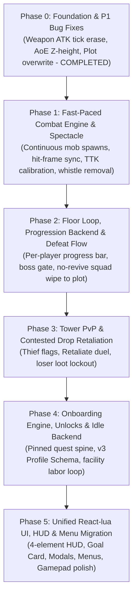

# Infinite Tower: Full Game Rework - Master Roadmap & Phase Index

**Project Title:** Infinite Tower - Full Game & Systems Rework  
**Target Architecture:** AFK Journey-style 3D Auto-Battler with Persistent Multiplayer Tower  
**UI Framework:** React-lua (`jsdotlua/react` + `react-roblox` 17.2.1)  
**Status:** In Progress (Phased Rollout)  

---

## 1. Roadmap Overview

---

## 2. Phase Index & Specifications

Each phase has its own detailed, self-contained implementation specification:

| Phase | Document | Focus Areas | Key Deliverables |
| :---: | :--- | :--- | :--- |
| **0** | [PHASE_0_FOUNDATION_AND_BUGS.md](PHASE_0_FOUNDATION_AND_BUGS.md) | Bug fixes & tooling | **COMPLETED & MERGED.** Fixed 5 critical P1 bugs; verified Rokit/Rojo/Wally setup; 14/14 tests passed. |
| **1** | [PHASE_1_COMBAT_PACING_AND_SPECTACLE.md](PHASE_1_COMBAT_PACING_AND_SPECTACLE.md) | Combat action & tempo | Continuous mob streamer, hit-frame damage synchronization, TTK tuning, damage numbers, complete removal of Q/E whistles. |
| **2** | [PHASE_2_FLOOR_LOOP_AND_DEFEAT.md](PHASE_2_FLOOR_LOOP_AND_DEFEAT.md) | Tower loop & failure | Globally shared floors, per-player kill progress tracking, boss summoning gate, full-copy boss loot, no-revive squad wipe to plot. |
| **3** | [PHASE_3_TOWER_PVP_RETALIATION.md](PHASE_3_TOWER_PVP_RETALIATION.md) | Tower PvP & Duels | Killer-tagged mob loot, [Loot Thief] flags, non-consequential retaliation duel, loser drop lockout. |
| **4** | [PHASE_4_ONBOARDING_AND_PROGRESSION.md](PHASE_4_ONBOARDING_AND_PROGRESSION.md) | Progression backend | `OnboardingConfig`, `OnboardingService`, v3 profile schema migration, system unlock gating, Fortress Development Tree (facility unlocks and upgrades), God's Blessing fountain facility (summon luck), inherent hero rarity with lowered hero odds, facility-only idle labor loop. |
| **5** | [PHASE_5_REACT_UI_AND_MENUS.md](PHASE_5_REACT_UI_AND_MENUS.md) | Complete UI/HUD/UX Overhaul | Modern React-lua root, 4-element persistent HUD, Goal Tracker card, Defeat/Duel/Claim modals, migrated menus (Forge, Squad, Pit, Facilities), gamepad navigation, retirement of legacy `HUDController`. |

---

## 3. High-Level Principles & Architecture Contracts

1. **Gameplay & Systems First, UI Last:** Gameplay loops, combat feel, and network contracts are fully developed and verified first so the React-lua UI can be built against real production state with zero throwaway mocks.
2. **Hands-Off Auto-Battling:** The Master explores and guides movement in 3D. Combat is 100% automatic—no manual skill taps, no formation management, no Q/E whistles.
3. **Server Authority:** All progression state (unlocked systems, onboarding step, floor clears, kill progress, inventory, currencies) is server-authoritative. The client sends intents; the server validates and replicates via delta snapshots.
4. **Clean HUD Limit (Max 4 Persistent Elements):**
   - Top-Center: Floor Progress Bar (transitions to Boss Health Bar).
   - Top-Left: Currencies (Gold, Gems) with readable font sizes and delta popups.
   - Top-Right: Pinned "Next Goal" Quest Card.
   - Bottom-Center: Navigation Toolbar with icons and badge indicators (unlocked systems only).
5. **Zero-Deadweight Systems:** All 10 existing systems are preserved but locked behind progressive milestone unlocks. New players see only 1–2 systems at a time.
6. **Low-Stakes Multiplayer:** Shared tower floors foster emergent encounters. Contested drops enable squad duels without wiping or teleporting either player; the loser is merely locked out of that single drop.
