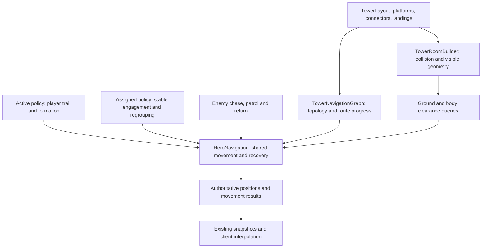

# Tower movement reliability implementation plan

Status: Phase 0 reproduction gate validated, 2026-11-05. See [baseline evidence](reviews/tower-movement/2026-11-05/README.md). Movement implementation and final acceptance testing are pending; moving render lag and full combat-load certification remain open.

Make all five heroes traverse ramps and platforms reliably during active floor runs and assigned-squad combat. Address route reversals, heroes falling behind, ramp seams, squad congestion, ineffective stuck detection, and recovery teleports together.

## Architecture decision

Use **one server-authoritative navigation solver**, with **separate destination policies** for active runs and assigned squads. Both policies use the same connector geometry, route progress, collision handling, avoidance, and recovery results. Enemy AI also calls `HeroNavigation`; it must retain working chase, patrol, and return behavior.

Destination policy answers where a unit should go. Navigation answers how to reach it and whether it is making progress. Recovery uses that result; a different combat state must not disable it.

## Investigation baseline

| Finding | Evidence and confidence |
| --- | --- |
| A moving goal can send a hero back to a ramp entrance | Reproduced in controlled floor-18 navigation probes. A topology example placed the goal 23 studs ahead while the rebuilt route's first point was 20 studs behind. `HeroNavigation.Step` rebuilds the tower route after the goal moves 14 studs and resets its cursor. |
| Different squad slots behave differently | Fourteen fixed-endpoint ramp directions passed on floor 18. Moving sprint destinations produced reversals and approximately 100-stud gaps for some slots while others followed cleanly. These were synthetic movement probes, not complete end-to-end gameplay tests. |
| Assigned squads share the affected solver | Confirmed in `CombatSimulation`. Their anchor follows a squadmate's enemy or another nearby enemy; chasing enemies also changes destinations. Assigned-mode reproduction with real combat is still required. |
| Combat pursuit lacks the follow-mode recovery check | `HeroStuckTracking` is cleared before `MOVE_TO_TARGET` navigation. Movement in any direction can reset follow-mode stuck detection, including unproductive shuffling. |
| Combat avoidance can stop units behind one another | Confirmed in source. Its contribution to assigned-squad failures needs a multi-unit playtest. |
| Ramp joins have incomplete lateral overlap | Layout endpoints overlap terrace edges by four studs along the centerline. Computed outer endpoint corners on diagonal links extend about 7.2-7.4 studs beyond terrace footprints. This identifies an awkward join; it does not by itself prove an open collision gap. |
| Landings are clearance reservations rather than constructed flat surfaces | `TowerLayout.Lanes` reserves landing areas; `TowerRoomBuilder` constructs sloped slabs or stair treads between endpoints. Full-width seam support needs Studio measurement. |
| Visual trailing has a separate contribution | Current source specifies a 0.10-second simulation tick and snapshots every two ticks. The renderer interpolates between snapshots. Measure actual timing and server/client separation before changing presentation. |

Existing traversal checks mainly use fixed destinations and platform-center approaches. Their passing results do not cover moving targets, all formation slots, diagonal joins, or assigned combat. The legacy material in `TOWER_NAVIGATION.md` describes an older tower implementation and is not the current source contract.

## Phase 0: reproducible scenarios and diagnostics

Deliver a small Studio harness before changing behavior. Use isolated test actors and test rooms, with deterministic cleanup. Capture real-time gameplay separately from fast mathematical probes; yielding path computations must be allowed to finish in integration tests.

- Preserve the floor-18 moving-goal reproduction, including slot offsets, direction reversals, and the hero already halfway along a connector.
- Reproduce assigned-squad failures during moving-enemy pursuit, enemy death, target switching, and return/regroup movement. Identify whether each failure is a route reversal, collision, bad ground selection, queue delay, or avoidance deadlock.
- Add optional Studio diagnostics for intent, destination identity, route revision, connector/direction/progress, waypoint cursor, requested versus consumed movement, blocked reason, path request age, recovery stage, and relocation reason.
- Measure server route lag, client visual lag, no-progress duration, backward travel, path compute latency, queue depth, and automatic relocations per hero. Keep diagnostics bounded and off normal production snapshot payloads.
- Establish profiler samples for navigation and squad policy under one squad, two squads meeting, and six active tower floors. Record actual tick/snapshot intervals and query counts.

**Exit:** a recorded active-run failure and an assigned-mode trace that identifies its cause. Save scripts and before/after evidence under `tests/studio-tower-movement.luau` and `docs/reviews/tower-movement/` as they are created.

## Phase 1: shared connector contract and better ramp joins

Primary files: `TowerLayout.luau`, `TowerRoomBuilder.luau`, and walkway/prop-clearance integration.

1. Extend each layout link with a stable connector ID, direction, usable width, flat landing extents at both ends, slope or stair section, and connection points. Keep these as shared layout data so geometry, navigation, patrols, and clearance consume the same description.
2. Construct full-width flat landings with supported, flared approaches into each terrace. Calculate overlap from the entire join footprint, including diagonal corners and the navigation body radius; replace the centerline-only four-stud assumption.
3. Match landing tops exactly to terrace surfaces. Position sloped deck surfaces from their actual top planes, accounting for slab thickness and rotation. Avoid exposed lips, unsupported shoulder triangles, and tiny ledges at either end.
4. Recalculate the remaining inclined run after adding flat landings. Preserve the existing maximum 15-degree slope and maximum one-stud stair rise. Choose landing lengths per connector so short links remain feasible. Treat the grand stair as its own connector shape with proper end landings.
5. Pull back or taper curb ends and provide room for turning. Include terrace bands, plinths, lanterns, and other solid scenery in the join audit. Clear the whole new landing and flare footprint, with body/headroom margins.
6. Mark traversable structures distinctly from removable decoration. Ensure prop removal and settling cannot delete or move a landing. Retain deliberate collision on rails and walls; decorative runners must not determine walkable height.
7. Audit non-link `BasinReturnRamp` joins too, so lower-basin recovery routes do not retain the same seam weakness.

**Exit:** Studio support and body-clearance sweeps pass across the center, both shoulders, and diagonal approaches in both directions on all five variants. Audit all 50 floors for biome-specific obstructions, supported spawns, and portal/sanctuary clearance. Verify player Humanoid traversal as well as lightweight entity traversal.

## Phase 2: shared routing, movement, avoidance, and recovery

Keep `HeroNavigation` as the existing integration facade. Extract pure topology/progress calculations into a proposed server module, `Core/TowerNavigationGraph.luau`, so CLI tests can exercise route behavior without pretending to simulate Roblox physics.

### Route continuity

- Classify a unit against both terraces and connector corridors, including height. A unit on a ramp retains its connector and directed progress instead of being snapped to the nearest terrace.
- Cache graph topology per layout variant and route state per unit/room generation. Store connector cursor, directed segment progress, destination identity, and route revision.
- Update the terminal destination without restarting an already valid route. Rebuild the untraversed portion when topology, destination region, obstruction, or explicit movement intent requires it.
- A same-direction goal update must not insert an entrance behind a unit already on that connector. Support genuine player reversals explicitly; progress is monotonic within a route direction, not across a deliberate U-turn.
- Use corridor- and height-aware waypoint reach/pass checks. Avoid skipping an upper waypoint merely because its horizontal position is close. Validate any shortcut across its entire intended span; a clear first 36 studs cannot certify a longer route.

### Local movement and path fallback

- Spend a tick's movement budget across successive waypoints and corners, preserving unused distance when a waypoint is reached early. Keep bounded substeps and full body sweeps.
- Define one coordinate contract: entity positions and navigation goals are feet positions. Convert player root positions at the boundary. Migrate `PlaceNear` callers explicitly so existing root-position callers remain correct.
- Separate grounded walking from an intentional jump/fall. Use actual elapsed time for descent rather than the existing fixed `0.2` assumption. Ground checks must respect the current support layer instead of selecting another terrace beneath a bridge. Keep visual jump offsets from corrupting ground-route progress.
- Keep Roblox path computation asynchronous and bounded. Use a fair, deduplicated request queue so busy floors cannot indefinitely starve a hero; stay within the current concurrency ceiling until profiling supports a change.
- Tag requests with room/entity generation, movement intent, and route revision. Discard stale results after recall, assignment change, target replacement, despawn, or room rebuild. A failed path returns a reason and bounded retry/backoff.
- Preserve a compatible call path for `TowerEncounterRuntime`; expose movement results such as advancing, arrived, blocked, waiting for path, or unreachable. Use actual progress, not just collision-query success, for these results.

### Avoidance and recovery

- Make local avoidance aware of connector direction and usable width. Give units stable yielding priority, bounded side movement, and a way out of head-on deadlocks. Reset yielding after separation.
- Audit the navigation state's actor set: it contains enemies as well as heroes. Scope avoidance by room/generation and entity relationship; follow, chase, and return must all remain viable.
- Apply one progress monitor to all movement intents, including combat pursuit. Pause it for legitimate stationary states such as attacking, intentional waiting, and downed heroes.
- Measure remaining distance along a stable route revision and connector advancement over time. Sideways motion, small oscillations, target jitter, and a local replan must not erase an ongoing failure. Meaningful destination changes should establish a new progress baseline.
- Escalate through bounded local correction, route refresh, and policy-level failure handling. The active policy can regroup a follower; the assigned policy can abandon a temporarily unreachable enemy and select another reachable objective.
- Keep automatic relocation as a logged last resort. Use a validated supported regroup location in the same room and generation; do not teleport units into attack range or across an otherwise untraversable obstacle. Keep invalid-world-position rescue distinct from ordinary lag or a legitimate long route. Preserve explicit Emergency Recall behavior.
- Clear navigation, queue entries, avoidance, and recovery state on lifecycle transitions. A mode switch must not inherit an old combat route or stale stuck timer.

**Exit:** moving-goal reversals are eliminated; a shuffling or blocked pursuer enters bounded recovery; no actor retains a stale async route after a generation/intent change. Enemy chase, return, and patrol regressions pass before enabling new squad policies.

## Phase 3: active floor-run destination policy

Extract destination policy into a proposed `Combat/SquadMovement.luau` module, integrated from `CombatSimulation`. Compute shared squad inputs once per tick, then keep per-hero route cursors and formation slots.

1. Maintain a bounded server-sampled trail of supported player travel through the current room, with distance/time sampling and connector transitions. Never record travel teleports as walkable trail segments. Prune/reset on room changes, recall, respawn, and assignment.
2. Use safe forward lookahead along that trail for followers. Permit shortcuts only after validating support, body clearance, and matching elevation. Fall back to the connector graph when the player jumps a gap that heroes cannot walk.
3. Project formation targets into the usable corridor. Compress formation smoothly on ramps and expand on landings/platforms. Use stable lateral slots and supported targets so heroes neither cut unsupported corners nor collapse to one fallback point.
4. Preserve sprint detection and bounded catch-up speed, but consume the budget along the route. Measure server path lag independently of intentional formation spacing and client interpolation delay.
5. Preserve the existing focus, disengagement, pacify, and combat rules. When leaving combat, rejoin a suitable forward trail point rather than restarting at an obsolete entrance or an inaccessible offset beside the player.

**Exit:** all five slots complete repeated walk/sprint, stop/start, corner, and U-turn scenarios without unintended route reversals or automatic recovery teleports on an unobstructed route.

## Phase 4: assigned-squad destination policy

Use the same `SquadMovement` policy boundary and shared navigation. Assigned movement must operate independently of the owner's sprint state and physical location.

1. Compute a consistent engagement/regroup anchor once per squad tick. Retain the chosen engagement while valid; replace the current per-hero scan of whichever squadmate/enemy happens to be encountered first.
2. Preserve per-hero combat targets and role-specific attack ranges. Stabilize the squad objective without forcing every hero onto the same physical point or rewriting existing focused-target priorities.
3. When an enemy dies or leaves its allowed area, select the next eligible objective using connector connectivity and route cost. Use cached reachability and bounded checks; do not compute a Roblox path for every candidate every tick.
4. Add temporary, generation-scoped exclusion for an unreachable target after recovery fails. Clear it when conditions change or the retry interval expires. Reconsider alternative supported attack positions before rejecting a target that could be attacked from range.
5. Regroup idle or recovering heroes on a reachable landing/platform associated with the current engagement. A stranded hero must not drag the entire squad's anchor backward through an average-position feedback loop.
6. Allow regrouping and target changes while the owner is on another floor or in the hub. Keep room isolation, squad assignment, leash, sanctuary, boss-lock, and progression eligibility checks in force.

**Exit:** a stationed squad completes repeated eligible camp cycles and target-death transitions across connected terraces, including with its owner elsewhere. A deliberately unreachable enemy cannot stall the squad indefinitely. Champion/boss scenarios are exercised through their existing eligibility rules.

## Phase 5: presentation, complete validation, and documentation

First compare authoritative hero positions against rendered positions. Adjust `EntityRenderer` only if measurable visual trailing remains after the movement fixes.

- Review interpolation at ramp/landing transitions so visual positions remain consistent with supported walking. Prevent the rendered chord between snapshots from visibly cutting through stairs or terrain at a sharp transition.
- Keep teleport snapping and ordinary movement distinct. Any new discontinuity signal must be justified by evidence and covered by protocol tests; measure existing generation behavior first.
- Keep the current simulation/snapshot rates for the initial fix. A higher replication rate or client movement prediction needs its own measured benefit and bandwidth check.
- Update GDD sections 3.3 and 4.5, `TOWER_NAVIGATION.md`, and the relevant tower documentation index to describe implemented contracts, movement modes, recovery, and actual verification evidence. Correct obsolete timing claims in touched comments/docs. Add intended behavior only when its implementation lands.

### Verification matrix

| Area | Required cases |
| --- | --- |
| Pure logic | Mid-ramp destination updates, preserved route suffix/cursor, reverse direction, height-aware classification, route cost, remaining-distance progress, stale request rejection, recovery timing, and assigned objective stability. Use the existing CLI runner and small injected dependencies. |
| Geometry | All five variants; every link both ways; full usable width; diagonal entry/exit; start/end seams; stairs and basin returns; body/headroom clearance; all 50 biome floors for scenery and spawn regressions. |
| Active run | Five slots; normal walk and sprint; overdrive/cargo speed changes; stop/start; U-turns and rapid corners; hero initially 20-40 studs behind; combat disengagement; focus and recall; jumping on/off ramps. |
| Assigned squad | Owner present and absent; moving enemies; target death/respawn; nearest enemy across a chasm; blocked or unreachable enemy; mixed melee/ranged heroes; idle regrouping; interrupted assignment. |
| Congestion | All five heroes entering together; hero catching a slower ally; two squads passing/head-on; heroes and mobs sharing a ramp; an obstacle appearing while a path is pending. |
| Lifecycle | Recall, visit/assign changes, floor regeneration, room retirement, owner respawn/leave, entity removal, and late join. No stale trails, routes, targets, or queue entries. |
| Enemies | Existing patrol routes, chase and home return, elite groups, boss movement, displacement, and supported spawns. |
| Performance/render | Repeat baseline loads, six active floors, two clients viewing the same floor, and representative latency/jitter. Record server route lag separately from snapshot and render lag; check bounded memory and request queues. |

### Acceptance gates

- Twenty consecutive traversals per variant and movement mode with all five slots: zero unintended entrance returns, unsupported moves, unrecovered stalls, or automatic recovery relocations on an unobstructed route. Deliberate U-turns and explicit Recall are reported separately.
- Forced blockage produces an initial recovery action within one second and a defined replan/alternative-objective decision within three seconds of sustained no progress. Legitimate attacks and explicit waits are excluded.
- Initial active-run target: per-hero 95th-percentile server lag of at most 20 studs along the intended route during uninterrupted sprint tests on an ideal connection, accounting separately for intended formation/trail spacing. Any adjustment to this target needs measured rationale, not a wider teleport leash.
- All geometry, pure logic, target-selection, lifecycle, and enemy regressions pass. Assigned squads make progress through eligible objectives with no indefinite unreachable-target lock.
- Navigation/policy 95th-percentile server cost increases by no more than 10% against the same baseline load; request concurrency remains bounded, and repeated room/assignment cycles do not grow retained state. Investigate and resolve failures rather than hiding them by raising update rates.
- Run `pwsh tests/run.ps1` and `rojo build -o build.rbxl`; use Rojo live sync and verify source/Studio parity before the final playtest. Save Studio traces, assertions, profiler comparisons, and short captures with the tested source revision. CLI success alone is not movement certification.

## Planned file changes

Paths below are relative to the repository root. New filenames are proposed implementation boundaries.

| File | Work |
| --- | --- |
| `src/ReplicatedStorage/Shared/Config/TowerLayout.luau` | Connector IDs, physical landings, usable corridors, shared clearance data; preserve/adapt patrol consumers. |
| `src/ServerScriptService/Core/TowerRoomBuilder.luau` | Construct flush full-width joins, flat landings and flares; taper curbs; audit stairs and return ramps. |
| `src/ServerScriptService/Core/TowerPropClearance.luau` | Adapt only where needed for new landing/approach footprints and structural exclusions. |
| `src/ServerScriptService/Core/TowerNavigationGraph.luau` (new) | Pure connector membership, routing, directed progress, and remaining-distance calculations. |
| `src/ServerScriptService/Core/HeroNavigation.luau` | Shared solver, request queue, consistent coordinates, avoidance, movement results, and recovery. |
| `src/ServerScriptService/Combat/SquadMovement.luau` (new) | Active trail/formation policy and assigned engagement/regroup policy, with explicit lifecycle reset. |
| `src/ServerScriptService/Combat/CombatSimulation.server.luau` | Integrate squad policy once per tick; unify follow/chase recovery; migrate goal-coordinate callers. |
| `src/ServerScriptService/Combat/HeroTargeting.luau` | Feed policy reachability/exclusions into existing selection without changing combat eligibility. |
| `src/ServerScriptService/Combat/TowerEncounterRuntime.luau` | Adapt shared movement inputs/results only as necessary; retain enemy behavior. |
| `src/StarterPlayerScripts/Rendering/EntityRenderer.client.luau` | Evidence-driven presentation adjustments after authoritative movement passes. |
| `tests/tower-navigation.spec.luau`, `tests/squad-movement.spec.luau` (new) | Behavioral regressions for topology, progress, recovery, and both policies. |
| `tests/tower-rework.spec.luau`, `tests/hero-targeting.spec.luau`, `tests/run.ps1` | Extend contract/selection coverage and register new pure modules/specs. |
| `tests/studio-tower-movement.luau` (new), `tests/studio-tower-rework.luau` | Timed movement reproduction, multi-actor scenarios, and full-width geometry validation. |
| `docs/GAME_DESIGN.MD`, `docs/TOWER_NAVIGATION.md`, `docs/tower-rebuild/README.md` | Implemented design, current navigation entry point, and verification links. |

## Implementation sequence

1. Baseline harness and diagnostics (Phase 0).
2. Connector contract, physical joins, and geometry verification (Phase 1).
3. Shared routing, avoidance, async handling, and recovery, including enemy compatibility (Phase 2).
4. Active-run destination policy (Phase 3).
5. Assigned-squad destination policy and target-failure handling (Phase 4).
6. Full acceptance pass, any justified rendering work, and documentation (Phase 5).

Keep each change reviewable with its own relevant checks. Final certification requires the complete sequence; geometry-only or sprint-speed-only improvements do not resolve the reported failure modes. The first implementation action is the reproduction harness, not tuning movement speed or teleport thresholds.
