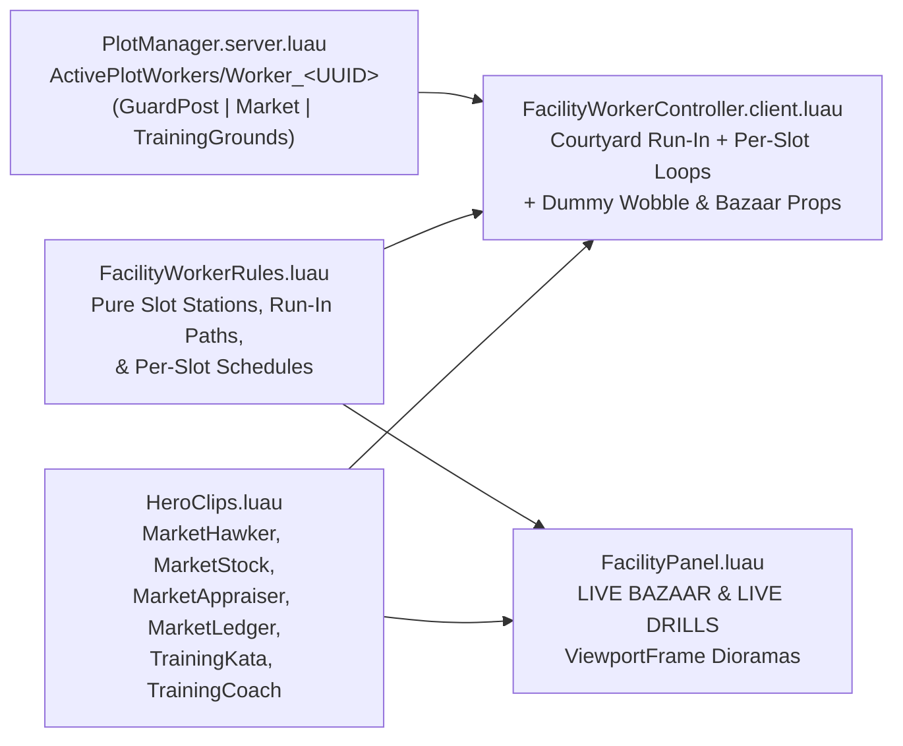

# Training Grounds & Market Worker Visual Loop Implementation Plan

## 1. Overview & Goals
Add a continuous physical and visual worker loop for **The Market** (`Building_Market`) and **Training Grounds** (`Building_TrainingGrounds`) on every player's Fortress Plot (`Plot_1..6`) and inside their `FacilityPanel` UI:

1. **Physical In-World Workers (`Plot_1..6`):** Stationed Merchants and Trainers appear physically inside `Building_Market` and `Building_TrainingGrounds` as full costumed R15 hero rigs (`ArtPackVisuals` + `HeroLoadout` + `HeroAnimator`) with **no overhead `BillboardGui`s**.
2. **Courtyard Run-In on Assignment:** Assigning a worker while on the plot spawns the hero at the Central Courtyard Plaza edge and jogs them along obstacle-free paths right into their assigned Market stall or Training Grounds station, playing a deployment ring + sparkle burst on arrival.
3. **Distinct Per-Slot Loops & Animations (`Slot 1..4`):** Both facilities support up to **4 worker slots** (`Lv.5` base 3 workers + Fortress Tree perk `Extra Stall` / `Drill Sergeant` = 4 workers). Every slot (`1..4`) has its own spatial station, prop interaction, and custom keyframed animation loop so two workers in the same facility never mirror the same routine.
4. **Live Looping `ViewportFrame` Stage in `FacilityPanel`:** Opening **The Market** (`LIVE BAZAAR`) or **Training Grounds** (`LIVE DRILLS`) displays a live looping 3D diorama of stationed workers performing their per-slot animations, pulsing the border and triggering an immediate flourish whenever a hero is assigned.

---

## 2. Per-Slot Visual & Physical Loops

### A. The Market (`Building_Market`)
`Building_Market` sits at plot-local `CFrame.new(74, 0, 44) * CFrame.Angles(0, math.rad(-145), 0)` with 4 U-shaped stalls facing `+Z` (toward the courtyard plaza), display trays, stools, crates, and barrels:

| Slot | Architectural Station (`marketCF`-local) | Role | Physical Movement & Prop Loop | Custom Clip / Animation |
| :--- | :--- | :--- | :--- | :--- |
| **Slot 1** | `Stall_RedAmber` `(-11.5, 0, -3.5)` rot `+28°` | **Bazaar Hawker** | Sidesteps laterally behind the Red/Amber counter (`x = -2.0 ↔ +2.0`) checking the 3 relic trays, then steps center to call out deals with rising gold shimmer motes. | `MarketHawker` (looped): wide merchant arm sweep across the counter, cupped callout gesture, lively waist/head scan. |
| **Slot 2** | `Stall_TanLeft` `(-4.2, 0, -8.5)` rot `+8°` ↔ `MarketCrate_3` `(1.5, 0, -5.5)` / rear barrels | **Crate Hauler & Stockist** | Walks from behind `Stall_TanLeft` to the rear supply crates, hoists a procedural 3D **wooden relic crate** (`Carry` locomotion), hauls it back to the counter, sets/arranges goods with a warm dust + coin puff, and repeats. | `Carry` (while hauling crate) → `MarketStock` (looped counter stocking & sorting motion). |
| **Slot 3** | `Stall_TanRight` `(6.2, 0, -8.0)` rot `-12°` ↔ rear barrel `(9.6, 0, -10.2)` | **Relic Appraiser** | Leans over `Stall_TanRight`'s middle tray holding a procedural **glowing relic orb / brass scale** up to eye level (emitting periodic appraisal glint sparks), periodically stepping back to the barrel to log stock. | `MarketAppraiser` (looped): left hand raises relic to eye line, head tilts in close inspection, right hand weighs/balances. |
| **Slot 4** *(Extra Stall)* | `Stall_GreenWhite` `(12.5, 0, -1.5)` rot `-38°` ↔ `MarketCrate_2` `(11.8, 0, 5.4)` | **Ledger & Coin Counter** | Stands behind `Stall_GreenWhite` with an open **gilded merchant ledger** prop in the left hand while counting/tossing coins with the right, alternating with an inspection walk out to front-right `MarketCrate_2`. | `MarketLedger` (looped): left forearm holds open ledger, right hand scribes entries and counts coin stacks. |

* **Assignment Run-In Path (Plot-Local):** `(20, 0, 8)` (east of Plaza Fountain) → `(46, 0, 24)` → `(66, 0, 34)` (Bazaar cobblestone entrance) → assigned Stall `1..4`.
* **Coma / Resting Behavior:** Resting Merchants walk behind their stall's wooden stool (`stallCF * CFrame.new(0, 0.3, -1.4)`) and play a seated/resting breather until recovered.

---

### B. Training Grounds (`Building_TrainingGrounds`)
`Building_TrainingGrounds` sits at plot-local `CFrame.new(-58, 0, 46)` (`RotationY = 0`) with a 28-stud cobblestone combat ring (`Y = 0.56`), 4 straw `TrainingDummy_1..4` posts at radius `9.6` (`35°`, `125°`, `215°`, `305°`), a `+Z` freestanding `BullseyeRedCenter` target `(0, 4.1, 11.8)`, and 2 SW weapon racks:

| Slot | Arena Station (`trainCF`-local) | Role | Physical Movement & Prop Feedback Loop | Custom Clip / Animation |
| :--- | :--- | :--- | :--- | :--- |
| **Slot 1** | Eastern Arc: `Dummy_1` `(5.4, 0.56, 3.8)` ↔ `Dummy_4` `(3.8, 0.56, -5.4)` | **Dummy Combo Striker** | Footwork-jogs to `Dummy_1`, unleashes a 3-hit martial weapon combo (`AttackBasic` → `AttackSpecial` → `AttackSkill`) where each `Release` marker **physically wobbles the straw dummy** + bursts straw/sparks, then rotates to `Dummy_4` and repeats. | Equipped weapon `Move` + chained `AttackBasic` / `AttackSpecial` / `AttackSkill` combos at rhythmic drill cadence. |
| **Slot 2** | Bullseye Firing Line: `(-1.8, 0.56, -1.5)` ↔ `(1.8, 0.56, -1.5)` aiming `+Z` at `(0, 4.1, 11.8)` | **Bullseye Precision Drill** | Shifts between left and right firing marks facing the `+Z` red-and-white bullseye, firing ranged projectiles (`BOW`/`STAFF`/`TOME`) or weapon shockwave slashes (`SkillVfx.Play`) straight into `BullseyeRedCenter` with bullseye impact rings. | Weapon `AttackBasic` / `AttackSpecial` volleys interleaved with `TrainingKata` form resets between marks. |
| **Slot 3** | Western Inner Circle `(-4.2, 0.56, 0.5)` ↔ `Dummy_3` `(-5.4, 0.56, -3.8)` ↔ SW Weapon Rack `(-8.8, 0.56, -4.8)` | **Kata Forms & Weapon Check** | Performs continuous martial kata sweeps & horse-stance blocks in the western ring, lunges at `Dummy_3` with a wind-arc ring, then walks to the SW Weapon Rack to inspect blades before returning to the mat. | `TrainingKata` (looped): low horse-stance drop, deliberate dual-arm block sweep, crisp forward martial form extension, return to guard. |
| **Slot 4** *(Drill Sergeant)* | Command Arc `(0, 0.56, -6.2)` ↔ `Dummy_2` `(-3.8, 0.56, 5.4)` | **Drill Sergeant / Arena Coach** | Paces the command arc overlooking Slots 1–3 with crimson/gold cadence rings pulsing underfoot, then steps up to `Dummy_2` (`125°`) to demonstrate a heavy `AttackSkill` strike (rattling `Dummy_2`) before resuming command watch. | `TrainingCoach` (looped): upright drill-master posture, left arm behind back, torso scan across the ring, sharp right-arm command point. |

* **Assignment Run-In Path (Plot-Local):** `(-18, 0, 6)` (west of Plaza Fountain, clear of Command Post) → `(-42, 0, 22)` → `(-58, 0, 31)` (`-Z` fence gap entrance) → assigned Arena Station `1..4`.
* **Coma / Resting Behavior:** Resting Trainers step to the perimeter bench/curb (`(-9.5, 0.52, -9.5)`) and rest out of the active sparring lanes.

---

## 3. Architecture & File Changes

### 1. [NEW] `src/ReplicatedStorage/Shared/Util/FacilityWorkerRules.luau`
* Pure `--!strict` configuration & math module (kept free of CLI-unshimmed `Vector3` methods like `.Magnitude` or `:Lerp` so `tests/run.ps1` runs natively).
* Defines exact `Market` and `TrainingGrounds` plot-local centers/rotations (sourced from `FacilityConfig.FacilityLayout`), courtyard run-in waypoint arrays, rest positions, and `Slot 1..4` station/waypoint definitions (`Role`, `PrimaryClip`, `Waypoints`, `PropKind`, `DummyIndex` / `TargetLocal`).

### 2. [MODIFY] `src/ReplicatedStorage/Assets/HeroRig/HeroClips.luau`
* Add 6 seamless looped shared facility clips to `SHARED_STATES`, `LOCOMOTION_STATES`, and `Shared`:
  * `MarketHawker`, `MarketStock`, `MarketAppraiser`, `MarketLedger`
  * `TrainingKata`, `TrainingCoach`
* Every clip obeys all `tests/hero-rig.spec.luau` invariants (`T = 0..1` strictly increasing, `samePose(first, last)`, valid `HeroRigSpec` joint names, knee `X <= 5`, elbow `X >= -5`, rotations in `[-180, 180]`).

### 3. [MODIFY] `src/ServerScriptService/Core/PlotManager.server.luau`
* Generalize `PlotManager.RefreshPlotVisuals(player)` so `Plot_N.ActivePlotWorkers` diff-updates `Worker_<UUID>` `Configuration` instances across **`GuardPost`**, **`Market`**, and **`TrainingGrounds`** (skipping `Market` / `TrainingGrounds` when their Fortress Tree `Level <= 0`).
* Preserve the zero-churn update pattern (`Facility = "GuardPost" | "Market" | "TrainingGrounds"`, `Slot = 1..4`) so 10s passive Gold `SyncProfile` ticks never recreate worker rigs or interrupt slot animations.
* Note: `AdventurerPatrolController.client.luau` already filters `if child:GetAttribute("Facility") ~= "GuardPost" then continue end`, so Outskirts behavior remains untouched.

### 4. [NEW] `src/StarterPlayerScripts/Rendering/FacilityWorkerController.client.luau`
* Watches `Workspace.WaitingRoomPlots` (`Plot_1..6`), `ActivePlotWorkers`, and `FacilityLevel_Market` / `FacilityLevel_TrainingGrounds` attributes.
* Spawns costumed R15 hero rigs (`ArtPackVisuals.Attach` + `HeroLoadout.Equip` + `HeroAnimator`) in `Workspace.AdventurerVisualEntities` with **no `BillboardGui`s**:
  * **Market workers:** Equips lightweight procedural merchant props (`MerchantCrate` during Slot 2 haul, `RelicOrb` on Slot 3, `GildedLedger` on Slot 4) when in stall work states; emits subtle gold coin/glint motes via `VfxPrimitives`.
  * **Training Grounds workers:** Equips the hero's weapon (`HeroLoadout.Equip`), drives Slot `1..4` routines, fires `SkillVfx.Play` on Slot 1/2/4 weapon markers, and applies a damped spring tilt wobble + straw burst VFX to `Building_TrainingGrounds`'s `DummyTorso_N` / `DummyCrossbar_N` / `DummyHead_N` parts on impact.
* Includes camera-distance throttling (`> 220` studs at `15 Hz`) and Tower-floor parking (`> 480` studs), plus `_G.FacilityWorkerState` telemetry for Studio playtest assertions.

### 5. [MODIFY] `src/StarterPlayerScripts/UI/Hud/FacilityPanel.luau`
* Extend the `ViewportFrame` preview stage (currently Guard Post only) to render tailored live dioramas for **`Market`** and **`TrainingGrounds`**:
  * **Market (`LIVE BAZAAR` · `LV.<N> · <N> STALLS ACTIVE`):** Cobblestone apron + striped stall counter + relic crates + up to 4 stationed Merchants simultaneously playing their exact slot animations (`Slot 1` hawking, `Slot 2` stocking crate, `Slot 3` appraising relic, `Slot 4` writing in ledger).
  * **Training Grounds (`LIVE DRILLS` · `LV.<N> · +<X>% SQUAD ATK & HP`):** Cobblestone ring plinth + straw training dummy + bullseye target + up to 4 stationed Trainers simultaneously playing their slot-specific drills (`Slot 1` dummy combo + dummy wobble, `Slot 2` bullseye volley, `Slot 3` kata forms, `Slot 4` drill coach).
* Trigger `deploySerial` on `Market` and `TrainingGrounds` assignments (in addition to `GuardPost`) so assigning a worker flashes the border in the facility's accent color (`Bronze` / `Crimson`) and plays an immediate celebratory flourish/strike in the preview stage.

### 6. [NEW] `tests/facility-workers.spec.luau` & [MODIFY] `tests/run.ps1`
* Register `FacilityWorkerRules.luau` and `facility-workers.spec.luau` in `tests/run.ps1`.
* Verify:
  1. All 4 Market slots and all 4 Training Grounds slots map to distinct `PrimaryClip` / `Role` definitions and non-overlapping spatial stations inside their respective facility footprints.
  2. Courtyard run-in paths stay clear of `PlazaFountain` (radius `16`) and stay within courtyard island bounds (`[-125..125, -85..85]`).
  3. All 6 new `HeroClips` states pass `tests/hero-rig.spec.luau` keyframe, joint-limit, and seamless-loop checks.

---

## 4. Verification Plan
1. **CLI Compile & Spec Suite:** Run `pwsh tests/run.ps1` (verifying `hero-rig.spec.luau`, `outskirts-waves.spec.luau`, `facility-workers.spec.luau`, and full 62+ KLOC strict Luau compilation).
2. **Rojo Build Check:** Run `rojo build -o build.rbxl` to confirm clean project build.
3. **Live Roblox Studio MCP Playtest:**
   * Sync scripts to Studio and start Play mode.
   * Unlock/verify `Market` and `TrainingGrounds` on `Plot_1`, assign workers across `Slot 1..4` in both facilities, and verify:
     * Newly assigned heroes jog from the Courtyard Plaza into their specific Market stall or Training Grounds station.
     * Each slot plays its distinct animation + prop feedback (crate hauling, ledger, dummy wobble, bullseye hits) with **zero `BillboardGui`s**.
     * Opening `Market` and `TrainingGrounds` in `FacilityPanel` displays the live `ViewportFrame` dioramas (`LIVE BAZAAR` and `LIVE DRILLS`) with zero console warnings/errors.
